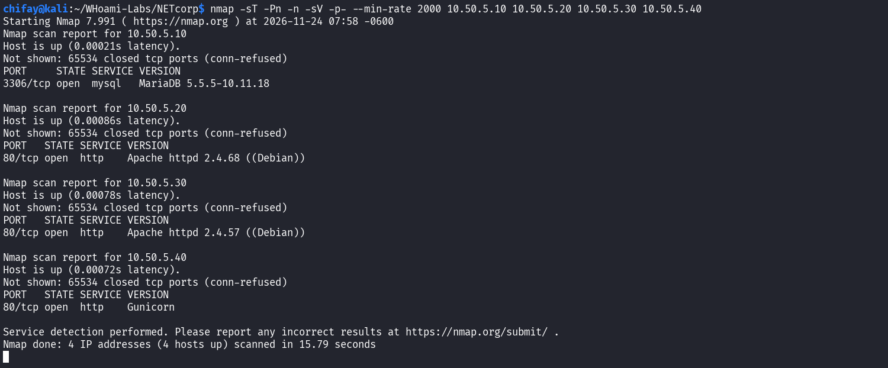

# NETcorp — Auditoría de Seguridad Ofensiva

**Evaluación black-box de la superficie web corporativa**

## Descripción

Este repositorio contiene el informe público de una auditoría de seguridad ofensiva externa sobre la superficie web de NETcorp. La evaluación se realizó sin credenciales ni acceso previo al código fuente y cubrió el portal corporativo, el WordPress de marketing y la API de comercio.

| Campo | Valor |
|---|---|
| **Cliente** | NETcorp |
| **Analista** | chifay |
| **Fecha** | 24 de noviembre de 2026 |
| **Tipo** | Auditoría externa black-box |
| **Riesgo global** | Crítico |
| **Clasificación** | Público — versión saneada |

La combinación de una inyección SQL, credenciales administrativas por defecto, lectura arbitraria de archivos, una base de datos expuesta y un IDOR en la API permitió obtener credenciales corporativas, acceder a información privada, ejecutar código como `www-data` y extraer datos de clientes.

## Hallazgos principales

| ID | Hallazgo | Severidad | CVSS 3.1 |
|---|---|---|---|
| F-01 | Inyección SQL en el inicio de sesión del portal | **Crítica** | 9.8 |
| F-02 | IDOR en el perfil de empleado | Media | 6.5 |
| F-03 | Credenciales de administrador de WordPress por defecto | **Crítica** | 9.8 |
| F-04 | Path traversal / lectura arbitraria de archivos | **Alta** | 7.5 |
| F-05 | MariaDB expuesto en red con credenciales válidas | **Alta** | 8.8 |
| F-06 | IDOR no autenticado en la API de cestas | **Alta** | 7.5 |
| F-07 | Ejecución remota de código mediante carga de plugins | **Alta** | 7.2 |
| F-08 | Divulgación de información y errores verbosos | Media | 5.3 |
| F-09 | Ausencia de cabeceras de seguridad y cookies sin atributos | Media | 4.3 |
| F-10 | XML-RPC habilitado y enumeración de usuarios | Media | 5.3 |

## Contenido

| Archivo | Descripción |
|---|---|
| [Fuente Markdown](report/Informe_Auditoria_NETcorp.md) | Texto fuente del informe. |
| [Evidencias](screenshots/) | Capturas de terminal 01–11. |

## Evidencias

| Evidencia | Descripción |
|---|---|
| [01](screenshots/01_recon_nmap.png) | Descubrimiento de puertos y servicios |
| [02](screenshots/02_portal_sqli.png) | Bypass de autenticación por SQLi y consulta expuesta |
| [03](screenshots/03_portal_idor.png) | IDOR en perfiles de empleados |
| [04](screenshots/04_portal_dump.png) | Extracción de la tabla de usuarios del portal |
| [05](screenshots/05_wp_admin_flag.png) | Acceso a WordPress y página privada con la bandera |
| [06](screenshots/06_wp_lfi.png) | Path traversal y lectura de archivos |
| [07](screenshots/07_db_exposure.png) | Acceso a MariaDB y volcado de hashes |
| [08](screenshots/08_api_idor.png) | IDOR en la API de cestas |
| [09](screenshots/09_wp_rce.png) | Ejecución de comandos como `www-data` |
| [10](screenshots/10_hardening.png) | Cabeceras, cookies y XML-RPC |
| [11](screenshots/11_validacion_flag.png) | Validación de la bandera |

## Sanitización

Esta es una versión saneada para difusión pública. Se han ocultado contraseñas y credenciales sensibles, hashes, identificadores de sesión, notas internas y el contenido de la bandera. Las capturas conservan los comandos y resultados necesarios para reproducir la metodología, con esos valores difuminados.

## Metodología

La evaluación siguió un enfoque black-box: reconocimiento, enumeración, análisis de vulnerabilidades, explotación controlada y post-explotación. No se realizaron pruebas de denegación de servicio ni acciones destructivas sobre los datos.

## Aviso

Este material se publica con fines educativos y de divulgación técnica. Los nombres, dominios, direcciones y datos incluidos pertenecen al alcance autorizado de la evaluación.
